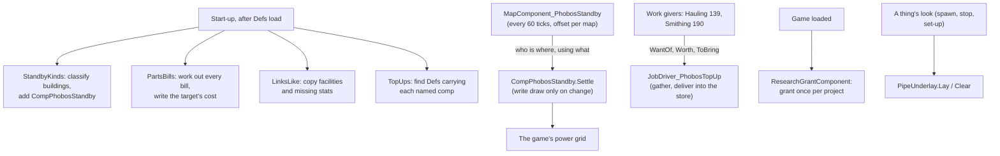

# Power, top-up and machines

**Status (23 Nov 2026):** living; written from the code at D'thorga Framework 0.271.0. Built: standby power, topping up
machines, mechanoids and vehicles, parts bills for placed buildings, the D'thorga research tab with its one-time grant and
set-aside tabs, pipes and conduits beneath our things, linking like another building, building over what lies under the
floor, and bulk holds. **Passed in game by the owner:** rows 341 (standby power), 190 and 383 (drone platforms topped up), 130
(no conduit over a vehicle's wiring); row 26 in part (the grant and the research refusal). **Not yet tested in game:**
everything else, including rows 83, 87, 255, 428 and 448.

This page says how the Framework's shared machinery for buildings works now: what powers them, what fills them, what they are
built from, what lies beneath them and what research they wait for. Building upgrades are on [stations, yard and
depots](stations-yard-and-depots.md); vehicle parts, their bills and upgrade trees on [upgrades and
fittings](upgrades-and-fittings.md). Why it is this way is in the [decision log](../decisions/power-and-machines.md) and the
[records](#why-it-is-this-way). How to use it from another mod is in [D'thorga Framework for modders](../../framework-modding.md).

## Read this first (gotchas)

- **Everything here finds other mods' things by what they are, never by their names.** Standby power takes up any powered
  workbench, turret, door or light; topping up names another mod's comp by its class and members, read by name; a parts bill
  takes another mod's part by role and size. No other author's assembly is referenced.
- **Standby power stands down by itself** beside LightsOut or Turn It On and Off - RePowered, which do the same job, and for any
  building whose draw another mod sets.
- **Standby power only ever lowers a draw.** In use, a building draws exactly its listed power; idle, a share of it (10 % by
  default); a light that is off, nothing. Nothing is saved: the game resets every draw from its Def when a map loads.
- **Topping up is hauling work just below refuelling** (priority 139 against the game's 140), and mechanitor work for
  mechanoids. Only a mechanoid is held while it is topped up; a building or a vehicle never is, so a drone walking home or a
  pilot boarding is never blocked. Two haulers never bring the same load.
- **A topping-up Def that no longer fits the code it names stands down**, with one line in the log saying why. Another author's
  update can break the names.
- **Parts bills are worked out once at start-up.** "Parts for building" takes effect at the next start. Removing a bill puts a
  building back at its XML cost.
- **Pipes and conduits beneath our things are ordinary hidden pieces** of the network, laid only where there is none, and refund
  nothing when taken apart. If the mod is removed, what is left is ordinary pipe or conduit.
- **The research grant is once per project per colony**, and only when every project it replaces was already finished.

## What it does

### Standby power

Idle buildings draw a share of their power, and lights in empty rooms go dark.

| Kind (`StandbyKind`) | Found by | In use while |
| --- | --- | --- |
| Light | A plain building that glows, needs no ticking, has no schedule and is not a sun lamp | Someone awake, not hostile, is in its room (indoors only) |
| Machine | A workbench or research bench | Someone's job is at it and they stand at its interaction spot, or beside it |
| Watch | A building with a recreation kind (a television) | Someone is watching it, from wherever they sit |
| Turret | A powered turret | It has a target |
| Grower | A plant grower (a hydroponics basin) | Anything grows in it |
| Facility | A building with a facility comp (a vitals monitor) | A bed it serves is occupied, or a building it serves is in use |
| Door | A powered door | It stands open |

- **Found once at start-up** (`StandbyKinds`): only buildings whose power comp is exactly the game's `CompPowerTrader` and that
  draw power. Generators, batteries and comps of other classes manage their own draw. A `PhobosStandbyExtension` on a Def can
  keep standby power off (`never`) or take a building up as a chosen kind.
- **The draw**: listed power in use; the standby share idle (0, 5, 10, 20 or 30 %; 10 % by default; the rule caps it at 50 %);
  nothing for a light that is off. The figure is written into the game's own power comp only when it changes, so the grid reads
  it as any other.
- **Lights** ask the game to relight them through the game's own question (`IThingGlower.ShouldBeLitNow`): no patch. Outdoor
  lights are left alone. A sleeper lights nothing; animals light rooms only with "Animals turn the lights on".
- **Only the player's buildings.** Another faction's are always at full power.
- **Another mod's draw is respected**: a draw found that is neither the one last written, the listed power nor nothing means
  another mod sets it, and standby power leaves that building alone until it is built again.
- **The inspect pane says why** a building is on standby: dark, no target, nothing growing, nothing served, closed, or idle.

### Topping up

Some machines hold a store of a material and offer only a right-click order to fill it. A `PhobosTopUpDef` names the comp that
holds the store (by its class's full name; a subclass counts), and where on it to read how much more it wants and of what.
Every building, mechanoid or vehicle whose Def carries that comp is then topped up by itself.

- **Two such Defs ship**: Fortified Features Framework's mech platform comp (D'thorga Patches, with The Dead Man's Switch's drone
  platforms and its mechanoids that carry a store), and our own aircraft dispensers' chaff and flare magazine (the vehicle
  systems).
- **Who brings it**: buildings and vehicles, haulers (Hauling, priority 139); mechanoids, a mechanitor (Smithing, priority 190,
  just after the game's mech repair at 200), who leaves a mechanoid be while it is hostile, berserk, burning or fighting, as the
  game's repair does.
- **How much**: a store wants its target less what it holds, and is worth a walk once it wants at least its least load (a whole
  drone's steel at a platform, read from the machine where the Def names a member for it; else `leastLoad`). An order given by
  hand ignores the least load. Others already carrying to it are subtracted.
- **How full** ("How full to fill them"): its own fill level by default; or at least half, three-quarters, or full, of its
  capacity where the Def names `capacityMember` and `heldMember`. Every level only ever raises the machine's own; the share is
  rounded up to a whole piece.
- **The job** gathers as much as the hauler can carry in one trip from as many stacks as it takes, as the game's hauling to a
  container does, and puts it **straight into the named comp's store**, never through the game's choice of the thing's holder (a
  mechanoid may carry another store). It delivers no more than is still wanted and drops the rest beside the machine.
- **A Def that stands down** (no such class; not a comp; a comp that keeps no store of its own; a member missing or of the wrong
  kind; a read that throws) is listed in the load line and reported once in the log.
- **Drone wrecks** use the same Defs to find a platform with room and the material it holds (Framework services, drones
  called home).
- **The dev action "Why isn't this topped up?"** lists, for the selected thing, every step the game and our work giver take
  before a hauler brings it material, ending at the first that says no.

### Parts bills

A built thing's cost is its **shell** (its own XML cost list) plus **roles** filled at start-up (`PhobosBillDef`). Each role is
filled by the first `PhobosRoleSupplyDef` that names it: another mod's part where one is installed and suits the thing's size,
ours otherwise (an item, more of our item on a bigger thing, a kit that covers a whole build once, or materials). The shell's
lines keep their order; a part the shell already names adds to that line. A fault in one bill leaves that thing at its shell
cost. Bills for placed buildings exist for D'thorga Farming's grain stores, the vehicle stations and the service yard; the
vehicles' own bills, the role supplies and the upgrade nodes' bills are described on [upgrades and
fittings](upgrades-and-fittings.md#parts-the-parts-bench-and-parts-bills).

### The research tab

- **The D'thorga tab** (`ResearchTab.xml`) loads only beside Vehicle Framework or D'thorga Medical, because the game lists even an
  empty tab. Projects on it come from D'thorga Vehicles (20), D'thorga Framework's vehicle systems (8), D'thorga Medical (9) and
  D'thorga Farming (5). The radio's project keeps the game's own tab.
- **The one-time grant**: a project carrying `ResearchReplacesExtension` lists the older projects whose content it took over.
  When a colony first loads with it, the project is finished free if every one of those (whose mod is active) was finished;
  otherwise it is noted and left. A new colony notes every such project at its start, so it researches all of them normally.
  Projects are remembered by name, so one added in a later version is considered once too. A message says how many were
  finished. When the project still has unfinished prerequisites, its progress is filled instead of finishing it, because the
  game's finish would give those prerequisites away too.
- **Set-aside tabs** (`ResearchSetAsideExtension`): a tab set aside is out of view for a colony that has put no research into it
  and in view, as before, for one that has. Outside a game it stays in view. Nothing is removed. The submarines' tab is the one
  set aside today; the windows are patched in the vehicle systems (the game's and Nice Research Tab's).

### Pipes and conduits beneath our things

A building or vehicle of ours joins the network under it: every cell of its footprint gets a piece of the network where it has
none, so a pipe touching any side connects and a run passes through.

- **`PipeUnderlay`** keeps what one thing laid: the pieces, their cells, and cells whose piece the player removed (never laid
  again while the thing stays put; the player's choice stands). It never touches a piece it did not lay. `Clear` takes them all
  up when the thing moves or is packed.
- **No refund**: a piece we laid gives nothing back when deconstructed, or a vehicle that lays its pieces at every stop would make
  steel from nothing.
- **Buildings**: `CompPhobosPipeUnderlay` (the Dubs Bad Hygiene tie-in assembly) lays Dubs' hidden plumbing under a building,
  once every thing is spawned after a load, and stays out of the way when the building is lifted whole on a gravship.
  `PlumbingFeed` beside it draws water from any plumbing under or beside a building, reading only, so removing a mod of ours
  leaves no gap in the player's runs.
- **Vehicles**: a parked vehicle of the player's lays its pieces across its footprint while its engine is off and takes them up
  the moment it starts or moves (`UnderlayRule`); a vehicle set up for work keeps the pieces its work runs through. How
  vehicles, trailers and the generator set use it is on [camping and life aboard](camping-and-life-aboard.md) and [hitches and
  trailers](hitches-and-trailers.md).
- **Older saves convert by themselves**: hidden pieces from early versions are adopted once and renewed.

### Building over what lies under the floor

`BuildOver.Blocks` answers whether a building already on a cell stops something of ours being placed there by code. It follows
the game's own rule for building over a conduit or a pipe, with two differences, because code places at once and without a
refund: an edifice always blocks, and so does anything the new thing would wipe as it spawns (a power-carrying building wipes the
conduit under it). A trailer setting up over buried pipes uses it.

### Linking like another building

`PhobosLinksLikeExtension` (`like`, `missingStats`, `onlyStats`) makes a building take every facility another building has once
all mods are loaded, and every stat it lacks, so a bed of ours gets the IV drips and vitals centres other mods add to the game's
hospital bed by name. With `onlyStats`, only facilities that change one of those stats are taken (chosen by effect). Both sides
of each link are written, or the link line would show and never link. Users: D'thorga Medical's burn unit bed and hyperbaric
chamber, and camp and station buildings in the vehicle systems.

### Bulk holds

`IBulkHold`, `BulkContents` and `BulkPour` keep loose goods by amount, never as stacks: one freshness figure a product, mixed by
amount and aged every rare tick at the temperature and the store's airing. A hold pours into another within its auger's reach,
or onto the ground beside it (at most a few stacks a step), one step a rare tick, saying what it did when it ends and why when
it cannot. `CompProperties_PhobosBulkStore` makes a building a hold (capacity, mixing, pour rate, reach; authored); D'thorga
Farming's field bin and silo use it, and its grain tank and chaser bin are holds on vehicles. `PhobosBulkGoodsExtension` marks
goods an auger takes in from the ground although no crop yields them (seed grain).

## How it works

**Per tick**: nothing, bar one check per map per tick of whether standby power's look is due.

**Every 60 ticks per map** (offset by the map's index, so maps share the load): standby power walks the map's pawns once, noting
rooms with someone awake and buildings someone stands at for their job, then settles every building it looks after from a list
kept as they spawn and despawn (`MapRegistry`), facilities last so they follow what they serve. The cost grows with pawns plus
buildings, never the whole map.

**On demand**: topping up runs only when the game looks for work, and skips at once on a map with nothing to top up; the
research grant once at each load; parts bills, links and standby kinds once at start-up; pipe pieces when a thing is placed,
parks, starts or moves.

**Every rare tick**: a bulk hold ages its contents and moves one step of a pour under way; gear being freed, as above.

**Where the numbers come from**: standby percents and the 60-tick look are authored (10 % the owner's choice); topping up's least
load is the machine's own where named, else authored per Def, and its priorities authored against the game's (refuelling 140,
mech repair 200); bills from the role supplies and the shell in XML; bulk capacities and rates authored per building.

## Code

All under `src/PhobosFramework/` unless named.

| File | What it holds |
| --- | --- |
| `Power/StandbyKinds.cs`, `Power/CompPhobosStandby.cs` | Classifying buildings, the extension, the comp that settles a draw |
| `Power/MapComponent_PhobosStandby.cs`, `Rules/StandbyPowerRule.cs` | The once-a-second look; `StandbyKind`, the draw, the light rule |
| `Environment/MapRegistry.cs` | A per-map list of comps, kept as they spawn and despawn |
| `TopUp/PhobosTopUpDef.cs`, `Rules/TopUpRule.cs` | The Def, member paths read by name; `TopUpLevel`, worth a walk, how much |
| `TopUp/TopUps.cs` | Which Defs carry a named comp, the wants, the job, both work givers, wreck intake |
| `TopUp/TopUpExplain.cs` | The "why isn't this topped up" dev action |
| `Bills/BillDefs.cs`, `Bills/PartsBills.cs`, `Rules/BuildBillRule.cs` | Role supplies and bills; applying them at start-up; the game-free bill |
| `Research/ResearchGrant.cs`, `Research/SetAsideResearch.cs` | The grant and its game component; set-aside tabs |
| `Rules/ResearchRules.cs`, `Rules/SetAsideRule.cs` | The grant decision, gate waits, field-laboratory research; set-aside |
| `Persistence/PipeUnderlay.cs`, `Rules/UnderlayRule.cs` | The pieces a thing laid; when a vehicle lays them |
| `src/PhobosFramework.Hygiene/PipeUnderlays.cs`, `PlumbingFeed.cs` | Dubs' pipes beneath buildings; drawing water |
| `Buildings/BuildOver.cs`, `Buildings/LinksLike.cs` | Building over what lies under the floor; linking like another building |
| `Bulk/BulkContents.cs`, `BulkPour.cs`, `CompPhobosBulkStore.cs`, `Rules/BulkHoldRule.cs` | Bulk holds, pouring, the building store |

## Defs and XML

The modders' types, linked to [the reference site](https://phobos-dthorga.github.io/phobos-rimworld/) (pages are
`api/<Namespace>.<Type>.html`):

- **[`PhobosStandbyExtension`][r1]** (`never`, `kind`). The comp itself, [`CompProperties_PhobosStandby`][r2], is added in code.
- **[`PhobosTopUpDef`][r3]**: `compClass`, `wantedMember`, `ingredientMember`, `leastLoad` or `leastLoadMember`,
  `capacityMember` with `heldMember`, and `buildings`, `mechanoids`, `vehicles`. Its `ConfigErrors` refuses empty names, a least
  load below 1, and a capacity without what is held. Put it in the `IfModActive` folder of the mod whose comp it names. The work
  givers and the job (`PhobosFramework_TopUp`) are in `TopUp.xml`.
- **[`PhobosBillDef`][r4]** (`target`, `size`, `tags`, `parts`) and **[`PhobosRoleSupplyDef`][r5]** (`roles`, `item`,
  `itemCount`, `itemCountBySize`, `materials`, `coversWholeBuild`, `substitutes` with `MayRequire`).
- **[`ResearchReplacesExtension`][r6]** (`replaces`) on a project, and **[`ResearchSetAsideExtension`][r7]** on a tab.
- **[`PhobosLinksLikeExtension`][r8]** (`like`, `missingStats`, `onlyStats`).
- **[`PipeUnderlay`][r9]** for code that lays pieces; `CompProperties_PhobosPipeUnderlay` on a building, in the Dubs Bad Hygiene
  tie-in assembly, which the reference site does not cover (source: `src/PhobosFramework.Hygiene/PipeUnderlays.cs`).
- **[`BuildOver`][r10]** for code that places buildings.
- **[`CompProperties_PhobosBulkStore`][r11]** and **[`PhobosBulkGoodsExtension`][r12]**.

[r1]: https://phobos-dthorga.github.io/phobos-rimworld/api/Phobos.Framework.Power.PhobosStandbyExtension.html
[r2]: https://phobos-dthorga.github.io/phobos-rimworld/api/Phobos.Framework.Power.CompProperties_PhobosStandby.html
[r3]: https://phobos-dthorga.github.io/phobos-rimworld/api/Phobos.Framework.TopUp.PhobosTopUpDef.html
[r4]: https://phobos-dthorga.github.io/phobos-rimworld/api/Phobos.Framework.Bills.PhobosBillDef.html
[r5]: https://phobos-dthorga.github.io/phobos-rimworld/api/Phobos.Framework.Bills.PhobosRoleSupplyDef.html
[r6]: https://phobos-dthorga.github.io/phobos-rimworld/api/Phobos.Framework.Research.ResearchReplacesExtension.html
[r7]: https://phobos-dthorga.github.io/phobos-rimworld/api/Phobos.Framework.Research.ResearchSetAsideExtension.html
[r8]: https://phobos-dthorga.github.io/phobos-rimworld/api/Phobos.Framework.Buildings.PhobosLinksLikeExtension.html
[r9]: https://phobos-dthorga.github.io/phobos-rimworld/api/Phobos.Framework.Persistence.PipeUnderlay.html
[r10]: https://phobos-dthorga.github.io/phobos-rimworld/api/Phobos.Framework.Buildings.BuildOver.html
[r11]: https://phobos-dthorga.github.io/phobos-rimworld/api/Phobos.Framework.Bulk.CompProperties_PhobosBulkStore.html
[r12]: https://phobos-dthorga.github.io/phobos-rimworld/api/Phobos.Framework.Bulk.PhobosBulkGoodsExtension.html

## Settings

All on D'thorga Framework's **General** page. The full text is in the generated [settings
reference](../settings-reference.md#dthorga-framework-and-dthorga-vehicle-systems).

| Label | Default | Section |
| --- | --- | --- |
| Idle buildings use less power | On | Standby power |
| Lights go dark in empty rooms | On | Standby power |
| Animals turn the lights on | Off | Standby power |
| Workbenches, research benches and televisions | On | Standby power |
| Turrets, hydroponics and monitors | On | Standby power |
| Powered doors | On | Standby power |
| Power on standby (0, 5, 10, 20, 30 %) | 10 | Standby power |
| Keep machines and mechanoids topped up | On | Topping up |
| How full to fill them (its own fill level; half; three-quarters; full) | Its own fill level | Topping up |
| Parts for building (other mods' parts where installed; always our own) | Other mods' parts where installed (needs a restart) | What things are built from |

With LightsOut or Turn It On and Off - RePowered active, the standby section says which mod does the job and standby power stays
off. Every setting here but "Parts for building" takes effect at once.

## Saved data and removal

- **Standby power saves nothing.** The game sets every draw from its Def again when a map loads; the next look sets ours. Removing
  the Framework leaves every building at its listed draw.
- **Topping up saves nothing of its own**; a job under way is the game's.
- **Parts bills save nothing**: costs are Def data, written at start-up.
- **The research grant** saves, on the game, the projects already considered (`PhobosResearchGrantHandled`), by name.
- **Pipes beneath things** save their pieces as references with their cells, the cleared cells and whether the one-time adoption
  is done, under the key their owner gives (a building's comp, a vehicle's or trailer's). What they laid is ordinary pipe or
  conduit if the Framework is removed.
- **Bulk holds** save their contents by product (amount and used share) and any pour under way, with the hold.
- **Removal** follows the Framework's sweep ([How the code is built, Saves and removal](../architecture.md#saves-and-removal)).

## Tie-ins

Every tie-in is in the [tie-in register](../tie-in-register.md).

- **LightsOut** and **Turn It On and Off - RePowered**: standby power stands down while either is active.
- **Fortified Features Framework** (The Dead Man's Switch's drone platforms and mechanoids): topped up through D'thorga Patches'
  Def, by name.
- **Vehicle Framework**: vehicles topped up by class name; our dispensers' magazine; vehicles' pipes and conduits; the research
  windows' set-aside patch.
- **Dubs Bad Hygiene**: plumbing beneath buildings and parked vehicles, the water feed.
- **Nice Research Tab**: set-aside tabs patched there too.
- **Other mods' bedside facilities** (any that add to the hospital bed by name): taken by linking like it.
- **Other mods' parts** (engines, tanks, pumps and more): fill bills' roles where installed.

## Performance

- **Nothing here is measured** on its own.
- **Shape of the cost**: standby power is one walk of a map's pawns and one of its standby buildings once a second, with draws
  written only when they change and no patch; topping up costs a map with nothing to top up one check per look for work;
  everything else is at start-up, on a load, or on an event.
- **Why standby power is built this way**: LightsOut patches the power draw's getter, which every grid reads for every building
  every tick, and Turn It On and Off rebuilds its sets every tick; ours looks once a second and writes only changes ([standby
  power, why the two mods cost so much](../archive/standby-power.md#why-the-two-mods-cost-so-much)).

## Limits and known gaps

- **Standby power looks once a second**: a light or a bench may be a second late.
- **"In use" is read from jobs**: someone at a bench without a job there, or a building used by a pawn that is not humanlike,
  does not count. Animals never use a bench.
- **A facility with no linked list stays at full power.**
- **Another mod that sets a draw only now and then** can be taken for the game's, until its draw differs from ours.
- **Topping up reads another author's code by name**; an update of theirs can make a Def stand down until its names are fixed.
- **Parts bills need a restart** after a change of "Parts for building", and are not re-applied mid-game.
- **The grant cannot grant a project with unfinished prerequisites** in one step; it fills the project's progress instead.
- **Inferred from the code, not tested in game**: `PipeUnderlay`'s class comment says the visible piece is laid; since Framework
  0.108.1 Dubs' tie-in lays the hidden one (`DubsPipes`). The behaviour is the hidden pipe; the comment is stale.
- **Inferred from the code, not tested in game**: `TopUps.JobFor`'s summary still says "one stack per trip"; since 0.240.0 the job
  gathers a full load from several stacks.

## Tests

None of these is a test in game.

- **Rule tests** (`tests/PhobosFramework.Rules.Tests`): `StandbyPowerRuleTests`, `TopUpRuleTests`, `BuildBillRuleTests`,
  `ResearchRulesTests`, `SetAsideRuleTests`, `UnderlayRuleTests`, `BulkHoldRuleTests`, `BulkOrderRuleTests`.
- **Python**: `tests/test_parts_bills.py`, `tests/test_check_research.py`.
- **Dev actions**: "Framework: list every parts bill", "Why isn't this topped up?" (`TopUpExplain`).
- **In game** ([the test list](../in-game-test-pass.md)): **passed** 130, 190, 341, 383; **passed in part** 26;
  **waiting** 53, 83, 87, 255, 428, 448.

## Why it is this way

- **[The decision log](../decisions/power-and-machines.md)**: every choice, one line each, with who made it and where.
- **Archived records**, kept unchanged for their history: [standby power](../archive/standby-power.md), [topping up
  machines](../archive/top-up-design.md), [the D'thorga research tree](../archive/research-tree.md), [pipes and conduits beneath
  our things](../archive/network-underlays.md), and, with [upgrades and fittings](upgrades-and-fittings.md), [parts
  bills](../archive/parts-bills.md).
- **Modders' guide**: [D'thorga Framework for modders](../../framework-modding.md): parts bills, linking like another
  building, water and pipes beneath things.
- **Records kept in place** (they cover machines and another system): [research gates
  audit](../research-gates-audit-2026-11-17.md), [universal hoppers](../universal-hoppers.md), [farming batch
  one](../farming-batch-one.md).
