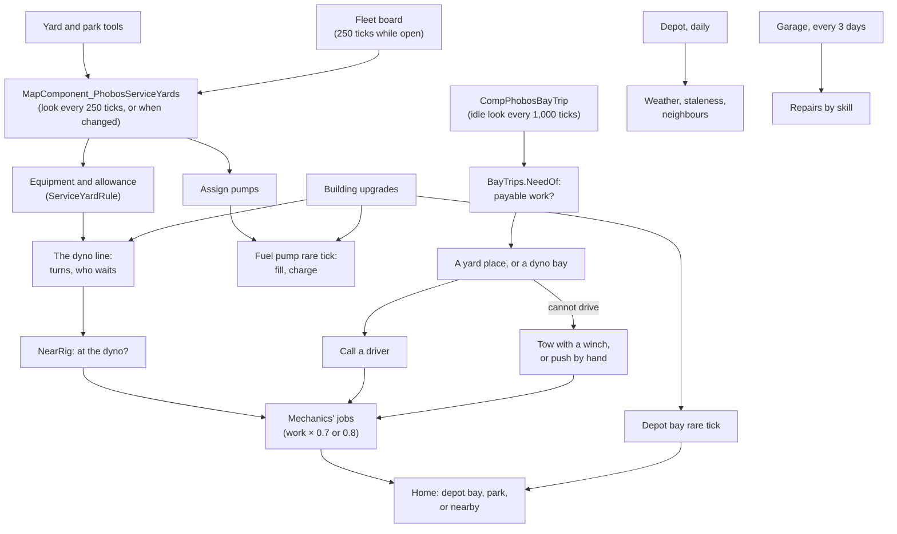

# Stations, yard and depots

**Status (23 Nov 2026):** living; written from the code at D'thorga Framework 0.269.0 and D'thorga Vehicles 0.114.0. Built: the
motor pool tab and its stations (parts bench, inspection pit, dyno bay, depot bay, fuel pump), building upgrades, the service yard
and its line, bay trips (driven, towed or pushed), the vehicle park, the fleet board, the garage, depots on the world map and what
time does to them, loading chutes and unloading bays. **Passed in game by the owner:** rows 165, 251, 271, 294 and 310; rows 36
and 301 in part. **Not yet tested in game:** everything else, including depot bays, depots, the garage and building upgrades.

This page says how the vehicles' stations, yard and depots work now. Why they are this way is in the [decision
log](../decisions/stations-yard-and-depots.md) and the [archived records](#why-it-is-this-way). How the vehicle code is laid out
in general is in [How the code is built](../architecture.md). What the parts bench makes and what the dyno bay's tunes do are on
[upgrades and fittings](upgrades-and-fittings.md); repairs themselves are on [vehicle damage](vehicle-damage.md); the recovery tow
and pushing by hand are on [hitches and trailers](hitches-and-trailers.md).

## Read this first (gotchas)

- **A working service yard takes over its dyno bay's reach.** A dyno bay the yard counts no longer serves a vehicle simply
  standing in reach; only the vehicles whose turn it is in the yard's line count as at the dyno, wherever they stand in the yard
  (`Systems/VehicleFittings.cs:776-783`). Vehicles in the bay's reach outside the yard join the same line.
- **Yard equipment never stands inside a yard.** The dyno bay, fuel pump and inspection pit cannot overlap zones. They count when
  they stand in or touch the yard's edge, diagonals included; equipment touching two yards belongs to the one made first.
- **A yard too big for its equipment keeps its cells but gives nothing.** Losing equipment never shrinks a yard; drawing past the
  allowance is refused cell by cell, keeping the nearest cells.
- **Any vehicle in a working yard counts as "at the bay"** for bay trips, and an idle vehicle parked there never sets off for
  another bay.
- **The depot bay's pad is only an outline.** It blocks nothing; a vehicle is in the bay when its centre cell is on the pad. A
  depot bay fuels only its one assigned vehicle, only with chemfuel, and charges no electric vehicle.
- **The fuel pump works only for a working yard**, and the yard, not the pump, chooses whom it fills.
- **Bay trips start only on the player's home maps**, never with enemies about, and only for land vehicles; their comp is added in
  code to every land vehicle with a loadout, trailers excepted.
- **Every storage building of any mod gets our load and unload switches, added in code.** "Vehicles may unload here" starts on
  only for the bulk bunker.
- **A depot's fuel is loose cans, fuel in cargo and tank compartments**, never the vehicles' own running tanks. Those are under
  cover: they do not age, leak or get poured.
- **The garage loads only with Vanilla Expanded Framework** (its outposts library), and its Def is in D'thorga Vehicles; without
  D'thorga Vehicles no garage button shows. **Garaged vehicles are not ticked.**
- **The dyno bay's reach is 5 cells in its Def but 3 by default in C#**: another mod's rig without `<reach>` gets 3.

## What it does

### The motor pool tab and its stations

The motor pool is a sub-tab of our D'thorga Architect tab (`Stations.xml`); it also holds the vehicle park and service yard tools,
the bulk bunker and the loading chute. All figures are authored.

| Station | Size | Cost | Power | Research | What it is |
| --- | --- | --- | --- | --- | --- |
| Vehicle parts bench | 3 × 1 | 120 steel, 4 components | 250 W | Vehicle parts | Where our parts and kits are made (Smithing) |
| Inspection pit | 3 × 1 | 60 steel, 1 component | — | — | A floor pit: +15 % work speed at the bench; +40 yard cells |
| Dyno bay | 2 × 2 | 100 steel, 4 components | 150 W | Vehicle tuning | Tunes, refits and heavy work in reach; +80 yard cells, required |
| Depot bay | 2 × 1 | 80 steel, 3 components, a parts bill | 100 W | Vehicle depot | A home pad, a 200-chemfuel tank and a shelf for parts |
| Fuel pump | 1 × 2 | 50 steel, 2 components, a parts bill | 80 W | Vehicle depot | A yard's pump with a 200-chemfuel tank |

- **The parts bench** links tool cabinets, the inspection pit and whatever links to the game's machining table; it breaks down
  and short-circuits in rain like other powered benches.
- **The dyno bay's reach** is 5 cells from its edge to the vehicle's drawn area, wings and rotors included. It works while
  powered. "Vehicles in reach" on the bay opens the fittings window ([upgrades and fittings](upgrades-and-fittings.md)).
- **The depot bay and fuel pump's parts bills** name a fuel tank and a fuel pump by role, so other mods' parts can stand in.

### Depot bays

- **One vehicle to a bay and one bay to a vehicle**: "Assign vehicle" on the bay; assigning takes the vehicle from any other bay.
- **"Go to bay"** on the vehicle drafts it and drives it to the parking cell, and undrafts it there. It refuses when already
  there, when the vehicle cannot drive or be drafted, or cannot reach.
- **The pad** is 3 wide and 6 long from the bay's front row (C# defaults); the vehicle parks with its middle on it.
- **While its vehicle is on the pad**, the bay pumps chemfuel at 30 an hour (60 with the faster pump), and service, diagnosis and
  repair take 0.7 of their work.

### The service yard

- **Draw it with "Service yard"** from the motor pool. Its allowance is the sum of its equipment's cells: a dyno bay 80, a fuel
  pump 40, an inspection pit 40 (`PhobosYardEquipmentExtension`, 40 by default). **Without a dyno bay it allows nothing.**
- **It works** when it has a dyno bay and its cells are within the allowance. The inspect line gives the cells, the equipment, and
  whether it has no dyno, is too big, or what it holds and who waits.
- **Work in a working yard takes 0.8 of its work** (the better of that and a depot bay's 0.7 applies).
- **The dyno line**: vehicles waiting for dyno work (a diagnosis asked for, a repair or part replacement that needs the dyno, or a
  due service that does), ordered by "Move up", then who asked first. **Turns**: one for each working dyno bay, two with a second
  roller set. Only vehicles with a turn get dyno work.
- **The pumps** fill the emptiest vehicle first and skip any at 99.5 % or more. With the charging cable a pump also charges an
  electric vehicle, drawing 500 W for each unit of Vehicle Framework's charge rate on top of its own 80 W; a grid that cannot pay
  switches it off.
- **Making room**: when every working yard is full, the vehicle idle longest (an hour or more) is driven out for one that needs
  the yard.

### Building upgrades

Upgrades for our buildings, in the Framework core (`src/PhobosFramework/Upgrades/`), ordered from a building's "Upgrades" button
and fitted by colonists doing Construction work.

| Upgrade | Building | Cost | What it does |
| --- | --- | --- | --- |
| Charging cable | Fuel pump | 20 steel, 2 components; Construction 4; Electricity | The pump charges electric vehicles |
| Second roller set | Dyno bay | 80 steel, 3 components; Construction 6; Vehicle tuning | Two turns of the yard's line |
| Faster pump | Depot bay | 15 steel, 1 component; Construction 4 | Pumps 60 an hour |

One piece of work at a time on a building; a prerequisite comes first; where two upgrades set a figure, the larger wins. Taking
one off refunds half and takes half the work. A moved building keeps its upgrades.

### Bay trips

- **With "Vehicles are taken to a dyno bay for repair by themselves" on**, an idle land vehicle on a home map looks every 1,000
  ticks (spread by its ID) for work that sends it. "What sends a vehicle" chooses: bay-only work alone; broken parts or bay-only
  work (the default); or any repair or service due.
- **It goes only if some of the work can be paid** from its cargo and the map's unforbidden things. A diagnosis asked for and a
  free repair of a damaged part always count. A busy vehicle is left alone.
- **Where**: a working yard first, else the nearest dyno bay. A colonist doing Drive work is called to drive it there.
- **A vehicle that cannot drive** is towed by a free vehicle with the recovery winch (if towing is on and the tow carries no
  weight warning), else pushed by hand (if pushing is on and one to six people suffice), else it waits.
- **After the work** it goes home: its own depot bay if the pad is free, else a vehicle park, else a spot nearby clear of every
  bay's reach, pad, door and zone. In a working yard with no depot bay of its own, it stays; in a park, it stays.
- **Authored timings** (`Rules_VehicleSystems.xml`): stuck after 600 ticks; three failed drives, then a day's rest; a day idle at
  the bay before giving up its place; waits for a driver, a coupling or pushers of 15,000, 10,000 and 10,000 ticks.
- **The fleet board** has a per-vehicle switch, "Taken to a dyno bay when it needs one"; the alert "Vehicles waiting for a dyno
  bay" names up to twelve.
- **The player's own orders always go** (Framework 0.276.4, the owner's card of 24 Nov 2026): "Send to yard" and "Take out of yard"
  mark their trip as ordered (`byOrder`, saved as `PhobosBayTripByOrder`), and a trip so marked goes on whatever the setting or the
  vehicle's switch says (`BayTripRule.GoesOn`); only automatic trips obey them. The mark clears when the trip ends, done or not.

### The vehicle park

A zone drawn with "Vehicle park". Places fill from its south-west corner, facing north then east, with a cell kept clear round
each vehicle. Bay trips bring vehicles home to it.

### The fleet board

- **A bottom-bar button** ("Show the fleet button on the bottom bar", on) opens a board of every vehicle the colony owns, wherever
  it is: at home, on a map, in a convoy, in flight, in a garage or depot, parked, lost, hulls and vehicles to claim.
- **It flags** low fuel (below 25 %), and shows each yard's card with "Go to the yard", "Take out of yard", "Move up" and "Send to
  yard", and a yard filter.
- **A parked vehicle near its timeout** gets a letter a set number of days ahead ("Warn before a parked vehicle is lost", 3 days),
  checked every six game hours.

### The garage

- **A garage is an outpost** set up from a vehicle caravan ("Set up a garage here"): 200 steel and 10 components, at least one
  person, Construction 6.
- **It holds** three vehicles a person, at most twelve. Every three days it repairs: points = the staff's Construction skill × 40;
  a steel pays 10 points and a component 400 (authored).
- **Aircraft are refused.** Taking vehicles out needs a person for every seat. A closed garage leaves its vehicles as a Vehicle
  Framework stash with 30 days to fetch them.

### Depots on the world map

- **"Leave a depot here"** on a convoy leaves vehicles and goods on its tile as a depot that never expires (`Service/Depots.cs`).
  It refuses another faction's convoy, a moving one, a tile with no landing ground, or one held by anything but a convoy or depot;
  the convoy keeps at least one vehicle.
- **"Leave and take at the depot"** swaps goods and vehicles; **"Refuel from the depot"** fills the emptiest first, and holds a
  moving convoy up for its refuelling stop.
- **An aircraft below half a tank** stops at a depot holding its fuel within 1.5 tiles of its way (looked at every 250 ticks).
- **Visiting a depot** makes a 100 × 100 map.
- **What time does**, once a day for each depot (all authored ballparks, each with its setting):
  - **Weather** (on): below 0 °C or with 2,000 mm of rain a year, outer parts lose 0.3 % of their health a day (never below 1),
    and loose cans leak 0.5 % a day.
  - **Stale fuel** (on): fresh for 90 days, then 1 % a day goes stale; adding fuel blends the clock by amount.
  - **Hostile neighbours** (off): a hostile settlement within 6 tiles finds it after the larger of 2 days and 4 days a tile, and
    takes its cargo and fuel; its vehicles are left. RimPacts' wars reach depots through this.

### Loading chutes, unloading bays and the bulk bunker

- **The loading chute** (D'thorga Vehicles; 1 × 1, 30 steel; the tipper's research) passes up to 4 stacks a rare tick into a
  standing vehicle of the same side whose footprint covers its spout, as cargo room allows.
- **The bulk bunker** (3 × 4, 96 stacks, 120 steel) is a hopper that Vanilla Factions Expanded - Factory's belts take from;
  "Vehicles may unload here" starts on.
- **Unloading bays**: a truck working by itself makes for the nearest marked storage that takes its load, has room and was not
  passed over on this trip; spare parts stay aboard. Stockpile zones get the switch too, kept by zone so it survives a gravship
  flight.
- **A parked vehicle on a fuel line** with its engine off takes 30 chemfuel an hour (D'thorga Framework's pipes; one look covers
  at most an hour). The depot bay's own tank is filled by Vanilla Expanded Framework's refuelling pipes, not by our code.

## How it works

**Per tick**: the yards' map component returns at once unless 250 ticks have passed or a yard changed. A bay trip's tick only
tests its stage, except while it is pushed or shunted a cell at a time.

**Every 250 ticks**: the yards' look (equipment, line, idle vehicles, pumps); each fuel pump, depot bay and loading chute; each
vehicle's own bay (for the work factor); the fleet board while open; an aircraft's depot check on a journey.

**Every 1,000 ticks**: a bay trip's idle look. **Daily**: each depot's pressures, staggered. **Every six hours**: the parked
warning. **Every three days**: the garage's repairs.

**Where the numbers come from**: the station Defs (`Stations.xml`, `ServiceYard.xml`) for sizes, costs, power, cells and pumps;
the rules Def (`Rules_VehicleSystems.xml`) for bay trips, the yard's work factor and idle time, pushing and pipe refuelling; the
C# defaults for the pad and the depot pressures; `GarageRule` for the garage.

## Code

All under `src/PhobosFramework.Vehicles/` unless named.

| File | What it holds |
| --- | --- |
| `Service/ServiceYard.cs`, `Service/ServiceYards.cs` | The yard zone, its tool and equipment extension; the map component, line, pumps and making room |
| `src/PhobosFramework/Rules/ServiceYardRule.cs` | The allowance, whether it works, the line, the pumps' order (game-free) |
| `Service/BayTrips.cs`, `Service/CompPhobosBayTrip.cs`, `Service/CompPhobosBayTrip.Carry.cs` | What sends a vehicle; the trip's stages; towing and pushing |
| `src/PhobosFramework/Rules/BayTripRule.cs` | Triggers, how to carry, where home is (game-free) |
| `Service/VehiclePark.cs`, `Systems/DepotBays.cs` | The park; depot bays and their pads |
| `Systems/CompPhobosFuelPump.cs`, `Systems/CompPhobosTuningRig.cs` | The fuel pump and charging cable; the dyno bay as a station |
| `Service/FleetService.cs`, `Presentation/MainTabWindow_PhobosFleet.cs` | The fleet board's rows and the parked warning; its window (read only) |
| `Presentation/BayGizmos.cs`, `Presentation/Alert_PhobosBayTrips.cs` | Bay buttons and the pad's outline; the waiting alert |
| `Service/Depots.cs`, `Service/DepotPressures.cs`, `Rules/DepotPressureRule.cs` | Depots, their dialog's work and what time does |
| `Sling/SlingWreck.cs`, `Presentation/Dialog_PhobosDepot.cs` | The depot's world object and daily tick; the depot dialog |
| `Service/LoadingChute.cs`, `Service/VehicleUnloadBays.cs`, `Service/VehicleLoadOut.cs` | The chute; unloading bays; the storage switches |
| `src/PhobosFramework/Upgrades/`, `src/PhobosFramework/Rules/BuildingUpgradeRule.cs` | Building upgrades, their jobs and rule |
| `src/PhobosFramework.Vehicles.Outposts/`, `src/PhobosFramework/Rules/GarageRule.cs` | The garage outpost and its repairs |
| `src/PhobosFramework.Vehicles.Pipes/PipeNetLink.cs` | Refuelling a parked vehicle from a fuel line |

## Defs and XML

The modders' types, linked to [the reference site](https://phobos-dthorga.github.io/phobos-rimworld/) (pages are
`api/<Namespace>.<Type>.html`):

- **[`PhobosYardEquipmentExtension`][r1]** (`cells`, `required`): makes any building yard equipment; another mod's pump or lift
  can join a yard with a patch.
- **[`CompProperties_PhobosTuningRig`][r2]** (`reach`), **[`CompProperties_PhobosDepotBay`][r3]** (`padWidth`, `padLength`,
  `pumpPerHour`, `workFactor`) and **[`CompProperties_PhobosFuelPump`][r4]** (`pumpPerHour`, `chargeWattsPerRate`).
- **[`CompProperties_PhobosLoadingChute`][r5]** (`stacksPerLook`), **[`CompProperties_PhobosVehicleLoadOut`][r6]** (added in
  code) and **[`PhobosBackUpSideExtension`][r7]** (`side`; starts "may unload" on).
- **[`CompProperties_PhobosBayTrip`][r8]**: added in code.
- **[`PhobosBuildingUpgradeDef`][r9]** and **[`CompProperties_PhobosBuildingUpgrades`][r10]**: upgrades for any building, by
  figure and grant.
- **[`PhobosBillDef`][r11]**: the depot bay's and fuel pump's parts bills.
- **[`PhobosVehicleRulesDef`][r12]**: the bay trip, yard, push and pipe refuelling figures.
- **The garage's types** (`Phobos.VehicleSystems.Garage.PhobosGarageExtension` and its outpost) are in the outposts tie-in
  assembly, which the reference site does not cover.

The Defs: `Stations.xml`, `ServiceYard.xml`, `MainButton_Fleet.xml`, `WorldObjects_SlingWreck.xml` (the depot) and
`Research.xml` in D'thorga Framework's `Mods/VehicleFramework/`; `BuildingUpgrades.xml` (the jobs) in its core; the loading chute
and bulk bunker in D'thorga Vehicles' `BulkBunker/`; the garage in `Mods/VehicleOutposts/`.

[r1]: https://phobos-dthorga.github.io/phobos-rimworld/api/Phobos.VehicleSystems.PhobosYardEquipmentExtension.html
[r2]: https://phobos-dthorga.github.io/phobos-rimworld/api/Phobos.VehicleSystems.CompProperties_PhobosTuningRig.html
[r3]: https://phobos-dthorga.github.io/phobos-rimworld/api/Phobos.VehicleSystems.CompProperties_PhobosDepotBay.html
[r4]: https://phobos-dthorga.github.io/phobos-rimworld/api/Phobos.VehicleSystems.CompProperties_PhobosFuelPump.html
[r5]: https://phobos-dthorga.github.io/phobos-rimworld/api/Phobos.VehicleSystems.CompProperties_PhobosLoadingChute.html
[r6]: https://phobos-dthorga.github.io/phobos-rimworld/api/Phobos.VehicleSystems.CompProperties_PhobosVehicleLoadOut.html
[r7]: https://phobos-dthorga.github.io/phobos-rimworld/api/Phobos.VehicleSystems.PhobosBackUpSideExtension.html
[r8]: https://phobos-dthorga.github.io/phobos-rimworld/api/Phobos.VehicleSystems.CompProperties_PhobosBayTrip.html
[r9]: https://phobos-dthorga.github.io/phobos-rimworld/api/Phobos.Framework.Upgrades.PhobosBuildingUpgradeDef.html
[r10]: https://phobos-dthorga.github.io/phobos-rimworld/api/Phobos.Framework.Upgrades.CompProperties_PhobosBuildingUpgrades.html
[r11]: https://phobos-dthorga.github.io/phobos-rimworld/api/Phobos.Framework.Bills.PhobosBillDef.html
[r12]: https://phobos-dthorga.github.io/phobos-rimworld/api/Phobos.VehicleSystems.PhobosVehicleRulesDef.html

## Settings

All in D'thorga Framework's vehicle systems settings. The full text is in the generated [settings
reference](../settings-reference.md#dthorga-framework-and-dthorga-vehicle-systems).

| Label | Default | Page, section |
| --- | --- | --- |
| Vehicles are taken to a dyno bay for repair by themselves | On | Repairs, service and fittings, Dyno bay trips |
| What sends a vehicle to a dyno bay | Broken, or bay-only work | Repairs, service and fittings, Dyno bay trips |
| A vehicle that cannot drive is towed to the dyno bay | On | Repairs, service and fittings, Dyno bay trips |
| Light vehicles that cannot drive are pushed to the dyno bay by hand | On | Repairs, service and fittings, Dyno bay trips |
| Tunes, changes of grade and heavy overhauls need a dyno bay | On | Repairs, service and fittings, Fittings and tuning |
| Warn before a parked vehicle is lost: ... days ahead (0 turns the warning off) | 3 | Cabs, camps and caravans |
| Show the fleet button on the bottom bar | On | Display, sound and stories |
| Depots weather | On | Display, sound and stories, Depots |
| Stored fuel goes stale | On | Display, sound and stories, Depots |
| Hostile neighbours find depots | Off | Display, sound and stories, Depots |

The yard's, bays' and upgrades' figures are not settings; they are in the Defs.

## Saved data and removal

- **The yards' map component** saves who asked, who was moved up and who has been idle since when, by vehicle ID
  (`PhobosServiceYardAsked`, `_MovedUp`, `_IdleSince`). The line, turns and pump targets are worked out again.
- **A depot bay** saves its vehicle (`PhobosDepotBayVehicle`); a vehicle's own bay is found again each rare tick.
- **A bay trip** saves whether it is kept out, its stage and next look always, and its bay, stand, timings, partner and whether the
  player ordered it only while on a trip (`PhobosBayTrip*`; `PhobosBayTripByOrder` since 0.276.4, off in older saves). The stage is an enumeration whose values are only ever appended.
- **Building upgrades** save what is fitted, ordered, being removed, the work done and what was delivered (`PhobosUpgrades*`).
- **Storage switches** save "may load" and "may unload"; stockpile marks are kept by zone ID in a game component.
- **A depot** saves its vehicles and goods, and its fuel clock, finding and carried fractions (`PhobosSlingWreck_*`,
  `PhobosDepot_*`); **a garage** its parked vehicles (`PhobosGarage_Parked`, deep), with the outposts library's own data.
- **Removal** (inferred, not tested): the zones, components, world objects and buildings fail to load and are dropped with errors.
  **Garaged vehicles and depot contents would be lost with their world objects.** Close garages and empty depots before removing
  the Framework ([How the code is built, Saves and removal](../architecture.md#saves-and-removal)).

## Tie-ins

Every tie-in is in the [tie-in register](../tie-in-register.md).

- **Vehicle Framework**: its pather, reach, footprint and drafting for driving to bays; its fuel and charge rate for pumps; its
  stashes and caravans for the garage and depots.
- **Vanilla Expanded Framework's outposts library**: the garage (`Outpost`, `OutpostExtension`), with one private field written by
  reflection after a load. Its pipes fill the depot bay's tank.
- **Vehicles at Work**: by name, postfixes only, each standing down when its target is absent: its health and move checks see our
  conditions, and its parking takes the depot bay's cell as a vehicle's home ([Vehicles at Work](../vehicles-at-work-tie-ins.md)).
- **Vanilla Factions Expanded - Factory**: belts take from the bulk bunker and feed the loading chute as ordinary storage.
- **Vanilla Gravship Expanded**: the motor pool's nested category. **Vanilla Furniture Expanded - Production**: its machining
  cabinets link to the parts bench. **RimPacts**: wars reach depots through hostile neighbours.
- **The game**: a postfix on a stockpile zone's buttons adds the unload switch; TD Enhancement Pack postfixes the same, and both
  only add.

## Performance

- **Measured**: only the fleet board has a timing label ("fleet board"); nothing here has a measurement of its own.
- **Shape of the cost**: one early return a tick for the yards; the stations on rare ticks; a bay trip's idle look every 1,000
  ticks, each search testing at most 16 ways there through Vehicle Framework's region search; push paths capped at 6,000 nodes, a
  failed one resting a day. Bays, rigs, pumps, upgrades and trips are listed in map registries, never by walking every building.
- **Caches**: whether a vehicle is at the dyno, 60 ticks per position; the dyno bay's vehicles in reach, half a second of real
  time.
- **The world map**: depots once a day each, staggered; garaged vehicles never ticked.

## Limits and known gaps

- **The player's faction only**: other factions' vehicles appear on the fleet board only as vehicles to claim.
- **Land vehicles only** for bay trips; the garage refuses aircraft and anything that cannot join a caravan.
- **Chemfuel only** at depot bays and pumps; other fuels get a "wrong fuel" line, and a depot bay charges nothing.
- **"Send to yard" does not carry a vehicle that cannot drive.**
- **Depots**: laying one by air (DP4) has no code of its own, and a convoy's range does not yet count depots on its way.
- **Stand-in art**: the garage's world icon, the fleet button's icon, and the chute's and bunker's pictures.
- **Found while writing (inferred from the code, not tested in game):**
  - **A vehicle waiting in a yard's line can give up its place after a day** and be driven home unworked
    (`CompPhobosBayTrip.cs:394-403`).
  - **Building or removing a dyno bay or pit does not mark the yard changed**; the yard sees it at its next look.
  - **A stale comment** says vehicles go to their depot bay only on the player's order (`DepotBays.cs:187`); bay trips and
    Vehicles at Work now send them.
  - **A nearer settlement of the same faction does not bring a depot's finding forward** (`DepotPressures.cs:61-66`).
  - **The bulk bunker and the fuel pump share a place in the tab's order** (both 125).

## Tests

None of these is a test in game.

- **Rule tests**: in `tests/PhobosFramework.Rules.Tests`, `ServiceYardRuleTests`, `BayTripRuleTests`, `BuildingUpgradeRuleTests`,
  `GarageRuleTests`, `UnloadBayRuleTests` and `GrabRuleTests` (the chute); in `tests/PhobosFramework.Vehicles.Rules.Tests`,
  `DepotPressureRuleTests`, `PipeRefuelRuleTests` and `PushRuleTests`.
- **In game** ([the test list](../in-game-test-pass.md)): **passed** 165, 251, 271, 294, 310; **passed in part** 36, 301;
  **waiting**: stations and depot bays 10, 12, 47, 53, 86, 250; bunker, chute and unloading 167, 168, 174, 202, 245 to 247, 249;
  depots 288 to 290; bay trips and the park 295 to 297; upgrades and the yard 309, 311, 312; orders that always go 483; the parts bench's links 432.

## Why it is this way

- **[The decision log](../decisions/stations-yard-and-depots.md)**: every choice, one line each, with who made it and where.
- **Archived records**, kept unchanged for their history: [vehicle stations](../archive/vehicle-stations.md) (the stations, depot
  bays, the garage and fleet tools; with [upgrades and fittings](upgrades-and-fittings.md)), [the service
  yard](../archive/vehicle-service-yard.md), [bay trips](../archive/vehicle-bay-trips.md) and [depots and forward fuel
  points](../archive/vehicle-depots.md).
- **Records kept in place** (they cover stations and another system): [universal hoppers](../universal-hoppers.md), [vehicle
  cross-links](../vehicle-crosslinks.md), [Vehicles at Work](../vehicles-at-work-tie-ins.md).
