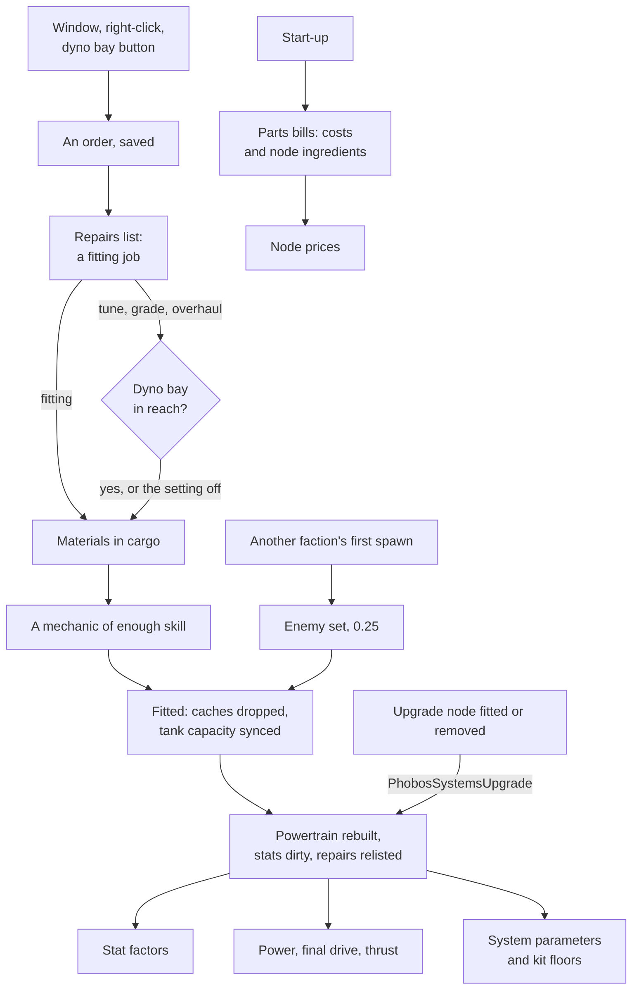

# Upgrades and fittings

**Status (23 Nov 2026):** living; written from the code at D'thorga Framework 0.268.0, Vehicles 0.114.0 and Patches 0.40.0. Built:
59 fittings, 9 tunes, 3 part grades, 5 families and 12 enemy fit sets; the fittings window and the dyno bay; 22 upgrade trees
priced like tunes, with any-of links and a scrolling tab; our parts, their substitutes, 28 vehicle parts bills and 13 node bills;
six service kits. **Passed in game by the owner:** rows 8, 161, 165, 176, 195, 231, 282, 294 and 298; row 64 in part. **Not yet
tested in game:** everything else, including part grades, prices and parts bills.

This page says how a vehicle is fitted, tuned, graded and upgraded now. Why it is this way is in the [decision
log](../decisions/upgrades-and-fittings.md) and the [archived records](#why-it-is-this-way). What an engine fitting or tune does
to power and fuel is on [engines and drivetrains](engines-and-drivetrain.md); what an aircraft's kits do in the air is on
[flight](flight.md); what armour and liners stop is on [vehicle damage](vehicle-damage.md).

## Read this first (gotchas)

- **Two systems share the words "upgrade" and "tune"; keep them apart.**
  - **Fittings, tunes and part grades are ours.** They work on any vehicle whose parts our loadout binds to roles, from any mod.
  - **Upgrade trees are Vehicle Framework's**, one per vehicle Def. We write trees only for our own vehicles, and change how
    every tree behaves in four narrow ways: any-of links, refusal text, a scroll view, and prices on the trees that ask for them.
- **`Tuning.cs` is not the tunes.** It exposes figures to Vehicle Framework's own per-design settings window. `RoleFamilyRule`
  (numbered roles rolled into their base role) and `PartGroupRule` (alike parts folded into one Health-tab row) are not upgrade
  families either; the families are `PhobosVehicleFamilyDef`.
- **A share per part**: a fitting on one of n parts of its roles gives the factor to the 1/n power; all n give the listed factor.
  Tunes apply whole.
- **Matched sets give nothing until whole.** They are ordered, cancelled and removed on every part of their roles together:
  heavy springs, road and all-terrain tyres and heavy brakes per axle, and the A-10's and Su-25's engines.
- **Fittings need no dyno bay; tunes, grade refits and heavy overhauls do**, while "Tunes, changes of grade and heavy overhauls
  need a dyno bay" is on. Materials come from the vehicle's cargo.
- **Two weight rules.** A fitting's `kilograms` (an accessory) only takes cargo room. An armour or weapon kit is an upgrade node
  that writes the same figure twice: cargo less N and `Phobos_KitKilograms` plus N, the second being mass on the drivetrain.
- **An upgrade node that changes one of our systems must list `PhobosSystemsUpgrade`**, or the powertrain, built once, never sees
  it.
- **Research on upgrade nodes is Vehicle Framework's own.** `PhobosEnforceUpgradeResearch` does nothing and is kept only so old
  XML loads.
- **Parts are ours; other mods' parts are substitutes by role**, named in XML behind `MayRequire`, never in C#. The first supply
  that fits wins. Bills are worked out once at start-up, so "Parts for building" needs a restart.
- **Tiers.** Fittings' stat factors reach every faction's vehicle. Power, final drive and tunes act through the drivetrain model,
  which runs only on the full tier with the drivetrain on Full, so on another faction's vehicle they matter once it is captured.
- **What is saved**: fitted parts, tunes, orders, grades, the enemy-set roll and the older-save flag per vehicle; what each priced
  upgrade cost and the colony's raw-materials flag per game. **Every factor, price and bill is derived.**
- **The "tuning rig" shows as "dyno bay"** in play; its class and defName keep "TuningRig".
- **Every figure is authored.** Costs, factors, uplifts and the enemy chance are gameplay figures; real machines are named where
  a fitting follows one (the Pegasus 11-61, the R-195, the uprated TF34).

## What it does

### Fittings

- **One fitting a part**, by the part's key. Fitting over another takes the old one off and gives its kit back if it has one.
- **Offered** where a fitting names a role the part plays and suits the vehicle (piston, diesel, tracked, power reaching the road,
  a mass window, loadouts, loadout kinds, a flat deck) and moves something here. **Refused, with the reason**: research not done,
  a destroyed part, a grade that holds no fitting, or any refusal in a matched set. Skill is checked by the job.
- **What a fitting can move**: vehicle stats, system parameters by name, floors on parameters (an avionics kit's capability),
  engine power, fuel, fuel capacity, turbine thrust and hot derate, dispenser cartridges, jamming reach, abilities granted by
  name, the electrical loads it brings, cargo kilograms, the wear it renews, and what comes back when it is removed.
- **Work and cost**: the listed work and materials × a weight factor (against 5,000 kg, held between 0.5 and 3) × "Time to fit and
  tune" or "Materials to fit and tune", counts rounded up, never to nothing. A packed machine named as a material stays one
  machine. Taking a fitting off is half its work.
- **Lost with its part**: a part at 0 health loses its fitting and any work ordered on it, with a message on the player's vehicle.
- **New tyres** take away their share of tread wear. **Extra tanks** raise Vehicle Framework's own fuel capacity, with no Harmony;
  fuel over the new capacity is drained into containers when a mechanic removes a tank, and lost when a tank is destroyed.
- **Abilities** count only while the fitting counts and its part stands. The sling, camp, litters, winch, fire fighting, the ECM
  pod and cabin oxygen read them; systems read them through `needsGrant`, `When_FittingGrants` and `When_Granted`.
- **What the window says is what the vehicle gets**: one rule, `FitFigures.Of`, serves both. Plain mode says up or down; Engineer
  mode gives the factor.

| Fitting (59 ship) | Roles | What it moves | Work, skill |
| --- | --- | --- | --- |
| Turbocharger | Engines; piston; power counts | power × 1.2, fuel × 1.1, heat × 1.25; grants Boost | 30,000, 8 |
| Uprated radiator | Radiator | radiator rate × 1.3 | 12,500, 4 |
| Heavy-duty springs | Wheels; matched per axle | cargo × 1.15, speed × 0.96 | 7,500, 3 |
| Road / all-terrain tyres | Wheels, not tracked; per axle | speed × 1.05, wear × 1.4 / speed × 0.95, soft-ground grip × 1.35 | 5,000, 3 |
| Auxiliary / ferry tank | Their mounts | capacity × 1.5, cargo × 0.85 / × 1.75, × 0.7 | 6,000 / 8,000 |
| Heavy-duty brakes | Brakes; per axle | brake wear × 0.6, heat × 0.75 | 3,000, 4 |
| Avionics kits (4) | Avionics and kit mounts; aircraft | a capability's floor to 1 | 2,400 to 6,000 |
| Pegasus 11-61 (Harrier); R-195 (Su-25); uprated TF34 (A-10) | Engines; the jets matched | thrust × 1.088 / 1.10 / 1.15 | 10,000 to 14,000 |
| Camp and cab accessories | Roof mount, side rail, berth, fridge bay … | abilities and 1 to 150 kg; most give their kit back | 300 to 9,000 |

### Tunes and boost

- **Three axes, three tunes each**, one "as built": Engine (economy: power × 0.9, fuel × 0.92; power: × 1.15, × 1.15, heat × 1.2),
  Gearing (tall: final drive × 0.85; short: × 1.2) and Boost (low × 0.95; high × 1.1, heat × 1.25).
- **Boost is offered only while a fitting grants it** (the turbocharger); a boost tune stops acting when the turbo comes off,
  though it stays saved. **Gearing needs an automatic or direct transmission.**
- **Flat fuel factors act only with "Fuel use follows engine load" off**; with it on, the model works gearing out itself. The
  cruise that sets fuel is worked out on the engine as built, so a tune's saving is not cancelled out.

### Part grades

- **Salvaged** (cost × 0.7, health × 0.7, faults × 1.5, holds no fitting, may be paid with salvage), **standard**, and
  **heavy-duty** (cost × 1.75, health × 1.3, faults × 0.6, skill 6, its own research).
- A grade is chosen when a destroyed part is replaced, or by a refit of a working part, which restores it to full and clears its
  conditions. Health goes through Vehicle Framework's health modifiers under one key; fault severity × the grade's factor.

### Families

Five families, each a set of fittings ordered together: **cold weather** (block heater, deep-cycle battery, battery warmer,
gear-reduction starter, fuel heater, cab insulation; it switches the night heater on), **all terrain**, **work lights**, **long
range** (auxiliary and ferry tanks) and **recovery** (the winch). **Fit all** orders each fitting on every part it suits that does
not carry or await it, skipping refused parts with the first reason. A part already carrying one of the family's fittings is
taken.

### Enemy fit sets

On another faction's vehicle's first spawn, with "Enemy vehicles may carry fittings" on, a 0.25 chance of a set picked by weight
among those whose tech window holds the faction's level and that fit something. Each fitting goes on every free part of its roles;
each tune replaces its axis. Twelve sets ship: four general, a camp tourer, two aircraft refits, two Close Air Support, two
Prowler and a Harrier. A captured vehicle keeps what it carries.

### Older saves

A loadout's `fittedOnOlderSaves` is given free, once, on the first free part of its roles, when a vehicle from a save without the
flag next spawns. One ships: the Harrier's night sight and radar.

### The fittings window and the dyno bay

- **The window** opens from the Dashboard's **Fittings and tunes** button, a command-bar button while a dyno bay is in reach, a
  colonist's right-click on the vehicle, and the dyno bay's **Vehicles in reach**. Right-click also offers **Do the waiting
  work**. It shows tunes, families and parts, with wheels grouped into axles by where they sit (within 0.75 cells). Hovering a
  choice previews its figures in blue; a matched set part-way done says how many more parts must carry it.
- **The dyno bay**: 2 × 2, 100 steel and 4 components, 150 W, its own research, reach 5 cells from its edge. A vehicle is in reach
  when the cells its picture covers come within reach. The bay must be powered. A bay that a working service yard runs counts for
  the vehicle whose turn it is, where it stands.
- **At a bay** a replaced part takes 0.7 of the work and comes back at 0.6 of full instead of 0.25.

### Upgrade trees as we shape them

- **22 trees, 135 nodes, 14 of them tie-in nodes**: 12 in D'thorga Vehicles (the tanker 20 nodes, the drill rig 17, the
  generator set and survey truck 16, the tipper 14, the Osprey 9, the Seabed Crawler 8, and five trailers) and 10 in D'thorga
  Farming. Tie-ins: Combat Extended's spall liners, Dubs Bad Hygiene, gas vessels, Rimefeller and Vanilla Chemfuel Expanded.
- **Four links, each for its own reason**: either/or for things that fill the same place (Vehicle Framework's exclusion list, on
  both nodes); needs all of (`prerequisiteNodes`) for building on one earlier upgrade; needs any one of (`PhobosUpgradeAnyOf`,
  only the tanker's) for alternatives; and holds it on, for what sits inside its parent. Research paces progress; a tree adds no
  gate of its own.
- **Any-of**: a node with an unmet link counts as locked for the click, the greyed node and other factions' random upgrades; holds
  it on refuses removing the only fitted parent. Drawn as a bar under Vehicle Framework's lines, white along a fitted path.
- **The layout**: the first row at row 2, one grid step between nodes, tie-in nodes after ours; a truck's own upgrades on the left
  and its armour and weapon kits in columns 29, 34 and 39. Vehicle Framework's tab is a fixed 880 × 520; a tree past it is drawn
  in our scroll view.
- **Armour kits** are nodes in five trucks' trees. **Weapon kits on the trucks are designed, not built**: only the Osprey's tree
  adds guns (two ramp guns, either/or, and a belly gun whose automatic aim `PhobosAutoTargetUpgrade` switches on). A gun added by
  a node is tied to a weapon mount with no extra XML ([damage](vehicle-damage.md)).
- **Node stats that switch our systems**: sling kilograms, infrared jammer, terrain radar, inlet barrier loss, kit kilograms and
  soft-ground grip (tractor dual wheels).

### Prices ("priced like tunes")

- **All 22 trees carry `PhobosUpgradeCostsLikeTunes`**; every other author's tree keeps its costs.
- **Price** = the node's XML figures × an uplift (work × 5, bulk materials × 2.5) × the weight factor × the cost settings. Only
  bulk items (stacks above 10) scale; a part counted in ones stays.
- **Written into the node at start-up**, after the parts bills, and again when a cost setting changes. **Refunds are fair**: what
  a vehicle paid is recorded, and Vehicle Framework's refund is made from that (or, without a record, from the node's old base).
  A spall liner refunds by what is left of it.

### Parts, the parts bench and parts bills

- **The parts bench** makes our parts and kits. **27 role supplies**: 9 core (fuel tank, suspension, wiring, lighting, exhaust,
  frame, hose, oxygen store, rotor blades) and 18 vehicle supplies (piston and turbine engines, transmission, wheels, radiator,
  battery, alternator, rotor drive, landing gear and more, with a default). 23 substitutes from RimThunder and Vanilla Vehicles
  Expanded, behind `MayRequire`.
- **Repairs read the same table** ([damage](vehicle-damage.md)); the default covers any part without a role at 0.5 steel and 0.02
  components a health point.
- **28 vehicle parts bills** (12 Farming, 12 D'thorga Vehicles, 5 D'thorga Patches: the C-17, Close Air Support's two, the
  Prowler, the Harrier, the UH-60) set what a vehicle is built from, by role; size is kerb mass unless given. **13 node bills**
  fill upgrade nodes' ingredients by role (a hose reel takes a hose, the drill rig's power pack an electric motor and a hydraulic
  pump, the Osprey's radar and jammer avionics). For a node, our part is its own materials, never a whole-build kit.
- **Six service kits** made at the bench (tyre set, brake pads, clutch kit, service kit, drive belt, hot-section kit). A colony
  begun after kits existed uses kits; an older one pays raw materials until the player turns its switch off.

## How it works

**Nothing ticks.** An order from the window, a menu or a debug action becomes a saved order and a job on the repairs list, priced
again whenever costs change. The mechanic's job ends in the fitting being recorded; then display caches are dropped, the fuel
capacity is synced, the powertrain is dropped to be rebuilt on next use, every stat is marked dirty and the Health tab refreshed.

**Reading**: factors are rebuilt on the first ask after a change. Stats go through a stat part on every vehicle stat; a system
parameter is Vehicle Framework's tuning × the fitting factor, raised to any kit floor; power and final drive are read when the
powertrain is built; fuel through the tuned fuel factor.

**At start-up** the parts bills write costs and node ingredients, then prices are written into the opted-in nodes; weapon mounts
and the tuning figures are set per design as Defs resolve. **On load**, grade health and tank capacity are put back after Vehicle
Framework's stat handler loads; on spawn, the enemy set (first spawn only) and the older-save fittings.

**Harmony**: postfixes on the upgrade tree's prerequisites (twice), its finish and its reset (for refunds), the upgrade tab's
prerequisite drawing; skipping prefixes on its buttons (only while ours refuses) and its grid (to draw it scrolling); Vehicle
Framework's stat handler on load; and the research windows, to hide set-aside research.

## Code

All under `src/PhobosFramework.Vehicles/` unless named.

| File | What it holds |
| --- | --- |
| `src/PhobosFramework/Rules/FittingRule.cs`, `FitCostRule.cs`, `BuildBillRule.cs` | Share per part, matched sets, grades, tanks, wear; costs; bills |
| `Defs/FittingDefs.cs` | Fitting, tune, grade, fit set and family Defs; stat, parameter and floor specs |
| `Defs/PartSupplyDefs.cs`, `Defs/VehicleBillDefs.cs`, `src/PhobosFramework/Bills/BillDefs.cs` | Part supplies; vehicle and node bills |
| `src/PhobosFramework/Bills/PartsBills.cs` | Applies every bill at start-up; resolves a role |
| `Systems/VehicleFittings.cs` | The per-vehicle service: figures, orders, families, grades, the bay, tanks, enemy sets, older saves |
| `Systems/CompPhobosTuningRig.cs`, `Systems/AircraftUpgrades.cs`, `Systems/Tuning.cs` | Dyno bay; node hooks; Vehicle Framework's tuning window |
| `Service/UpgradeAnyOf.cs`, `UpgradePricing.cs`, `UpgradeResearch.cs`, `ServiceKits.cs`, `WeaponMounts.cs` | Tree behaviour, prices, kits |
| `Rules/UpgradeAnyOfRule.cs`, `AxleRule.cs`, `ReachRule.cs` | Any-of; axles; reach by the drawn area |
| `Presentation/Dialog_PhobosVehicleFittings.cs`, `FittingText.cs`, `UpgradeTabScroll.cs`, `PlaceWorker_PhobosTuningRigReach.cs` | The UI |
| `Jobs/FittingsFloatMenu.cs`, `Debug/FitNowDebugActions.cs` | Right-click; Fit now |
| `Service/Patches.cs`, `Service/SetAsideResearchPatches.cs` | The stat part, grades after load; hidden research |
| `scripts/check-upgrade-trees.py` | The tree checker, `show`, and `--write` for the diagrams |

## Defs and XML

The modders' types, linked to [the reference site](https://phobos-dthorga.github.io/phobos-rimworld/):

- **[`PhobosVehicleFittingDef`][u1]**: `roles`, `matchedSet`, `matchedPerAxle`, `materials`, `work`, `minSkill`, research, and
  what it moves (above), with its matches. `ConfigErrors` refuses no roles, a fitting that moves nothing, per-axle without a set,
  and a factor or floor naming no parameter. 59 in 14 files.
- **[`PhobosVehicleTuneDef`][u2]**: `axis`, `isDefault`, `order`, costs, `powerFactor`, `fuelFactor`, `flatFuelFactor`,
  `finalDriveFactor`, `parameterFactors`. Nine.
- **[`PhobosVehiclePartGradeDef`][u3]**: cost, health and fault factors, `holdsFitting`, `paidWithSalvage`, skill, research.
  Three.
- **[`PhobosVehicleFitSetDef`][u4]**: tech window, `weight`, `fittings`, `tunes`. Twelve.
- **[`PhobosVehicleFamilyDef`][u5]**: `order`, `fittings`, `switchOn`. Five.
- **On an upgrade tree**: [`PhobosUpgradeAnyOf`][u6] (`links`: `node`, `anyOf`, `holdsParent`) and
  [`PhobosUpgradeCostsLikeTunes`][u7]. **Upgrade classes**: [`PhobosSystemsUpgrade`][u8] and [`PhobosAutoTargetUpgrade`][u9]
  (`turretKeys`).
- **[`CompProperties_PhobosTuningRig`][u10]**: `reach`.
- **Parts**: [`PhobosRoleSupplyDef`][u11] (`roles`, `item`, `itemCount`, `materials`, `substitutes`) and
  [`PhobosVehiclePartSupplyDef`][u12] (adds `wholePart`, `kit`, steel and components per health, `work`);
  [`PhobosVehicleBillDef`][u13] (`target`, `size`, `parts`, `nodes`). Its `ConfigErrors` refuses a target that is not a vehicle
  build Def and a node key its tree lacks.
- **Loadout field**: `fittedOnOlderSaves`. **Vehicle stats of ours** for nodes: `Phobos_SlingKilograms`, `_InfraredJammer`,
  `_TerrainRadar`, `_InletBarrierLoss`, `_KitKilograms`, `_SoftGroundGripBonus`, `Phobos_EmpHardening`.
- **In `PhobosVehicleRulesDef`**: the weight factor's reference and exponents, the uplifts, the bulk line, the enemy chance, the
  replaced part's health and the bay's share of work.

`python scripts/check-upgrade-trees.py` checks every tree (part of the gate); `show` prints them; `--write` redraws the Mermaid
diagram under each record's `<!-- upgrade-tree: DEFNAME -->` line. `tests/test_parts_bills.py` checks the bills.

[u1]: https://phobos-dthorga.github.io/phobos-rimworld/api/Phobos.VehicleSystems.PhobosVehicleFittingDef.html
[u2]: https://phobos-dthorga.github.io/phobos-rimworld/api/Phobos.VehicleSystems.PhobosVehicleTuneDef.html
[u3]: https://phobos-dthorga.github.io/phobos-rimworld/api/Phobos.VehicleSystems.PhobosVehiclePartGradeDef.html
[u4]: https://phobos-dthorga.github.io/phobos-rimworld/api/Phobos.VehicleSystems.PhobosVehicleFitSetDef.html
[u5]: https://phobos-dthorga.github.io/phobos-rimworld/api/Phobos.VehicleSystems.PhobosVehicleFamilyDef.html
[u6]: https://phobos-dthorga.github.io/phobos-rimworld/api/Phobos.VehicleSystems.PhobosUpgradeAnyOf.html
[u7]: https://phobos-dthorga.github.io/phobos-rimworld/api/Phobos.VehicleSystems.PhobosUpgradeCostsLikeTunes.html
[u8]: https://phobos-dthorga.github.io/phobos-rimworld/api/Phobos.VehicleSystems.PhobosSystemsUpgrade.html
[u9]: https://phobos-dthorga.github.io/phobos-rimworld/api/Phobos.VehicleSystems.PhobosAutoTargetUpgrade.html
[u10]: https://phobos-dthorga.github.io/phobos-rimworld/api/Phobos.VehicleSystems.CompProperties_PhobosTuningRig.html
[u11]: https://phobos-dthorga.github.io/phobos-rimworld/api/Phobos.Framework.Bills.PhobosRoleSupplyDef.html
[u12]: https://phobos-dthorga.github.io/phobos-rimworld/api/Phobos.VehicleSystems.PhobosVehiclePartSupplyDef.html
[u13]: https://phobos-dthorga.github.io/phobos-rimworld/api/Phobos.VehicleSystems.PhobosVehicleBillDef.html

## Settings

Page "Repairs, service and fittings", section "Fittings and tuning", unless named. The full text is in the generated [settings
reference](../settings-reference.md#dthorga-framework-and-dthorga-vehicle-systems).

| Label | Default | Where |
| --- | --- | --- |
| Tunes, changes of grade and heavy overhauls need a dyno bay | On | Fittings and tuning |
| A tank needs upgrades for compartments | On | Fittings and tuning |
| Time to fit and tune (a quarter, half, standard, double) | Standard | Fittings and tuning; a change reprices |
| Materials to fit and tune (two fifths, standard, half as much again) | Standard | Fittings and tuning; a change reprices |
| Bigger vehicles cost more to fit and tune | On | Fittings and tuning; a change reprices |
| Enemy vehicles may carry fittings | On | Dangers and raids, Other factions |
| This colony: services take raw materials instead of kits | Off in a new game; on in a save from before kits | Servicing, shown only in a game |
| Parts for building | Others' parts where installed | D'thorga Framework, General; needs a restart |

Tunes need "How engines and drivetrains work" on Full; flat fuel factors need "Fuel use follows engine load" off (both on the
engines page).

## Saved data and removal

- **Per vehicle**, by part key (Vehicle Framework saves parts by position, and appended parts move):
  `PhobosVehicleSystems_Fitted`, `_Tunes`, `_FitOrders`, `_Grades`, `_FitSetRolled` and `_OlderSaveFitsSettled`.
- **Per game**: `PhobosUpgradePrices_Paid` (vehicle, node, what it paid) and `PhobosServiceKits_RawAccepted` and `_Decided`.
- **Derived, never saved**: every factor, the tank's capacity offset, the grades' health modifiers (put back after load), every
  price, every bill and the weapon-mount requirements.
- **A Def removed or renamed**: its fitting, tune, order or grade goes on load; the rest of the vehicle is untouched. A paid price
  whose material's mod left is dropped.
- **Removal**: the uninstall sweep clears fittings, which strips grade health and takes the tank offset back. With the mod gone,
  priced nodes go back to their XML costs, any-of links vanish, and `PhobosSystemsUpgrade` names a missing class in our trees.
  Extra fuel stays until burned ([How the code is built, Saves and removal](../architecture.md#saves-and-removal)).

## Tie-ins

Every tie-in is in the [tie-in register](../tie-in-register.md).

- **Vehicle Framework**: its upgrade tree and tab (Harmony as above), the stat part on every vehicle stat, its fuel capacity
  offset, health modifiers, component requirements and its settings cache.
- **Combat Extended**: spall-liner nodes and their refund; the health event raised again so mounts act.
- **RimThunder and Vanilla Vehicles Expanded**: part substitutes by role. **RimThunder Desert Sabre**: marked through the
  fitted-equipment extension.
- **Dubs Bad Hygiene**: the shower trailer's and water bowser's trees and bills; the crew water tank fitting.
- **Close Air Support, the EA-6B Prowler and the Harrier**: fittings and fit sets in D'thorga Vehicles, bills in D'thorga Patches,
  the Harrier's older-save fittings. **The C-17 and the UH-60**: bills only.
- **Rimefeller, Vanilla Chemfuel Expanded and the gas vessels**: one tie-in node each, or three, in our trees.
- **Nice Research Tab**: by name, to hide set-aside research; stands down if it is absent.

## Performance

- **Nothing of this system is measured.** The fittings window is timed as "fittings window".
- **Nothing ticks** in fittings for any faction; prices and bills are worked out at start-up and on a setting change.
- **Caches**: factors rebuilt only after a change; the buttons' answers held half a second; the window's rows rebuilt on change or
  every half second; the near-bay answer held 60 ticks while the vehicle stands still; bays from a map registry.

## Limits and known gaps

- **Fit now offers no Boost tunes** (its axes are Engine and Gearing), while the window offers Boost.
- **Enemy sets ignore research, grades and occupied parts**, so a matched set can land part-way and then give nothing.
- **Fuel in extra tanks weighs as a share of the base tank**, so a full auxiliary-tanked vehicle weighs what a full plain one does
  (inferred from the code).
- **Kit weight is written twice by hand** on each armour node, with no check that the two agree.
- **A boost tune survives its turbocharger** in the saved list, doing nothing until a turbo returns.
- **Older-save fittings wait for a spawn**: a vehicle in a caravan or a garage at load gets them when next on a map.
- **The tree checker** does not check the armour columns or that tie-in nodes come last.
- **Not built**: weapon kits for the service trucks.

## Tests

None of these is a test in game.

- **Rule tests**, `tests/PhobosFramework.Rules.Tests`: `FittingRuleTests`, `FitCostRuleTests`, `BuildBillRuleTests`,
  `ResearchRulesTests`. `tests/PhobosFramework.Vehicles.Rules.Tests`: `UpgradeAnyOfRuleTests`, `RoleFamilyRuleTests`,
  `PartGroupRuleTests`, `WeaponMountRuleTests`, `AxleRuleTests`, `ReachRuleTests`, `ServiceLifeUpgradeTests`.
- **Python**: `tests/test_check_upgrade_trees.py` (the shipped trees too), `tests/test_parts_bills.py`,
  `tests/test_upgrade_labels_capitalised.py`, `tests/test_check_research.py`.
- **The self-test** in game covers fittings, tunes, grades, replacement and tanks on a throwaway vehicle.
- **In game** ([test list](../in-game-test-pass.md)): **passed** 8, 161, 165, 176, 195, 231, 282, 294, 298; **passed in part** 64;
  **waiting** 9, 10, 37, 42, 44, 46 to 48, 53, 65, 68, 80, 125, 163, 178 to 180, 220, 224, 225, 232, 292, 296, 297, 306, 307, 327
  to 330, 367, 368, 400, 403, 432, 438 to 440.

## Why it is this way

- **[The decision log](../decisions/upgrades-and-fittings.md)**: every choice, one line each, with who made it and where.
- **Archived records**, kept unchanged for their history: [vehicle tuning and
  upgrades](../archive/vehicle-tuning-and-upgrades.md); with flight and engines, [aircraft service-life
  upgrades](../archive/aircraft-service-life-upgrades.md); and, with [stations, yard and depots](stations-yard-and-depots.md),
  [vehicle stations](../archive/vehicle-stations.md).
- **Records kept in place** (they cover upgrades and another system): [vehicle upgrades, round
  two](../vehicle-upgrades-round-two.md), [parts bills](../parts-bills.md), [utility vehicles](../utility-vehicles-design.md),
  [militarised service vehicles](../vehicle-militarised-service-vehicles.md).
