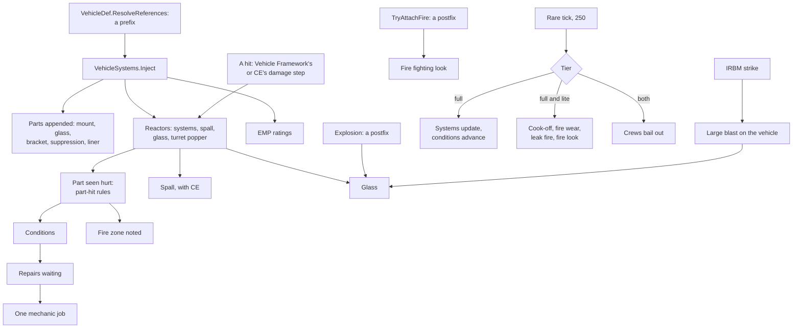

# Vehicle damage

**Status (23 Nov 2026):** living; written from the code at D'thorga Framework 0.268.0, Vehicles 0.114.0 and Patches 0.40.0. Built:
conditions on Vehicle Framework's parts, our Health tab, repairs that need supplies, knocked-out weapons, tracks, gear and crews,
spall and liners, glass, armour classes, fire (wear, zones, extinguishers, suppression, cook-off, leaks, tyres), Vehicle
Framework's stuck fires, EMP and large blasts. **Passed in game by the owner:** rows 24, 123, 128 and 158; row 19 in part. **Not
yet tested in game:** everything else, including spall, glass and fire fighting.

This page says how a vehicle is hurt, what it loses and how it is mended now. Why it is this way is in the [decision
log](../decisions/vehicle-damage.md) and the [archived records](#why-it-is-this-way). Lost engine power, gearbox and clutch faults
are on [engines and drivetrains](engines-and-drivetrain.md); how the vehicle code is laid out is in [How the code is
built](../architecture.md).

## Read this first (gotchas)

- **Vehicle Framework's part health is the one health figure. We never add a second.** A condition is a severity from 0 to 1 on
  one part, keyed by the part's key, never its position. It says only what health cannot (a hole that keeps leaking).
- **Two tiers, by faction.** The player's vehicles run the full tier; another faction's on a map run the lite tier; off a map,
  none. The lite tier counts hits and gives conditions but never advances them. Repairs that need supplies, field fixes and the
  fire's wiring short are full tier only.
- **Much works on every faction's vehicle with no tier at all**, because it hangs on Vehicle Framework's own hooks or on the
  design: weapon mounts, thrown tracks, turret popping, EMP ratings, body integrity, glass, spall, damage looks and large blasts.
  Fire wear, cook-off, leak fires, suppression and bail-out run on both tiers.
- **Parts we append are saved by key**, not by Vehicle Framework's list of positions, and each new kind is appended after the
  ones before it so older saves line up. **Never rename** `PhobosGlass`, `PhobosSpallLiner`, `PhobosWeaponMount`,
  `PhobosExtinguisherBracket`, `PhobosSuppressionEngine` or `PhobosSuppressionCrew`.
- **Body integrity leaves out our empty mounting points** (glass, liner, bracket, suppression), through a stat worker swapped in
  by XML, with no Harmony. The appended weapon mount does count.
- **Some parts are mended only with goods**: liner, glass, bracket and the two suppression parts are never mended free and never
  graded. Liner and glass are also left out of Vehicle Framework's health percentage.
- **Spall needs Combat Extended**, with CE's "Use New Vehicle Armor" on, read at each hit. Glass works with or without CE.
- **Armour classes are matched, not stored.** A part "is" a class only when its sharp and blunt figures equal the class's within a
  thousandth, on CE's scale with CE and Vehicle Framework's without. Another author's part shows no class.
- **Fire is the game's attached fire; the zones are ours.** The fire read is the biggest attached fire on the vehicle's own map.
- **Every rules Def is "first loaded wins"**, so another mod may patch it: knock-outs, spall, glass, fire wear, fire fighting and
  blasts, with cook-off and EMP figures in the vehicle rules. The C# defaults are fallbacks; the XML is what ships.
- **"Figures only, no consequences" is not honoured everywhere**: fire wear, cook-off, leak fires, short circuits and large blasts
  check it; spall, glass, tyre fires, suppression and bail-out do not (inferred from the code).
- **The player's crews leave only a burning vehicle**, never one that is merely stuck; other factions' crews leave both.
- **Every figure is authored unless the Def or rule names a source.** The armour classes' threats, the fire zones' spread and the
  hull's cut of a strike's dose name theirs.

## What it does

### Conditions and the Health tab

- **Six conditions ship**: holed radiator, cracked sump, shorted battery, holed fuel tank, shorted wiring and warped cylinder
  head. Hits give them: a part-hit rule adds severity per health lost, scaled by the part's fitting. Each runs inside the system
  that gave it (electrical, cooling, lubrication).
- **The warped head** needs a service from severity 0.4: machining it flat, 15 steel and 3 components, 3,000 work, at a dyno bay.
  Its worst stage costs engine power (on the engines page).
- **A condition clears** when a repair brings the part to full (unless it needs a service), when it fades, when a service lists
  it, or when the part is replaced.
- **A field fix** halves a condition's severity once and never clears it: 600 work and 1 component, above the mildest stage, once.
- **The danger clock** says when a draining quantity reaches its next notable stage, from the last hour's rate or the declared
  one, shown only within 72 hours.
- **Our Health tab** replaces Vehicle Framework's, unless "Keep Vehicle Framework's own Health tab" is on. Parts stand outside
  then inside; under each, its liner, glass, extinguisher or suppression state, "destroyed", what is waiting (replace, re-line,
  re-glaze, refill, recharge), grade, fitting, a fuel leak, system stages, conditions with their cause, the danger clock and
  "needs service". The part's tooltip gives its armour class and what it stops. Plain words: Good, Worn (0.7), Poor (0.4), Bad,
  Destroyed.
- **The damage sheet** draws the vehicle with its hurt parts' cells tinted. **Damage looks** show an overlay per part below a
  health share (0.7 as shipped) on seven of D'thorga Vehicles' designs, six with cracked-glass marks.

### Body integrity and destruction

Vehicle Framework destroys a vehicle when body integrity falls below 1 %. Ours sums only the parts that count, rounded to a
thousandth; with none it sums them all. A design without our systems is summed as Vehicle Framework sums it. A destroyed vehicle
can leave a hull (a setting of the vehicle stories), marked burnt out when it died burning.

### Repairs that need supplies

- **"Destroyed parts need replacing"** (on): a part at 0 waits for supplies in the cargo, and free repair leaves it alone.
  Player's vehicles only.
- **The cost** comes from the role's part supply (first that fits, else the default): an engine or transmission at 100 % of the
  whole part, any other at 50 % of its materials (two settings), or steel and components by health; 1,500 work by default. A
  salvaged grade can be paid in salvaged parts.
- **A replaced part** comes back at 0.25 of full in the field and 0.6 at a dyno bay, which also takes 0.7 of the work. Its
  conditions go.
- **A field re-fit** of a destroyed track or wheel brings it to 0.25, for twice a field fix's work, and it stays on the list until
  properly replaced.
- **One mechanic job** works the list in order: replacements, services, field fixes, re-fits, re-line, re-glaze, refill,
  recharge, fittings, taking supplies from the cargo.
- **A watchdog** stands mechanics down for 60,000 ticks when Vehicle Framework's free repair stops raising health.

### Knocked out, not destroyed

- **A weapon stops with its mount** at 0.1 of the mount's health, through Vehicle Framework's own component requirement on the
  turret templates. An author's own requirement, a weapon riding another and a static launcher are left alone. The mount is
  `MainTurret` or `PhobosPylons` where they exist, else an appended inner turret ring (60) or, on aircraft, weapon pylons (40).
  Under CE a hit raises the health event again so the requirement is read.
- **Weapon pace**: a mount at the stop line gives 0.55 pace; a hurt gunner never below 0.5; without power a turret is cranked at
  0.2 traverse and 0.5 aim; a cranked turret's accuracy is 0.6 on the move and 0.7 in poor visibility. Unpowered automatic
  weapons stop.
- **A thrown track**: a track part at 0 health stops the vehicle, past upgrade bonuses. Wheels stay averaged.
- **Working gear** names a load, quantity or engine it needs; without it, the player's vehicle refuses the work.
- **A turret blown off**: on designs with an ammunition rack and a main turning weapon, a 0.25 chance a hit once the rack is at
  0.25 health, 0.3 after each cook-off blast. It needs CE's ammunition system; an author's own popper stands.
- **Crew in danger**: a burning vehicle, or one that cannot move and has no working weapon. Other factions get out at once. The
  player's crew leave a burning vehicle once it stops ("Your crews get out of a burning vehicle", on); otherwise the **Crew in
  danger** alert. The Systems tab shows crew, weapons, running gear and loads.

### Spall and liners (Combat Extended only)

- **When**: an outer plate of at least the Rifle class (8 mm sharp). A beaten face on a sharp hit throws beaten spall; a stopped
  hit throws shock spall if explosive with 30 damage or more, or sharp with penetration at 0.75 of the plate's armour or more
  ("Heavy hits shake spall loose").
- **How much**: a pool of 0.5 (beaten) or 0.25 (shock) of what the plate took by CE's own armour function. Under 0.5 throws
  nothing.
- **A liner** stops 0.7 of the pool when whole, falling to nothing at 0.25 health; above 0.5 it keeps the spray to one cell. It
  loses 0.5 health per point stopped, and lines only the plates on its cells.
- **Fragments**: three unlined, one behind a narrow liner, one for shock; each misses at 0.3, with a third of the plate's sharp
  armour as penetration, as CE's small fragment. They reach crew in enclosed seats and inner parts on those cells.
- **Liner state**: not fitted, sound, worn (0.5), spent (0.25). A re-line takes a panel per quarter missing (the Osprey's per
  sixth), 2,400 work; removing it refunds what is left. A panel is 20 synthread and 8 chemfuel, 25 kg.
- **Who has one**: our five trucks and the Osprey by upgrade, and another author's design marked `lined` (RimThunder's M2A3) with
  a 60-health liner born whole. "Also on other mods' vehicles" (on) spreads spall to every CE design.

### Glass

- **The part**: `PhobosGlass`, 40 health, inside, on the cab's cells, hit weight 0.05, not counted, on every closed-cab design
  with our loadout unless it is a trailer or marked `noGlass`, and on an open one marked with a windscreen. **States**: sound,
  cracked below 0.7, gone at 0. **Kinds**: ordinary, armoured (the armoured-cab upgrade, or another author's armoured design),
  vision blocks (tracked loadouts) and windscreen (an open vehicle that keeps one, such as the open-top Humvee).
- **Open or closed** is one answer for the cab and the glass: a marking first, then a loadout that says open, then a ground
  vehicle whose author marked every seat exposed counts as open; otherwise closed. Aircraft are left out, as their exposed seats
  sit under a canopy.
- **What breaks it**: a hit on a plate over it passes 0.6, 0.15 or 0.1 of the damage by kind (a windscreen 0.3); an explosion out
  to 2.5 × its radius, falling off, at 1, 0.25 or 0.2; fire at 0.6 of the glass an hour at full fire; a strike.
- **Splinters** ("Breaking glass cuts the people behind it", on): ordinary glass cuts once when a third goes at once and twice
  when it goes; armoured once when gone; a windscreen once as it goes, reaching open front seats. Each a 3-point cut to the upper
  body, one in twenty to an eye.
- **The driver's view** scales the speed cap on land: cracked 0.75 in the dark or bad weather, else 0.9; gone 0.8 in bad weather;
  vision blocks 0.85 cracked, 0.6 gone.
- **Gone glass** opens the cab (a windscreen's going changes no shelter): the Windows button goes, smoke clears as in an open cab,
  and an aircraft's canopy no longer pressurises.
- **Re-glazing**: one laminated pane plus a pane per third missing (ordinary), three armoured panes per whole, or four blocks per
  whole; a windscreen one laminated pane; 400 + 1,200 × missing work. A crack sound, a logbook line and a "glass gone" alert.

### Armour classes and the wider target

- **Eight classes**, each a sourced threat with authored figures: skin (2 mm), splinter (5), rifle (8), AP rifle (15), heavy
  machine gun (30), heaviest machine gun (38), autocannon (48), heavy autocannon (75), with CE's sharp and blunt ratings beside.
- **Kits add by class**: `scripts/check-vehicle-armour.py` checks every part sits on one class on both scales, one outer part to a
  cell, and every set of compatible kits sums to a class.
- **The wider target** under CE: a design with `hitWidthCells` gets a hit box that wide, through CE's own callback list (no
  Harmony): 3, 4 or 5 cells on the five trucks, the Osprey and the combine. Parts we append go inside on such a design.

### Fire

- **Seeing it**: an attached fire on a multi-cell thing counts as burning, which the game's own check misses.
- **Fire wear** every rare tick, both tiers ("Other factions' vehicles burn as yours do", on): each role loses its share an hour ×
  the fire's size, never below 0.1 of its rate while burning: radiator and belt 0.5, wheels and hydraulic lines 0.4, battery and
  fuel tank 0.3, brakes 0.2, glass 0.6. A ground fire under a fireproof vehicle wears its soft parts ("Fire underneath burns
  fireproof vehicles' tyres and hoses", on). Full tier: wiring shorts at 0.3 an hour at full fire.
- **Zones**: a fire starts in the zone of the part hit in the last 3 minutes, else the engine bay; it spreads from running gear to
  the engine after 0.4 hours, and from the engine to the crew after 0.25 (after Papageorge and Colwell, SAE 2024-01-2502, and
  McCormick and Clauson, TARDEC 2006).
- **The extinguisher**: a bracket on every non-trailer design of our loadouts takes a fitting with 3 charges, each knocking a fire
  down by 0.75 (out below 0.1). Someone aboard uses it, else the nearest free colonist is sent. A mechanic refills it.
- **Automatic suppression**: engine-bay and crew systems, by upgrade on our trucks or as a fitting on another author's armoured
  design. It discharges when its zone burns; the fire shrinks by the zones left or goes out; then it is spent until recharged.
  A "Fire protection spent" alert.
- **Cook-off** ("Ammunition aboard can cook off in a fire", on; needs CE's ammunition system): a blast every half hour on average
  at full fire, each using a quarter of the prone ammunition aboard (2 kg at least); radius 1.5 + 0.6 ∛kg, damage 10 + 6 ∛kg.
- **A leaking tank** ("Leaking fuel feeds a vehicle fire", off) lights a ground fire beneath it at 3 × fire size an hour.
- **Tyres** on wheeled designs smoulder 2 hours after the gear's fire is out and relight at 1 an hour unless it rains ("Burnt
  tyres can light again", on); they can burst while burning, an 8-damage blast that spares the vehicle ("Burning tyres can burst",
  off).
- **Short circuits** in the grid short the wiring of a player's vehicle parked on the shorting net.
- **Under CE** the extinguishing step Vehicle Framework skips is run by name.

### Fires that never go out (D'thorga Patches)

Vehicle Framework can leave a fire attached to a vehicle after it leaves the map, or several at once. D'thorga Patches puts every
attached fire out as a vehicle leaves its map, and on the rare tick every fire not on the vehicle's map and every fire after the
first, telling the player.

### Blasts and EMP

- **EMP ratings**: electrical roles get a moderate rating on civilian designs and minor on military ones, unless the author rated
  them. RimThunder's and mechanical designs are never stalled. The hardening kit lowers a rating to the military one. Under CE the
  skipped EMP step is run by name.
- **Large blasts** (an IRBM strike, through the core's large-blast hook): in the fireball everyone aboard dies and the vehicle is
  gone. Otherwise severity is the wind × √(20 t / kerb tonnes): 1 or more wrecks it, 0.02 or more batters it. Battered, outer
  parts lose up to 0.8 and inner 0.2 of health at severity 1, ±50 %; heat from 0.3 takes the soft parts. The glass is struck; a
  running engine takes the pulse as EMP. Crews take 25 blunt × severity.
- **The hull's cut of the dose** for people aboard: open 1; closed under 15 t 0.9, 15 to 40 t 0.7, 40 t or more 0.35 (after
  Davidson, 1979; Glasstone and Dolan 1977 §5.86 and Operation Teapot WT-1123 for the blast). A vehicle is sheltered only when
  every cell is. "Vehicles in the strike" (D'thorga Patches, on).

## How it works

**At start-up, once per design**: a prefix on `VehicleDef.ResolveReferences` chooses a loadout and applies it: parts appended,
weapon mounts tied, tracks found, the turret popper, glass, fire fighting, a marked liner, reactors and EMP ratings. With CE,
every design gets the spall reactor on its outer parts, loadout or not. The Health tab is swapped in.

**On a hit**, Vehicle Framework's or CE's damage step calls the reactors. Ours compares the part's health with what it last saw;
a loss runs the part-hit rules (conditions), notes the fire zone, and bumps the Health tab's version. Spall and glass react on
their own. Explosions reach the glass through a postfix on `Explosion.StartExplosion`.

**Every rare tick** (250 ticks): the full tier updates its systems and advances conditions, then cook-off, fire wear, leak fires,
the fire look (zones, spread, tyre bursts, suppression) and bail-out. The lite tier sweeps part health (CE writes it without an
event), then the same fire steps and its own bail-out. D'thorga Patches' postfix clears stray fires.

**Nothing runs every tick** but the fire-fighting component's check of an empty list.

## Code

All under `src/PhobosFramework.Vehicles/` unless named.

| File | What it holds |
| --- | --- |
| `Systems/VehicleConditions.cs`, `Defs/ConditionDefs.cs` | Conditions: the list, stages, fading, services |
| `Systems/VehicleRepairs.cs` | Repairs that need supplies, field fixes, re-fits, the job's list |
| `Systems/CompPhobosVehicleSystems.cs` | Hits, tiers, the rare tick, the fire share, wear by role |
| `Systems/CompPhobosDamageLooks.cs`, `Systems/VehicleStatWorker_PhobosBodyIntegrity.cs`, `Rules/IntegrityRule.cs` | Looks; integrity |
| `Service/WeaponMounts.cs`, `Mobility.cs`, `TurretPace.cs`, `TurretPacePatches.cs`, `TurretPopping.cs`, `CrewBailOut.cs`, `Feeds.cs` | Knock-outs |
| `Rules/WeaponMountRule.cs`, `MobilityRule.cs`, `TurretPowerRule.cs`, `CrewRule.cs`, `Defs/KnockOutDefs.cs` | Knock-out rules |
| `Service/Spall.cs`, `Rules/SpallRule.cs`, `Defs/SpallDefs.cs` | Spall and liners |
| `Service/Glass.cs`, `GlassBlastPatch.cs`, `Rules/GlassRule.cs`, `Defs/GlassDefs.cs` | Glass |
| `Armour/ArmourDefs.cs`, `Armour/CombatExtendedHitWidth.cs`, `src/PhobosFramework/Rules/ArmourClassRule.cs` | Classes; CE hit box |
| `Service/FireWear.cs`, `FireFighting.cs`, `CookOff.cs`, `LeakFire.cs`, `TyreFire.cs`, `ShortCircuits.cs` | Fire |
| `Rules/FireWearRule.cs`, `FireFightingRule.cs`, `CookOffRule.cs`, `Defs/FireWearDefs.cs`, `FireFightingDefs.cs` | Fire rules |
| `Service/VehicleBlasts.cs`, `VehicleEmp.cs`, `Rules/VehicleBlastRule.cs`, `EmpRule.cs`, `Defs/VehicleBlastDefs.cs` | Blasts and EMP |
| `Service/VehicleHulls.cs`, `VehicleStory.cs` | Hulls; logbook lines |
| `Presentation/ITab_PhobosVehicleHealth.cs`, `DamageSheet.cs`, `HealthWords.cs`, `ITab_VehicleSystems.Knocked.cs` | Health tab, cards |
| `Presentation/Alert_PhobosGlassGone.cs`, `Alert_PhobosLinerSpent.cs`, `Alert_PhobosCrewInDanger.cs` | Alerts |
| `Service/Patches.cs` | Thrown track, free repair, liner and glass out of health, the systems reactor |
| `src/PhobosFramework/Environment/AttachedFires.cs`, `LargeBlasts.cs` | Fires on things; the blast hook |
| `src/PhobosPatches.VehicleFramework/`, `src/PhobosPatches.Irbm/Strike/StrikeWork.cs` | Stuck fires; a strike's vehicle route |

## Defs and XML

The modders' types, linked to [the reference site](https://phobos-dthorga.github.io/phobos-rimworld/):

- **[`PhobosVehicleConditionDef`][d1]**: `stages`, `fadePerHour`, `clearsOnRepair`, `needsServiceFrom`, `service`,
  `fieldFixable`. `ConfigErrors` wants at least one stage, stages in order within 0 to 1, and a service where one is needed. Six
  ship in `Conditions.xml`. A part-hit rule's `condition` gives one.
- **[`PhobosKnockOutRulesDef`][d2]**: mounts, tracks, pace, power, crank aim, re-fit, turret popping, bail-out.
- **[`PhobosSpallRulesDef`][d3]** and the liner node **[`PhobosSpallLinerUpgrade`][d4]** (`panels`; six nodes).
- **[`PhobosGlassRulesDef`][d5]**: part health and label, the four goods, re-glaze work, the armoured-cab node.
- **[`PhobosFireWearRulesDef`][d6]**: `roles` (role, share an hour, soft), the least share, wiring.
- **[`PhobosFireFightingRulesDef`][d7]**: role zones, spread hours, extinguisher, suppression, `armouredFrom`, leaks, tyres; with
  the suppression node **[`PhobosSuppressionUpgrade`][d8]** (`zone`; ten nodes in five trees).
- **[`PhobosVehicleBlastRulesDef`][d9]**: weight, shares, soft roles, crew harm, hull shares.
- **[`PhobosArmourClassDef`][d10]** (eight) and the extension **[`PhobosArmourExtension`][d11]** (`hitWidthCells`,
  `appendedPartsInside`).
- **[`PhobosFittedEquipmentExtension`][d12]**: marks another author's design `armoured`, `lined`, its `glass` kind, or `noGlass`.
- **[`CompProperties_PhobosDamageLooks`][d13]**: `looks` (part, health below, overlay).
- **Reactors** usable from XML by full name: `Reactor_PhobosSpall`, `Reactor_PhobosGlass`, `Reactor_PhobosTurretPopper`,
  `Reactor_PhobosVehicleSystems`. The stat worker `VehicleStatWorker_PhobosBodyIntegrity` is set by `BodyIntegrity.xml`.
- **In `PhobosVehicleRulesDef`**: cook-off and EMP figures, field fixes, replaced parts' health, the dyno bay's share of work, the
  danger clock and the repair watchdog. **Schema**: `PartHitRule` (`condition`, `perHealthLost`, `perShareLost`),
  `PartToAdd.countsTowardDestruction`, `Effect_AddCondition`, `When_GlassGone`.

`python scripts/check-vehicle-schemas.py` and `python scripts/check-vehicle-armour.py` read them offline.

[d1]: https://phobos-dthorga.github.io/phobos-rimworld/api/Phobos.VehicleSystems.PhobosVehicleConditionDef.html
[d2]: https://phobos-dthorga.github.io/phobos-rimworld/api/Phobos.VehicleSystems.PhobosKnockOutRulesDef.html
[d3]: https://phobos-dthorga.github.io/phobos-rimworld/api/Phobos.VehicleSystems.PhobosSpallRulesDef.html
[d4]: https://phobos-dthorga.github.io/phobos-rimworld/api/Phobos.VehicleSystems.PhobosSpallLinerUpgrade.html
[d5]: https://phobos-dthorga.github.io/phobos-rimworld/api/Phobos.VehicleSystems.PhobosGlassRulesDef.html
[d6]: https://phobos-dthorga.github.io/phobos-rimworld/api/Phobos.VehicleSystems.PhobosFireWearRulesDef.html
[d7]: https://phobos-dthorga.github.io/phobos-rimworld/api/Phobos.VehicleSystems.PhobosFireFightingRulesDef.html
[d8]: https://phobos-dthorga.github.io/phobos-rimworld/api/Phobos.VehicleSystems.PhobosSuppressionUpgrade.html
[d9]: https://phobos-dthorga.github.io/phobos-rimworld/api/Phobos.VehicleSystems.PhobosVehicleBlastRulesDef.html
[d10]: https://phobos-dthorga.github.io/phobos-rimworld/api/Phobos.VehicleSystems.PhobosArmourClassDef.html
[d11]: https://phobos-dthorga.github.io/phobos-rimworld/api/Phobos.VehicleSystems.PhobosArmourExtension.html
[d12]: https://phobos-dthorga.github.io/phobos-rimworld/api/Phobos.VehicleSystems.PhobosFittedEquipmentExtension.html
[d13]: https://phobos-dthorga.github.io/phobos-rimworld/api/Phobos.VehicleSystems.CompProperties_PhobosDamageLooks.html

## Settings

D'thorga Framework's vehicle systems settings. The full text is in the generated [settings
reference](../settings-reference.md#dthorga-framework-and-dthorga-vehicle-systems); the strike's is under [D'thorga
Patches](../settings-reference.md#dthorga-patches).

| Label | Default | Page, section |
| --- | --- | --- |
| Ammunition aboard can cook off in a fire | On | Dangers and raids |
| Other factions' vehicles burn as yours do | On | Dangers and raids |
| Fire underneath burns fireproof vehicles' tyres and hoses | On | Dangers and raids |
| Your crews get out of a burning vehicle | On | Dangers and raids |
| Leaking fuel feeds a vehicle fire | Off | Dangers and raids |
| Burnt tyres can light again | On | Dangers and raids |
| Burning tyres can burst | Off | Dangers and raids |
| Beaten armour throws spall inside | On | Dangers and raids, Spall inside vehicles |
| Vehicles' glass cracks and breaks | On | Dangers and raids, Spall inside vehicles |
| Breaking glass cuts the people behind it | On | Dangers and raids, Spall inside vehicles |
| Also on other mods' vehicles; Heavy hits shake spall loose | On (shown with spall on) | Dangers and raids, Spall inside vehicles |
| Destroyed parts need replacing | On | Repairs, service and fittings, Repairs |
| Replacing an engine or transmission costs / any other part costs | 100 % / 50 % | Repairs, service and fittings, Repairs |
| Field fixes | On | Repairs, service and fittings, Repairs |
| Keep Vehicle Framework's own Health tab | Off (needs a restart) | Display, sound and stories |
| Vehicles in the strike | On | D'thorga Patches, IRBM: after-effects |

Glass and splinters sit under the "Spall inside vehicles" heading. No knock-out figure is a player setting; they live in the
knock-out rules Def.

## Saved data and removal

- **Conditions** under `PhobosVehicleSystems_Conditions` (Def, part, role, system, severity, field-fixed, cause; the stage is
  rebuilt). **Repairs**: `PhobosVehicleSystems_FieldFixRequested` and `_FieldRefitted`.
- **Every appended part's health**, liner and glass included, by key under `PhobosVehicleSystems_PartHealth`, put back on load.
- **Fire fighting** under `PhobosFireFighting_*`: burning zones and their times, extinguisher charges (−1 when never fitted),
  spent systems, smoulder. A burnt-out hull saves `PhobosHull_BurntOut`.
- **Derived, never saved**: weapon mount requirements, track keys, the popper, EMP ratings, reactors, turret pace, the fire share,
  the last hit's zone and the damage looks.
- **On load**: a condition whose Def is gone is dropped with one log line; one whose part is gone, at the next update. A liner not
  fitted loads as nothing. The liner and suppression nodes never re-run on load, so the saved state stands.
- **Removal**: the uninstall sweep clears conditions, saved part health and fittings. With the mod gone, the requirements,
  reactors and appended parts go with their Defs ([How the code is built, Saves and
  removal](../architecture.md#saves-and-removal)).

## Tie-ins

Every tie-in is in the [tie-in register](../tie-in-register.md).

- **Vehicle Framework**: parts, reactors, component requirements (by name), the stat worker by XML, its health events, and Harmony
  on free repair, the health percentage, EMP and the thrown track's speed.
- **Combat Extended**: its armour function and hit step by name, "Use New Vehicle Armor", its fragments, the collision-box
  callback list, its ammunition system for cook-off; we run the EMP and extinguishing steps it skips.
- **RimThunder**: its ammunition rack for turret popping, `MainTurret` as the mount, never stalled by EMP, the M2A3 marked lined.
- **The Harrier**: D'thorga Patches' `PhobosPylons` as its weapon mount.
- **InterRim Ballistic Missile**: the strike asks the large-blast hook for each vehicle; the dose aboard goes to Rimatomics or
  D'thorga Medical's radiation model, cut by the hull.
- **Any mod's vehicle**: glass on closed cabs with our loadout, spall on all under CE, suppression on armoured designs, and the
  fitted-equipment extension for marking.

## Performance

- **Measured** in the owner's game on 9 Nov 2026 (Framework 0.42.0, 12 full-tier and 3 lite vehicles): the whole vehicle model
  0.0076 ms a tick; a hit 0.0003 ms; the full-tier rare tick 0.131 ms on average (over its 0.1 ms budget); the lite tier's 0.014
  ms ([health record, Performance](../archive/vehicle-health-design.md#performance)). Nothing is measured since for spall, glass,
  fire or blasts.
- **Timed labels**: "vehicle hit", "vehicle rare tick / full", "vehicle rare tick / lite" and "health tab".
- **Shape of the cost**: the fire share read once a tick at most; the repair list rebuilt only when health or costs change; the CE
  hit box one lookup a call; turret pace once a real second; the crew alert every 250 ticks; fire services read nothing unless
  the vehicle burns. The glass's explosion hook walks the map's pawns once per explosion.

## Limits and known gaps

- **Fire on another map**: the fire share reads only fires on the vehicle's own map, but the fire look, the extinguisher and the
  player's bail-out read the biggest attached fire anywhere. Without D'thorga Patches a stray fire could hold zones and empty a
  crew (inferred from the code).
- **The hull's dose share** reads the closed cab from the loadout, so glass already gone does not open it.
- **A cook-off's blast** does not spare its own vehicle; a tyre burst does.
- **A strike never batters** the liner or bracket, and strikes glass only when the vehicle is not wrecked.
- **Turret popping needs CE's ammunition system**, as it follows cook-off.
- **The appended weapon mount counts toward destruction**, unlike the other mounting points.
- **The armour check** does not see parts our loadouts append at start-up, or a design marked by a patch.

## Tests

None of these is a test in game.

- **Rule tests**, `tests/PhobosFramework.Vehicles.Rules.Tests`: `IntegrityRuleTests`, `SpallRuleTests`, `GlassRuleTests`,
  `FireWearRuleTests`, `FireFightingRuleTests`, `VehicleBlastRuleTests`, `EmpRuleTests`, `CrewRuleTests`, `WeaponMountRuleTests`,
  `MobilityRuleTests`, `TurretPowerRuleTests`, `TurretPaceRuleTests`, `RoundThreeRuleTests`, `SystemRuleTests`.
  `tests/PhobosFramework.Rules.Tests`: `ArmourClassRuleTests`, `SeverityRuleTests`, `RepairRulesTests`, `PartHealthRuleTests`,
  `SalvageRuleTests`, `DetailTierTests`. `tests/PhobosPatches.Rules.Tests`: `AttachedFireRuleTests`, `StrikeRuleTests`.
- **Python**: `tests/test_check_vehicle_armour.py`, `tests/test_damage_prefix_runs_first.py`. **The self-test** in game includes
  `SpallSelfTest` (21 checks).
- **In game** ([test list](../in-game-test-pass.md)): **passed** 24, 123, 128, 158; **passed in part** 19; **waiting** 1, 2, 4, 6,
  29, 75, 92, 111, 112, 119 to 122, 124 to 127, 129, 137, 146, 150, 189, 222 to 225, 232, 260, 304, 305, 308, 332, 333, 339, 340,
  368, 375 to 377, 386 to 388, 394 to 399, 426, 442, 444, 445.

## Why it is this way

- **[The decision log](../decisions/vehicle-damage.md)**: every choice, one line each, with who made it and where.
- **Archived records**, kept unchanged for their history: [a pawn-like health model](../archive/vehicle-health-design.md),
  [knocked out, not destroyed](../archive/vehicle-knocked-out-systems.md), [spall](../archive/vehicle-spall.md),
  [glass](../archive/vehicle-glass.md), [armour](../archive/vehicle-armour.md), [fire on vehicles](../archive/vehicle-fire.md),
  [fires that never go out](../archive/vehicle-framework-fires.md).
- **Records kept in place** (they cover damage and another system): [nuclear strikes, vehicles and
  people](../nuclear-strike-effects.md), [militarised service vehicles](../vehicle-militarised-service-vehicles.md), [vehicle
  cross-links](../vehicle-crosslinks.md).
