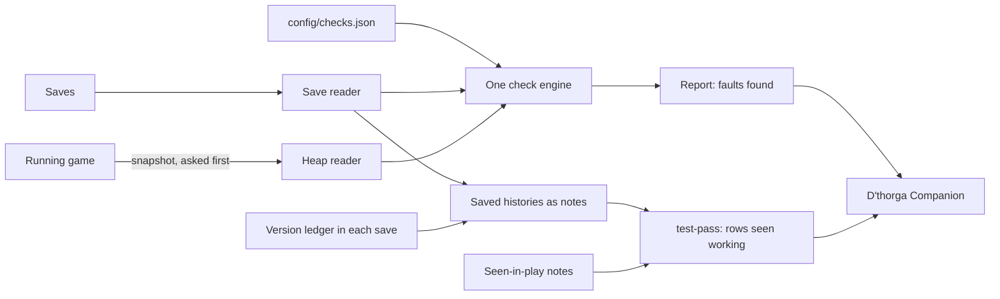

# Test automation: checks, saved histories and live looks (25 Nov 2026)

**Round two (26 Nov 2026):** at the owner's word ("Let's do #1 through #3", then "Don't forget to write it up as well, especially in
the Companion's own guide"): figures from saves as evidence (kit 1.129.0, three rules for rows 9 and 67), and the save checks run by
themselves in D'thorga Companion (0.101.0). Then, on their go-ahead ("build the graph history decoding too"), figures from the saved
graph histories (kit 1.130.0, three rules for rows 27, 71 and 101). The first live check on the owner's game waits for their save and
"go". See [Round two](#round-two-26-nov-2026).

**Status (26 Nov 2026):** At the owner's word ("let's do #1 through #3, and I especially want to do #4", then "Document everything
though"). Built: save checks (phobos-modkit 1.119.0), live checks (1.120.0), saved histories (1.121.0), the version ledger
(Framework 0.287.0), `config/checks.json` and the saved mapping, evidence for 26 more rows, and Companion 0.91.0's Run the checks.
Part 1's new notes are built in four batches (Framework 0.291.0 to 0.301.0, 26 Nov); two claims are left in [the rows still without
evidence](test-automation-rows.md). Live checks are untested on the owner's game; nothing here is tested in game or on screen.

The owner asked whether anything could (semi-)automate fulfilling the test list, "perhaps even our new debugging (and memory)
capabilities with Companion". Of ten options offered that day, the owner chose four. This record designs them; how each tool works
is written once, in phobos-modkit's docs, linked below as each is built.

## Read this first (gotchas)

- **Nothing here passes a test row.** The shared rule stands: nothing counts as tested until the owner says so. These tools find
  faults, and give the test list more evidence to put before the owner; the verdict stays theirs.
- **A live check pauses the game for about half a second**, as every heap snapshot does. **Agents ask before every one**, and ask
  the owner to save first; D'thorga Companion shows its card before every snapshot.
- **Save checks and saved histories only read saves**, from a copy, as every save tool does. They never attach to the game.
- **One new piece of saved state**: the version ledger in D'thorga Framework (part 3), a few lines in each save. It is what stops an
  old event passing for evidence on a newer row.

## Why: what the HEMTT showed (25 Nov 2026)

The owner's M1075 HEMTT held 975 steel in its work store from 24 Nov, 03:52 (save PG20) until the owner noticed it a day later
(Framework 0.286.2 fixed it). Every save in between held the fault, plainly: a store of 975 steel for five fittings needing about a
hundred. Nothing read it. A rule run over each new save would have flagged it the morning it began.

The test list showed the rest of the gap that day: 432 rows waiting, 185 of them with no seen-in-play note at all (so no amount of
play can flag them), 76 asking for a copy of a save and about 100 for a dev action.

## The four questions (phobos-modkit `rules/designs.md`)

These are testing tools; nothing here changes a colony, except the version ledger's few saved lines.

| Question | Answer |
| --- | --- |
| What does it let the owner do? | Learn of a wrong state in their colony from the saves they already make, or from one click in Companion, before they notice it in play; see more test rows flagged as seen working without playing any differently |
| What does it stop them doing? | Nothing in the game. In the tools: an event older than a row's change can no longer stand as evidence for it |
| How does it change the way they test? | Companion's pages say what the checks found; the Tests page gains sightings read from saves. Live checks are a button behind the snapshot card |
| What outside the thing notices? | Nothing in the game: by design, as for every testing tool. The game pauses for half a second at a live check |

**Risk (agent's proposal, owner to confirm):** none to the colony. Save tools read copies; a snapshot only reads. The ledger adds
saved state, which a save keeps if D'thorga Framework is removed; the game logs that it could not load it, as for any removed mod's
component. It needs no setting of its own.

## The parts

### 1. Notes for the rows that have none

185 rows waiting on the owner have no seen-in-play key, so no play can flag them. **A first batch gains notes** where one call at
the point the behaviour happens says it ran, chosen where the row's claim is a mechanic rather than a look (a picture, a sound or a
colour needs the owner's eyes whatever is noted). The rest are listed in this record by what they need: a note, saved evidence
(part 3), or the owner's eyes only. Rules as before (`src/AGENTS.md`): each note behind `Seen.Wants`, its key in
`config/test-evidence.json` in the same change.

### 2. Save checks: rules run over each save

A check is data: what to read from a save, and what counts as wrong. The engine is game-free, in phobos-modkit; RimWorld's reading
of a save is its adapter; the checks themselves are this repository's, in `config/checks.json`.

| Kind of check | What it catches | Example |
| --- | --- | --- |
| A rule over read values | A state the design says cannot happen | A work store holding many times what its waiting work needs |
| Numbers | NaN or infinity saved anywhere in our values: the mark of a division by nothing | A coolant temperature saved as NaN |
| References | A saved reference to a thing that is not in the save: the game drops it on load, with an error | A hitch's trailer that no longer exists |

**A rule** names the things to read (by def or class), the values (by their path in the thing's saved data, as `rimworld-save thing`
shows them, with `*` over a list's items), an optional condition saying which things it applies to, a condition for a fault, and the
sentence it says. Conditions are small expressions: names, numbers, comparisons, `and`, `or`, `not`, arithmetic, and `sum`, `count`,
`max`, `min`, `any`, `all`, `abs`. Anything else is refused when the file is read, so a check file can never run code.

**A level:** `fault` (the design says it cannot happen) or `look` (worth a look; may be fine). *Agent default.*

**Where it runs:** on the command line (`rimworld-save checks`), and in D'thorga Companion's "Since you last played" for the newest
save. *Agent default:* the newest save, with `--save` for another.

### 3. Saved histories as evidence

Our vehicles keep an event log in each save (Framework 0.84.0, `VehicleEventLog`): every stage worth a look entered, each service, new
fault and jump-start, with its tick, for 15 days and up to 64 events. D'thorga Framework's Logbook keeps the colony's notable events
the same way. **Read from saves, these become notes** in the seen-in-play format, written by the kit, so test-pass reads them beside
the game's own: expectations, parts and order rules work unchanged. Because the log keeps every vehicle's every stage (the game's
notes are once per session per thing and case), **order rules such as "a warning before a refusal" can be judged on every
occurrence**.

**The difficulty: which version wrote an event.** A save does not record our mods' versions, and a note older than the row's change
must count as stale. **The version ledger** (D'thorga Framework) solves it: a game component that records, at each load, each
D'thorga mod's version with the tick it began running, only when it changed. A saved event's tick then names the version exactly.
**An event from before the ledger's first entry has no known version and is never counted as fresh**: honest, at the cost of
evidence from saves made before the ledger.

**Which saves:** *agent default*, the newest four in the Saves folder (`saves` in the mapping), the same event (thing, key, case,
tick) counted once, from the oldest save holding it. Four keeps a first run to seconds per new save; the event log's 15 days reach
back further than four saves in the owner's play anyway.

**The mapping** lives in `config/test-evidence.json` beside the rows: which saved lists become notes, and the keys they make
(`saved.vehicle-stage.<quantity>`, `saved.vehicle-service.<system>`, `saved.vehicle-fault.<condition>`,
`saved.vehicle-jump-start`, `saved.logbook.<kind>`), with the stage as the note's case.

### 4. Live checks: one snapshot, many checks

The heap reader (phobos-modkit 1.65.0; D'thorga Companion's Explorer) reads a snapshot of the running game. **A new request reads
named fields from every object of a kind**, following links and opening lists, in one pass; the same check engine then judges them.
One snapshot answers every live check in the file.

**What a snapshot sees that a save cannot:** state that is never saved (caches, pending work lists, link networks, reservations),
our objects that should have gone (a destroyed vehicle's parts still held), and collections that only grow.

**Paths** follow fields by name through links (`parent.def.defName`); `[]` opens a list, array, set or dictionary's values into its
items; a final `#` gives a collection's count without reading its items. *Agent default:* up to 1,000 items opened per object, and
5,000 objects per kind, each limit said in the report when reached.

**Where it runs:** `rimworld-perf look-check` on the command line, after asking; and a "Run the checks" button on Companion's Explorer
page, behind its snapshot card.

## What a next game needs

| Part | Game-free (phobos-modkit) | A game supplies |
| --- | --- | --- |
| Check engine, expressions, report | All of it | Nothing |
| Save checks | The engine | A save reader that gives a thing's values by path (RimWorld's: `rimworld-save`'s index and thing reader) |
| Saved histories | The note writer, the de-duplication | Where each list lives in its saves, and a version ledger in its own mod library |
| Live checks | The heap reader and its new request | Only a .NET game: its install's runtime folder, as its adapter already names for looking inside |

## Agent choices, owner to revise

- A check's two levels, `fault` and `look`.
- Save checks run on the newest save by default.
- Saved histories read the newest four saves, the same event counted once.
- Save checks and live checks start with the rules in As built, all on vehicles; the work store's 300 and 100 are authored lines.
- A saved order problem is a lead, not a fault (the event log's hourly merge, under Limits).
- An event older than the ledger is never fresh evidence.
- Live check limits: 1,000 items per object, 5,000 objects per kind.
- The first batch of new notes: chosen by the agent, as listed below once built.

## Build steps

| Step | Where | What | State |
| --- | --- | --- | --- |
| 1 | phobos-modkit | The check engine, its expressions, and save checks for RimWorld (`rimworld-save checks`) | Built, 1.119.0 |
| 2 | phobos-modkit | The heap reader's `values` request, and live checks (`rimworld-perf look-check`) | Built, 1.120.0 |
| 3 | phobos-modkit | Saved histories as notes, read by test-pass itself (not a report of their own: see As built) | Built, 1.121.0 |
| 4 | phobos-rimworld | The version ledger in D'thorga Framework; `config/checks.json`; the saved-history mapping; the kit's pin | Built, Framework 0.287.0 |
| 5 | phobos-rimworld | Evidence for rows that have none: saved keys first, then a batch of new seen-in-play notes | 26 rows mapped (25 Nov); 3 by `logged` stages (Framework 0.290.0); 13 by the first batch of notes (0.291.0); 12 by the second (0.295.0); 7 by the third (0.298.0, Medical 0.27.0, Patches 0.45.0); 21 by the fourth (0.301.0, Radio Framework 0.17.0), with the held-back pairs narrowed by case or listed under `shared`; 2 note claims left in [the rows still without evidence](test-automation-rows.md): row 28's oil burn, and row 169, whose work another mod's code does |
| 6 | D'thorga Companion | Save checks on its Reports page (kit 1.122.0 finds the check file through the games list); Run the checks on the Explorer page, from the snapshot held (kit 1.123.0) | Built, Companion 0.91.0; untested on screen |

## As built (25 Nov 2026)

### How to use it

| Question | Command | Notes |
| --- | --- | --- |
| Is anything in my newest save wrong? | `python scripts/query-save.py checks` | `--save PG20` for another; `--check "work-store*"` for some |
| Is anything in my running game wrong? | `python scripts/perf.py look-check --freeze` | **Ask the owner first, and ask them to save**. On the owner's game a snapshot has no room (below), so `--freeze`: the game stands still for the read (28.6 s, 27 Nov 2026), 120 s at most |
| What has the test list seen, saves included? | `python scripts/test-pass.py report` | `--no-saves` to leave the saves out; first run of a new save indexes it |
| Where are the rules? | `config/checks.json` | Language: phobos-modkit `docs/checks.md`. A new rule that would have caught a fault goes in with its fix |

### What each part does, as built

- **Save checks** run the `save` checks in `config/checks.json` over a save: seven at first, all on vehicles. Two are kinds the kit knows
  (NaN or infinity saved; references to things the save does not hold), four are rules on values (battery, coolant and oil between 0
  and 1, no part below 0 health, the event log's 64 and the logbook's 200 caps), and one is "worth a look": a work store holding over
  300 things. **Over PG20 it finds the HEMTT's 981 things laid out for 5 fit orders**, a day before the owner did; the newest saves are
  clean. A thing another holds (the store's steel) is read from the index: its def, ID and stack count.
- **Live checks** run the `live` checks from one snapshot. Two at first, both "worth a look": a work store holding more than its waiting
  repairs and fittings could use (every option counted, plus an authored 100 for due services' supplies, which are not read), and a
  destroyed vehicle's systems still in memory (garbage or a leak: `perf.py look-why` tells them apart). **Not yet run on the owner's game.**
- **Saved histories**: test-pass reads the newest four saves' vehicle event logs and logbooks (about 350 notes on 25 Nov 2026) unless
  given `--no-saves`. Keys: `saved.vehicle-stage.<quantity>` with the stage's position in its list as the case (for `turbineStart`, 0 is
  "too weak to light" and 1 "barely enough to light"), `saved.vehicle-fault.<condition>`, `saved.vehicle-service.<system>`,
  `saved.vehicle-jump-start`, `saved.logbook.<entry kind>`. Rows 69 and 74 take them beside the game's notes, with three order rules.
- **The version ledger** (Framework 0.287.0): saves made before it hold none, so their notes are version 0 and stale for any row naming
  a version; evidence from them starts counting once the owner plays on with 0.287.0.

## Round two (26 Nov 2026)

The owner asked whether these abilities could be improved. Of seven offered, they chose the first three: run the live checks once on
their game; figures as evidence; save checks run by themselves. Nothing here passes a row, and **nothing is tested in game or on
screen**.

| # | What | Where | State |
| --- | --- | --- | --- |
| 1 | The first live check on the owner's game (`python scripts/perf.py look-check`) | phobos-modkit 1.132.0 (`--freeze`, and a fix) | **Run on 27 Nov 2026**: both live checks found nothing across 216 vehicles (below) |
| 2 | Figures as evidence: a save check's `note` makes figures from each thing into notes, which test-pass reads from the newest saves and `expect` judges | phobos-modkit 1.129.0; three rules in `config/checks.json`; rows 9 and 67 in `config/test-evidence.json` | Built; untested in game |
| 3 | Save checks run by themselves: each scan of Companion's page list runs every report the manifest marks with `waits`, and shows its count beside Reports, beside the report and on Home | phobos-modkit 1.129.0 (`waits`); D'thorga Companion 0.101.0 | Built; untested on screen |

### The four questions

| Question | Answer |
| --- | --- |
| What does it let the owner do? | Learn of a wrong state in their newest save the next time they look at Companion, with nothing pressed; see a row's figures read from their saves, judged against what the row expects |
| What does it stop them doing? | Nothing in the game. A figure that misses the row's expectation no longer passes for a sighting: it is listed apart |
| How does it change the way they test? | Saving while playing is enough for both: the next look at Companion checks the save, and the Tests page gains rows seen working by their figures |
| What outside the thing notices? | Nothing in the game: by design, as for every testing tool |

**Risk (agent's grade): none.** Both only read copies of saves; the kit indexes a new save once, in its own cache.

### The figure rules (26 Nov 2026)

Found by an agent's reading of the 162 claims "for the owner's eyes only", each probed on the owner's PG23 with a scratch check.

| Rule | Row | Figure and expectation | Seen in PG23 | Also a fault |
| --- | --- | --- | --- | --- |
| `grade-health-cherokee-chemtank` | 9 | `factor`: the chemtank's health over its 120; heavy-duty `1.01..1.3001` | VVE_Cherokee10681530, heavy-duty, 156 (1.3) | Above 156 |
| `extra-fuel-cherokee` | 67 | `share`: fuel over the stock 420; `1.01..1.7501` | Two Cherokees at 735 (1.75) | Above 735: the capacity that keeps growing |
| `extra-fuel-harrier` | 67 | `share`: fuel over the stock 250; `1.01..1.7501` | Harrier_Jet22544104 at 437.5 (1.75) | Above 437.5 |

**Agent choices, owner to revise:** one rule per graded part and per vehicle kind, since a rule cannot look a saved list up by a
value read from another path; only a Cherokee with one graded part is read (so the grade read is the chemtank's); a figure below
the range (a half-empty tank, a damaged part) simply does not count, rather than failing.

**Found on the way:**

- **A class select misses every jet**: the Harrier, A-10, Su-25 and Prowler save their own subclasses. Choose them by `def`.
- **Vehicle Framework saves its own parts by place**, not name (`statHandler/components/li[N]/health`): a rule on one names the place
  and the date. Parts our loadouts add are saved by name (`PhobosVehicleSystems_PartHealth[key]`).
- **The first scan found 6 faults in PG23**: jets saved with another jet mod's guns (row 555's rule). PG23 was saved at 14:28, before
  Patches 0.45.2 (14:55), which repairs them on load, so **the next save after a load with 0.45.2 should come up clean**: a free test of
  that fix.
- **HID_JLTV20213714 has had coolant level 0 for the whole saved day, its coolant temperature holding at 27 to 31 C in -15 C air.**
  Possibly holed in battle and nothing to cool, or a quantity that stops moving when empty. Not investigated.

### Figures from the graph histories (kit 1.130.0)

Every vehicle saves its last day of each quantity it shows, `PhobosVehicleSystems_History_<system>_<quantity>`: 240 samples, one each
tenth of an hour, base64 16-bit values scaled over the quantity's range (`QuantityHistory.cs`, `HistoryCodec`). The kit's `samples(text,
low, high)` reads them, and `first`, `last`, `at`, `tail`, `diffs` and `mean` take a level, a rate or a step. **The range in a rule
comes from the quantity's Def**: a wrong one gives wrong figures with no error. Derived quantities (flight control, crew oxygen) are in
the histories only.

| Rule | Row | Figure and expectation | When it reads | Design source |
| --- | --- | --- | --- | --- |
| `heavy-controls-flight-control` | 101 | `share`: flight control now over the day's best; `0.45..0.55` powered, `0.65..0.75` with manual reversion (A-10, Su-25) | Hydraulics below 0.4 now, sound (0.7 or more) earlier that day | Systems_Avionics.xml: FlightControl x 0.5, or 0.7 with manualReversion |
| `camp-night-heater-coolant` | 27 | `coolant` at the save `20..45`, and the lowest of the last 4 hours | A caravan's vehicle (a world object) with its night heater on, not electric | Systems_Cooling.xml: toward engineHeaterTarget 40, full below 35 |
| `camp-electric-night-heater` | 71 | `fall10h`: charge lost over ten hours `0.12..0.28`; `pack` at the save `10..20` | The same, electric, with no charging in the last ten hours | Systems_Electric.xml: nightHeaterShare 0.02 an hour, pack target 15 |

**How the owner gets these figures:** save while the caravan is still camped (rows 27 and 71), and while the aircraft's hydraulics are
low (row 101). A save made later, with the caravan moving or the fluid topped up, simply does not count. **None applies in PG23**: no
caravan was camped and no aircraft had heavy controls. Every rule was run over it without error.

**Agent choices, owner to revise:** a caravan is told by its place in the save (a world object) and the night heater switched on, since
only the player switches loads; the day's best flight control stands for the sound one; the ranges of each expectation.

**Found on the way, and looked into at the owner's word (26 Nov 2026): neither is a fault.**

- **Two other factions' vehicles on the world map, a VVE_Tango (22725564) and a VVE_Highwayman (22726608), seemed to hold coolant
  at 200 C and cab at 80 C for ten hours.** Their last update was about tick 49,985,800, 157 days before PG23 (tick 59,446,425):
  another faction's vehicle off a map is never updated, so **its history is its last day on a map**, frozen. That day was a fight:
  the Highwayman has a holed radiator, a shorted battery and a warped head (the mark of overheating). In PG23 all 48 other factions'
  vehicles were stale and all 32 of the player's fresh. **So every figure rule reads only the player's things** (`ofPlayer`, kit
  1.131.0, which also gives `now`, the save's tick).
- **The HEMTT (21684925) lost 0.215 of its charge over ten hours**, in two spells of about 3 A (hours 0 to 4 and 20 to 24 of its
  saved day), engine off, nobody aboard, its coolant following the air. **Its work lamps lit by themselves**: with "lights that
  switch themselves" on (the default), fitted lamps light in the dark on a vehicle standing still with the player's people within 8
  cells, an hour past the last of them, and only while the battery is over half full (Loadouts_Default.xml, workLamps). The game noted
  them lighting automatically three times on 26 Nov (`vehicles.work-lamps-lit`, Framework 0.301.2 to 0.311.1). The night heater,
  switched on, rightly never ran away from camp.
- **Some vehicles new to the world hold one or two samples**, a few dropping from full charge to nothing in one step: a rule on a
  history narrows by `count(samples(...))`.

### The first live check (27 Nov 2026)

The owner saved and said go. Two faults came first, neither in the game:

- **The live reader refused the check file**: it read the save checks too, and did not know the save adapter's kinds (`numbers`,
  `references`). Fixed in phobos-modkit 1.132.0: it reads only the checks it runs.
- **Windows refused the snapshot** (error 1450). A snapshot copies the game, which takes about its private memory in free commit:
  RimWorld held 21.3 GB, and the machine had 19.6 GB of commit left (63 GB of RAM and a fixed 35 GB page file, 78.5 GB in use).
  Of four ways offered (a larger page file, closing programs, freezing the game, leaving it), **the owner chose freezing**.
  phobos-modkit 1.132.0's **`look-check --freeze`** suspends the game's threads and reads it in place, with no copy, then always
  lets it go: when done, at 120 s, on Ctrl+C, and, if the reader is stopped first, by the reader's `thaw`, which the kit runs at once.

**The result:** the game stood still for 28,552 ms; **both live checks found nothing** (work stores holding more than their work
needs; destroyed vehicles' systems still held in memory), each over 216 vehicle systems. Afterwards all 90 of the game's threads
were running. **Agent default, owner to revise:** the 120 s freeze limit. Companion's "Run the checks" holds a snapshot (`serve`),
which never freezes, so on this machine it meets the same error 1450; it would need its own freeze button.

### Next, if wanted

- **More history rules**: rows 28 (oil burn, with engine hours from `Service_engineHours`), 29, 30, 34, 92 (an EMP's single drop:
  `min(diffs(charge))`), 144 and 396. Each needs a condition a save can show; the agent's reading has the figures.
- ~~Figures on notes we already write~~ **Built 27 Nov 2026 (Framework 0.337.0)**: `vehicles.part-replaced-in-field` (new, row 1)
  and `vehicles.part-replaced-at-rig` (row 36) carry the part's `share` of its maximum (0.25 and 0.6), and `vehicles.grade-done` a
  `factor` against the ungraded part (row 9, any part). Row 509's note already carried its brake wear (`health`).
- ~~Live figure notes~~ **Built 27 Nov 2026 (phobos-modkit 1.134.0)**: a live check's `note` is kept in the kit's cache
  (`live-notes/rimworld.jsonl`) with the installed version of its mod, and test-pass reads it. The first is row 58's
  `service-lead-watts` (`CompPhobosGeneratorSet.leadWatts`, 300 W, never saved).
- The agent's full reading, with every claim's verdict: kept in the session's scratch notes only; this section holds what it found.

### Limits

- **An event log keeps the same event once an hour** (Framework's own rule, for its graphs). An order rule can then miss a warning
  repeated within the hour and report a refusal as out of order. Treat a saved order problem as a lead, not a fault.
- Saved notes are only for the player's vehicles: our event logs and logbooks keep nothing for other factions'.
- A live check reads one instant: a list mid-rebuild can break a rule for that moment only. Run it again before believing a finding.
- Save checks read vehicles only, so far. Pawns (1,463 in the owner's colony) would take far longer; a pawn check should narrow its
  `select` by def.
