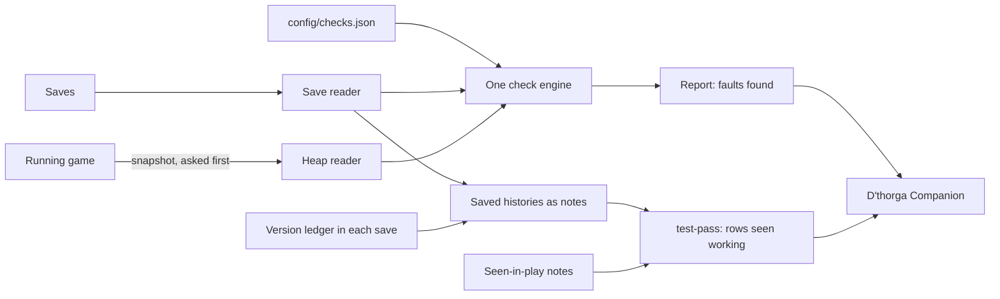

# Test automation: checks, saved histories and live looks (25 Nov 2026)

**Status (25 Nov 2026):** At the owner's word ("let's do #1 through #3, and I especially want to do #4", then "Document everything
though"). Built: save checks (phobos-modkit 1.119.0), live checks (1.120.0), saved histories (1.121.0), the version ledger
(Framework 0.287.0), `config/checks.json` and the saved mapping. Not yet built: part 1's notes batch and Companion's pages. Live checks
are untested on the owner's game; nothing here is tested in game.

The owner asked whether anything could (semi-)automate fulfilling the test list, "perhaps even our new debugging (and memory)
capabilities with Companion". Of ten options offered that day, the owner chose four. This record designs them; how each tool works
is written once, in phobos-modkit's docs, linked below as each is built.

## Read this first (gotchas)

- **Nothing here passes a test row.** The shared rule stands: nothing counts as tested until the owner says so. These tools find
  faults, and give the test list more evidence to put before the owner; the verdict stays theirs.
- **A live check pauses the game for about half a second**, as every heap snapshot does. **Agents ask before every one**, and ask
  the owner to save first; D'thorga Companion shows its card before every snapshot.
- **Save checks and saved histories only read saves**, from a copy, as every save tool does. They never attach to the game.
- **One new piece of saved state**: the version ledger in D'thorga Framework (part 3), a few lines in each save. It is what stops an
  old event passing for evidence on a newer row.

## Why: what the HEMTT showed (25 Nov 2026)

The owner's M1075 HEMTT held 975 steel in its work store from 24 Nov, 03:52 (save PG20) until the owner noticed it a day later
(Framework 0.286.2 fixed it). Every save in between held the fault, plainly: a store of 975 steel for five fittings needing about a
hundred. Nothing read it. A rule run over each new save would have flagged it the morning it began.

The test list showed the rest of the gap that day: 432 rows waiting, 185 of them with no seen-in-play note at all (so no amount of
play can flag them), 76 asking for a copy of a save and about 100 for a dev action.

## The four questions (phobos-modkit `rules/designs.md`)

These are testing tools; nothing here changes a colony, except the version ledger's few saved lines.

| Question | Answer |
| --- | --- |
| What does it let the owner do? | Learn of a wrong state in their colony from the saves they already make, or from one click in Companion, before they notice it in play; see more test rows flagged as seen working without playing any differently |
| What does it stop them doing? | Nothing in the game. In the tools: an event older than a row's change can no longer stand as evidence for it |
| How does it change the way they test? | Companion's pages say what the checks found; the Tests page gains sightings read from saves. Live checks are a button behind the snapshot card |
| What outside the thing notices? | Nothing in the game: by design, as for every testing tool. The game pauses for half a second at a live check |

**Risk (agent's proposal, owner to confirm):** none to the colony. Save tools read copies; a snapshot only reads. The ledger adds
saved state, which a save keeps if D'thorga Framework is removed; the game logs that it could not load it, as for any removed mod's
component. It needs no setting of its own.

## The parts

### 1. Notes for the rows that have none

185 rows waiting on the owner have no seen-in-play key, so no play can flag them. **A first batch gains notes** where one call at
the point the behaviour happens says it ran, chosen where the row's claim is a mechanic rather than a look (a picture, a sound or a
colour needs the owner's eyes whatever is noted). The rest are listed in this record by what they need: a note, saved evidence
(part 3), or the owner's eyes only. Rules as before (`src/AGENTS.md`): each note behind `Seen.Wants`, its key in
`config/test-evidence.json` in the same change.

### 2. Save checks: rules run over each save

A check is data: what to read from a save, and what counts as wrong. The engine is game-free, in phobos-modkit; RimWorld's reading
of a save is its adapter; the checks themselves are this repository's, in `config/checks.json`.

| Kind of check | What it catches | Example |
| --- | --- | --- |
| A rule over read values | A state the design says cannot happen | A work store holding many times what its waiting work needs |
| Numbers | NaN or infinity saved anywhere in our values: the mark of a division by nothing | A coolant temperature saved as NaN |
| References | A saved reference to a thing that is not in the save: the game drops it on load, with an error | A hitch's trailer that no longer exists |

**A rule** names the things to read (by def or class), the values (by their path in the thing's saved data, as `rimworld-save thing`
shows them, with `*` over a list's items), an optional condition saying which things it applies to, a condition for a fault, and the
sentence it says. Conditions are small expressions: names, numbers, comparisons, `and`, `or`, `not`, arithmetic, and `sum`, `count`,
`max`, `min`, `any`, `all`, `abs`. Anything else is refused when the file is read, so a check file can never run code.

**A level:** `fault` (the design says it cannot happen) or `look` (worth a look; may be fine). *Agent default.*

**Where it runs:** on the command line (`rimworld-save checks`), and in D'thorga Companion's "Since you last played" for the newest
save. *Agent default:* the newest save, with `--save` for another.

### 3. Saved histories as evidence

Our vehicles keep an event log in each save (Framework 0.84.0, `VehicleEventLog`): every stage worth a look entered, each service, new
fault and jump-start, with its tick, for 15 days and up to 64 events. D'thorga Framework's Logbook keeps the colony's notable events
the same way. **Read from saves, these become notes** in the seen-in-play format, written by the kit, so test-pass reads them beside
the game's own: expectations, parts and order rules work unchanged. Because the log keeps every vehicle's every stage (the game's
notes are once per session per thing and case), **order rules such as "a warning before a refusal" can be judged on every
occurrence**.

**The difficulty: which version wrote an event.** A save does not record our mods' versions, and a note older than the row's change
must count as stale. **The version ledger** (D'thorga Framework) solves it: a game component that records, at each load, each
D'thorga mod's version with the tick it began running, only when it changed. A saved event's tick then names the version exactly.
**An event from before the ledger's first entry has no known version and is never counted as fresh**: honest, at the cost of
evidence from saves made before the ledger.

**Which saves:** *agent default*, every save in the Saves folder, newest first, the same event (thing, tick, kind) counted once.

**The mapping** lives in `config/test-evidence.json` beside the rows: which saved lists become notes, and the keys they make
(`saved.vehicle-stage.<quantity>`, `saved.vehicle-service.<system>`, `saved.vehicle-fault.<condition>`,
`saved.vehicle-jump-start`, `saved.logbook.<kind>`), with the stage as the note's case.

### 4. Live checks: one snapshot, many checks

The heap reader (phobos-modkit 1.65.0; D'thorga Companion's Explorer) reads a snapshot of the running game. **A new request reads
named fields from every object of a kind**, following links and opening lists, in one pass; the same check engine then judges them.
One snapshot answers every live check in the file.

**What a snapshot sees that a save cannot:** state that is never saved (caches, pending work lists, link networks, reservations),
our objects that should have gone (a destroyed vehicle's parts still held), and collections that only grow.

**Paths** follow fields by name through links (`parent.def.defName`); `[]` opens a list, array, set or dictionary's values into its
items; a final `#` gives a collection's count without reading its items. *Agent default:* up to 1,000 items opened per object, and
5,000 objects per kind, each limit said in the report when reached.

**Where it runs:** `rimworld-perf look-check` on the command line, after asking; and a "Run the checks" button on Companion's Explorer
page, behind its snapshot card.

## What a next game needs

| Part | Game-free (phobos-modkit) | A game supplies |
| --- | --- | --- |
| Check engine, expressions, report | All of it | Nothing |
| Save checks | The engine | A save reader that gives a thing's values by path (RimWorld's: `rimworld-save`'s index and thing reader) |
| Saved histories | The note writer, the de-duplication | Where each list lives in its saves, and a version ledger in its own mod library |
| Live checks | The heap reader and its new request | Only a .NET game: its install's runtime folder, as its adapter already names for looking inside |

## Agent choices, owner to revise

- A check's two levels, `fault` and `look`.
- Save checks run on the newest save by default.
- Saved histories read every save in the folder, the same event counted once.
- An event older than the ledger is never fresh evidence.
- Live check limits: 1,000 items per object, 5,000 objects per kind.
- The first batch of new notes: chosen by the agent, as listed below once built.

## Build steps

| Step | Where | What |
| --- | --- | --- |
| 1 | phobos-modkit | The check engine, its expressions, and save checks for RimWorld (`rimworld-save checks`) |
| 2 | phobos-modkit | The heap reader's `values` request, and live checks (`rimworld-perf look-check`) |
| 3 | phobos-modkit | Saved histories as notes (`rimworld-save notes`), read by test-pass |
| 4 | phobos-rimworld | The version ledger in D'thorga Framework; `config/checks.json`; the saved-history mapping; the kit's pin |
| 5 | phobos-rimworld | The first batch of new seen-in-play notes |
| 6 | D'thorga Companion | Save checks in Since you last played; live checks on the Explorer page |
