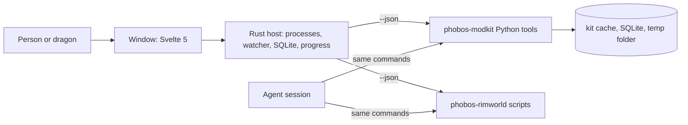

# Desktop front end for the Phobos tools: research and direction (9 Nov 2026)

**This round is research and record only (owner, 9 Nov 2026). Nothing here is built, and nothing has been tested on a
screen or in a game.** The record says what the owner decided, what the agent recommends and why, what two earlier
desktop programs of the owner's teach us, what the shared tool kit already has, and what would have to change in it.
Every claim about code names the file it was read from. Figures measured on the owner's PC are labelled as such and are a
best case for other players.

## Read this first

**Owner's decisions (9 Nov 2026):**

1. **A desktop program over every use of our tools, now and in the future.** The command-line tools answer agents; the
   program answers the person at the screen. "The tool will primarily serve those that are Human. Or Dragon."
2. **Primarily Rust, SQLite if a database is needed.**
3. **The look and feel of Republic Observatory**, the owner's Workers & Resources desktop program, with a **House D'thorga
   identity** rather than its Ministry of Planning one.
4. **A new sibling repository**, like Republic Observatory and Phobos Scope. phobos-modkit stays the engine.
5. **Research first.** This record, then a design, then code.
6. **OnAir WyrmGrid is the reference for the map**, instead of a throwaway drawing experiment this round.
7. **One program for every game the owner works on**, so moving between games does not lose the thread: "It'd stop me
   from losing focus as I change games over time."
8. **A plain, unassuming name: D'thorga Companion**, so players can look it up and remember it. The owner loved "D'thorga
   Eyrie" and set it aside for that reason: "It's all about brand awareness."

**Agent recommendations, for the owner to revise:**

- **Tauri 2 with Svelte 5 and TypeScript for the window, a Rust host behind it**, exactly Observatory's and WyrmGrid's
  stack. The owner's first lean was Rust throughout; the Rust still does the work, the web part only draws.
- **The Python tools stay as they are and run as processes.** The program calls them with `--json` and shows the result.
  Measured on the owner's PC on 9 Nov 2026: starting a Python process costs about 0.16 seconds; the queries themselves
  cost 0.2 to 2.7 seconds. Porting 11,200 lines of working Python to Rust would give the person nothing they could see.
- **MapLibre GL JS draws the planet**, as it draws WyrmGrid's Atlas, in its globe projection with our own tiles and no map
  of Earth underneath.
- **SQLite only, in two files outside any synced folder.** DuckDB, which Observatory added for history across saves, waits
  until a feature earns it.
- **The first version only reads.** Deploying, cleaning up, bumping versions and publishing come later, each behind a
  confirmation. Steam uploads never enter the program.
- **A small set of changes to phobos-modkit** make the program possible and are worth having without it. They are listed
  under "Where things live". None is built this round.

## Who it is for, and what it is not

The person at the screen asks a question about their game and gets an answer they can read, with pictures where a
picture says it better, without typing a command or reading a Markdown table. The owner reads fast, finds dense text
hard, and has unreliable fine motor control, so: the answer comes first, controls are big, nothing needs a drag or
appears only on hover, and everything is reachable from the keyboard
([player language](player-language.md)).

It is not a replacement for the command line. Agent sessions keep calling the tools as they do today; the program and
the sessions run the same code, so both always get the same answer. A "copy as command" button on every view lets the
owner hand a session exactly what they are looking at.

It never controls the owner's mouse or keyboard, never touches a save or the game's folders in its first version, and
never holds Steam credentials.

## What the person wants to know

Every question the tools answer today, grouped the way a person asks them. "Changes things" marks a tool that writes
outside the kit's cache; those stay out of the first version. The kit commands are in phobos-modkit's
`python/phobos_modkit/__main__.py` (14 commands); the project scripts are in `scripts/`.

| The question | Today's answer | What the screen needs | Changes things |
| --- | --- | --- | --- |
| Why did the game log errors? Was that fault mine? | `triage-log` (kit `rimworld-log`; `--show ID` for one message) | A grouped list, each group expandable to its full message; the mods involved | No |
| What is in my save? Who is where, with what? | `query-save` summary, things, pawns, hediffs, find, world, components | Sortable tables with a type-to-find box | No |
| What changed since my last save? | `query-save diff` | A two-column comparison | No |
| What is on the ground, under the roof, in the air, on this map? | `query-save grid` | A map of cells, coloured by value | No |
| What is on the world map? Why is that place polluted? | `query-save planet` (`--near`, `--compare`, `--history`) | A globe, a ring table, previous and next buttons across saves | No |
| Anything else about the save | `query-save sql` | A query box for the Engineer mode only | No |
| What does this Def really look like in my game? Who defines and who patches it? | `query-defs` who, show, patched, list, patches, mods, sql | Long XML text, a before-and-after diff, tables | No |
| Who patches this method? What does this mod patch? Where do mods collide? | `query-patches` who, mod, hotspots | Tables in load order | No |
| Do the names our patches rely on still exist? | `check-targets` | A pass-or-fail list | No |
| What does the game's or a mod's code do? | `query-code` find, outline, show, refs | Code text with line numbers | No |
| How long does the game take to start, and which mods cost it? | `startup-impact` summary, compare, mod | A bar chart per mod and a timeline per launch | No |
| Which of my mods are ready for the next game version? | `version-readiness` | A table with a filter | No |
| Is this mod alive? What do players say about it lately? | `workshop-research` report, details, comments, versions | Long text; a progress bar, since comments arrive about 8 seconds apart | No (reads the Workshop online) |
| What settings am I playing with? What changed since last time? | `mod-settings` summary, snapshot, compare | Tables; snapshot writes a file | Snapshot writes one JSON file |
| Is my change ready to commit? | `check-all` (the gate, 34 steps in about 52 s) | A live list of steps, each with its output on demand | No (it builds, but only into build folders) |
| What version is each mod, and does the changelog fit a Workshop page? | `release` changelog, constants, history | Tables; `constants --set --apply` writes files | With `--apply` |
| Install my mods into the game | `scripts/deploy.py` | A confirmation first; a log after | Yes, the game's Mods folder |
| What did the tools and tests leave behind? | `scripts/cleanup.py` | A preview list; `--apply` deletes | With `--apply` |
| Does every mod's layout, text, schema and link pass? | `check-mod-layout.py`, `check-doc-links.py`, `check-vehicle-schemas.py`, `check-factory-patches.py` | Pass-or-fail lists (only the schema check has `--json` today) | No |
| Is the mod list document current? | `refresh-mod-list.py` | A diff of the document; rewrites it | Yes, one document; `--online` reads Steam |
| Make a picture | `generate-art.py`, `art-run.py`, `scripts/art/*` | Out of scope: paid, GPU-bound, with their own rules | Yes, and costs money |

Twelve of the scripts are thin wrappers over the kit and already speak JSON. The project-only checks do not, except the
vehicle schema check; they would gain `--json` when they are first shown in the program, not before.

## What each behaviour does to the person

The project's rule ([AGENTS.md](../../AGENTS.md)): a behaviour says what it lets the person do, what it stops them doing,
and how it changes the way they do things, before it is built.

| Behaviour | What it lets them do | What it stops them doing | How it changes the way they work |
| --- | --- | --- | --- |
| The program as a whole | Ask a question of their game by clicking, and read the answer with pictures | Run anything that writes outside the kit's cache (first version) | They look first and ask a session second, and hand the session exactly what they saw |
| The planet view (first slice) | See the world map's pollution and every settlement on a globe, click a place, and step through their saves with buttons | Nothing; it only reads | A question like "why is Red Brook polluted?" becomes a glance instead of a day's investigation |
| The fallback report viewer (first slice) | Read any tool's report, including tools not yet given their own page, in the same window and text size | Nothing | New tools appear in the program the day they exist, with no screen work |
| Copy as command | Paste what they are looking at into a session | Nothing | Sessions and the program stay in step |
| A home page per game, "where was I?" (agent proposal) | Come back to a game after months and see its newest save and log, recent commits and open work | Nothing | Changing games stops costing the thread; the owner picks up where they left off |

## One program, every game

**Owner's decision 7.** Today the kit knows RimWorld in depth and Steam in general. The owner's other projects sit in
sibling repositories: Project Zomboid, Phobos Ostranauts, Farming Simulator 25, Workers & Resources and Kenshi.

What it means for the design (agent's reading, owner to revise):

- **Each game is a module, and the program's core never names a game**, the same rule phobos-modkit keeps for its own
  core. The tool manifest says which game each command belongs to, so a new game appears when its adapter does.
- **A game with no adapter still gets a home page** from what needs no game knowledge: its repository, recent commits, open
  work, changelogs and any Steam Workshop items. Saves and logs arrive with the adapter.
- **The kit's game adapter contract now has a reason to exist** (row T10 in [outstanding work](outstanding-work.md), waiting
  for a second adapter). Its shape is still decided when the second game is added, not guessed from one.
- **Republic Observatory and OnAir WyrmGrid stay separate programs** (agent lean, below). Each is large, finished in its
  own right and has its own identity; the home page for that game can open them.

## What we have

**The report model.** Every kit tool builds a `Report` of text lines, bullets, tables and code blocks and renders it as
Markdown or JSON (`python/phobos_modkit/report.py:24-151`; the JSON carries `"format": 1`). This is what makes a generic
viewer possible: one renderer shows every tool.

**Four JSON envelopes, not one.** Plain `render_json` for release, gate, code, patches, readiness, startup, settings and
targets; `{"report": …}` for the Workshop tools; `{"save" or "index", "built", "report"}` for the save and Def tools
(`games/rimworld/save_cli.py:275-278`, `defs_cli.py:160-162`); and log triage's own shape from `logs/render.py:181-202`,
whose `--json` takes a file name, with `-` for standard output (`games/rimworld/cli.py:38`). A program would have to know
all four. Table cells are strings ("12.5%"), so a screen cannot sort them as numbers.

**No progress output anywhere.** Save indexing takes 1.4 to 3.5 seconds, the Def index about 8 seconds, the first
build of the .NET reader longer, Workshop comments about 8 seconds an item, the gate about 52 seconds. Each runs silently
and reports its time afterwards. Only the Steam uploader prints lines as it goes (`steam/publish/cli.py:199`).

**Where derived data lives.** The kit's cache defaults to the system temporary folder, which sync tools leave alone
(`python/phobos_modkit/paths.py:34-37`); each tool keeps SQLite files there with a `meta` table of provenance
(`cache.py:65-74`). The kit never finds a settings file by itself; a consumer passes one (`paths.py:13-31`). Here that is
`.local/install-settings.json` with `rimworldPath`, `rimworldSavesPath`, `rimworldLogsPath`, `rimworldConfigPath`,
`workshopPath` and `modkitCachePath`. A program would read the same file and the same environment variables, in the same
order: argument, environment, file, platform default.

**The planet model.** `python/phobos_modkit/games/rimworld/planet.py` rebuilds every tile's centre on a unit sphere and
its neighbours from the number of tiles, and reads the pollution layer from a save. Positions are a reconstruction,
checked by road links and tests, not read from the save. **The game's own mapping from a tile centre to longitude and
latitude is now known** (the 1.7 decompile, `RimWorld.Planet.PlanetLayer.LongLatOf`): longitude is `atan2(x, −z)` in
degrees and latitude is `asin(y / radius)` in degrees. Our model's coordinates are unit-length, so the formula applies as
written. **Unverified:** whether our icosahedron sits in the same orientation as the game's. One tile's longitude and
latitude read from the game's world screen would settle it; until then a globe of ours may be rotated against the game's.

**Measured timings (owner's PC, 9 Nov 2026, one cold process each).** `python -c pass` 0.03 s; `query-save --help`
0.16 s; `query-save planet --near "Red Brook" --json` 1.25 s; `query-save summary --json` 0.66 s; `triage-log --json -`
2.72 s for 3.7 MB of JSON; `query-defs who Steel --json` 0.24 s. The process start is not the cost; the query is. A
process per question is fine, and a resident Python worker is not needed.

**The kit's own rules that a desktop program would break if it lived inside the kit** (phobos-modkit `AGENTS.md` and
`docs/project-direction.md:48-70`): Python on the standard library alone; Rust only "for large inputs where speed changes
how the tool is used"; outside frameworks declined on purpose; "Core never names a game"; a notice for every third-party
dependency; a gate with no step for Node. These are the reasons for the owner's decision 4.

## What Observatory and WyrmGrid give us

Both are the owner's, both public, both Tauri 2 with Svelte 5 and TypeScript over a Rust host. Observatory's ADR-0002
records how it borrowed WyrmGrid's methodology without its code, palette, vocabulary or dependencies; this program would
do the same with both. Paths below are inside those repositories.

| What to borrow | Where it is | Why it fits |
| --- | --- | --- |
| **Five bands**: command bar, observation bar, navigator, canvas, inspector | Observatory `docs/dashboard-and-interface.md:20-28`, `src/App.svelte` | The owner loves it. The observation bar becomes "which save and which log you are looking at", with previous and next buttons |
| **Answer, then movement, then detail**; filters sit above what they change; destructive work in a separate task | Observatory ADR-0031, `dashboard-and-interface.md:33-50` | Matches our "answer first" rule and keeps deploy and cleanup apart from reading |
| **Side task drawers**, Escape and Alt+Left step back | Observatory ADR-0031 | Multi-step work without losing the page |
| **Plain and Technical wording** as a stored mode with a partial text overlay, and a wording audit with a reading-grade target | Observatory ADR-0027, `locales/player-language-policy.json`, `scripts/audit-player-language.mjs` | Our Plain, Operator and Engineer modes in one mechanism; the figures never change between modes |
| **Evidence labels** on every number: a save fact, a calculation, an estimate | Observatory `src/lib/charts/types.ts:4-12` | Keeps "what the save shows" apart from "my guess" |
| **Missing data shown as unavailable**, never filled in | Observatory `AGENTS.md` product boundaries | Same rule as ours |
| **Themes as inert colour files** with a Rust contrast checker (4.5:1 text, 3:1 graphics) and colour-vision warnings; a 12 px type floor; 24 px controls; 100 to 200 % text scale; reduced motion | Observatory ADR-0015, `src-tauri/src/theme.rs`, `docs/accessibility-guidance-and-notifications.md` | Dark by default and readable; a light theme can exist for others without code |
| **Progress**: blocking work on a thread, events to the window, a snapshot command for late joiners, an indicator in the command bar | Observatory `src-tauri/src/commands.rs:1130-1147`, `src/lib/tasks/progress.ts:82-109` | The kit has no progress today; this is the shape its new progress stream would feed |
| **Watcher**: file events as hints, a full reconciliation every 15 s, a 1.5 s stable window before reading a new file | Observatory `src-tauri/src/recorder_service.rs` | New saves and a growing log appear by themselves without ever reading a half-written file |
| **UI review without the mouse**: the packaged window driven through tauri-driver and Edge WebDriver, fixed scenarios, no attach to a running copy | Observatory ADR-0021, `docs/operations/native-ui-review.md`, `scripts/ui-review.mjs` | Fits our rule never to control the owner's mouse; gives the owner screenshots to judge |
| **Gate order**: fast checks, Rust tests, Clippy, browser audit with axe, desktop binary, native smoke | Observatory `docs/operations/development-gates.md:43-51` | A known-good order for a Tauri repository |
| **Build output in the temp folder** | Observatory `scripts/run-with-short-cargo-target.mjs` | The checkouts sit in a long, spaced, synced path; the kit learnt the same lesson |
| **A map on a globe**: MapLibre GL JS loaded lazily, globe projection, layers added from GeoJSON, selection linked to an inspector | WyrmGrid ADR-0001, `apps/desktop/src/lib/atlas/AtlasMap.svelte` | The only map precedent in the owner's work, and it is a globe already |
| **Bundled data with a manifest**: source, version, SHA-256, simplification and licence beside the file | WyrmGrid `apps/desktop/static/data/atlas/admin1-manifest.json` | Our asset-record habit, applied to data |
| **A complexity budget**: five tests before any new library | WyrmGrid ADR-0004; Observatory `docs/dependencies.md:94-100` | Both repositories grew large; this keeps ours small |
| **Platform WebView2, no bundled browser** | WyrmGrid ADR-0005 | Small installer; the renderer follows Windows updates |
| **Extract when two consumers share semantics**, not before | WyrmGrid `docs/architecture/reusable-presentation-and-exploration.md` | Our own "shared code lives once", with a brake |

**What not to copy** (Observatory ADR-0002, applied to us): the Ministry of Planning identity and palette, Observatory's
extension and Analysis Pack system, its DuckDB warehouse and the sync between two databases, WyrmGrid's plugin
protocols, sidecars, SQLCipher, Sentry and audio. WyrmGrid's Atlas fetches its base map style from
`demotiles.maplibre.org` at run time; **ours needs no Earth and no network**: an empty style with globe projection and our
GeoJSON.

**Licences** (what each program records; to re-check against the packages at the first build):

| Dependency | Licence | Recorded in |
| --- | --- | --- |
| Tauri 2 | MIT or Apache-2.0 | Observatory `docs/dependencies.md` |
| Svelte 5 | MIT | Observatory `docs/dependencies.md` |
| Apache ECharts | Apache-2.0 | Observatory `docs/dependencies.md` |
| MapLibre GL JS | BSD-3-Clause; globe projection since version 5 (first pre-release September 2024) | [S] web search, 9 Nov 2026, maplibre.org newsletter and the npm page; unverified against the package's own LICENSE file |
| rusqlite with bundled SQLite | MIT; SQLite is public domain | phobos-modkit `THIRD_PARTY_NOTICES.md` |
| notify (file watcher) | CC0-1.0 | Observatory `docs/dependencies.md` |
| Fluent (`@fluent/bundle`, `fluent-syntax`) | Apache-2.0; MIT or Apache | Observatory `docs/dependencies.md` |

## Where things live

**The program: a new sibling repository (owner, 9 Nov 2026).** Its name is open (below). It pins phobos-modkit as a
submodule, as this repository does, and calls the kit's Python through `--json`. Its own code is the Rust host (process
runner, watcher, the two SQLite files, settings, progress events) and the Svelte window.

**phobos-modkit: the engine.** What follows is what the kit needs regardless of the program, each with the kit rule it
serves. **None of it is built this round**; each goes to phobos-modkit under its own rules, then the pin moves here.

| Kit change | Why the kit wants it anyway | Kit rule it serves |
| --- | --- | --- |
| **One JSON envelope** for all 14 commands, replacing the four shapes | Agents parse JSON too; four shapes mean four parsers | "Output in two forms, JSON and short Markdown" (kit `AGENTS.md`) |
| **A tool manifest**: `python -m phobos_modkit manifest` listing every command, its report names, options, whether it reads or writes, and the surfaces its report uses | Sessions and docs stop hand-maintaining the list; the gate can check the docs against it | Determinism and stated limits |
| **Typed table cells**: a value, a display string and a unit, so "12.5%" sorts as 0.125 | Agents can compute on reports; the report JSON stops being strings | The report model is the one place to do it |
| **A progress stream**: one line per stage on standard error, or `--progress` for JSON lines | Sessions waiting on a 52-second gate see where it is | Cheap; no new dependency |
| **`planet` gives longitude and latitude** once the orientation is verified | `query-save planet` can then print the game's own coordinates for a tile | A verified figure, labelled |

**phobos-rimworld: the content.** The project-only scripts stay here and gain `--json` through the report model when
the program first shows them. Rules for the program's wording would extend [player language](player-language.md) or get
a sibling, since that guide covers in-game text and READMEs, not a tool.

## The planet view, specifically

The first slice has to prove the one thing neither earlier program did: drawing a RimWorld planet. 590,492 tiles exist;
27,745 are polluted in the owner's newest save, and settlements, sites and roads are a few thousand more.

| Option | What it would need | Agent's view |
| --- | --- | --- |
| **MapLibre GL JS, globe projection, empty style, our GeoJSON** | Tile centres to longitude and latitude (formula known, orientation to verify); a polygon or point per polluted tile; a layer per thing | **Recommended.** WyrmGrid proves the library in a Tauri window; a GeoJSON source of about 30,000 small features is ordinary for it. Test: draw PG4's polluted tiles and settlements, pan and zoom, read the frame rate |
| ECharts custom series on a sphere | Hand-written projection and picking | ECharts is a chart library; a globe would be our code on top of it |
| Three.js | Our own sphere, picking, labels and camera | Heavier than the question; WyrmGrid uses it only for weather volumes |
| Our own canvas | Everything by hand | Only if MapLibre fails the test |
| A flat projection (equirectangular) in ECharts or plain SVG | The same coordinates | The fallback if a globe proves slow; loses the "where on the planet" feel |

**Open before building:** the full planet (every tile coloured by biome or hilliness) is a different load from the
polluted subset and is not promised; the tile outlines are hexagons on the game's sphere and would be drawn as such
only if the test shows the cost is bearable; the orientation check above.

## Open risks

- **Orientation of our planet model** against the game's: unverified; one in-game reading settles it.
- **Drawing cost**: unmeasured until the first slice's test. The polluted subset is the target; the full planet is not.
- **Node in the gate**: the new repository needs Node 22 and npm in its checks and CI, like Observatory; phobos-modkit's
  gate has no step for Node and should not gain one.
- **Tool wording** is outside `player-language.md`; a rule set for the program is needed before its first screen text.
- **SQLite on synced storage**: both of the program's files live under the user's local application data, never in a
  Synology or Drive folder (Observatory ADR-0011 bans DuckDB there for the same reason). Synology does not back up that
  folder, so the owner's own pins and notes get an export.
- **WebView2**: the program depends on the Evergreen runtime being present, as WyrmGrid does (ADR-0005).
- **Reading the game's files while the game runs**: the kit already freezes a copy before indexing (`cache.py:87-105`);
  the watcher's stable window adds a second guard.

## Recorded alternatives (not chosen)

| Alternative | Why not |
| --- | --- |
| **egui**, all Rust, one program | The agent's first pick. Dropped when the owner chose Observatory's look: long text and reading comfort are egui's weak side, and the owner has already judged Observatory's |
| **Port the tools to Rust** | 11,200 lines of working Python; a port shows the person nothing new |
| **The program inside phobos-modkit** | Breaks the kit's standard-library, Rust-for-speed and no-framework rules and adds Node to its gate |
| **The program inside phobos-rimworld** | The kit serves several games; a program here would name one |
| **A throwaway globe experiment this round** | The owner pointed at WyrmGrid instead; its Atlas answers the library question, and the drawing test belongs to the first slice |
| **DuckDB from the start** | Observatory earned it through constant recording across saves; nothing here needs it yet |

## Who chose what

**Owner (9 Nov 2026):** the program; Rust and SQLite as the lean; humans and dragons first; Observatory's layout and feel
with a House D'thorga identity; a new sibling repository; research before design; WyrmGrid as the map reference; one
program for every game; a plain name people can look up.

**Agent, with the owner's agreement to proceed on the recommendations:** Tauri 2 with Svelte 5 over a Rust host; the
Python tools unchanged and run as processes; MapLibre for the globe; SQLite only; read-only first; Steam out.

**Agent defaults, owner to revise:** the kit changes and their order; the question inventory's groupings; the first
slice (planet view plus fallback viewer); the planet drawing options and the recommended one; the licences table.

## Open questions for the owner

| Question | Agent lean |
| --- | --- |
| The program's name: plain, unassuming, easy to look up (owner, 9 Nov 2026) | **Decided by the owner, 9 Nov 2026: "D'thorga Companion"**, repository `phobos-companion` (free on the owner's account). It matches D'thorga Framework, Medical and Patches, and "companion" is the word people already use for this kind of program. Ruled out: "Toolbox", which RimWorld already has twice (Nif's ToolBox and O21 Toolbox, and players confused them); "Workbench", which means a crafting bench in most of the owner's games. Checked by web and GitHub search only; the Workshop's own search is not in our tools |
| Do Republic Observatory and OnAir WyrmGrid fold into it one day? | No. They stay separate programs, and the game's home page opens them |
| In what order do other games join? | The game the owner is working on when the first slice is done; Project Zomboid and Ostranauts have the most existing work |
| Dark as the only built-in theme? | Dark default, with Observatory's inert theme files so a light or high-contrast theme costs no code |
| When may the first slice start? | After the owner reads this record and answers the name; the design record for the slice comes first |

## Sources

Read this round, 9 Nov 2026. [P] primary (the file itself); [S] secondary; unverified marked.

- [P] phobos-modkit v0.19.0: `AGENTS.md`, `README.md`, `docs/project-direction.md`, `python/phobos_modkit/__main__.py`,
  `report.py`, `cache.py`, `paths.py`, `native.py`, `games/rimworld/save_cli.py`, `defs_cli.py`, `cli.py`, `planet.py`,
  `logs/render.py`, `steam/publish/cli.py`, `config/gate.json`, `Cargo.toml`.
- [P] phobos-rimworld: `AGENTS.md`, `docs/development/README.md`, `analysis-tooling.md`, `outstanding-work.md`,
  `player-language.md`, `scripts/_modkit.py` and every script in `scripts/`.
- [P] soviet-republic-observatory (the owner's, public): `README.md`, `AGENTS.md`, `package.json`, `src-tauri/Cargo.toml`,
  `docs/dashboard-and-interface.md`, `docs/dependencies.md`, `docs/themes.md`,
  `docs/accessibility-guidance-and-notifications.md`, `docs/operations/development-gates.md`,
  `docs/operations/native-ui-review.md`, `docs/architecture/decisions/0002`, `0011`, `0013`, `0015`, `0021`, `0027`,
  `0031`, `src/App.svelte`, `src/lib/charts/types.ts`, `src/lib/tasks/progress.ts`, `src-tauri/src/recorder_service.rs`,
  `src-tauri/src/theme.rs`, `scripts/run-with-short-cargo-target.mjs`.
- [P] onair-wyrmgrid (the owner's, public, MIT; read from GitHub): `README.md`, `AGENTS.md`, `Cargo.toml`,
  `apps/desktop/package.json`, `apps/desktop/src/lib/atlas/AtlasMap.svelte`, `camera.ts`,
  `apps/desktop/static/data/atlas/admin1-manifest.json`, `docs/atlas/README.md`,
  `docs/architecture/decisions/0001-rust-tauri-maplibre.md`, `0004-declarative-charts-and-complexity-budget.md`,
  `0005-system-webviews.md`, `0018-threejs-webgpu-weather-composition.md`,
  `docs/architecture/reusable-presentation-and-exploration.md`, `docs/legal/open-source-licences.md`.
- [P] RimWorld 1.7 decompile in `.local/decompiled` (never committed): `RimWorld.Planet.PlanetLayer.LongLatOf`, found
  with `python scripts/query-code.py find "*LongLatOf*"`.
- [S] MapLibre GL JS licence and globe support: web search of 9 Nov 2026 (maplibre.org newsletter of September 2024;
  the npm page for `maplibre-gl`). Unverified against the package's LICENSE file.
- [S] Name check, 9 Nov 2026: [Nif's ToolBox on the Steam Workshop](https://steamcommunity.com/sharedfiles/filedetails/comments/2016186459),
  whose author notes the clash with another mod called Toolbox; GitHub search for the candidate repository names. Neither
  proves a name is free everywhere.
- Measured here: process and query timings, and the toolchain present (Node 22, npm 10, cargo 1.97).
