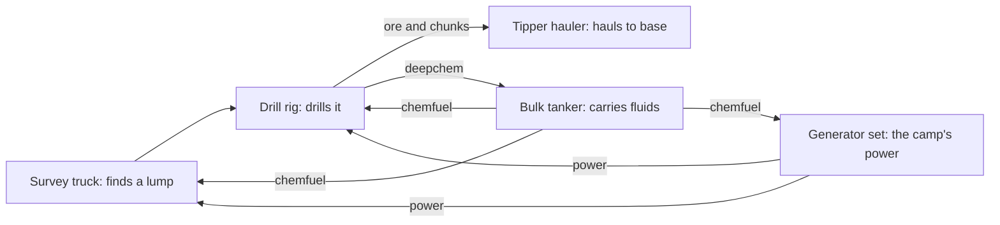

# Utility vehicles: design (8 Nov 2026)

**The stand-in is built and has grown: D'thorga Vehicles (0.16.0, 9 Nov 2026) carries loadouts and drivetrains for other
authors' vehicles. One vehicle of ours is built, the bulk tanker (Framework 0.34.0 onward, Vehicles 0.12.0 onward); not yet tested in
game. The other four are designed in full in their own records (9 Nov 2026, research and record only):**
[the survey truck](vehicle-survey-truck.md), [the drill rig](vehicle-drill-rig.md), [the tipper hauler](vehicle-tipper-hauler.md) and
[the generator set](vehicle-generator-set.md). They wait for the owner's answers to their questions and the owner's go. **Updated 8 Nov 2026 (owner's directions, answered in this record):** a fifth vehicle designed in full, the bulk
tanker, liquid or gas by upgrade; every vehicle of ours upgradeable and extendable from its first Def, with the art following the
upgrade tree; parts from Vehicle Framework's mechanics by default and from RimThunder's and Vanilla Vehicles Expanded's part items
where they are present, our own parts only as fallbacks. Every figure read from another mod in this update was read with the patches
of the owner's full list applied (query-defs patched, patched-Defs file of 8 Nov 2026 08:58 UTC, game 1.7.5000, 335 mods).

A design record. The owner asked on 8 Nov 2026 for utilitarian
vehicles in RimWorld, a mobile drill rig first and "all sorts" after, each with per-part health that affects how well
it does its job. **The vehicles wait for the framework** (owner, 8 Nov 2026): the
[vehicle systems service](vehicle-systems-design.md) is built first, and the mod this record describes, D'thorga
Vehicles, is created as a stand-in that carries loadouts for other mods' vehicles until our own follow. Code readings
are in [Vehicle Framework mechanics](vehicle-framework-mechanics.md); the art research is in
[art services](vehicle-art-services.md).

## Read this first

- **Owner's decisions (8 Nov 2026):** a new mod, D'thorga Vehicles; the vehicle systems framework first, this mod as a
  stand-in; a family of three to four vehicles designed in full and the rest sketched; 1.7 only; the art route is open
  (the owner is not committed to ChatGPT; PixelLab only where it fits).
- **Vehicle Framework (VF) on Steam is a 1.6 build** that the 1.7 game loads; SmashPhil says 1.7 is near. Defs here
  follow the schema that build reads; a rebuild is expected when VF 1.7 ships.
- **This mod will be unsafe to remove from a save**, as VF and Vanilla Vehicles Expanded (VVE) are: it holds the
  player's vehicles. Its README says so, and says to scrap the vehicles first.
- **Parts are appended only, never reordered**: saves hold part healths by position.
- **Every part feeds a stat that changes an outcome.** A stat nothing reads is a figure on a card (the Harrier's
  flight-control lesson): each of our stats has a floor and a refusal that names it.
- **No value loops.** A mobile rig drills the same deposits at the same rates as the game's deep drill; it buys
  mobility and self-containment, never more ore per hour than a built drill of the same cost.
- **Honest physics, labelled.** Every figure below is authored and untuned unless a source is named.
- **Owner's directions of 8 Nov 2026.** (1) **Every vehicle of ours is fully upgradeable and extendable**, each by its own
  character, and its art is planned around its upgrade tree from the first picture (principle 8). (2) **Parts come from providers
  by role**: Vehicle Framework's own mechanics first; RimThunder's and Vanilla Vehicles Expanded's part items as soft dependencies,
  together or as replacements; our own parts only where no provider is present (principle 9 and the table under it). (3) **A fifth
  vehicle in full: the bulk tanker**, a liquid or a gas tanker by the player's upgrade choice, extensible by the fluid mods it finds.
  (4) **One or more of our vehicles will be diesel-electric** for mechanics of their own (owner, 8 Nov 2026, in the
  [electric vehicles record](vehicle-electric-design.md)); no vehicle is named yet, and the generator set is the agent's candidate.

## Why a new mod, and why it starts as a stand-in

The consolidation rule (owner, 7 Nov 2026) lets a new mod exist for a different audience or different hard
dependencies. D'thorga Vehicles has both: its audience is players who run VF, and its hard dependencies are **Vehicle
Framework** (MIT), **Vanilla Expanded Framework** and **D'thorga Framework**. VVE is optional: engine blocks and upgrade
parts as costs where present, reached through `IfModActive` folders and `MayRequire`.

| Identity | Value |
| --- | --- |
| Display name | D'thorga Vehicles (agent default) |
| `packageId` and Harmony ID | `PhobosDthorga.Vehicles` |
| Prefixes | `Phobos` on defNames, namespaces, keys and saved keys |
| Build | One target, `net10.0` against the 1.7 reference, into `1.7/Assemblies`; `supportedVersions` 1.7 only |
| `Directory.Build.targets` | Reuses `VehicleFrameworkAssemblies` (the installed VF, `Private=false`) |

**As a stand-in** the mod ships no vehicle: About, README, CHANGELOG, and under `Mods/<Other>/` folders the named
loadouts that apply the systems service to VVE's vehicles, the Harrier and the HUMVEE. That proves the service on
vehicles the owner already drives. Our vehicles, their loadouts and art come after.

## Principles for every utility vehicle (agent proposal)

1. **Physics sets the kit, the kit sets the play.** Mass and footprint follow the real machine; a drill mast needs a
   long deck and outriggers; a generator set is a small self-propelled truck with a generator on its back.
2. **One stat per job.** Each vehicle's work is a `VehicleStatDef` of ours (table below) fed by the parts that do it.
   Parts → efficiency → stat → outcome, with a floor below which the job refuses and the refusal names the part.
3. **Deploy to work.** A working vehicle sets up (outriggers down, mast up) through a comp of ours that uses VF's own
   move and draft hooks and the Deployed and Undeployed events; it cannot move while set up. We do not borrow the
   turret comp's deploy state.
4. **Vanilla precedence.** Drilling reads the game's deep resource grid and portion sizes; surveying reuses the
   ground-penetrating scanner's find routine; a generator feeds the game's power net; water goes through Dubs Bad
   Hygiene where present; crews do the game's own jobs with the game's skills (Mining, Intellectual, Construction).
5. **The systems service applies to every one of ours** from the first Def: a rig has a battery, an alternator, a
   radiator and oil like any other vehicle, through its loadout.
6. **UI presents, services decide.** Gizmos and inspect text read state; one service call does the work.
7. **XML first.** Vehicles, parts, stats and loadouts are Defs; C# only for the jobs and comps the Defs cannot express.
8. **Upgradeable and extendable from the first Def** (owner, 8 Nov 2026). Every vehicle ships with a Vehicle Framework upgrade tree
   shaped by what it is: tank type on the tanker, mast and bit on the rig, sensor suite on the survey truck, body on the tipper,
   alternator and drive on the generator. Nodes are VF `UpgradeNode`s other modders can add to with a `PatchOperationAdd` into our
   tree, and every node moves a figure that changes an outcome, never a card figure. **The art follows the tree**: the base body is
   the bare platform (chassis-cab and deck), and every node that changes the look is a VF `graphicOverlay` with its own north, east
   and south on the body's canvas, so a node added later never forces the body to be redrawn (VF `GraphicDataOverlay`, with
   `ComponentRequirement` for damage states; VF 1.6 decompile, `Vehicles.decompiled.cs:6219`). Upgrades are additive on saves: a
   new node later is fine, a removed or renamed node key is not (VF saves the unlocked keys and skips a key it cannot find on load,
   `CompUpgradeTree.ReloadUnlocks`, `:21884`). Parts stay fixed per Def and append-only; a node changes stats, comps, overlays and
   labels, never the parts list.
9. **Parts by role, from providers** (owner, 8 Nov 2026; **reversed by the owner on 9 Nov 2026:** our part items now always exist in
   D'thorga Framework and set repair costs, with other mods' accepted only where they make sense; see
   [vehicle health, slice 3](vehicle-health-consequences.md). The text and table below are kept as written; the tanker's build cost
   still swaps in providers' items and has not been changed.) Vehicle Framework ships no part items (its ThingDefs are motes and the
   airdrop container; read 8 Nov 2026), so "VF parts by default" means its mechanics: components, upgrade trees, roles, reactors,
   overlays, fuel and caravans, used before anything of ours is written. Part **items** come from the mods that make them, named by
   role in each vehicle's cost and each node's ingredients and resolved in XML (`LoadFolders.xml` `IfModActive` folders and
   `PatchOperationFindMod`), never in C#: RimThunder's item, then Vanilla Vehicles Expanded's, then our own. Our own parts load only
   when no provider is present and are never a copy of a part a provider ships. The table "Parts and where they come from" below is
   the one place that says which item fills which role.

## The parts model

**New stats** (`VehicleStatDef`s of ours, `showOnVehicleTypes` Land):

| Stat | Operation | Fed by | Read by |
| --- | --- | --- | --- |
| `Phobos_DrillRate` | Average | Rotary head, drill string, drill bit, flushing pump, compressor | The drilling job's work per tick |
| `Phobos_RigStability` | MinValue | Outriggers, mast | The deploy gizmo: below the floor it refuses and names the part |
| `Phobos_RigControl` | MinValue | Control console, wiring | Deploying and drilling: below the floor, the rig will not run |
| `Phobos_ScanRate` | Average | Sensor boom, geophone array, recorder | The survey job's work per tick |
| `Phobos_GeneratorOutput` | Average | Engine, traction generator, regulator | The watts offered to the net while deployed |
| `Phobos_TipRate` | Average | Tipping rams, hydraulic pump | The tipping job's duration |
| `Phobos_PumpRate` | Average | Pump and power take-off, hose reel | The tanker's transfer rate (and a water tanker's fire monitor later) |
| `Phobos_TankIntegrity` | MinValue | Tank shell, tank fittings | The tanker's leak and vent rate; below the floor the tank will not hold a load |
| `Phobos_TankCapacity` | MaxValue | Set by the tank node (StatUpgrade), not by parts | How much the fitted tank holds |

**Conventions.** Depth: external for anything a shot meets first (cab, wheels, mast, outriggers, body panels), internal
for what sits inside. Every part has real cells (Combat Extended hits only those). Running gear carries `MoveSpeed`; the
engine carries `MoveSpeed` with `priorityStatEfficiency` so a dead engine stops the vehicle whatever the wheels say.
Reactors: `Reactor_FuelLeak` on fuel tanks, `Reactor_Explosive` on engines as VVE does, and one of ours to write
later, a hydraulic leak that drains the hydraulic quantity of the systems service. Damage states and raised equipment
draw through `graphicOverlays` that our comps add and remove (Vehicle Framework's `ComponentRequirement` on an overlay is never applied, read 9 Nov 2026;
[the animation research](vehicle-animation-research.md)). Combat Extended armour follows the Harrier part's scale
(millimetres and megapascals, light vehicle). Repair order is list order, so the engine and controls come early.

### Parts and where they come from (principle 9; agent defaults, owner to confirm)

What the providers actually ship, read 8 Nov 2026 with every patch of the owner's list applied:

| Provider | For us | Part items it ships |
| --- | --- | --- |
| Vehicle Framework (`smashphil.vehicleframework`) | Hard dependency | None. Mechanics only |
| Vanilla Vehicles Expanded (`oskarpotocki.vanillavehiclesexpanded`) | Optional, on the owner's list | Ten car parts made at its garage bench: engine block (40 steel, 4 silver, 6 components, 5,000 work), alternator, battery, exhaust, fuel tank, radiator, suspension, transmission, wheel, wiring. Combat Extended adds a Bulk figure to each |
| RimThunder - Core (`rimthunder.core`) | Optional, on the owner's list | Engines by class, made at its assembly bench: light, medium and heavy diesel, turbine, turbojet (heavy: 4 heavy castings and 12 components, 75,000 work, Crafting 7, research "Otto Cycle"; mass 200, market value 1,350); transmission component, fuelling component, road wheel, tyre, heavy casting; its research EngineBasis, EnginePlus, EngineAdvanced; item category `Engine`. Its HEMTT costs 1 heavy engine, 1 fuel tank, 1 transmission, 11 tyres, 12 components and steel, the pattern our costs follow |

The roles, and who fills each when both providers are present (the owner's list), when one is, and when neither is:

| Role | RimThunder present | VVE present (no RimThunder) | Neither: our fallback part |
| --- | --- | --- | --- |
| Engine | Light, medium or heavy engine by vehicle class; turbine where a node asks | Engine block (two on the heavy set) | `Phobos_EngineAssembly` |
| Transmission | Transmission component | Car transmission | `Phobos_DrivetrainKit` (transmission and axles together) |
| Fuel tank | Fuelling component | Car fuel tank | Part of `Phobos_DrivetrainKit` |
| Running gear | Road wheels and tyres, one pair per axle | Car wheels, one per corner; car suspension | Part of `Phobos_DrivetrainKit` |
| Electrical | VVE's alternator, battery and wiring when VVE is also present; else components | Car alternator, battery, wiring | `Phobos_ElectricalKit` |
| Cooling | VVE's radiator when VVE is also present; else components | Car radiator | Part of `Phobos_ElectricalKit` |
| Hydraulic power pack, pump, mast, drill string, sensor boom, tank shell and fittings | Ours, whatever is installed: nobody ships them | Ours | Ours |

Rules of the table: **RimThunder supplies the engine, transmission, fuel tank and running gear; VVE the electrical and cooling set**
when both are present (RimThunder's engines are the richer set, VVE's electrical set the finer). Our fallback parts load only from
folders conditioned on neither provider being active (`IfModNotActive="rimthunder.core,oskarpotocki.vanillavehiclesexpanded"`: the
game loads such a folder only when none of the listed mods is active, `LoadFolder.ShouldLoad`), are made at
the machining table behind the game's own research, are priced near VVE's engine block, and disassemble back to steel and components
as RimThunder's engines do. **The precedent is already in the tree**: D'thorga Patches swaps RimThunder's turbine into the Harrier's
cost (`mods/PhobosPatches/Mods/HarrierVtol/Patches/Cost_HarrierVtol.xml`). With RimThunder active, an `IfModActive` patch also adds
engine-class nodes to each tree (light, medium, heavy diesel, turbine where it fits), each costing that engine item and switching the
systems service's drivetrain Def, which already models these engines on RimThunder's own vehicles. Build site: VF's `buildDef`
blueprint with the swapped costs; assembling at RimThunder's bench is a later option, not a dependency. **Watch:** RimThunder Core's
engines live in its `1.6/StandaloneModule` folder, loaded today; re-read the folder and the defNames at the Vehicle Framework 1.7 gate.

Two sets name the roles in the vehicles below: the **light-truck set** (1 engine, 1 transmission, 1 fuel tank, 2 axles of running
gear, 1 electrical set, 1 radiator) and the **heavy-truck set** (1 heavy engine, 1 transmission, 1 fuel tank, 3 axles of running
gear, 1 electrical set, 1 radiator, suspension where VVE is present).

## The first family, in full (agent default: the extraction chain; owner to confirm)

Five vehicles that share the deploy-and-work model and feed one another: find the deposit, drill it, haul the ore, carry the fluids,
power the camp. Cells are the vehicle's own facing north, x across and z along, centred as VF centres them. Health,
cost and mass are authored and untuned. Each vehicle's **Upgrades** row is a sketch of its tree under principle 8: exclusive pairs
are marked with "or" (in XML, `disableIfUpgradeNodeEnabled` on each side), and each node names the figure it moves; the nodes are the
agent's and wait for the owner.

### The four unbuilt vehicles, in their own records (9 Nov 2026)

Each has a design record in the tanker's shape: what it does to the player, the honest mechanics it hooks, its figures, upgrade tree,
parts, art request and open questions. Research and record only; nothing of them is built. The sections that used to stand here
(8 Nov 2026) were the sketches those records replace; the figures below are the records', all authored unless a record says otherwise.

| Vehicle | Size | What it lets the player do | What it stops them doing | How it changes the way they play | Record |
| --- | --- | --- | --- | --- | --- |
| Survey truck | 2 x 7 light, about 4.5 t | Find deep ore (deepchem included) under the map it stands on, and, by upgrade, a lump on another tile; run a powered array on the generator set's net or its own big battery | Mint ore for free: each find on a map slows the next; the array runs only on power the truck cannot make alone | Expeditions have a reason: find, then drill, then haul | [survey truck](vehicle-survey-truck.md) |
| Mobile drill rig | 3 x 10 heavy, about 20 t | Drill a found lump at the game's rates, with chunks when it is spent; raise deepchem to the tanker beside it; drill an oil well head with Rimefeller; drill on the camp's power | Beat a built deep drill per portion; move while set up | A lump is worked from a truck, with insects as the game gives them | [drill rig](vehicle-drill-rig.md) |
| Tipper hauler | 3 x 8 heavy, about 10 t | Carry a stone road leg's worth of chunks or blocks and tip the whole load in one job behind the truck | Tip where there is no room; carry more than the body's health allows | Hauling ore from the rig is a drive, not a hundred carries | [tipper hauler](vehicle-tipper-hauler.md) |
| Generator set | 2 x 6 light, about 6 t, diesel-electric | Drive on traction motors; parked, feed the grid through a stub building and power every vehicle of ours beside it | Out-produce the game's generator per chemfuel; charge Vehicle Framework's electric vehicles without a battery on the net | A camp has power where the truck is parked, and the family plugs into it | [generator set](vehicle-generator-set.md) |

How the five feed one another:

**Build order after the tanker (owner, 9 Nov 2026):** **the generator set first** (the smallest, it proves the diesel-electric drive
and the power stub, and every other vehicle plugs into it), then the rig and survey truck together, then the tipper. The rig record had
leaned to the rig first, to prove the shared deploy base; the generator set now proves it. None of them starts until the tanker has been
seen working in game and the owner gives the go.

**What the records corrected in this one:** the deep drill costs **100 steel and 2 components** (its Def, as written and as patched),
not 150; a generator set is a self-propelled truck, not a trailer; the rig's pump feeds only `Phobos_RigStability`; a tracks node and
the Rails and Roads spreader node moved no figure and are cut; the game has no depth, so the mast moves reach.

### Bulk tanker (owner's addition, 8 Nov 2026; the design is the agent's, owner to confirm)

A heavy truck whose tank is an upgrade: a **liquid tanker** or a **gas tanker** by the player's choice, carrying whatever the mods
present give it to carry. One chassis, one `VehicleDef` (`Phobos_Tanker`). Vehicle Framework's upgrade tree does the switching:
each tank node names the other in `disableIfUpgradeNodeEnabled`, so one tank must come off before the other can go on
(`CompUpgradeTree.Disabled`, `:21690`; `replaces` would swap them in one step and refund the old tank, `FinishUnlock`, `:21777`, with
no chance to drain it; corrected 8 Nov 2026), a node carries its own `graphicOverlays` (the tank body is drawn by the
node, not the base texture), a `StatUpgrade` sets the capacity, and the unlocked set is saved and re-applied on load
(`CompUpgradeTree.ReloadUnlocks`, VF 1.6 decompile `Vehicles.decompiled.cs:21875`); our comp asks `CompUpgradeTree.NodeUnlocked`
(`:21659`) which tank is fitted. Prior art: none carries fluid on Vehicle Framework; Trains of the Rim's tanker car is cargo only
(`TOTR_Railcars_Tanker`: CargoCapacity 30,000, a Tank part, no fluid comp; patched Def read 8 Nov 2026).

| Item | Value |
| --- | --- |
| Footprint, drawSize | (3, 10), (4, 11) (9 Nov 2026, after the owner's first look: 2 x 6 was two thirds the width of the other heavy trucks. This matches RimThunder's PLS, the biggest truck on the list; the picked art is 3.27 cells wide at 10 long) |
| Mass | 340 empty; contents add their own mass by density (below) |
| Fuel | Chemfuel, 28 a day driving, 6 a day pumping (the engine at idle drives the pump through a power take-off) |
| Crew | Driver; the pump runs unattended once the hoses are connected |
| Research | Chassis and liquid tank: the Vehicles tier (VVE's hauler research where present). Pressure vessel: the research of the first gas building present (Helixien gas; Odyssey's vacuum technology for the oxygen net), else Fabrication |
| Cost (authored) | The heavy-truck set by role (table above), plus 280 steel and 8 components. Liquid tank node: 120 steel. Pressure vessel node: 160 steel, 20 plasteel, 2 components. A refit refunds half (VF's default `refundFraction`) |
| Upgrades | `LiquidTank` or `PressureVessel` (below); `HoseReel` (a second hose, PumpRate x1.5); `InsulatedLiquidTank` (see Temperature, below). Overlays: the liquid tank, the pressure vessel, the hoses out, damage |
| Tie-ins | Every fluid mod below, each in its own `IfModActive` folder; none required |

**The two tank nodes:**

| Node | Capacity (`Phobos_TankCapacity`) | Why that figure | Look |
| --- | --- | --- | --- |
| `LiquidTank` | 3,000 units | Two thirds of Vanilla Chemfuel Expanded's fixed chemfuel tank (4,500 units for 140 steel, patched Def read 8 Nov 2026), so a tanker never beats a built tank per steel; it buys mobility | A horizontal elliptical tank with a manway and a ladder |
| `PressureVessel` | 1,200 units | A pressure vessel holds far less per tonne of steel than an open tank; authored ratio | A single cylinder with hemispherical ends, a relief valve and a gauge cabinet |

**Variants from the accepted art (owner, 8 Nov 2026: all twelve overlay attempts are accepted, for upgrades, extensions and storage types;
the owner approved the mapping below, 8 Nov 2026; the figures are authored).** Under principle 8 each variant that becomes a node must move a figure.

| Accepted art | Proposed node | What it would change (authored) |
| --- | --- | --- |
| Liquid tank 1, default | `LiquidTank` | The general tank above: 3,000 units |
| Liquid tank 2, wider with slim hatches | `InsulatedLiquidTank` | 2,700 units; contents change temperature slowly (owner, 8 Nov 2026; it replaces the separate insulation node first sketched) |
| Liquid tank 3, squarer ends | `HighVolumeLiquidTank` | 3,300 units; a full load slows the truck more |
| Pressure vessel 2, default | `PressureVessel` | The vessel above: 1,200 units |
| Pressure vessel 1, slim | `LightPressureVessel` | 800 units; cheaper and lighter |
| Pressure vessel 3, wide band | `HeavyWallVessel` | 1,000 units; a tougher shell (`Phobos_TankIntegrity`) |
| Hose reel 1 and hose 2 | Held for a later node | Alternates, such as a second hose type |

With more than two tank nodes, each names all the others in `disableIfUpgradeNodesEnabled` (the list form of the field read at `:21696`).

**Contents are a Def anyone can write.** `PhobosTankContentsDef` (a new Def type in D'thorga Framework's Vehicle-Framework part, XML):
label, `phase` (Liquid or Gas, which decides the node it needs), unit label, `kilogramsPerUnit` (the mass balance), `flammable`, its temperature behaviour (below), and a
list of **ports**: the classes that move contents between the tank and the world. Each contents Def ships in the folder of the mod
that gives it meaning, so a player with no fluid mod still has a chemfuel tanker that refuels vehicles and loads from barrels.

| Contents | Phase | Ports | Folder | Lean |
| --- | --- | --- | --- | --- |
| Chemfuel | Liquid | `Port_VehicleFuel`: refuels any VF vehicle alongside (`CompFueledTravel.Refuel(float)`, `:19335`). `Port_Items`: chemfuel items in and out, the game's own stack. `Port_PipeNet` on `VCHE_ChemfuelNet` where Vanilla Chemfuel Expanded is active | Common; the pipe port under VCHE | First |
| Deepchem | Liquid | `Port_PipeNet` on `VCHE_DeepchemNet`: the tanker is the pipeline from a pumpjack field you never built | VCHE | First |
| Water | Liquid | `Port_DubsPlumbing`: pull through the Framework's `PlumbingFeed` (already used for coolant), push through `PlumbingNet.PushWater` (DBH 1.7 `PlumbingNet.cs:314`), carrying DBH's contamination level. `Port_FireMonitor` later: the catalogue's fire engine becomes this port | Dubs Bad Hygiene | First |
| Nutrient paste | Liquid | `Port_PipeNet` on `VNPE_NutrientPasteNet` | Vanilla Nutrient Paste Expanded | Second |
| Astrofuel | Liquid | `Port_PipeNet` on `VGE_AstrofuelNet` | Vanilla Gravship Expanded, Chapter 1 (Odyssey) | Second |
| Oxygen | Gas | `Port_PipeNet` on `VGE_OxygenNet` (its unit is u³; its Def links oxygen canisters at 1:1) | Vanilla Gravship Expanded, Chapter 1 | Second: the only gas net on the owner's list today |
| Helixien gas | Gas | `Port_PipeNet` on Vanilla Helixien Gas Expanded's net | VHGE (not on the owner's list) | When the owner adds the mod |
| Crude oil | Liquid | `Port_Rimefeller`: its own pipe model (`CompStorageTank.Storage`, `BasePipeNet`), a second model to read | Rimefeller | Later |
| Hemogen | Liquid | `Port_PipeNet` on `VRE_HemogenNet` | Vanilla Races Expanded - Sanguophage | Second (owner, 8 Nov 2026) |

**How transfer works (the honest model).** The tanker never registers as a pipe connector: VEF registers connectors at spawn from
their neighbours (`PipeNetManager.RegisterConnector`, PipeSystem 1.7 `PipeNetManager.cs:93`), and a thing that moves would leave a
stale one behind. Instead, **deployed** (hoses out, wheel chocks down: it cannot move, through the same deploy comp on VF's move and
draft hooks that the rig uses), the pump moves `Phobos_PumpRate` units an hour between the tank and the first counterpart a port
finds in the cardinal neighbours of the vehicle's cells: a pipe net through `PipeNetManager.GetPipeNetAt(cell, def)` and then
`PipeNet.DistributeAmongStorage` or `DrawAmongStorage` (public, `PipeNet.cs:664` and `:743`); Dubs' plumbing through `PlumbingFeed`;
a vehicle's `CompFueledTravel`. Three gizmos, Load, Unload and Hold; each says what it is doing and names what stops it (no
counterpart beside the tanker, the counterpart full or empty, the pump below its floor). Rare tick; nothing per tick.

**Temperature (owner approved, 8 Nov 2026; the agent's proposal).** The contents have their own temperature, which moves slowly towards the outside
air; the Dashboard shows it. It slows the player or puts them on a clock, and stops them only where physics would. Each contents Def
carries its own limits, so a modder's fluid can freeze, thicken, spoil or vent without code.

| Contents | Trigger | What it stops | How it changes play | What it opens up |
| --- | --- | --- | --- | --- |
| Water | Tank below 0 °C | **Pumping**, until it thaws; the truck can still drive | Winter runs need timing, or a heated garage overnight | The insulated tank makes winter deliveries possible |
| Chemfuel, deepchem | Below about −8 °C, worst at −20 °C, only with the existing fuel-thickening setting on (off by default: chemfuel is not diesel) | Nothing | Pumping slows to a floor of 15%, as a vehicle without grip crawls and never stops | Refuelling in deep cold is possible but slow |
| Nutrient paste, hemogen | Above 0 °C | **The whole load spoils** after 0.75 days, about 18 in-game hours; below 0 °C the clock pauses | Long summer hauls become a race | The insulated tank buys time, so it matters in hot climates too |
| Compressed gas | Fire or extreme heat | The relief valve vents the load fast | Move the truck away or lose the cargo | A damaged valve (the tank fittings part) is worth repairing before a dangerous run |

**Sources and simplifications.** Water's 0 °C is physics. The −8 and −20 °C curve is the one the fuel system already uses (No. 2 diesel's gel point, secondary source, in `Systems_Lubrication.xml`); applying it to chemfuel is a gameplay choice. The 0.75 days and the pause below 0 °C are Vanilla Expanded Framework's own rule for unpowered stores (`CompResourceStorage.Tick`, PipeSystem 1.7 `CompResourceStorage.cs:110`, default `daysToRotStart`), and a tanker has no power, so the clock always runs. Gas pressure follows absolute temperature: 0 to 40 °C is only about 15% (273 K to 313 K), so ordinary weather has no effect, while a 300 °C fire about doubles it. The insulation time (about a day to reach the outside temperature, against six hours for a plain tank) is authored. Insulation slows the change and never prevents it.

**Left out, because they would not change a decision:** ordinary hot days on gas; cold gas, where the pressure falls but the amount carried does not; and liquid expansion in a full tank, which would only be a fill limit. **Known:** Dubs Bad Hygiene's water towers were not found to freeze (no freezing in `CompWaterStorage`), so a tanker's water is more exposed than a fixed tower: the owner accepts this for a thin mobile tank. On a temperate map, most of this rarely comes up.

**Contents as a systems-service quantity.** The loadout adds `PhobosVehicleSystem_Tank`: quantity `contents` from 0 to the
capacity, on the Dashboard; `kilogramsPerUnit x contents` joins the vehicle's mass through the kerb-mass extension (whether VF's
Mass stat then slows the vehicle is verified at build). Stages: **residue** below 2 % (the tank is not clean); **heavy** above 60 %
(`Effect_StatFactor` 0.85 on MoveSpeed, authored). **The chemist's rule:** changing contents or tank type needs an empty tank and a
purge job (4 hours, a colonist; water where Dubs Bad Hygiene is present), and water drawn from a tank that last held chemfuel is
contaminated at Dubs' Untreated level. Refusals name the step: "drain the tank", "purge the tank". **Open at build:** Vehicle
Framework has no Def-level way found so far to refuse taking a node off a loaded tank (`RemoveUnlock`, `:21827`, only queues the work),
so the drain-first rule needs either one Harmony patch there or a removal that spills what is left. **Prerequisites are all-of**
(`PrerequisitesMet`, `:21674`), so "either tank" cannot be a prerequisite: the hose reel takes none and does its
work once a tank is fitted.

| Part | Health | Depth | Cells | Feeds | Job |
| --- | --- | --- | --- | --- | --- |
| Chassis | 170 | External | all, weight 3 | BodyIntegrity | |
| Cab | 50 | External | (0, 2) (1, 2) | | Crew |
| Engine | 60 | Internal, priority | (0, 3) (1, 3) | MoveSpeed, Phobos_PumpRate | Drives the road and the pump |
| Transmission | 40 | Internal | (0, 1) (1, 1) | MoveSpeed | |
| Front axle and wheels | 35 | External | (0, 3) (1, 3) | MoveSpeed | |
| Rear axles and wheels | 50 | External | (0, −1) (1, −1) (0, −2) (1, −2) | MoveSpeed | Tandem axles |
| Truck fuel tank | 35 | Internal | (0, 1) | | VF's fuel-leak reactor |
| Tank shell | 90 | External | (0, 1) (1, 1) (0, 0) (1, 0) (0, −1) (1, −1) (0, −2) (1, −2) | Phobos_TankIntegrity | Our reactor: a hit drains liquid as a puddle (chemfuel: filth that burns) or vents gas fast; flammable contents at zero integrity explode through VF's `Reactor_Explosive`, scaled to the load, as VCHE's fixed tank already does (`CompProperties_ExplosiveContent`, flame, radius up to 12 at 4,500 units; patched Def read 8 Nov 2026); on by default, with a setting to turn it off (owner, 8 Nov 2026) |
| Tank fittings | 40 | External | (0, −2) (1, −2) | Phobos_TankIntegrity | Baffles on the liquid tank; the relief valve and gauge on the pressure vessel (the node sets the label; the part key never changes) |
| Pump and power take-off | 40 | Internal | (1, 2) | Phobos_PumpRate | Below the floor nothing moves |
| Hose reel and couplings | 30 | External | (0, −2) (1, −2) | Phobos_PumpRate | Needed to deploy |
| Manifold and valves | 30 | Internal | (0, 0) | Phobos_RigControl | Below the floor the pump will not run |
| Wiring | 25 | Internal | (1, 0) | Phobos_RigControl | |
| Lights | 15 | External | (0, 3) (1, 3) (0, −2) (1, −2) | | Load at night |

Cells run x from −1 to 1 and z from −4 to 5 on a 3 x 10 footprint, and are read off the picked art: bonnet at z 5 and 4 with the front wheels at z 4, cab and pump at z 3, the deck from z 1 back, the rear axles at z −2 and −3. Colours for the Def, which give the picked body its tone while leaving it repaintable: `color` (162, 156, 123), `colorTwo` (195, 110, 36).

**Argued against here:** registering the tank as a VEF connector (stale the moment the vehicle moves); two VehicleDefs for the two
tanks (a refit would be a new vehicle and lose the parts' saved health); adding parts by upgrade (VF parts are fixed per Def and saved
by position); a fire engine of its own (it is a water tanker with a monitor port). **Diesel-electric:** the tanker stays diesel; a
power take-off pump is the real machine.

### As built: the bulk tanker (8 Nov 2026, D'thorga Framework 0.34.0 and D'thorga Vehicles 0.12.0, Drafts)

**Not yet tested in game.** Built on the owner's go. Comps and rules are in D'thorga Framework (`src/PhobosFramework.Vehicles/Tanks`, `TankRule` in the core, a new tie-in assembly for pipe nets); the vehicle, tree, contents, textures and parts are in D'thorga Vehicles.

| What the player does | What it lets them do | What it stops | How it changes play |
| --- | --- | --- | --- |
| Fits a tank | Carry a liquid or a gas | Only one tank at a time | The tree decides what the truck can haul |
| Sets up beside something | Pump to and from pipes, plumbing, stacks and other vehicles | The truck cannot move or be drafted | A delivery is a place and a stop, not a route |
| Lets it get cold, hot or shot | Insulation and repair buy time | Frozen water will not pump; a holed tank will not load | Temperature and damage are planned around |

**Differences from the design above, each the agent's choice for the owner to revise:**

- **Removing a tank with a load in it spills the load.** Vehicle Framework gives no way to refuse the job, so this needs no Harmony patch.
- **The insulated tank halves the spoilage clock** (`spoilRate` 0.5). The approved table said it buys time on hot hauls, but a clock that only pauses below 0 °C would give it nothing to do above freezing.
- **The contamination clause is dropped for fuel:** purging is required before a change of contents, so water cannot follow chemfuel unpurged. Dubs Bad Hygiene's own quality is tracked instead: contaminated water pumped into a tower contaminates it.
- **A fresh load of something that can freeze arrives 5 °C above its freezing point** and cools in the tank, otherwise an empty tank could never load water in the cold.
- **A fire vents gas by the outside temperature or the vehicle burning**, not the contents' temperature, which lags by hours.
- **Gas vessels are patched in with Vanilla Gravship Expanded**, since nothing else carries a gas yet. Water needs Dubs Bad Hygiene.

**Size, from the owner's first look (9 Nov 2026):** the owner finds even Vanilla Vehicles Expanded's 3 x 6 Big Rig small, so heavy trucks of ours are sized against RimThunder's 3 x 10 PLS. The footprints of the other four designs above predate this and need revisiting before their art. **Damage marks** are drawn by the tank's comp: Vehicle Framework never reads a part requirement on a graphic overlay.

**Not built:** RimThunder engine-class upgrade nodes (principle 9), `Port_FireMonitor`, crude oil and helixien gas ports, masks for overlays.

### As built: the second wave of fluids (9 Nov 2026, D'thorga Framework 0.35.0 and D'thorga Vehicles 0.13.0, Drafts)

**Not yet tested in game.** The owner asked for items that are really fluids: FSX and prometheum, and the agent's list, all but liquid oxygen. Each is a contents Def using the item port, so stacks on the ground pump straight in.

| Fluid | What it lets the player do | What it stops | How it changes play |
| --- | --- | --- | --- |
| FSX | Move it in bulk, or park a truck bomb | Nothing | A hit may set off the load (25%, authored) |
| Prometheum | Move it in bulk | Pressure vessel only (agent's reading of "ignites on contact with oxygen") | Any spill catches fire |
| Toxic sludge | Haul waste off your land in one trip | Nothing | 8 days to get rid of it unless frozen (the game's own figure); a spill or dissolved load pollutes, 6 cells a pack as the game does |
| Fecal sludge | Empty septic tanks without barrels | Nothing | One trip replaces dozens |
| Napalm, crude, beer, wort, insect jelly | Bulk haulage | Nothing | Wort runs on the game's 5-day clock; napalm's blast reaches further |

**Agent defaults, owner to revise:** ten units to an FSX or prometheum, thirty to a wastepack; a blast cap of 15 cells; blast factors of 1.4 (FSX) and 1.25 (napalm). The owner did not answer these, so they are the agent's stated leans.

**Deferred, on the owner's word (9 Nov 2026): liquid oxygen.** D'thorga Medical's liquid oxygen store (`docs/development/medical-equipment.md`) would be a real cryogenic cargo: insulated tank only, boiling off slowly. It waits on functionality not built yet: the store's own pipe connection needs reading, and a boil-off behaviour for tanks.

### As built: compartments (9 Nov 2026, D'thorga Framework 0.37.0 and D'thorga Vehicles 0.15.0, Drafts)

**Not yet tested in game.** Owner's decisions, 9 Nov 2026: a tank holds one fill type by default, with a setting on by default; compartment upgrades divide its capacity; filled alike they still hold the whole capacity; food cannot share with anything else, and the player is told why; what counts as food is anything with a nutrition value, with a whitelist and blacklist.

| | |
| --- | --- |
| Lets the player | Carry up to three fluids on one trip, a delivery round rather than a single drop |
| Stops them | Pumping two compartments at once; mixing food with anything else; dividing a pressure vessel |
| Changes | A burst tank loses every compartment at once, and only what burns feeds the blast |

**Agent's choices:** three compartments at most, one to each hatch on the liquid tanks; one tank temperature; water, nutrient paste, hemogen and wort whitelisted as food, because no item of theirs carries a nutrition value (the owner may blacklist any of them). The rule is food against non-food only, so sludge may share with fuel.

### Bulk trading and quests (owner's decisions, 9 Nov 2026; not built)

**Bulk buying only at a settlement the player has travelled to**, with the tanker in the caravan: "the player should have reasons to go out and explore, not an easy way to sit at home". No buying from visiting traders or orbital traders. **As built, 9 Nov 2026 (Framework 0.38.0, Vehicles 0.16.0, Drafts; not yet tested in game):** a Bulk order button on the caravan, priced by the game's own `TradeUtility.GetPricePlayerBuy` with the caravan's best negotiator, buying only, leaving `RimWorld.TradeDeal` alone: at least seven mods on the owner's list patch its `TryExecute`. What a settlement offers is its trader's own `WillTrade`. It lets the player fill up far from home; it stops them buying from home, or buying the same fluid at one settlement twice in 15 days (authored); it changes the tanker into a reason to travel. The amount is set in a small window with the game's own count control, `TransferableUIUtility.DoCountAdjustInterface` (Framework 0.39.0, owner's choice: interfaces follow the game's patterns), which needs no patch. Agent's choice: fluids that exist only in pipes are not sold. **Quests come later**, generic and in the Framework, so other vehicles of ours can use them too.

### What each one needs in art

Per vehicle: a north, east and south **base body** at 128 px per drawSize unit, drawn as the bare platform (principle 8), a colour
mask for each; **one overlay set (north, east, south) per node that changes the look**, on the body's canvas so it registers; overlays
for the deployed state (mast raised, outriggers down, boom up, tipper raised, hoses out) and for damage; and a 64 px icon. The
request record lists a vehicle's nodes before its first picture is made. The route is in [art services](vehicle-art-services.md)
and the rules in [paid image generation](paid-image-generation-rules.md).

## The catalogue, sketched

One line per idea. "Reuses" names the game or mod system the vehicle drives; "Prior art" names Workshop mods that
already do it (IDs in the mechanics record); the lean is the agent's.

| Family | Vehicle | What it does | Reuses | Job stat and key parts | Tie-ins | Prior art | Lean |
| --- | --- | --- | --- | --- | --- | --- | --- |
| Extraction | Quarry excavator | Mines mountain and rock faces from a cab, faster than a pick | The mining job and skill | Phobos_DigRate: boom, bucket, slew ring, hydraulics | | none | High: nobody has it |
| Extraction | Water-well rig | Drills a well head in a dry biome | Dubs Bad Hygiene wells | Phobos_DrillRate | DBH | none | Medium: needs DBH |
| Extraction | Gas-well rig | Taps helixien gas where the survey finds it | Vanilla Helixien Gas Expanded | Phobos_DrillRate | VHGE | none | Low until VHGE is on the owner's list |
| Haulage | Flatbed | Carries bulky things and a disabled vehicle | CargoCapacity | Deck, winch | Recovery | Caravan Hauler, Forklift Logistics | Medium |
| Haulage | Bulk tanker | In the family (8 Nov 2026) | | | | | In the family |
| Haulage | Refrigerated van | Keeps food cold on the road | VVE's refrigerator comp | | | VVE | Skip: exists |
| Construction | Bulldozer | Smooths and clears terrain, pushes rubble | The game's smoothing and clearing jobs | Phobos_BladeRate: blade, tracks, hydraulics | Rails and Roads of the Rim | none | High |
| Construction | Road paver | Lays road tiles as it drives | Rails and Roads of the Rim | Phobos_PaveRate | RRotR | none | Medium |
| Construction | Crane | Lifts and places heavy things, gravship parts | The hauling job; VGE parts | Phobos_LiftRate: boom, winch, outriggers | VGE | an R3 Capraia add-on mentions a crane | Medium |
| Agriculture | Tractor with implements | Ploughs, sows, harvests into cargo | The growing jobs | Phobos_FieldRate: PTO, implement | | Tractor: Industrial Age (1.6) | Low unless that mod stays on 1.6 |
| Agriculture | Forwarder | Hauls logs from the felling site | The hauling job | CargoCapacity, crane | | none | Medium |
| Power | Generator set | In the family | | | | RV with built-in PD | In the family |
| Power | Battery bank | A trailer of batteries charged at base and drained at camp | The game's battery comp | Capacity: cells, bus bars | The systems service | none | Medium |
| Power | Floodlight tower | Lights a camp at night | The game's glow comp | Phobos_GeneratorOutput | | none | Low |
| Emergency | Ambulance | Carries patients, a bed role, the fluids kit aboard | D'thorga Medical's equipment | Phobos_MedicalBay: bed, oxygen, lights | Medical | HE-Ford ambulances | Medium: ours would run the Medical part's kit |
| Emergency | Fire engine | Pumps water onto fires: now a fire-monitor port of the bulk tanker's water contents, not a vehicle of its own | D'thorga Medical's fire layer, DBH water | Phobos_PumpRate: the tanker's pump, a monitor node | Medical, DBH | HE-Pierce Arrow Pumper | Folded into the tanker |
| Emergency | Recovery truck | Tows a disabled vehicle home | The systems service's jump-start; VF's move hooks | Phobos_LiftRate: winch, boom | Search and Rescue | none | High |
| Communications | Radio van | A vehicle-mounted station and relay on vehicle power | The radio framework's listed tie-in | A load on the electrical system; mast, set | Radio | none | High, once the radio framework reaches Phase 2 |
| Survey | Survey truck | In the family | | | | none | In the family |
| Maintenance | Repair bay | A parked workshop that raises RepairRate for vehicles alongside | VF's RepairRate stat | Phobos_ServiceRate: hoist, tools | The systems service's service job | none | Medium: VF has no workbench, so this is the honest form |
| Military and naval | Recovery vehicle, decontamination truck, shower truck, landing craft, snow carrier, and five submarines | Researched 9 Nov 2026 with a Workshop gap check; see [unique military vehicles and submarines](military-vehicles-research.md) | | | | none for any of them | Record only; the owner picks |

## Vehicle Framework 1.7 gate and the build plan

- **1.7 only.** One build target; no `1.6` folder; `supportedVersions` 1.7.
- Defs follow the schema VF's 1.6 build reads, which is what the 1.7 game loads today; C# compiles against the installed
  `Vehicles.dll` through `Directory.Build.targets`, as the Harrier part does. When VF 1.7 ships: re-read the part
  fields, the `VehicleComp` hooks, the overlay API and the settings attributes against the new build, rebuild and
  re-deploy.
- **Order** (owner: framework first): the vehicle systems service and the stand-in mod's loadouts for VVE, the Harrier
  and the HUMVEE, proven on vehicles the owner already drives; then this family, **the bulk tanker first** (owner, 8 Nov 2026), one
  vehicle at a time: Defs and stats,
  the deploy comp and the jobs, the floors and refusals, art, README and changelog, and the owner's short test
  protocol (a drive, a set-up, a refusal, a repair, a save and reload).

## Art plan (agent recommendation, owner to confirm; the research is in [art services](vehicle-art-services.md))

- **Size it first** (owner, 9 Nov 2026): before a vehicle's first picture, measure its planned footprint against the biggest comparable
  vehicle on the owner's list and generate at 1.5 times its drawn size ([the rules](paid-image-generation-rules.md)); the tanker had to
  grow from 2 x 6 to 3 x 10 after its first look.
- **Per vehicle:** three bare-platform bodies, three masks, one overlay set per visible upgrade node plus the deployed and damage
  overlays, one icon; 128 px per drawSize unit (principle 8, 8 Nov 2026). The tanker is the cheapest pilot: one body and two tank
  overlays show the whole upgrade idea.
- **Pipeline:** the north body from a pay-per-image API with a vanilla-look prompt (thick near-black outline, soft cel
  shading, pale panels, rounded corners, straight top-down) and style references; downscaled by script. East and south
  by **script rotation of the north** (a true top-down east is north turned a quarter), then a reference-guided edit
  that fixes lighting and end details, so all three facings share one design. Overlays as edits of the body, cut out by
  script. Masks by script posterisation of the panel zones, with a model pass only where the script cannot separate
  them. The icon by script.
- **Services (owner's pick, 8 Nov 2026: the OpenAI image API for the bodies, the owner's local generation for icons):** the
  research put the Gemini image API (Nano Banana 2.1, about US$0.034 an image) first and the OpenAI image API (gpt-image-2
  medium, about US$0.041) second; the owner chose OpenAI, which they know, and which their own sources rate best for RimWorld's
  look; FLUX.2 edits on fal.ai as the backup for the turned-image edits. All
  pay-per-image with no subscription; the whole family costs a few dollars. **PixelLab is not for the bodies**: its
  rotation tools stop at 128 to 256 px and are trained on characters; the 19 Oct 2026 reasoning in
  [artwork direction](artwork-direction.md) stands. It could draw 64 px icons if the owner wants it used.
- **Who does what:** the agent drives the API through the `openai` engine of `scripts/art-run.py` (built 8 Nov 2026, under the [paid image generation rules](paid-image-generation-rules.md);
  [how to run it](vehicle-art-services.md#running-the-openai-engine)) with the owner's key in the `OPENAI_API_KEY`
  environment variable, never in a file; the owner buys the credit, sets the account's spending limit and makes every pick. Every image goes through the near-copy check
  and gets a record (tool, model, prompt, date, SHA-256, AI disclosure) with the service's output terms as read on the
  day; masters go to the `art-masters` branch. The local Klein route stays a free baseline for icons and items.

## Who chose what

- **Owner (8 Nov 2026):** utilitarian vehicles with per-part health and efficiency; a mobile drill rig first; a new
  mod; the framework before the vehicles, the mod as a stand-in; three to four vehicles in full; 1.7 only; the art
  route open to suggestions.
- **Owner (8 Nov 2026, later):** the bulk tanker is built first, on a 2 x 6 footprint, with attempt 2 of the pilot as its body
  (resized to 3 x 10 on 9 Nov 2026 after the owner's first look; heavy trucks of ours are sized against RimThunder's 3 x 10 PLS).
- **Owner (9 Nov 2026, the four unbuilt vehicles):** one design record per vehicle; **no Helixien gas hooks** (the mod is switched
  off on the owner's list) **and deepchem in**; the survey truck does **both** surveys by upgrade (deep ore under its own map as the
  base, a long-range node that finds a lump on another tile); a **high-power survey mode** by a costly overhaul node, run on the
  generator set's power or on a **large battery** node that makes it semi-independent of the generator truck, recharged by the engine
  **idling itself** when the battery is low; **diminishing returns per map** on finds; **uranium in the survey truck's cost** (sealed
  radioisotope sources, as real logging tools use); the generator set is **self-propelled and diesel-electric**, the family's
  diesel-electric vehicle; **the generator set is the camp's power for every vehicle of ours** with electric loads.
- **Owner (9 Nov 2026, on reading the four records):** the build order above; the survey truck's curve (1.5x per find, cap 8x) and uranium
  (10 in the truck, 40 in the probe); the bare rig at 0.8 of a deep drill's rate; the generator set's sound enclosure cut; the tipper's
  base load 2,400 kg; a test of a stone load at a Rails and Roads site before any tipper code.
- **Owner (9 Nov 2026):** vehicle parts are ours, other mods' accepted as substitutes only where it makes sense (the reversal of
  principle 9, [vehicle health, slice 3](vehicle-health-consequences.md)).
- **Owner (8 Nov 2026):** every vehicle of ours fully upgradeable and extendable by its character, with the art planned around
  the tree; parts from Vehicle Framework by default, RimThunder's and Vanilla Vehicles Expanded's part items as soft dependencies,
  together or as replacements, our own replacements where neither is present; a fifth vehicle in full, a tanker that is liquid or
  gas by upgrade and extensible by the mods it plugs into; one or more of ours diesel-electric; the OpenAI image API for bodies.
- **Agent defaults, owner to confirm:** the extraction chain as the family; chemfuel rigs; drilling on the game's deep
  resource grid at its rates; the stats table; every health, cost and mass figure; the catalogue's leans; the art
  pipeline and services; every upgrade node sketched; the role table's split between RimThunder and VVE and the three fallback
  parts; the tanker's two capacities, its contents list and leans, the port model, the purge rule and the heavy stage; the
  generator set as the diesel-electric candidate.

## What was argued against, and why

- **Our own deposit model** (richer ore bodies the rig alone could reach): a second resource grid beside the game's,
  and a value loop waiting to happen. The game's grid, found by the game's scanner, keeps the rig honest.
- **A worker seat role** for the driller: VF's roles handle movement and turrets only; a job at the vehicle uses the
  game's skills and work priorities, as the deep drill does.
- **Borrowing the turret comp's deploy state**: it belongs to turrets; a comp of ours on VF's move and draft hooks is
  smaller and ours to change.
- **Electric-only rigs**: a truck rig on a diesel-hydraulic power pack is the real machine; the electric variant stays
  an option.

## Open questions for the owner

| Question | Agent lean |
| --- | --- |
| The family: survey truck, drill rig, tipper hauler, generator set, bulk tanker? | Yes (the tanker joined on 8 Nov 2026) |
| Which vehicle is built first? | **The bulk tanker** (owner, 8 Nov 2026, taking the agent's lean: cheapest to draw, and it proves the upgrade model; this replaces the earlier request for the drill rig first) |
| Which vehicle is the diesel-electric one? | **The generator set** (owner, 9 Nov 2026: self-propelled, diesel-electric) |
| The tanker's name | "Bulk tanker" as a working name |
| Hemogen as tanker contents? | **Yes**, and it spoils like nutrient paste (owner, 8 Nov 2026) |
| Insulation on the tanker: do contents freeze and gel? | **Yes**, as the section Temperature says; insulation is the insulated tank, not a separate node (owner, 8 Nov 2026) |
| A flammable load exploding at zero tank integrity: on or off by default? | **On**, scaled to the load, with a setting to turn it off (owner, 8 Nov 2026) |
| Chemfuel rig, or an electric variant alongside? | Chemfuel first; electric drilling on the camp's power is a node ([the drill rig](vehicle-drill-rig.md)) |
| Drill-bit wear as a consumable? | Later, with the systems service's wear phase |
| Wheels or tracks on the rig? | Wheels. A tracks node was dropped on 9 Nov 2026: a node never changes the parts list (principle 8) |
| Which art service? | **The OpenAI image API for vehicle bodies; local generation for icons** (owner, 8 Nov 2026); no subscription |
| Any C# before VF 1.7 ships? | Yes, against the installed build the game already loads; expect a rebuild |
| The mod's display name | D'thorga Vehicles |
| Which vehicle is built next, after the tanker? | **Decided by the owner, 9 Nov 2026:** the generator set, then the rig and survey truck together, then the tipper; after the tanker is seen working in game |
| Each vehicle's own open questions | In its record: [survey truck](vehicle-survey-truck.md), [drill rig](vehicle-drill-rig.md), [tipper hauler](vehicle-tipper-hauler.md), [generator set](vehicle-generator-set.md) |

## Sources

- Vehicle Framework and Vanilla Vehicles Expanded code and XML: [Vehicle Framework mechanics](vehicle-framework-mechanics.md).
- The game's deep drill, ground-penetrating scanner and chemfuel generator figures: RimWorld 1.7 Defs as installed
  (deep drill 100 steel and 2 components, corrected 9 Nov 2026 from the Def as patched; chemfuel generator 4.5 fuel a day for 1,000 W), to be re-read at build.
- Prior-art mods: the community collections of VF mods named in the mechanics record, read 8 Nov 2026.
- Real rigs as grounding only (no figure is taken from them): truck-mounted reverse-circulation, diamond and water-well
  rigs as built by the mining-equipment makers; unverified, named for orientation.
- Vehicle Framework's upgrade tree and overlays (8 Nov 2026, the 1.6 decompile in `.local/decompiled/VehicleFramework-1.6`):
  `UpgradeNode` fields (`replaces`, `prerequisiteNodes`, `graphicOverlays`, `ingredients`, `refundFraction`), `CompUpgrade`
  activating comps, `CompUpgradeTree.ReloadUnlocks` and `NodeUnlocked`, `GraphicDataOverlay`, `CompFueledTravel.Refuel`.
- Vanilla Expanded Framework's pipe system (PipeSystem 1.7 decompile): `PipeNetManager.RegisterConnector` and `GetPipeNetAt`,
  `PipeNet.DistributeAmongStorage` and `DrawAmongStorage`, `CompResourceStorage`.
- Dubs Bad Hygiene 1.7 decompile: `PlumbingNet.PullWater` and `PushWater`; Rimefeller: `CompStorageTank`, `BasePipeNet`.
- Defs of the owner's list with every patch applied (`query-defs patched`, patched-Defs file of 8 Nov 2026 08:58 UTC): RimThunder
  Core's engines and recipes, VVE's car parts, VCHE's chemfuel tank and nets, VGE's oxygen and astrofuel nets, VNPE's and VRE's
  nets, Trains of the Rim's tanker car.
