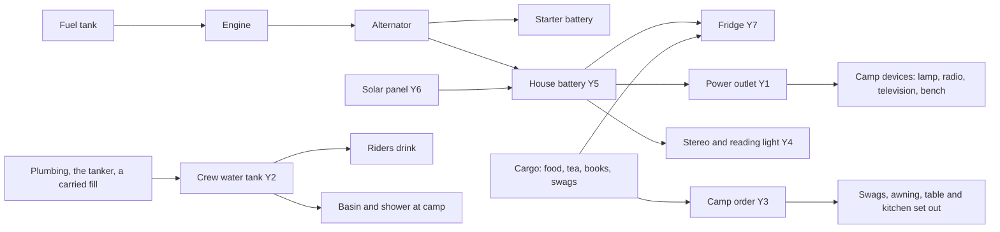

# Vehicle accessories: camp gear and comforts (13 Nov 2026)

**A research and design record. Nothing is built, and nothing here is tested in game.** The owner, 13 November 2026: "I wish to
explore vehicle accessories the player can install whether it's for entertainment, to help with camping, or something different
... these can be added to their vehicles either as part upgrades involving steel, components, etc. and/or as craftables from a
workbench of some kind." Facts marked **[code]** were read on 13 Nov 2026 with `scripts/query-code.py`, `scripts/query-defs.py`
and our own source, and are summarised in our own words. Figures marked **[A]** are authored starting values; **[S]** come from a
secondary source and are **unverified** (see Sources); **[I]** is our inference. Vehicle Framework references are from its **1.6**
decompile, the only one we hold; its 1.7 build may differ.

## Read this first

- **What an accessory is:** something fitted to a vehicle, or carried by it and set out beside it, that makes a camp or a trip
  better: a fridge, a water tank, an awning, swags, a power outlet, a stereo.
- **Nothing runs for free** (owner). Every accessory draws on something real: the battery and alternator, fuel, water, or goods
  from the cargo. **Stores run down and are refilled** by the player's people; nothing tops itself up.
- **Camp first, some aboard** (owner). Most accessories work beside a parked vehicle, where the game's ordinary activities
  (sleeping, cooking, washing, recreation) already work. A few work while riding.
- **The main finding:** we do not need thirty new machines. **Three links** turn a parked vehicle into the heart of a camp, and
  the furniture the game and the owner's mods already have does the rest: a **power outlet** (Y1), a **crew water tank** (Y2)
  and a **camp order** that sets gear out and packs it away (Y3). A fourth, **life aboard** (Y4), covers the road.
- **What cannot be done cheaply:** people riding in a vehicle on a map start no activity by themselves, a vehicle cannot itself
  be a television or a bed, and its looks never count as beauty. Sleeping *inside* a vehicle is the hard one (see "What makes
  this hard").
- **No drag or aerodynamics** (owner): no accessory changes speed or fuel use through air resistance.
- **No setting, version or changelog changes in this round.** This is a record; the owner picks what is built.

## The owner's rules for this work (13 Nov 2026)

| Rule | In the owner's words or choice |
| --- | --- |
| Real resources | "these accessories must consume real resources whether it's electricity from the battery/alternator, or something else from the game world" |
| Stores are refilled | "Things like water containers, etc. still need to be filled up regularly as the colonists drink from them, of course." |
| Passive gear | Gear with nothing to plug in (awning, roof rack, bull bar) costs its **build materials and its weight**. No wear or upkeep |
| No drag | "drag, aerodynamics, etc. is not something I wish to introduce into this mod because it's not something that can be accurately modelled in Rimworld without large assumptions" |
| Where it works | Camp first, some aboard |
| Real kit to echo | All four: a 12 V fridge with a second battery; an awning or tarp; water and washing; lights, a stove or billy. Swags, from an earlier talk |
| Two ways in | Fitted for materials and work, and/or crafted at a workbench |

## What the research found

### What we already have

- **Fittings** work on every vehicle that has a loadout, from any mod. Materials and work go straight into the vehicle, on a named
  **mount** that a loadout appends in XML (lamp bracket, winch mount, auxiliary tank cradle). Fifteen fittings and five families
  exist (`mods/PhobosFramework/Mods/VehicleFramework/Common/Defs/Phobos/Framework/VehicleSystems/Fittings.xml`, `Families.xml`;
  the Def type is in `src/PhobosFramework.Vehicles/Defs/FittingDefs.cs:31-65`).
- **Electricity is fully accounted for** [code]: a 45 Ah battery and a 65 A alternator
  (`VehicleSystems/Systems_Electrical.xml:33-34`), a load-shed order (`src/PhobosFramework/Rules/ElectricsRule.cs:26,38`, tested),
  a warning when the battery can barely start the engine, and extra engine work for every amp drawn
  (`src/PhobosFramework.Vehicles/Rules/AccessoryRules.cs:11`, tested). A consumer is an `ElectricalLoadSpec`: a name, amps, a
  switch, a shed rank (`src/PhobosFramework.Vehicles/Defs/SystemDefs.cs:426-446`; the work lamps at
  `VehicleSystems/Loadouts_Default.xml:335-354`).
- **Fuel, cargo, heat and light hooks exist** [code]: `Effect_ConsumeFuel` (the night heater), `TakeFromCargo`
  (`src/PhobosFramework.Vehicles/Systems/CompPhobosVehicleSystems.cs:1182`: repairs, services, the litter kit's medicine),
  `Effect_PushHeat`, vehicle lights, the cab's own temperature (`src/PhobosFramework.Vehicles/Service/CabClimate.cs`), cab moods.
- **A tank that holds water exists** [code]: the tanker's `CompPhobosTank` carries any `PhobosTankContentsDef`
  (`src/PhobosFramework.Vehicles/Tanks/TankDefs.cs`), and with Dubs Bad Hygiene its water contents pump to and from plumbing
  (`mods/PhobosVehicles/Mods/DubsBadHygiene/Defs/Tanker_Water.xml`; `src/PhobosFramework.Vehicles.Hygiene/Port_DubsPlumbing.cs:10-15`).
  **Nothing aboard drinks from it today.**
- **A vehicle already feeds the game's power grid** [code]: the generator set does it through a small power-plant comp on the
  game's own net (`src/PhobosFramework.Vehicles/Systems/CompPhobosGeneratorSet.cs:55,370-426`), and parked vehicles now lay
  visible conduits and plumbing beneath them (Framework 0.107.0 and 0.108.0).
- **Crafting exists**: the vehicle parts bench makes kits, parts and the crawler's refit items.
- **Not built anywhere**: sleeping, cooking, recreation, drinking water for the crew, shade.
- **Two gaps this record must close:** a load is declared on a **loadout**, not on a fitting, so a new powered fitting would have
  to be patched into every default loadout; and a fitting has **no weight** (the litter kit and the auxiliary tank stand in for
  weight with a share of cargo space, `Fittings.xml:158,230`).
- **A name already taken:** in our code "accessory" means an electrical load on the engine (`AccessoryRules`). New identifiers use
  `Camp` and `Kit` instead; the word players see is still free.

### What the game and Vehicle Framework allow

| Lever | Finding [code] | So an accessory can |
| --- | --- | --- |
| **Seat comfort** | A rider's comfort is their seat's figure, 0.5 unless a seat upgrade sets it; riding as cargo gives 0.15 (`VehicleFramework-1.6:Vehicles.decompiled.cs:44837-44863`) | Raise comfort on the road, in XML, on our own upgrade trees |
| **Caravan beds** | A packed bed anywhere in a caravan's inventory, a vehicle's cargo included, is a caravan bed and sets rest and comfort (`full:all.cs:792327-792345`; `VehicleFramework-1.6:Vehicles.decompiled.cs:44762-44834`) | Be a swag: a bed item, in XML alone |
| **Riders on a map** | Their needs keep ticking (`VehicleFramework-1.6:Vehicles.decompiled.cs:17282-17302`), rest and recreation only fall, and they start no job [I] | Help riders only through a check of our own, as hotboxing plans |
| **Recreation in a caravan** | Only meditation and talk, only while stopped; no item ever gives any (`RimWorld-1.7:RimWorld.Planet.Caravan_NeedsTracker.cs:258-276`) | Give recreation on the road only through our own check |
| **Recreation buildings** | The game's watch job casts its target to a Building (`full:all.cs:282208`); a vehicle is a pawn | Power or carry a real television, never be one |
| **Reading** | Recreation comes from the book's own factor while the read job runs (`full:all.cs:287598`) | Let riders read only through our own check |
| **Light and heat** | Both work from a parked vehicle; ours already do | Light and warm a camp |
| **Gathering spot** | Not tied to buildings (`full:all.cs:538731-538810`); plausible on a vehicle, never tried | Probably make the vehicle a place to sit and talk |
| **A roof** | A vehicle roofs nothing. Field Tents lays its own canvas roof over cells (`FieldTents/Building_FieldTent.cs:1288-1308`) | Be an awning that roofs cells beside the vehicle |
| **"Slept outside"** | Given when the sleeper's room has 300 or more unroofed cells, whatever the bed (`full:all.cs:292877-292947`; `RimWorld-1.7:Verse.Room.cs:378-392`); −4 mood for a day (the Def) | **Not** be cured by an awning: only a closed room cures it |
| **Rot** | A held thing asks its holders for a temperature before the weather (`RimWorld-1.7:Verse.Thing.cs:506-534`); we already answer for riders (`src/PhobosFramework.Vehicles/Service/Patches.cs:257-275`) | Keep chosen food cold in the cargo by answering for it too |
| **Added comps** | A comp an upgrade adds mid-game is never set up on the map (`VehicleFramework-1.6:Vehicles.decompiled.cs:14835-14872`) [I] | Not rely on that route for light, facilities or gathering |
| **Beauty** | Pawns, and so vehicles, never count | Not be decoration |

### What other mods on the owner's list already do

The mod list was refreshed on 13 Nov 2026 (346 mods switched on). The patched-Defs file dates from 8 Nov, so mods added since
may be missing from the item figures.

- **No active mod puts a bed, a kitchen, a stereo, a water tank, a shower, an awning or camp power on a vehicle.** Other authors'
  upgrade trees offer speed, armour, seats, turrets and cargo; a few have roof racks or cargo carriers (Vanilla Vehicles Expanded
  Upgrades' Traveller, GTek's L-ATV, the HUMVEE's trunk).
- **Camp gear to pair with, not remake:** Field Tents (roofed rooms that pack with their contents; updated 9 Nov 2026, 1.7),
  Use Bedrolls - Continued (updated 31 Oct 2026, 1.7), Dubs Bad Hygiene (water tub, water butt, bottles, pit latrine; updated
  26 Oct 2026, 1.7), Vanilla Cooking Expanded's grill, Vanilla Brewing Expanded's coffees and teas, and packable radios,
  televisions, telescopes and games from the base game and Vanilla Furniture Expanded. **Campfire Stews was last updated in
  July 2025 and does not declare 1.7**, so this record does not lean on it.
- **Vanilla Vehicles Expanded Tier 3's Hermano** has a switchable cargo fridge that burns fuel. Its code was not read (not
  decompiled here).
- **RimExodus is switched off** at the moment, so nothing here depends on it.
- **Not on the owner's list, and a different answer to the same wish: Vehicle Interior Framework** (Workshop 3184281714, formerly
  "Movable RV w/ Interior!"). It gives Vehicle Framework vehicles a walk-in interior. Comment-checked on 13 Nov 2026 with
  `scripts/workshop-research.py`: updated 4 Nov 2026, declares 1.7, about 43,000 subscribers, the uploader replying on 8 Nov;
  recent comments mention performance and a few clashes, with fixes on 30 Oct and 4 Nov. It is the "home on wheels" route. This
  record takes the other route, a camp beside the vehicle, because the owner chose camp first and our submarine rule already
  turns down walk-in interiors for their cost. We suggest neither adding nor avoiding it; it is named so the choice is visible.

## The idea in one picture

## The four links

These are the pieces of new code. Everything else in the catalogue is Defs that use them.

### Y1. Power outlet: the vehicle runs a small camp

- **What it is:** a fitting that makes a parked vehicle, engine off or idling, a small source on the game's own power net, through
  the conduit it already lays beneath itself. Anything with an ordinary power lead then works at camp: a standing lamp, a
  packable radio or television, a workbench, another mod's device.
- **What it uses up:** watts become amps at the vehicle's voltage, divided by an inverter efficiency of 0.85 [A]. A 200 W radio
  on a 12 V vehicle is about 20 A. With the engine off that drains the battery; with it idling the alternator carries it and the
  engine burns fuel for it, by the rule already in place.
- **Limit:** a ceiling per vehicle class, 300 W on a light vehicle [A], so it never rivals the generator set (which gives
  kilowatts and is a vehicle built for it).
- **To settle at build:** today the conduits beneath a parked vehicle are taken up when its engine starts. Idling to carry a
  camp load needs them kept while the vehicle stands still with the outlet on.
- **Why this first:** it answers lights and most entertainment at camp with **no new recreation code**, by the game's own power
  system (our "vanilla precedence" rule), and it is a smaller copy of what the generator set already does.

| Lets the player | Stops the player | Changes how they play |
| --- | --- | --- |
| Run a lamp, a radio or a bench anywhere a vehicle can park, with no grid | Running much for long on the starter battery: about two hours of a 200 W radio flattens a stock battery [computed from 45 Ah] | Camp power becomes a budget: idle the engine and burn fuel, fit a house battery, or carry a solar panel |

### Y2. Crew water tank: water that runs down and is refilled

- **What it is:** a small tank fitted in the cargo space, holding **water in litres**, on the tank system the tanker already uses
  (`CompPhobosTank` with the water contents Def). 60 L [A], three jerry cans' worth.
- **How it empties:** riders drink from it on the road (Y4) before they touch their bottles; at camp it feeds the plumbing the
  parked vehicle lays beneath itself, so a Dubs Bad Hygiene basin or shower touching the vehicle draws from it. How Dubs' own
  storage comp would see our tank (`DBH-1.7:DubsBadHygiene/CompWaterStorage.cs`) was **not read**; that is the first thing to
  check before building.
- **How it is refilled** (owner: regularly, by the player): parked on or beside plumbing with water behind it, as vehicles take
  on coolant water today; from our tanker; or by a colonist carrying water from a source, the way Dubs' water tub is filled. It
  never fills by itself. Rain does not fill it [A].
- **When it runs dry:** people fall back on bottles and whatever the tile offers, exactly as without the tank. A plain warning
  shows at a quarter [A]: "The water tank is low."
- **It keeps what it was filled with:** the tank system already remembers the worst water quality drawn, so stream water stays
  untreated water.
- **An honest limit:** thirst and washing exist only with Dubs Bad Hygiene. Without it the tank would move no outcome, so
  **the tank and the washing gear are a Dubs Bad Hygiene tie-in** (agent default), absent otherwise.

| Lets the player | Stops the player | Changes how they play |
| --- | --- | --- |
| Carry days of water in one place and wash at camp | Travelling dry country without planning water | Water becomes a thing to plan: how many people, how many days, where the next fill is |

Real planning figures for scale [S, unverified]: about 2 L a person a day for drinking in cool weather, 4 L in heat, 5 to 6 L in
extreme heat; 5 to 7 L with cooking and a little washing; 15 to 30 L with showers (Camping Australia). So 60 L is three people
for about three days without showers, or one day with them.

### Y3. The camp order: set out and pack up

- **What it is:** two buttons on a parked vehicle, **Set up camp** and **Pack up camp**. Setting up lays the vehicle's camp gear
  out beside it as ordinary things the game already knows how to use: the awning unrolls over the cells along one side, swags go
  down as beds, the table and chairs, the kitchen and any carried recreation building are placed. Packing up puts each back.
- **Why a button, not hand placement:** every piece could be installed by hand as the game allows, and still can be. One button
  saves a dozen placements each night (agent recommendation; it is also far kinder on the hands). The layout is shown as a
  preview first, and a piece moved by hand is remembered for that vehicle next time [A].
- **Rules:** it refuses with a reason where the ground is blocked ("No room on that side: 3 cells are blocked"). **Packing never
  deletes anything**: a bed in use waits for its sleeper; things left on the table or under the awning stay where they are. The
  vehicle will not drive off with its awning out, and says so. If the vehicle is destroyed, the camp stays as ordinary things.
- **Engineering notes:** it acts on the tick after the order, never during spawn set-up (the sling's landing fault). The pieces
  are held by the vehicle while packed, so a save holds them once.

| Lets the player | Stops the player | Changes how they play |
| --- | --- | --- |
| Make and strike a camp in two clicks | Driving off with the camp still out | Stopping for the night becomes a small ritual with a real result, not a chore |

### Y4. Life aboard: one check for everything riders do

- **What it is:** hotboxing's design already needs one check, on the vehicle's rare tick and the caravan's own, that does for
  riders what the game does not: take something from the cargo and use it (`docs/development/vehicle-hotboxing.md`). Y4 is that
  same check, written once in the core, with more things it can do:
  - **Drink** from the crew tank (Y2) when thirsty.
  - **Listen**: with a stereo fitted and switched on, everyone aboard gains recreation of the music kind, by the game's own
    tolerance rule, while it draws its amps.
  - **Read**: a rider who is not driving reads a book from the cargo, gaining the recreation that book gives; a reading light
    draws a little at night.
  - **Have a cuppa**: a rider takes a tea or coffee from the cargo for recreation, as they would at home. The owner's caravans
    never drink Vanilla Brewing Expanded's drinks today (read on 27 Oct 2026), so this is new.
  - **Smoke** (hotboxing, already designed).
- **Cost:** nothing per tick; an empty vehicle is one count check.

| Lets the player | Stops the player | Changes how they play |
| --- | --- | --- |
| Arrive from a long trip with people in good spirits | The driver joining in: a driver neither reads nor drinks | Packing books, tea and a stereo for a trip matters; so does who drives |

## The resource rule

Every accessory, and what it uses up. Passive gear: materials and weight only (owner). **Every store has a size, a rate, a way to
refill it and a plain warning when low.**

| Resource | Where it comes from | Who uses it | Refilled by |
| --- | --- | --- | --- |
| **Amps** | The house battery if fitted, else the starter battery; the alternator while the engine runs; a solar panel by day | Fridge, outlet, stereo, reading light, shower pump | Driving or idling (fuel), sunlight, shore power beside a grid (already built) |
| **Fuel** | The vehicle's tank | Idling to carry loads; the night heater (built); a water heater | Refuelling, as now |
| **Water** | The crew tank | Riders drinking, basin, shower, the kitchen | Plumbing, the tanker, a carried fill |
| **Goods** | The cargo | Food in the fridge, tea, books (not used up), wood or chemfuel for the kitchen | Loading the vehicle |
| **Weight** | The vehicle's cargo capacity | Every accessory, fitted or carried | — |

- **Weight, honestly:** fittings weigh nothing today. This record proposes one new figure on a fitting, **kilograms taken from
  cargo capacity**, a flat amount rather than today's share (a 20 kg fridge should not cost a road train fifteen percent of its
  hold). Carried gear already weighs what its item weighs. That is all weight does: no drag, no speed change (owner).
- **Loads on fittings:** one small generic change lets a fitting carry its own electrical load, so a powered accessory is one
  Def and works on every loadout, ours and other authors'.
- **Shed order:** camp loads shed before anything the vehicle needs. Proposed ranks, first to go first: outlet, stereo, shower
  pump, then today's order (air conditioning, climate control, cab heater, night heater, work lamps, headlights), with **the
  fridge last of the camp loads** so the food outlives the radio [A].

## How an accessory is fitted

**Agent recommendation, owner to revise: a fitting on a named mount, made from a crafted kit where the thing is a real object.**

- **Fitted gear** (fridge, water tank, outlet, house battery, solar panel, stereo, roof rack, awning) is a **fitting**, so it works
  on every vehicle with a loadout, beside other authors' upgrade trees and never inside them (owner, 11 Nov 2026), and needs no
  picture drawn on another author's vehicle.
- **Mounts** decide what can share a vehicle, as the lamp bracket and winch mount do:

| Mount | Takes one of | On |
| --- | --- | --- |
| **Roof** | Roof rack, or solar panel | Land vehicles with a roof |
| **Side rail** | Awning | Land vehicles, boats (a boat's awning is its bimini), aircraft (a tarp under the wing, as bush pilots camp) |
| **Cab** | Stereo; reading light | Closed cabs |
| **Cargo bay** | Fridge, water tank, house battery, kitchen box, outlet: any number, each paying its kilograms | Everything with cargo |

- **Crafted kits** are the fitting's material where there is a real object: a fridge unit, a tank, a stereo, a solar panel, made at
  the **vehicle parts bench**; canvas goods (the awning roll, swags) at the game's **tailoring bench** [A]. A fitting's materials
  are already a list of things and counts, so a kit needs no new code. This covers both routes the owner named: steel and
  components straight in for simple brackets and racks, a crafted kit for the rest.
- **Carried gear** (swags, folding table and chairs, the kitchen box's cookware, games, books) is ordinary items in the cargo. The
  camp order sets them out.
- **Our own vehicles** also get accessory nodes on their upgrade trees where the vehicle's shape suggests one (our rule that every
  vehicle of ours is upgradeable): the Datum survey truck is the natural tourer.
- **Not checked:** whether taking a fitting off gives its materials back today. If it does not, a removed accessory should give
  its kit back (a question below).
- **Set against the alternatives:** an upgrade-tree node reaches only our own seven vehicles; a loose item with no fitting cannot
  draw on the vehicle's battery, tank or fuel, which is the whole point.

## The catalogue

"New code" says what must be written beyond Defs. **Bold** rows are the short list.

| ID | Accessory | Kind | Uses up | What it does | New code |
| --- | --- | --- | --- | --- | --- |
| **Y1** | **Power outlet** | Fitting, cargo bay | Amps for every watt, then fuel | Camp devices run from the vehicle | The outlet link |
| **Y2** | **Crew water tank** | Fitting, cargo bay | Water; 60 kg of capacity when full [A] | Riders drink; basin and shower at camp | Tank on a fitting; drinking in Y4; the plumbing side to check |
| **Y3** | **Camp order** | Two buttons | — | Sets gear out, packs it away | The order and its layout |
| **Y4** | **Life aboard** | A check | What each activity takes | Drinking, music, reading, a cuppa, smoking | The check (shared with hotboxing) |
| **Y5** | **House battery** | Fitting, cargo bay | Charging amps while driving; 25 kg [A] | Camp loads draw it first and can never flatten the starter battery | A second store in the electrical system |
| **Y6** | **Solar panel** | Fitting, roof; or a folding blanket set out by Y3 | Roof mount or cargo weight | Slow charge by day, parked or resting | A daylight input |
| **Y7** | **12 V fridge** | Fitting, cargo bay | 0.8 A on average, more in heat; 20 kg [A] | Keeps a set weight of food cold in the cargo | Answering temperature for chosen cargo |
| **Y8** | **Swag** | Carried bed | 6 kg each [A]; cloth to make | A good bed anywhere, in caravans too; "slept under the stars" | The memory only; the bed is XML |
| **Y9** | **Awning** | Fitting, side rail | Cloth and steel; 15 kg [A] | A roof over the cells beside the vehicle | A roofing building set out by Y3 |
| **Y10** | **Camp kitchen box** | Carried, set out by Y3 | Chemfuel or wood; water for drinks | A cooking bench at camp; tea and coffee recipes with Vanilla Brewing Expanded | None for the bench; recipes are XML |
| **Y11** | **Folding table and chairs** | Carried | A few kilograms | Eat at a table; a place to sit and talk | None |
| **Y12** | **Camp shower and basin** | Carried, set out by Y3 | Water from Y2; a pump's amps; heat | Wash at camp (Dubs Bad Hygiene) | Depends on Y2's plumbing answer |
| **Y13** | **Stereo** | Fitting, cab | 1 A [A] | Music aboard through Y4 | Part of Y4 |
| Y14 | Reading light | Fitting, cab | 0.3 A [A] | Reading aboard at night through Y4 | Part of Y4 |
| Y15 | Better seats | Node on our trees | Materials | Higher comfort riding | None on ours; other authors' vehicles would need a patch |
| Y16 | Roof rack | Fitting, roof | Steel; its own weight | More cargo space, on vehicles that have none from their author | None |
| Y17 | Tool locker | Fitting, cargo bay | Steel, components; 30 kg [A] | Faster field repairs and services from this vehicle | A factor on our repair work |
| Y18 | Tyre compressor | Fitting, cargo bay | Amps for a few minutes | Air down for soft ground, air up for the road | A switch on the tread rule already built |
| Y19 | Spotlight | Fitting, roof | 8 A [A] | A lit patch the player aims | Aiming; value mostly with Combat Extended, **unverified** |
| Y20 | Bull bar | Fitting | Steel; weight | Less damage to the vehicle from collisions | Vehicle Framework's collision figures, **not read** |
| Y21 | Sleeping berths (roof tent, cab bunk) | Fitting | Cloth, steel | Rest aboard | Large: see "What makes this hard" |

## The short list in depth

### Y5 and Y6. House battery and solar panel

- **Why two batteries:** a starter battery is there to start the engine; a second battery behind an isolator or a DC-DC charger
  takes the camp loads so the first is never drained (REDARC's explanation of dual battery systems [S]).
- **Rule:** with a house battery, every camp load (fridge, outlet, stereo, pump, lights) draws it and never the starter. It
  charges from the alternator after the starter battery is full, and from the solar panel. 100 Ah [A].
- **Solar:** a 200 W folding blanket gave about 8 to 11 A in good sun and about 6 A under bright overcast in the reports found
  [S, unverified]; about 40 Ah on a good day is our own estimate from five hours of useful sun [I]. In game: the sun's height
  and the weather scale it, only while parked on a map or resting in a caravan, and not under a roof. It is slow income, not a
  free lunch: it carries the fridge and a little more.
- **The sums it creates** (computed from our figures): the fridge alone takes 19 Ah a day, so a stock 45 Ah battery reaches the
  "barely enough to start" warning in under two days parked; a house battery gives about five days; a panel makes the fridge
  indefinite in fair weather. A 200 W radio takes that panel's whole day in about two hours.

| Lets the player | Stops the player | Changes how they play |
| --- | --- | --- |
| Camp for days with the fridge running and still start the engine | Nothing | The choice real campers make: idle the engine, carry more battery, or chase the sun |

### Y7. The fridge

- **Rule:** the fridge keeps a set weight of food, 30 kg [A], at 4 °C while it has power. The player sets what goes in with the
  game's own storage filter [A]. The food stays ordinary cargo, so caravans eat it and haulers load it as now; only the
  temperature the game is told for those things changes.
- **How** [code, proposed]: the game asks a held thing's holders for a temperature before it uses the weather, and passes the
  thing asked about. We already answer for riders; the same registry would answer for a vehicle's cargo, for the things the
  fridge has claimed. The registry's reader must be given the thing as well as the holder: a small change.
- **Draw:** 0.8 A on average at 32 °C outside for a 47 L compressor fridge (retailer listings of ARB's figure [S, unverified]);
  ours scales with the outside temperature from 0.4 A at 15 °C to 1.5 A at 45 °C [A].
- **Without power** it is a box: the food follows the weather again, and a warning says so once.

| Lets the player | Stops the player | Changes how they play |
| --- | --- | --- |
| Carry fresh meat and meals for a week | Forgetting the battery: a flat one spoils the food | Fresh food on the road is paid for in amps, every hour of every day |

### Y8. Swags

- **What it is:** the Australian canvas bedroll with its own mattress and short poles. In the game, a bed that packs: rest 1.0,
  comfort 0.75, 6 kg [A]. For scale, the game's bedroll is rest 0.95, comfort 0.68, 2.5 kg [code, the Def]. It counts as a
  caravan bed, as any packed bed does.
- **"Slept under the stars":** an awning does not cure the game's "slept outside" (−4), and a swag is not a room. Proposed: waking
  from a night in a swag with no roof overhead, in fair weather and a comfortable temperature, gives a good memory of +5 for a
  day [A], which more than covers it. In rain it does not, and the game's own soaking and cold apply. A swag under the awning
  stays dry but trades the stars for the roof.
- **Why this one is worth its code:** it is the owner's own camping, and it makes the cheap, open camp a real choice against the
  heavy closed tent, by weather.

| Lets the player | Stops the player | Changes how they play |
| --- | --- | --- |
| Sleep well with no tent in fine weather | Nothing | The forecast decides the camp: swags under the stars, the awning in rain, a Field Tent in the cold |

### Y9. The awning

- **What it is:** a roll on the vehicle's side rail. Set out, it roofs the cells along that side, two deep [A], with our own canvas
  roof, as Field Tents does for its tents. It is its own thing beside the vehicle, so it is never drawn on another author's art.
- **What a roof really does in the game:** rain and snow do not fall there, things left under it do not weather as fast, and
  toxic fallout does not reach who stands there (these three from our knowledge of the game's rules, **not re-read in code this
  round**; to confirm before building). It does **not** make a room, cure "slept outside" or change the temperature [code].
- **Not remade:** walls for it. A closed, warm room is what Field Tents already does well; pack one.

| Lets the player | Stops the player | Changes how they play |
| --- | --- | --- |
| Unload, eat and sleep dry beside the vehicle | Driving off with it out | Which side faces the camp matters when parking |

### Y10 to Y12. Kitchen, table, shower

- **Kitchen box:** set out, it is a small cooking bench that burns chemfuel or wood through the game's own refuelling [A], so it
  needs no vehicle link. A single camp burner uses 150 to 220 g of gas an hour at full flame [S, unverified]; our fuel rate is
  authored against the game's fuelled stove. **A billy for tea:** where Vanilla Brewing Expanded's coffees and teas are active,
  the kitchen box takes their hot drink recipes. Those recipes and their benches were **not read**; to check before building.
- **Folding table and chairs:** light, low comfort, no code. The game's tables are gathering spots already (not re-read this
  round).
- **Shower and basin:** a camp shower pump moves about 4 L a minute [S, unverified], so a five-minute shower is 20 L, a third of
  the tank. Whether it is a Dubs fixture on the vehicle's plumbing or a thing of ours depends on the Y2 check. Heating the water
  honestly needs a source: the cold-water version first.

## What makes this hard

- **Sleeping inside a vehicle (Y21).** A berth could raise a rider's rest by our own call, but a colonist will never *choose* it:
  the game sends people to bed buildings, and a seat is not one. The player would have to order each person aboard each night.
  A caravan that drives through the night with a sleeping relief driver would also mean changing how Vehicle Framework decides a
  caravan rests (`VehicleFramework-1.6:Vehicles.decompiled.cs:44470-44478`). **Recommendation: do not build berths now.** Swags
  and Field Tents cover sleeping; raise it again if Vehicle Framework gains a rest role.
- **Riders do nothing by themselves on a map.** Y4 is the answer, and it is the same answer hotboxing needs.
- **Dubs Bad Hygiene's side of the tank** is unread, and a second kind of water store is not allowed by our own rules. The tank
  must be the tanker's system or nothing.
- **Vehicle Framework's 1.7 build** is not decompiled here. The checks above read riders, cargo and the caravan's pawn list,
  which did not change between the builds the hotboxing record compared.

## Left out, and why

| Idea | Why |
| --- | --- |
| Anything that only changes drag or streamlining | Owner: not modelled |
| Wear or upkeep on passive gear | Owner: materials and weight only |
| A two-way radio in the cab | Radio work is on the back burner (owner, 9 Nov 2026) |
| Decoration, paint, flags | A vehicle's looks never count as beauty |
| A fold-out screen, outside speakers, a tailgate workbench, camp lamps of our own | The outlet (Y1) runs the game's own television, radio, bench and lamps |
| A games locker, a telescope mount | The game's packable games and telescope ride in the cargo; the camp order sets them out |
| Awning walls, a camp trailer's tent | Field Tents does closed rooms; the camp trailer is recorded in `vehicle-trailer-research.md` |
| A swag rack | With no drag and no wear a rack changes nothing; swags ride in the cargo and weigh what they weigh |
| Snorkel, winch, recovery gear, work lamps, extra fuel tanks | Already built or agreed elsewhere |
| A camouflage net | A caravan's visibility is fixed on the vehicle's Def, not a figure a fitting can reach; no lever on a map |
| Insect screens, rod holders, a clothes line | No outcome to move |
| A walk-in interior | Vehicle Interior Framework exists for that; our submarine rule turns interiors down for their cost |

## Other factions' vehicles

| Where | What happens | Lets the player | Stops the player |
| --- | --- | --- | --- |
| **A raid on us** | Raiders' vehicles may carry fitted gear from the enemy fit sets by chance and tech level, as they carry fittings now. On the lite tier nothing of it runs: no outlet, no fridge draw, no check aboard | Capture a vehicle that already has a fridge, a tank or a stereo | Nothing |
| **A base we attack** | Parked vehicles keep their fitted gear as data. A later, optional touch: a base's vehicle with its awning out and swags down, placed once when the map is made as plain things | Loot the gear; fight around a camp | Nothing |
| **A vehicle we capture** | It follows our rules at once, with its stores as found: the tank part full, the fridge's food as fresh as its power left it | Use it as ours | Nothing |

The four links read only what any vehicle has: a loadout, cargo, riders. Nothing depends on the vehicle being ours. With several
hostile vehicles on a map the cost is none, because the lite tier skips all of it.

## Cost to run

- **Y1:** one power comp on the game's net while parked with the outlet on; read when the net changes, as the generator set does.
- **Y2:** the tank's existing rare update; a drink is one subtraction.
- **Y3:** nothing between orders. Camp things are ordinary buildings.
- **Y4:** the vehicle's rare tick, only with riders; the caravan's own interval.
- **Y7:** a temperature question for held things already runs through our patch; the fridge adds one lookup for things in a
  vehicle's cargo and none for anything else [I, to measure].
- Nothing here runs per tick.

## Optional tie-ins

| Mod | What changes when it is active |
| --- | --- |
| Dubs Bad Hygiene | The crew tank, drinking aboard, the basin and shower exist only with it |
| Vanilla Brewing Expanded and its Coffees and Teas | A cuppa aboard; hot drinks at the kitchen box |
| Field Tents, Use Bedrolls | Nothing to build: swags are beds they already understand [I, to check in play] |
| Vanilla Furniture Expanded | Its radios run from the outlet as they are |
| Combat Extended | The spotlight's value, if any, is here; unverified |
| Vanilla Vehicles Expanded Tier 3 | The Hermano keeps its own fridge; ours is not offered where a vehicle has one |

## Art and sound

- **Our own vehicles:** a fitted roof rack, solar panel and rolled awning would each be their own overlay, planned before any
  picture. Cargo-bay gear is not visible. **No picture is drawn on another author's vehicle** (owner's rule): the awning, swags,
  table and kitchen are separate things beside it.
- **New pictures needed if built:** the awning (rolled, and out), the swag (rolled, and laid), the kitchen box, the folding table
  and chair, and an item icon for each kit; a button icon each for Set up camp, Pack up camp and every new switch.
- **Sounds, each its own:** the fridge's compressor (quiet, on a cycle), canvas for the awning, a pump for the shower, a low
  murmur for the stereo (no music of anyone's), a billy coming to the boil.

## A suggested order, if the owner wants one

1. **The power budget:** loads on fittings, weight on fittings, the house battery (Y5), the outlet (Y1), the fridge (Y7).
   Small pieces on systems already built; they make every later piece honest.
2. **The camp:** the camp order (Y3), swags (Y8), the awning (Y9), the folding table and chairs (Y11), the kitchen box (Y10).
3. **Water:** read Dubs' storage code first; then the tank (Y2), drinking aboard, the basin and shower (Y12).
4. **The road:** life aboard (Y4) together with hotboxing: the stereo (Y13), reading, a cuppa.
5. **The rest**, as wanted: the solar panel (Y6), then Y15 to Y20.

## Questions for the owner

1. **What to build first:** the suggested order above, or a different first batch?
2. **Swags and "slept under the stars":** add the good memory for a fair night in a swag with no roof (agent default: yes, +5),
   or leave the game's "slept outside" as it is?
3. **The camp order:** one button with a previewed layout that remembers hand-moved pieces (agent default), or leave setting out
   to the game's own install orders?
4. **Water without Dubs Bad Hygiene:** the tank and washing gear exist only with it (agent default), or should we give water a use
   of our own without it?
5. **Life aboard:** build it with hotboxing as one piece (agent default), or keep the two apart?
6. **Sleeping berths:** leave out for now (agent default), or design them properly despite the cost?
7. **Other factions' camps:** later, bases' vehicles with a camp set out (agent default: yes, later), or never?
8. **A removed accessory** gives its kit back (agent default), or is spent?

## Who chose what

- **Owner (13 Nov 2026):** the idea; real resources for every accessory; stores that run down and are refilled; passive gear costs
  materials and weight only; no drag or aerodynamics; camp first with some aboard; their real kit (fridge and second battery,
  awning, water and washing, lights and stove or billy); a record before anything is built.
- **Agent defaults, owner to revise:** the four links; fittings on mounts with crafted kits; kilograms on fittings and loads on
  fittings; every figure marked [A]; the shed order; the fridge by answering temperature for chosen cargo; the tank as a Dubs
  Bad Hygiene tie-in; the "slept under the stars" memory; the one-button camp; berths left out; the suggested order; everything
  in "Left out".

## Sources

**Web figures were read as search summaries on 13 Nov 2026; the pages themselves were not opened, so each is unverified and none
should be written into a Def until it is.** Which page gave which figure was not always clear from the summary.

- **Fridge draw** (about 0.8 Ah an hour at 12 V, 5 °C inside, 32 °C outside): retailer listings and a review of ARB's Zero 47
  fridge freezer, among them [Quadratec](https://www.quadratec.com/products/arb-zero-fridge-freezer) and
  [Overland Expo](https://www.overlandexpo.com/?p=29496). ARB's own page was not found.
- **Water per person:** [Camping Australia, camping water management](https://campingaustralia.com.au/blogs/expert-advice/camping-water-management);
  the Royal Flying Doctor Service's [Travelling in Remote Areas](https://www.flyingdoctor.org.au/assets/files/Travelling%5Fin%5FRemote%5FAreas%5FAXWVuuJ.pdf)
  was reported as advising 10 L a person a day in very hot conditions and was not read.
- **Shower pump flow** (about 4 L a minute): retailer listings, among them
  [Camping Australia](https://campingaustralia.com.au/products/12v-portable-water-pressure-shower-pump).
- **Solar blanket output:** a seller's page and an owner's report, among
  [Hard Korr](https://hardkorr.com/au/product/200w-solar-blanket-with-perc-cell-technology/) and
  [Gold Rat Engineering's listing](https://highbanker.com.au/products/gold-rat-engineering-bushmans-200-watt-solar-blanket-with-mppt-controller).
  The daily figure is our own estimate.
- **Camp burner gas use:** makers' figures as retailers list them, among
  [Alpinetrek's Outwell Olida page](https://www.alpinetrek.co.uk/outwell-olida-stove-gas-stove/).
- **Dual batteries:** REDARC, [What is a dual battery charger](https://www.redarcelectronics.com/us/discover/what-is-a-dual-battery-charger/).
  A maker's own explanation; no endorsement implied.
- **RimWorld 1.7** (Ludeon Studios), **Vehicle Framework** 1.6 build (Smash Phil), **Dubs Bad Hygiene** (Dubwise),
  **Field Tents** (lordfelix): read from our decompiles and their Defs, summarised in our own words.
- **Vehicle Interior Framework** (uploader enrico): its Workshop details and newest comments, through
  `scripts/workshop-research.py` on 13 Nov 2026.
- **Our own records:** `vehicle-hotboxing.md` (riders and caravans), `vehicle-upgrade-families.md` (mounts and families),
  `vehicle-crosslinks-round-two.md` (cab insulation and heaters still to come), `vehicle-generator-set.md` (feeding the grid).
