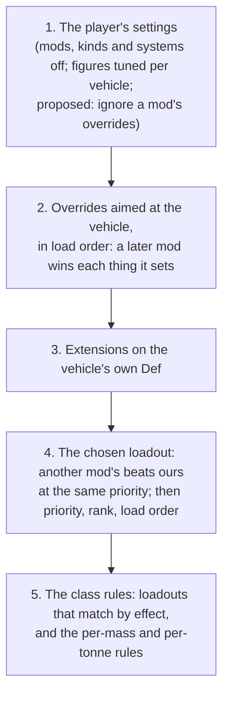

# The authors' override contract (13 Nov 2026)

**A research and design record. Nothing is built, and nothing here is tested in game.** The owner, 13 November 2026: "I'm planning
on providing for a system, that authors will be able to take advantage of, where they can give overrides as needed through some kind
of definitions file, such as XML", and "the author will be able to publish their overrides through a Steam Workshop publication or
through a pre-existing one already, such as with their own vehicle mod." It is the first of three records of the cross-links round
three review; the [avionics record](vehicle-avionics.md) and cross-links, round three (`vehicle-crosslinks-round-three.md`) refer
to it and are written after it. Facts marked "from the code" were read on 13 Nov 2026 with `scripts/query-code.py` and from our own source, and are
summarised in our own words. **Everything under "The proposed contract" is a proposal**: no class, field or Def named there exists
yet.

## Read this first

- **Most of it exists already.** An author can write a loadout for their vehicle today, in XML, and a handful of per-vehicle
  overrides. What is missing: describing an aircraft's avionics, switching off or retuning one cross-link, taking a vehicle out of
  our systems cleanly, a rule for two mods that override one vehicle, and any promise that the names will not change.
- **The proposal: one new Def, an override aimed at a vehicle**, that sits on top of whichever loadout the vehicle gets. A loadout
  describes a vehicle whole; an override changes a few things about it. Both are plain XML in any mod. Today's loadouts and
  per-vehicle extensions keep working unchanged and become part of the same published contract.
- **It stays silent without D'thorga Framework.** The game skips a Def, a list entry or a whole folder when a named mod is not
  active; the exact patterns are below, each checked against the game's code.
- **Who wins, as the owner decided:** the player's settings, then the last-loaded override, then our definitions, then the class
  rules. One consequence needs a small change of rule: **another mod's definition for a vehicle must beat ours wherever it sits in
  the load order** (today the later-loaded of two equal loadouts wins, which would let ours beat an author's by accident).
- **From contract version 1 the names are a promise**: never renamed or removed, only added to. Nothing of ours is on the Workshop
  yet, so there is one last chance to tidy names before they freeze. That is a question for the owner.
- **Four questions for the owner** are at the end.

## What an author can write today

From the code. "Wins over" says what each beats when two sources disagree.

| What | Where it goes | What it says | Wins over | From the code |
| --- | --- | --- | --- | --- |
| **A loadout**, `Phobos.VehicleSystems.PhobosVehicleLoadoutDef` | A Def in any mod | Which vehicles (`selector`), which systems with which figures (`systems`, each with a `set`), which of the vehicle's parts play which role or what part to append (`partRoles`), the electrical loads, the engine and drivetrain, the flight profile, the cab, a cargo hook's rating (`sling`), `noHitch`, the settings group (`kind`) | A loadout of lower `priority` (`Vehicle` beats `Mod` beats `Effect` beats `Default`), then lower `rank`; among equals the last loaded, with a warning | `src/PhobosFramework.Vehicles/Defs/SystemDefs.cs:610-664`; `Rules/SystemRules.cs:62-100`; `VehicleSystemsMod.cs:258-261` |
| The selector | Inside a loadout | Vehicles by name, by mod (`packageIds`), by type, fuel, flight, mass, part tags or part key endings. Vehicle names are plain text, so naming a vehicle whose mod is absent is no error | | `SystemDefs.cs:468-535` |
| **Cab** extension, `PhobosVehicleCabinExtension` | On the vehicle's own Def | Closed or open cab; climate control fitted | The loadout's `cabin` block | `SystemDefs.cs:558-564`; `Systems/CompPhobosVehicleSystems.cs:294`, `:345` |
| **Figures** extension, `PhobosVehicleFiguresExtension` | On the vehicle's own Def | Empty mass in kilograms; engine power in kilowatts | The loadout's and drivetrain's figures and the per-mass rules. **The player's tuning in Vehicle Framework's window wins over it** | `SystemDefs.cs:566-586`; `Systems/Powertrain.cs:89`, `:163-170` |
| **Hitch point** extension, `PhobosHitchPointExtension` | On the vehicle's own Def | Where the hitch sits | The default, just behind the rear edge | `Hitch/CompPhobosHitch.cs:18-23` |
| **Engine sound** and **work sounds** extensions | On the vehicle's own Def | The vehicle's own engine loops and the sounds of its work, by key | Silence | `Systems/EngineSound.cs:17`; `Systems/VehicleWorkSounds.cs:28` |
| `PhobosEnforceUpgradeResearch` | On an upgrade tree | The tree's nodes need the research they name | Vehicle Framework's own behaviour (it never checks) | `Service/UpgradeResearch.cs:11-12` |
| `FieldResearchExtension` | On a research project or tab | Only a laboratory aboard a vehicle can work on it | | `Service/FieldResearch.cs:7-11` |
| `CompProperties_PhobosTrailer` | In a trailer's own Def | It is a trailer: two lengths and a jack-knife angle. A trailer gets no systems | | `Hitch/CompPhobosTrailer.cs:9-22`; `Service/VehicleSystems.cs:55` |
| `CompProperties_PhobosSubmersible`, `CompProperties_PhobosTank` | In the vehicle's own Def | It dives; it carries a bulk tank | | `Systems/CompPhobosSubmersible.cs:27-28`; the guide |
| Systems, drivetrains, flight profiles, part conditions, fittings, families, parts bills | Defs in any mod | New systems and content of the author's own | Nothing: they add | [the modding guide](../vehicle-systems-modding.md) |
| **To opt out** | A `Vehicle`-priority loadout with no systems | The vehicle gets nothing of ours | Our loadouts, if it loads after ours | The guide, "A loadout for your vehicle"; `VehicleSystems.cs:60` |

**The player already has the last word**, in the settings: our vehicles only or everyone's; a mod's vehicles off; a kind of loadout
off; any one system off; and, per vehicle, the figures Vehicle Framework's own window lets them tune
(`VehicleSystemsMod.cs:16-29`; `VehicleSystems.cs:61-68`; `Systems/Tuning.cs:23-30`; `CompPhobosVehicleSystems.cs:293`).

**How it is applied** (from the code): once per vehicle design while Defs load, in a prefix on the design's `ResolveReferences`.
The service picks the loadout, binds each role to the vehicle's own parts or appends a part, and adds one comp to the design with
the systems and their figures (`VehicleSystems.cs:41-184`). Nothing is chosen again during play.

**What the guide promises today:** "the schema may change before the first public release" (`docs/vehicle-systems-modding.md:5-6`).
The contract below replaces that line when it is built.

### What is missing

| Gap | Why it matters |
| --- | --- |
| **No avionics fit** | An author cannot say what instruments, sensors or defences their aircraft carries, or on which parts. The [avionics record](vehicle-avionics.md) fills this in |
| **No way to drop or retune one cross-link** | A loadout chooses whole systems. An author whose vehicle has, say, an electric cab heater cannot switch off "the cab heater needs warm coolant" without dropping the Cabin system |
| **Opting out is a trick** | An empty loadout works, but only if it loads after ours, and nothing says so to the player |
| **Small changes need a whole loadout** | Changing one figure means repeating the vehicle's systems, roles and loads, which then miss our later improvements |
| **Two mods, one vehicle** | Equal loadouts resolve by load order with a warning; extensions on one Def of the same class do not combine at all |
| **A third party cannot use the extensions cleanly** | They sit on the vehicle's own Def, so another mod has to patch that Def |
| **No promise** | Any name could change under a published mod |

## What the game allows: XML that loads only when our mod is active

From the game's code (`RimWorld-1.7` is our decompile of the files named; `full:all.cs` is the whole assembly). Package IDs are
compared without regard to case (`RimWorld-1.7:Verse.ModLister.cs:181-195`). Ours is `PhobosDthorga.Framework`.

| Mechanism | What it does | Verified | Verdict for an override |
| --- | --- | --- | --- |
| **`MayRequire` on a Def's own tag** | The whole Def is skipped, before its class is even looked up, unless every mod named is active. Its `Name` and `ParentName` are skipped too, so a child of one of our abstract loadouts raises no "parent not found" | `RimWorld-1.7:Verse.LoadedModManager.cs:408-412`; `full:all.cs:144272-144275` | **Use it.** One file, no folders |
| `MayRequireAnyOf` on a Def's own tag | Skipped unless any one of the mods named is active. **Inheritance does not check it**, so do not combine it with `ParentName` | `LoadedModManager.cs:413-417`; `full:all.cs:144272` reads `MayRequire` only | Avoid with `ParentName` |
| **`MayRequire` on a list entry** | An entry that is not a Def (such as a mod extension) is skipped before its class is looked up. An entry that names a Def is dropped quietly when the mod is absent | `full:all.cs:142549-142563`; the newer loader does the same through `ValidateMayRequires`, `full:all.cs:144068-144083` | **Use it** for an extension on the author's own vehicle |
| `MayRequire` on a field that names a Def | The reference is dropped quietly when the mod is absent | `full:all.cs:142464-142466` | Use it where an override names a Def of a third mod |
| **`LoadFolders.xml` with `IfModActive`** | A folder of the mod loads only while one of the mods named is active (`IfModActiveAll`: all of them; `IfModNotActive`: none) | `full:all.cs:98757-98775`, `:98663-98671` | **Use it** for many files, or for assemblies |
| `PatchOperationFindMod` | Applies a patch when a mod is active. **It matches the mod's display name, not its package ID** | `full:all.cs:100138-100148`, `:97688-97698` | **Avoid.** A change of our display name would silently switch every such patch off |

**Two Defs with the same name.** The game adds each mod's Defs in load order, and a Def whose name is already taken **replaces**
the earlier one without a message (``RimWorld-1.7:Verse.DefDatabase`1.cs:25-58``). So the list of Defs is in load order, a Def knows
its mod (`modContentPack`, whose `loadOrder` is its position, `RimWorld-1.7:Verse.ModContentPack.cs:17`), and "whichever loads last
wins" can be had two honest ways: a later mod reuses the earlier Def's name and replaces it whole, or the two Defs have different
names and our service orders them by their mods' places in the load order.

**Class names do not depend on load order.** Every active mod's content is loaded before any XML is read
(`LoadedModManager.cs:42-76`), and inheritance is resolved after every Def has been registered (`LoadedModManager.cs:367-391`). An author's mod may therefore sit before or after
D'thorga Framework in the list and still load. This is why precedence between an author and us cannot be left to load order (see
"Who wins").

### The two ways to publish

**(a) Inside the author's own vehicle mod.** One file, anywhere under the mod's `Defs`. With D'thorga Framework absent the game
skips it whole:

```xml
<Defs>
  <Phobos.VehicleSystems.PhobosVehicleOverrideDef MayRequire="PhobosDthorga.Framework">
    <defName>MyMod_Kestrel_Dthorga</defName>
    <!-- ... the override ... -->
  </Phobos.VehicleSystems.PhobosVehicleOverrideDef>
</Defs>
```

An extension on the author's own vehicle takes the attribute on its list entry:

```xml
<modExtensions>
  <li Class="Phobos.VehicleSystems.PhobosVehicleCabinExtension" MayRequire="PhobosDthorga.Framework">
    <closed>false</closed>
  </li>
</modExtensions>
```

For several files, a folder named in the mod's `LoadFolders.xml` does the same job:

```xml
<loadFolders>
  <v1.7>
    <li>/</li>
    <li IfModActive="PhobosDthorga.Framework">Compat/DthorgaFramework</li>
  </v1.7>
</loadFolders>
```

**(b) A separate override mod**, by the author or by anyone else. Its `About.xml` names D'thorga Framework and the vehicle's mod
under `modDependencies` and `loadAfter`, so the game will not start it without them and the files need no `MayRequire`. To beat
another mod's override of the same vehicle it must load after that mod, which is the player's choice to make.

The vehicle systems' classes live in the part of D'thorga Framework that loads only with Vehicle Framework, so an override is
read only when both are active. A vehicle mod already needs Vehicle Framework.

## The proposed contract

### Its shape: an override Def aimed at a vehicle, beside the loadout

| Shape | For | Against |
| --- | --- | --- |
| **A new Def, an override aimed at vehicles by name** (recommended) | Works from any mod without touching another author's Def. Several can be aimed at one vehicle and ordered by load order. One `MayRequire` on its tag keeps it silent. Small: it says only what differs, so it keeps picking up our later improvements. It can carry things an extension cannot, such as "drop this system" | One more Def type to learn |
| Extensions on the vehicle's own Def (today's way) | Sits with the vehicle; nothing new | A third party must patch the author's Def. Two extensions of one class on one Def do not combine. Nothing orders them. No place for opt-outs or cross-links |
| Only loadouts | Exists | Whole-vehicle only: to change one figure the author repeats everything and then misses our later changes |
| Patches against our Defs (possible today with the game's own patch operations) | Needs nothing from us | Changes every vehicle that uses the Def, not one. Positional and brittle. No errors that name the mistake, no report |

**Recommended: both instruments, each for its own job.** A **loadout** when an author wants to describe a vehicle from scratch; an
**override** when they want ours with changes. The extensions stay as the short way to say one thing on the author's own Def.

### What an override can say

Every name below is proposed. `PhobosVehicleOverrideDef`, in the namespace the loadouts use:

| Field | Meaning |
| --- | --- |
| `contract` | The contract version the file was written for. 1 at first |
| `vehicles` | The vehicles it applies to, **by name** (text, so a missing vehicle is no error). The loadout's `selector` is accepted too, for an author with a family of vehicles |
| `noSystems` | **Opt out wholly**: the vehicle gets none of our systems, no appended parts and none of our tabs |
| `dropSystems` | **Opt out by system**: systems to leave out |
| `addSystems` | Systems to add, each with its `set` of figures, as in a loadout |
| `parameters` | Figures to change on systems the vehicle already has: a system and a `set` |
| `links` | **One cross-link at a time**: an address (below) with `off`, or a `factor` that scales it |
| `partRoles` | Roles to bind to the vehicle's own parts or to append, as in a loadout; `unbind` to leave a role empty |
| `loads`, `dropLoads` | Electrical loads to add or replace by name, and loads to leave out |
| `drivetrain`, `flightProfile`, `cabin`, `sling`, `noHitch`, `hitchPoint` | As in a loadout and the extensions today |
| `figures` | Empty mass and engine power, as `PhobosVehicleFiguresExtension` |
| `avionics` | **A placeholder block.** What the aircraft carries and on which parts. Its fields are designed in the [avionics record](vehicle-avionics.md), not here |

### Addresses: how an override names a thing

An override can only change what it can name, so every overridable thing needs a name that never changes.

| Thing | Its address | Stable today? |
| --- | --- | --- |
| A system | Its `defName` (`PhobosVehicleSystem_Cooling`) | Yes |
| A figure of a system | System and parameter name (`alternatorAmps`) | Yes |
| A quantity | System and quantity name (`coolantTemperature`) | Yes; saved games already hold these names |
| A flow | System and flow name (`heater`, `followCoolant`) | Yes: every flow has a `name` (`SystemDefs.cs:118-121`) |
| A stage | System, quantity and the stage | **No.** A stage has only a label, which is player text and may be translated (`SystemDefs.cs:58-65`). **Proposed: give each stage a `name`** |
| An event rule, a part-hit rule | System and the event; system, role and quantity | Workable, but a `name` on each is cleaner. **Proposed** |
| An electrical load | Its `name` (`headlights`) | Yes |
| A part role | Its name (`Radiator`, `Engine1`) | Yes |
| An ability a fitting grants | Its name (`CargoHook`) | Yes |
| **A cross-link** | The system that is changed, plus the flow or stage that does it. "The cab heater needs warm coolant" is `PhobosVehicleSystem_Cabin` / flow `heater` | Follows from the rows above |
| An avionics item | Named in the avionics record | To come |

A cross-link written in C# and not in a system's XML (the tread's effect on grip, the loads' share of engine work) has no address
today. **Proposed: each gets a named switch in the rules, listed in the guide**, so an override can turn it off the same way.

### Who wins



- **Between two overrides: whichever loads last** (owner). Proposed: they are **layered**, the later mod winning only the things it
  sets, so a small compatibility mod that changes one figure does not wipe out the author's whole override. The alternative, the
  last one replacing the earlier whole, is question 2.
- **Between an author and us, load order must not decide.** The owner's order is "author, then our definitions", but class names
  do not need a load order, so an author's mod can sit before ours. Today the later of two equal loadouts wins
  (`SystemRules.cs:88-97`), which would then pick ours. **Proposed: a definition from a mod that is not ours beats one of ours of
  the same priority, wherever each loads.** The service already tells our mods by their package ID (`VehicleSystems.cs:62`).
- **The player can still override an author** (owner). Proposed: the settings window lists each mod that ships overrides, with a
  tick to ignore that mod's. It would be a new setting, reported as such when built.
- **Nothing an author writes can lock the player out.** There is no field for it.

### How today's pieces sit under it, unbroken

- Loadouts keep their priorities, ranks and inheritance. The only change of behaviour is the rule above for another mod against
  ours.
- Every extension keeps working and keeps its place: stronger than the loadout, weaker than an override Def.
- The empty-loadout trick for opting out keeps working; `noSystems` is the plain way to say it.
- **All of them become published names from contract version 1**, including our own system, parameter, quantity, flow, load and
  role names.

## The stability rule (proposed wording for the guide)

1. **What is covered:** the Def classes and their namespace; every field of the override, the loadout, the selector and the
   extensions; our systems' `defName`s and their parameter, quantity, flow, stage, load and role names; the abilities fittings
   grant; our vehicle stats' names.
2. **What is not:** figures and defaults (balance changes); which systems our own loadouts choose; our C# classes' members; texture
   paths.
3. **Names are never renamed or removed, only added to.** If a name must be replaced, the old one keeps working as an alias, and
   the log says so **once a session for each mod and name**, naming the new one, through the shared logger's once gate.
4. **`contract` says which version a file was written for.** It rises only when something is added that an older D'thorga
   Framework cannot read. A file written for a newer contract than the installed Framework speaks is read as far as it can be,
   with one plain line saying which mod needs a newer D'thorga Framework.
5. **The promise starts with the Framework version that ships contract 1.** The guide's "the schema may change" line goes then.

**For rule 4 to hold, the override must be read by our own reader**, as `ParameterSet` already reads its figures
(`SystemDefs.cs:16-27`), not by the game's field-by-field loader, which raises a red error on any element it does not know. That
is also what makes plain error messages possible. It is an agent choice of engineering, and costs a little C#.

## Errors and the dev report

**At start-up, in the log, each naming the mod, the Def and the mistake in plain words:**

- "MyMod_Kestrel_Dthorga (My Vehicles): no system called PhobosVehicleSystem_Coolin. Did you mean PhobosVehicleSystem_Cooling?"
- the same for a parameter, a flow, a stage, a load, a role and a vehicle name that matches nothing while its mod is active;
- an override that both drops a system and sets a figure on it; two parts appended under one key; a `factor` below zero.

The loadouts' own `ConfigErrors` (`SystemDefs.cs:632-664`) and the service's problem list (`VehicleSystems.cs:35`, `:107`, `:139`)
already do this for loadouts; the override joins them. A mistake never stops the vehicle loading: the rest of the override applies
and the vehicle runs.

**The load line** (`src/PhobosFramework/LoadReport.cs`) gains one entry: how many mods' overrides are in force, and how many the
player has set aside.

**The dev report**, a dev action in the D'thorga group, available at the main menu and in play, as "Framework: list every parts
bill" is (`src/PhobosFramework/Debug/FrameworkDebugActions.cs:22`): for every vehicle design, the loadout it got and from which
mod; each override applied, in order, with its mod; **each thing it changed, from what to what**; anything refused and why; and what
the player's settings then changed. "Vehicle systems: log selected" gains the same lines for one vehicle.

**Checking a file without the game.** `scripts/check-vehicle-schemas.py` checks our own files against our source
(`scripts/check-vehicle-schemas.py:1-14`), so an outside author cannot run it as it stands. The start-up errors are the author's
check. The script learns the override Def so our own files are held to the same contract.

## What it costs

- **Resolved once, while Defs load**, in the step that already picks the loadout. Nothing is looked up during play.
- **Nothing each tick.** A dropped system is simply not in the vehicle's list. A cross-link switched off or scaled needs one small
  change: a vehicle design's systems share their flows today (`Systems/SystemState.cs:7-16` holds only the figures), so each design
  would also hold a short list of factors, one per flow and stage, read where the flow is already evaluated every 250 ticks. Cost
  class: **hub**.

## Other factions' vehicles

An override belongs to the vehicle's design, not to who owns it.

| Where | What an override does there |
| --- | --- |
| **A raid on us** | The raiders' vehicle of that design runs under the same override. Other factions' vehicles stay on the lite tier, so most of it is never evaluated |
| **Parked at a base we attack** | The same. Its parts and fit are what the override says, so what the player finds there is what they would build |
| **One we capture** | It becomes a full-tier vehicle with the override already in force; nothing is worked out again |

Cost with several on a map: none beyond today's.

## Saves

- **Appended parts are saved by position.** Vehicle Framework saves a vehicle's parts as healths in order, so a design that gains
  or loses appended parts changes every saved vehicle of that design at the next load. Our service already handles it: saved parts
  beyond the design are dropped and new ones are made at full health (`Service/Patches.cs:39-47`), and a fitting goes with a part
  that no longer exists (`Systems/VehicleFittings.cs:901-902`). **An override that appends, renames or removes a part does the same
  to a running colony**, as does adding or removing an override mod. The guide's rule stands: never insert or reorder a vehicle's
  own parts.
- A dropped system's saved readings are ignored, and come back if the system does. Quantities are saved under their system and
  quantity names, which is one more reason those names must not change.
- Adding an override mod to a running colony is safe apart from the parts above. Removing one returns the vehicle to what it had.

## What an override must not do

- **No art.** An override changes how a vehicle's systems behave, never how it looks. We do not ship overrides that alter another
  author's vehicle art (owner, 11 Nov 2026).
- **One vehicle's business only.** It reaches the vehicles it names and nothing else: no shared figure, no setting, no other mod's
  Def.
- **An override is its publisher's own business.** A third party's override of someone else's vehicle is that third party's to
  maintain and answer for. We keep the mechanism fair (load order, the report, the player's tick) and do not judge between them.
- **No code.** XML only. An author who wants a new kind of input, condition or effect writes a class as the guide describes; that
  is outside this contract's promise.

## A worked example (the proposed contract; none of this works yet)

A fictional author's light helicopter, `MyMod_Kestrel`, shipped inside its own mod. It has an electric cab heater, a real cargo
hook rated by its maker, its own dashboard part, and no wish for our hitch.

```xml
<Defs>
  <Phobos.VehicleSystems.PhobosVehicleOverrideDef MayRequire="PhobosDthorga.Framework">
    <defName>MyMod_Kestrel_Dthorga</defName>
    <contract>1</contract>
    <vehicles>
      <li>MyMod_Kestrel</li>
    </vehicles>

    <!-- The helicopter's real empty weight and engine. -->
    <figures>
      <emptyKilograms>1450</emptyKilograms>
      <ratedKilowatts>520</ratedKilowatts>
    </figures>

    <!-- A bigger battery than the class default. -->
    <parameters>
      <li>
        <system>PhobosVehicleSystem_Electrical</system>
        <set>
          <batteryAmpHours>60</batteryAmpHours>
        </set>
      </li>
    </parameters>

    <!-- Its cab heater is electric: it does not wait for bleed air or warm coolant. -->
    <links>
      <li>
        <system>PhobosVehicleSystem_Cabin</system>
        <flow>heater</flow>
        <off>true</off>
      </li>
    </links>

    <!-- Which of its own parts carries the hook, and what the hook is rated for. -->
    <partRoles>
      <li>
        <role>HookMount</role>
        <find>
          <li><key>BellyHardpoint</key></li>
        </find>
      </li>
    </partRoles>
    <sling>
      <ratedKilograms>900</ratedKilograms>
    </sling>

    <!-- It should never tow, and it carries no work lamps. -->
    <noHitch>true</noHitch>
    <dropLoads>
      <li>workLamps</li>
    </dropLoads>

    <!-- What it carries in the cockpit: designed in the avionics record. -->
    <avionics>
      <!-- to come -->
    </avionics>
  </Phobos.VehicleSystems.PhobosVehicleOverrideDef>
</Defs>
```

To take the helicopter out of our systems altogether, the whole override would be its name, its `vehicles` and
`<noSystems>true</noSystems>`.

## What it lets, stops and changes

| For | Lets them | Stops them | Changes how they work |
| --- | --- | --- | --- |
| **A vehicle's author** | Make our systems fit their vehicle, or leave them out, in a few lines, from their own mod, with errors that name the mistake | Locking a behaviour against the player; reaching any vehicle but their own | They no longer need to ask us, or wait for us, to get their vehicle right |
| **A third party** | Publish a compatibility mod for a vehicle whose author has moved on | Overruling the player; silently beating the author (the report shows who changed what) | Compatibility becomes something anyone can ship |
| **The player** | Choose between two mods' views by load order; set a mod's overrides aside; see what changed and why | Nothing | A vehicle that behaves oddly can be traced to the mod that said so |
| **Us** | Treat our own loadouts as the first users of the same contract | **Renaming anything published** | Names are chosen with more care, and replaced only through aliases |

## Argued against

- **Priority numbers on overrides.** The owner chose load order; numbers invite authors to outbid each other.
- **`PatchOperationFindMod` as the pattern to recommend.** It reads our display name, which the brand rule may change.
- **Per-save or per-vehicle overrides chosen in play.** That is the player's settings and the fittings window, not an author's
  file.
- **A C# interface for overrides.** XML only, as asked. Code is the guide's "a class of your own", outside the promise.
- **Replacing the extensions with the override.** They are short, they sit with the vehicle, and mods may already use them.

## Questions for the owner

**Answered by the owner, 13 Nov 2026:** (1) **one new override Def** beside the loadout, today's extensions kept; (2) two overrides on one
vehicle are **layered**: the later-loaded mod wins only what it sets; (3) **tidy today's names once** before contract 1 freezes them;
(4) **a tick per mod** in the settings to ignore its overrides (a new setting, when built). Nothing is built yet.

The questions as they were put:

1. **The shape:** one new override Def aimed at vehicles, beside the loadout, with today's extensions kept. (Agent lean: yes.)
2. **Two overrides on one vehicle:** layered, the later mod winning only what it sets (agent lean), or the later one replacing the
   earlier whole?
3. **A last tidy before the names freeze:** go through today's names once (roles such as `Engine1` to `Engine8`, load names, the
   `kind` words, stage and rule names to be added) in the change that builds contract 1, since nothing is published yet. (Agent
   lean: yes.)
4. **The player's tick:** a list in the settings window of mods that ship overrides, each with "ignore this mod's overrides".
   (Agent lean: yes; it is how "the player can still override" is kept.)

## Who chose what

- **Owner (13 Nov 2026):** overrides through a definitions file, published in the author's own Workshop mod or a separate one; one
  contract for every vehicle system, avionics and single cross-links included; the player's settings, then the author's override,
  then our definitions, then the class rules; whichever of two mods loads last wins; an author may opt out wholly or by system and
  the player can still override; a versioned, stable contract; clear start-up errors and a dev report.
- **Agent proposals, for the owner to revise:** the override Def and every field named; the addresses, with names added to stages
  and rules; layering between overrides; another mod's definition beating ours whatever the load order; extensions ranked between
  the override and the loadout; the override read by our own reader; the wording of the stability rule; the per-design list of
  factors; the dev report's contents.

## Sources

- RimWorld, by Ludeon Studios: how Defs, list entries and folders load conditionally, how patches find a mod, and how Defs of one
  name resolve, read from our decompile and summarised in our own words. No code is copied.
- Vehicle Framework, by Smash Phil: parts saved by position, as recorded in `src/PhobosFramework.Vehicles/Service/Patches.cs`.
- Our own source and [the modding guide](../vehicle-systems-modding.md), as cited by file and line.
