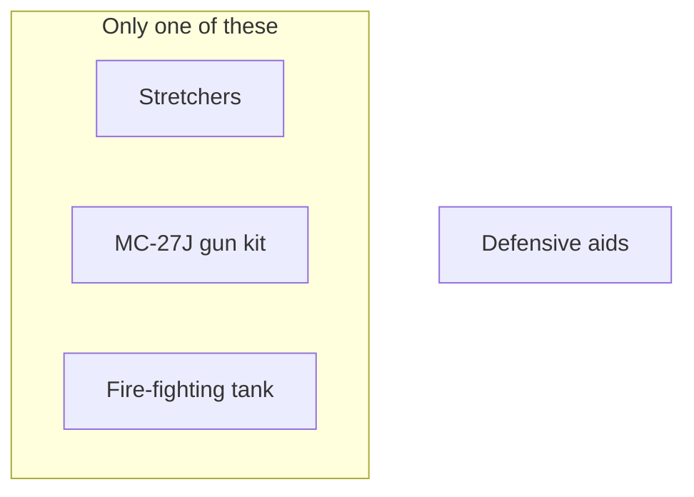

# The C-27J Spartan: design (26 Nov 2026)

**Status (26 Nov 2026):** the aeroplane itself built: our flight's aeroplane switch and take-off rule (Framework 0.302.0), then the
aircraft with its hold, drops, defensive aids, raids and edge-on propellers (Framework 0.316.0, Vehicles 0.123.0), on the owner's picked
art; then LAPES (Framework 0.323.0, Vehicles 0.126.0; [airdrops](airdrop.md#lapes-26-nov-2026-framework-03230-vehicles-01260)); its own
voice (Vehicles 0.127.0) and defensive aids pods (0.127.1); then the three hold fits with their pictures (Framework 0.329.0, Vehicles 0.128.0).
Not built: its flyover, taxi and cabin sounds (picked, waiting for a flight hook), filling the tank from a bowser or tanker, and its damage
looks (the parts are cut, waiting for the owner's look). Not yet tested in game.

The owner asked, 26 Nov 2026, after the parachute airdrops were built ([airdrops](airdrop.md)): "C-27J Spartan", the transport aeroplane
that record and [modern military vehicles](modern-military-vehicles.md) (MV7, "the rough-strip transport aeroplane") named as the real
vehicle carrier. It keeps its real name (that record's decision 12).

How to read it: **[P]** a primary source; **[S]** a secondary one; **[I]** our inference; **[A]** an authored gameplay figure. Owner
choices, agent defaults and agent choices are labelled as such.

## Read this first

- **It never hovers.** It takes off along a strip and lands on one, circles where it would hold, and makes drop passes; it cannot drop
  from a hover, hook a sling load or work a hoist. Our flight gains an aeroplane switch for it (`canHover`).
- **A strip of about 35 cells** of clear, level, unroofed ground to take off loaded (690 m at full weight **[P]**, at our flight's map
  scale **[A]**), less when light; rough ground does (a gravel strip of CBR 4 **[P]**).
- **Its hold takes one vehicle up to 2 by 5 cells and 8,600 kg** (owner's card): an L-ATV, the Wiesel, Vanilla Vehicles Expanded's cars.
- **LAPES is on by default** (owner's card, against our rule that high-risk behaviours start off; the owner's choice): it flies a metre or
  two above a clear strip and pulls a platform out of the ramp. No drift, pinpoint, and a small chance of striking the ground.
- **Big picture**: drawn at the Osprey's scale (owner's card), about 34 by 27 cells on a 5 by 11 footprint, shipped at about 120 pixels a
  cell (past the 4K limit at 128).

## The owner's decisions (26 Nov 2026, question cards)

| Question | Answer |
| --- | --- |
| Size | **The Osprey's scale**: 5 x 11 footprint, picture about 34 x 27 cells |
| Hold | **2 x 5 cells, 8,600 kg**, one vehicle |
| LAPES | **Yes, on by default** |
| Fits | **All four**: the MC-27J gun kit, the fire-fighting tank, stretchers, defensive aids |
| Filling the fire-fighting tank | **Pump from open water**: a colonist runs the pump while it stands within reach of open water; a bowser or a tanker where those exist (not built yet) |
| The gun kit's fight | **Circle left, gun on the centre**: told to circle, it turns left so the gun faces the centre; on other legs it fires only on its left |
| The gun kit's barrel | **The slim one** (try 1; the owner, 26 Nov 2026: "Use the slim barrel on the gun kit") |
| Art | **Nano Banana Pro through fal, as the Osprey**; a cost cap asked once the picture list is planned |

## The four questions

| Question | Answer |
| --- | --- |
| What it lets the player do | Carry a vehicle, troops, stretchers or cargo by air to a rough strip or by parachute anywhere; deliver by LAPES onto a strip with no drift; circle a fight with a side gun; drop water along a fire line |
| What it stops them doing | Using it without a strip; hovering, slinging or roping; carrying more than one vehicle or anything wider than two cells |
| How it changes play | An airstrip becomes worth building and defending; heavy loads reach a camp or a fight without a road; one airframe changes job by its fit |
| What outside it notices | Enemies shoot at it on its passes and on the strip; raiders and allies fly it (paratrooper raids, supply drops); air defence of other mods sees it; fires go out under its tank |

## The real machine

Sources: Leonardo's Next Gen brochure (Mar 2021) **[P1]**, Alenia's pocket technical guide **[P2]**, Alenia's 2006 proposal **[P3]**,
the RAAF's *Aircraft of the RAAF* (A34) **[P4]**, Leonardo's 2021 presentation **[P5]**, EASA's AE2100 type certificate **[P6]**.

| Figure | Real value |
| --- | --- |
| Length, span | 22.7 m, 28.7 m **[S]** |
| Hold | 2.45 m wide at the floor (3.33 m at most), 2.25 m high, 8.58 m of floor (11.43 m with the ramp; another source says 9.48 m) **[P2, P3]** |
| Weights | 17,000 kg empty **[P4]**; 32,500 kg max take-off **[P1, P4]**; 11,300 kg max payload, 8,600 kg at 2.5 g **[P1, P4]**; 9,734 kg of fuel **[P1]** |
| Engines | Two Rolls-Royce AE2100-D2A, 3,458 kW each, take-off and max continuous alike **[P6]**; six-blade Dowty propellers **[P2]** |
| Performance | 602 km/h cruise; 9,144 m ceiling **[P1]**; take-off 690 m and landing 390 m at max weight; strip 12.1 m wide **[P1, P5]** |
| Crew, people | Two pilots and a loadmaster **[P4]**; 60 troops; 34 equipped paratroops; 36 stretchers **[P1]** |
| Drops | 9,000 kg on two platforms, 6,000 kg on one; six A-22 bundles; LAPES up to 5,000 kg **[P1, P2]** |
| Fits | MC-27J: a 30 mm gun through the left door (in trials, fielding by 2030 **[S]**); a roll-on fire-fighting tank of 7,950 L sprayed through the left jump door **[P1]** |
| The RAAF | Ten, A34-001 to -010, No 35 Squadron, Amberley **[P4]**; retirement announced April 2026 **[S]** |

## The aircraft in game (agent defaults, for the owner's review)

As built (Vehicles 0.123.0), the Defs in `mods/PhobosVehicles/Defs/Phobos/Vehicles/C27J/` and `Patches/C27J/`; each authored figure is
explained in a comment beside it there. The main ones:

| Figure | In game | Basis |
| --- | --- | --- |
| Mass stat, flight speed | 2,200; 22 | The Osprey's 1,950 and 17.5, scaled by empty weight and by 602 km/h **[I]** |
| Cargo | 11,300 kg, the real maximum payload **[P1]**; the hold 8,600 kg (owner's card) | Take-off is judged on the whole weight: with full fuel it lifts about 5,800 kg, so a full hold needs less fuel, as the real one (owner's card, 26 Nov 2026: "Keep the real trade"). Drag the fuel bar's target down, or have a colonist take fuel out (Vehicle Framework's own) |
| Fuel | 2,830 units, 12,168 L of the real 9,734 kg **[P1]** | About 2.5 times the Osprey's endurance **[I]** |
| Flight | 9 cells a second, turn 24 degrees a second, circle 18 cells at 7 a second; rolls 12 to 35 cells, landing 25 **[A]** | The map's compressed scale |
| Propellers | Edge-on bars from above, still or a blur (owner's card, 26 Nov 2026: "Edge-on bar"; Framework's `CompPhobosPropellers`) | A tractor propeller spins upright ahead of its nacelle |
| Defensive aids | One node: the infrared jammer and chaff and flare dispensers, 60 cartridges **[A]** (owner's card: per aircraft; Framework's `countermeasuresByUpgrade`) | The RAAF's suite **[P4]** |
| Raids | Always paratroopers: an aeroplane cannot land on a spot or rope down | Framework's raider flight |
| Walk-in cabin | None yet | The cabins record: no new cabin until the Osprey's is tested |

- **Footprint 5 x 11, picture about (34, 27)** at the Osprey's 1.175 cells a metre (owner's card).
- **Our systems**: a loadout with two turbines driving propellers through gearboxes (the turboshaft kind and the rotor drive standing in
  for turboprops **[I]**: our engine model has no turboprop kind), fly-by-wire hydraulics, avionics with weather radar, two fuel tanks.
- **Flight**: speed, turn and circle figures at the map's compressed scale **[A]**; take-off roll from its weight against its maximum
  take-off weight (a new rule), at most about 35 cells **[A]**; a rolling landing on a strip of about 25 cells **[A]**.
- **Hold**: 2 x 5 cells, 8,600 kg, one vehicle (owner's card). **Airdrop**: two jump doors, two platforms of up to 6,000 kg, two
  bundles a second **[A]**.
- **People**: 2 pilots, a loadmaster, and 40 passenger seats (the RAAF's fit **[P4]**).

## LAPES (owner's card: on by default)

**Built** (Framework 0.323.0, Vehicles 0.126.0): how it works, its figures and what is unconfirmed are in
[airdrops](airdrop.md#lapes-26-nov-2026-framework-03230-vehicles-01260). The C-27J's limit is `lapesKg` 5,000 in its airdrop patch.

- **An order on the drop buttons**: pick a clear, level strip and its direction, as a landing strip is picked. The aircraft descends to
  its LAPES height along it and its platform (up to 5,000 kg **[P]**) is pulled out of the ramp on an extraction chute, sliding to a stop
  on the strip: no drift.
- **Risk**: the load lands hard more often than by parachute **[A]**; the aircraft can strike the ground (a small chance **[A]**,
  damaging its landing gear and belly, rarely more), after the two fatal LAPES crashes of 1982 and 1987 **[S]**.

## The upgrade tree (owner's card: all four fits; agent's layout)

| Node | What it does | Real basis |
| --- | --- | --- |
| Defensive aids | **Built**: infrared jammer, chaff and flares, cued by the built-in missile warning receiver | The RAAF's suite **[P4]** |
| Stretchers | **Built** (Vehicles 0.128.0): 36 stretchers in the hold, carried and tended as the litter kit's (Framework's `Phobos_Litters`); 360 kg **[A]**; either/or with the gun kit and the tank (they fill the hold) | **[P1]** |
| MC-27J gun kit | **Built**: a 30 mm gun on a pallet (`Phobos_C27J_GunKit`, 200 rounds a minute **[S]**, 45 cells, 75 with Combat Extended's 30x173 mm **[A]**), out of the left door, worked by the loadmaster; its side-gun marker makes it circle left; 1,000 kg **[A]**; either/or with the stretchers and the tank | Leonardo's MC-27J **[S]** |
| Fire-fighting tank | **Built**: a roll-on tank of 7,950 L (Framework's `CompPhobosFireTank`), pumped from open water at 400 L a minute within 6 cells **[A]**, emptied along a water drop pass 3 cells wide at 100 L a cell (the bucket's rule); 2,000 kg empty **[A]**, its water weighed as cargo; either/or with the others | Leonardo's fit **[P1]** |

The three hold fits are either/or (they fill the same hold); defensive aids stand alone. The tree's Mermaid diagram comes from
`scripts/check-upgrade-trees.py --write` once built.

<!-- upgrade-tree: Phobos_C27J_UpgradeTree -->

## Other factions' C-27Js

- **In a raid on us**: it brings paratroopers by parachute (the airdrop's raid arrival), or lands outside turret range on a strip it
  finds; its passes are open to our guns and CIWS.
- **At a base we attack**: parked on its strip, its parts can be shot out.
- **Allies**: its pass delivers allied supply drops.
- **One we capture**: it flies as ours.

## Art (owner's card: Nano Banana Pro through fal; cap by card after this plan)

The base body drawn bare in three facings with paint masks; one overlay per visible fit (the gun pallet's barrel at the left door, the
tank's spray boom, the defensive pods; the stretchers are inside and need none); the icon. Every picture is planned before the first is
made (the vehicle rule), and the cost cap is asked by card first.

**The plan and its cap (owner's cards, 26 Nov 2026):** ten paid pictures on Nano Banana Pro through fal, capped at US$3.00, raised to
US$3.60 for a propeller redraw: the body from above (2 tries), the propeller (2), then the three fit overlays as edits of the picked body
(2 each). The upgrade icons go to the local night run; damage marks and paint masks are made by script. The first propeller pair, drawn
face-on with orange tip bands, the owner rejected ("Neither propeller is up to standard"), with a photo of the real one: all black, a
black bullet spinner, slim swept scimitar blades. Redrawn as seen from above, edge-on; the photo, not being our art, was never sent.
Requests and records: `assets/phobos-vehicles/requests/c27j-paid.json` and its record.

### Parts for damage looks (26 Nov 2026; agent's placements, for the owner's look before any export)

The body pick cut into the Def's own parts with Segment Anything on the processor (`scripts/art/name_parts.py --cpu`, about 3 minutes;
`assets/phobos-vehicles/requests/c27j-parts.json`, boxes from the plan checked against the pick). The review picture is kept in the
art tools' working folder (`parts/7178d782.../review.png`). Each part takes the bulk tanker's damage marks below 60% health, as the
Osprey's do, once the owner has seen the cut.

| Part (the Def's key) | Cut | Score |
| --- | --- | --- |
| Cockpit, ForwardHold, CentreHold, AftHold | The fuselage, banded at 4, 9 and 14 m back (the plan's) | 0.84 |
| LeftWing, RightWing | Whole, root to tip | 0.90, 0.92 |
| LeftNacelle, RightNacelle | Whole, spinner to exhaust | 0.98, 0.99 |
| LeftMainGear, RightMainGear | The fairing behind the wing | 0.87, 0.83 |
| Tail | Tailplane and fin | 0.98 |

The paint repair from the same session's grid map was tried and is not used: 0 visible flecks with or without it (`export_c27j.py`).

## Order of work (agent's proposal)

1. Our flight's aeroplane switch and the take-off rule (Framework), with tests.
2. The C-27J's Defs: vehicle, loadout, flight, hold, airdrop, parts bill, research (Vehicles), on its pictures once picked.
3. LAPES (Framework), then the four fits.
