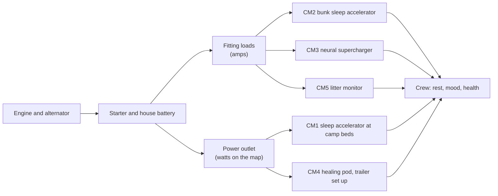

# Crew machines on vehicles and trailers (23 Nov 2026)

**Status (23 Nov 2026):** partly built. CM1, CM2 and CM5 are built in D'thorga Framework 0.265.0 ([what was built](#built-cm1-cm2-and-cm5-23-nov-2026)),
not yet tested in game; CM3 and CM4 are not built. The figures and every "agent default" below wait for the owner's word.

**A design record.** The owner, 23 November 2026, after asking how a neural supercharger works: "We should probably consider upgrades
just like the neural supercharge, sleep accelerator, etc. for our vehicles", and then "Oh, trailers too!". Facts marked **[code]** were
read on 23 Nov 2026 with `scripts/query-defs.py` (Defs as patched in the owner's game, from the file of 19 Nov 2026) and the game's
decompiled code, and are given in our own words. Figures marked **[A]** are authored starting values; **[I]** is our inference.

## Read this first

- **Four machines, CM1 to CM5** (the sleep accelerator is two pieces): a sleep accelerator beside camp beds (CM1) and in the cab bunk
  (CM2), a neural supercharger aboard (CM3), a healing pod trailer (CM4) and a vitals monitor for litters (CM5).
- **Every one draws real power** from the vehicle, by the accessory rule, through loads and the power outlet that are already built
  ([vehicle accessories](vehicle-accessories.md)). None adds wear, drag or upkeep.
- **Three of the game's machines are Ideology's** (sleep accelerator, neural supercharger, biosculpter pod) **[code]**. The vitals
  monitor is the base game's.
- **The hard one is CM4.** Healing on the road needs the pod to work while the caravan is off the map; see "What makes this hard".
- **A correction to the links work of the same day:** camp, roof tent and cabin beds stand on the map once set out, so a machine can
  stand beside them. Only the cab bunk is held inside the vehicle with no cell of its own.

## The owner's choices (23 Nov 2026)

| Choice | The owner's answer |
| --- | --- |
| Which ideas go into this record | All four: sleep accelerator, neural supercharger, healing pod trailer, vitals monitor for litters |
| A player without Ideology | **The game's machine, ours otherwise**: with Ideology the game's own machine is the part fitted or set out; without it a plain version of ours fills the same role, as parts bills do for other mods' parts |

Everything else here is the agent's proposal or default, labelled where it matters.

## What the research found

### The game's machines [code]

| Machine | From | Size | Weight | Power | What it does |
| --- | --- | --- | --- | --- | --- |
| Sleep accelerator | Ideology | 1 by 1 | 20 kg | 50 W idle, **400 W in use** | A bed it stands beside, at the head: rest 35% faster, hunger 20% faster in bed. Research: Microelectronics basics |
| Neural supercharger | Ideology | 1 by 3 | 20 kg | 400 W | Charges for one day with power on, then gives one person a supercharge for one day: consciousness +10%, learning +25%, hunger +20% |
| Biosculpter pod | Ideology | 3 by 2 | 50 kg | 200 W working, 50 W idle | One person inside for a cycle: medic 6 days, age reversal 8, pleasure 4, bioregeneration 25 (its own research). 5 nutrition a cycle |
| Vitals monitor | Base game | 1 by 1 | 20 kg | 80 W | A bed it stands beside: tend quality +7%, immunity gain +2%, surgery success +5% |

- **The supercharger's use takes about 2.4 seconds** at its end cell, and empties it. A colonist goes by themselves only when the
  machine's mode allows (those whose ideology prefers it, everyone, or nobody) and half a day after their last one wore off.
- **The precept "Neural supercharge: preferred"** gives an unhappy thought once half a day has passed without one. A caravan has no
  machine to go back to, so today those colonists are unhappy on any trip longer than a day and a half **[I]**.
- **The pod puts its occupant out** after one day in all without power; the count adds up across cuts.
- **A pod tuned to one person** runs their later cycles a quarter faster.

### What ours already has [code]

- **Loads on fittings, a house battery and a power outlet** (Framework 0.129.0). The outlet puts a parked vehicle on the game's own
  power net through the conduit beneath it: up to 300 W on a 12 V vehicle, 600 W on 24 V, each watt costing amps at the vehicle's
  voltage over an inverter efficiency of 0.85.
- **The camp order** sets out gear carried in the cargo beside a parked vehicle or a camp-deck trailer, and packs it away.
- **Beds on the map once set out:** the swag, the roof tent, the camper beds, and the walk-in cabin's beds and litter. None links to
  facilities today except the swag (like a bedroll, Framework 0.259.0).
- **The cab bunk** is held by the vehicle. A sleeper there rests at the bunk's own rest figure, read each tick
  (`CompPhobosCamp`), so a fitting that raises that figure is a small change.
- **Life aboard** already runs a check for what riders do on the move (music, reading, a drink, a treat).
- **The litter kit** lays downed people on litters in a cabin, and crew who can doctor tend them while the vehicle stands
  (`CompPhobosLitter`).
- **Driver fitness** reads consciousness, sight and manipulation, and counts consciousness only up to 100% (`DriverRule`). Hours at
  the wheel do not read learning speed.
- **Set-out pieces** (the Billy field kitchen's range, kettle and cold box) are carried by a trailer, stand on the map when it is set
  up, and work while it is plugged in (`CompPhobosSetOut`).

## The idea in one picture

## The machines

What each draws, by the outlet's rule (watts over 0.85, over the vehicle's voltage) [computed]:

| Machine | Watts | Amps at 12 V | Amps at 24 V |
| --- | --- | --- | --- |
| Sleep accelerator, in use (50 W idle) | 400 | 39.2 | 19.6 |
| Vitals monitor | 80 | 7.8 | 3.9 |
| Biosculpter pod, working | 200 | 19.6 | 9.8 |
| Neural supercharger, charging | 400 | 39.2 | 19.6 |

The owner's tanker, idling in a heat wave with its air conditioner on, drew 70 A and lost 14 A from its battery (the owner's
screenshot, 23 Nov 2026). A supercharger on top of that needs the engine working or a house battery.

### CM1. A sleep accelerator beside camp beds

- **What it is:** the game's own sleep accelerator, carried in the cargo as camp gear, set out at a camp bed's head by the camp order
  and powered from the outlet or any power within its lead's reach. No new machine.
- **What it needs:** the roof tent's and camper beds take facilities that change rest (the links extension with its stat filter, so
  it is chosen by what it does); the camp order learns to put one at a bed's head; the camp-deck trailer needs power where its
  truck has driven away (see "To settle").
- **Without Ideology:** a **camp sleep inducer** of ours with the same figures [A], built like the game's (agent default).

| Question | Answer |
| --- | --- |
| What it lets the player do | Rest a crew in about three-quarters of the time at a camp |
| What it stops them doing | Carrying 20 kg of something else, and running other camp devices on a small outlet at the same time |
| How it changes play | A short halt can be a full rest: camp, sleep fast, move on. Food runs down faster for it |
| What outside the vehicle notices | The colonists (rest, hunger), the vehicle's battery and fuel, and other factions' camps, which may have one standing |

**Risk: low** (agent's grade): faster hunger and a drained battery, both shown; the house battery keeps the starter safe. No setting.

### CM2. A sleep accelerator in the cab bunk

- **What it is:** a fitting for the sleeper berth. While someone sleeps in the bunk and the fitting has power, the bunk rests them 35%
  faster and they hunger 20% faster [the game's figures]. It draws its 50 W only while someone sleeps there.
- **Its kit:** with Ideology, the game's sleep accelerator itself; without, ours (as CM1).
- **Why it matters:** it pairs with **Drive through the night**. The relief driver is rested sooner, so a pair of drivers holds a long
  run with less tiredness at the far end.

| Question | Answer |
| --- | --- |
| What it lets the player do | Bring the relief driver back to the wheel sooner; sleep faster in a parked cab |
| What it stops them doing | Nothing new, beyond its power and the food it costs |
| How it changes play | Long hauls in shifts become steadier; packing enough food for the run matters more |
| What outside the vehicle notices | The colonists (rest, hunger), the world map (crews arrive less tired), the electrics (a load at night) |

**Risk: low** (agent's grade). No setting of its own; night driving keeps its own.

### CM3. A neural supercharger aboard

- **What it is:** a fitting in the cab of a heavy vehicle, or on a camp-deck trailer. It charges only while it has power, one game day
  of it at 400 W, and then gives one person aboard a supercharge through the life-aboard check: someone its mode allows, never the
  driver while the vehicle moves.
- **Its modes** are the game's three: those whose ideology prefers it (the default), everyone, nobody.
- **With Ideology** the kit is the game's machine and the condition is the game's own, so the precept's thought is satisfied on the
  road. **Without Ideology** ours gives a condition of our own with the same three figures [A] and no precept to satisfy.
- **At a camp on a map,** the game's own supercharger carried in the cargo already works from a 24 V vehicle's outlet with no code of
  ours [I]: its 400 W is over a 12 V outlet's ceiling.

| Question | Answer |
| --- | --- |
| What it lets the player do | Keep colonists who expect a supercharge content on long trips; lift an impaired driver's consciousness by a tenth |
| What it stops them doing | Running it for nothing: it is the heaviest load a cab can carry, and gives one person a day |
| How it changes play | Who gets the day's charge is a choice; a long trip with believers aboard needs the power for it |
| What outside the vehicle notices | The colonists' mood (the ideology's thought), hunger, the driver's fitness, the electrics and fuel |

**Risk: low** (agent's grade): the worst outcome is a flat house battery.

**Honest limits:** a fit driver gains nothing from it at the wheel, since fitness counts consciousness only to 100%. **Without Ideology
its value is thin**: no precept, so only the impaired driver's tenth and faster learning. **Agent's proposal:** let hours at the wheel
read learning speed, so a supercharged driver comes to know a vehicle sooner; otherwise consider leaving ours out for players without
Ideology, which would change the owner's choice for this one machine.

### CM4. The healing pod trailer

- **What it is:** a trailer whose body carries a biosculpter pod, in the way the Billy field kitchen carries its range and cold box.
  Set up and plugged in, the pod stands on the map and works as the game's does. A new trailer, with art of its own.
- **Slice 1, set up only (agent's proposal):** the pod works only while the trailer is set up, from a grid or a vehicle's outlet
  (200 W fits both ceilings). It lets a pod be towed to an outpost, a camp or a gravship's landing site. The trailer refuses to pack
  up with someone inside.
- **Slice 2, on the road:** the patient stays in the pod and the cycle goes on while the caravan travels, on the towing vehicle's
  power. This is the piece the owner chose, and the hard one.
- **Without Ideology:** a **recovery pod** of ours with one cycle like the medic cycle [A] and none of the others (agent default); it
  needs its own design and art before it is built.

| Question | Answer |
| --- | --- |
| What it lets the player do | Take a pod where it is needed; in slice 2, start a cycle and leave, so six days of healing are six days of travel |
| What it stops them doing | Moving off while someone is inside (slice 1); cutting the trailer's power for long (slice 2) |
| How it changes play | A long expedition can carry its own recovery; the trailer becomes the thing a convoy protects |
| What outside the vehicle notices | The patient, the doctor's workload, the towing vehicle's electrics, raiders (a pod with someone inside is a hostage), a letter when a cycle ends or is lost |

**Risk: moderate** (agent's grade): a cycle and its nutrition can be lost at once if power fails for a day, and the player is warned
as the count runs. Nobody is harmed. So slice 2 has its own setting, **Healing pods work on the road**, on by default.

### CM5. A vitals monitor for litters

- **What it is:** a fitting beside the litter kit: a monitor on the litters. Tending aboard is 7% better and immunity gain 2% faster
  [the game's figures]; it draws 80 W while someone lies on a litter. Its kit is the game's vitals monitor, so Ideology plays no part.
- **In a walk-in cabin** the litter is a bed on the cabin's own map, so there it can be the game's monitor as a fixture beside it,
  linked through the links extension (hospital bed, tending and immunity only).

| Question | Answer |
| --- | --- |
| What it lets the player do | Tend the wounded better on the way home |
| What it stops them doing | Nothing new, beyond its power |
| How it changes play | An air ambulance or a truck with litters is worth fitting out properly, not just with stretchers |
| What outside the vehicle notices | The patient (infection, recovery), the doctor aboard, the electrics |

**Risk: low** (agent's grade). No setting. It belongs with D'thorga Medical's work, and its tie to the medical queue is for the build.

## What makes this hard

- **CM4 on the road.** In a caravan a vehicle and what it holds are off the map. The pod's own code draws effects on a map and holds
  its occupant in its own container **[code, outline only]**; whether it can be ticked while packed has **not been read**. If it cannot,
  slice 2 needs a holder of our own that counts the cycle by the game's figures and hands the patient back at the end. Read the pod's
  tick and its end-of-cycle code before promising slice 2.
- **The cab bunk has one mount.** A loadout part takes one fitting, and the bunk is the sleeper berth's fitting. CM2 needs a mount of
  its own beside it, or a second bunk fitting with the accelerator built in. To settle at build.
- **A camp-deck trailer has no power of its own.** With its truck away, CM1 at the trailer's beds needs a vehicle with an outlet in
  reach, a house battery on the trailer, or a grid. To settle at build.
- **A supercharge on the move.** The game's use is a job at a map cell. Aboard, the life-aboard check gives it instead. The game's own
  condition keeps the "last supercharged" time itself while it lasts **[code]**, which is what clears the precept's thought; that it
  does so for someone riding in a caravan is **not yet checked**.
- **Tending on litters.** How `CompPhobosLitter` sets tend quality was not read for this record; CM5's figure joins it there.

## Other factions' vehicles

| Machine | In a raid on us | At a base we attack | On one we capture |
| --- | --- | --- | --- |
| CM1, CM2 | None: raiders never camp, and a fitted bunk accelerator does nothing in a fight | Some factions' camped vehicles may have one standing, through the fit sets that already give them a camp | Loot: the machine and the fitting come with the vehicle |
| CM3 | Does nothing in a fight | A faction whose ideology prefers the supercharge may have one fitted (agent default) | Loot |
| CM4 | Other factions bring no trailers | None | Not applicable until they tow |
| CM5 | A raider's ambulance, if any, tends no better for us to notice | None | Loot |

## Cost to run

Nothing ticks for these alone. CM2 and CM5 are read where the bunk and the litters already work; CM3 joins the life-aboard check and
counts its charge on the electrics' own pass; CM1 is the game's machine; CM4's set-out pod is the game's, and its road count, if built,
runs on the caravan's interval.

## Left out, and why

| Idea | Why |
| --- | --- |
| A growth vat, gene tools or a mech gestator on a trailer | Not asked for; each is its own design |
| A mech recharger or band node on a vehicle | Worth its own record: it would let mechanoids work from a vehicle away from home |
| Better driving from a supercharge above 100% consciousness | Driver fitness stops at 100% by design |

## The order (agent's proposal)

1. **CM1**, the least new code: the links extension on camp beds and one more piece for the camp order.
2. **CM2**, small, and it completes driving through the night.
3. **CM5**, small, with the medical work.
4. **CM3**, after the owner's word on hours at the wheel and on players without Ideology.
5. **CM4**, slice 1, then slice 2 once the pod's code is read.

## Art and sound

Kits that are the game's machines need no picture. Ours without Ideology (the camp sleep inducer, the supercharger, the recovery pod),
the fittings' icons and the pod trailer need art by the art rules, asked for before the first test.

## Built: CM1, CM2 and CM5 (23 Nov 2026)

The owner's cards of 23 Nov 2026: **CM1, CM2 and CM5 now**; fittings take **the packed machine itself**, "and genericize the code where
reasonable because I see it having other uses elsewhere"; the sleep inducer's picture **paid now**, fitting icons in the night run; the
supercharger (CM3), when built, **Ideology only**, with no change to hours at the wheel; the pod trailer (CM4) **set up first, road second**.
Rows 438 to 440 of [the in-game test pass](in-game-test-pass.md). Not yet tested in game.

| Question | Answer |
| --- | --- |
| What it lets the player do | Rest a sleeper faster in a cab bunk or a camp bed; tend better on a vehicle's litters |
| What it stops them doing | Running a light vehicle's camp sleep machine from its own outlet: 400 W is over a 12-volt outlet's 300 W |
| How it changes play | A long haul in shifts, or a short halt, rests more; food and fuel run down faster for it |
| What outside the vehicle notices | The colonists (rest, hunger), the patient (tend quality), the electrics and fuel, the camp layout |

**Risk: low** (agent's grade, for the owner to confirm): faster hunger and a drained battery, both shown. No setting.

| Piece | Where | Differs from the design |
| --- | --- | --- |
| Packed machines as materials | `PackedThings` in the Framework core (`src/PhobosFramework/Items`): finding, counting, taking and giving back a supply ask it, so a building named in a list is answered by that building packed | New: the owner's call for generic code. The item finder, a vehicle's cargo count and take, its supply hauling, bay trips and fitting give-backs all use it; a packed machine is never scaled by a vehicle's weight |
| CM2 | `PhobosFitting_CabBunkAccelerated`, a second version of the cab bunk on the same sleeper berth: the bunk's steel and cloth plus the machine | The record proposed a mount beside the bunk; a part takes one fitting, so it is the bunk with the machine instead (agent's choice). Rest +35% through a stat part on the game's bed rest (`StatPart_PhobosBunkAccelerator`), hunger +20% through a postfix on the game's hunger, which applies a bed's figure only on a map. **400 W in use** (39.2 A at 12 V), not the 50 W first written: the game's machine draws 50 W idle and 400 W while used |
| CM5 | `PhobosFitting_LitterKitMonitored`, a second version of the litter kit: its materials plus a packed vitals monitor | As CM2, a second version rather than a second mount. Tend +7% through a postfix on the game's tend sum, within the medicine's cap; the monitor's immunity and surgery offsets reach only a bed, which a litter is not. The Osprey's cabin now picks its layout by the litters, not by the plain kit's name (D'thorga Vehicles 0.113.2) |
| CM1 | The camp order sets a packed sleep machine against a camp bed's head, facing it (`besideBedHead` on camp gear); the roof tent and camper beds take machines that speed rest from a plain bed's list (the links extension with its stat filter) | Ours, the **sleep inducer**, is built in the Motor pool tab without Ideology and hidden with it; with Ideology the game's machine is camp gear by patch. A machine waiting for a pending fitting is not set out |

**Known limits:** the new fittings borrow the cab bunk's and the litter kit's icons until the night run. Walk-in cabin beds take no camp
machine: the camp order does not reach a cabin. A remembered spot from an earlier camp is used first, as for other gear, even if it no
longer faces a bed.

