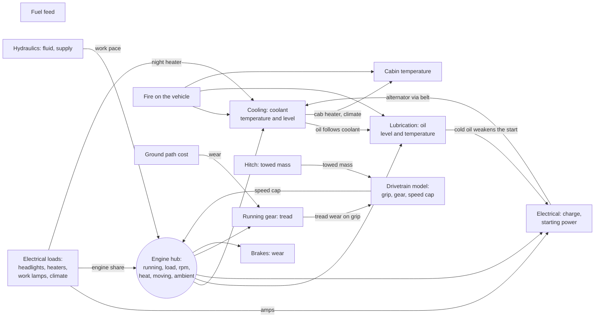

# Vehicle cross-links, round three: the crew, weather and ground, combat damage, electrics and hydraulics (13 Nov 2026)

**A research record. Nothing is built, and nothing here is tested in game.** The owner, 13 November 2026, asked for "a research and
record purview for any further and deeper cross-links we can make", with avionics as the gap they see most, "but I want this
purview to cover all vehicles, ground-based and all." It is the third of three records in this review:

1. [The authors' override contract](vehicle-author-overrides.md): how another mod's author changes any of this in XML.
2. [Avionics for every aircraft](vehicle-avionics.md): rows A1 to A17 and loose ends L1 to L6. **Aircraft rows are not repeated
   here.**
3. This record: every other vehicle, plus what carries over from [round one](vehicle-system-crosslinks.md) and
   [round two](vehicle-crosslinks-round-two.md), the faults found on the way, and a short list ranked across all three.

The owner chose the four areas for ground vehicles and boats on 13 November 2026: **the crew; weather and ground; combat damage;
electrics and hydraulics.**

How to read it:

- Facts marked "from the code" were read on 13 Nov 2026 with `scripts/query-code.py` and `scripts/query-defs.py`. `VF` is Vehicle
  Framework 1.6 (`VehicleFramework-1.6:Vehicles.decompiled.cs`), `all.cs` the game (RimWorld 1.7 decompile). Our files are named in
  full.
- Real-world claims carry a label: **[P]** a primary source, **[S]** a secondary one, **[I]** our inference, **[A]** authored for
  play. A figure without a label is authored. A game needs the direction and rough size of an effect, not a workshop manual.
- Cost classes, as in the earlier rounds: **XML** (Defs only), **input** (one small input or condition class), **hub** (a change in
  the systems comp, the drivetrain or a shared service), **job** (a change in a working vehicle's comp), **hook** (a patch into
  another author's code, named).
- "An override can" says what an author could change about a row under the [contract](vehicle-author-overrides.md): every row is
  addressed by its system and flow or stage name, so it can be switched off or scaled per vehicle.
- Every name of a Def, quantity, input or class in the tables is **proposed**.

## Read this first

- **The graph is a web now, not a star.** Rounds one and two and the work since (families, headlights, the hitch, the hybrid
  generator set) give about 25 links between systems. What is still missing is anything **outside the machine**: the person driving
  it, the weather it drives through, and what a hit does beyond the radiator, the sump and the battery.
- **Vehicle Framework and the game already do more than we credit**, and the proposals below build on that rather than beside it:
  vehicles already slow in rain and snow through the game's weather (`VF:47400`); Vehicle Framework already picks the most conscious
  driver (`VF:11566`) and refuses a role to anyone without manipulation or consciousness (`VF:18000-18004`); its authors already give
  fuel tanks leak and explosion reactions (`VF:8019-8113`).
- **Twenty new rows (G1 to G20)** in the owner's four areas, plus fresh verdicts on round two's unbuilt T4 to T8, F2 to F8 and the
  boost axis.
- **The cheapest clear wins** are two lines of XML each (a dry tank hurting the fuel pump; an air-brake warning before the brakes
  lock). **The deepest** are one driver rule shared with the [hotboxing record](vehicle-hotboxing.md), weather on grip, and one
  load-shedding rule shared with the aircraft.
- **Four faults** found on the way are listed with a recommendation each; one, a miscount in round one's record, is corrected in the
  same change as this record.
- **Five questions for the owner** are at the end.

## The graph after Framework 0.105.2

From the Defs and the code, 13 Nov 2026. Round two's table counted ten links after 0.70.0; since then T1 to T3, the block heater,
the families, headlights, the hitch, recovery and the hybrid generator set have added the rest.

**The holes this round looks at:** nothing reads the driver; weather reaches only air temperature (`Input_Ambient`) and the
ground's path cost (`Input_GroundPathCost`, which counts snow on the cell); brake and clutch wear are flat per hour of driving;
the cab's temperature stages are labels with no effects (the game's own temperature handling reaches the crew instead, through
`src/PhobosFramework.Vehicles/Service/CabClimate.cs`); hits reach coolant, oil and charge through four part conditions only
(`mods/PhobosFramework/Mods/VehicleFramework/Common/Defs/Phobos/Framework/VehicleSystems/Conditions.xml`).

## What the game and Vehicle Framework already do (from the code)

| What | Where | What it means here |
| --- | --- | --- |
| The game's weather slows vehicles as it slows people | `VF:47400` divides a vehicle's move speed by `WeatherManager.CurMoveSpeedMultiplier` (`all.cs:430032`) | Weather on **speed** is done. G5 is about **grip** (hills, mud, towing), which nothing reads |
| The game's weather carries more than speed | `WeatherDef` has `rainRate`, `snowRate`, `sandRate`, `windSpeedFactor`, `accuracyMultiplier` and `preventsShuttleLaunch` (`all.cs:47739-47765`) | One weather input can serve G5, G8 and the avionics record's A1 |
| Drivers are chosen by consciousness | `RoleAssignment.Resort` sorts drivers by consciousness (`VF:11566`); a role needs manipulation and consciousness (`VF:18000-18004`) | A driver rule (G1) reads the same capacities, so the player's choice of driver already matters to Vehicle Framework |
| Tank hits have reactions | `Reactor_FuelLeak` and `Reactor_Explosive`, and `Reactor_TurretPopper` for turrets (`VF:8019-8196`), used by our own trucks (`mods/PhobosVehicles/Defs/Phobos/Vehicles/BulkTanker/Vehicle_BulkTanker.xml:189`) | A leaking tank and an exploding one are Vehicle Framework's; G11 only covers the vehicles whose authors gave their tank none |
| Land vehicles keep out of deep water | Vehicle Framework's reachability treats water by vehicle type (`VF:57721`) | Fording (G6, G7) is about shallow water, marsh and rivers only |

## Round two, carried forward

Round two's unbuilt rows, with a fresh verdict after what has been built since.

| # | Round two's row | What changed since | Fresh verdict |
| --- | --- | --- | --- |
| T4 | Brake and clutch wear follow mass and speed | **Trailers and the recovery tow** now add mass a truck must stop; a laden tipper and a towing truck wear brakes like an empty one today | **Take**, with F3. Hub |
| T5 | Engine braking on descents spares the brakes | Unchanged | Hold until T4 is played; then with F6 |
| T6 | Running the tank dry hurts the fuel pump | Unchanged; still two lines | **Take, first.** XML |
| T7 | Dust clogs the air filter | The game's weather has a `sandRate` (`all.cs:47743`) | Merged into **G8**, which reads it |
| T8 | A battery warmer on shore power | Headlights now drain a parked battery, which raises the stakes of a cold one | **Take**, into the cold-weather family |
| F2 | Transmission cooler | The gearbox stage is still rarely reached | Hold |
| F3 | Heavy-duty brakes | Pairs with T4 | **Take with T4** |
| F4 | Gear-reduction starter | Headlights and the night heater now drain batteries; a weak start matters more | **Take** |
| F5 | Cab insulation | The electric night heater now costs range, so insulation saves it | **Take**, into the cold-weather family |
| F6 | Exhaust brake | Pairs with T5 | With T5 |
| F7 | Fuel heater | The cold-weather family exists to hold it | **Take**, into the cold-weather family |
| F8 | Heavy-duty air filter | Pairs with G8 | With G8 |
| — | A boost axis on the turbocharger | The owner has played tunes several at a time (13 Nov 2026) without asking for more | Still hold |

**Round two's "argued against", looked at again:** gearbox heat into the coolant (the owner dropped it, "somewhat sadly"), the
compressor's load on the engine (under 1 %) and steam in the cab ("fun, dishonest") all stand. **A cold cab slowing the driver**
stands too, and G1 honours it: the game's hypothermia and heatstroke already lower a pawn's consciousness and manipulation, so a
driver rule that reads those capacities lets a freezing cab slow the vehicle through the game's own conditions, with no parallel
model.

## 1. The crew

**The real basis.** Fatigue and impairment are among the commonest causes of serious crashes: a AAA Foundation study of NHTSA
data put a drowsy driver in about 17.6 % of US fatal crashes in 2017 to 2021 **[S]**
([AAA Foundation for Traffic Safety](https://aaafoundation.org/?p=3159)); NHTSA itself says its own counts understate it **[P]**
([NHTSA, drowsy driving](https://www.nhtsa.gov/risky-driving/drowsy-driving)). Drug-impaired drivers weave more and react more
slowly **[P]** ([NHTSA](https://www.nhtsa.gov/node/138601), as cited in the [hotboxing record](vehicle-hotboxing.md)). A game
needs only the direction: a driver in a bad way drives slower and harder on the machine.

| # | Link | Reads and changes | Lets the player | Stops them | Changes how they play | Cost | An override can | Verdict |
| --- | --- | --- | --- | --- | --- | --- | --- | --- |
| G1 | **One driver rule** | The driver's consciousness, sight and manipulation (the game's capacities, as `VF:11566` already reads) → the speed cap, down to ×0.7 at worst, and tyre and brake wear up to ×1.1 [A]. The [hotboxing record](vehicle-hotboxing.md)'s stoned driver becomes one case of it, as do concussion, a lost eye, a broken hand and hypothermia | See why a truck crawls ("the driver can barely see: driving carefully") | Driving at full pace with a half-conscious, half-blind or one-handed driver | The player picks the driver, and medicine and rest matter to a convoy | hub | Scale it or switch it off per vehicle (an autonomous vehicle has no driver) | **Take.** Build with hotboxing |
| G2 | **A tired driver** | The driver's rest need below the game's "tired" level → feeds G1 a further ×0.9 and one message [A] | Notice a long day on the road | Driving through the night without a rest stop and no cost | Caravans gain a reason to stop, and two drivers to swap | input | Scale or off | **Take with G1** |
| G3 | **A driver who breaks stops the vehicle** | The driver in a mental break → the vehicle stops and refuses to move, with the reason, until the break ends or another driver takes the wheel [I] | Understand why a truck has stopped in a raid | A berserk or wandering driver driving on | Mood management reaches the convoy | input | Off | **Take**, small |
| G4 | **The cab's comfort reaches the crew** | Already done: the cab's temperature is the crew's (`CabClimate.cs`), and the game's own needs and conditions follow | — | — | — | built | — | **Recorded, not proposed**: G1 now carries its effect to the vehicle |

## 2. Weather and ground

**The real basis.** A film of water 0.002 inches (0.05 mm) thick cuts tyre-to-road friction by 20 to 30 % of dry **[P]**
([FHWA research](https://www.fhwa.dot.gov/publications/research/safety/14065/003.cfm)); design stopping distances are set by the
wet case **[S]** ([AASHTO, as excerpted by the University of Idaho](https://www.webpages.uidaho.edu/niatt_labmanual/Chapters/geometricdesign/professionalpractice/BrakingDistance.htm)).
After deep water, brakes work less well until dried by light use **[P]**
([Manitoba Public Insurance driver's handbook](https://apps.mpi.mb.ca/comms/drivershandbook/wet-brakes.html);
[Hyundai owner's manual](https://ownersmanual.hyundai.com/full_webhelp/ne1n/2026/en_us/id078de3166c2.html)). The HMMWV fords
30 inches (76 cm) without a kit and 60 inches (152 cm) with its deep-water kit **[P]**
([TM 9-2320-280-10, hosted by tpub](https://hummer-hmmwv.tpub.com/TM-9-2320-280-10/css/TM-9-2320-280-10_205.htm)); water drawn
into an intake can bend a connecting rod, because water does not compress **[S]**
([PropertyCasualty360, technical notebook](https://www.propertycasualty360.com/amp/2010/04/01/technical-notebook-hydrostatic-lock/)).
Dusty and sandy running shortens an air cleaner's life **[P]**
([TM 9-2350-222-10-2, hosted by tpub](https://operatormanuals.tpub.com/TM-9-2350-222-10-2/TM-9-2350-222-10-20513.htm); the Army's
FM 90-3, *Desert Operations*, [hosted by GlobalSecurity](https://www.globalsecurity.org/military/library/policy/army/fm/90-3/index.html),
its wording not checked).

| # | Link | Reads and changes | Lets the player | Stops them | Changes how they play | Cost | An override can | Verdict |
| --- | --- | --- | --- | --- | --- | --- | --- | --- |
| G5 | **Rain, snow and ice take grip** | A new `Input_Weather` (rain, snow and sand rates from `all.cs:47739-47743`) and frozen water under the vehicle → the drivetrain's grip: rain ×0.85, snow ×0.75, ice ×0.6 [A], on top of tread (T3) and tyres. Speed in weather is already Vehicle Framework's; this is grip: hills, mud, a heavy trailer | See why a laden truck stalls on a hill in a blizzard | Towing a heavy trailer uphill in snow as if it were dry | All-terrain tyres and a heavier tractor matter in winter; the forecast before hitching reads it | input + hub | Scale each weather's factor | **Take** |
| G6 | **Wet brakes after a ford** | Driving out of shallow water, marsh or a river → a short-lived `brakesWet` quantity: speed cap ×0.9 and a message until a minute or two of driving dries them [A] | Read the ford in the convoy's pace | Nothing much | A small, honest touch | input + XML | Off | **Take**, small |
| G7 | **The intake and deep water** | A small engine with its engine running in moving river water → a small chance an hour of engine damage (water in the intake) [A], none with a snorkel fitting | Cross a river with a snorkel or a big truck | Driving a small car through a river with nothing to keep the water out | A snorkel becomes a real fitting for river country | input + fitting | Set the vehicle's fording class | **Ask the owner** (question 5): the game's water is shallow by name, and land vehicles keep out of deep water |
| G8 | **Dust clogs the air filter** (round two's T7) | An `airFilter` quantity in the Service system rising with engine hours, faster in arid biomes and much faster in weather with a sand rate → power ×0.9 and fuel ×1.1 when clogged [A], cleared by the engine service; F8 slows it | Keep a desert truck strong by servicing it | Running a desert convoy on a clogged filter for nothing | Desert and sandstorm country cost services | input + XML | Scale the rate | **Take** after G5 (same input) |
| G9 | **Darkness without headlights** | At night, moving, headlights off and the cell unlit (the game's light grid) → speed cap ×0.85, lower with poor sight (G1) [A] | Headlights earn their battery cost | Driving at full pace in the dark with the lights off | A real choice at night: lights and a draining battery, or slow and dark; raiders' lit vehicles already show themselves ([headlights record](vehicle-headlights.md)) | input | Off (a vehicle with night vision) | **Take** **Built in Framework 0.106.0, not yet tested in game.** |
| G10 | **Wind on high vehicles and trailers** | `windSpeedFactor` (`all.cs:47745`) on tall vehicles and trailers | — | — | Hardly seen in play | input | — | **Argued against**: see below |

## 3. Combat damage

| # | Link | Reads and changes | Lets the player | Stops them | Changes how they play | Cost | An override can | Verdict |
| --- | --- | --- | --- | --- | --- | --- | --- | --- |
| G11 | **A holed tank, where its author gave it no reaction** | A hit on the fuel tank part of a vehicle with no `Reactor_FuelLeak` (checked once at start-up) → a `HoledTank` condition draining fuel an hour, as `HoledRadiator` drains coolant [A] | Patch a leak in the field, as for the radiator | A tank shot through keeping all its fuel | Combat damage reaches range on every vehicle | XML + input | Off (an armoured tank) | **Take** |
| G12 | **Hits to the electrics drop loads** | A hit on the battery or alternator part → a `ShortedWiring` condition: one switched load, chosen at random, drops out until repaired; the headlights are among them [A]. Shares G16's rule | See the headlights die after a hit | Nothing | A shot-up truck limps home dim | XML + G16 | Off | **Take with G16** |
| G13 | **Ammunition aboard cooks off in a fire** | A burning vehicle (round one's link 4, `Input_Fire`) carrying ammunition in its cargo → a chance of an explosion, larger with more aboard [A]; Combat Extended's ammunition read where installed | Keep ammunition off a burning truck, or pull it out | Parking a fuel-and-ammo convoy in a fire with no risk | Fires become emergencies | input | Off | **Ask the owner** (question 4) |
| G14 | **Hits through the cab hurt the crew** | To check first: whether Vehicle Framework already passes damage to seated people when a cab part is hit | — | — | — | — | — | **Read first** |
| G15 | **Fire reaches the tyres and the battery** | Extends round one's link 4: a fire also damages the wheels' and the battery's parts an hour [A] | See a burnt-out truck need tyres and a battery, not only a radiator | A truck walking away from a fire on its old tyres | Fire's cost is honest | XML | Scale or off | **Take** **Built in Framework 0.106.0, not yet tested in game.** |

Trailers and towed vehicles take hits as any vehicle does; nothing new is needed for them.

## 4. Electrics and hydraulics

**The real basis.** Cars and trucks shed electrical loads in a set order when voltage or charge falls: heated seats, rear and
mirror heaters and the blower go first, with a message to the driver **[S]** ([GM's Saab service information, load shed system](https://saabwisonline.com/9-5-9650/2010/3-electrical-system/charging-and-starting-system/technical-description/load-shed-system-description-and-operation));
owners' manuals list the same loads **[P]** ([Ram 2500/3500 owner's manual](https://vehicleinfo.mopar.com/assets/publications/en-us/Ram/2022/2500_3500/om_html/GUID-DB06928D-0177-4DE3-AA7A-479E8E64E7AC.html)).
Without power steering a vehicle still steers, but with "much more effort, especially in sharp turns and at low speeds" **[P]**
([Nissan Leaf owner's manual](https://www.nissan.com.mt/ownership/owners-manuals/manuals.html/iom/leaf/0ze1/e0/2023/electric-power-steering-system-1.shtml);
[Mazda CX-30 owner's manual](https://owners-manual.mazda.com/gen/en/cx-30/cx-30_8hq1ee19i/contents/05080101.html)). Air brakes warn
at about 60 psi, and the spring brakes come on between 20 and 45 psi **[P]**
([Rhode Island CDL manual, air brakes](https://dmv.ri.gov/sites/g/files/xkgbur556/files/documents/manuals/Section5_Air_Brakes.pdf)).

| # | Link | Reads and changes | Lets the player | Stops them | Changes how they play | Cost | An override can | Verdict |
| --- | --- | --- | --- | --- | --- | --- | --- | --- |
| G16 | **One load-shedding rule for every vehicle** (shared with the avionics record's A6) | When the battery is running down below 0.3 charge, or the alternator is lost, switched loads drop in a set order: air conditioning, climate control, cab heater, night heater, work lamps, then headlights; instruments and essential loads stay. One message; they come back when the supply recovers [A]. `LoadActive` gains the shed state | Understand why the heater went off | A dying alternator running every comfort load until the battery is flat | A failing truck gets you home in the cold and dark, slowly | hub | Mark loads essential, or set the order | **Take, first of the hub rows** |
| G17 | **Power steering on heavy vehicles** | Heavy loadouts gain the hydraulics system (built for the working vehicles, `Systems_Fluid.xml:107`); with the engine off or the pump lost, steering is heavy: speed cap ×0.6 while moving [A] | See why a towed heavy truck crawls | Driving a heavy truck at full pace on a dead pump | Hydraulic damage on a heavy vehicle matters | XML | Off (a vehicle with manual steering) | **Hold**: one hydraulics rollout with the avionics record's A7 |
| G18 | **An air-brake warning before the brakes lock** | The air brakes refuse to move below 0.55 today (`Systems_Fluid.xml:19` onward); add a warning stage above it, near the 60 psi warning's share [A] | Get notice before the truck locks | Being stopped with no warning | Air leaks become something to act on | XML | Change the thresholds | **Take, first** (two lines) **Built in Framework 0.106.0, not yet tested in game.** |
| G19 | **Fuses and per-circuit faults** | — | — | — | — | — | — | **Argued against**: see below |
| G20 | **The radio as a load** | The vehicle radio draws amps once the radio framework comes back | — | — | — | XML | — | **Future tie-in only**: the radio framework is on the back burner (owner, 9 Nov 2026) |

## Other kinds of vehicle

- **Boats and submarines.** G1 to G3 apply (they have drivers); G16 applies (boats carry loads, navigation lights among them); G5,
  G6, G9 and G17 do not (no running gear, no brakes, open water). Submarines keep their own air and sonar rules; nothing here
  overlaps them.
- **Trailers.** No engine and no systems of their own; G5's grip reaches them through the tractor's drivetrain, and T4's brake
  wear through the tractor, which brakes the train alone (a simplification already in the [hitch design](vehicle-hitch-design.md)).
- **The generator set.** G16 sheds the truck's own loads, never the camp's grid, which has its own rule.
- **Electric vehicles.** G16 runs on their 12 V side; G5 and G9 apply; the traction pack's cold rules already cover winter.

## Argued against

- **G10, wind on high vehicles and trailers:** the game's wind matters to windmills and fires; a slower truck in a gale would be
  seen by almost no one, and nothing the player does would change.
- **G19, fuses and per-circuit faults:** failures the player cannot see or fix differently from a part repair; G12 gives the same
  play through one condition.
- **A separate weather or crew model:** both exist in the game; every row here reads them instead.
- **Steering effort from tyre pressure, suspension geometry and the like:** detail no screen would show.

## Other factions' vehicles

| Where | What these rows do there |
| --- | --- |
| **A raid on us** | Raiders run the lite tier: G1 (the driver), G5 (weather on grip) and G9 (darkness) cost nothing to read once a rare tick and apply to them as to us, so a night raid in a storm comes slower; G16 and the hub rows stay off for them, as the lite tier already keeps them off |
| **Parked at a base we attack** | Nothing runs on a parked vehicle; a holed tank (G11) shot during the attack still leaks, so a captured truck may need its tank patched |
| **One we capture** | It follows our rules at once, as every system does today |

## Cost

Nothing here runs per tick. Weather is read once per rare tick per map and cached; the driver is read when the driver changes or
their health changes, and on the rare tick; conditions run on the systems' rare tick (every 250 ticks); G9 reads the light grid
only for a moving vehicle at night. Within the vehicle model's budget of 0.05 ms a tick on average
([vehicle health design](vehicle-health-design.md)).

## Faults found on the way

| # | Fault | Recommendation |
| --- | --- | --- |
| 1 | Our Harrier patch's flight-control rule (`src/PhobosPatches.Harrier/FlightControlRule.cs:23-36`) checks every vehicle with a flight-control part, so while the Harrier mod is active it can also refuse a launch for the Frog, Toad, Smuggler, Warbird, Cherokee and Goliath | Answered by the avionics record's **A8** (one flight-control rule in the Framework). If A8 waits, a small fix release limiting the rule to the Harrier is worth doing first |
| 2 | The Warbird and the Smuggler, both planes, fall to the generic aircraft loadout and are given a turbofan | The avionics record's **L5**: a piston-engine loadout for them |
| 3 | The Patches README's health figures for the Harrier's parts are stale, and the hit-share note in `mods/PhobosPatches/Mods/HarrierVtol/Patches/Parts_HarrierVtol.xml:9` is probably out of date (inference from the Harrier mod's code) | The avionics record's **L6**: fix when A8 touches those files |
| 4 | Round one's record said "five links" where its table has four rows: the boiler reads the fusible plug twice, which made five reads from four pairs | **Corrected** in [round one's record](vehicle-system-crosslinks.md) in the same change as this record |

## The short list: ten across all three records

The cheapest rows with the clearest play value, in order. Each names its record.

1. **T6** (round two): a dry tank hurts the fuel pump. XML, two lines.
2. **G18** (this record): an air-brake warning before the brakes lock. XML, two lines.
3. **A5** ([avionics](vehicle-avionics.md)): an aircraft's generator follows its engine. XML.
4. **A9** ([avionics](vehicle-avionics.md)): an engine out is felt. XML.
5. **G16 with A6** (this record and [avionics](vehicle-avionics.md)): one load-shedding rule for every vehicle. Hub.
6. **G15** (this record): fire reaches the tyres and the battery. XML.
7. **G1 with G2** (this record, with [hotboxing](vehicle-hotboxing.md)): one driver rule. Hub.
8. **G5** (this record): rain, snow and ice take grip. Input and hub.
9. **G9** (this record): darkness without headlights. Input.
10. **A8** ([avionics](vehicle-avionics.md)): one flight-control rule, which also mends fault 1. Hub.

Next after these: T4 with F3 (brake wear by mass and speed), G11 (a holed tank), and the cold-weather additions T8, F4, F5 and F7.

## Order to build, when the owner says so

1. **The two-line rows**: T6, G18, G15.
2. **Shared rules**: G16 (with the avionics record's A6), then G1 with G2 and G3 (with hotboxing).
3. **Weather**: G5, then G9, then G8 with F8.
4. **Damage**: G11, G12.
5. **Brakes**: T4 with F3, then T5 with F6.
6. **The cold-weather family's additions**: T8, F4, F5, F7.
7. **One hydraulics rollout** for G17 and the avionics record's A7.

## Questions for the owner

**Answered by the owner, 13 Nov 2026:** (1) **the driver rule, gently**, for health, drugs and tiredness (at worst ×0.7 of speed,
no crashes); (2) **weather takes grip, on by default with a setting**; (3) **unlit vehicles are mildly slower at night** (×0.85);
(4) **ammunition cook-off now, on by default, but only where Combat Extended is detected and its own ammunition settings allow it**
(if that cannot be detected reliably, it stays off and the record says why); (5) **river fording with a snorkel fitting is in**.
**The first batch, when the owner says build:** the quick wins **T6, G18, G15**; aircraft power **A5, A9, A6 with G16, A8**; and
night driving **G9**. G1 with G2 and G5 are agreed but not in the first batch. Nothing is built yet.

The questions as they were put:

1. **The driver rule (G1): should a driver's health, drugs and tiredness slow every vehicle, not only a stoned one?** Agent lean:
   **yes, gently** (at worst ×0.7 of speed), with no crashes, as for hotboxing.
2. **Weather on grip (G5): on by default, with a setting?** Agent lean: **yes**. It only bites on hills, in mud and when towing.
3. **Darkness (G9): should an unlit vehicle be slower at night?** Agent lean: **yes, mildly** (×0.85), so headlights earn their
   battery cost.
4. **Ammunition cooking off in a burning vehicle (G13)?** Agent lean: **later, as a setting off by default**, once fires on
   vehicles have been seen in play.
5. **Rivers and the intake (G7), with a snorkel fitting?** Agent lean: **not now**: the game's water is shallow by name, and land
   vehicles keep out of deep water, so the risk would be rare and hard to read.

## Who chose what

- **Owner (13 Nov 2026):** the review itself, for every vehicle; the four areas for ground vehicles and boats (the crew, weather
  and ground, combat damage, electrics and hydraulics); record only, with the owner picking.
- **Agent proposals, owner to revise:** every row, figure and verdict here; the merging of T7 into G8; the fresh verdicts on round
  two's rows; the ranking and the order to build.

## Sources

- Federal Highway Administration (FHWA), research report on pavement friction (water film and friction): <https://www.fhwa.dot.gov/publications/research/safety/14065/003.cfm>
- AASHTO stopping-distance practice, as excerpted by the University of Idaho's NIATT lab manual: <https://www.webpages.uidaho.edu/niatt_labmanual/Chapters/geometricdesign/professionalpractice/BrakingDistance.htm>
- Manitoba Public Insurance, driver's handbook, wet brakes: <https://apps.mpi.mb.ca/comms/drivershandbook/wet-brakes.html>
- Hyundai owner's manual, driving in flooded areas: <https://ownersmanual.hyundai.com/full_webhelp/ne1n/2026/en_us/id078de3166c2.html>
- US Army TM 9-2320-280-10 (HMMWV operator's manual), fording, hosted by tpub: <https://hummer-hmmwv.tpub.com/TM-9-2320-280-10/css/TM-9-2320-280-10_205.htm>
- PropertyCasualty360, technical notebook on hydrostatic lock (secondary): <https://www.propertycasualty360.com/amp/2010/04/01/technical-notebook-hydrostatic-lock/>
- US Army TM 9-2350-222-10-2, air cleaner in dusty and sandy areas, hosted by tpub: <https://operatormanuals.tpub.com/TM-9-2350-222-10-2/TM-9-2350-222-10-20513.htm>
- US Army FM 90-3, *Desert Operations* (1993), hosted by GlobalSecurity (wording not checked): <https://www.globalsecurity.org/military/library/policy/army/fm/90-3/index.html>
- AAA Foundation for Traffic Safety, drowsy driving in fatal crashes, 2017 to 2021: <https://aaafoundation.org/?p=3159>
- NHTSA, drowsy driving: <https://www.nhtsa.gov/risky-driving/drowsy-driving>; drug-impaired driving: <https://www.nhtsa.gov/node/138601>
- GM's Saab service information, load shed system (secondary host): <https://saabwisonline.com/9-5-9650/2010/3-electrical-system/charging-and-starting-system/technical-description/load-shed-system-description-and-operation>
- Ram 2500/3500 owner's manual (2022), battery saver and load shedding: <https://vehicleinfo.mopar.com/assets/publications/en-us/Ram/2022/2500_3500/om_html/GUID-DB06928D-0177-4DE3-AA7A-479E8E64E7AC.html>
- Nissan Leaf owner's manual (2023), electric power steering: <https://www.nissan.com.mt/ownership/owners-manuals/manuals.html/iom/leaf/0ze1/e0/2023/electric-power-steering-system-1.shtml>
- Mazda CX-30 owner's manual, power steering: <https://owners-manual.mazda.com/gen/en/cx-30/cx-30_8hq1ee19i/contents/05080101.html>
- Rhode Island DMV, CDL manual section 5, air brakes: <https://dmv.ri.gov/sites/g/files/xkgbur556/files/documents/manuals/Section5_Air_Brakes.pdf>
- Vehicle Framework, by Smash Phil, and RimWorld, by Ludeon Studios: read from our decompiles and summarised in our own words.
