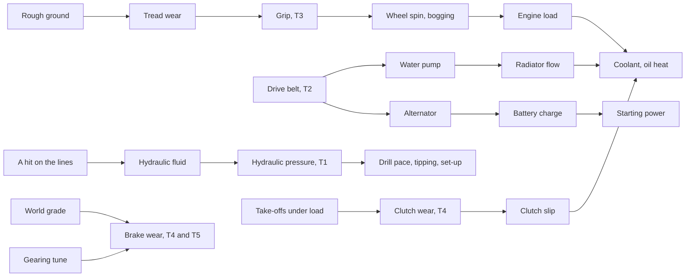

# Vehicle crosslinks, round two: deeper chains, more fittings, and what the stations should do (10 Nov 2026)

The owner, 10 Nov 2026, after the first eight crosslinks were built: "a research and record purview, where we can perhaps do any
tertiary cross-linking, and as well any functional upgrades much like our block heater"; also whether to add crafting stations, to
start differentiating them, or to change the tuning rig; "all suggestions, ideas, and even perhaps disagreements are good." This is
the research and record. **Nothing here is built.** Every proposal answers for itself (what it lets the player do, stops them doing,
and changes), figures are the agent's and authored, sources are labelled, and the owner's call is asked at the end.

**Next round:** [round three](vehicle-crosslinks-round-three.md) (13 Nov 2026), with [avionics](vehicle-avionics.md) and [the authors' override contract](vehicle-author-overrides.md).

## Read this first

- **Build these first, in this order:** working vehicles that read their **hydraulics** (T1, the one system we ship that nothing
  reads), the **drive belt** (T2, one cheap part that ties three chains together), **worn tread loses grip** (T3, which makes
  rough-ground wear bite), and the **tuning rig doing a job** (S1). Then the fittings batch (F1 to F8), which is Defs only.
- **The biggest decision is S4, consumables as items.** Tyres, brake pads, belts and filters made at the parts bench and carried as
  stock, instead of services eating raw steel and components. It makes the bench matter every week and makes caravans plan, and it
  costs the field convenience we have now. I lean yes, with the field fixes kept. It needs a "go", not a nod.
- **Four things I argue against** (the section near the end): splitting the parts bench; an inspection pit; gating engine replacement
  behind the rig's hoist while nothing can tow; and a gearbox-to-coolant heat link. Each would cost more than it gives, and the record
  says why, so the owner can overrule with the reasons in view.
- **The graph after Framework 0.70.0** is no longer a star. The coolant now feeds the oil, the cab heater and the start; the loads feed
  the engine; the ground feeds the tyres; fire feeds four temperatures. The chains proposed below hang off parts that are still single
  points: the water pump, the alternator, the brakes, the clutch, the hydraulic pump.

## Where the model stands (read from the Defs and code, 10 Nov 2026)

22 systems, about 65 quantities, 8 fittings, 6 tunes, 3 grades, 4 conditions, 3 stations. The links that run between systems now:

| From | To | Through | Since |
| --- | --- | --- | --- |
| Cooling | Lubrication | oil follows coolant | 0.11 |
| Cooling | Cabin | the heater core, scaled by the water pump | 0.67 |
| Cabin's night heater, a block heater | Cooling | coolant held near 40 °C | 0.67, 0.70 |
| Lubrication | Electrical | starting power and a start's draw follow the oil | 0.70 |
| Electrical | Turbine, Auxiliary electrical | starting power; the loads' supply | 0.15 |
| The loads | the engine hub | shaft power for the alternator | 0.70 |
| The ground | Running gear | tread wear and running-gear wear | 0.70 |
| Fire | Cooling, Lubrication, Cabin, Traction battery | heat, and the radiator cooking | 0.69 |
| Engine health | Lubrication, Cooling | oil burn and heat | 0.68 |
| Fusible plug | Boiler | a melted plug drops the fire | 0.14 |

**Holes found while reading:**

- `PhobosVehicleSystem_Hydraulics` exists, with a pump, lines, fluid, pressure, hits and a top-up service, and **nothing in the code or
  the Defs reads `hydraulicPressure`**. The drill rig, the survey truck and the tipper do their work without it.
- The **water pump** and the **alternator** are driven by one belt on nearly every real engine, and a belt is a common breakdown. We
  have no belt: each fails on its own, by its own breakdown roll.
- **Brake wear is flat per stop** (`wearPerStop 0.0008`) whatever the vehicle weighs or how fast it was going; a 40-tonne tank and a
  Mule pay the same. The clutch part slips when damaged but **never wears from use**.
- **Tread wear changes speed and failure, never grip.** A flat tyre (the part below 20 %) triples rolling resistance in the drivetrain;
  worn tread (the quantity) does nothing in mud.
- The **tuning rig** is a gate and nothing else (`CompPhobosTuningRig`: powered, within reach). It does no work of its own.

## Tertiary crosslinks

"Tertiary" here means a chain of three or more, or a link between two systems neither of which is the engine. Cost: **XML** is Defs
only; **input** is one small `Input_` or `When_` class; **hub** is a change in the comp or drivetrain; **job** is a change in a working
vehicle's comp.

| # | Link | The real basis (labelled) | Reads and changes | Lets the player | Stops them | Changes how they play | Cost | Verdict |
| --- | --- | --- | --- | --- | --- | --- | --- | --- |
| T1 | **Working vehicles run on their hydraulics** | Drill masts, tipper bodies and outriggers are hydraulic, pumped off the engine; a cut line bleeds the system and the work slows or stops (general; Wikipedia, "Hydraulic machinery", secondary) | The rig, the tipper and the survey truck get the Hydraulics system with a HydraulicPump and HydraulicLines appended; the rig's drilling pace, the tipper's tip and the survey boom's set-up scale with `hydraulicPressure`; below 0.2 the job refuses with the reason | Read a slow dig from a leaking line on the Health tab and fix the line, not the engine | Tipping or drilling with no pressure: the load stays up, the mast stays down, and it says why | Hydraulic top-ups join rig upkeep; a hit on a rig in the field has a cost you can see | job + XML | **Build first**: a shipped system with no reader is a promise unkept |
| T2 | **A drive belt turns the water pump and the alternator** | One serpentine belt drives both on most engines; a snapped belt means no charging and, within minutes, an overheating engine (Wikipedia, "Serpentine belt", secondary) | A Belt part appended to every liquid-cooled piston loadout; `Input_PartEfficiency` on Belt multiplies the radiator flow (with the water pump) and the alternator's supply; the Service system gives the belt a breakdown roll of its own (snaps to 0 at once, MTB authored); a spare belt is a cheap supply | Carry a spare belt and fix the real cause of a sudden overheat | Nothing | One cheap part becomes the thing that strands a caravan: coolant climbs and the battery drains together, and the Health tab names the belt | XML | **Build first**: three chains from one part, no code |
| T3 | **Worn tread loses grip** | Worn tyres hold less on soft and wet ground long before they fail on a road (common knowledge; no figure claimed) | The drivetrain's grip multiplied by a curve on `treadWear` (1 to 0.6 worn, 0.6 to 0.9 down to 0.7, beyond 0.9 0.5 [A]); the bogging and wheel-spin the model already does follow | See worn tyres cost you in mud before the road | Nothing | Tyres get renewed before a wet-season trip; link 6's rough-ground wear bites twice | hub (one read) | **Build first**: closes the loop link 6 opened |
| T4 | **Brake and clutch wear follow what the move did** | Brake wear is energy turned to heat: it rises with mass and speed; a clutch wears at each take-off, more under load and on a grade (general; Wikipedia, "Brake wear" and "Clutch", secondary) | `wearPerStop` scaled by the vehicle's mass over its design's kerb mass and by the speed at the stop (the drivetrain has both); a new `clutchWear` quantity with `wearPerStart` scaled by load and the world grade; worn clutch slips (the model's `ClutchCapacity`) | Know that a laden truck down a mountain pass needs pads sooner | Nothing | Routes and loads become part of brake upkeep | hub + XML | Build with T5 |
| T5 | **Engine braking: short gearing spares the brakes on descents** | Downshifting lets the engine hold a vehicle back on a long descent; a retarder or exhaust brake does the same on trucks (Wikipedia, "Engine braking", secondary) | On a hilly world tile, brake wear per hour gains a term for descents, multiplied by 0.6 with short gearing and 1.3 with long [A]; the exhaust brake fitting (F6) multiplies it by 0.5 | Choose gearing for the mountains, not only the pull | Nothing | The gearing tune gains a second purpose, and a reason to change it per route | XML | Build with T4 |
| T6 | **Running the tank dry hurts the fuel pump** | Electric fuel pumps are cooled and lubricated by the fuel; running dry overheats them (general service advice, secondary) | The `OutOfFuel` event wears the FuelPump part 5 % [A] | Nothing new | Nothing | A reserve is worth keeping; the fuel feed stage then shows the damage | XML, two lines | Cheap, take it |
| T7 | **Dust clogs the air filter** | Desert and dry-biome running clogs air filters, costing power and fuel until they are changed (general; Wikipedia, "Air filter", secondary) | An `airFilter` quantity in the Service system rising with engine hours, three times as fast in arid biomes [A] (a new `Input_BiomeAridity`, read once per map); clogged above 0.7: power 0.9, fuel 1.1; the engine service renews it (its component already stands for "filters") | Read a slow truck as a filter, not an engine | Nothing | Desert colonies service sooner; a heavy-duty filter fitting (F8) earns its place | input + XML | Optional; an honest small loop |
| T8 | **A battery warmer beside the block heater** | Cold-climate plug-in kits often pair a block heater with a battery blanket (general; secondary) | A second cheap fitting holding the battery above 0 °C on shore power, so its frost condition and the capacity curve ease | Start a soaked-cold truck on its own battery | Nothing | Completes the winter kit | XML | Take it with the fittings batch |

### The chains these make

## Functional upgrades: fittings and tunes

Each is a `PhobosVehicleFittingDef`, Defs only, offered through the roles a loadout binds; figures authored. Research gates name
projects that exist (research-tree.md).

| # | Fitting | On | What it moves | Lets the player | Stops them | Changes how they play | Cost and gate |
| --- | --- | --- | --- | --- | --- | --- | --- |
| F1 | **Off-road tyres** | Wheels (not tracked) | grip on path cost above 4 times 1.25; speed 0.96; road tread wear 1.3 | Cross the marsh a road-tyred truck bogs in | Nothing; it is the mirror of road tyres | A truck is shod for its route; the two tyre fittings become a real choice | 15 steel, 1 component; vehicle tuning |
| F2 | **Transmission cooler** | Transmission | `coolRate` 1.4 | Haul heavy in the heat without the gearbox overheating | Nothing | The overheating gearbox stage, which few players will have seen, gets its answer | 20 steel, 2 components; vehicle tuning |
| F3 | **Heavy-duty brakes** | Brakes | `wearPerStop` and the descent term 0.6; with T4, carries a laden truck | Run a tipper all day without pads every week | Nothing | Pairs with T4 and T5 | 20 steel, 2 components; vehicle tuning |
| F4 | **Gear-reduction starter** | Starter | `starterAmpHours` 0.7 | Start a cold diesel on a tired battery | Nothing | Pairs with link 7 and the block heater | 10 steel, 2 components; vehicle electrics |
| F5 | **Cab insulation** | the cab (a parameter on Cabin: `insulationRate` 0.6) | the cab holds its warmth or cool longer; night heater fuel per hour 0.7 | Camp in frost on less fuel | Nothing | A winter fitting with no engine in it | 20 steel, 10 cloth; vehicle tuning |
| F6 | **Exhaust brake** | Engine (piston, heavy only: `minKilograms` 3,500) | the descent brake term 0.5 (T5) | Bring a loaded truck down a pass on its engine | Nothing | Heavy trucks get the fitting real ones have | 25 steel, 2 components; vehicle tuning |
| F7 | **Fuel heater** | FuelPump | the fuel gelling stage never trips for this vehicle (a `fuelGellingProtected` figure the fitting multiplies, the block heater's pattern) | Run diesels in a cold biome with the gelling setting on | Nothing | The gelling setting stops being all or nothing | 10 steel, 1 component; vehicle electrics |
| F8 | **Heavy-duty air filter** | Engine | the filter clogs at 0.4 the rate (T7) | Keep a desert truck's power between services | Nothing | Only with T7 | 10 steel, 1 component; vehicle parts |
| F9 | **Long-range fuel tank** | the vehicle (a stat, `CargoCapacity` 0.9 and fuel capacity 1.3) | a third more fuel for a tenth less cargo | Reach a far settlement without a tanker | Carrying as much | Range against payload, the oldest trade-off there is | **Needs checking**: Vehicle Framework's fuel capacity is a comp property, not a stat; a fitting would need a hook on `CompFueledTravel.FuelCapacity` (not read for this record) |
| F10 | **Battery warmer** | Battery | holds the battery above 0 °C on shore power (T8) | As T8 | Nothing | Completes the winter kit | 5 steel, 1 component; vehicle electrics |

**A third tune axis, boost, only with a turbocharger fitted** (agent idea): low, standard and high boost moving power 0.95, 1, 1.1
and heat 0.9, 1, 1.25 [A], with high boost raising hot-section wear on a turbine. It gives the turbocharger a dial. I would hold it
until the owner has played with the two axes we have: three axes in one window is a lot to read.

**Grades: no change proposed.** Salvaged, standard and heavy-duty already answer the question a grade asks.

## Stations: what each should do

### S1. The tuning rig does a job: diagnostics

**Built in 0.73.0 as a text letter; how it should look is researched in [vehicle-presentation-design.md](vehicle-presentation-design.md).**

Today the rig is a gate: a tune or a refit waits for a vehicle within three cells of a powered rig. A player sees it only as "why is
my tune waiting". Proposal: a **Diagnose** order on a vehicle at the rig, a mechanic's job of about 1,500 ticks, that produces a
report letter: the engine's real power at the wheels against its rated power, fuel at a cruise, every part's health and grade, the
hidden figures (hot-section life, battery pack wear, hours since service) and every condition. On a captured vehicle it also reveals
the enemy fit set it came with. In Plain mode the letter says it in words; in Engineer mode it carries the numbers.

- **Lets the player:** know what a captured or bought vehicle really has before trusting it; see wear that no gauge shows.
- **Stops them:** nothing.
- **Changes how they play:** the rig earns its 150 W; a captured vehicle goes to the rig first.

### S2. The rig's hoist fits parts better, without stranding anyone

A destroyed engine or transmission is replaced wherever the vehicle stands, by a mechanic with the part aboard, and comes back at
25 % health. The rig's description already says it has a hoist. Proposal: **a part fitted within reach of the rig returns at 60 %**
[A] instead of 25 %, and the work is 0.7 of the field figure. Field replacement stays possible at the old figures.

- **Lets the player:** limp home and have the job done properly, or do it properly at home.
- **Stops them:** nothing. (The alternative, requiring the hoist, would strand any vehicle whose engine dies away from home, because
  nothing in Vehicle Framework or our mods can tow. Argued against below. Added 11 Nov 2026: RimThunder - Core, on the owner's
  list, can; see [the trailer research](vehicle-trailer-research.md).)
- **Changes how they play:** home is where engines are swapped; the depot bay's 70 % and the rig's 60 % make the motor pool the
  place for heavy work.

### S3. Serious work waits for the rig

The warped head's "machining the cylinder head flat" (15 steel, 3 components, 3,000 ticks) and the turbine's hot-section overhaul
are done at the vehicle wherever it is. Real head machining needs a machine shop. Proposal: these two condition services, and a
future cracked block, **require the rig**, with the same refusal text the tunes use. A `needsRig` flag on a condition's service.

- **Lets the player:** nothing new.
- **Stops them:** rebuilding an engine's top end in a field with a toolbox.
- **Changes how they play:** a badly warped head means a trip home. Since the slight warp is still fixed by an ordinary repair, no
  vehicle is stranded by it.

### S4. Consumables become items made at the parts bench (the big one)

Tyres and track pads (15 steel, 2 components, 10 chemfuel), brake pads (1 component), the engine service's oil and filters (9
chemfuel, 1 component) and, with T2, belts are services paid in raw materials carried aboard. Proposal: **a tyre set, a brake pad set,
a service kit (oil and filters), a drive belt** as items with their own storage category under vehicle parts, made at the parts bench
from those same materials, and the services take the item. Field fixes (leaks and shorts) stay as they are. A caravan carries kits,
not steel.

- **Lets the player:** stock a shelf (the depot bay's) with what the fleet eats; see at a glance what is short; trade for kits.
- **Stops them:** servicing from raw steel and components wherever they are. A caravan that forgot its kits is a caravan with worn
  brakes until it is home. **This is the real cost**, and the owner's rule on extreme decisions says it is a feature when the player
  chose it.
- **Changes how they play:** the parts bench is used every week, not once per vehicle; the bay's shelf means something; tyre kits
  become loot and trade goods.
- **Honest caveats:** the seabed crawler and every vehicle from another mod take these too (the services are shared), so the change is
  felt everywhere at once; and the migration must keep a service already due payable the old way until the player has kits (a grace
  of one service per vehicle, or an "accept raw materials" setting defaulting off for new colonies and on for old saves).

### S5. The parts bench: keep it one bench

The owner asked whether to add stations or differentiate them. The bench makes engines, kits, turbines, booster packs, jump-start kits
and the crawler's fittings. Splitting it (an electrical bench, an engine stand) would give the player two buildings to place and two bill
lists to find things in, for no decision that matters: nothing in the game would be done differently. **Keep one bench**; let research
and S4's kits grow its list. Differentiation that earns its place is by **what each station does**, as above: the bench makes, the rig
measures and does heavy work, the bay keeps and refuels.

### Stations argued against

- **An inspection pit** (cheap, unpowered, halves the work of underside jobs): it would duplicate the depot bay's work bonus with a
  second building and a second rule for which jobs count. If underside work should be cheaper somewhere, make it the bay. **The owner
  wanted one as a production bonus for the bench instead (10 Nov 2026), which duplicates nothing; built that way in 0.73.0.**
- **Requiring the hoist for engine replacement:** strands vehicles; see S2.
- **A wash or decontamination bay:** a vehicle that drove through fallout or a painted radiation area carrying contamination is a
  good idea for D'thorga Medical, not for the vehicle systems; noted for the owner, not proposed here.
- **A paint shop:** Vehicle Framework's own patterns and colours already cover it.

## Argued against among the links

- **Gearbox heat into the coolant** (a shared cooler): a second heat path beside three temperatures that already exist, for a stage
  almost no one reaches. Nothing the player would do differently. **Dropped by the owner, "somewhat sadly" (10 Nov 2026).**
- **The air brakes' compressor loading the engine:** real, but the compressor runs for minutes after a long stand on a handful of named
  trucks; a hub change for an effect under 1 %.
- **A cold cab slowing the driver:** the game's own hypothermia and moods already do it; vanilla precedence.
- **Steam from a boiling radiator into the cab:** fun, dishonest.

## Order to build, when the owner says so

1. **T1, T2, T3** together (Framework, one middle bump; Vehicles for the rig, tipper and survey truck loadouts): the hydraulic
   readers, the belt, worn tread. Each has a test-pass row.
2. **S1 and S2** (the rig's diagnostics and the better fit at the rig), with **S3** if the owner wants it.
3. **The fittings batch F1 to F8 and F10**, Defs only, with **T6 and T8**; **F9** once Vehicle Framework's fuel capacity hook is read.
4. **T4 and T5** (brake and clutch wear, engine braking) with F3 and F6.
5. **S4** (consumables as items) on its own, with the migration and its own test pass: it is the one change that touches every
   vehicle's upkeep at once.
6. **T7 and F8** last, if wanted.

Each step says "not yet tested in game" until the owner says otherwise, and every new setting is reported when it lands.

## The owner's answers, and what was built (10 Nov 2026)

**Owner:** "Please implement what you'd build first, #1 through #4" (T1, T2, T3, and the rig's S1 and S2); **S4 agreed**; an
inspection pit **is wanted after all, as a production bonus for the crafting table, as Dead Man's Switch does with its own**; the hoist
stays optional as S2 has it; the gearbox-to-coolant link is dropped.

**Built in D'thorga Framework 0.73.0 and D'thorga Vehicles 0.33.0, not yet tested in game:**

- **T1:** a new `hydraulicSupply` reading on the hydraulics system follows the **fluid only** (the pump's health is left out: a damaged
  pump already slows the work through the vehicle's own work stat, and counting it twice would be wrong). The drill rig, the survey truck
  and the tipper carry the system, bound to their own pump and lines (the tipper's rams stand for lines; the survey truck gets a small set
  added). Drilling and surveying run at the supply's pace; tipping too; below 0.2 (the rules Def) setting up, working and tipping stop,
  and say why.
- **T2:** a drive belt on every land vehicle with liquid cooling (found by name, else added beside the engine, 10 health). Its efficiency
  multiplies the radiator's flow, the cab heater and climate control, and the alternator's output (a new optional `drivenByRole` on
  `Input_ElectricalBalance`). It snaps on the service system's breakdown roll (MTB 4,000 hours fresh, 1,500 due, 400 overdue [A]), all
  its health at once; a new one is 4 chemfuel and 300 ticks [A]. **Boats are left out for now:** their loadout has no water pump role.
- **T3:** `TreadRules.GripFactor` (1 new, 0.85 worn at 60 %, 0.7 at 90 %, 0.5 bald [A]) multiplies the ground's grip on a map and on
  the world map; rails keep theirs.
- **S1:** a **Diagnose** toggle on every vehicle once tuning rigs exist; a Construction job of 1,500 ticks within reach of a working rig;
  a letter listing every part (worst first) with its grade and fitting, the tunes, the rated power (not in Plain), every system's
  readings, and every fault. Plain mode gives words, the others figures. The health words are now one shared helper (`HealthWords`).
- **S2:** a destroyed part fitted within reach of a working rig returns at **60 %** instead of 25 %, for **0.7** of the work [A]. A new
  `NearRig()` answers "physically at a rig" whatever the setting that makes tunes wait for one.
- **Inspection pit:** a facility for the vehicle parts bench, **+15 % work speed, one counts** (the tool cabinet's +6 %, two counting,
  for scale) [A]; 60 steel and a component. Its picture is the depot bay's, a placeholder until the owner asks for art.

**S4 built in D'thorga Framework 0.74.0 (10 Nov 2026), not yet tested in game:**

- Four items made at the parts bench from exactly what each service took before (Crafting 3, vehicle parts research): a **tyre set**
  (15 steel, 2 components, 10 chemfuel), a **brake pad set** (1 component), an **engine service kit** (9 chemfuel, 1 component) and a
  **drive belt** (4 chemfuel). Their pictures are our other parts', placeholders.
- The tyre, brake and engine services take the kit; a destroyed belt takes the belt item, whole. Each keeps its old materials as
  `rawSupplies` (a new field on a service), and a part supply can be marked `kit`.
- **Migration, per colony** (`GameComponent_PhobosServiceKits`, saved): a save from before kits loads with "services take raw
  materials" on, so nothing due is held up; a new colony starts with it off. The player switches it in the vehicle systems settings
  window while a game is running (a per-colony choice, not a global setting). The motor service of electric vehicles has no kit.
- The depot bay's shelf takes the four kits by default.
- **The inspection pit's picture** was made on the OpenAI image API the same day, two attempts at the owner's word (US$0.041 in all,
  our parts bench as a style-only reference). **The owner picked attempt 1** ("more flat and top-down"); it ships in 0.74.1, master on
  `art-masters`, attempt 2 on `art-references`.

**Still to come, in the record's order:** the fittings batch (F1 to F8, F10) with T6 and T8; T4 and T5 (brake and clutch wear, engine
braking); S3 if wanted; T7 last. Traders do not stock the kits yet (no trade tags); they can be sold.

## Open questions for the owner

| Question | Agent lean |
| --- | --- |
| S4, consumables as items: yes, no, or yes with an "accept raw materials" setting for old saves? | **Answered: yes** (owner, 10 Nov 2026). The setting for old saves is still the agent's lean |
| T1: hydraulics on the drill rig, tipper and survey truck only, or the tanker's transfer pump too? | The three; a tanker's pump is a different pump |
| T2: a belt on every liquid-cooled piston vehicle, including other mods' (another appended part on each)? | Yes; it is where the belt is |
| S1 to S3: all three rig changes, or S1 and S2 only? | All three; S3 strands no one |
| The boost tune axis: now, or after play with the two axes? | After |
| T7 and F8, the air filter: in or out? | In, last |

## Who chose what

- **Owner (10 Nov 2026):** the purview: tertiary crosslinks, functional upgrades like the block heater, stations added or
  differentiated, the tuning rig's functionality; disagreement welcome.
- **Agent:** everything proposed, every figure [A], the order, the leans and the arguments against. All for the owner to revise.

## Sources

Read for this record, in our own words: every `Systems_*.xml`, `Fittings.xml`, `Conditions.xml` and `Stations.xml` under
`mods/PhobosFramework/Mods/VehicleFramework/Common/Defs/Phobos/Framework/VehicleSystems/`; `src/PhobosFramework.Vehicles/Systems/
Powertrain.cs` (grip, rolling resistance, clutch capacity and the wheel reads, lines 340 to 353 and 475 to 483); `CompPhobosTuningRig.cs`
and `VehicleFittings.cs:315-344` (what the rig gates); `vehicle-system-crosslinks.md`, `vehicle-tuning-and-upgrades.md`,
`vehicle-depot-bays.md`, `vehicle-drivetrain-design.md` (what was built and left), `vehicle-health-consequences.md` (the answered
questions on supplies and conditions). Real-world bases are general knowledge or Wikipedia articles named per row (serpentine belts,
hydraulic machinery, engine braking, brake and clutch wear, air filters, fuel pumps), all **secondary and unverified against a maker's
manual**; no figure in this record is measured from a real machine, and every one proposed is marked [A] for authored.
