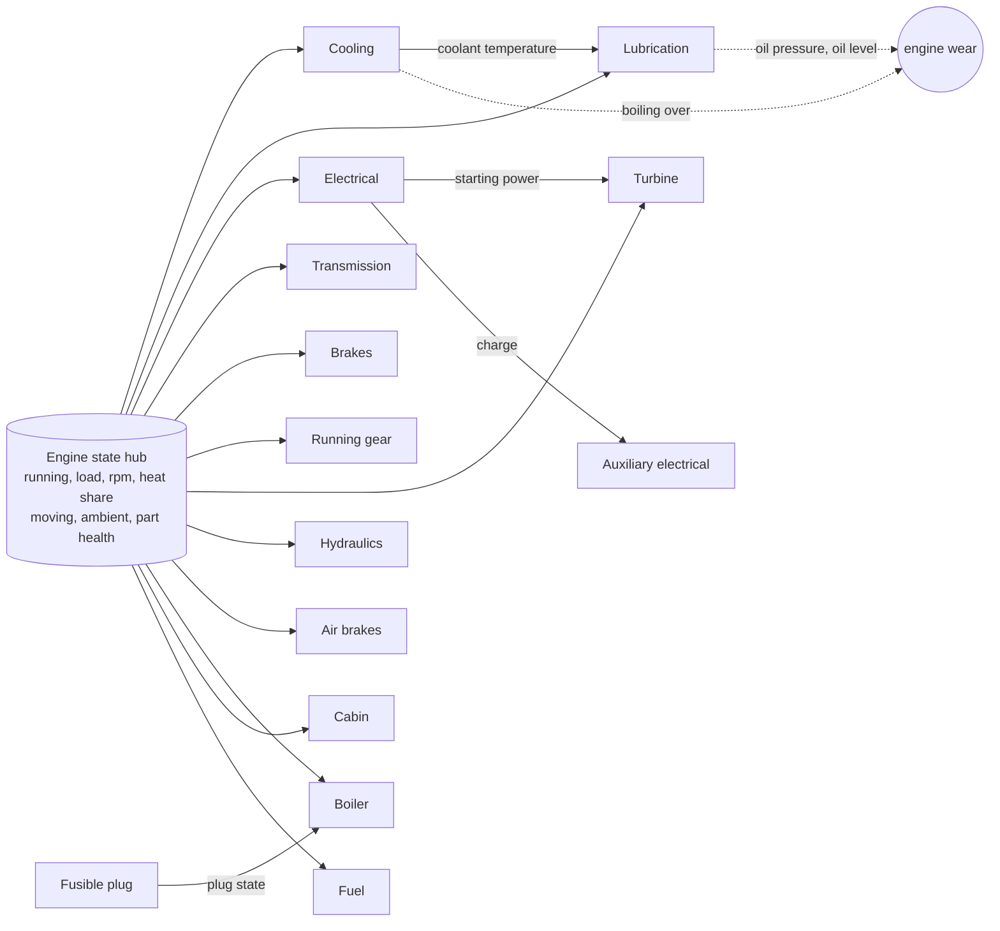
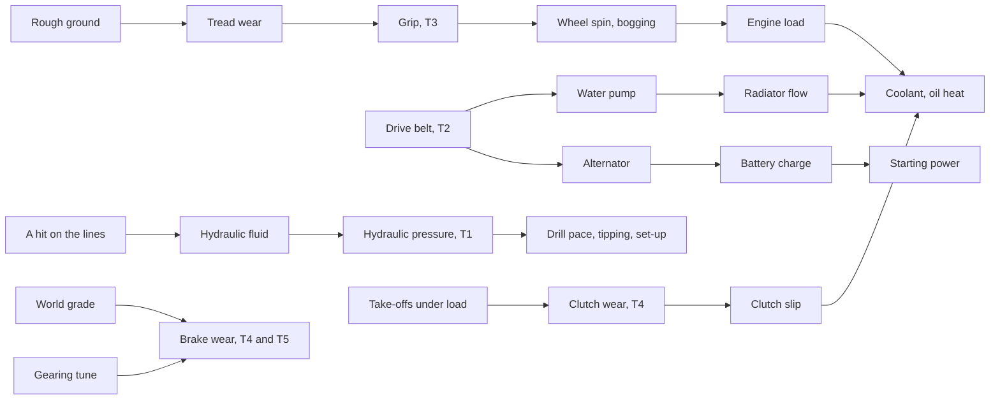
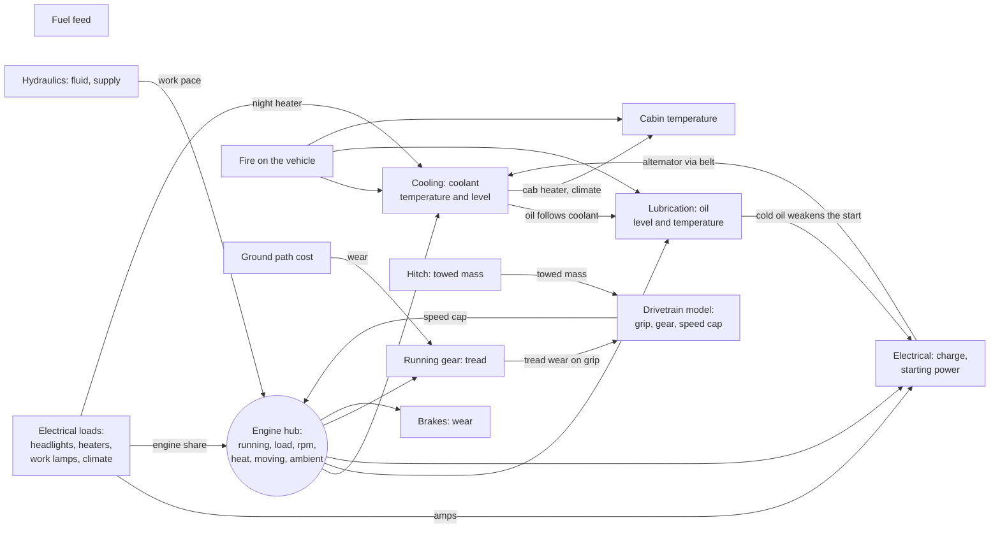

# Vehicle cross-links: three rounds (9 to 13 Nov 2026)

The three rounds of research into links between a vehicle's systems, each kept as written. Round one found the 22 systems
joined in a star round the engine state and proposed eight links; round two looked for deeper chains, fittings and what the
stations should do; round three added the crew, weather and ground, combat damage, electrics and hydraulics. What a vehicle
loses before it is a wreck carries on in [knocked out, not destroyed](vehicle-knocked-out-systems.md).

**Status (17 Nov 2026):** round one is built (D'thorga Framework 0.67.0 to 0.70.0); rounds two and three are built except engine braking
(T5 with F6, held by the owner) and the rows argued against or left for later (G10, G19, G20). Not yet tested in game. Each round's
own status line opens its section.

**The rounds:** [Vehicle system crosslinks: research and record](#vehicle-system-crosslinks-research-and-record-9-nov-2026); [Vehicle crosslinks, round two: deeper chains, more fittings, and what the stations should do](#vehicle-crosslinks-round-two-deeper-chains-more-fittings-and-what-the-stations-should-do-10-nov-2026); [Vehicle cross-links, round three: the crew, weather and ground, combat damage, electrics and hydraulics](#vehicle-cross-links-round-three-the-crew-weather-and-ground-combat-damage-electrics-and-hydraulics-13-nov-2026).

## Vehicle system crosslinks: research and record (9 Nov 2026)

*Merged into this record on 17 Nov 2026 from `vehicle-system-crosslinks.md`; kept as written.*

**Status (17 Nov 2026):** built in D'thorga Framework 0.67.0 to 0.70.0 (and Vehicles 0.30.2): all eight links and the block heater
upgrade; not built: nothing from this round is left. Not yet tested in game.

The owner, 9 Nov 2026: "I just want to enrich the simulation layer under everything. Create crosslinks and so forth." This is the research
and record part of that, written before anything was built. It reads what the 22 vehicle systems already feed each other, from the Defs and the code, and
proposes the links that would earn their place. Every proposal answers for itself (what it lets the player do, stops them doing, and changes),
as the standing rule asks. Figures here are agent proposals for the owner to revise; sources are labelled, and nothing is tested in game.

**Next rounds:** [round two](#vehicle-crosslinks-round-two-deeper-chains-more-fittings-and-what-the-stations-should-do-10-nov-2026) (10 Nov 2026) and [round three](#vehicle-cross-links-round-three-the-crew-weather-and-ground-combat-damage-electrics-and-hydraulics-13-nov-2026) (13 Nov 2026).

### Read this first

- **The systems form a star, not a web.** Almost every system reads the same hub, the comp's shared engine state (running, load, speed,
  heat share, moving, ambient air, part efficiencies, `CompPhobosVehicleSystems.cs:564-587`). Only **five reads run from one system's quantity
  to another's**, from four pairs of systems (the boiler reads the fusible plug twice; corrected 13 Nov 2026, the record had said
  "five links"), out of 22 systems and about 60 quantities:

  | Reader | Reads | How | Where |
  | --- | --- | --- | --- |
  | Lubrication | Cooling's `coolantTemperature` | oil temperature follows the coolant | `Systems_Lubrication.xml:130-139` |
  | Turbine | Electrical's `startingPower` | a turbine too weak to light | `Systems_Turbine.xml:138-151` |
  | Auxiliary electrical | Electrical's `charge` | the loads' supply | `Systems_Electrical.xml` |
  | Boiler | Fusible plug's `fusiblePlug` (twice) | a melted plug drops the fire | `Systems_Boiler.xml` |

- **The one real chain we have is the best thing in the model**: a hit radiator leaks coolant, the engine runs hot, the oil follows it and
  cooks, and the engine wears (Cooling, Lubrication, Conditions). The owner's Harrier story and the Wagon screenshots both came from it. Every
  proposal below is another chain of that kind, where one system's state changes what another one does, and the player can read it from the
  gauges.
- **The schema can already express most of them in XML**: `Input_Quantity` reads any quantity of any system, with a `fallback` when a vehicle has
  no such system (`Inputs.cs`), and `Input_PartEfficiency` reads any role. Four of the eight proposals need no C# at all. Two need a small new
  input each, and two need a code change in the hub.
- **My recommended first four**, in order: the engine block warmed by the night heater (**1**), the cab heater running off the coolant (**2**), a
  worn engine burning oil and running hot (**3**), and a burning vehicle cooking its own systems (**4**). Together they turn the cold start, the
  winter camp, the tired engine and the fire into things the gauges show and the player can act on.

### The graph today

Solid arrows are quantities read by another system. Dotted arrows are wear applied to the engine part. Everything else a system knows, it gets
from the hub. Conditions (a holed radiator, a cracked sump, a shorted battery, a warped head) hang off single systems and are not drawn.

### What is missing, and what each link would do

Each row is one proposed crosslink. "Lets / stops / changes" is the standing test. Cost: **XML** means Defs only; **input** means one small new
`Input_` or `When_` class; **hub** means a change in the comp's shared state.

| # | Link | The real basis (labelled) | Reads and changes | Lets the player | Stops them | Changes how they play | Cost |
| --- | --- | --- | --- | --- | --- | --- | --- |
| 1 | **Night heater warms the engine, not only the cab** | A block heater keeps coolant and oil warm overnight so the engine starts easily and wears less (secondary: Wikipedia, "Block heater"). Today the night heater holds the cab (`Systems_Cabin.xml:149`) and the engine starts from the air's temperature, paying the cold-start wear (`Systems_Cooling.xml:251-265`) | Cabin's `nightHeaterRunning` becomes a flow toward about 15 °C [A] on `coolantTemperature` and `oilTemperature` while the vehicle stands | Start a frozen camp's vehicles without the wear and the weak-battery refusals | Nothing | A winter camp runs the heater for the engines' sake as well as the crew's; fuel against repairs | XML |
| 2 | **Cab heater from the coolant** | A car's heater is a small radiator fed by engine coolant: no heat until the engine is warm, and none when the coolant is gone (secondary: Wikipedia, "Heater core") | Cabin's `heater` flow scaled by a curve on `coolantTemperature` (0 below 30 °C, full from 60 °C [A]), `fallback` 1 for vehicles without cooling (electric, steam) | Warm the cab for free once the engine is warm | Instant warmth on a cold start, and any heat with the coolant gone | Idle the engine before a winter trip; a holed radiator now also freezes the crew | XML |
| 3 | **A worn engine burns oil and runs hot** | Worn rings and guides let oil past; a tired engine also sheds more heat to its coolant (secondary, approximate: engine makers' service literature as commonly cited; unverified figures) | Lubrication's `burn` flow and Cooling's `combustion` flow each gain an `Input_PartEfficiency` on `Engine` through an inverted curve (1 at full health, 2 at 40 % [A]) | Read a tired engine from its oil consumption before it fails | Ignoring a 40 % engine for a season | Services come sooner on a worn engine; a repair pays back in oil | XML |
| 4 | **A burning vehicle cooks its systems** | Fire on the body heats everything under the skin. Today a fire only takes hit points from parts; the owner's Harrier flew home on fire with its coolant and oil none the wiser | New `Input_Fire`: the size of the fires attached to the vehicle. A flow into `coolantTemperature`, `oilTemperature`, `packTemperature` and `cabTemperature` while it burns | See the fire on the gauges and know how long the engine has | Shrugging off a fire that the crew puts out in time | Fire-fighting a vehicle becomes urgent for the engine, not only the hull; a jet on fire lands hot | input |
| 5 | **Accessories load the engine** | An alternator takes shaft power for what it supplies: about 1.5 W at the crank per watt delivered (secondary, approximate: alternator efficiency 55 to 70 %, Wikipedia, "Alternator (automotive)") | The hub adds the active electrical load's watts to `EngineLoad` (12 or 24 V times the amperes, over the engine's rated power) | Nothing new to do | Nothing | Lights, heaters and climate control cost fuel and heat; a camp that runs them off the engine all night feels it | hub |
| 6 | **Rough ground wears tyres and suspension** | Off-road running wears tyres and running gear far faster than roads (common knowledge; no figure claimed). Today tread wears by distance only (`Systems_Chassis.xml`, `Input_Moving`) | New `Input_TerrainCost`: Vehicle Framework's path cost under the vehicle, normalised so a road reads 1 and the worst passable ground about 3 [A]; scales `treadWear` and a small `Effect_DamagePart` on `Wheels` and suspensions | Choose roads to save tyres and parts | Nothing | Caravans and convoys prefer roads for a reason the player can see on the Health tab | input |
| 7 | **Cold oil makes a hard start** | Cold oil is thick: cranking takes more battery and the first minutes wear more (the same sources as the cold-start wear we have) | Electrical's `startingPower` gains a curve on `oilTemperature` (0.6 at -20 °C, 1 at 10 °C [A]); the cold-start wear condition moves from coolant to oil temperature | Warm the engine (link 1) to make a start certain | Starting a soaked-cold diesel on a tired battery | The night heater, the battery and the start become one decision | XML |
| 8 | **Water pump drives the heater too** | The heater core is on the same coolant circuit as the radiator | Link 2's curve also multiplied by `Input_PartEfficiency` on `WaterPump` | Nothing new | A hit water pump leaving the cab warm | A small, honest extra from a part we already added in Framework 0.55.0 | XML, with link 2 |

Not proposed, and why:

- **A shared engine-bay temperature as a second hub.** It would be a parallel model of heat beside the coolant, the oil and the pack, each
  of which is already a temperature. Link 4 gives fire a way in without it.
- **Hydraulic pressure following engine speed.** Real, but set-up and tipping are one-shot actions; the player would never see the difference.
- **Oil pressure feeding other systems.** Separate circuits on every vehicle we model; nothing honest to link.
- **Era-specific electrics** (an electric fuel pump that needs the battery): true of modern vehicles only, and the loadouts do not know an era.

### Order to build, when the owner says so

1. Links **1, 2 and 8** together: one Cabin and one Cooling Def change, no code, and a new design line in the world-map record (the night heater
   gains a reason). **Built in Framework 0.67.0 (10 Nov 2026), not yet tested in game.** As built:
   - Link 1 pulls the coolant toward 40 °C at 2 an hour [A], not toward 15: the cold-start wear begins below 20 °C, so 15 would have
     saved nothing. That holds the coolant near 26 °C at -20 outside and near 21 °C at -40 through a night's camp (rule tests). The oil
     follows the coolant already, so no second flow. It runs on every vehicle with liquid cooling, open or closed (owner); the heater's
     fuel is burned by the cab system when there is one and by the cooling system otherwise, once either way.
   - Links 2 and 8 also apply to climate control's heating, which uses the same heater core. Vehicles with no coolant (electric, steam,
     turbine bleed air) read as warm and keep their full heater.
   - Found on the way: a system switched off in the settings went on lending its frozen readings to the others, and went on applying its
     frozen stage (a cab switched off mid-burn kept burning fuel). Both now stand down with it.
2. Link **3**: two flows, no code; the Lubrication and Cooling Def comments carry the label. **Built in Framework 0.68.0 (10 Nov 2026),
   not yet tested in game.** As built:
   - The flows read a new `Input_PartHealth` (the part's share of health), not `Input_PartEfficiency`: a part's efficiency follows its
     author's curve and can stay at 1 while it is badly worn.
   - Oil burn: twice the normal at 40 % engine health and below [A], as proposed.
   - Heat: **a fifth more**, not twice [A]. At full load the radiator holds the coolant about 70 degrees above the air, so double heat
     boils any worn engine over on a warm day and wears it further, a spiral rather than a sign; a quarter more already reached
     "overheating" on a 35 °C day in the rule tests. A fifth more reaches "running hot", which the player sees and can act on.
   - The owner's answer (oil use is a reason to service): the engine service also falls due once the oil is below 60 % [A], through a
     new data rule on services (`alsoDue`), behind the setting **Low oil calls for a service** (on). Off, the burned oil only lowers the
     level until the next service. This also brings a cracked sump's leak to a mechanic's attention.
3. Link **4**: `Input_Fire` (one class, one attachment read on the rare tick), then flows on the four temperatures. The owner's Harrier is the test.
   **Built in Framework 0.69.0 (10 Nov 2026), not yet tested in game.** As built:
   - `Input_Fire` reads the biggest attached fire on the vehicle's own map, as a share of a full-grown fire (the game's 1.75), at most
     once a tick. The biggest, not the sum: a vehicle can carry duplicate fires the game never puts out (temporary-patches.md, J3). A
     hull under water (a submersible's hidden phase) and a vehicle off the map read 0, at session 4b's prompting.
   - **The owner's rule could not be met by heat alone.** A fire grows to full size within minutes, and the radiator settles any steady
     heat within the hour, so a steady flow either boils every burning engine or none. So the fire also **cooks the radiator and its
     hoses**, half its health an hour [A] (they fail first in a real vehicle fire), and heats the coolant at 180 an hour [A]: put out
     after an hour, the coolant peaks near 102 °C and the radiator needs repair; after two, it boils over. `FireFigureTests` hold this.
   - The oil follows the coolant, so it needs no flow of its own, except on an engine with no coolant (a turbine, an air-cooled
     engine): 60 an hour [A], about 20 °C above its running heat, so a jet that flew on fire lands with hot oil. That needed a new
     condition, `When_HasQuantity`.
   - The cab: 80 an hour [A], about 40 °C above the air within the hour, stifling, so the crew want out. The electric pack: 30 an hour
     [A]; heavy and slow, it is warm but unharmed after an hour, and in thermal runaway after about three and a third.
4. Link **7**: a curve on starting power, and moving the cold-start condition to oil temperature.
5. Links **5 and 6** last: each touches the hub or reads the map, so each needs a cost measurement against the 0.05 ms budget before it ships.

**Links 7, 5 and 6 and the block heater built together in Framework 0.70.0 (10 Nov 2026), with D'thorga Vehicles 0.30.2 for the
heavy vehicles' voltage; not yet tested in game.** The owner asked for one batch and one version, to spend fewer tokens. As built:

- **Link 7:** starting power gains a curve on `oilTemperature` (0.6 at -20 °C, 1 from 10 [A]); a start's battery draw follows the oil
  rather than the air (the air's curve kept for a vehicle without oil); the cold-start wear moved from Cooling to Lubrication, reading
  the oil below 20 °C, so air-cooled and turbine engines count it too.
- **Block heater:** a fitting on an engine (15 steel, 2 components, vehicle electrics research, Construction 3; the owner's agreed
  defaults). It keeps the coolant at the night heater's 40 °C on shore power, parked with the engine off, free from the grid as shore
  charging is. Built on a `blockHeaterAbsent` figure the fitting multiplies to 0, the fusible plug's pattern, so no new code. **Both
  heaters gained a thermostat** (full below 35 °C, off at 40): without it the 0.67.0 night heater pulled a hot engine just parked
  *down* toward 40 faster than it would cool by itself, a fault found while adding this.
- **Link 5:** `AccessoryRules.EngineShare`: the switched-on loads' amperes times the system voltage, over an alternator efficiency of
  0.6 [A, inside the cited 55 to 70 %], as a share of the engine's rated power. It adds to the engine load, to the heat share, and to
  the fuel burned when fuel follows the model. It is honestly small (lights and a heater on a light truck: about 1 %); its point is a
  long night camp or an idle with every load on. Electric vehicles and engines with no known rated power are not charged. A new
  `systemVolts` figure (12, heavy vehicles 24, the voltage their loads were authored for) turns amperes into watts. Setting **Accessories
  load the engine** (on; owner).
- **Link 6:** `Input_GroundPathCost` reads the terrain and snow under the vehicle once per cell moved to (the caravan's tile on the
  world map). Tread wears by a curve on it (road 1, soil 1.2, mud or soft sand 2.5, the worst 3 [A]), and over path cost 8 and up the
  Wheels part loses 1 % of its health an hour on the move [A]. No suspension part exists to wear, so the wheels carry it. Rails and
  aircraft in flight read as a road. Setting **Rough ground wears tyres and suspension** (on; owner).
- **Cost:** link 5 is a sum the update already makes plus one multiplication; link 6 is one array read when the vehicle has moved
  cell. Both run in the rare update, never per tick. **Not measured in game**: the 0.05 ms budget check needs the owner's colony.

Each step takes the middle version number (new behaviour), carries its own test-pass row, and says "not yet tested in game" until the owner says
otherwise.

**All eight links are built (Framework 0.67.0 to 0.70.0). The next round, deeper chains, fittings and the stations, is researched in
[vehicle-crosslinks-round-two.md](#vehicle-crosslinks-round-two-deeper-chains-more-fittings-and-what-the-stations-should-do-10-nov-2026).**

### The owner's answers (10 Nov 2026)

| Question | Agent lean | Owner's answer |
| --- | --- | --- |
| Should the night heater warm the engine on every vehicle, or only ones with a cab heater fitted? | Every vehicle with cooling | **Every vehicle with cooling, and a block heater can be a good upgrade** (below) |
| Does a worn engine's extra oil burn count as a reason to service, or only as a cost? | A cost only | **A reason to service it, with a setting to make it a cost only** (link 3) |
| How hard should fire cook? | Put out within an in-game hour: hot but undamaged; left to burn: boils over | **The agent's lean** (link 4) |
| Link 5 on or off by default? | On, with a setting | **On, with a setting to turn it off** |

### Proposed: a block heater upgrade (agent's proposal from the owner's answer; built in Framework 0.70.0, above)

The night heater works only at a caravan's night camp. A **block heater** is an electric element in the engine that plugs into mains
power, which is how real vehicles in cold places are kept warm overnight at home (secondary: Wikipedia, "Block heater").

- **Lets the player:** keep vehicles parked in a cold base warm from the colony's power, so a winter morning's start costs no wear and
  the cab heater works at once.
- **Stops them:** nothing.
- **Changes how they play:** winter parking is laid out beside power, and a fitting is worth buying for a cold map.
- **How:** a fitting in the existing fittings set, with a Toward flow on `coolantTemperature` while the vehicle is on shore power
  (`Input_ShorePower`, which the depot bays and electric vehicles already use) and parked, and a small power draw. It would come with
  link 7 (cold oil makes a hard start), when the start itself depends on the warmth. Figures to author then.

### Who chose what

- **Owner (9 Nov 2026):** enrich the simulation layer under everything with crosslinks; research and record first.
- **Owner (10 Nov 2026):** the four answers above, after testing the damage chain in game; go-ahead for the cross-linking.
- **Agent:** the graph reading, the eight proposals and their figures (all authored, marked [A]), the order, and what was left out; in
  0.67.0, the engine heater's 40 °C target and rate, the heater core's 30 to 60 °C curve, and applying links 2 and 8 to climate control;
  in 0.68.0, reading health rather than efficiency, the heat cut to a fifth, the 60 % oil line and the setting's default (on, matching
  the owner's answer); in 0.69.0, the cooked radiator as the way to meet the owner's fire rule, and every fire figure; in 0.70.0, every
  figure in links 7, 5 and 6, the heaters' thermostat, the wheels standing in for suspension, and 24 V for the heavy loadouts.
- **Owner (10 Nov 2026):** batch links 7, 5, 6 and the block heater into one version; a setting for link 6, on; the block heater's
  defaults agreed.

### Sources

Read for this record, in our own words: `src/PhobosFramework.Vehicles/Systems/CompPhobosVehicleSystems.cs:564-587` (the hub) and `:1034-1040`
(heat share); `src/PhobosFramework.Vehicles/Schema/Inputs.cs` (`Input_Quantity`'s fallback, `Input_PartEfficiency`, `Input_ElectricalBalance`);
every `Systems_*.xml` under `mods/PhobosFramework/Mods/VehicleFramework/Common/Defs/Phobos/Framework/VehicleSystems/`, parsed for cross-system
quantity reads (five found); `Systems_Cabin.xml:149` (night heater), `Systems_Cooling.xml:251-265` (cold-start wear), `Systems_Lubrication.xml:130-139`
(oil follows coolant), `Systems_Turbine.xml:138-151` (turbine start). Secondary sources for the real basis are named per row and are not primary
engineering references; the figures in the proposals are authored for play, not measured.

## Vehicle crosslinks, round two: deeper chains, more fittings, and what the stations should do (10 Nov 2026)

*Merged into this record on 17 Nov 2026 from `vehicle-crosslinks-round-two.md`; kept as written.*

**Status (17 Nov 2026):** built in D'thorga Framework 0.73.0 (and Vehicles 0.33.0: T1, T2, T3, S1, S2 and the inspection pit), 0.74.0
(S4), 0.106.0 (T6) and 0.123.0 (T4, T7 as round three's G8, T8, F2, F3, F4, F5, F7, F8, F10 and the boost tune axis; [what was built](#built-in-framework-01230-17-nov-2026));
S3 in 0.124.0 ([below](#s3-serious-work-waits-for-the-rig)); not built: T5 with F6 (engine braking, held by the owner on 17 Nov 2026). Not yet tested in game, apart from the Diagnose letter
(the owner, 11 Nov 2026: it arrives and lists every part and reading).

The owner, 10 Nov 2026, after the first eight crosslinks were built: "a research and record purview, where we can perhaps do any
tertiary cross-linking, and as well any functional upgrades much like our block heater"; also whether to add crafting stations, to
start differentiating them, or to change the tuning rig; "all suggestions, ideas, and even perhaps disagreements are good." This is
the research and record. Every proposal answers for itself (what it lets the player do, stops them doing,
and changes), figures are the agent's and authored, sources are labelled, and the owner's call is asked at the end.

**Next round:** [round three](#vehicle-cross-links-round-three-the-crew-weather-and-ground-combat-damage-electrics-and-hydraulics-13-nov-2026) (13 Nov 2026), with [avionics](vehicle-avionics.md) and [the authors' override contract](vehicle-author-overrides.md).

### Read this first

- **Build these first, in this order:** working vehicles that read their **hydraulics** (T1, the one system we ship that nothing
  reads), the **drive belt** (T2, one cheap part that ties three chains together), **worn tread loses grip** (T3, which makes
  rough-ground wear bite), and the **tuning rig doing a job** (S1). Then the fittings batch (F1 to F8), which is Defs only.
- **The biggest decision is S4, consumables as items.** Tyres, brake pads, belts and filters made at the parts bench and carried as
  stock, instead of services eating raw steel and components. It makes the bench matter every week and makes caravans plan, and it
  costs the field convenience we have now. I lean yes, with the field fixes kept. It needs a "go", not a nod.
- **Four things I argue against** (the section near the end): splitting the parts bench; an inspection pit; gating engine replacement
  behind the rig's hoist while nothing can tow; and a gearbox-to-coolant heat link. Each would cost more than it gives, and the record
  says why, so the owner can overrule with the reasons in view.
- **The graph after Framework 0.70.0** is no longer a star. The coolant now feeds the oil, the cab heater and the start; the loads feed
  the engine; the ground feeds the tyres; fire feeds four temperatures. The chains proposed below hang off parts that are still single
  points: the water pump, the alternator, the brakes, the clutch, the hydraulic pump.

### Where the model stands (read from the Defs and code, 10 Nov 2026)

22 systems, about 65 quantities, 8 fittings, 6 tunes, 3 grades, 4 conditions, 3 stations. The links that run between systems now:

| From | To | Through | Since |
| --- | --- | --- | --- |
| Cooling | Lubrication | oil follows coolant | 0.11 |
| Cooling | Cabin | the heater core, scaled by the water pump | 0.67 |
| Cabin's night heater, a block heater | Cooling | coolant held near 40 °C | 0.67, 0.70 |
| Lubrication | Electrical | starting power and a start's draw follow the oil | 0.70 |
| Electrical | Turbine, Auxiliary electrical | starting power; the loads' supply | 0.15 |
| The loads | the engine hub | shaft power for the alternator | 0.70 |
| The ground | Running gear | tread wear and running-gear wear | 0.70 |
| Fire | Cooling, Lubrication, Cabin, Traction battery | heat, and the radiator cooking | 0.69 |
| Engine health | Lubrication, Cooling | oil burn and heat | 0.68 |
| Fusible plug | Boiler | a melted plug drops the fire | 0.14 |

**Holes found while reading:**

- `PhobosVehicleSystem_Hydraulics` exists, with a pump, lines, fluid, pressure, hits and a top-up service, and **nothing in the code or
  the Defs reads `hydraulicPressure`**. The drill rig, the survey truck and the tipper do their work without it.
- The **water pump** and the **alternator** are driven by one belt on nearly every real engine, and a belt is a common breakdown. We
  have no belt: each fails on its own, by its own breakdown roll.
- **Brake wear is flat per stop** (`wearPerStop 0.0008`) whatever the vehicle weighs or how fast it was going; a 40-tonne tank and a
  Mule pay the same. The clutch part slips when damaged but **never wears from use**.
- **Tread wear changes speed and failure, never grip.** A flat tyre (the part below 20 %) triples rolling resistance in the drivetrain;
  worn tread (the quantity) does nothing in mud.
- The **tuning rig** is a gate and nothing else (`CompPhobosTuningRig`: powered, within reach). It does no work of its own.

### Tertiary crosslinks

"Tertiary" here means a chain of three or more, or a link between two systems neither of which is the engine. Cost: **XML** is Defs
only; **input** is one small `Input_` or `When_` class; **hub** is a change in the comp or drivetrain; **job** is a change in a working
vehicle's comp.

| # | Link | The real basis (labelled) | Reads and changes | Lets the player | Stops them | Changes how they play | Cost | Verdict |
| --- | --- | --- | --- | --- | --- | --- | --- | --- |
| T1 | **Working vehicles run on their hydraulics** | Drill masts, tipper bodies and outriggers are hydraulic, pumped off the engine; a cut line bleeds the system and the work slows or stops (general; Wikipedia, "Hydraulic machinery", secondary) | The rig, the tipper and the survey truck get the Hydraulics system with a HydraulicPump and HydraulicLines appended; the rig's drilling pace, the tipper's tip and the survey boom's set-up scale with `hydraulicPressure`; below 0.2 the job refuses with the reason | Read a slow dig from a leaking line on the Health tab and fix the line, not the engine | Tipping or drilling with no pressure: the load stays up, the mast stays down, and it says why | Hydraulic top-ups join rig upkeep; a hit on a rig in the field has a cost you can see | job + XML | **Build first**: a shipped system with no reader is a promise unkept |
| T2 | **A drive belt turns the water pump and the alternator** | One serpentine belt drives both on most engines; a snapped belt means no charging and, within minutes, an overheating engine (Wikipedia, "Serpentine belt", secondary) | A Belt part appended to every liquid-cooled piston loadout; `Input_PartEfficiency` on Belt multiplies the radiator flow (with the water pump) and the alternator's supply; the Service system gives the belt a breakdown roll of its own (snaps to 0 at once, MTB authored); a spare belt is a cheap supply | Carry a spare belt and fix the real cause of a sudden overheat | Nothing | One cheap part becomes the thing that strands a caravan: coolant climbs and the battery drains together, and the Health tab names the belt | XML | **Build first**: three chains from one part, no code |
| T3 | **Worn tread loses grip** | Worn tyres hold less on soft and wet ground long before they fail on a road (common knowledge; no figure claimed) | The drivetrain's grip multiplied by a curve on `treadWear` (1 to 0.6 worn, 0.6 to 0.9 down to 0.7, beyond 0.9 0.5 [A]); the bogging and wheel-spin the model already does follow | See worn tyres cost you in mud before the road | Nothing | Tyres get renewed before a wet-season trip; link 6's rough-ground wear bites twice | hub (one read) | **Build first**: closes the loop link 6 opened |
| T4 | **Brake and clutch wear follow what the move did** | Brake wear is energy turned to heat: it rises with mass and speed; a clutch wears at each take-off, more under load and on a grade (general; Wikipedia, "Brake wear" and "Clutch", secondary) | `wearPerStop` scaled by the vehicle's mass over its design's kerb mass and by the speed at the stop (the drivetrain has both); a new `clutchWear` quantity with `wearPerStart` scaled by load and the world grade; worn clutch slips (the model's `ClutchCapacity`) | Know that a laden truck down a mountain pass needs pads sooner | Nothing | Routes and loads become part of brake upkeep | hub + XML | Build with T5 |
| T5 | **Engine braking: short gearing spares the brakes on descents** | Downshifting lets the engine hold a vehicle back on a long descent; a retarder or exhaust brake does the same on trucks (Wikipedia, "Engine braking", secondary) | On a hilly world tile, brake wear per hour gains a term for descents, multiplied by 0.6 with short gearing and 1.3 with long [A]; the exhaust brake fitting (F6) multiplies it by 0.5 | Choose gearing for the mountains, not only the pull | Nothing | The gearing tune gains a second purpose, and a reason to change it per route | XML | Build with T4 |
| T6 | **Running the tank dry hurts the fuel pump** | Electric fuel pumps are cooled and lubricated by the fuel; running dry overheats them (general service advice, secondary) | The `OutOfFuel` event wears the FuelPump part 5 % [A] | Nothing new | Nothing | A reserve is worth keeping; the fuel feed stage then shows the damage | XML, two lines | Cheap, take it **Built in Framework 0.106.0 (owner's first batch, 13 Nov 2026), not yet tested in game.** |
| T7 | **Dust clogs the air filter** | Desert and dry-biome running clogs air filters, costing power and fuel until they are changed (general; Wikipedia, "Air filter", secondary) | An `airFilter` quantity in the Service system rising with engine hours, three times as fast in arid biomes [A] (a new `Input_BiomeAridity`, read once per map); clogged above 0.7: power 0.9, fuel 1.1; the engine service renews it (its component already stands for "filters") | Read a slow truck as a filter, not an engine | Nothing | Desert colonies service sooner; a heavy-duty filter fitting (F8) earns its place | input + XML | Optional; an honest small loop |
| T8 | **A battery warmer beside the block heater** | Cold-climate plug-in kits often pair a block heater with a battery blanket (general; secondary) | A second cheap fitting holding the battery above 0 °C on shore power, so its frost condition and the capacity curve ease | Start a soaked-cold truck on its own battery | Nothing | Completes the winter kit | XML | Take it with the fittings batch |

#### The chains these make

### Functional upgrades: fittings and tunes

Each is a `PhobosVehicleFittingDef`, Defs only, offered through the roles a loadout binds; figures authored. Research gates name
projects that exist (research-tree.md).

| # | Fitting | On | What it moves | Lets the player | Stops them | Changes how they play | Cost and gate |
| --- | --- | --- | --- | --- | --- | --- | --- |
| F1 | **Off-road tyres** | Wheels (not tracked) | grip on path cost above 4 times 1.25; speed 0.96; road tread wear 1.3 | Cross the marsh a road-tyred truck bogs in | Nothing; it is the mirror of road tyres | A truck is shod for its route; the two tyre fittings become a real choice | 15 steel, 1 component; vehicle tuning |
| F2 | **Transmission cooler** | Transmission | `coolRate` 1.4 | Haul heavy in the heat without the gearbox overheating | Nothing | The overheating gearbox stage, which few players will have seen, gets its answer | 20 steel, 2 components; vehicle tuning |
| F3 | **Heavy-duty brakes** | Brakes | `wearPerStop` and the descent term 0.6 (**as built, 0.6 on wear per stop and per hour only: no descent term exists, since nothing descends; noted 18 Nov 2026**); with T4, carries a laden truck | Run a tipper all day without pads every week | Nothing | Pairs with T4 and T5 | 20 steel, 2 components; vehicle tuning |
| F4 | **Gear-reduction starter** | Starter | `starterAmpHours` 0.7 | Start a cold diesel on a tired battery | Nothing | Pairs with link 7 and the block heater | 10 steel, 2 components; vehicle electrics |
| F5 | **Cab insulation** | the cab (a parameter on Cabin: `insulationRate` 0.6) | the cab holds its warmth or cool longer; night heater fuel per hour 0.7 | Camp in frost on less fuel | Nothing | A winter fitting with no engine in it | 20 steel, 10 cloth; vehicle tuning |
| F6 | **Exhaust brake** | Engine (piston, heavy only: `minKilograms` 3,500) | the descent brake term 0.5 (T5) | Bring a loaded truck down a pass on its engine | Nothing | Heavy trucks get the fitting real ones have | 25 steel, 2 components; vehicle tuning |
| F7 | **Fuel heater** | FuelPump | the fuel gelling stage never trips for this vehicle (a `fuelGellingProtected` figure the fitting multiplies, the block heater's pattern) | Run diesels in a cold biome with the gelling setting on | Nothing | The gelling setting stops being all or nothing | 10 steel, 1 component; vehicle electrics |
| F8 | **Heavy-duty air filter** | Engine | the filter clogs at 0.4 the rate (T7) | Keep a desert truck's power between services | Nothing | Only with T7 | 10 steel, 1 component; vehicle parts |
| F9 | **Long-range fuel tank** | the vehicle (a stat, `CargoCapacity` 0.9 and fuel capacity 1.3) | a third more fuel for a tenth less cargo | Reach a far settlement without a tanker | Carrying as much | Range against payload, the oldest trade-off there is | **Needs checking**: Vehicle Framework's fuel capacity is a comp property, not a stat; a fitting would need a hook on `CompFueledTravel.FuelCapacity` (not read for this record) |
| F10 | **Battery warmer** | Battery | holds the battery above 0 °C on shore power (T8) | As T8 | Nothing | Completes the winter kit | 5 steel, 1 component; vehicle electrics |

**A third tune axis, boost, only with a turbocharger fitted** (agent idea): low, standard and high boost moving power 0.95, 1, 1.1
and heat 0.9, 1, 1.25 [A], with high boost raising hot-section wear on a turbine. It gives the turbocharger a dial. I would hold it
until the owner has played with the two axes we have: three axes in one window is a lot to read.

**Grades: no change proposed.** Salvaged, standard and heavy-duty already answer the question a grade asks.

### Stations: what each should do

#### S1. The tuning rig does a job: diagnostics

**Built in 0.73.0 as a text letter; how it should look is researched in [vehicle-presentation-design.md](vehicle-presentation-design.md).**

Today the rig is a gate: a tune or a refit waits for a vehicle within three cells of a powered rig. A player sees it only as "why is
my tune waiting". Proposal: a **Diagnose** order on a vehicle at the rig, a mechanic's job of about 1,500 ticks, that produces a
report letter: the engine's real power at the wheels against its rated power, fuel at a cruise, every part's health and grade, the
hidden figures (hot-section life, battery pack wear, hours since service) and every condition. On a captured vehicle it also reveals
the enemy fit set it came with. In Plain mode the letter says it in words; in Engineer mode it carries the numbers.

- **Lets the player:** know what a captured or bought vehicle really has before trusting it; see wear that no gauge shows.
- **Stops them:** nothing.
- **Changes how they play:** the rig earns its 150 W; a captured vehicle goes to the rig first.

#### S2. The rig's hoist fits parts better, without stranding anyone

A destroyed engine or transmission is replaced wherever the vehicle stands, by a mechanic with the part aboard, and comes back at
25 % health. The rig's description already says it has a hoist. Proposal: **a part fitted within reach of the rig returns at 60 %**
[A] instead of 25 %, and the work is 0.7 of the field figure. Field replacement stays possible at the old figures.

- **Lets the player:** limp home and have the job done properly, or do it properly at home.
- **Stops them:** nothing. (The alternative, requiring the hoist, would strand any vehicle whose engine dies away from home, because
  nothing in Vehicle Framework or our mods can tow. Argued against below. Added 11 Nov 2026: RimThunder - Core, on the owner's
  list, can; see [the trailer research](vehicle-hitch-design.md#trailers-that-follow-their-tractor-how-rimthunder-does-it-and-what-it-opens-for-us-11-nov-2026).)
- **Changes how they play:** home is where engines are swapped; the depot bay's 70 % and the rig's 60 % make the motor pool the
  place for heavy work.

#### S3. Serious work waits for the rig

The warped head's "machining the cylinder head flat" (15 steel, 3 components, 3,000 ticks) and the turbine's hot-section overhaul
are done at the vehicle wherever it is. Real head machining needs a machine shop. Proposal: these two condition services, and a
future cracked block, **require the rig**, with the same refusal text the tunes use. A `needsRig` flag on a condition's service.

- **Lets the player:** nothing new.
- **Stops them:** rebuilding an engine's top end in a field with a toolbox.
- **Changes how they play:** a badly warped head means a trip home. Since the slight warp is still fixed by an ordinary repair, no
  vehicle is stranded by it.

**Built in D'thorga Framework 0.124.0 (owner, 17 Nov 2026: "proceed with your recommendations"), not yet tested in game (test row 165).**
A service may say `needsRig`; machining the warped head and the turbine's hot-section overhaul do. Each waits, with its supplies still
loaded wherever the vehicle is, until the vehicle is parked within reach of a working rig, and the inspect line says so in the words a
waiting tune uses. It follows the player's existing setting, now **Tunes, changes of grade and heavy overhauls need a dyno bay** (on):
turned off, both are worked anywhere again. No aircraft is stranded: a worn hot section only breaks down more often, never refuses to
start or fly. A cracked block does not exist yet; it would take the same flag.

#### S4. Consumables become items made at the parts bench (the big one)

Tyres and track pads (15 steel, 2 components, 10 chemfuel), brake pads (1 component), the engine service's oil and filters (9
chemfuel, 1 component) and, with T2, belts are services paid in raw materials carried aboard. Proposal: **a tyre set, a brake pad set,
a service kit (oil and filters), a drive belt** as items with their own storage category under vehicle parts, made at the parts bench
from those same materials, and the services take the item. Field fixes (leaks and shorts) stay as they are. A caravan carries kits,
not steel.

- **Lets the player:** stock a shelf (the depot bay's) with what the fleet eats; see at a glance what is short; trade for kits.
- **Stops them:** servicing from raw steel and components wherever they are. A caravan that forgot its kits is a caravan with worn
  brakes until it is home. **This is the real cost**, and the owner's rule on extreme decisions says it is a feature when the player
  chose it.
- **Changes how they play:** the parts bench is used every week, not once per vehicle; the bay's shelf means something; tyre kits
  become loot and trade goods.
- **Honest caveats:** the seabed crawler and every vehicle from another mod take these too (the services are shared), so the change is
  felt everywhere at once; and the migration must keep a service already due payable the old way until the player has kits (a grace
  of one service per vehicle, or an "accept raw materials" setting defaulting off for new colonies and on for old saves).

#### S5. The parts bench: keep it one bench

The owner asked whether to add stations or differentiate them. The bench makes engines, kits, turbines, booster packs, jump-start kits
and the crawler's fittings. Splitting it (an electrical bench, an engine stand) would give the player two buildings to place and two bill
lists to find things in, for no decision that matters: nothing in the game would be done differently. **Keep one bench**; let research
and S4's kits grow its list. Differentiation that earns its place is by **what each station does**, as above: the bench makes, the rig
measures and does heavy work, the bay keeps and refuels.

#### Stations argued against

- **An inspection pit** (cheap, unpowered, halves the work of underside jobs): it would duplicate the depot bay's work bonus with a
  second building and a second rule for which jobs count. If underside work should be cheaper somewhere, make it the bay. **The owner
  wanted one as a production bonus for the bench instead (10 Nov 2026), which duplicates nothing; built that way in 0.73.0.**
- **Requiring the hoist for engine replacement:** strands vehicles; see S2.
- **A wash or decontamination bay:** a vehicle that drove through fallout or a painted radiation area carrying contamination is a
  good idea for D'thorga Medical, not for the vehicle systems; noted for the owner, not proposed here.
- **A paint shop:** Vehicle Framework's own patterns and colours already cover it.

### Argued against among the links

- **Gearbox heat into the coolant** (a shared cooler): a second heat path beside three temperatures that already exist, for a stage
  almost no one reaches. Nothing the player would do differently. **Dropped by the owner, "somewhat sadly" (10 Nov 2026).**
- **The air brakes' compressor loading the engine:** real, but the compressor runs for minutes after a long stand on a handful of named
  trucks; a hub change for an effect under 1 %.
- **A cold cab slowing the driver:** the game's own hypothermia and moods already do it; vanilla precedence.
- **Steam from a boiling radiator into the cab:** fun, dishonest.

### Order to build, when the owner says so

1. **T1, T2, T3** together (Framework, one middle bump; Vehicles for the rig, tipper and survey truck loadouts): the hydraulic
   readers, the belt, worn tread. Each has a test-pass row.
2. **S1 and S2** (the rig's diagnostics and the better fit at the rig), with **S3** if the owner wants it.
3. **The fittings batch F1 to F8 and F10**, Defs only, with **T6 and T8**; **F9** once Vehicle Framework's fuel capacity hook is read.
4. **T4 and T5** (brake and clutch wear, engine braking) with F3 and F6.
5. **S4** (consumables as items) on its own, with the migration and its own test pass: it is the one change that touches every
   vehicle's upkeep at once.
6. **T7 and F8** last, if wanted.

Each step says "not yet tested in game" until the owner says otherwise, and every new setting is reported when it lands.

### The owner's answers, and what was built (10 Nov 2026)

**Owner:** "Please implement what you'd build first, #1 through #4" (T1, T2, T3, and the rig's S1 and S2); **S4 agreed**; an
inspection pit **is wanted after all, as a production bonus for the crafting table, as Dead Man's Switch does with its own**; the hoist
stays optional as S2 has it; the gearbox-to-coolant link is dropped.

**Built in D'thorga Framework 0.73.0 and D'thorga Vehicles 0.33.0, not yet tested in game:**

- **T1:** a new `hydraulicSupply` reading on the hydraulics system follows the **fluid only** (the pump's health is left out: a damaged
  pump already slows the work through the vehicle's own work stat, and counting it twice would be wrong). The drill rig, the survey truck
  and the tipper carry the system, bound to their own pump and lines (the tipper's rams stand for lines; the survey truck gets a small set
  added). Drilling and surveying run at the supply's pace; tipping too; below 0.2 (the rules Def) setting up, working and tipping stop,
  and say why.
- **T2:** a drive belt on every land vehicle with liquid cooling (found by name, else added beside the engine, 10 health). Its efficiency
  multiplies the radiator's flow, the cab heater and climate control, and the alternator's output (a new optional `drivenByRole` on
  `Input_ElectricalBalance`). It snaps on the service system's breakdown roll (MTB 4,000 hours fresh, 1,500 due, 400 overdue [A]), all
  its health at once; a new one is 4 chemfuel and 300 ticks [A]. **Boats are left out for now:** their loadout has no water pump role.
- **T3:** `TreadRules.GripFactor` (1 new, 0.85 worn at 60 %, 0.7 at 90 %, 0.5 bald [A]) multiplies the ground's grip on a map and on
  the world map; rails keep theirs.
- **S1:** a **Diagnose** toggle on every vehicle once tuning rigs exist; a Construction job of 1,500 ticks within reach of a working rig;
  a letter listing every part (worst first) with its grade and fitting, the tunes, the rated power (not in Plain), every system's
  readings, and every fault. Plain mode gives words, the others figures. The health words are now one shared helper (`HealthWords`).
- **S2:** a destroyed part fitted within reach of a working rig returns at **60 %** instead of 25 %, for **0.7** of the work [A]. A new
  `NearRig()` answers "physically at a rig" whatever the setting that makes tunes wait for one.
- **Inspection pit:** a facility for the vehicle parts bench, **+15 % work speed, one counts** (the tool cabinet's +6 %, two counting,
  for scale) [A]; 60 steel and a component. Its picture is the depot bay's, a placeholder until the owner asks for art.

**S4 built in D'thorga Framework 0.74.0 (10 Nov 2026), not yet tested in game:**

- Four items made at the parts bench from exactly what each service took before (Crafting 3, vehicle parts research): a **tyre set**
  (15 steel, 2 components, 10 chemfuel), a **brake pad set** (1 component), an **engine service kit** (9 chemfuel, 1 component) and a
  **drive belt** (4 chemfuel). Their pictures are our other parts', placeholders.
- The tyre, brake and engine services take the kit; a destroyed belt takes the belt item, whole. Each keeps its old materials as
  `rawSupplies` (a new field on a service), and a part supply can be marked `kit`.
- **Migration, per colony** (`GameComponent_PhobosServiceKits`, saved): a save from before kits loads with "services take raw
  materials" on, so nothing due is held up; a new colony starts with it off. The player switches it in the vehicle systems settings
  window while a game is running (a per-colony choice, not a global setting). The motor service of electric vehicles has no kit.
- The depot bay's shelf takes the four kits by default.
- **The inspection pit's picture** was made on the OpenAI image API the same day, two attempts at the owner's word (US$0.041 in all,
  our parts bench as a style-only reference). **The owner picked attempt 1** ("more flat and top-down"); it ships in 0.74.1, master on
  `art-masters`, attempt 2 on `art-references`.

**Still to come, in the record's order:** the fittings batch (F1 to F8, F10) with T6 and T8; T4 and T5 (brake and clutch wear, engine
braking); S3 if wanted; T7 last. Traders do not stock the kits yet (no trade tags); they can be sold.

### Open questions for the owner

| Question | Agent lean |
| --- | --- |
| S4, consumables as items: yes, no, or yes with an "accept raw materials" setting for old saves? | **Answered: yes** (owner, 10 Nov 2026). The setting for old saves is still the agent's lean |
| T1: hydraulics on the drill rig, tipper and survey truck only, or the tanker's transfer pump too? | The three; a tanker's pump is a different pump |
| T2: a belt on every liquid-cooled piston vehicle, including other mods' (another appended part on each)? | Yes; it is where the belt is |
| S1 to S3: all three rig changes, or S1 and S2 only? | All three; S3 strands no one |
| The boost tune axis: now, or after play with the two axes? | After |
| T7 and F8, the air filter: in or out? | In, last |

### Who chose what

- **Owner (10 Nov 2026):** the purview: tertiary crosslinks, functional upgrades like the block heater, stations added or
  differentiated, the tuning rig's functionality; disagreement welcome.
- **Agent:** everything proposed, every figure [A], the order, the leans and the arguments against. All for the owner to revise.

### Sources

Read for this record, in our own words: every `Systems_*.xml`, `Fittings.xml`, `Conditions.xml` and `Stations.xml` under
`mods/PhobosFramework/Mods/VehicleFramework/Common/Defs/Phobos/Framework/VehicleSystems/`; `src/PhobosFramework.Vehicles/Systems/
Powertrain.cs` (grip, rolling resistance, clutch capacity and the wheel reads, lines 340 to 353 and 475 to 483); `CompPhobosTuningRig.cs`
and `VehicleFittings.cs:315-344` (what the rig gates); `vehicle-system-crosslinks.md`, `vehicle-tuning-and-upgrades.md`,
`vehicle-stations.md`, `vehicle-drivetrain-design.md` (what was built and left), `vehicle-health-design.md` (the answered
questions on supplies and conditions). Real-world bases are general knowledge or Wikipedia articles named per row (serpentine belts,
hydraulic machinery, engine braking, brake and clutch wear, air filters, fuel pumps), all **secondary and unverified against a maker's
manual**; no figure in this record is measured from a real machine, and every one proposed is marked [A] for authored.

## Vehicle cross-links, round three: the crew, weather and ground, combat damage, electrics and hydraulics (13 Nov 2026)

*Merged into this record on 17 Nov 2026 from `vehicle-crosslinks-round-three.md`; kept as written.*

**Status (17 Nov 2026):** built in D'thorga Framework 0.106.0 (T6, G18, G15, G9 and G16, with the avionics record's A5, A6, A8 and
A9), 0.113.0 (G1 with G2, G5, G7 with the snorkel, and G13) and 0.123.0 (G6, G8, G11, G12, G17, G1 and G9 for raiders, and round two's
T4, T8, F2 to F5, F7, F8 and boost; [what was built](#built-in-framework-01230-17-nov-2026)); G3, G4 and G14 were Vehicle Framework's
and the game's already; not built: G10 and G19 (argued against), G20 (the radio, on the back burner) and round two's T5 with F6 (held).
Not yet tested in game.

A research record. The owner, 13 November 2026, asked for "a research and
record purview for any further and deeper cross-links we can make", with avionics as the gap they see most, "but I want this
purview to cover all vehicles, ground-based and all." It is the third of three records in this review:

1. [The authors' override contract](vehicle-author-overrides.md): how another mod's author changes any of this in XML.
2. [Avionics for every aircraft](vehicle-avionics.md): rows A1 to A17 and loose ends L1 to L6. **Aircraft rows are not repeated
   here.**
3. This record: every other vehicle, plus what carries over from [round one](#vehicle-system-crosslinks-research-and-record-9-nov-2026) and
   [round two](#vehicle-crosslinks-round-two-deeper-chains-more-fittings-and-what-the-stations-should-do-10-nov-2026), the faults found on the way, and a short list ranked across all three.

The owner chose the four areas for ground vehicles and boats on 13 November 2026: **the crew; weather and ground; combat damage;
electrics and hydraulics.**

How to read it:

- Facts marked "from the code" were read on 13 Nov 2026 with `scripts/query-code.py` and `scripts/query-defs.py`. `VF` is Vehicle
  Framework 1.6 (`VehicleFramework-1.6:Vehicles.decompiled.cs`), `all.cs` the game (RimWorld 1.7 decompile). Our files are named in
  full.
- Real-world claims carry a label: **[P]** a primary source, **[S]** a secondary one, **[I]** our inference, **[A]** authored for
  play. A figure without a label is authored. A game needs the direction and rough size of an effect, not a workshop manual.
- Cost classes, as in the earlier rounds: **XML** (Defs only), **input** (one small input or condition class), **hub** (a change in
  the systems comp, the drivetrain or a shared service), **job** (a change in a working vehicle's comp), **hook** (a patch into
  another author's code, named).
- "An override can" says what an author could change about a row under the [contract](vehicle-author-overrides.md): every row is
  addressed by its system and flow or stage name, so it can be switched off or scaled per vehicle.
- Every name of a Def, quantity, input or class in the tables is **proposed**.

### Read this first

- **The graph is a web now, not a star.** Rounds one and two and the work since (families, headlights, the hitch, the hybrid
  generator set) give about 25 links between systems. What is still missing is anything **outside the machine**: the person driving
  it, the weather it drives through, and what a hit does beyond the radiator, the sump and the battery.
- **Vehicle Framework and the game already do more than we credit**, and the proposals below build on that rather than beside it:
  vehicles already slow in rain and snow through the game's weather (`VF:47400`); Vehicle Framework already picks the most conscious
  driver (`VF:11566`) and refuses a role to anyone without manipulation or consciousness (`VF:18000-18004`); its authors already give
  fuel tanks leak and explosion reactions (`VF:8019-8113`).
- **Twenty new rows (G1 to G20)** in the owner's four areas, plus fresh verdicts on round two's unbuilt T4 to T8, F2 to F8 and the
  boost axis.
- **The cheapest clear wins** are two lines of XML each (a dry tank hurting the fuel pump; an air-brake warning before the brakes
  lock). **The deepest** are one driver rule shared with the [hotboxing record](vehicle-hotboxing.md), weather on grip, and one
  load-shedding rule shared with the aircraft.
- **Four faults** found on the way are listed with a recommendation each; one, a miscount in round one's record, is corrected in the
  same change as this record.
- **Five questions for the owner** are at the end.

### The graph after Framework 0.105.2

From the Defs and the code, 13 Nov 2026. Round two's table counted ten links after 0.70.0; since then T1 to T3, the block heater,
the families, headlights, the hitch, recovery and the hybrid generator set have added the rest.

**The holes this round looks at:** nothing reads the driver; weather reaches only air temperature (`Input_Ambient`) and the
ground's path cost (`Input_GroundPathCost`, which counts snow on the cell); brake and clutch wear are flat per hour of driving;
the cab's temperature stages are labels with no effects (the game's own temperature handling reaches the crew instead, through
`src/PhobosFramework.Vehicles/Service/CabClimate.cs`); hits reach coolant, oil and charge through four part conditions only
(`mods/PhobosFramework/Mods/VehicleFramework/Common/Defs/Phobos/Framework/VehicleSystems/Conditions.xml`).

### What the game and Vehicle Framework already do (from the code)

| What | Where | What it means here |
| --- | --- | --- |
| The game's weather slows vehicles as it slows people | `VF:47400` divides a vehicle's move speed by `WeatherManager.CurMoveSpeedMultiplier` (`all.cs:430032`) | Weather on **speed** is done. G5 is about **grip** (hills, mud, towing), which nothing reads |
| The game's weather carries more than speed | `WeatherDef` has `rainRate`, `snowRate`, `sandRate`, `windSpeedFactor`, `accuracyMultiplier` and `preventsShuttleLaunch` (`all.cs:47739-47765`) | One weather input can serve G5, G8 and the avionics record's A1 |
| Drivers are chosen by consciousness | `RoleAssignment.Resort` sorts drivers by consciousness (`VF:11566`); a role needs manipulation and consciousness (`VF:18000-18004`) | A driver rule (G1) reads the same capacities, so the player's choice of driver already matters to Vehicle Framework |
| Tank hits have reactions | `Reactor_FuelLeak` and `Reactor_Explosive`, and `Reactor_TurretPopper` for turrets (`VF:8019-8196`), used by our own trucks (`mods/PhobosVehicles/Defs/Phobos/Vehicles/BulkTanker/Vehicle_BulkTanker.xml:189`) | A leaking tank and an exploding one are Vehicle Framework's; G11 only covers the vehicles whose authors gave their tank none |
| Land vehicles keep out of deep water | Vehicle Framework's reachability treats water by vehicle type (`VF:57721`) | Fording (G6, G7) is about shallow water, marsh and rivers only |

### Round two, carried forward

Round two's unbuilt rows, with a fresh verdict after what has been built since.

| # | Round two's row | What changed since | Fresh verdict |
| --- | --- | --- | --- |
| T4 | Brake and clutch wear follow mass and speed | **Trailers and the recovery tow** now add mass a truck must stop; a laden tipper and a towing truck wear brakes like an empty one today | **Take**, with F3. Hub |
| T5 | Engine braking on descents spares the brakes | Unchanged | Hold until T4 is played; then with F6 |
| T6 | Running the tank dry hurts the fuel pump | Unchanged; still two lines | **Take, first.** XML |
| T7 | Dust clogs the air filter | The game's weather has a `sandRate` (`all.cs:47743`) | Merged into **G8**, which reads it |
| T8 | A battery warmer on shore power | Headlights now drain a parked battery, which raises the stakes of a cold one | **Take**, into the cold-weather family |
| F2 | Transmission cooler | The gearbox stage is still rarely reached | Hold |
| F3 | Heavy-duty brakes | Pairs with T4 | **Take with T4** |
| F4 | Gear-reduction starter | Headlights and the night heater now drain batteries; a weak start matters more | **Take** |
| F5 | Cab insulation | The electric night heater now costs range, so insulation saves it | **Take**, into the cold-weather family |
| F6 | Exhaust brake | Pairs with T5 | With T5 |
| F7 | Fuel heater | The cold-weather family exists to hold it | **Take**, into the cold-weather family |
| F8 | Heavy-duty air filter | Pairs with G8 | With G8 |
| — | A boost axis on the turbocharger | The owner has played tunes several at a time (13 Nov 2026) without asking for more | Still hold |

**Round two's "argued against", looked at again:** gearbox heat into the coolant (the owner dropped it, "somewhat sadly"), the
compressor's load on the engine (under 1 %) and steam in the cab ("fun, dishonest") all stand. **A cold cab slowing the driver**
stands too, and G1 honours it: the game's hypothermia and heatstroke already lower a pawn's consciousness and manipulation, so a
driver rule that reads those capacities lets a freezing cab slow the vehicle through the game's own conditions, with no parallel
model.

### 1. The crew

**The real basis.** Fatigue and impairment are among the commonest causes of serious crashes: a AAA Foundation study of NHTSA
data put a drowsy driver in about 17.6 % of US fatal crashes in 2017 to 2021 **[S]**
([AAA Foundation for Traffic Safety](https://aaafoundation.org/?p=3159)); NHTSA itself says its own counts understate it **[P]**
([NHTSA, drowsy driving](https://www.nhtsa.gov/risky-driving/drowsy-driving)). Drug-impaired drivers weave more and react more
slowly **[P]** ([NHTSA](https://www.nhtsa.gov/node/138601), as cited in the [hotboxing record](vehicle-hotboxing.md)). A game
needs only the direction: a driver in a bad way drives slower and harder on the machine.

| # | Link | Reads and changes | Lets the player | Stops them | Changes how they play | Cost | An override can | Verdict |
| --- | --- | --- | --- | --- | --- | --- | --- | --- |
| G1 | **One driver rule** | The driver's consciousness, sight and manipulation (the game's capacities, as `VF:11566` already reads) → the speed cap, down to ×0.7 at worst, and tyre and brake wear up to ×1.1 [A]. The [hotboxing record](vehicle-hotboxing.md)'s stoned driver becomes one case of it, as do concussion, a lost eye, a broken hand and hypothermia | See why a truck crawls ("the driver can barely see: driving carefully") | Driving at full pace with a half-conscious, half-blind or one-handed driver | The player picks the driver, and medicine and rest matter to a convoy | hub | Scale it or switch it off per vehicle (an autonomous vehicle has no driver) | **Take.** Build with hotboxing. **Built in Framework 0.113.0, not yet tested in game** (see below) |
| G2 | **A tired driver** | The driver's rest need below the game's "tired" level → feeds G1 a further ×0.9 and one message [A] | Notice a long day on the road | Driving through the night without a rest stop and no cost | Caravans gain a reason to stop, and two drivers to swap | input | Scale or off | **Take with G1** **Built in Framework 0.113.0, not yet tested in game.** |
| G3 | **A driver who breaks stops the vehicle** | The driver in a mental break → the vehicle stops and refuses to move, with the reason, until the break ends or another driver takes the wheel [I] | Understand why a truck has stopped in a raid | A berserk or wandering driver driving on | Mood management reaches the convoy | input | Off | **Take**, small |
| G4 | **The cab's comfort reaches the crew** | Already done: the cab's temperature is the crew's (`CabClimate.cs`), and the game's own needs and conditions follow | — | — | — | built | — | **Recorded, not proposed**: G1 now carries its effect to the vehicle |

### 2. Weather and ground

**The real basis.** A film of water 0.002 inches (0.05 mm) thick cuts tyre-to-road friction by 20 to 30 % of dry **[P]**
([FHWA research](https://www.fhwa.dot.gov/publications/research/safety/14065/003.cfm)); design stopping distances are set by the
wet case **[S]** ([AASHTO, as excerpted by the University of Idaho](https://www.webpages.uidaho.edu/niatt_labmanual/Chapters/geometricdesign/professionalpractice/BrakingDistance.htm)).
After deep water, brakes work less well until dried by light use **[P]**
([Manitoba Public Insurance driver's handbook](https://apps.mpi.mb.ca/comms/drivershandbook/wet-brakes.html);
[Hyundai owner's manual](https://ownersmanual.hyundai.com/full_webhelp/ne1n/2026/en_us/id078de3166c2.html)). The HMMWV fords
30 inches (76 cm) without a kit and 60 inches (152 cm) with its deep-water kit **[P]**
([TM 9-2320-280-10, hosted by tpub](https://hummer-hmmwv.tpub.com/TM-9-2320-280-10/css/TM-9-2320-280-10_205.htm)); water drawn
into an intake can bend a connecting rod, because water does not compress **[S]**
([PropertyCasualty360, technical notebook](https://www.propertycasualty360.com/amp/2010/04/01/technical-notebook-hydrostatic-lock/)).
Dusty and sandy running shortens an air cleaner's life **[P]**
([TM 9-2350-222-10-2, hosted by tpub](https://operatormanuals.tpub.com/TM-9-2350-222-10-2/TM-9-2350-222-10-20513.htm); the Army's
FM 90-3, *Desert Operations*, [hosted by GlobalSecurity](https://www.globalsecurity.org/military/library/policy/army/fm/90-3/index.html),
its wording not checked).

| # | Link | Reads and changes | Lets the player | Stops them | Changes how they play | Cost | An override can | Verdict |
| --- | --- | --- | --- | --- | --- | --- | --- | --- |
| G5 | **Rain, snow and ice take grip** | A new `Input_Weather` (rain, snow and sand rates from `all.cs:47739-47743`) and frozen water under the vehicle → the drivetrain's grip: rain ×0.85, snow ×0.75, ice ×0.6 [A], on top of tread (T3) and tyres. Speed in weather is already Vehicle Framework's; this is grip: hills, mud, a heavy trailer | See why a laden truck stalls on a hill in a blizzard | Towing a heavy trailer uphill in snow as if it were dry | All-terrain tyres and a heavier tractor matter in winter; the forecast before hitching reads it | input + hub | Scale each weather's factor | **Take** **Built in Framework 0.113.0, not yet tested in game.** |
| G6 | **Wet brakes after a ford** | Driving out of shallow water, marsh or a river → a short-lived `brakesWet` quantity: speed cap ×0.9 and a message until a minute or two of driving dries them [A] | Read the ford in the convoy's pace | Nothing much | A small, honest touch | input + XML | Off | **Take**, small |
| G7 | **The intake and deep water** | A small engine with its engine running in moving river water → a small chance an hour of engine damage (water in the intake) [A], none with a snorkel fitting | Cross a river with a snorkel or a big truck | Driving a small car through a river with nothing to keep the water out | A snorkel becomes a real fitting for river country | input + fitting | Set the vehicle's fording class | **Ask the owner** (question 5): the game's water is shallow by name, and land vehicles keep out of deep water. **Built in Framework 0.113.0, not yet tested in game.** |
| G8 | **Dust clogs the air filter** (round two's T7) | An `airFilter` quantity in the Service system rising with engine hours, faster in arid biomes and much faster in weather with a sand rate → power ×0.9 and fuel ×1.1 when clogged [A], cleared by the engine service; F8 slows it | Keep a desert truck strong by servicing it | Running a desert convoy on a clogged filter for nothing | Desert and sandstorm country cost services | input + XML | Scale the rate | **Take** after G5 (same input) |
| G9 | **Darkness without headlights** | At night, moving, headlights off and the cell unlit (the game's light grid) → speed cap ×0.85, lower with poor sight (G1) [A] | Headlights earn their battery cost | Driving at full pace in the dark with the lights off | A real choice at night: lights and a draining battery, or slow and dark; raiders' lit vehicles already show themselves ([headlights record](vehicle-headlights.md)) | input | Off (a vehicle with night vision) | **Take** **Built in Framework 0.106.0, not yet tested in game.** |
| G10 | **Wind on high vehicles and trailers** | `windSpeedFactor` (`all.cs:47745`) on tall vehicles and trailers | — | — | Hardly seen in play | input | — | **Argued against**: see below |

### 3. Combat damage

| # | Link | Reads and changes | Lets the player | Stops them | Changes how they play | Cost | An override can | Verdict |
| --- | --- | --- | --- | --- | --- | --- | --- | --- |
| G11 | **A holed tank, where its author gave it no reaction** | A hit on the fuel tank part of a vehicle with no `Reactor_FuelLeak` (checked once at start-up) → a `HoledTank` condition draining fuel an hour, as `HoledRadiator` drains coolant [A] | Patch a leak in the field, as for the radiator | A tank shot through keeping all its fuel | Combat damage reaches range on every vehicle | XML + input | Off (an armoured tank) | **Take** |
| G12 | **Hits to the electrics drop loads** | A hit on the battery or alternator part → a `ShortedWiring` condition: one switched load, chosen at random, drops out until repaired; the headlights are among them [A]. Shares G16's rule | See the headlights die after a hit | Nothing | A shot-up truck limps home dim | XML + G16 | Off | **Take with G16** |
| G13 | **Ammunition aboard cooks off in a fire** | A burning vehicle (round one's link 4, `Input_Fire`) carrying ammunition in its cargo → a chance of an explosion, larger with more aboard [A]; Combat Extended's ammunition read where installed | Keep ammunition off a burning truck, or pull it out | Parking a fuel-and-ammo convoy in a fire with no risk | Fires become emergencies | input | Off | **Ask the owner** (question 4) **Built in Framework 0.113.0, not yet tested in game.** |
| G14 | **Hits through the cab hurt the crew** | To check first: whether Vehicle Framework already passes damage to seated people when a cab part is hit | — | — | — | — | — | **Read (16 Nov 2026): yes.** Vehicle Framework's `HitPawn` and Combat Extended's path both strike a person in a seat whose cells are hit ([knocked out, not destroyed](vehicle-knocked-out-systems.md#people-aboard)); nothing to build: our own vehicles' seats give their cab cells |
| G15 | **Fire reaches the tyres and the battery** | Extends round one's link 4: a fire also damages the wheels' and the battery's parts an hour [A] | See a burnt-out truck need tyres and a battery, not only a radiator | A truck walking away from a fire on its old tyres | Fire's cost is honest | XML | Scale or off | **Take** **Built in Framework 0.106.0, not yet tested in game.** |

Trailers and towed vehicles take hits as any vehicle does; nothing new is needed for them.

### 4. Electrics and hydraulics

**The real basis.** Cars and trucks shed electrical loads in a set order when voltage or charge falls: heated seats, rear and
mirror heaters and the blower go first, with a message to the driver **[S]** ([GM's Saab service information, load shed system](https://saabwisonline.com/9-5-9650/2010/3-electrical-system/charging-and-starting-system/technical-description/load-shed-system-description-and-operation));
owners' manuals list the same loads **[P]** ([Ram 2500/3500 owner's manual](https://vehicleinfo.mopar.com/assets/publications/en-us/Ram/2022/2500_3500/om_html/GUID-DB06928D-0177-4DE3-AA7A-479E8E64E7AC.html)).
Without power steering a vehicle still steers, but with "much more effort, especially in sharp turns and at low speeds" **[P]**
([Nissan Leaf owner's manual](https://www.nissan.com.mt/ownership/owners-manuals/manuals.html/iom/leaf/0ze1/e0/2023/electric-power-steering-system-1.shtml);
[Mazda CX-30 owner's manual](https://owners-manual.mazda.com/gen/en/cx-30/cx-30_8hq1ee19i/contents/05080101.html)). Air brakes warn
at about 60 psi, and the spring brakes come on between 20 and 45 psi **[P]**
([Rhode Island CDL manual, air brakes](https://dmv.ri.gov/sites/g/files/xkgbur556/files/documents/manuals/Section5_Air_Brakes.pdf)).

| # | Link | Reads and changes | Lets the player | Stops them | Changes how they play | Cost | An override can | Verdict |
| --- | --- | --- | --- | --- | --- | --- | --- | --- |
| G16 | **One load-shedding rule for every vehicle** (shared with the avionics record's A6) | When the battery is running down below 0.3 charge, or the alternator is lost, switched loads drop in a set order: air conditioning, climate control, cab heater, night heater, work lamps, then headlights; instruments and essential loads stay. One message; they come back when the supply recovers [A]. `LoadActive` gains the shed state | Understand why the heater went off | A dying alternator running every comfort load until the battery is flat | A failing truck gets you home in the cold and dark, slowly | hub | Mark loads essential, or set the order | **Take, first of the hub rows** **Built: Framework 0.106.0 (13 Nov 2026), not yet tested in game.** |
| G17 | **Power steering on heavy vehicles** | Heavy loadouts gain the hydraulics system (built for the working vehicles, `Systems_Fluid.xml:107`); with the engine off or the pump lost, steering is heavy: speed cap ×0.6 while moving [A] | See why a towed heavy truck crawls | Driving a heavy truck at full pace on a dead pump | Hydraulic damage on a heavy vehicle matters | XML | Off (a vehicle with manual steering) | **Hold**: one hydraulics rollout with the avionics record's A7 |
| G18 | **An air-brake warning before the brakes lock** | The air brakes refuse to move below 0.55 today (`Systems_Fluid.xml:19` onward); add a warning stage above it, near the 60 psi warning's share [A] | Get notice before the truck locks | Being stopped with no warning | Air leaks become something to act on | XML | Change the thresholds | **Take, first** (two lines) **Built in Framework 0.106.0, not yet tested in game.** |
| G19 | **Fuses and per-circuit faults** | — | — | — | — | — | — | **Argued against**: see below |
| G20 | **The radio as a load** | The vehicle radio draws amps once the radio framework comes back | — | — | — | XML | — | **Future tie-in only**: the radio framework is on the back burner (owner, 9 Nov 2026) |

### Other kinds of vehicle

- **Boats and submarines.** G1 to G3 apply (they have drivers); G16 applies (boats carry loads, navigation lights among them); G5,
  G6, G9 and G17 do not (no running gear, no brakes, open water). Submarines keep their own air and sonar rules; nothing here
  overlaps them.
- **Trailers.** No engine and no systems of their own; G5's grip reaches them through the tractor's drivetrain, and T4's brake
  wear through the tractor, which brakes the train alone (a simplification already in the [hitch design](vehicle-hitch-design.md)).
- **The generator set.** G16 sheds the truck's own loads, never the camp's grid, which has its own rule.
- **Electric vehicles.** G16 runs on their 12 V side; G5 and G9 apply; the traction pack's cold rules already cover winter.

### Argued against

- **G10, wind on high vehicles and trailers:** the game's wind matters to windmills and fires; a slower truck in a gale would be
  seen by almost no one, and nothing the player does would change.
- **G19, fuses and per-circuit faults:** failures the player cannot see or fix differently from a part repair; G12 gives the same
  play through one condition.
- **A separate weather or crew model:** both exist in the game; every row here reads them instead.
- **Steering effort from tyre pressure, suspension geometry and the like:** detail no screen would show.

### Other factions' vehicles

| Where | What these rows do there |
| --- | --- |
| **A raid on us** | Raiders run the lite tier: G1 (the driver), G5 (weather on grip) and G9 (darkness) cost nothing to read once a rare tick and apply to them as to us, so a night raid in a storm comes slower; G16 and the hub rows stay off for them, as the lite tier already keeps them off |
| **Parked at a base we attack** | Nothing runs on a parked vehicle; a holed tank (G11) shot during the attack still leaks, so a captured truck may need its tank patched |
| **One we capture** | It follows our rules at once, as every system does today |

### Cost

Nothing here runs per tick. Weather is read once per rare tick per map and cached; the driver is read when the driver changes or
their health changes, and on the rare tick; conditions run on the systems' rare tick (every 250 ticks); G9 reads the light grid
only for a moving vehicle at night. Within the vehicle model's budget of 0.05 ms a tick on average
([vehicle health design](vehicle-health-design.md)).

### Faults found on the way

| # | Fault | Recommendation |
| --- | --- | --- |
| 1 | Our Harrier patch's flight-control rule (`src/PhobosPatches.Harrier/FlightControlRule.cs:23-36`) checks every vehicle with a flight-control part, so while the Harrier mod is active it can also refuse a launch for the Frog, Toad, Smuggler, Warbird, Cherokee and Goliath | Answered by the avionics record's **A8** (one flight-control rule in the Framework). If A8 waits, a small fix release limiting the rule to the Harrier is worth doing first |
| 2 | The Warbird and the Smuggler, both planes, fall to the generic aircraft loadout and are given a turbofan | The avionics record's **L5**: a piston-engine loadout for them |
| 3 | The Patches README's health figures for the Harrier's parts are stale, and the hit-share note in `mods/PhobosPatches/Mods/HarrierVtol/Patches/Parts_HarrierVtol.xml:9` is probably out of date (inference from the Harrier mod's code) | The avionics record's **L6**: fix when A8 touches those files |
| 4 | Round one's record said "five links" where its table has four rows: the boiler reads the fusible plug twice, which made five reads from four pairs | **Corrected** in [round one's record](#vehicle-system-crosslinks-research-and-record-9-nov-2026) in the same change as this record |

### The short list: ten across all three records

The cheapest rows with the clearest play value, in order. Each names its record.

1. **T6** (round two): a dry tank hurts the fuel pump. XML, two lines.
2. **G18** (this record): an air-brake warning before the brakes lock. XML, two lines.
3. **A5** ([avionics](vehicle-avionics.md)): an aircraft's generator follows its engine. XML.
4. **A9** ([avionics](vehicle-avionics.md)): an engine out is felt. XML.
5. **G16 with A6** (this record and [avionics](vehicle-avionics.md)): one load-shedding rule for every vehicle. Hub.
6. **G15** (this record): fire reaches the tyres and the battery. XML.
7. **G1 with G2** (this record, with [hotboxing](vehicle-hotboxing.md)): one driver rule. Hub.
8. **G5** (this record): rain, snow and ice take grip. Input and hub.
9. **G9** (this record): darkness without headlights. Input.
10. **A8** ([avionics](vehicle-avionics.md)): one flight-control rule, which also mends fault 1. Hub.

Next after these: T4 with F3 (brake wear by mass and speed), G11 (a holed tank), and the cold-weather additions T8, F4, F5 and F7.

### Order to build, when the owner says so

1. **The two-line rows**: T6, G18, G15.
2. **Shared rules**: G16 (with the avionics record's A6), then G1 with G2 and G3 (with hotboxing).
3. **Weather**: G5, then G9, then G8 with F8.
4. **Damage**: G11, G12.
5. **Brakes**: T4 with F3, then T5 with F6.
6. **The cold-weather family's additions**: T8, F4, F5, F7.
7. **One hydraulics rollout** for G17 and the avionics record's A7.

### Built in Framework 0.113.0 (16 Nov 2026)

The owner's go of 16 November 2026 ("start work on the cross-links"), building the rows agreed for later. Not yet tested in game.
Where the build differs from the rows above, the build is what holds:

- **G1 with G2, the driver**, is its own system (`PhobosVehicleSystem_Driver`, `Systems_Driver.xml`) on every land vehicle, boat,
  electric vehicle and locomotive, so the settings' list of systems switches it off (no separate setting). `DriverRule` reads the
  game's consciousness, sight and manipulation through authored curves (a one-eyed driver, sight about 0.5, reads 0.85) and the worst
  decides; tiredness (the game's "tired" level) multiplies by 0.9, which is G2. Stages: from 0.8 to 0.95 x0.9, from 0.6 x0.8, below 0.6
  x0.7 (the owner's floor), with messages; the tyre and brake wear flows read the fitness up to x1.1. The fittest person in a driving
  seat counts, and only while the engine runs. Aircraft are left out: a pilot's state belongs with the avionics.
- **G5, weather on grip**, multiplies the driven wheels' grip in the drivetrain model (and the tow forecast) by `WeatherGripRule`: the
  game's own rain and snow rates, eased between weathers, none under a roof, and ice from the terrain's Ice tag; the worst of the three
  counts. Map only; rails keep their grip. Setting **Rain, snow and ice take grip**, on.
- **G7, fording**: `Input_Fording` on the service system, for a land vehicle under 2,000 kg (authored; heavier ones ford unaided, as a
  HMMWV fords 76 cm without a kit) with its engine running on terrain tagged River; a breakdown with a 2-hour mean time, 30 % of the
  engine's health. The **snorkel** fitting sets the service system's new `intakeExposure` to 0 and is offered only under 2,000 kg on
  piston engines. Electric vehicles have no intake.
- **G13, cook-off**, is a service on the rare tick (`CookOff`), not a system stage, so it runs for any faction's burning vehicle, the
  lite tier included. It reads Combat Extended by name (`CombatExtendedAmmo`): its ammunition system setting, and the ammunition its
  own Defs mark as able to cook off or detonate. Anything unreadable counts as off. Figures in the rules Def (`CookOffRule`). Setting
  **Ammunition aboard can cook off in a fire**, on.
- **A correction to "Other factions' vehicles" below**: other factions' vehicles run the lite tier, where no system stage runs, so G1
  and G9 (built in 0.106.0) do not slow raiders as the table said they would. G5 reaches any vehicle whose drive is modelled, and G13
  any burning vehicle. Running G1 and G9 for raiders would need the lite tier to evaluate those two quantities: a later choice.

### Built in Framework 0.123.0 (17 Nov 2026)

The owner's picks of 17 November 2026, as cards: every group (combat damage, brake and clutch wear, the cold-weather pack, the crew,
fords and dust), and of the held rows **power steering, the transmission cooler and the boost axis**; **engine braking (T5 with F6) left
held**; raiders to feel G1 and G9 too; the fittings' pictures as stand-ins for now. Built in D'thorga Framework 0.123.0 and Vehicles 0.62.0,
not yet tested in game (test rows 158 to 164). Where the build differs from the rows above, the build is what holds:

- **G3 is Vehicle Framework's already.** Its `VehicleRoleHandler.CanOperateRole` (VehicleFramework-1.7, `Vehicles.decompiled.cs:20545`)
  refuses any role to a pawn in a mental state, so a vehicle whose only driver breaks cannot move until the break ends or another takes the
  wheel, and Vehicle Framework says so. What was ours to do: the driver's fitness (G1) now passes over a broken driver. No refusal of our own.
- **G11, the holed tank**, needs a fuel tank part: a new `FuelTank` role finds one by name (`FuelTank`, `Chemtank`), never adds one. The
  part-hit rule gains `unlessReactor`, so a tank whose author gave it Vehicle Framework's `Reactor_FuelLeak` gets no holed tank of ours.
  Vanilla Vehicles Expanded's land vehicles carry that reactor (read for the Traveller with `query-defs.py show`), so the row reaches our own
  trucks and other authors' vehicles without one.
- **G12, shorted wiring**, is a condition on the battery or alternator from 0.1 severity: one circuit dead, two from 0.5. Which switched loads
  is picked from the vehicle and the part (`WiringRule`), so nothing is saved; shorted loads join the shed ones in every load check, the
  headlights included, and the Systems tab says "dead: its wiring is shorted".
- **T4, brakes and the clutch.** The brakes' wear on the move and at each stop multiply by `BrakeWearRule`: the mass aboard and behind the
  hitch against the empty mass (1 to 3) times the square of the speed against the design speed (0.25 to 1.5). The clutch's wear is a new
  quantity on the transmission, 0.0004 a take-off times the mass factor; worn, it slips in the drivetrain model (`ClutchHolds`), and worn
  through the vehicle will not drive. **The world grade was left out** of the clutch: a take-off is a map event, with no grade to read. A
  **clutch kit** (8 steel, 1 component) renews it, after S4. An automatic's torque converter wears the same (a simplification).
- **G6, wet brakes**: a hidden `brakesWet` on the brakes, soaked at once in the game's water terrain on the move, dried in about half an
  hour of driving or two standing; above 0.3, x0.9 of speed and a message.
- **G8 with F8, the air filter**: on the service system, 0.0025 an hour while the engine runs times `DustRule` (rainfall of 1,000 mm and up
  1, a desert 3; x4 in a sandstorm in the open). Clogged above 0.7: x0.93 of speed and x1.1 fuel through a new `Effect_EngineFuel` (it
  reaches the burn through the drivetrain model only), and it calls the engine service. Electric vehicles have none.
- **G17, power steering**, is its own system with its own `SteeringPump` role, pump and fluid, not the working hydraulics: real trucks keep
  them apart, and binding the hydraulic pump role on the heavy loadout would have bound it twice on the tipper, the drill rig and the survey
  truck. On the default heavy and tracked loadouts, and added by hand to the Busbar, the L-ATV, the MaxxPro and the HMMWV. Below 0.4
  assist, x0.6 of speed. A towed vehicle's own steering is not read.
- **The cold-weather fittings.** T8 as the **battery warmer** (the battery reads at least 5 °C while plugged in, through a new
  `Input_BatteryTemperature`), F4 the **gear-reduction starter** (starting power x1.3, a start's draw x0.7), F5 **cab insulation** (on a new
  `Cabin` role found as the vehicle's `Cab`, a cabin, its upholstery or its roof), F7 the **fuel heater** (`fuelGelExposure` to 0). The pack
  takes the starter, the fuel heater and the insulation; the battery keeps the deep-cycle battery, one fitting to a part. **A fault found
  on the way and fixed:** a family with two fittings for one part would have fitted each over the other in turn; a part already carrying
  one of the family's fittings now counts as taken.
- **F2, F3**: the transmission cooler and heavy-duty brakes, as the rows say.
- **Boost**: a third tune axis, `Boost`, shown only while a fitting grants it (the turbocharger); low, standard and high as the row says,
  with fuel 0.96 and 1.1 (the agent's addition: fuel follows the power). A boost tune stops counting the moment the turbocharger goes.
- **Raiders and G1, G9**: the light tier keeps up the rules Def's `liteTierQuantities` (driver fitness and dark driving) on the rare tick,
  quietly, so only their stat factors reach the vehicle. Raiders burn their headlights at night while moving, so the dark slows only one
  with no headlights.
- **Notes for testing**: every notable stage entered, condition given, fitting and tune finished now notes itself (prefixes in
  `config/test-evidence.json`).

### Questions for the owner

**Answered by the owner, 13 Nov 2026:** (1) **the driver rule, gently**, for health, drugs and tiredness (at worst ×0.7 of speed,
no crashes); (2) **weather takes grip, on by default with a setting**; (3) **unlit vehicles are mildly slower at night** (×0.85);
(4) **ammunition cook-off now, on by default, but only where Combat Extended is detected and its own ammunition settings allow it**
(if that cannot be detected reliably, it stays off and the record says why); (5) **river fording with a snorkel fitting is in**.
**The first batch, when the owner says build:** the quick wins **T6, G18, G15**; aircraft power **A5, A9, A6 with G16, A8**; and
night driving **G9**. G1 with G2 and G5 are agreed but not in the first batch. Nothing was built when they answered; the first
batch came in Framework 0.106.0, and G1, G2, G5, G7 and G13 in 0.113.0 (above).

The questions as they were put:

1. **The driver rule (G1): should a driver's health, drugs and tiredness slow every vehicle, not only a stoned one?** Agent lean:
   **yes, gently** (at worst ×0.7 of speed), with no crashes, as for hotboxing.
2. **Weather on grip (G5): on by default, with a setting?** Agent lean: **yes**. It only bites on hills, in mud and when towing.
3. **Darkness (G9): should an unlit vehicle be slower at night?** Agent lean: **yes, mildly** (×0.85), so headlights earn their
   battery cost.
4. **Ammunition cooking off in a burning vehicle (G13)?** Agent lean: **later, as a setting off by default**, once fires on
   vehicles have been seen in play.
5. **Rivers and the intake (G7), with a snorkel fitting?** Agent lean: **not now**: the game's water is shallow by name, and land
   vehicles keep out of deep water, so the risk would be rare and hard to read.

### Who chose what

- **Owner (13 Nov 2026):** the review itself, for every vehicle; the four areas for ground vehicles and boats (the crew, weather
  and ground, combat damage, electrics and hydraulics); record only, with the owner picking.
- **Agent proposals, owner to revise:** every row, figure and verdict here; the merging of T7 into G8; the fresh verdicts on round
  two's rows; the ranking and the order to build.

### Sources

- Federal Highway Administration (FHWA), research report on pavement friction (water film and friction): <https://www.fhwa.dot.gov/publications/research/safety/14065/003.cfm>
- AASHTO stopping-distance practice, as excerpted by the University of Idaho's NIATT lab manual: <https://www.webpages.uidaho.edu/niatt_labmanual/Chapters/geometricdesign/professionalpractice/BrakingDistance.htm>
- Manitoba Public Insurance, driver's handbook, wet brakes: <https://apps.mpi.mb.ca/comms/drivershandbook/wet-brakes.html>
- Hyundai owner's manual, driving in flooded areas: <https://ownersmanual.hyundai.com/full_webhelp/ne1n/2026/en_us/id078de3166c2.html>
- US Army TM 9-2320-280-10 (HMMWV operator's manual), fording, hosted by tpub: <https://hummer-hmmwv.tpub.com/TM-9-2320-280-10/css/TM-9-2320-280-10_205.htm>
- PropertyCasualty360, technical notebook on hydrostatic lock (secondary): <https://www.propertycasualty360.com/amp/2010/04/01/technical-notebook-hydrostatic-lock/>
- US Army TM 9-2350-222-10-2, air cleaner in dusty and sandy areas, hosted by tpub: <https://operatormanuals.tpub.com/TM-9-2350-222-10-2/TM-9-2350-222-10-20513.htm>
- US Army FM 90-3, *Desert Operations* (1993), hosted by GlobalSecurity (wording not checked): <https://www.globalsecurity.org/military/library/policy/army/fm/90-3/index.html>
- AAA Foundation for Traffic Safety, drowsy driving in fatal crashes, 2017 to 2021: <https://aaafoundation.org/?p=3159>
- NHTSA, drowsy driving: <https://www.nhtsa.gov/risky-driving/drowsy-driving>; drug-impaired driving: <https://www.nhtsa.gov/node/138601>
- GM's Saab service information, load shed system (secondary host): <https://saabwisonline.com/9-5-9650/2010/3-electrical-system/charging-and-starting-system/technical-description/load-shed-system-description-and-operation>
- Ram 2500/3500 owner's manual (2022), battery saver and load shedding: <https://vehicleinfo.mopar.com/assets/publications/en-us/Ram/2022/2500_3500/om_html/GUID-DB06928D-0177-4DE3-AA7A-479E8E64E7AC.html>
- Nissan Leaf owner's manual (2023), electric power steering: <https://www.nissan.com.mt/ownership/owners-manuals/manuals.html/iom/leaf/0ze1/e0/2023/electric-power-steering-system-1.shtml>
- Mazda CX-30 owner's manual, power steering: <https://owners-manual.mazda.com/gen/en/cx-30/cx-30_8hq1ee19i/contents/05080101.html>
- Rhode Island DMV, CDL manual section 5, air brakes: <https://dmv.ri.gov/sites/g/files/xkgbur556/files/documents/manuals/Section5_Air_Brakes.pdf>
- Vehicle Framework, by Smash Phil, and RimWorld, by Ludeon Studios: read from our decompiles and summarised in our own words.
