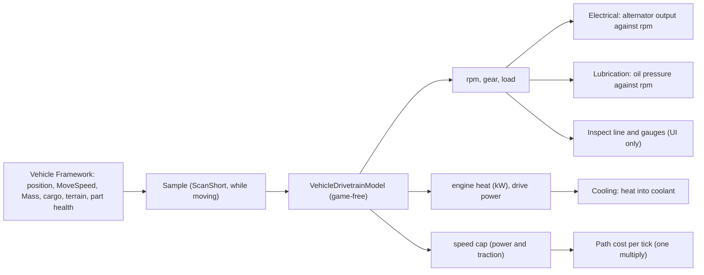

# Vehicle drivetrain and engine speed: design (8 Nov 2026)

A design record. **Built in D'thorga Framework 0.11.0 on 8 Nov 2026 (see [As built](#as-built-dthorga-framework-0110-8-nov-2026)); not yet tested in game.** The text above that section keeps its original scope. The owner asked on 8 Nov 2026 to introduce engine
speed (rpm) and, "if at all possible, a semi-realistic drivetrain provided we can maintain good performance". It was
written while the [vehicle systems](vehicle-systems-design.md) service was being coded, and checked afterwards against
what D'thorga Framework 0.9.0 built (8 Nov 2026). It **adds** to that schema (one optional loadout field, one new Def type,
three new inputs, and a better source for the built `EngineLoad`) and changes nothing already there. The owner reads and
corrects it before any code. Studied sources are in [vehicle simulation references](vehicle-references.md); Vehicle
Framework facts come from [Vehicle Framework mechanics](vehicle-framework-mechanics.md).

## Read this first

- **Quasi-static, not simulated.** The model takes the speed a vehicle is moving at and works backwards through the
  wheels, gearbox and engine to gear, rpm, load, fuel power and heat. This is the backward-facing method of
  Guzzella and Sciarretta and of NREL's ADVISOR. It has no differential equation and integrates nothing, so it cannot
  go unstable and costs the same at any game speed.
- **Vehicle Framework (VF) still decides how fast a vehicle moves.** The drivetrain only lowers that speed when the
  engine's power or the tyres' grip cannot deliver it: a laden two-wheel-drive truck in loose sand. It never applies
  a part's health a second time when VF already feeds that part into MoveSpeed.
- **Two clocks, on purpose** (agent proposal; from our [map scale research](map-scale-research.md)). Speed uses the
  **action clock**: 60 ticks are one second and a cell is one metre, so MoveSpeed 10 is 36 km/h. Energy, fuel and heat
  use the **day clock**: 2,500 ticks are one hour, the clock VF's fuel rates and the systems service already use.
- **Nothing new is saved.** Gear and rpm are derived each sample and rebuilt after a load (the systems design's rule:
  derived values are never saved). Removing the drivetrain leaves nothing behind in a save.
- **No new ticking.** It samples on VF's own ScanShort event (every 60 ticks) while a vehicle moves, and once on
  ignition and on stopping. Parked vehicles cost nothing.
- **Every starting figure is labelled** primary, secondary, our inference or authored, and is a proposal, not tuned.

## What it adds to the systems service



- **A new Def, `PhobosVehicleDrivetrainDef`**: the engine, transmission and running gear of one kind of vehicle. Like
  the other Defs it sits under the `Phobos` prefix and is never renamed once saves can hold it. Saves never hold it in
  practice, since nothing is saved.
- **One optional field on `PhobosVehicleLoadoutDef`: `drivetrain`**, a Def with `set` overrides, as `systems` already
  works. A loadout without it runs exactly as it does today.
- **The built `EngineLoad` gets a real source.** As built, `CompPhobosVehicleSystems` sets it to 0, 0.5 or 1 from drafted and
  moving. With a drivetrain in the loadout, the model's load (0 to 1) replaces that, so every flow already reading
  `Input_EngineLoad` improves with no XML change.
- **Three new inputs** for the systems' flows: `Input_EngineRpm`, `Input_EngineHeat` (kW) and `Input_DrivePower` (kW).
  With no drivetrain they fall back to today's behaviour: rpm reads idle or a nominal cruise figure, and heat follows load.
  The built gearbox-temperature system (`PhobosVehicleSystem_Transmission`) can read drive power for its losses.
- **`VehicleDrivetrainModel`**, game-free and unit-tested in `tests/` beside `VehicleSystemModel`; the comp only feeds
  it.

## The model, step by step

All quantities are SI. Labels: **[P]** primary, **[S]** secondary, **[I]** our inference, **[A]** authored.

1. **Speed.** Measured from the vehicle's position change between samples, in cells per action-clock second times
   metres per cell. This works whether VF alone moves the vehicle or Vanilla Vehicles Expanded's acceleration
   controller does [I]. **Divide out our own cap first** (speed ÷ current cap factor), so the model sees the speed VF
   intends. Otherwise the cap would see the slower speed, lift itself, and oscillate.
2. **Mass.** VF's Mass is balance mass (the Mule is 240), not kilograms of truck. Kerb mass = VF Mass × 12 kg [A]
   (Mule 2,880 kg, Dirtbike 360 kg, Bulldog 5,400 kg), overridable per loadout. Payload adds up to 60% of kerb mass at
   full cargo [A], scaled by cargo mass over `CargoCapacity` [I], plus passengers by their own mass.
3. **Road load.** F = C_rr·m·g + ½·ρ·CdA·v² + m·a. Rolling resistance C_rr comes from the terrain under the vehicle
   through a curve against the terrain's `pathCost` [A]. Shape it from the secondary tables: about 0.01 on paved
   ground, 0.05 on soil, 0.15 to 0.35 on sand [S]. Read the game's and mods' terrain path costs with
   `python scripts/query-defs.py` before fixing the curve. Acceleration a comes from the change in measured speed, and
   is non-zero only under VVE's controller [I]. Aerodynamic drag is small at RimWorld speeds but costs nothing to keep.
4. **Wheels to engine.** Engine rpm = v ÷ (2π·r) × 60 × final drive × gear ratio. Wheel radius r, final drive and
   gears come from the drivetrain Def.
5. **Gear choice** (automatic). Take the highest gear in which rpm is at least the downshift rpm and the engine has at
   least 10% torque in reserve. Keep the current gear while it still qualifies (hysteresis), as Jolt's upshift and
   downshift rpm pair does [S]. Below first gear's downshift speed the clutch slips: rpm is held at a launch figure
   and drive torque passes through. Manual gearboxes are the same rule; players don't shift.
6. **Engine.** Rated power = kW per tonne of kerb mass × kerb mass [A], by archetype. Torque at any rpm is the rated
   torque times a normalised curve against rpm ÷ rated rpm [A], shaped like a typical diesel or petrol curve (peak
   torque around two thirds of rated rpm). Required engine power = wheel power ÷ drivetrain efficiency. Load is
   required over available torque at that rpm.
7. **Limits and the speed cap.** If no gear can supply the power, the cap factor is the highest speed that some gear
   can hold, divided by VF's intended speed (a short bisection) [I]. If traction cannot, tractive force is capped at
   μ × driven share × m·g: share 0.5 for two-wheel drive, 1 for all-wheel drive and tracks [I]; peak μ about 0.8 on
   dry asphalt, 0.6 on gravel, 0.55 on wet earth [S]. Where traction is below rolling resistance, a real vehicle is
   stuck. **We keep a floor (cap 0.15) [A]** and show "Wheels spinning" instead of stopping the vehicle (open
   question 2). Changes to the cap are smoothed over a second so the vehicle doesn't jerk [A].
8. **Fuel and heat.** Fuel power = (engine power + friction power) ÷ indicated efficiency: the Willans shape
   [S, Guzzella and Sciarretta]. Friction power is rated power × (0.04·x + 0.08·x²), with x = rpm ÷ rated rpm [A].
   Indicated efficiency is 0.40 for diesel and 0.35 for petrol [A, to check against Heywood]. **Heat into the coolant
   is 28% of fuel power** [A, to replace with Heywood's energy balance]. This gives the cooling system real kilowatts
   to set against its `radiatorKilowatts`. The comp averages heat over the rare-tick window on the day clock and hands
   the average to the cooling flow.
9. **What rpm drives elsewhere.** This is the payoff for the other systems:
   - **Alternator**: output against rotor rpm, where rotor rpm = engine rpm × pulley ratio 2.5 (Delco Remy's example
     [S]). The curve is zero below about 1,200 rotor rpm (one product's cut-in [S]), then rises to full output
     [A: (1200, 0) (1800, 0.5) (2400, 0.7) (4000, 0.9) (6000, 1)]. **An idling truck with lights, heater and a winch
     now runs its battery down**, as Delco Remy's "half the load at idle" rule predicts.
   - **Oil pressure** rises linearly with rpm up to a relief-valve figure and falls as hot oil thins, JSBSim's shape
     [S]. It replaces the systems design's "oil pressure derived from pump efficiency and level" with something that
     also drops at idle.
   - **Coolant pump flow and fan airflow** rise with rpm [I]. That is why an idling, overheating engine is a real
     state: the systems design's stopped/moving radiator factor becomes rpm-aware.
   - **Display**: Operator mode shows "3rd gear, 1,550 rpm"; Engineer mode adds load, engine power, fuel power and
     heat. A gauge for the selected vehicle interpolates between samples in the UI only.

## Archetypes (agent proposal; all authored, every figure to replace with a published gearbox and engine)

Chosen by effect, never by name, following the owner's rule of 5 Nov 2026: tracks, `electricPowered`, `vehicleType`
and Mass.

| Archetype | Selector | Idle / launch / rated rpm | Gears, final drive | Shift up / down | Wheel radius | kW per tonne | Driven share | CdA (m²) | Drivetrain efficiency |
| --- | --- | --- | --- | --- | --- | --- | --- | --- | --- |
| Light wheeled, petrol | Land, wheels, Mass under 120 | 800 / 1,300 / 5,500 | Jolt's defaults 2.66, 1.78, 1.30, 1.00, 0.74 [S: a game default]; 3.9 | 4,000 / 2,000 | 0.31 m | 60 | 0.5 | 0.7 | 0.90 |
| Heavy wheeled, diesel | Land, wheels, Mass 120 or more | 700 / 1,100 / 3,000 | 4.0, 2.4, 1.5, 1.0, 0.8; 4.1 | 2,400 / 1,300 | 0.38 m | 30 | 0.5 | 2.4 | 0.88 |
| Tracked, diesel | Land, no parts tagged `Wheel` [I: check against VVE's tracked designs] | 650 / 1,000 / 2,400 | 5.0, 2.9, 1.8, 1.2, 0.85; 6.0 | 2,000 / 1,100 | 0.32 m sprocket | 20 | 1.0 | 4.0 | 0.80 |
| Electric | `electricPowered` | none / none / motor base speed 3,000 | single reduction 9.0 | none | by size | 60 | 0.5 | by size | 0.92 |
| Boat | Sea | 700 / 700 / 2,800 | propeller law, no gearbox | none | none | 25 | none | none | 0.95 |

A loadout that names a vehicle can override any field. An "all-wheel drive" variant just sets the driven share to 1.

## Worked example (prototype run, 8 Nov 2026)

Run with a Python prototype of steps 2 to 8, at half payload. These are **outputs of authored figures, not measurements**.

| Vehicle | Ground | Speed | Gear, rpm | Engine power | Load | Fuel power | Into coolant | Result |
| --- | --- | --- | --- | --- | --- | --- | --- | --- |
| VVE Mule (heavy wheeled; 3,744 kg laden; 86 kW) | asphalt, C_rr 0.012 | 36 km/h | 3rd, 1,545 | 6.6 kW | 13% | 26 kW | 7.2 kW | Cruising |
| Mule | soil, 0.05 | 36 km/h | 3rd, 1,545 | 22.5 kW | 45% | 65 kW | 18.3 kW | Working hard |
| Mule | loose sand, 0.25 | 36 km/h intended | none | needs 106 kW | over | | | Power-limited to 26 km/h (cap 0.73), and **traction-limited: 6.4 kN of grip against 9.2 kN needed, so it bogs** in two-wheel drive; all-wheel drive has 12.9 kN and gets through |
| VVE Bulldog (tracked; 7,020 kg; 108 kW) | asphalt | 26 km/h | 4th, 1,547 | 8.6 kW | 10% | 37 kW | 10.5 kW | Cruising |
| Bulldog | loose sand | 26 km/h intended | none | needs 156 kW | over | | | Power-limited to 16 km/h (cap 0.62); tracks keep traction (24.1 kN against 17.2 kN) |

Pulling away in the Mule on asphalt: the clutch slips at 1,100 rpm up to about 12 km/h, then it runs 1st to about 19
km/h, 2nd to about 30 km/h and 3rd at 36 km/h. Heat into the coolant at cruise (7 to 18 kW) sits well inside a 40 to
60 kW radiator. Overheating then needs what it needs in life: heavy load, a damaged radiator, low coolant or idling in
heat.

**Integration is already safe as built.** At the rare tick each step is 0.1 in-game hours (360 s), and an open thermostat's
coolant time constant comes out near 160 s for these magnitudes [A], which a plain `T += rate × hours` step would turn into
divergence. Framework 0.9.0's `SystemIntegrator` takes the exact exponential step for "toward" flows, opens gated flows
across a band, and cuts the interval into steps of at most 0.025 h. The drivetrain's heat feeds it unchanged.

## Parts and damage

Roles join the loadout's `partRoles` as today: **Engine** (found), **Gearbox** (VVE has one; others get it added),
**Clutch** (added, low hit weight) and **DrivenWheels** (parts tagged `Wheel`; tracks by tag).

| Part | Effect of damage (stages, authored) | Double-count rule |
| --- | --- | --- |
| Engine | None from us: VF already scales MoveSpeed by the engine's efficiency | VF owns it |
| Gearbox | Efficiency falls with health; below 40% the top gear is lost, below 20% only 1st and 2nd remain, so redline in the highest working gear caps speed ("limping in 2nd"). Wear adds heat | If a design already lists the gearbox under MoveSpeed, only rpm, heat and display change, never the cap |
| Clutch | Below 50%, the torque it can pass falls; under high load it slips (rpm up, speed capped, wear) | Ours alone |
| Driven wheels or tracks | Each damaged driven wheel cuts the driven share and raises rolling resistance (a flat tyre triples it [A]) | VF's own wheel efficiency stays; we add only traction and resistance |

## Other drive types

- **Electric.** Motor rpm follows speed through a single reduction. Torque is constant up to base speed and power is
  constant above it [I]. No gearbox. Motor losses heat the motor-temperature quantity the systems design already
  plans for electric vehicles.
- **Tracked.** As wheeled, with full driven share, higher rolling resistance and, in a later phase, a skid-steer
  turning cost from Wong's chapter 6, charged on VF's RotationChanged event (on `develop`) [I].
- **Boats.** No gearbox: engine power demand = rated power × (rpm ÷ rated)³, the propeller law [S], with rpm in
  proportion to speed. Design speed (VF MoveSpeed) is set at 85% of rated rpm [A], which is 61% load.
- **Aircraft and other turbines.** In [gas turbines](vehicle-turbine-design.md): flight phases as the load signal, the
  hover margin, water injection, twin engines and the tank turbine.
- **Caravans on the world map.** No cell speed exists there. Use the cruise point at the vehicle's nominal speed, with
  rolling resistance from the tile's road and biome and an average grade from hilliness [A: flat 0%, small hills 2%,
  large hills 5%, mountainous 8%]. It is evaluated once per rare tick while the caravan moves.

## Schema (draft; field names settle at build)

```xml
<Phobos.VehicleSystems.PhobosVehicleDrivetrainDef>
  <defName>PhobosDrivetrain_HeavyWheeledDiesel</defName>
  <label>diesel truck drivetrain</label>
  <engine>
    <fuelKind>Diesel</fuelKind>              <!-- sets indicated efficiency 0.40 [A] -->
    <idleRpm>700</idleRpm><launchRpm>1100</launchRpm><ratedRpm>3000</ratedRpm>
    <kilowattsPerTonne>30</kilowattsPerTonne>
    <torqueCurve>(0,0)(0.25,0.6)(0.5,0.95)(0.65,1)(0.85,0.95)(1,0.85)(1.1,0)</torqueCurve>
    <frictionShare>(0.04, 0.08)</frictionShare>
    <coolantHeatShare>0.28</coolantHeatShare>
  </engine>
  <transmission>
    <kind>Automatic</kind>                    <!-- Automatic, Manual, Cvt, Direct, Propeller -->
    <gears><li>4.0</li><li>2.4</li><li>1.5</li><li>1.0</li><li>0.8</li></gears>
    <finalDrive>4.1</finalDrive><upshiftRpm>2400</upshiftRpm><downshiftRpm>1300</downshiftRpm>
    <efficiency>0.88</efficiency>
  </transmission>
  <running>
    <wheelRadius>0.38</wheelRadius><drivenShare>0.5</drivenShare><dragArea>2.4</dragArea>
  </running>
  <mass><kilogramsPerVehicleMass>12</kilogramsPerVehicleMass><payloadShare>0.6</payloadShare></mass>
</Phobos.VehicleSystems.PhobosVehicleDrivetrainDef>
```

In a loadout, beside `systems`:

```xml
<drivetrain>
  <def>PhobosDrivetrain_HeavyWheeledDiesel</def>
  <set><drivenShare>1</drivenShare></set>   <!-- an all-wheel-drive truck -->
</drivetrain>
```

The cooling system's engine-heat flow then reads `<li Class="Input_EngineHeat" />` in place of `Input_FuelBurn` and
the authored `HeatPerFuelUnit`. The electrical system's alternator flow multiplies by an `Input_EngineRpm` curve. The
validator gains checks for gears in descending order, upshift above downshift, launch between idle and rated, and a
torque curve ending at zero.

## Performance

- **Per sample**: one position difference, one cached terrain lookup (refreshed when the cell changes), five
  multiplies for road load, at most one torque-curve evaluation per gear (five gears), and a bisection of about 16
  steps only when a limit binds. Well under a microsecond in C# when no limit binds [I, not measured].
- **Per moving vehicle per tick**: one multiply in the path-cost-per-tick postfix, the same hook VVE uses. VVE's own
  factor and ours multiply cleanly.
- **Parked or idle**: one evaluation on ignition, none after.
- **A benchmark in `tests/`** (500 vehicles, mixed terrain) before phase A ships settles the figure. The owner's high-end
  PC is a best case for players (AGENTS.md).

## Interplay with other mods

- **Vanilla Vehicles Expanded**: its controller ramps speed up and down; we read that through measured speed, so
  launches use 1st gear naturally. Both factors multiply path cost per tick.
- **Combat Extended**: no interaction; it changes damage, not movement.
- **Vehicle Framework's own terrain costs and `offRoadMultiplier`** are already inside the measured speed. We add only
  what the powertrain cannot deliver.

## Settings (our `ModSettings`; agent defaults)

| Setting | Choices | Default | Needs restart |
| --- | --- | --- | --- |
| Drivetrain | Off / Display only (rpm and gear shown, no effects) / Full | Full | No |
| Load-dependent fuel use | Off (VF's rates unchanged; heat still follows the model) / On (fuel scales with the model's fuel power, normalised so a nominal cruise matches VF's rate) | Off | No |
| Stuck in soft ground | Floor (slow crawl, "Wheels spinning") / Stop (the vehicle refuses the path) | Floor | No |

## As built (D'thorga Framework 0.11.0, 8 Nov 2026)

**Built and checked offline; not yet tested in game.** Code: `src/PhobosFramework.Vehicles/Rules/DrivetrainModel.cs` (game-free,
with the rule tests), `Systems/Powertrain.cs` (the vehicle's side), `Defs/PowertrainDefs.cs`, and the archetypes in
`mods/PhobosFramework/Mods/VehicleFramework/Common/Defs/Phobos/Framework/VehicleSystems/Drivetrains.xml`.

**The owner's answers (8 Nov 2026):**

| Question | Owner's answer | As built |
| --- | --- | --- |
| 2. Crawl or stop without traction? | **Crawl** | A 15% floor and "Wheels spinning"; no stop setting |
| 3. Load-dependent fuel use? | **Keep the authors' figures; the setting off by default** | The setting exists, off; on, fuel follows the model's fuel power, normalised so a nominal cruise matches the author's rate |

Questions 1, 4, 5 and 6 took the agent's leans (agent choices, owner to revise): two clocks; kerb mass 12 kg per VF Mass unit,
overridable per loadout (`mass` in the drivetrain Def, or `kilogramsPerVehicleMass` and `emptyKilograms` in a loadout's `set`);
Plain mode says only "Engine labouring" (load above 90%) or "Wheels spinning"; engine sound later.

**Corrections from reading Vehicle Framework and Vanilla Vehicles Expanded (8 Nov 2026), which the build follows:**

- **The speed cap hooks `VehiclePathFollower.CostToPayThisTick()`** (private; a postfix multiplying its result by the cap),
  with Harmony priority First so it runs **before** VVE's postfix on the same method, which reads the result to decide braking.
  Vehicle Framework's MoveSpeed stat and path planning are untouched.
- **VF's Mass stat already includes cargo**, so kerb mass uses the design's base Mass; inventory, passengers (their own mass),
  turret ammunition and fuel are added, cached for 250 ticks and dirtied on cargo and passenger events.
- **Speed is sampled from the sub-cell position** (the path follower's next cell and the share of its cost left), because a
  vehicle's Position changes only per cell. Never from DrawPos.
- **Terrain**: rolling resistance and grip are curves on the terrain's own path cost (built floors 0, soil 2, sand 4, soft sand
  and mud 14, marsh and shallow water 30; authored, shaped from the secondary tables in the references), with snow on top.
- **Tracked vehicles are found by a part key ending in Track** (a new selector field, `partKeySuffixes`), because two of VVE's
  tracked vehicles carry no Wheel tag. The tracked loadout wins a tie with the mass-based ones through a new loadout `rank`.
- **Skid-steer turning cost is not built**: VF's rotation events exist only on its development branch.

**Also built:** a medium land loadout (VF Mass 120 to 350, 12 V electrics and a diesel) between light (petrol) and heavy; a
clutch part on land vehicles (slips under load when damaged); the gearbox losing its top gear below 40% and keeping only 1st and
2nd below 20%; a flat tyre tripling its rolling resistance. Cooling's combustion heat reads the model's heat (as a share of the
heat at rated power, so 420 degrees an hour still means full load); the radiator's fan, the oil pump and the alternator follow
engine speed (the alternator: nothing below 1,200 rotor rpm, about half at idle through a 2.5 pulley; authored curve). Caravans on
the world map take a cruise point from the tile's hilliness and road.

**Checked offline:** the worked example within tolerance (the Mule in 3rd at about 1,545 rpm and 13% load on asphalt; loose sand
power-capped, bogged in two-wheel drive and through in all-wheel drive; the Bulldog's sand cap), gear hysteresis, gearbox damage,
the propeller law, the terrain curves, and a 500-sample benchmark under 50 ms (`tests/PhobosFramework.Vehicles.Rules.Tests`).

**To test in game (owner):**

1. A Vanilla Vehicles Expanded truck driving on a road and on soil, in Operator mode: the gear and rpm change sensibly.
2. A laden truck in soft sand or mud: it slows, and crawls with "Wheels spinning" rather than stopping.
3. A truck idling at night with its headlights on: the battery slowly drains; driving charges it.
4. Save and reload with vehicles moving: no errors, the same gears after a few seconds.

## Open questions for the owner

| Question | Agent lean |
| --- | --- |
| 1. Two clocks (speed on the action clock, heat and fuel on the day clock), as proposed? | Yes: speeds look right at 1 m per cell, and heat stays in step with VF's per-day fuel |
| 2. Should a vehicle that cannot get traction crawl or stop? | Crawl, with an inspect line saying why; stopping would strand pathing |
| 3. Load-dependent fuel use: change other authors' fuel balance, or leave it? | Off by default: retrofits keep their authors' fuel figures |
| 4. Kerb mass at 12 kg per VF Mass unit? | A starting figure; check it against the owner's vehicle list for outliers (dirt bikes, tanks) |
| 5. Gear and rpm on the inspect line in Plain mode? | No: Plain says "engine labouring" only when load is above 90% |
| 6. Engine sound pitched by rpm? | Later, and only if VF exposes the sustainer; quiet, with a volume setting (AGENTS.md) |

## Who chose what

- **Owner (8 Nov 2026):** introduce rpm and a semi-realistic drivetrain, provided performance holds; build a body of
  references to study.
- **Owner (8 Nov 2026):** crawl without traction; keep the authors' fuel figures with the setting off.
- **Agent proposals, owner to confirm:** the quasi-static method; VF keeps deciding speed and we only cap it; the two
  clocks; nothing saved; ScanShort sampling; the archetypes and every authored figure; the speed-cap floor; the
  settings table.

## Sources

Studied sources, with terms and what to take from each, are in [vehicle simulation references](vehicle-references.md).
The figures above cite them by name: Guzzella and Sciarretta (method, Willans line), Wipke, Cuddy and Burch (ADVISOR),
Jolt Physics (shift rpm pair, light-vehicle gear defaults), Delco Remy (alternator pulley ratio), the E-Z-GO manual
(cut-in), JSBSim (oil pressure), the rolling-resistance and friction tables (marked low quality), and the propeller
law (secondary). Vanilla Vehicles Expanded's `CompVehicleMovementController` was read from its GitHub 1.7 source on
8 Nov 2026 (no licence: read only). The worked example came from a prototype run that day.
