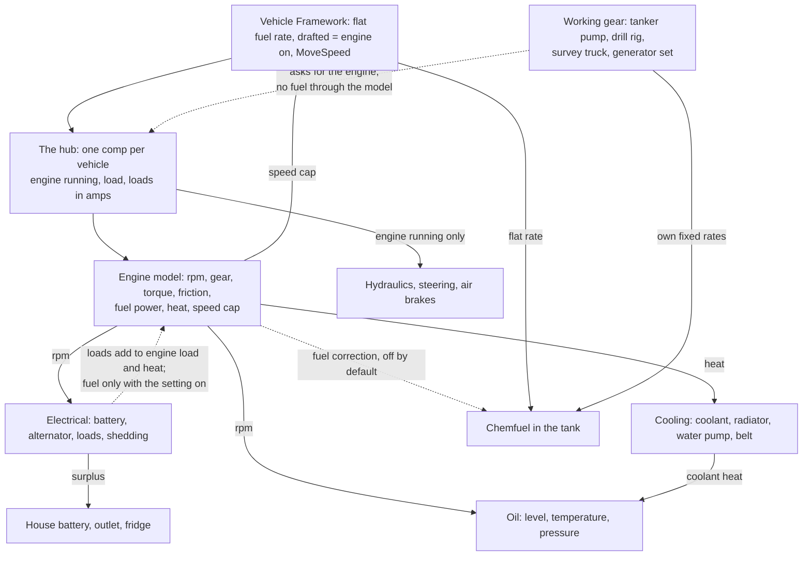
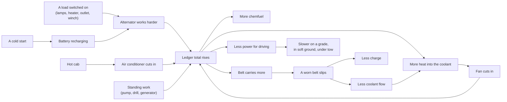

# Engine loads: a top-down review and a design (18 Nov 2026)

**Status (18 Nov 2026):** A research and design record, with its code checks done the same day. Built: the fixes for C1 and C4 (D'thorga
Framework 0.129.1, Vehicles 0.65.1) and the step back's S1 to S6 and S8 (Framework 0.130.0), not yet tested in game, S8 not yet measured
after. Not built: S7, the engine-load ledger itself and C6. It reviews the vehicle simulation as it stood in D'thorga Framework 0.129.0.

The owner asked for a deeper simulation layer: parts the engine drives, such as the alternator and the water pump, take a little
horsepower from it according to their own load, and so a little chemfuel, with effects reaching three and four links further out.
They asked for a step back first: a top-down look at where the vehicle simulation stands, then forward again. This record is that
look, then the design.

**Read this first:**

- **Part of this exists already, and is dormant.** Electrical loads have loaded the engine since Framework 0.70.0 (cross-link 5), but
  the fuel for them is burned only with "Fuel use follows engine load" on, and that setting is off by default.
- **No load takes power from driving today**, and every belt-driven part turns for free.
- **The loads are not small in fuel.** The game's normal cruise uses about a tenth of an engine's rated power, so each kilowatt a load
  takes adds 2 to 4 % to the fuel burned at a cruise ([worked figures](#how-big-the-loads-are-worked-figures)).
- **Turning the fuel model on by default halves idle fuel** against Vehicle Framework's rule. The owner accepted that (18 Nov 2026).
- **Re-derived work figures come out 2 to 5 times today's** for the drill rig and the generator set. The table is in
  [work loads](#work-loads-old-figures-against-re-derived-ones). The generator set keeps today's fuel (owner, 18 Nov 2026), with the
  real figure recorded beside it.
- **Three faults in built code were found while checking** ([what the checks found](#what-the-checks-found-18-nov-2026)): lamps and
  the night heater run on a flat battery with the engine off; the diesel-electric's alternator gives nothing at idle; and the tanker's
  pump costs nothing above idling. Each was read from the code; none was seen in game.

How to read the citations: `file:line` with no mark was re-read for this record on 18 Nov 2026. A dagger (†) marks a line a survey
agent read and this record's author did not re-read. Vehicle Framework lines are from its 1.7 decompile, kept in `.local/` and never
committed; they are marked †.

## The owner's decisions (18 Nov 2026)

| # | Decision | Whose |
| --- | --- | --- |
| 1 | **The whole fuel model is on by default**: "Fuel use follows engine load" defaults to on, reversing the default of 8 Nov 2026. Other authors' fuel rates still hold at the nominal cruise the model is normalised to | owner (the agent had recommended a small extra burn instead) |
| 2 | **Air drag stays, as one fixed figure per vehicle class.** It is the recorded exception to the rule of 13 Nov 2026; no fitting, accessory, load or upgrade ever changes drag | owner (agent's recommendation) |
| 3 | **Work loads join the same ledger, with figures re-derived from real power.** The owner asked which choice was more realistic; re-deriving is, so it is taken as the answer. Each old rate is shown beside its re-derived one for the owner to accept or overrule | owner's criterion (realism); the reading of it as an answer is the agent's |
| 4 | **The generator set keeps today's fuel** (2 a day idling to 15 at full output), and the record keeps the real figure beside it as information ("it's useful information") | owner (the agent had recommended keeping it through one named figure for what a game watt stands for; that figure stays a proposal under S3) |
| 5 | **Idle at about a quarter of the cruise rate is accepted**, as the fuel model gives it | owner (agent's recommendation) |
| 6 | **The air-brake compressor becomes a ledger load**, reopening the row round two argued against | owner (agent's recommendation) |
| 7 | **Confirm the possible faults and source the missing figures before building** | owner (agent's recommendation); done the same day, below |
| 8 | **Fix C1 and C4 now; C6 waits for the ledger's work loads** | owner (agent's recommendation); built in Framework 0.129.1 and Vehicles 0.65.1 |
| 9 | **The ledger's alternator runs at 0.55 efficiency, falling with speed** (Remy's typical figure, against today's 0.6) | owner (agent's recommendation); not built |
| 10 | **Start the step back, S1 to S8, next** | owner (agent's recommendation); built in Framework 0.130.0, bar S7 |
| 11 | **Lost power as power** (step S4): a choked filter, a warped head and a weak fuel pump take power from the engine in the full model, and stay a speed factor without it | owner (agent's recommendation) |
| 12 | **Record the owner's running game for S8 now**, before the step back is installed | owner |

## Where we are, top-down

### What Vehicle Framework gives us

Vehicle Framework has no engine power of any kind: no horsepower, torque, alternator, battery or radiator (searched in its 1.7
decompile†). What it has:

- **Fuel is a flat daily rate**: full while moving, half while drafted and standing on a map, nothing undrafted
  (`CompFueledTravel.ConsumptionRatePerTick`†). On the world map a caravan burns only while moving.
- **"Engine on" means drafted.** There is no ignition apart from the draft switch.
- **Speed is one stat**, lowered by part health and by how full the cargo is. Mass never affects it.
- **Aircraft in world flight do not tick their comps**, so anything of ours reaches them only through the fuel-rate hooks we already
  patch.
- **Every vehicle not the player's is drafted the moment it spawns**, so it burns half rate while parked until its tank is empty.

Everything deeper is ours, in D'thorga Framework's vehicle part. A load chain for driving on a map needs no new Harmony patch.

### What stands on top of it today

Solid arrows work under default settings. Dotted arrows are dormant, partial, or outside the engine model.

- **The hub** (`src/PhobosFramework.Vehicles/Systems/CompPhobosVehicleSystems.cs`) decides whether the engine runs and how hard, adds
  the loads up in amps and runs every system on the rare tick (every 250 ticks) and on events.
- **The engine model** (`src/PhobosFramework.Vehicles/Rules/DrivetrainModel.cs`) works backwards from the vehicle's speed to gear,
  rpm, engine power, fuel power and heat, and caps the speed where power or grip runs out. It is on in full by default
  (`VehicleSystemsMod.cs:72`).
- **Systems are XML**: stocks and flows read by one generic worker, so the electrical, cooling, oil and fluid systems are Defs.

### What already loads the engine

Cross-link 5 turns the switched-on electrical loads into a share of the engine's rated power: amps times volts, over an alternator
efficiency of 0.6 (`Rules/AccessoryRules.cs:14-21`). The hub adds that share to the engine load, capped at 1
(`CompPhobosVehicleSystems.cs:940-941`), and to the heat. Since Framework 0.129.0 the camp loads on a house battery count too (`:952`).

What it does not do:

| Gap | Where |
| --- | --- |
| **No fuel under default settings.** The loads' fuel is added only when fuel follows the model; otherwise the sum uses Vehicle Framework's share and the loads' fuel is dropped | `Systems/Powertrain.cs:715-728`; default off at `VehicleSystemsMod.cs:74` |
| **No power taken from driving.** The drive conditions carry no load term, and the speed cap is worked out from road load alone | `Rules/DrivetrainModel.cs:88-112`, `:251-261` |
| **The alternator is charged for what the loads draw, never for what it produces.** Recharging the starting battery after a start, or charging the house battery, costs the engine nothing | `CompPhobosVehicleSystems.cs:949-957` |
| **An engine turned by standing work gets the load but no fuel for it**: the fuel sum needs the engine running for driving | `Powertrain.cs:720`; comment at `CompPhobosVehicleSystems.cs:916` |
| **Charged slightly high.** The share is priced at rated-power fuel, which includes the engine's friction at rated speed; friction is already in the drive's fuel, so the loads pay about 15 % too much | `Powertrain.cs:727` against `DrivetrainModel.cs:178-187` |
| **Mechanical parts take nothing**: water pump, radiator fan, steering pump, hydraulic pumps, air compressor, the belt itself. The air conditioner is a 30 A electrical load, where a real one is belt-driven | `Systems_Cooling.xml:319-365`†, `Systems_Fluid.xml:69-78`†, `Loadouts_Default.xml:501-520`† |

Several records and the player guide say an idling outlet or work lamps burn fuel. Under today's defaults they do not; with decision 1
built they will. They are listed in [records that speak ahead of the code](#records-that-speak-ahead-of-the-code).

### The seams

These are why a step back is needed. Each makes a general load chain awkward, or makes two parts of the model disagree.

| # | Seam | What it is | Where |
| --- | --- | --- | --- |
| 1 | No one "engine is running" | The hub's `EngineRunning` and `EngineRunningRaw`; the drafted switch read directly by set-up work; Vehicle Framework's own burn test, which we patch; the aircraft's flight phase; the generator set's `running`; the ignition hint | `CompPhobosVehicleSystems.cs:893-925`; `CompPhobosSetUp.cs:361`†, `:533`†; `BatteryDrive.cs:31`†; `CompPhobosGeneratorSet.cs:382`† |
| 2 | Five ways to burn fuel | Vehicle Framework's flat rate with the model's correction; flat hourly effects (night heater, holed tank); rig work per day; the generator set's idle-to-full rate; the water drop. Only the first knows the engine | `Powertrain.cs:730`; `Schema/Effects.cs:250`; `CompPhobosRigWork.cs:173`; `CompPhobosGeneratorSet.cs:385`; `Sling/WaterDrop.cs:152` |
| 3 | Mixed units | Amps for loads, the game's watts for the outlet and hook-up, watt-days for the battery drive, pack share an hour for electric vehicles, kW in the engine model, a "heat share" for cooling. The generator set's record says the game's watts are not real watts; the outlet and hook-up convert them one to one | [generator set](vehicle-generator-set.md), [accessories](vehicle-accessories.md) |
| 4 | Lost power shown as lost speed | A clogged air filter, a warped head and a weak fuel feed multiply move speed, while the engine model still reports full power and fuel | `Systems_Service.xml:42-71`†, `Conditions.xml:238-266`† |
| 5 | Figures in code or written three times | Alternator efficiency 0.6 is a C# constant; the alternator's speed curve and pulley ratio appear three times in XML | `AccessoryRules.cs:14`; `Systems_Electrical.xml:285-305`†, `:333-353`†, `Systems_HouseBattery.xml:70-90`† |
| 6 | Displays that disagree | World-map range ignores stage fuel factors and the loads' fuel; the Engineer line shows the model's fuel power while the default burns the flat rate | `Service/VehicleRange.cs:57`†; `Presentation/InspectText.cs:168-169`† |
| 7 | Two "accessories load the engine" routes | Cross-link 5 sits outside the engine model; turbine bleed air sits inside it | `CompPhobosVehicleSystems.cs:940`; `Powertrain.cs:436-438`† |
| 8 | Performance already over its line | The one measurement had a full-model vehicle's rare tick at 0.131 ms against 0.1 ms | [vehicle health](vehicle-health-design.md), the measurement table |
| 9 | Records behind the code | Stale status lines; the grid hook-up (Framework 0.120.0) has no design record | [the documentation audit](docs-audit-2026-11-17.md) |

## How big the loads are (worked figures)

Worked by hand from the engine model's own formulas with the heavy diesel's default figures, by a scratch script, not by the game.
They show sizes; the build's unit tests will hold the real figures. Vehicle figures are from our Defs
(`mods/PhobosVehicles/Defs/Phobos/Vehicles/*/Vehicle_*.xml`).

**The game's cruise is a light one.** The fuel model is normalised so that a nominal cruise (design speed, kerb mass plus 15 %, a
built floor; `Powertrain.cs:123-132`) burns the author's rate. That cruise asks little of the engine:

| Vehicle | Rated power | Cruise | Engine power at the cruise | Fuel power at the cruise | Idle, by the model | Idle, by Vehicle Framework |
| --- | --- | --- | --- | --- | --- | --- |
| Ullage tanker | 224 kW | 12 m/s | 19 kW (9 %) | 96 kW | 7.1 a day | 14 a day |
| Talus tipper | 220 kW | 11 m/s | 19 kW (9 %) | 91 kW | 7.4 a day | 14 a day |
| Kelly drill rig | 300 kW | 10 m/s | 32 kW (11 %) | 135 kW | 7.3 a day | 15 a day |
| Busbar generator set | 130 kW | 12 m/s | 18 kW (14 %) | 72 kW | 3.4 a day | 8.5 a day |

Two things follow.

- **Friction, not the road, is most of the fuel at a cruise.** At 12 m/s on a floor the tanker needs 19 kW at the engine and loses 19 kW
  to its own friction.
- **With the fuel model on, idle burns about a quarter of the cruise rate, where Vehicle Framework burns half.** Decision 1 therefore
  halves idle fuel for every vehicle with a full ground drivetrain. That is the model as built, with the friction figures as authored,
  and the owner accepted it (decision 5). If play says otherwise, the friction constant (`DrivetrainSpec.FrictionConstant`, 0.03,
  authored) is the figure to tune.

**A kilowatt at the shaft costs 2.5 kW of fuel** (one over the diesel's indicated efficiency of 0.40), which is 2 to 4 % of the fuel
at a cruise. For the tanker:

| Load | Shaft power | Extra fuel at a cruise | Source of the shaft figure |
| --- | --- | --- | --- |
| Alternator carrying 30 A at 24 V | 1.2 kW | +3 % (0.9 a day) | our rule, efficiency 0.6 (authored) |
| Air conditioner holding a cool cab | 2.6 kW (3.5 hp) | +7 % (1.9 a day) | National Academies, table 5-11 |
| Air conditioner cooling a hot cab | 5.6 kW (7.5 hp) | +15 % (4.1 a day) | National Academies, table 5-11 |
| Air compressor, loaded, 1,800 rpm | 3.0 kW (4 hp) | +8 % (2.2 a day) | National Academies, table 5-11 |
| Radiator fan engaged, 1,800 rpm | 14.9 kW (20 hp) | +39 % (10.8 a day) | National Academies, table 5-11 |

**Measured on a real vehicle.** The University of Minnesota measured every accessory's input power on a hybrid city bus in service
(Campbell and Kittelson, CTS 09-23, 2009): a 2007 Cummins ISB rated at 194 kW, close to our tanker's 224 kW. Averages over its
routes in Minneapolis in August and September:

| Accessory | Average input, air conditioning off | Average input, air conditioning on |
| --- | --- | --- |
| Engine fan (hydraulic) | 6.3 kW | 6.3 kW |
| Alternator | 2.3 kW | 1.6 kW, plus 2.9 kW for the air conditioner's fans |
| Power steering pump | 1.8 kW | 1.8 kW |
| Air compressor | 0.6 kW | 0.6 kW |
| Air-conditioner compressor | | 6.1 kW |
| **All of them** | **11.0 kW** | **19.3 kW** |

A city bus in summer is a hard case (its fan and pumps are hydraulic, and the study's point is that they waste much of what they
take), but it shows these loads are kilowatts, not watts, on an engine this size. The same report finds the power steering pump
averaging 45 % efficiency against a peak of 81 %, and the alternator taking more input as engine speed rises while its output stays
the same. The study did not measure the water pump.

The records called cross-link 5 "honestly small (about 1 %)". That is its share of rated power. Against the fuel a cruise burns, the
same load is 3 to 6 %, and at idle, where the engine burns a quarter as much, it is four times that again. **Idle and standing work
are where the player will feel these loads.** The fan is the largest by far, and real fans run engaged only 5 to 10 % of the time
(National Academies, table 5-12, from SAE J1343).

## The design: one ledger of what the engine drives

**One list per vehicle of everything that takes shaft power, in kilowatts, worked out inside the hub's existing sample.** It replaces
cross-link 5's share and the engine model gains one term.

### The rule

A game-free rule in `src/PhobosFramework.Vehicles/Rules/`, beside `AccessoryRules` and `DrivetrainModel`, tested in
`tests/PhobosFramework.Vehicles.Rules.Tests` (that project compiles the folder, so a new rule file needs no project change).

At each sample, with the engine at some rpm:

1. Each load reports the shaft power it takes now. Their sum is the ledger's total.
2. **Driving gets what is left**: the engine's available power at that rpm, less the total. The speed cap is worked out from that,
   so a vehicle at the limit of its power slows a little with its loads on. This is the "takes away a small amount of horsepower"
   the owner asked for, and it is the new term in `DriveConditions`.
3. **Fuel power** is drive power plus the total plus friction, over the indicated efficiency: each kilowatt on the ledger costs one
   over the efficiency, with friction charged once.
4. **Heat into the coolant** follows fuel power as it does today.
5. **Engine load** is drive power plus the total, over the available power.

**Rated power is net power** (agent default). A rated figure, ours or a real vehicle's, is taken as measured with the engine's
standard parts fitted and turning: a published net rating is taken "in as-installed condition" with "accessories like the alternator
and water pump" (Randy Bolig, Chevy Hardcore, 2015, describing SAE J1349; the standard itself is behind a paywall and was not read).
So the ledger is normalised at the nominal cruise with a standard set of loads running: at that cruise, with nothing extra switched
on, a vehicle burns the author's rate and reaches the author's speed exactly as it does now. Only departures cost or save: more
when the fan cuts in or the air conditioner runs, a little less with everything off.

### Loads are XML

A load is declared on a loadout, modelled on the electrical load that exists today (`ElectricalLoadSpec`,
`Defs/SystemDefs.cs:458-492`†), so another modder adds one without C#:

| Field | What it says |
| --- | --- |
| name, label | Its identity and what the Systems tab calls it |
| driven by | The part role that turns it: the belt, the gear train or a power take-off. That part's health and state scale it, and a broken belt drops every load on it |
| kilowatts at rated speed | Its size, with a source or the word "authored" |
| speed law | Constant; with engine speed cubed (pumps and fans); or a curve against rpm, for a table from a source |
| inputs | The same inputs systems use: coolant temperature for the fan, cab temperature for the air conditioner, the alternator's output for the alternator |
| when | A condition, as loads have today |
| baseline | Whether it counts as part of the standard set the net rating already includes |

Names of loads freeze with the override contract's first version ([authors' override contract](vehicle-author-overrides.md)), after
its last tidy.

### The loads

| Load | Driven by | What sets its size | Real figure | Source and standing |
| --- | --- | --- | --- | --- |
| **Alternator** | belt | What it **produces**: the loads it carries plus what it is putting into the starting and house batteries, never more than it can supply at that speed, over its efficiency, which falls as it spins faster | Remy's white paper: "a typical engine efficiency of 40%, a belt efficiency of 98% and an alternator efficiency of 55%", so only 21 % of the fuel's energy reaches the wiring; measured duty-cycle averages of 60.5 % (line-haul tractor, 84 A), 54.1 % (city tractor, 40 A) and 59.1 % (school bus, 102 A). MOTOR magazine: a claw-pole alternator "is only about 50% efficient" | Mike Bradfield, Remy Inc.; MOTOR (2000); both read from the source. **Today's 0.6 sits at the top of the measured averages; the agent recommends 0.55, Remy's typical figure**, with a gentle fall at high speed. FleetOwner's "130-amp alternator in full-field mode siphons 8-10 hp" would mean under 30 % at 14 V and is left as an outlier |
| **Water pump** | belt | Engine speed cubed (the pump affinity laws), times the pump's condition | A conventional engine-driven pump "in the range of 1 to 2 kW" against 30 to 60 W for a small electric one; on a heavy diesel, "up to 7 kW", needed "only in retarder operation, but not in fired diesel engine operation" | **Unverified**: both read only as search summaries (a ResearchGate paper comparing electric and mechanical pumps; Springer's SN Applied Sciences, 2021, whose page needs a login). No Def carries a figure until a page is read |
| **Radiator fan** | belt, through its clutch | Engaged above a coolant temperature, with engine speed; a viscous clutch drags a little when released | Engaged: 1.5, 5 and 20 hp at 600, 1,200 and 1,800 rpm. Viscous, released: 1.1, 2.3 and 6 hp | National Academies (2010), table 5-11, from the Technology and Maintenance Council; read from the page |
| **Air-conditioner compressor** | belt | Cab temperature against its set point; cycles off when the cab is cool | 7.5 hp cooling a hot cab, 3.5 hp holding a cool one, "not including blower"; 6.1 kW averaged on the Minnesota bus | Same table, and the Minnesota report. NREL: the compressor's power "can be greater than the engine power required to move a mid-sized vehicle 56 km/h (35 mph)" (Farrington, Cuddy, Keyser and Rugh, 1999, read from the paper). FleetOwner gives 5 hp. Moves the 30 A electrical load to the belt, leaving only its blower on the electrical side |
| **Air-brake compressor** | gear train | Loaded while the tanks fill, a small drag otherwise | Loaded: 1.1, 2.5 and 4 hp at 600, 1,200 and 1,800 rpm. Unloaded: 0.2, 0.5 and 1 hp; 0.6 kW averaged on the Minnesota bus | Same table. FleetOwner: 3.5 hp loading. **Reopened by the owner** (decision 6), against round two's "a hub change for an effect under 1 %": the hub change is now paid once, and by the worked figures the effect is about 8 % of cruise fuel while loaded |
| **Power steering pump** | belt | A small constant drag; more while steering at low speed | 0.4, 1.1 and 3 hp unloaded at the three speeds; 1.8 kW averaged on the Minnesota bus, a city route with much steering | Same table. FleetOwner: "a constant 3/4 hp" |
| **Hydraulic pump** | power take-off | The work in hand: rams, a grab, a mast | By application | The table says "varies by application" |
| **Oil pump** | gear train | Not a load of its own: the model's friction term is "friction and pumping power" and already holds it | | Agent default, to avoid charging it twice (`DrivetrainModel.cs:170-175`) |
| **Standing work** | power take-off | See [work loads](#work-loads-old-figures-against-re-derived-ones) | | |

Electrical loads stay in amps where the player sees them. They reach the engine only through the alternator's row.

### Work loads: old figures against re-derived ones

Decision 3 puts the working vehicles' fuel on the ledger. Their loads here are **illustrative and authored**: real figures for each
pump and compressor must be sourced before a Def carries them. The right-hand column is the load run straight through the engine
model (load plus friction at the working speed, over 0.40, against the cruise).

| Vehicle | Today | Illustrative real load | Straight through the model | The agent's recommendation |
| --- | --- | --- | --- | --- |
| Ullage tanker, pumping | 6 a day in [its record](vehicle-bulk-tanker.md); **in code, 14 a day: Vehicle Framework's idle half rate, with nothing for the pump** (check C6) | 8 to 15 kW at the shaft, 1,000 rpm | 14 to 19 a day | Re-derive from the pump's flow and pressure: shaft power is flow times pressure over the pump's efficiency. Darley's HM truck pumps, for example, are rated at 946 L a minute at 10.3 bar (HM250) up to 1,892 (HM500), which is about 16 to 33 kW of water power before losses (our arithmetic); a fuel transfer pump works at a fraction of that pressure. Needs a litres figure for the game's pump rate (600 units an hour) |
| Kelly drill rig, drilling | 40 a day (`CompPhobosDrillRig.cs:14`); its engine demand is already set to half of rated (`CompPhobosDrillRig.cs:100`, authored) | 150 kW, the half of its 300 kW engine the code already asks for, at 1,800 rpm | 97 a day | Re-derive from that existing demand. Makers' figures are engine ratings, not drilling draw: truck-mounted rotary rigs carry 147 to 405 kW engines (Comacchio GEO-T 15, Bauer BG 36, from a search summary). Its 160 tank would last under two days of drilling: say so in its guide |
| Datum survey truck, scanning | 8 a day (`CompPhobosSurveyTruck.cs:41`) | About 1 kW of instruments through the alternator, at idle | 6.4 a day (worked with the heavy diesel's figures; the truck uses a medium diesel) | Re-derive; it barely moves |
| Busbar generator set | 2 a day idle to 15 at full output (`Vehicle_GeneratorSet.xml:348-349`) | 100 kW electrical at 1,800 rpm | 6.4 idle, 72 at full output | **Kept at today's figures** (owner, decision 4); the real figure stays here as information |
| Talus tipper, tipping | No figure of its own | A ram pump for some seconds | Too brief to matter in a day | A load for the heat and the power, not for the fuel |

**The generator set is where realism and play collide.** Its 2,000 W is the game's watts, which its own record says are not real
watts. A real 100 kW head would burn 72 a day for the same 2,000 W, which no player would run beside the game's own generator. The
rule against value loops only forbids being better than that generator, so both figures are legal.

**The owner kept today's fuel (decision 4), and the real figure stays here as information.** In the ledger the generator head is
therefore one load whose size follows today's curve (2 a day idling to 15 at full output, worked back to kilowatts), not the real
head's. A rules-Def figure for how many real watts one of the game's watts stands for (about 6.5 by these sums) would express the same
thing once, and settle seam 3 for the outlet and the grid hook-up; it stays the agent's proposal under step S3.

**Why re-derived figures are so much larger:** the fuel unit is set by the game's cruise, and that cruise is light (9 to 14 % of rated
power). Real work that takes a third of an engine therefore costs several times the driving rate. The proportions to the engine are
right; it is the driving that the game makes cheap.

## The chains

What the ledger joins up. Order counts links from the cause.

| Chain | 1st | 2nd | 3rd | 4th |
| --- | --- | --- | --- | --- |
| Loads at idle | Outlet, lamps or heater on | Alternator takes shaft power | Fuel and coolant heat rise | With no air moving through the radiator, the fan cuts in and takes more |
| After a start | Starter drains the battery | Alternator recharges at full output | Fuel is higher for the first minutes | The extra load is extra heat, so a cold engine warms a little sooner |
| A hot day | Cab above its set point | Air conditioner cuts in | Fuel and heat rise | Fan cuts in; on a climb the vehicle slows |
| At the limit of power | A steep grade, soft ground or a heavy tow | The loads' share comes off drive power | The speed cap falls a little | Switching loads off gets the speed back: the player's lever |
| A tired belt | Service overdue | A loaded belt slips | Alternator and water pump underdriven | Battery runs down and coolant runs hot together, which is how a real slipping belt shows itself |
| A worn engine | Engine health down | Less power available | The same loads are a bigger share | Idle with everything on labours and runs hot |
| Standing work | Pump or drill running | A large share of the engine, standing still | Heat with no air moving | Fan engaged for most of the job; overdrive cuts out sooner |

## What each behaviour lets, stops and changes

AGENTS.md's test for every new behaviour.

| Behaviour | Lets the player | Stops the player | Changes how they play |
| --- | --- | --- | --- |
| Loads cost chemfuel through the engine | See what each switch costs, and trade comfort for range | Idling all night on the outlet, air conditioner and lamps for the price of idling alone | A camp run from an idling engine is a fuel decision; the house battery and the generator set earn their place |
| Loads take power from driving | Get a little more pull by switching loads off on a climb or in mud | Nothing outright; the vehicle only slows | Heavy tows and soft ground reward a lean vehicle |
| The alternator is charged for what it produces | Understand why a flat battery costs fuel to refill | Free recharging | Short hops with many starts cost more than one long run |
| The fan and air conditioner cut in by temperature | Read heat as a cost before it is damage | Ignoring a hot engine at no cost | Parking in shade, and not standing still under load in the heat |
| A loaded, worn belt slips | Catch a tired belt from its symptoms before it snaps | Running a worn belt at full load without effect | Service has a reason besides breakdown chance |
| Work loads on the ledger | See drilling and pumping as engine work, with heat and a fuel figure that follows the job | Running working gear and every comfort at once without the engine noticing | Working vehicles are tended, not parked and forgotten |

**Candidly:** at a cruise with nothing extra switched on, the player will see no change at all, by design. The value is at idle, in
camp and during standing work. If that proves too faint in play to justify its upkeep, the fan and the air conditioner are the two
loads large enough to keep, and the rest could stay as figures on the Engineer line only if they still move an outcome.

## Other factions' vehicles

- **In a raid on us:** other factions' vehicles run the light model, which has no engine model and no loads
  ([the audit](vehicle-other-factions-audit.md)), so nothing here applies and none is slowed or run dry sooner. Vehicle Framework
  already burns their fuel while they stand drafted; we add nothing to it. Agent default, following the owner's standing decision to
  keep the light model.
- **Parked at a base we attack:** the same. A parked vehicle's tank is as Vehicle Framework left it.
- **Captured:** it becomes the player's, takes the full model at the next update, and its loads start to count from then. Nothing is
  charged for the time before.
- **Cost with several on a map:** none; the ledger is not evaluated for them.

## Constraints

- **Performance.** The budget is 0.05 ms a tick averaged for the whole vehicle model and 0.1 ms per full-model vehicle per rare tick,
  and the one measurement stood at 0.131 ms ([vehicle health](vehicle-health-design.md)). The ledger adds no tick loop: it is a sum
  over a handful of loads inside the sample the hub already takes, with no allocation. **Record with `python scripts/perf.py` before
  and after any build** (ask the owner first, as each recording can hitch the game), and close the existing overrun before adding to it.
- **Vehicle Framework's stat cache.** It marks every stat dirty each 250 ticks by itself†, so a speed change that follows the rare
  tick costs nothing extra; dirtying move speed more often than that would cost a full recompute per moving vehicle per tick†.
- **Aircraft.** Turbines keep their own demand model and bleed air. In world flight comps do not tick†, so a load there reaches fuel
  only through the launcher's fuel multiplier we already patch (`Sling/SlingPatches.cs:65-76`†).
- **Electric vehicles** draw their loads on the traction pack, as now; the ledger does not apply.
- **A vehicle with no drivetrain or no known rated power** keeps Vehicle Framework's flat rate, as now.
- **Vehicle Framework's hooks.** No function of ours goes into a shared hook. `CompFueledTravel.ConsumeFuel` is called, never
  patched: leaks, electric discharge and two aircraft mods all go through it†.
- **Derived state is never saved.** The ledger is rebuilt at each update.
- **Each new link has its own setting**, as cross-links 5 and 6 have.
- **No drag changes.** Decision 2: the drivetrain's one drag figure per class stays fixed (`DrivetrainModel.cs:150-151`).

## The step back: what to put right first

In order, each for the owner's go-ahead. None is built.

| # | Step | What it replaces | Why it comes before the loads |
| --- | --- | --- | --- |
| S1 | **One engine state**: running or not and why, rpm, power available, load, worked out once per update and read by everything | Seam 1's separate tests | A load needs one answer to "is the engine turning, and how fast" |
| S2 | **One fuel service**: every burn of a vehicle's fuel goes through one call that knows its source | Seam 2's five routes | So the range estimate, the Engineer line and a per-source breakdown agree, and standing work can be charged through the engine |
| S3 | **Shaft kilowatts as the one unit inside the engine**, with amps and the game's watts converted in one place by named rules-Def figures | Seam 3 | The ledger is a sum; it needs one unit. Settles the generator set's question |
| S4 | **Lost power as lost power**: the air filter, warped head and weak fuel feed lower available kilowatts in the full model, keeping the speed factor only where there is no engine model | Seam 4 | Otherwise a starved engine's loads look small beside power it does not have |
| S5 | **Figures to the rules Def, curves written once**: alternator efficiency, the shedding thresholds, the idle fuel share; the alternator curve named and shared | Seam 5 | The ledger's figures are tuned in play; they must be in one place |
| S6 | **Displays read the one fuel figure**: world-map range and the Engineer line | Seam 6 | With the fuel model on by default, a range that ignores it misleads |
| S7 | **Bleed air joins the ledger's shape**, so turbines and pistons load their engines one way | Seam 7 | Can follow the first loads; listed so it is not forgotten |
| S8 | **Measure, and close the overrun** | Seam 8 | Before anything is added to the hub |

Then the loads, in this order (agent's proposal): the ledger with the alternator moved onto it and the fuel default changed (decision
1); the fan and the air conditioner, the two that matter most; the water pump with the belt's slip; the compressor and steering pump;
the work loads.

### What the step back became (Framework 0.130.0, 18 Nov 2026)

Built at the owner's word (decision 10); not yet tested in game. What each step is now, and where it differs from the plan above:

| Step | Built as | Where |
| --- | --- | --- |
| S1 | `EngineState`: why the engine turns (off, out of fuel, on the battery, idling, driving, working, flying), its speed, driving's share and the loads' share, put together once per update and refreshed by the once-a-second sample. The Engineer line shows the load once (C7). Reading the code in full showed seam 1 overstated: the hub was already the one authority, and the other places are its inputs (the ignition switch, the battery drive, the generator head) | `Systems/EngineState.cs`, `Rules/EngineStateRule.cs`, `CompPhobosVehicleSystems.RefreshCaches` |
| S2 | `VehicleFuel`: every burn of ours says what it is for (engine, work, heater, leak, flight, spilled) and a fading figure per use gives the rate; Vehicle Framework's own flat burn is read, not routed. The inspect panel shows chemfuel a day (Operator) and its uses (Engineer) | `Service/VehicleFuel.cs`, `Rules/FuelRateRule.cs` |
| S3 | `PowerUnits` in the core: watts, amps, kilowatts, power in through an efficiency, and the game's watts, taken as real ones (1, named; decision 4) | `src/PhobosFramework/Rules/PowerUnits.cs` |
| S4 | `Effect_EnginePower` and the drivetrain's `PowerLoss` (decision 11); the stat card still names the fault where it falls back to speed | `Schema/Effects.cs`, `Rules/DrivetrainModel.cs` |
| S5 | The alternator's output, its spool curve and its efficiency (0.55 falling with speed, decision 9), the shedding thresholds and the flat battery's recovery, all in the rules Def; one `Input_AlternatorOutput` where three copies stood | `Rules_VehicleSystems.xml`, `Defs/SystemDefs.cs`, `Schema/Inputs.cs` |
| S6 | The world map's range reads `VehicleFuel.WorldMoveFactor`, the factor the burn uses; the Engineer power line reads the engine's one picture through one helper for the inspect panel and the Systems tab | `Service/VehicleRange.cs`, `Presentation/InspectText.cs` |
| S7 | Not built: bleed air joins the ledger's shape when the ledger exists | — |
| S8 | See below | `Environment/MapRegistry.cs` in the core, `VehicleFittings.NearRig`, `DepotBays`, `SlingPatches`, `RecacheStatFactors` |

Also found and fixed while building: the electrical loads' fuel was priced at full-power fuel with the engine's friction counted again,
about 15 % too much; it is now what they add on the Willans line (`Powertrain.FuelKwNow`).

### The recording before (18 Nov 2026)

The owner's running game, a minute, with `python scripts/perf.py record` (decision 12). **D'thorga Framework took 1.0 % of the main
thread**, and nearly all of it was not the engine model:

| What | Share of the main thread | Cause | Fixed in 0.130.0 |
| --- | --- | --- | --- |
| A vehicle repair job | 0.6 % | Its check, every tick, of whether a tuning rig was near walked every building the colony owns (the game's `ListerBuildings.AllBuildingsColonistOfDef`) | Rigs from a list of their own on each map; the answer kept a second |
| The vehicle systems' rare tick | 0.2 % | Of which depot bays, 0.1 %: the same walk, for every vehicle | Bays from a list of their own |
| The sling's held-things patch | 0.1 % | Three component lookups on every vehicle each time the game asks what it holds | Found once per vehicle |
| A lock wait under our code | 0.1 % | Most likely the log keeper's lock on each game log message; not chased | No |

**The tool could not split the game loop this time**: every frame was "outside the named parts", under `RimWorldWaylith.Program.Main`,
and it warned that the simulation hardly ran, though a repair job only ticks while the game runs. The first recording on the same build
(17 Nov 2026) matched 99.2 %. That is a phobos-modkit gap to look into; the shares by mod and method above do not depend on it. **The
recording after waits for the owner to install 0.130.0**; `python scripts/perf.py compare` then sets the two side by side.

## What the checks found (18 Nov 2026)

Seven things looked wrong in the first reading. Each was then read in full in the code, at the owner's word (decision 7). **Three are
faults, two are missing links, one is a stated simplification and one is not a fault.** All of this is read from the code; none of it
was seen in game, and nothing has been changed.

| # | Verdict | What the code does | Where | What would put it right |
| --- | --- | --- | --- | --- |
| C1 | **Fault** | **Lamps and the night heater keep running on a flat battery with the engine off.** Whether a load runs (`LoadActive`) never asks about the battery; nothing is shed with the engine off; and charge stops at zero, so the drain simply stops. Headlight beams, work lamps and the night heater (which also keeps burning its chemfuel) all read `LoadActive`. Meanwhile the Systems tab says "no power", from a battery test of its own that also says so with the engine running and the alternator carrying the loads | `CompPhobosVehicleSystems.cs:409-427` against `:430-447`; `Systems/Headlights.cs:63`, `:78`; `Systems/WorkLamps.cs:43`; `src/PhobosFramework/Rules/ElectricsRule.cs:28`; `Systems_Cabin.xml:95`, `Systems_Cooling.xml:264` | **Fixed in Framework 0.129.1** (decision 8): `ElectricsRule.LoadsPowered`, one rule that the load switch, the Systems tab, weapon drives and powered fittings all read: power while a working alternator turns, a grid carries the loads, or the battery holds charge, with a recovery margin. A message names what went out |
| C2 | Not a fault | An aircraft's cab heater is two things on one system: its bleed air is the heat (0.5 % of the engine's work) and its 4 A is "for the valves and fan", as its comment says. Nothing is counted twice | `Powertrain.cs:468-474`; `Loadouts_Default.xml:1166-1188` | Nothing |
| C3 | Stated simplification | While both batteries charge (the starting battery between 90 and 98 %), the same alternator surplus is counted into each | `Systems_HouseBattery.xml:12-14` | The ledger's alternator row: one supply, shared |
| C4 | **Fault** | **The diesel-electric's alternator gives nothing at idle and never reaches full output.** The alternator turns at 2.5 times engine speed and cuts in at 1,200 rpm. The Goat DE2 and the default diesel-electric idle at 450 rpm (1,125 at the alternator: nothing) and are rated at 1,000 rpm (2,500 at the alternator: about 71 % of its 100 A). A shunter standing with its lights on runs its battery flat. Every other engine of ours idles at 600 rpm or more and gives about a third to a half at idle, as intended | `Systems_Electrical.xml:285-305`, `:333-353`; `Loadouts_TrainsOfTheRim.xml:181-183`; `Drivetrains.xml:262-264` | **Fixed in Framework 0.129.1 and Vehicles 0.65.1** (decision 8): each engine's Def has an `alternatorRatio`, 2.5 by default (MOTOR: an alternator "spins at two to three times the speed of the engine") and 4 on the diesel-electrics (authored), giving about half at idle and 90 % at rated speed |
| C5 | Missing link | The cab heater warms the cab from the coolant's temperature but takes no heat out of the coolant: the coolant's flows are combustion, the radiator, the soak, the two engine heaters and fire | `Systems_Cabin.xml:120-147`; `Systems_Cooling.xml:290`, `:321`, `:367`, `:375`, `:387`, `:406` | A heat link beside the ledger: a cold engine idling with the heater on warms more slowly, as a real one does |
| C6 | **Fault** | **The tanker's engine-driven pump costs nothing above idling.** The tank is not one of the set-up comps that ask for the engine (`IVehicleEngineDemand`); its pump only needs the ignition on. So pumping burns Vehicle Framework's idle half rate, 14 a day for the tanker, not the 6 its record gives, and the engine shows idle: no load, no heat from the pump | `Tanks/CompPhobosTank.cs:65`, `:495`; `Systems/CompPhobosSetUp.cs:347`, `:546-552` | A pump row on the ledger (work loads, above). Its record's 6 a day is corrected there when it is built |
| C7 | Missing link | The Engineer display shows two load figures that disagree whenever loads are on or work runs: the hub's (with the electrical loads and standing work) and the drive model's (driving alone) | `Presentation/InspectText.cs:56-57`, `:168-169` | S1: one engine state, read by both |

## Settings to report when this is built

Nothing changes now. When decision 1 is built, the reply that delivers it must name:

- **D'thorga Framework, vehicle systems: "Fuel use follows engine load"**, default changing from off to on. RimWorld writes nothing
  for a value at its default, so a player who never touched it changes with the default; one who switched it either way keeps
  their choice. Run `python scripts/mod-settings.py changes --since REV` against the commit the build starts from.
- Any new setting for a new link, each on by default with its label and place in the settings window.

## Records that speak ahead of the code

True once decision 1 is built; overstated under today's defaults. Left as they are until then.

- [Vehicle accessories](vehicle-accessories.md): the outlet "burns fuel for it, by the rule already in place".
- [Vehicle upgrades, round two](vehicle-upgrades-round-two.md): work lamps run "at a fuel cost".
- [The player guide's vehicle care chapter](../player-guide/vehicle-care.md): an idling outlet "burning fuel".
- D'thorga Framework's README: the "Accessories load the engine" row.

## Found along the way

Not part of this design; each has a row in [outstanding work](outstanding-work.md).

- **[Vehicle Framework mechanics](vehicle-framework-mechanics.md) is behind its 1.7 build** in places the survey found: speed now
  ramps through an acceleration controller; the idle half rate applies on a map only; the fuel comp also re-checks on every rare
  tick; all stats are marked dirty every 250 ticks; non-player vehicles are drafted on spawn.
- **The grid hook-up** (Framework 0.120.0) is described only in the changelog and the fault-read.
- **Battery and alternator figures differ between records**: 40 Ah and 50 to 70 A as designed, 45 Ah and 65 A as built, 100 Ah and
  100 A on heavy vehicles.

## Sources

Findings are the sources'; the sizing, the ledger and every recommendation are ours.

| Source | What it supports | How it was read |
| --- | --- | --- |
| National Research Council and Transportation Research Board, *Technologies and Approaches to Reducing the Fuel Consumption of Medium- and Heavy-Duty Vehicles* (National Academies Press, 2010), chapter 5, tables 5-11 and 5-12 ([chapter](https://www.nationalacademies.org/read/12845/chapter/7)). Table 5-11 is credited there to the Technology and Maintenance Council, table 5-12 to SAE J1343 | Fan, air compressor, air conditioner and power steering power at three engine speeds; the share of time each runs | From the page, 18 Nov 2026 |
| Jeffrey Campbell and David Kittelson, *Superbus Phase I: Accessory Loads Onboard a Parallel Hybrid-Electric City Bus*, CTS 09-23, University of Minnesota Center for Transportation Studies, August 2009 ([report](https://cts-d10resmod-prd.oit.umn.edu/pdf/cts-09-23.pdf)) | Measured average input power of each accessory on a bus with a 194 kW Cummins ISB; the power steering pump's efficiency; the alternator's input rising with engine speed | From the report's text, 18 Nov 2026 |
| Mike Bradfield, Remy Inc., *Improving Alternator Efficiency Measurably Reduces Fuel Costs*, white paper, 2015 ([paper](https://cdn.base.parameter1.com/files/base/acbm/ooh/document/2015/03/High-Efficiency-White-Paper.pdf)) | Alternator efficiency 55 % typical; belt 98 %; measured duty-cycle averages of 54.1 to 60.5 %; how its losses grow with speed | From the paper's text; a manufacturer's paper |
| R. Farrington, M. Cuddy, M. Keyser and J. Rugh, *Opportunities to Reduce Air-Conditioning Loads Through Lower Cabin Soak Temperatures*, NREL/CP-540-26615, National Renewable Energy Laboratory, 1999 ([paper](https://www.osti.gov/servlets/purl/9822)) | An air-conditioning compressor can take more than moving a mid-sized car at 56 km/h | From the paper's text |
| "Eye on Electronics", MOTOR magazine, May 2000 ([page](https://www.motor.com/magazine-summary/eye-electronics-2-may-2000/)) | A claw-pole alternator about 50 % efficient; 6 kW to drive 200 A; it spins at two to three times engine speed | From the page; author not named there |
| Darley, HM250, HM350 and HM500 pump sheet, 2023 ([sheet](https://www.darley.com/wp-content/uploads/2022/10/HM250_350_500_2023.pdf)) | Flows and pressures of PTO-driven truck pumps, from which pumping power is worked out | From the sheet's text; it gives no input power |
| Stewart Siegel, "Smart Accessories", FleetOwner, 1 Nov 1997 ([article](https://www.fleetowner.com/news/article/21660429/smart-accessories)) | Trade figures for the alternator, compressor, air conditioner, steering and fan; "10% of the fuel burned goes to running accessories", which it qualifies with "no one knows precisely" | From the page; a trade article, secondary |
| Randy Bolig, "Horsepower Ratings: Gross Versus Net", Chevy Hardcore, 18 Nov 2015 ([article](https://www.chevyhardcore.com/news/horsepower-ratings-gross-versus-net)) | A net rating is taken with the alternator and water pump fitted | From the page; secondary. SAE J1349 itself was not read. The article does not mention the fan |
| Wikipedia, "Alternator (automotive)" | Alternator efficiency of 55 to 70 % | As cited in `AccessoryRules.cs`; secondary, approximate |
| L. Guzzella and A. Sciarretta's backward-facing method, and NREL's ADVISOR | The engine model's shape, the fuel line | As cited in [the drivetrain design](vehicle-drivetrain-design.md) |

**Unverified: seen only as search summaries, the pages could not be read. No Def may carry these.**

- An air-conditioner compressor's peak draw of 5 to 6 kW (NREL: Rugh, Hovland and Andersen).
- Claw-pole alternator efficiency of roughly 40 to 60 %, about 53 % at idle and 42 % at 6,000 rpm (a University of Adelaide thesis).
- Bosch's peak efficiency of about 65 % for an air-cooled alternator, falling quickly with speed (Bosch "Yellow Jackets" guide, 2003;
  the copy found is over the fetch limit).
- Cooling-system losses of 23.5 kW on a light-duty diesel, cut to 3.6 kW with electric pumps and fans (SAE 2005-01-2020).
- **A water pump's shaft power**: 1 to 2 kW for a conventional car pump (a ResearchGate paper comparing electric and mechanical
  pumps); up to 7 kW on a heavy diesel, but only under the engine brake (SN Applied Sciences, 2021, behind a login). The ledger's
  water pump waits for one of these to be read.
- Truck-mounted rotary drill rigs' engine ratings of 147 to 405 kW (makers' pages, as search summaries; ratings, not drilling draw).
