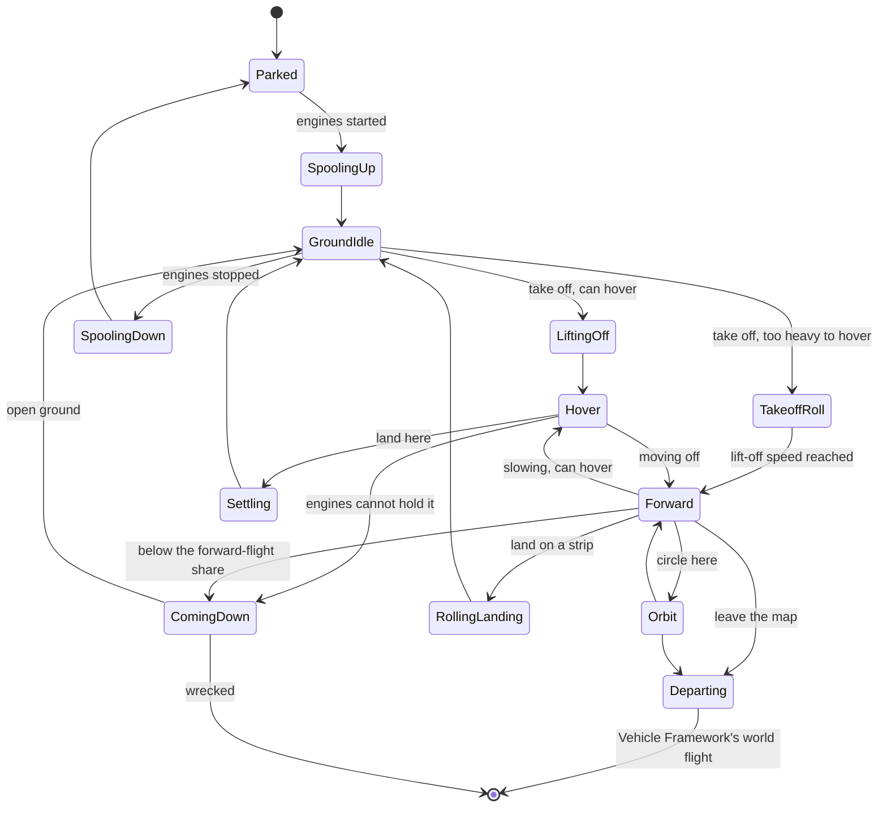

# Our own flight over the map: hovering, circling, leaving the ground rolling, and a cruising height (18 Nov 2026)

**Status (19 Nov 2026):** the hover half (slice 2) is built in D'thorga Framework 0.147.0, with the V-22 Osprey flying on it in
D'thorga Vehicles 0.71.0 ([what was built](#built-19-nov-2026-the-hover-half)); leaving and arriving in flight (slice 3) in Framework 0.149.0
([built](#built-19-nov-2026-leaving-and-arriving-in-flight)); leaving the ground rolling (slice 4) in Framework 0.151.0 and Vehicles 0.73.0
([built](#built-19-nov-2026-leaving-the-ground-rolling)); circling (slice 5) in Framework 0.153.0 and Vehicles 0.75.0
([built](#built-19-nov-2026-circling)); ropes and a hoist (slice 6's first half) in Framework 0.155.0 and Vehicles 0.77.0
([built](#built-19-nov-2026-ropes-and-a-hoist)); a raider's flight (slice 6's other half) in Framework 0.157.0 and Vehicles 0.79.0
([built](#built-19-nov-2026-a-raiders-flight)); the cruising height between tiles in Framework 0.141.0 and 0.142.0
([built](#built-18-nov-2026-the-cruising-height-and-phases-that-follow-the-hover)); stock helicopters on our flight, behind a setting that
starts off, in Framework 0.160.0 and Vehicles 0.81.0 ([built](#built-19-nov-2026-stock-helicopters-on-our-flight)). Not built: aeroplanes
that never hover, side-firing gun arcs and runs, and flying other authors' aircraft on ours (decided 19 Nov 2026: after our own
combat features, and only where the player turns it on, aircraft by aircraft; [the read and the decision](#read-19-nov-2026-other-authors-aircraft-on-our-flight)). Nothing here is tested in game (rows 199, 200, 204 to 211). The owner answered
its four questions the same day ([their answers](#the-owners-answers-18-nov-2026)). **Two code reads made before building
changed parts of the design**: where they differ, [what the reads found](#what-the-reads-before-building-found-18-nov-2026)
is the newer word.

The owner chose on 18 November 2026 that our aircraft fly over the map on flight code of our own, built on neither existing flight
mod: "We simply learn where we can from said, named, mods because I wish to go our own, more improved, route", designed for
hovering and circling together, with the hover half built first ([modern military vehicles](modern-military-vehicles.md), decision
2 and the fourteenth). This is that design: row MV1 in [outstanding work](outstanding-work.md). The same day the owner asked for
three engine gaps to be settled inside it, because all three belong to the flight model: **a rule for leaving the ground rolling**,
**flight phases that come from our own flight**, and **a cruising height between tiles**. The V-22 Osprey (MV3) and every later
aircraft of ours stand on this record; the Osprey's own figures are set in its own record, not here.

How to read this file: **[code]** read in code on 18 Nov 2026 by research helpers with `scripts/query-code.py`, never run;
**[P]** a primary source; **[S]** a secondary one; **[I]** our inference; **[A]** an authored gameplay choice. Owner choices, agent
defaults and agent recommendations are labelled as such. Other mods' code is described in our own words and never copied: neither
flight mod states a licence.

## Read this first

- **The aircraft stays an ordinary Vehicle Framework vehicle of the stock class**, spawned on the cell beneath it while it flies. A
  comp of ours moves it, draws it and keeps its state. No class of ours is ever the vehicle's, so a save never holds an aircraft
  whose class has left the game.
- **It needs about twelve new Harmony patches, none on a method every pawn calls**, and shares two we already ship for
  submarines. The first count here was five; the reads before building found seven more that are needed
  ([below](#what-the-reads-before-building-found-18-nov-2026)). The VTOL Vehicle framework applies 68; the Harrier with its
  bundled fixed-wing fork applies 129, several on methods every pawn calls.
- **The price of so few patches is four honest simplifications**, each said plainly below: eight headings (drawn turning smoothly);
  people beneath a hovering aircraft are slowed; line of sight is the ground's; a hovering aircraft shields the ground beneath it
  from blasts.
- **Three engine thresholds decide what an aircraft may do, all from the hover check that already exists**: it hovers at a margin of
  1 or more, flies forward down to its forward-flight share, and leaves the ground rolling down to its rolling share. One engine out
  falls out of the same three figures.
- **The rolling share comes from two published weights**, with nothing else authored: 0.89 for the Osprey, 0.67 for the Harrier.
- **A cruising height is one worked-out figure per leg, never saved.** It decides whether high ground can be crossed, what the
  flight costs in fuel and speed, and who needs oxygen. It can be built before any of the rest and serves every aircraft in play.
- **Circling is designed here and built second.** Until it is built, an aircraft too heavy to hover takes off rolling only as part
  of leaving the map.
- **The owner's four answers (18 Nov 2026):** stock helicopters may fly on it behind a setting that starts off; eight headings;
  people beneath a hover are slowed, with a setting; running dry in the air has real consequences.
- **Several textbook relations could not be read at their source** (the FAA's handbooks and Leishman's textbook refused automated
  reading on the day). They are marked unverified in [sources](#sources); the rules that lean on them are labelled as our own
  derivation or as authored.

## The owner's decisions this stands on

| Decision | Owner's words or pick | Where |
| --- | --- | --- |
| Whose flight code | Our own; learn from VTOL Vehicle and the Harrier's fork, build on neither, take ideas and never code | Modern military vehicles, decision 2 |
| What it must fly | Hovering and circling designed together; the hover half built first | The fourteenth decision |
| One aircraft for every player | No Def that exists only with another flight mod | Decision 3 |
| Armour and guns | Combat Extended first, Vehicle Framework the fallback; armed as the real machine | Decisions 1 and 4 |
| The three engine gaps | Written into this record | Owner, 18 Nov 2026 |
| Other factions | Every vehicle mechanic is designed with their vehicles in mind | AGENTS.md |

## What each behaviour lets, stops and changes

| Behaviour | Lets the player | Stops them | Changes how they play |
| --- | --- | --- | --- |
| **Flying over the map** | Lift off, move anywhere over the map, hold over a spot, land where the ground is clear, and fire the aircraft's guns from the air | Landing under a roof, on a building or on another vehicle; boarding, loading or repairing it in the air | An aircraft becomes something used on a map, not only a way between maps: it covers a landing, lifts a load, crosses a river |
| **Hovering costs the most** | Hold still over a spot for as long as the fuel lasts | Hovering heavy, hot or high: below a margin of 1 it sinks | Short hovers and quick work; a heavy aircraft keeps moving |
| **Forward flight is cheaper** | Stay in the air, moving, at a weight it could not hover at | Stopping | A crippled or heavy aircraft is flown, never parked in the sky |
| **Circling** (built in slice 5) | Fly round a spot until told otherwise, at a preset size and either way round; hold over a spot by circling when too heavy or crippled to hover | Circling tighter than it can turn; stopping still while it cannot hover | A heavy aircraft no longer has to leave at once: it can wait over the map while a strip is cleared or its load lightens |
| **Raiders by aircraft** (built in slice 6) | Nothing new to do: a raid may come in by air, put down outside the turrets, roped in close or as close as it can get, and the aircraft leaves | Keeping the aircraft: shot down or with its crew lost on the ground it is wrecked | Turrets and open ground near the colony matter in a new way: a landing zone beyond the turrets is where the raid starts, and an aircraft hovering to rope people in is a target worth the shooting |
| **Ropes and a hoist** (built in slice 6) | Put people down without landing, two at a time down fast ropes; lift one person aboard at a time, a downed one in a stretcher, or lower one, from a steady hover | Doing it while moving or circling, without the fitting, beyond the hoist's rated load, or onto roofed or built-on ground; whoever is on a line falls if the aircraft must come down | A rescue or a raid needs no landing spot, only open ground behind the ramp and a steady hover, which holds the aircraft low and still over the fight for as long as it takes |
| **Leaving the ground rolling** | Take off with a load too heavy to lift straight up, along a clear strip | Doing it without a strip, or beyond the rolling share | A strip at home is worth clearing; the far end of the trip decides the load |
| **A cruising height** | Climb over high ground; fly at the height the aircraft was built for and get its author's speed and range | Crossing a range higher than its ceiling at that weight; a high cruise with nobody on oxygen | Heavy loads and lost engines mean routes round the mountains; oxygen and a pressurised cabin earn their place |
| **Running the tank dry in the air** | Nothing: it is a consequence | Treating fuel as optional | The fuel line is watched; a forced landing costs the airframe and may cost the crew |
| **Beneath a hovering aircraft** | Nothing new | People standing under it; ground vehicles driving under it | Landing spots are kept clear, as real ones are |

## What was read

Three reads on 18 Nov 2026, each from code and nothing run.

### The game's own flying animals

RimWorld 1.7 gives every pawn a flight tracker, and a vehicle gets one too **[code]**. It is a flag, a draw offset, a speed
factor and a path grid the route search does not use. **It changes nothing about being shot, struck, burned or gassed**; only
traps ask it. Vehicle Framework never ticks it, and setting it on a vehicle risks a state that never clears. **Reused from the
game:** the Skyfaller and Shadows drawing layers, `Skyfaller.DrawDropSpotShadow`, and the roof helpers. Nothing else applies.

### Vehicle Framework 1.7

From its public source at commit `026420b5`, which matches the installed build 1.7.2537 **[code]**.

| Question | What the code says |
| --- | --- |
| Moving without its path follower | No supported way, but every piece is public: set the position and the eight-way rotation, then `ReclaimPosition()`, `ResetToCurrentPosition()` on the follower, and the path costs under the cells left |
| Cells an aircraft holds | Three registrations: the game's thing grid, Vehicle Framework's own claim, and a cost grid for its pathfinder. **A footprint cell off the map destroys the vehicle** |
| Standing on impassable cells | Nothing pushes a standing vehicle out; only spawning and starting a path relocate it |
| Walking beneath | The base vehicle Def is pass-through at a cost of 250, so people cross a vehicle's cells slowly and cannot stand in them |
| Drawing | `vehicle.Transform` takes any angle with no patch. Its position offset is applied twice to the body, three times to turret pictures and once to aim: **avoid the offset** |
| Rotors | `overlayRenderer.SetAcceleration` spins every rotor overlay; a comp's `PostDraw` runs each frame |
| Turrets | They tick whenever the vehicle is spawned, and fire while it moves; aim starts from the drawn position, the projectile from the cell |
| Being hit | Through the thing grid, by fill and not as a pawn. Every hit ends in `VehicleStatHandler.ApplyDamage` |
| Sitting still | After five hours without the follower moving, everyone aboard is put out; `ResetIdleTicks()` is public |
| Fuel on a map | Burned while drafted; at the idle rate when the follower is not moving |
| Leaving | `CompVehicleLauncher.Launch` starts its lift-off animation; `AerialVehicleInFlight.Create` and `OrderFlyToTiles` are public |
| Arriving | An arrival-mode Def may name a worker class of ours, which may place the vehicle itself |
| Its launch style | Strictly one per vehicle, and saved by class name: a subclass of ours would put our class in saves |
| What a comp can refuse | The stock move order and drafting (`CanMove`, `CanDraft`). It can add gizmos and threat, never remove them |

### The two flight mods

Both keep the aircraft spawned on the cell beneath it, as this design does. What each problem cost them, and what we take from it:

| Problem | How they solve it | What we do |
| --- | --- | --- |
| The vehicle's class | A class of their own, saving about fifty fields | A comp on the stock class, saving a handful |
| A free angle | Five patches so turrets aim from a continuous facing, and a hit box that no longer matches the picture | Eight headings; the picture turns smoothly between them |
| Walking beneath | Patches on `GenGrid.Walkable`, `GenGrid.Standable` and `Thing.BlocksPawn`, which every pawn calls, rescanning cells with no aircraft about | No patch: people are slowed beneath a hover |
| The shadow | Nine patches keeping a mask so the shadow hides under roofs and fog | A plain shadow on the game's shadow layer |
| Melee | Patches on target finding and on `Reachability.CanReach`, the costliest of all | The hit is refused where every hit already ends; nothing on target finding |
| Boarding and unloading in the air | Nine prefixes for one rule | One guard, at a place found before building |
| Flight as pawn jobs | Tripped the game's job-loop check; one helicopter mod resets that counter | Flight runs from the comp's tick, never a job |
| Leaving and arriving | Eight patches; players reported "Caravan Lost" on map changes (3 Oct 2026) | Two patches and an arrival mode; crew stay ordinary passengers throughout |
| Height | A drawn figure only, read by nothing | One height per aircraft that outcomes read |
| A blocked landing | Hovers with no timeout found | Climbs back, says why, and waits for a new order |
| Crashing | The crew step out unhurt | Running dry is the player's call and has real consequences |

**Kept from them, as ideas:** the landing checks, arriving at the map's edge on the side flown from, the orbit's steering (aim at
a tangent, corrected by the radius error), a go-around when the strip is blocked, and turning a hover so a named gun bears.

## The design

### The shape: a comp on a stock vehicle

- **`CompPhobosFlight`**, in D'thorga Framework's vehicle part, on any aircraft whose Def carries its properties. It ticks only
  between lift-off and touchdown (Vehicle Framework's tick-by-request), so **a parked aircraft costs nothing**.
- **`PhobosFlightDef`** holds what kind of flight an aircraft has: hover, circle or both; its speeds, turn rate and height; its
  strip. Hardware and tuning are XML, so another author gives a vehicle of theirs our flight by adding the comp in XML.
- **One seam for everything else:** `OnMapFlight` already answers "does this fly on the map, is it airborne, how far has it
  climbed" for the sling, the litter and the water bucket, by reading the two flight mods by name. Our comp becomes its first,
  direct answer. Everything that reads the seam works on our aircraft with no further change.
- **Game-free rules** go in the Framework's `Rules/` with tests: `FlightPathRule` (speed, turning, the orbit), `RollRule` and
  `CruiseRule`.

### Where it is

- **One true position**, a pair of decimals, moved each tick by the comp. The cell is derived from it. When the position enters a
  new cell the comp sets the vehicle's position and has Vehicle Framework reclaim its footprint.
- **The whole footprint stays on the map.** The true position is held inside the map less half the aircraft's longest side and one
  cell. It leaves only through the departure order.
- **Path costs:** the cells an aircraft leaves are worked out again at each step, so nothing stale is left behind; the cells it
  enters are worked out only once it settles into a hover. So a passing aircraft slows nobody, and a hovering one slows the people
  beneath it **[A]**.
- **Every 250 ticks** it resets Vehicle Framework's idle count, so nobody is put out of an aircraft for sitting in a hover.

### Eight headings, drawn smoothly

Vehicle Framework gives every vehicle eight headings, and its turret arcs, hit boxes and muzzle positions are all worked out from
them **[code]**. **The aircraft's heading is one of those eight.** The picture turns smoothly from one to the next through
`vehicle.Transform`, a few ticks behind the true turn, so it never snaps. In an orbit the position follows a true circle, the
heading is the nearest of eight, and the drawn angle is the true one.

- **What it costs:** a gun's arc is worked out up to 22.5 degrees away from the picture. A side-firing gun's arc is written wide
  enough to cover that.
- **What it saves:** five patches on turret aiming, a copy of Vehicle Framework's firing code that would drift with every update
  of it, and a hit box that disagrees with the picture.

**Decided: eight headings** (owner, 18 Nov 2026, the agent's recommendation).

### How it is drawn

- **Body:** where it is, with no sideways offset, on the Skyfaller layer so it draws over buildings, people and smoke and under
  weather. How the layer is reached without Vehicle Framework's uneven offset is the first thing to prove
  ([below](#to-read-or-prove-before-building)).
- **Height shows in the shadow.** A plain shadow on the game's shadow layer slides away from the body and shrinks as the aircraft
  climbs, drawn from the comp's `PostDraw`. The body grows a little with height, as both flight mods' do **[A]**.
- **Rotors** spin through Vehicle Framework's own rotor overlays, driven by the engine model's speed.
- **One height per aircraft** (`flightHeightMetres`, authored), reached as it climbs. It is read by the sling's strop, the time a
  rope or hoist takes, and Combat Extended's shot heights. It is shown in Engineer mode only.

### States

Orbit and the hold for an aircraft that cannot hover belong to the circling half. An aircraft arriving from the world map enters
at Forward.

### What keeps it up: three thresholds from one check

The engine model already works out a hover margin for any aircraft, at its weight, in the day's air, with the engines it has left
(`Powertrain.HoverCheck`; 1 means just enough). This design reads that one figure three ways:

| The aircraft may | While its hover margin is at least | Whose figure |
| --- | --- | --- |
| Hover, lift off straight up, settle straight down | 1 | The engine model, built |
| Stay in the air moving forward | Its **forward-flight share** (0.6 **[A]**) | Authored per flight profile; the real basis is below |
| Leave the ground rolling | Its **rolling share** (0.89 for the Osprey, 0.67 for the Harrier) | Worked from two published weights ([below](#leaving-the-ground-rolling)) |

**The real basis.** A rotor moving forward through air needs less power than one hovering in it; pilots feel the change as
"effective translational lift (ETL) at about 16 to 24 knots" **[S]**. That a rotor's power need falls to a minimum at a moderate
forward speed is standard helicopter theory; the textbook page could not be read, so **the 0.6 is authored**, not sourced.

**What follows from it:**

- **A heavy or hot-and-high aircraft keeps moving.** Slowing below its hover speed with a margin under 1 is refused: it holds its
  speed and says why.
- **One engine out** on a twin halves what the engines give. An Osprey at a middling weight then has a margin near 0.55 to 0.65:
  light, it stays in forward flight and must land rolling; heavy, it comes down. That is the modern military record's "it must land
  rolling on a strip, or drop its load", now from figures.
- **An engine lost in a hover** takes the margin below 1 at once, and the aircraft comes down where it is.

### Orders

Flight runs from the comp's tick and never as a pawn job. Orders are few, each with its own icon, each saying what it did and each
refusal saying why:

| Order | How it is given | What it does |
| --- | --- | --- |
| **Take off** | A button, on the ground with engines running | Lifts straight up when it can hover; otherwise asks for a strip |
| **Fly here** | Right-click on the ground, through the game's own right-click menu providers | Flies to the spot and holds there if it can hover |
| **Land here** | A button, then a spot and a heading | Checks the footprint, descends; on a strip when it cannot hover |
| **Cover that** | A button, then a target or spot | Turns the hover so the named gun bears, looked at again every 30 ticks |
| **Circle here** | A button, then a centre; radius and direction by preset buttons | The circling half |
| **Leave the map** | Vehicle Framework's own launch button and destination picker | Flies to the edge and hands over to its world flight |

While airborne the comp answers Vehicle Framework's `CanMove` with no, so its ground "go here" order and its path follower never
drive a flying aircraft. On the ground the aircraft taxis as any vehicle does.

### What is beneath it

- **People** cross beneath a hovering aircraft slowly and cannot stand there. This is Vehicle Framework's own rule for any
  vehicle's cells, kept because it suits: the real Osprey's downwash is over 80 knots **[S]**. A passing aircraft slows nobody.
  **Decided: slowed, with a setting to switch the slowing off** (owner, 18 Nov 2026, the agent's recommendation).
- **Ground vehicles** go round the spot beneath a hover, as they go round any vehicle.
- **Roofs:** no take-off or landing with a roof over any footprint cell. Flying over a roofed building or a mountain is free.
- **Fog:** flying over hidden ground is allowed and reveals nothing.
- **Landing needs** every footprint cell on the map, seen, unroofed, free of buildings and impassable ground, and not claimed by
  another vehicle. A descent that finds its spot blocked climbs back to the hover, says why, and waits for a new order.
- **Blasts:** Vehicle Framework treats the inside of a vehicle's footprint as blocking a blast **[code]**, so a hover shields the
  ground beneath it. Accepted at first; one patch on its rarely run blast step would change it.
- **Traps:** an aircraft of another faction passing over a trap may spring it. The hit is refused (below), but the trap is spent.
  Accepted at first.

### Being shot at, and shooting

- **It is an ordinary target on the cell beneath it.** Every gun that could hit a vehicle standing there can hit it in the air, by
  Vehicle Framework's own parts and hit boxes. Nothing of ours touches targeting.
- **Line of sight is the ground's**, both ways: a wall between a shooter and the aircraft blocks the shot. Both flight mods do the
  same. A real aircraft would see over the wall; this is a simplification, said in the README when built.
- **Melee and anything else that cannot reach it is refused** where every hit on a vehicle already ends
  (`VehicleStatHandler.ApplyDamage`), in the prefix we already ship for submarines, which already runs before Combat Extended's.
  One rule in the Framework, "what can reach this vehicle now", serves a hull that is under and an aircraft that is up.
- **A limit to watch:** raiders with only melee weapons may gather beneath a hover and do nothing. Changing who they choose means
  patching target finding, which every pawn calls; not proposed unless play shows it matters.
- **Its guns** tick, aim and fire as on the ground, because the vehicle is spawned. A crewless armed aircraft says it is a threat
  through Vehicle Framework's own comp hook.
- **Combat Extended** takes a shot height and has a height band for what a shot can hit. Our one height figure feeds both; how is
  a read still to do.

### Crew, cargo and work on it

- **The crew stay ordinary passengers of an ordinary spawned vehicle** throughout, so the colonist bar, the "everyone is gone"
  check and the map's keep-open rule see them as they see any crew.
- **Nobody boards, steps out, loads, unloads, repairs or refuels it in the air.** One guard: the prefix on `DisembarkPawn` we
  already ship for submarines takes the same rule, and the boarding and work-giver ends are found before building.
- **Ropes and a hoist** are that guard's exception, a later slice: going down a rope takes time by the flight height, one person
  at a time, and needs the fitting.
- **Stopping the engines in the air** cannot be refused through Vehicle Framework **[code]**, so the comp starts them again at
  once and says the engines cannot be stopped in the air.

### Leaving the map and arriving

- **Leaving.** Vehicle Framework's own launch button and destination picker are kept, so every arrival choice it offers still
  shows. A prefix on `CompVehicleLauncher.Launch`, for aircraft with our flight only, keeps the destination and arrival action
  and skips Vehicle Framework's lift-off animation. Our flight then takes off if it is on the ground, flies to the map's edge on
  the side of the destination, and hands over through Vehicle Framework's public `Create` and `OrderFlyToTiles`. The order is
  saved, so a save made on the way out loses nothing.
- **Arriving on a map we choose a spot on.** A prefix on Vehicle Framework's land-at-a-cell arrival, for our aircraft only, puts
  the aircraft on the map at the edge it flew in from, already flying, with a landing order for the chosen spot.
- **Arriving on a map being attacked.** An arrival mode of ours, a Def with our worker, puts it at the edge flying and holding,
  for the player to order. No patch.
- **The landing check at a journey's end** (Framework 0.140.0) stands down for an arrival onto a map, where the three thresholds
  judge the landing as it happens. It still judges a landing as a caravan, where there is no map.
- **Both prefixes skip the original, and must:** Vehicle Framework offers no way to launch without its animation or to arrive
  without landing. Each skips only for an aircraft carrying our comp.

### When the engines stop in the air

Vehicle Framework stops a vehicle's engines when its tank is empty **[code]**. In the air that is a forced landing:

- **Over open ground** it comes down where it is. The undercarriage and airframe take damage by how far short of a hover it was,
  and everyone aboard is hurt a little **[A]**.
- **Over a building, impassable ground, another vehicle or deep water** it is wrecked through Vehicle Framework's own destruction,
  which leaves its wreck and deals with the crew as any destroyed vehicle's.
- **Moving forward above its forward-flight share with engines still running** it is not coming down: it flies on to a strip.

This follows the owner's standing rule that an explicit order has real consequences. **Decided as written** (owner, 18 Nov 2026,
the agent's recommendation).

### Circling (designed now, built second)

- **The orbit:** a centre the player picks, a radius and direction by preset buttons, never tighter than the aircraft can turn.
  It steers at the tangent, corrected by how far off the radius it is.
- **The tightest circle** follows from speed and bank: a turn's radius is the speed squared over gravity times the tangent of the
  bank angle. That is the physics of any circular motion **[I]**; the FAA's printed form of it could not be read. In the Def it
  is two authored figures, the orbit speed and the tightest radius in cells, and a Def whose orbit is tighter than its turn is a
  config error.
- **Holding:** an aircraft that cannot hover circles where a hovering one would hold. This is what frees a rolling take-off from
  having to leave the map at once.
- **Guns:** a side-firing gun bears on the centre all the way round. The gunship circles a target and "performs a pylon turn,
  flying in a large circle around the target" **[S]**.
- **Runs** (a straight pass through two points, for bombs or guns) are a path this design provides and nothing more; what is
  dropped or fired belongs to the aircraft's own record.
- **Aeroplanes** have no hover at all: they take off and land only on a strip, by the [strip rule](#aeroplanes-that-never-hover).

## Flight phases for the engine model

The engine model samples an aircraft once a second, asks its flight profile's reader which phase it is in, and takes that phase's
demand (`Powertrain.SampleAircraft`). Today's two readers find another mod's flight state by name. **Our flight needs no lookup:**
`PhaseReader_OwnFlight`, a subclass of the existing `PhaseReader`, reads the comp's state. The class was written to be subclassed.

| Our state | Phase | Demand on the engines |
| --- | --- | --- |
| Parked | (none) | Engines off |
| Spooling up, spooling down | `SpoolingUp`, `SpoolingDown` | Authored, as today's profiles |
| Ground idle, taxiing | `Idle`, `Taxi` | Authored, as today's |
| Lifting off, hover, settling | `Hover` | **The hover check's own figure** (weight, air, engines left), as today's hover phases |
| Take-off roll | `TakeoffRoll` | The top rating |
| Forward, orbit | `Forward` | The hover figure times the forward-flight share, so it follows weight and air too |
| Rolling landing | `RunwayLanding` | Authored |
| Departing | `Departing` | Authored: a climb |
| Between tiles | `WorldFlight` | Authored: the cruise, read from Vehicle Framework's own flag as today |
| Coming down | (none) | Engines off or failing |

- **Fuel on a map needs nothing new.** Vehicle Framework burns its idle rate for a drafted vehicle that its follower is not
  moving. The correction built in Framework 0.132.0 reads what the tank lost and burns or hands back the difference, so each
  phase burns what its demand asks. The profile names no other mod's rate.
- **Hovering is the thirsty part by itself:** its demand is the highest of the airborne phases.
- **New in the profile:** `forwardFlightShare` and `rollingShare`, beside `hoverPowerAtMaxGross`.
- **A tiltrotor's profile** is then XML: rotor-borne phases on the map, a wing-borne cruise between tiles. On the map its
  nacelles are upright and it flies as a helicopter, as the modern military record's agent default has it.

## Leaving the ground rolling

### The real basis

Aircraft that can hover publish two take-off weights:

| Aircraft | Straight up | Rolling | Source |
| --- | --- | --- | --- |
| V-22 Osprey | 52,600 lb (23,859 kg) | 57,000 lb (25,855 kg), short rolling take-off | **[P]** Bell Boeing's 2007 pocket guide, as read for the modern military record |
| AV-8B Harrier II Plus | 20,755 lb (9,415 kg) | 31,000 lb (14,100 kg) | **[S]** Wikipedia's specifications, citing Nordeen, Boeing and Airforce-technology.com |

### The roll rule

`RollRule`, game-free, from the hover margin alone:

1. **Margin 1 or more:** it lifts straight up. No strip.
2. **Margin between the rolling share and 1:** it needs a strip. The strip's length runs in a straight line from the aircraft's
   shortest roll at a margin of just under 1 to its full roll at the rolling share **[A: the straight line]**.
3. **Margin below the rolling share:** it cannot leave the ground. The refusal names the limit and how much lighter it must be.

**The rolling share is worked out, not chosen [I]:**

- **Rotors.** Hover power rises with weight to the power of 1.5 (momentum theory, the rule the hover check already uses). The
  same engines lift 57,000 lb rolling and 52,600 lb straight up, so rolling needs (52,600 ÷ 57,000) ^ 1.5 = **0.886** of the
  hover's power at any one weight.
- **Jets held up by thrust.** Thrust needed is the weight, so the share is the plain ratio: 9,415 ÷ 14,100 = **0.668**.
- Whether each published weight is set by power or by the airframe's strength, its source does not say. We fit one figure to
  both and say so.

Worked for a full roll of 20 cells and a shortest roll of 5 (**illustrative: the Osprey's own record sets them**):

| Hover margin | What happens | Strip |
| --- | --- | --- |
| 1.05 | Lifts straight up | None |
| 0.97 | Rolls | 9 cells |
| 0.94 | Rolls | 13 cells |
| 0.91 | Rolls | 17 cells |
| 0.886 | Rolls, at the limit | 20 cells |
| 0.85 | Refused | |

Because the margin already holds weight, heat and height, so does the strip. With engines that just hover the straight-up weight
at the sea, the same aircraft just hovers 0.89 of it at 1,000 m and 0.80 at 2,000 m, and rolls with 0.97 and 0.86 of it (our
arithmetic from `AirRule`, at the standard temperature for each height). **A high base is where a strip earns its keep.**

### The strip

- **A straight run of cells ahead of the aircraft**, along one of its eight headings, as wide as its footprint.
- **Every cell** must be on the map, seen, unroofed, free of buildings and impassable ground, and not claimed by another vehicle.
- **No built floor is asked** unless the aircraft's Def says so (`needsBuiltFloor`). The Osprey's gear is built for rocks, sand,
  grass and snow **[P, guide]**; a jet would say yes.
- **Choosing it:** the take-off order shows the strip ahead as the game shows a placement, clear cells and blocked ones, with the
  length needed. A blocked cell names what blocks it.
- **During the roll** the strip is looked at again every 30 ticks. Blocked before lift-off speed, the aircraft brakes and stops.
- **Landing rolling** uses the same strip rule, at the full roll **[A]**, and costs the undercarriage the wear already built for
  a rolling landing (`RunOnWearShare`). An aircraft that cannot hover and finds no strip may be ordered down anyway: that is a
  forced landing, with its damage.

### Aeroplanes that never hover

Designed for the circling half, not built with the hover half. An aeroplane's profile judges no hover, so its strip comes from
weight and air directly:

- **Strip = its roll at maximum weight × (weight ÷ maximum weight)² ÷ (air density ratio)²** **[I]**.
- **Our derivation:** lift-off speed squared follows weight over density; acceleration follows thrust over weight; the roll is
  speed squared over twice the acceleration; a turbine's thrust follows density. So the roll follows weight squared over density
  squared. Pilots are taught the weight half as "10 per cent more weight, about 21 per cent more runway"; the FAA page that
  prints it could not be read, so it stands here as unverified.

### The lift check at launch

The lift check built for Vehicle Framework's own launch (`liftCheckAtLaunch`) refuses a launch the engines cannot lift. For an
aircraft with our flight it asks the roll rule: it refuses only below the rolling share, and between the two it says the
aircraft needs a strip and how long.

## A cruising height between tiles

Today a flight between tiles keeps the air of the tile it left. The altitude record lists "a flight's own cruising height" as
not built. This is its design. **It does not depend on flight over the map**, and serves the Harrier, the helicopters and the
pods as well as our own aircraft.

### The cruise rule

`CruiseRule`, game-free. For each leg of a journey:

1. **The highest ground on the leg**, found by walking the tiles from one end to the other, each step to the neighbour nearest
   the far end, reading `TileAir.ElevationMetres` **[I: the tile walk]**.
2. **The clearance:** 300 m, and 600 m where that ground is mountainous **[A]**, after the United States' instrument-flight rule
   of "1,000 feet above the highest obstacle" and "2,000 feet" in mountainous areas **[P, 14 CFR 91.177]**.
3. **The ceiling now**, from the aircraft's published ceiling, its weight and the engines it has left (below).
4. **The oxygen line:** 3,050 m while anyone aboard lacks oxygen in a cabin that is not pressurised **[A, from S]**. Of the
   Osprey: "The fuselage is not pressurized, and personnel must wear on-board oxygen masks above 10,000 feet" **[S]**.
5. **The height flown** is the aircraft's design cruise height, brought down to the ceiling and the oxygen line, and never below
   the ground plus its clearance.
6. **If the ground plus its clearance is above the ceiling, the leg is refused** in the destination picker, saying it cannot
   climb over the high ground at this weight, and by how much it must lighten or that it must route round.

### The ceiling now

A published ceiling is where the engines' falling output meets what level flight needs. Turbine output follows pressure (built);
the power level flight needs rises as density falls, as the hover rule's does. So the ceiling sits where pressure ratio × √(density
ratio) falls to a figure fixed by the published ceiling, scaled by weight to the power of 1.5 and by the share of engines working
**[I: our fit, in the model's own terms]**.

A check against the Osprey (published ceiling 7,620 m **[P]**):

| Case | The rule gives | Published |
| --- | --- | --- |
| Both engines, full weight | 7,620 m (the fit) | 7,620 m |
| One engine, full weight | 4,000 m | 3,139 m (guide), 2,896 m (Bell), 2,865 m (fact sheet), weights not stated |
| One engine, 0.8 of full weight | 5,800 m | |

**It reads about a quarter high on one engine.** The published figures leave room to climb and do not state their weight. If
play shows it matters, an authored one-engine ceiling per aircraft is the simple fix; not proposed now.

### What reads the height flown

| What | Rule | Standing |
| --- | --- | --- |
| **Crossing high ground** | Step 6 | New |
| **Fuel and speed, wing-borne jets** | Flown lower than its design height: fuel × √(density flown ÷ density at design), speed × the inverse | Direction and shape from the textbook relation between true and equivalent airspeed **[S]**; the fuel half is the jet range relation, **unverified** here |
| **Fuel and speed, wing-borne shaft turbines** (a tiltrotor, a turboprop) | The same with the power 0.25 | **[A]**: a propeller gains less from height than a jet |
| **Fuel, rotor-borne** | Flown higher than its design height: fuel × √(density at design ÷ density flown); speed unchanged | Momentum theory, as the hover rule |
| **Oxygen** (avionics A14, built) | The height flown against the oxygen line replaces today's fixed "cruises high" flag | A change to built, untested code |
| **The cold cockpit** (avionics A15, not built) | Outside air is the tile's temperature less 6.5 °C for each 1,000 m above it | The standard atmosphere's lapse rate, already in `AirRule` |
| **Lift and landing checks** | Unchanged: they read the air of the tile left and the tile reached | Built |

At its design height an aircraft's factors are exactly 1, so **its author's speed and range hold for a sound aircraft flown as
intended**, as the fuel work of Framework 0.132.0 already promises.

Worked (standard atmosphere):

| Aircraft, design height | Flown at | Why | Fuel | Speed |
| --- | --- | --- | --- | --- |
| A jet, 7,000 m **[A]** | 3,810 m | Nobody on oxygen | × 1.19 | × 0.84 |
| A tiltrotor, 4,600 m **[A]** | 3,050 m | Troops in the cabin without oxygen | × 1.04 | × 0.96 |
| A tiltrotor, 4,600 m | 1,000 m | One engine, heavy | × 1.10 | × 0.91 |
| A helicopter, 1,000 m **[A]** | 2,500 m | Crossing a range | × 1.08 | × 1 |
| A helicopter, 1,000 m | 4,300 m | Crossing the owner's highest ground | × 1.18 | × 1 |

- **The jet's row is today's built figures.** Avionics A14 slows a jet without oxygen to 0.85 and raises its fuel to 1.2. With
  the Harrier's design height authored at 7,000 m the rule gives 0.84 and 1.19, so nothing the owner has installed changes.
- **The tiltrotor's 4,600 m** is where the Osprey's published top speed is given: 305 knots "at 15,000 ft" against 275 at the sea
  **[S]**.

### Candidly: how often it will matter

On the owner's world a tenth of the land stands above 1,500 m, about a hundredth above 2,500 m, and the highest tile is 3,968 m
([world elevation](world-elevation-and-descents.md)). A sound helicopter clears nearly all of it. **High ground will stop an
aircraft only when it is heavy or has lost an engine, over the few great ranges.** The everyday effects are the oxygen line and
the cost of flying low, and those are small for anything but a jet. If that proves too faint in play, the oxygen line is the part
worth keeping.

### Where it is worked out

- **In the destination picker**, in the postfix we already have on its target check, so a refusal and the height show before
  launch; and **at launch and at each waypoint**, in the prefix we already have on the flight path.
- **Nothing is saved.** The factors are kept per aircraft for the leg it is on and worked out again when asked after a load.
  Vehicle Framework asks for the fuel multiplier we already patch, and reads flight speed through a stat our systems already
  scale; no new patch.
- **What it shows:** the launch screen says the height and what holds it down. Plain mode says it in words ("flying low:
  slower and thirstier"); Engineer mode gives the metres and the factors.

### Built (18 Nov 2026): the cruising height and phases that follow the hover

At the owner's word ("proceed with both cruising height and engine phases", 18 Nov 2026), D'thorga Framework 0.141.0 and D'thorga
Vehicles 0.66.0; **not yet tested in game** (rows 199 and 200). Where it differs from the design above:

| Part | As built | Where |
| --- | --- | --- |
| The rule | `CruiseRule` in the core, game-free and tested against this record's worked tables (the jet's 1.19 and 0.84, the tiltrotor's and helicopter's rows, the Osprey's 4,000 m on one engine) | `src/PhobosFramework/Rules/CruiseRule.cs` |
| The ground | `TileAir.HighestOnLeg`: the walk as designed, its highest tile and its highest mountainous one, so the clearance is taken per tile (the highest of ground plus 300 m and mountains plus 600 m) | `src/PhobosFramework/WorldMap/TileAir.cs` |
| The figures | A `cruise` block on the loadout (the aircraft's own) or the flight profile (shared): design height, published ceiling, lift (rotor, jet, propeller), oxygen line, pressurised | `PowertrainDefs.cs`, `SystemDefs.cs` |
| **The oxygen line** | **3,810 m (12,500 ft, 14 CFR 91.211) by default, an aircraft's own where it has one.** The record's step 4 said 3,050 m while its jet row used 3,810 m; the agent took the jet row's figure as the default and kept 3,050 m for an aircraft whose source gives it (the Osprey's, when its Def is written). Agent's choice | `CruiseRule.DefaultOxygenLineMetres` |
| Who needs oxygen | Flesh aboard, unless the cabin is pressurised: the crew are covered by a working oxygen set; passengers (seats that neither drive nor man a weapon) never are. Agent's simplification | `CruiseHeight.OxygenLine` |
| Per leg | Worked out when Vehicle Framework first asks for the leg's speed (as each leg begins) and kept for that leg; nothing saved. Fuel through the world-flight multiplier every tick, speed through flight speed once per leg, each a postfix of its own beside the sling's | `CruiseHeight.Current`, `CruiseHeightPatches.cs` |
| The picker | Vehicle Framework prices a journey at one rate; a postfix on its update prices it leg by leg (weight less the fuel the legs before burn), so the fuel shown, "not enough fuel" and the line's colour follow the heights. A refused leg fails the target with how many kilograms to shed, or "fly round" where even the empty aircraft could not | `CruisePicker` |
| **A leg beyond the engines in flight** | **Flown, struggling, at the height the ground asks, with a message.** The design refuses it in the picker and said nothing for one found in flight (an engine lost on the way). Agent's choice; a forced landing is the alternative | `CruiseHeight.Begun` |
| The oxygen set's fixed figures | Stand only where the cruising height does not govern the aircraft (a new condition, `When_CruiseHeight`, inverted) | `Systems_Avionics.xml` |
| Air defence | The Dead Man's Switch's track reads the leg's height where it governs | `AirCombat.TrackCruiseMetres` |
| Who has figures | The Harrier (7,000 m, 15,240 m published, read as 11,000; jet), the Hind (1,000 m, 4,500 m; rotor), the Mongoose (1,000 m, 4,725 m; rotor); the shared helicopter profiles (1,000 m, 4,500 m, authored); the stock aeroplane profile (3,000 m, 8,000 m, propeller, authored). Pods none: their thrusters do not breathe air | the loadouts, `FlightProfiles.xml` |
| The setting | **Cruising height between places**, on | vehicle systems settings |
| **Phases that follow the hover** | A phase marked `followsHover` asks its authored demand at the heaviest weight in sea-level air at 15 °C and moves from there as the hover figure does (`TurbineModel.FollowHover`). The VTOL helicopter profile's on-station and climbing-away phases use it. The authored figure stays the one the on-map fuel rate stands for. It is the design's "the hover figure times the forward-flight share" in a form that works today: a forward phase of our own flight is the same flag with the demand written as the hover figure times the share | `PowertrainDefs.cs`, `Powertrain.SampleAircraft` |

**The owner's answers to the build's four questions (19 Nov 2026), built in Framework 0.142.0** (not yet tested in game):

| Question | Answer | As built |
| --- | --- | --- |
| The oxygen line | **3,810 m by default** (owner); an aircraft's own where its source gives one | Unchanged |
| Who has oxygen | **Passengers only with a cabin oxygen fitting** (owner) | `PhobosFitting_CabinOxygen` on a cabin oxygen panel appended to every aircraft (one fitting to a part, so it never competes with the litter kit): 20 steel, 3 components, 15 kg, 3 A while the engine runs (`feed`: its load and the engine). Working, nobody aboard needs the line. **It changes nothing in play yet**: only the Harrier cruises above the line, and it seats one; it is for the Osprey |
| A leg too high in flight | **Struggle across; and where a twin still has the power, limp back** ("It's all about the dynamic and memorable stories you generate") | `CruiseRule.AfterEngineLost`: at the 250-tick look in flight, an engine lost since the leg was judged splits the leg where the aircraft is (`TileAir.WalkLeg`, Vehicle Framework's `transition`). On if the engines left clear the ground ahead; back to set down as a caravan at the stop it left if they clear the ground crossed and that stop is open land (`CargoRefuel.NoLandingReason`); else across. Speed follows at once (Vehicle Framework's `SetSpeed`, by name) |
| The no-drag rule | **Keep it** as a second exception | Written into `src/PhobosFramework.Vehicles/AGENTS.md`: height alone, never a fitting, accessory, load or upgrade |

**What the one-engine ceiling comes to** (the rule's fit, worth knowing in play): a helicopter with a 4,500 m published ceiling climbs to
about 580 m on one engine at its heaviest and about 2,500 m at 0.8 of it. A heavy twin that loses an engine over any high country
usually cannot fly on; light, it often can.

**Other factions' aircraft:**

| Where | The cruising height | Phases that follow the hover |
| --- | --- | --- |
| **A raid on us** | Nothing: their aircraft do not fly journeys between tiles | A VTOL helicopter of theirs on station works its engines by its load and the air, for heat and wear; its fuel is untouched, as all their aircraft fuel is |
| **Parked at a base we attack** | Nothing | Nothing: parked, its engines do not run |
| **One we capture** | Governs it from its first journey as ours, as any of our aircraft | As in a raid, with our fuel rules once it is ours |
| **Cost with several** | One leg's walk per journey leg of ours, kept for the leg; nothing per tick but a table lookup | One more hover figure per aircraft sample (once a second) |

**Not built, and why:** `PhaseReader_OwnFlight`, the forward-flight and rolling shares and the three thresholds. Each reads or
decides something only our own flight does (its state; whether it may stop, fly on or roll), so they come with the hover half
(slice 2) rather than as fields nothing reads.

## Built (19 Nov 2026): stock helicopters on our flight

At the owner's word ("Yes, please", 19 Nov 2026, to building it), D'thorga Framework 0.160.0 and D'thorga Vehicles 0.81.0; **not
yet tested in game** (row 211). As [designed](#stock-helicopters-on-our-flight), with these differences and choices:

| Part | As built | Where |
| --- | --- | --- |
| Which | The Cherokee and the Louie (Vanilla Vehicles Expanded - Tier 3) and the Mosquito (Vanilla Vehicles Expanded), each in a patch file that loads only with its mod. The thrust pods are left out, as designed | `Flight_VanillaVehiclesExpandedTier3.xml`, `Flight_VanillaVehiclesExpanded.xml` |
| **Idle while off** | The comp carries `onlyWithStockSetting`; while the setting is off it answers for nothing (no buttons, no strip, none of our patches act), so Vehicle Framework flies it as before. One already in the air finishes its flight on ours whatever the setting | `CompPhobosFlight.Active`, `FliesOnOurs` |
| Their engines | The shared stock helicopter profile reads our flight's hover and forward phases while it answers, and the members it read before otherwise, so the Ka-27 and Mi-38 sharing it are unchanged. Forward demand 0.51 (its hover figure 0.85 times the forward-flight share 0.6, as the Osprey's) | `PhaseReader_OwnFlightOr`, `FlightProfiles.xml` |
| **Their speeds** | **A floor of 4 cells a second** (agent's choice): the Osprey's ratio of map to world speed (7 to 17.5) would give the Cherokee 1.8, slower than a person walks. The Louie 4, the Mosquito 4.2. Turn rates, climb, descent, flight heights (60, 50 and 40 m) and tightest circles authored by kind, each circle above what its turn allows | the patch files |
| What they lack | No rolling take-off (their profile gives no rolling share), no ropes or hoist (no mounts offered), nothing marking them for raiders | |
| Over hidden ground | Drawn over it, as the Osprey; the cost accepted: one parked on unseen ground at a base the player attacks shows through the fog | `seeThroughFog` |
| The sling | The load is taken as the helicopter sets off for another place, as for the Hind; and since Framework 0.161.0 it can be lifted and set down from a hover on the map ([the sling record](vehicle-sling-design.md#built-19-nov-2026-lifting-and-setting-down-from-a-hover)) | `CompPhobosSling` |
| The landing-surface rule | Applies to them as to every aircraft on our flight (Framework 0.159.0), on the engine roles they have | `LandingSurface` |

## Built (19 Nov 2026): a raider's flight

At the owner's word ("Proceed with slice 6's other half, a raider's flight", 19 Nov 2026), D'thorga Framework 0.157.0 and D'thorga Vehicles
0.79.0; **not yet tested in game** (row 210). Prior art read first: VTOL Raids (potemkinvillager, on the owner's list) already adds its
aircraft to raids of 2,500 points and more, but flies them on VTOL Vehicle's flight, so it cannot fly ours.

**The owner's four answers (19 Nov 2026), asked before building:**

| Question | Answer | Where it shows |
| --- | --- | --- |
| Its role in a raid | **It brings the raiders, then leaves**: free transport, as drop pods are, so raid points are unchanged | `PawnsArrivalModeWorker_PhobosAirAssault` |
| Where it puts them | **"A mix of all three, pseudorandomly generated"**: outside the turrets, roped in close, or as close as it can | `RaidLandingRule.Choose` |
| On from the start? | **On, with a setting** ("Raiders may arrive by aircraft") | `VehicleSystemsSettings.raidersArriveByAir` |
| Keeping it | **A wreck, never yours**: shot down it is wrecked; with its crew lost on the ground its raiders wreck it | `ForcedLanding`, `Scuttle`, the claim order |

| Part | As built | Where |
| --- | --- | --- |
| **How a raid gets it** | **One of the game's own arrival modes** (`PhobosAirAssault`), offered to the two "attack at once" raid strategies, plain and smart; not staging, siege or sapper raids, which plan from the edge. No Harmony. Industrial factions or better, humanlike, with an aircraft of ours marked for raiders (`PhobosRaiderAircraftExtension`, the Osprey's). Weight authored: none below 1,000 points, to the game's own drop pods' 0.3 at 4,000. Allies sent to help (the friendly strategy inherits the plain one's list) may come the same way | `AirAssault.xml`, `RaiderFlight.AircraftFor` |
| The aircraft | Made for the raiding faction by Vehicle Framework's own generator, fuelled, flown by two of the faction's people who are not part of the raid. Raiders fill its seats; up to three aircraft a raid (authored, as VTOL Raids' limit); whoever does not fit walks in from the same edge. They come in side by side, 12 degrees apart (authored) | `RaiderFlight.Launch` |
| The three ways | By chance, 0.5, 0.3 and 0.2 (authored): **outside the turrets** (each colony turret's weapon range plus 4 cells; a turret whose weapon cannot be read counts 25), **roped in close**, **as close as it can**. Each takes the spot nearest the colony's middle (its buildings' mean) it will take, between 6 and 60 cells out, from 400 random candidates; landings face the colony. Raiders know the ground, so unseen ground is no bar | `RaiderFlight.FindZone`, `RaidLandingRule.Score` |
| Down | Landed, its raiders step out two each half second and it lifts off. Roping uses the ropes of slice 6's first half, with or without the fitting. A spot taken from under it is tried again, three times, then it ropes them down where it is | `RaiderThink`, `Unload` |
| Gone | Back the way it came, off the edge it came over: its crew and anyone still aboard go home with it | `Leave`, `Vanish` |
| Never a prize | Shot down it is always a wreck, even over open ground; its crew lost (killed, downed) in the air brings it down, on the ground makes its raiders wreck it; the claim order refuses it | `ForcedLanding`, `RaiderThink`, `VehicleClaims.Refusal` |
| Saved | Its plan: the way, the stage, the tries, the edge point it leaves by | `PhobosFlight_Raider` |
| Its raiders | Join the raid's own orders as they step out, as drop-pod raiders do from their pods: the game makes the raid's orders after they arrive, holding them aboard | The game's raid |

**Not built:** a raiders' aircraft that stays to fight (the owner's answer: it leaves); aircraft at a base the player attacks still stand
parked as Vehicle Framework places them.

## Built (19 Nov 2026): ropes and a hoist

At the owner's word ("Proceed with slice 6, ropes and a hoist", 19 Nov 2026), D'thorga Framework 0.155.0 and D'thorga Vehicles 0.77.0;
**not yet tested in game** (row 209). A raider's flight, the slice's other half, is not built.

**The owner's four answers (19 Nov 2026), asked before building:**

| Question | Answer | Where it shows |
| --- | --- | --- |
| A downed person on the hoist | **The hoist lifts them alone**, in its stretcher; nobody rides down (the agent had recommended a rider, as real rescues do) | `TakeOnHook` |
| The ropes' height (the aircraft flies at 60 m; ropes are about 27 m) | **It drops to a work height**, about 20 m, and climbs back after | `LineStep` |
| How it gets them | **Two fittings**, a fast-rope bar and a rescue hoist, built and fitted as the cargo hook is | `Fittings.xml` |
| Someone on a line when the aircraft must come down | **Real consequences**: they fall from the height they were at | `DropLines`, `LineRule.FallHarm` |

| Part | As built | Where |
| --- | --- | --- |
| The figures | The hoist's 600 lb (272 kg) and 250 ft of cable, and two rope points **[P, the V-22 guide]**; the hoist at 0.7 m/s loaded and 1.2 m/s empty, from an Army technical manual's 125 ft a minute at 600 lb and 250 at 300 lb, and Breeze-Eastern's 600 lb hoist at up to 150 ft a minute **[S, unverified against the makers' sheets]**; a 20 m work height **[A]**, from the Army's 90 ft rope limit less a margin read on a study card (unverified); a 4 m/s slide and a 10 s hook-up **[A]**. A lift from the work height takes about a minute (`LineRule.LiftSeconds`, tested) | `CompProperties_PhobosFlight`, `LineRule` |
| **The hoist works from the work height too** | Agent's choice: from 60 m a lift would take about two and a half minutes of hovering; the cable would reach (76 m) | `LineStep` |
| Where people come and go | **The ground beneath the ramp as it is drawn** (where the shadow puts it): the nearest standable, unroofed, seen cell outside the footprint within 3 cells (authored). The ropes and the cable are drawn from the ramp to it | `FootPoint`, `LandingCell`, `DrawLines` |
| Who goes down the ropes | Everyone awake in a seat that does nothing (passengers, the crew chief), two at a time, until none are left or the player presses **Stop**; never the pilots or a gunner | `Riders`, `RopeStep` |
| The hoist | **One button, a menu**: lift each person of ours (or a downed, friendly one) within reach, or lower each person aboard, a refusal shown greyed with its reason. It needs someone else awake aboard to work it, power (200 A while the cable moves, never shed; a flat battery stalls it with its brake on and says so), and a seat or, for a downed person, a free litter or the cargo hold. Whoever was sent for must still be at the hook when it reaches the ground, or it comes up empty and says so | `HoistUpRefusal`, `HoistUpStep`, `PutAboard` |
| While at the lines | **Every other order is refused** until the last person is off a line; **Stop** sends nobody more | `LinesOutRefusal`, `StopLines` |
| A fall | Each person on a line falls from where they were: what they still had to slide, or their height on the cable. 2 harm points a metre above 1.5 m, in three blows (authored: a fall from 20 m does 37, enough to break bones and sometimes kill). Also when the aircraft is destroyed | `DropLines`, `OnDestroying` |
| The guards | Our hoist's own boarding and loading pass the in-air guards for that one call; nothing else does | `VehicleAccess.Lines` |
| The pictures | The drawn hoist (the Osprey's pick (b)) shows on the ramp while the hoist is fitted, through the node looks; the fast-rope bar has none. The two fittings' and buttons' icons are code-drawn stand-ins | `Flight_Osprey.xml`, `draw_icons.py` |
| Saved | The job, the people on the lines (held by the flight comp), each rope's metres left, the cable out, the hook-up, whom it was sent for | `PhobosFlight_Line*`, `_RopeLeft`, `_CableOut`, `_HookLeft`, `_HoistFor` |

**Other factions' aircraft:** none fly orders on our flight until a raider's flight is built; a captured one uses its lines as ours do.
The Osprey's own record had the hoist and ropes as upgrade nodes; why they are fittings is said there.

## Built (19 Nov 2026): circling

At the owner's word ("Proceed with slice 5, circling", 19 Nov 2026), D'thorga Framework 0.153.0 and D'thorga Vehicles 0.75.0; **not yet
tested in game** (row 208). Where it differs from the design above, as agent choices the owner may revise:

| Part | As built | Where |
| --- | --- | --- |
| The orbit | As designed: the tangent the way round, turned in or out by up to 70 degrees as far off the circle as half its radius (both authored). Tested flown at the Osprey's figures from 40 cells off: it settles within a cell of its circle, either way round | `OrbitRule`, `OrbitStep` |
| Its figures | The circling speed and tightest radius in the comp (`orbitSpeedCellsPerSecond`, `orbitRadiusCells`), not in a separate flight Def; a radius tighter than its turn at that speed (r = v / turn rate) is a config error. The Osprey: 5 cells a second, 12 cells against 8.2 | `CompProperties_PhobosFlight` |
| Size and way round | **Three presets**, 1, 1.6 and 2.5 times the tightest (authored), and the other way round, from one button's menu showing the present choice; kept per aircraft. A circle that would leave the map has its centre moved in, or its radius cut to fit | `FlightGizmos.CircleOptions`, `OrbitRule.FitCentre` |
| Holding | **Hold here** circles from its present course; **Fly to** circles over the spot on arrival; the end of a roll with no journey circles on from its course; a landing whose strip is no longer clear circles over the spot and says why. An engine lost in a hover still brings it down, as designed | `Hold`, `Arrive`, `RollStep` |
| The rolling take-off | Open to **Take off** too, now that it can hold: slice 4's "only when leaving" is lifted | `TakeOffRefusal`, `TakeOff` |
| Coming down from a circle | Glides on along its course while it comes down, as one moving to a point does | `BeginFall` |
| Engines and drawing | Circling is the `Forward` phase; a tiltrotor's nacelles lean forward in it | `PhaseReader_OwnFlight`, `ForwardTiltShare` |
| Saved | The centre and radius flown, and the player's size and way round | `PhobosFlight_OrbitX`, `_OrbitZ`, `_OrbitRadius`, `_OrbitSize`, `_OrbitClockwise` |
| **Not built** | **Aeroplanes that never hover** (the strip rule above): no aircraft of ours is an aeroplane on our flight yet, and the Harrier flies on its own mod; built with the first one. **Side-firing gun arcs**: no aircraft of ours has a side-firing gun; the Osprey's ramp and belly guns (Vehicles 0.74.0) are written with their own arcs. **Runs** (a pass through two points): no bomb or gun needs one yet | |

**Other factions' aircraft:** none fly orders on our flight until a raider's flight is built (slice 6); a captured one circles as any of
ours.

## Built (19 Nov 2026): leaving the ground rolling

At the owner's word ("Proceed with slice 4, the rolling take-off", 19 Nov 2026), D'thorga Framework 0.151.0 and D'thorga Vehicles 0.73.0;
**not yet tested in game** (row 207). Where it differs from the design above, as agent choices the owner may revise:

| Part | As built | Where |
| --- | --- | --- |
| The rule | As designed, tested on the record's worked table and both rolling shares; a refused aircraft is told how much lighter to be (a rotor's margin follows the weight to the 1.5) | `RollRule` |
| When it rolls | **Only when leaving for another place**, as the design asked until circling is built. **Take off** refuses with the strip needed; **Fly to** is refused while it cannot hover, since it would come down at the spot | `TakeOffRefusal`, `FlyToRefusal` |
| The strip | **Along one of four headings**, the way it faces (Vehicle Framework's own four-way rotation), not eight: the strip's cells and its footprint stay whole cells | `FlightRules.StripCells`, `StripRefusal` |
| The roll | An even acceleration reaching its lift-off speed (0.6 of its top speed over the map, authored) at the strip's end; the strip ahead looked at every 30 ticks; stopped by a blocked strip, no fuel, or engines that can no longer roll it. Then it climbs while flying on. No over-limit strain: a roll is within the engines | `RollStep`, `AbortRoll`, `HoverLimits.OnLaunch` |
| The launch button on the ground | Our flight answers after Vehicle Framework's own refusals, in place of the lift check at launch: straight up, a clear strip, or why not | `Patch_CanLaunch_Flight`, `LiftOffPatch` |
| A rolling landing | **Touches down at the spot and rolls on ahead** for the full roll, braking evenly, down over the first two-fifths (authored); it turns to its heading over the spot rather than lining up from afar. Ordered while it could hover and unable to when it gets there, it rolls in if the strip is clear and comes down where it is if not. Blocked on the roll, it stops short and its undercarriage takes a forced landing's wear | `BeginRollingLanding`, `RollingLandingStep`, `RolledIn` |
| **Ordered down without a strip** | **Refused, not a forced landing**: the design let it be ordered down anyway. Refusing keeps one mis-click from wrecking an aircraft; circling will give it somewhere to wait | `LandRefusal` |
| The picture | The strip outlined ahead of a selected aircraft that must roll, green or red, worked out every half second | `FlightDrawing.Strip` |
| Saved | The roll's start, its length, and whether the landing rolls | `PhobosFlight_RollFromX`, `_RollFromZ`, `_RollCells`, `_LandRolling` |

**Other factions' aircraft:** they do not leave for other places, so none roll to take off; a captured one rolls as any of ours. One that
cannot hover lands rolling only on an order, so a raider's aircraft is unchanged.

## Built (19 Nov 2026): leaving and arriving in flight

At the owner's word ("Proceed with slice 3, leaving and arriving in flight", 19 Nov 2026), D'thorga Framework 0.149.0; **not yet tested in
game** (row 206). Where it differs from the design:

| Part | As built | Where |
| --- | --- | --- |
| Leaving | **A prefix on `CompVehicleLauncher.Launch`, last in line**, skipping the original for an aircraft on our flight: it does nothing when an earlier prefix (our air-defence prompt) has held the launch back. It keeps the picker's nodes and arrival, takes off if on the ground, fires Vehicle Framework's launch event (so the sling and the over-limit strain listen as at its own lift-off), and flies to the edge point on the bearing of the journey's first place (`FlightPathRule.EdgePoint`, tested) | `Patch_Launch_Flight`, `CompPhobosFlight.Depart` |
| The hand-over | At the edge: despawned, its claim released, `AerialVehicleInFlight.Create` and `OrderFlyToTiles`, Vehicle Framework's "left the map" event and message, as its own lift-off does | `HandOver` |
| Saved | The journey's nodes and arrival, until the edge | `PhobosFlight_DepartNodes`, `PhobosFlight_DepartAction` |
| A new order | Fly to, hold or land on the map ends a departure under way, with a message | `CancelDeparture` |
| The launch button in the air | **A postfix running first** answers afresh (a steady flight, its crew and fuel); our other refusals still follow. The lift-off's over-limit refusal stands aside for an aircraft already up | `Patch_CanLaunch_Flight`, `LiftOffPatch` |
| Where it came from | **Noted at each leg's start in a postfix on the flight speed getter** (Vehicle Framework reads it as each leg begins, after a load too), not kept when the flight is ordered: one place serves every way a journey is ordered | `FlightLegs` |
| Arriving on a chosen spot | A prefix on `ArrivalAction_LandToCell.SpawnSkyfaller` (a crash, which overrides it, stays Vehicle Framework's): spawned over the edge it flew in from, flying, ordered to land on the spot; a spot no longer clear is refused with a message and it holds inside the edge | `Patch_LandToCell_Flight`, `FlightArrival` |
| **Arriving on a map made or loaded for the journey** | **Not an arrival mode of ours: prefixes on Vehicle Framework's three arrival workers** (centre, edge, targeted), so every arrival the picker offers already comes in flying, with no option added and none to keep in step with its list. Centre flies to the middle and holds; edge holds 12 cells in (authored); targeted holds and opens the landing outline | `Patch_CenterDrop_Flight`, `Patch_EdgeDrop_Flight`, `Patch_TargetedDrop_Flight` |
| Where it comes in | On the edge on the bearing of the place it flew from (the game's world heading), **at the nearest place along the edge, up to 40 cells either way (authored), where spawning would destroy nothing**: a vehicle wipes the plants beneath it as it spawns | `FlightArrival.ClearPlace` |
| The landing check | Stands aside for an arrival onto a map; still judges a landing as a caravan | `LandingCheck.cs` |

**Other factions' aircraft:** they do not fly journeys between tiles, so none of this applies to a raid on us or a base we attack. One we
capture leaves and arrives flying as any of ours.

## Built (19 Nov 2026): the hover half

At the owner's word ("Proceed with the hover half of our own flight", 19 Nov 2026), D'thorga Framework 0.147.0 and D'thorga Vehicles 0.71.0;
**not yet tested in game** (rows 204 and 205). Where it differs from the design above:

| Part | As built | Where |
| --- | --- | --- |
| The rule | `FlightPathRule` in the core, game-free and tested: turning the short way, speeding up and braking to arrive at rest, turning before running, the eight and four headings, the three thresholds as `Judge`, a forced landing's wear and harm, the shadow's slide | `src/PhobosFramework/Rules/FlightPathRule.cs` |
| The comp | `CompPhobosFlight`, on the stock vehicle class, ticking only in the air. **Its figures are comp properties, not a `PhobosFlightDef`** (agent's choice: one less Def type, the same XML for another author) | `Flight/CompPhobosFlight.cs` |
| States | Ground, LiftingOff, Hover, Moving, Settling, ComingDown: the design's hover half. Spooling, the take-off roll, the rolling landing, orbit and departing are not built | |
| Where it is | One true centre and heading, saved; the cell and the nearest of eight headings set from them when either changes, so Vehicle Framework claims the footprint again; the picture's turn between headings is `Transform.rotation`, read back from the heading Vehicle Framework draws, so four headings work as eight | `SyncPosition`, `FlightRules.CellFor` |
| Drawing | **The postfix on `VehicleDrawTracker.DrawPos`** (finding 1): its true centre on the Skyfaller layer. The shadow is the game's skyfaller shadow picture on the shadow layer, sliding south-east and shrinking as it climbs, drawn from the comp. The body does not grow with height: Vehicle Framework draws no scale | `FlightPatches.cs`, `FlightDrawing` |
| Orders | **Take off**, **Fly to** (the game's cell targeter), **Hold here**, **Land here** (Vehicle Framework's own landing targeter, with its outline and turning; four headings to land on). A ground order to an aircraft in the air, one or a group, becomes "fly here" in a prefix on `PawnGotoAction`; Vehicle Framework's own "go here" still asks whether the spot is reachable by ground, so **Fly to** is the way over water or walls. **"Cover that" is not built** | `FlightGizmos`, `Patch_PawnGotoAction_Flight` |
| The thresholds | The hover margin once a second, read three ways: hover at 1, fly on down to the forward-flight share (on the flight profile, 0.6 authored), else fall. In a hover below 1 it comes down where it is; moving below 1 it flies its leg through without braking and comes down on the move at the end, **as a forced landing, until the rolling landing of slice 4 exists** (agent's choice). The hover-limit setting: allow at a cost strains the engines each second past 1; warn only and figures only never bring it down for its margin. With every engine out it falls whatever the setting | `FlightRules.Hold` |
| A forced landing | Over open ground it lands where it is, facing the nearest of four headings: `WearLanding` twice at 0.1 to 0.6 of a part's health by the shortfall, and 2 to 10 blunt harm to each person aboard (both authored). Over a building, a roof, impassable ground, deep water or another vehicle it is destroyed through Vehicle Framework's own destruction, its people put out first | `ForcedLanding` |
| Engines in the air | Undrafting is undone at once, with a message; running dry is a fall | `Engines` |
| Guards | Boarding (`TryAddPawn` with a role), loading (`AddOrTransfer`), unloading (the two drop helpers), stepping out (the shared `DisembarkPawn` prefix), work (`VehicleWorkGiver.JobOnThing`) and the work lists (`VehicleListers`) refused in the air, each with a message at most every 5 seconds. Melee and fire on the ground cannot reach it (the shared `ApplyDamage` prefix: only ranged and explosive damage does) | `FlightPatches.cs`, `SubmersiblePatches.cs` |
| CR8 fixed | A prefix and finalizer on `VehiclePawn.Destroy` mark a vehicle being destroyed, and the shared guard lets its people out, a hull under water included | `Patch_VehiclePawn_Destroy_Access` |
| The launch button | Refused in the air, saying it must land first, until slice 3 | `Patch_CanLaunch_Flight` |
| Engine phases | `PhaseReader_OwnFlight` reads the comp: Idle on the ground with engines running, Hover in lift-off, hover and landing, Forward while moving, WorldFlight between places. A phase marked `forwardFlight` asks the hover figure times the forward-flight share | `PowertrainDefs.cs`, `Powertrain.SampleAircraft` |
| The seam | `OnMapFlight` answers from our flight first, so the sling, the litter and the water bucket see it | `OnMapFlight.cs` |
| The Osprey | A patch file of its own adds the comp (7 cells a second, 35 degrees a second, 6 s up, 8 s down, 60 m, all authored), `seeThroughFog`, our reader and phases, and the on-map fuel's reference phase | `mods/PhobosVehicles/Patches/Osprey/Flight_Osprey.xml` |
| Tilting nacelles | `CompPhobosFlight.ForwardTiltShareOf` gives up to half-forward with speed over the map, for the tiltrotor renderer to read | |
| Settings | **None added.** "People are slowed beneath a hovering aircraft" and "Stock helicopters fly over the map" are not built: people are slowed as beneath any vehicle, and only aircraft that name the comp fly | |
| Buttons' pictures | Stand-ins until their own are drawn | `Phobos/VehicleSystems/Flight/` |

**Measured:** nothing yet. The cost of a cell crossed is the design's figure to measure with `python scripts/perf.py`, with the owner's
leave, before a second aircraft flies on it.

## Patches

**Revised by the reads before building: the list [further down](#the-patches-as-they-now-stand) replaces this one.** As first
written, each for aircraft carrying our comp only:

| Method | Kind | How often it runs | Why |
| --- | --- | --- | --- |
| `CompVehicleLauncher.Launch` | Prefix that skips | When the player launches | Our flight leaves the map; Vehicle Framework's animation is skipped |
| Vehicle Framework's land-at-a-cell arrival | Prefix that skips | When a flight arrives | It arrives flying, then lands under our rules |
| Vehicle Framework's work giver for work on a vehicle, and its refuel one | Prefix | A work scan, per candidate vehicle | No repair or refuelling in the air |
| `VehiclePawn.GetFloatMenuOptions` | Postfix | A right-click on the aircraft | No boarding in the air |

Shared with what we already ship for submarines, widened from "a hull that is under" to one rule:

| Method | What it gains |
| --- | --- |
| `VehicleStatHandler.ApplyDamage` (prefix, already first in line) | Melee cannot reach an aircraft in the air |
| `VehiclePawn.DisembarkPawn` (prefix) | Nobody steps out in the air |

**None is on a method every pawn calls.** No function of ours goes into another mod's shared hook. Every target is named in full
in its patch, so `scripts/check-targets.py` reads it, and `scripts/query-patches.py who` is run on each before it is added.

## Saved state

On the comp, with stable keys prefixed `PhobosFlight_`: the state, the true position, the heading, the current order and its
target, the strip chosen, and a pending departure (the destination and Vehicle Framework's own arrival action, saved as it saves
them). **Not saved:** speed (a loaded aircraft resumes from rest in the air, or at its orbit speed), the drawn angle, the shadow,
the cruise factors, anything the engine model derives.

**Removing the mod:** an aircraft of ours leaves with our Defs. Another author's aircraft given our flight in XML would stay, as an
ordinary landed vehicle on the cell it was over. **Land everything before removing**, for the README.

## Cost

- **Parked:** nothing. The comp does not tick.
- **In the air, each tick:** one position step, a handful of decimals.
- **Each cell crossed:** the vehicle's position is set, which registers its footprint again in the game's grids and in Vehicle
  Framework's claim, and the cells left have their path cost worked out. For a 5 by 9 footprint that is about 45 cells of grid
  work every few ticks at flying speed. **This is the figure to measure**: the budget is 0.05 ms a tick for the whole vehicle
  model.
- **Every 30 ticks:** a hover's "bring the gun to bear" look, the strip during a roll. **Every 250:** the idle reset.
- **A recording with `python scripts/perf.py` before and after** the first slice, with the owner's leave.

## Other factions' aircraft

| Where | What happens |
| --- | --- |
| **A raid on us** | Flight is the comp's and works for any faction's aircraft. What is missing is the orders: a raider's aircraft needs a small AI of its own (arrive flying, land on clear ground, put its people out, leave or stay), through Vehicle Framework's AI comp. **Not in the hover half**; designed with the first aircraft that raids. Until then other factions' aircraft of ours arrive as Vehicle Framework lands them |
| **Parked at a base we attack** | On the lite tier: hits are counted and nothing else runs. The comp does not tick |
| **One we capture** | Claimed with the claim order; it flies for us at once. Its engines are judged by the same three thresholds |
| **Being shot at by them** | Their guns hit it as any vehicle's. Their melee cannot. Their people are slowed beneath a hover as ours are |
| **Their air defences** | On a map it is an ordinary target for every gun. Whether The Dead Man's Switch's on-map air-defence turrets see it is a read for [air-defence tie-ins](air-defence-tie-ins.md) |
| **What the player is shown** | Nothing their crew could not know: no enemy aircraft's fuel, margin or strip is shown |
| **Cost with several on a map** | The per-tick step for each one in the air; nothing for the parked |

The cruising height is the player's aircraft's only, as the fuel and altitude work is: other factions' aircraft do not fly these
journeys.

## Settings to report when this is built

None exists yet. Proposed, each in D'thorga Framework's settings under vehicle systems:

| Setting | Default | What it does |
| --- | --- | --- |
| **Cruising height between tiles** | On | Off: every leg is flown as today, with no ceiling, no cost for flying low and the fixed oxygen figures |
| **People are slowed beneath a hovering aircraft** | On | Off: path costs beneath a hover are never worked out, so people cross freely (they still cannot stand there) |
| **Raiders may arrive by aircraft** (built 0.157.0) | **On** (owner, 19 Nov 2026) | Off: no raid arrives by aircraft |
| **Stock helicopters fly over the map** (built 0.160.0) | **Off** (owner, 18 Nov 2026) | On: Vehicle Framework's own helicopters hover and fly over the map on this flight ([below](#stock-helicopters-on-our-flight)) |

The hover-limit setting that exists ("When an aircraft is too heavy or too hot to lift off or hover onto its pad") governs the
three thresholds as it governs the hover check today.

## Build order

Agent's proposal; each slice waits for the owner's word.

| # | Slice | What it proves or gives |
| --- | --- | --- |
| 0 | **A proof by dev action only**: lift a stock helicopter into a hover, move it, turn it, land it. Nothing a player sees | The drawing layer, the cost of each cell crossed, turret aim in the air, saving and loading in flight |
| 1 | **The cruising height** | Stands alone; serves every aircraft in play now |
| 2 | **The hover half**: the comp, the states, take off, fly here, land here, the shadow, the guards, our phases, running dry | An aircraft that flies over a map |
| 3 | **Leaving and arriving**: the two prefixes and the arrival mode | Journeys start and end in flight |
| 4 | **Leaving the ground rolling**: the roll rule, the strip, rolling landings | The Osprey's two ways up |
| 5 | **Circling**: the orbit, holding for aircraft that cannot hover, side-firing arcs, aeroplanes' strips | Gunships and transports |
| 6 | **Ropes and a hoist; a raider's flight AI** | The Osprey's rescue fit; aircraft in raids |

Slices 2 to 4 need an aircraft to fly on. The Osprey's Def is the first of ours; with the owner's setting, stock helicopters can
carry them sooner ([below](#stock-helicopters-on-our-flight)).

### Stock helicopters on our flight

**Decided (owner, 18 Nov 2026): a setting, off by default.** The agent had recommended a dev-only proof and nothing a player
sees. With the setting on, Vehicle Framework's own helicopters fly over the map on this flight; with it off they fly exactly as
their authors made them.

- **Which:** the rotorcraft that lift through Vehicle Framework's own launch and nothing else: the Cherokee, the Louie and the
  Mosquito on the owner's list. The thrust pods (Frog, Toad, Goliath) are left out at first **[A]**. Aircraft on another flight
  mod (the Hind, the Mongoose, the Harrier) are not touched by this setting: they already fly on their own. Flying them on ours is a
  later, separate choice ([19 Nov 2026](#read-19-nov-2026-other-authors-aircraft-on-our-flight)).
- **How:** the comp is added to each in XML, in a folder that loads only with that helicopter's mod, and stands idle while the
  setting is off. It does not tick then, so it costs nothing.
- **Their pictures are left as they are.** We add only the ground shadow. They were drawn for Vehicle Framework's own flight, so a
  hover may look odd; the eight headings are the ones their pictures already have.
- **Their engines:** each already has a flight profile of ours. With the setting on its phases come from our flight; with it off,
  from Vehicle Framework's flags as today.
- **What it gives back:** the sling's "hover over the load and lift it", set aside on 12 Nov 2026 as too risky against Vehicle
  Framework's shared launch, becomes possible on the Cherokee.
- **Changing the setting** takes effect for an aircraft on the ground. One in the air finishes its flight first.
- **To settle when it is built:** each helicopter's speeds and flight height over a map are ours to author, since their authors
  never set any; they are labelled as ours and kept in proportion to each one's world speed.

## To read or prove before building

**Read on 18 Nov 2026**: items 1, 3, 4, 5 and 6 are answered in
[what the reads found](#what-the-reads-before-building-found-18-nov-2026), and item 2 in the armour record. Item 7 can only be
measured. As first written:

1. **The drawing layer.** Vehicle Framework applies a `Transform` position offset unevenly, by reading, not seen in game. Prove in
   slice 0 which of these lifts the body over buildings cleanly: the aircraft Def's own altitude layer; a height-only offset; or,
   last, a postfix on its draw. If its offset is at fault, draft a report for the owner to post to its author.
2. **Combat Extended's path for a spawned vehicle in the air**: the shot height it wants from a firing aircraft and its height
   band for hitting one. Not read.
3. **The one place boarding, loading and unloading pass through**, so one guard serves all three.
4. **The stock launch button's refusals** for an aircraft in the air: it refuses while Vehicle Framework's follower moves or its
   angle is not zero. Our aircraft does neither, by reading; confirm at a diagonal heading.
5. **Right-click orders:** that a menu provider of ours with one choice acts at once, as the game's own orders do.
6. **How Vehicle Framework lists arrival modes**, so ours appears where a map is attacked and nowhere it should not.
7. **The cost of a cell crossed**, measured, before any second aircraft is given flight.

## What the reads before building found (18 Nov 2026)

The owner asked for a good portion to be built before any test, so the dev-only proof was dropped and its questions were
answered from code instead, as firmly as code allows. Read by a research helper from Vehicle Framework's source (commit
`026420b5`) and the game's decompile; nothing was run. Each finding gives the route chosen and a fallback. **[code]** throughout.

| # | Question | What the code says | Route chosen | Fallback |
| --- | --- | --- | --- | --- |
| 1 | **The drawing layer** | No height-only offset works: Vehicle Framework adds the offset twice to the body, three times to turret sub-pictures and once to the people shown in seats, so no single figure puts them all between the Skyfaller and Weather layers. Vehicles stand on the laying-pawn layer | **One postfix on `VehicleDrawTracker.DrawPos`** for an aircraft in the air: the height becomes the Skyfaller layer and the position the true one. Everything that is drawn or aimed reads that one figure, so all agree, and `vehicle.Transform` carries the turn only | Widen our existing prefix on `VehiclePawn.DynamicDrawPhaseAt`; seat pawns then hide under the body |
| 2 | **Over hidden ground** | The game does not draw a thing whose cell is fogged unless its Def says `seeThroughFog` | Our aircraft Defs set it | None needed |
| 3 | **Smooth movement** | Vehicle Framework's drawn position springs toward the cell's centre and would trail a fast aircraft | The same postfix gives the true position, so nothing trails | |
| 4 | **The cost of a cell crossed** | For a 5 x 9 footprint, about 450 to 500 small per-cell steps: the game's own grids, then Vehicle Framework's claim, which redoes itself on every position change. No dearer than a stock vehicle driving one cell. Safe from a comp's tick. **Any gas on the cells beneath is cleared**, as it is under any vehicle that moves | Set the position each cell; work out path costs only for the cells left; measure before a second aircraft flies | Step every two cells |
| 5 | **Eight headings** | A diagonal heading exists only where the Def allows diagonals and Vehicle Framework's own diagonal setting is on. Otherwise an aircraft has four | Our aircraft Defs allow them; with the player's setting off, four headings, the picture still turning smoothly | |
| 6 | **The launch button in the air** | It greys out with a roof over the cell beneath, and at any diagonal heading; our own lift check would also refuse an aircraft flying forward below a hover margin of 1 | A postfix that runs first on `CanLaunchWithCargoCapacity` and answers afresh for an aircraft our flight has in the air; the `Launch` prefix runs last, after our own air-defence prompt, and fires Vehicle Framework's launch event itself, since our sling and hover code listen for it | Our own "leave the map" button, with the stock one hidden in the air |
| 7 | **Right-click orders** | Vehicle Framework blocks every menu provider not derived from its own base when a vehicle is selected. With several vehicles selected a ground order skips the comp's refusal, so an aircraft in the group would be sent a ground order | A provider derived from `FloatMenuOptionProvider_Vehicle`; one prefix on `PawnGotoAction` turning a ground order for an aircraft in the air into "fly here" | A "fly here" button with a targeter |
| 8 | **Arriving** | The arrival choices are a fixed list in code: the Def database is never read, so a mode of ours never shows by itself. The edge an aircraft came from is forgotten by the time it arrives | A postfix on `GetArrivalOptions` adding ours (we already have one there); the bearing kept when the flight is ordered. The landing check at a journey's end stands down for an aircraft carrying our flight | Let Vehicle Framework land it, then lift off under our flight |
| 9 | **One guard for crew and cargo** | Boarding ends in `TryAddPawn`; loading in `AddOrTransfer`; leaving in `DisembarkPawn`; unloading in two drop helpers; work on a vehicle in `VehicleWorkGiver.JobOnThing` and the list its other work scans read. A postfix on the right-click menu alone would miss the several-pawns menu, jobs already running and raiders. Both flight mods patch the same handful | One rule in the Framework, "may this vehicle be boarded, loaded or worked on now", asked from those places; jobs aimed at the aircraft end at lift-off | Guard the orders only, and accept that a job already running slips through |

**Also confirmed:** `vehicle.Transform` is not saved, so the comp applies the turn again after a load, and resets it before any
hand-over to Vehicle Framework's own drawing. Repair zeroes its turn, which only happens on the ground.

### The patches as they now stand

Each acts only for an aircraft carrying our comp. None is on a method every pawn calls each tick.

| Method | Kind | How often it runs | Why |
| --- | --- | --- | --- |
| `VehicleDrawTracker.DrawPos` | Postfix | Once per vehicle per frame, and for each seat pawn drawn | Height and true position in the air (finding 1) |
| `CompVehicleLauncher.CanLaunchWithCargoCapacity` | Postfix, first | While the launch button shows | The button works in the air (finding 6) |
| `CompVehicleLauncher.Launch` | Prefix that skips, last | When the player launches | Our flight leaves the map |
| `ArrivalAction_LandToCell.Arrived` | Prefix that skips | When a flight arrives | It arrives flying |
| `LaunchProtocol.GetArrivalOptions` | Postfix | While a destination is picked | Our arrival mode is offered (finding 8) |
| `PawnGotoAction` (Vehicle Framework's) | Prefix | A ground order to vehicles | A group order never drives an aircraft that is in the air (finding 7) |
| `VehiclePawn.TryAddPawn`, `VehiclePawn.AddOrTransfer`, the two drop helpers | Prefixes | A person or thing going aboard or coming off | Nothing boards, loads or unloads in the air (finding 9) |
| `VehicleWorkGiver.JobOnThing` | Prefix | A work scan, per candidate vehicle | No work on it in the air |
| `VehicleReservationManager.VehicleListers` | Postfix | A work scan | The same, for loading, refuelling and upgrade work |

Shared with what we already ship for submarines, as first written: `VehicleStatHandler.ApplyDamage` and
`VehiclePawn.DisembarkPawn`. The right-click menu postfix of the first list is no longer needed.

**About twelve new patches, where the first count was five.** That is still a fraction of either existing flight mod's, and the
difference from them stands: nothing on what a pawn may walk or stand on, on reachability, on target finding or on every shot.

### A fault the read found in code we already ship

Read in code, not seen in game. **A submarine destroyed while it is under takes its crew with it** (inferred from the order of
calls): Vehicle Framework puts everyone out before it removes a destroyed vehicle, and our rule that nobody steps out of a hull
that is under refuses them while that flag is still set. It is row CR8 in [outstanding work](outstanding-work.md). The guard
designed above allows a destruction through, which is the fix.

### Still unknown from code alone

- Whether the game's compiler folds the small `DrawPos` getter into its callers, so that a postfix is missed in places. If so,
  the fallback of finding 1 applies.
- The measured cost of a cell crossed, and the garbage Vehicle Framework's claim makes.
- Whether clearing smoke and gas beneath an aircraft reads as rotor wash or as a fault.
- Whether our `Launch` prefix really runs after both flight mods' and our own prompt in the owner's load order.
- Combat Extended's part is in [the armour record](vehicle-armour.md#in-the-air).

## Read 19 Nov 2026: other authors' aircraft on our flight

**Status (19 Nov 2026):** read and decided; nothing built. The owner asked whether the Harrier, the Hind and the Mongoose could fly
on our flight, aircraft by aircraft, with their authors' flight as the fallback, "only if the cost to maintain such is low", and the
moment it becomes more than a little, "we drop support and move entirely to our own VTOL code". Two read-only reads that day
answered it; one claim (the Harrier's weapons) was checked again by hand.

### What the reads found [code]

| | The Harrier (its bundled Fixed-Wing Aircraft Framework fork) | The Hind and the Mongoose (rabiosus's VTOL Vehicle) |
| --- | --- | --- |
| Source read | `.local/decompiled/FixedWingAircraftFramework` (matches the installed fork, dated 2 Nov 2026), the source the author ships in the mod (16 Nov 2026) | `.local/decompiled/VTOLVehicle-1.7-2026-11-15`; the installed build is newer (19 Nov 2026) and was not decompiled; the helicopters' own code from 8 Nov |
| One way into the air | `VtolWorldFlightUtility.CanStartLocalFlight` holds every take-off from the ground | `VtolFlightController.BeginTakeoff` holds every take-off from the ground |
| What else needs a patch to hold theirs off | Their world-launch prefix and their three arrival prefixes (each takes an arriving aircraft over; with ours on the same methods, a double spawn), the buttons | The right-click, their world-launch prefix, their three arrival prefixes, the buttons |
| Patches of ours, in all | 6 to 8, about four of them on the author's own patch classes | About 7, five of them on the author's own patch classes |
| What fights ours while theirs stays grounded | Heading: their tick and draw put the body, turret positions and `FullRotation` back to their `FacingAngle` every tick and frame; ours would write theirs. The drawn height is not bypassed: their `DrawPos` returns Vehicle Framework's while grounded | The same heading fight; the Hind's body is drawn by their code at their angle |
| What goes dead under ours | **Both weapons**: rocket pods and bombs carry `FixedWingAttackRunExtension`, and the fire button refuses "needs flight" unless their own state is flying (`FixedWingAircraftFramework.decompiled.cs:5541-5558`, `CanFlyAttackRun` at 17236, checked by hand). Hover landing, return to base, evasion, jet effects | About ten of each helicopter's own features: wobble, engine-damage slowing, crash hits and fire on a shoot-down, the emergency landing, combat facing; their ground rearm would rearm a hovering aircraft; rotor wash stays at the parked spot |
| Raiders | Raids keep only the edge-drop arrival | VTOL Raids' raiders arrive through the same arrival path, so a takeover keyed to the Def would trap raider aircraft: it must cover the player's aircraft only |
| How often the code changes | Source drops on 2, 9 and 16 Nov 2026 touched 14 of 33 files; the fork's assembly is renamed every build, so it must be reached by name | Builds on 15 and 19 Nov 2026; the Workshop page records launches broken by updates in October and November |

**The upkeep is not low**, and hiding their buttons alone is not enough: right-click, world launch, arrivals and drawing all still go
to their flight. Most of the cost is in patching the authors' own patch classes, which they reshuffle often.

### What the owner decided (19 Nov 2026)

- **Our own features come first.** The owner had planned all along to build crash damage, an emergency landing, wobble and bomb
  runs for our flight. Built there, they serve our own aircraft and would serve any aircraft our flight flies, so the "features go
  dead" half of the finding goes away. The upkeep half does not.
- **The takeover comes after those features, off unless the player chooses it**: "with our code taking over enabled explicitly
  only when the player chooses to do so, so as to ensure our responsibilities to the community accordingly". A setting per aircraft,
  every one off by default; the player's own aircraft only, never raiders'. The agent recommended building it after the features.
- **Fail-safe** (agent recommendation, accepted with the order above): at start-up the takeover for one framework checks that every
  method it needs still exists, and applies none of its patches if any is missing, so an author's update leaves those aircraft on
  their authors' flight as today; `scripts/check-targets.py` names a missing method before an install. A heading the takeover holds
  is written into their `FacingAngle` from ours, and a guard keeps ours from starting while theirs has the aircraft in the air.
- **Dropped the first time it costs more than a little to maintain** (owner), on the assumption that players move to our own
  aircraft for this.
- **A turned-on takeover makes that aircraft's faults ours, and says so** (agent's pushback, accepted by the owner the same day). Each
  per-aircraft setting's tooltip says that while it is on the aircraft flies on D'thorga's code and its problems go to D'thorga, not
  its author; the load line names the aircraft on our flight; the README's gotchas say the same. In the log, D'thorga Framework 0.170.0's
  note after an error with our code on its path is the base; the takeover adds a registration so that an error in a taken-over
  aircraft's flight code names the setting and says "report it to D'thorga, not the author".
- **Decided afresh before it is built, never by default** (agent's pushback, accepted by the owner the same day). The reads found the
  upkeep is not low, which by the owner's own rule would drop it; it is deferred because building the combat features removes the
  other half of the cost. When MV10 and the F-35B exist, ask again whether it is still wanted, given how many players then fly those
  airframes rather than ours, before building any of it.
- **Our own aircraft next, after the Osprey's first test:** a jump jet first, the F-35B (with attack runs, which any jet of ours
  needs), then a modern attack helicopter (owner: "both, jet first").
- **D'thorga Patches keeps its parts for the Harrier, Hind and Mongoose until our own aircraft replace them**, each retired when ours
  covers what it gives, never in a sweep (owner, the agent's recommendation).

## Argued against

| Idea | Why not |
| --- | --- |
| Holding the aircraft inside a flying thing of ours, as the game's jump packs and Vehicle Framework's own lift-off do | A vehicle that is not spawned cannot fire: its turrets tick only while it is. No guns in the air |
| The game's own flight tracker | Changes nothing about being hit, is never ticked on a vehicle, and can stick in a landing state for good |
| A free drawing angle with turrets to match | Five patches and a copied firing path that drifts with every Vehicle Framework update |
| Patching what a pawn may walk or stand on | Every pawn asks it constantly; the existing mod pays for it with no aircraft about |
| A shadow that hides under roofs and fog | Nine patches for a nicety |
| A launch style of ours (a subclass of Vehicle Framework's) | It is saved by class name |
| Ground effect: a low hover needing less power | Real, and it would need a second height that play would have to show. Left out until a figure it moves is wanted |
| Vortex ring state: sinking into its own downwash | The player does not fly the descent; a rule with no decision in it |
| Folding, a visible tilt between tiles | Change no outcome (the modern military record) |

## The owner's answers (18 Nov 2026)

Asked as four cards after the record was written; the owner answered all four the same day.

| # | Question | The agent recommended | The owner chose |
| --- | --- | --- | --- |
| 1 | Should stock Vehicle Framework helicopters (the Cherokee, Louie and Mosquito) fly on our flight too? | A dev-only proof, nothing a player sees | **A setting, off by default** ([what it means](#stock-helicopters-on-our-flight)) |
| 2 | Eight headings with a smoothly turning picture, or a free angle? | Eight headings | **Eight headings** |
| 3 | People beneath a hover: slowed, or free to walk and stand? | Slowed, with a setting | **Slowed, with a setting** |
| 4 | Running dry or losing its engines in the air | Real consequences: a hard landing with damage and injuries over open ground; a wreck over buildings, impassable ground, another vehicle or deep water | **Real consequences** |

Slice 0's dev-only proof still comes first, on a stock helicopter, whatever the setting.

## Who chose what

- **Owner (18 Nov 2026):** our own flight, learning from both mods and building on neither; hovering and circling designed
  together, hover first; one aircraft for every player; the three engine gaps written into this record. **Later the same day:**
  stock helicopters on our flight behind a setting that starts off (against the agent's recommendation of a dev-only proof);
  eight headings; people slowed beneath a hover, with a setting; real consequences for running dry. **19 Nov 2026:** other authors'
  aircraft on ours only after our own crash damage, emergency landing, wobble and attack runs exist, and only where the player turns
  it on, aircraft by aircraft; our F-35B and then an attack helicopter after the Osprey's first test; D'thorga Patches keeps its parts
  for the Harrier, Hind and Mongoose until ours replace them ([the read](#read-19-nov-2026-other-authors-aircraft-on-our-flight)).
- **Agent recommendations, for the owner to accept or change:** the comp on a stock vehicle; the three thresholds; the roll rule's straight line; the cruise rule and its clearance; the build order; everything
  under "Argued against".
- **Agent defaults, owner to revise:** blasts shielded beneath a hover and traps sprung by a passing aircraft, both accepted at
  first; melee raiders left to gather; line of sight as the ground's; the Harrier's design height of 7,000 m, chosen so its built
  figures do not move; no bobbing in the hover; which stock helicopters the setting covers, and the pods left out.
- **Authored, to be set when built:** the forward-flight share 0.6; every speed, turn rate, height and strip length; the 300 m and
  600 m clearances; the oxygen line's 3,050 m; the power 0.25 for shaft turbines; the forced landing's damage.

## Sources

Findings are the sources'. The design, every simplification and every authored figure are ours; no source endorses them. Web
pages were read by a research helper on 18 Nov 2026.

| Source | What it supports | How read |
| --- | --- | --- |
| Vehicle Framework (SmashPhil), public source at commit `026420b5`, matching build 1.7.2537 | Everything marked [code] about it | The clone, with `scripts/query-code.py` |
| RimWorld 1.7, build 1.7.9805, decompiled | The game's flight tracker, projectiles, drawing layers, roofs | The local decompile; summarised, never copied |
| rabiosus's VTOL Vehicle framework (15 Nov 2026 build), the Fixed-Wing Aircraft Framework fork and the Harrier (16 Nov 2026 build), the Hind, decompiled | How each solves on-map flight; patch counts from `scripts/query-patches.py` | Local decompiles; summarised in our words. Neither states a licence: ideas only |
| Players' comments on the VTOL Vehicle and Harrier Workshop pages, 3 Oct to 15 Nov 2026 | "Caravan Lost" on map changes; launches broken by updates | `scripts/workshop-research.py report`, from its cache |
| Bell Boeing, *V-22 Osprey Pocket Guide*, 2007, as read for [modern military vehicles](modern-military-vehicles.md) | The Osprey's vertical and short take-off weights, its ceilings, its landing gear | That record's reading; a third-party host |
| Wikipedia, "McDonnell Douglas AV-8B Harrier II", specifications, citing Nordeen (2006), Boeing and Airforce-technology.com ([page](https://en.wikipedia.org/wiki/McDonnell_Douglas_AV-8B_Harrier_II)) | "Rolling takeoff: 31,000 lb (14,100 kg)", "Vertical takeoff: 20,755 lb (9,415 kg)" | The page |
| Wikipedia, "Bell Boeing V-22 Osprey", citing McKinney, "Flying the V-22", *Vertical*, and its specifications' sources ([page](https://en.wikipedia.org/wiki/Bell_Boeing_V-22_Osprey)) | The cabin is not pressurised and oxygen is worn above 10,000 feet; 275 knots, and 305 at 15,000 ft; service ceiling 25,000 ft; downwash over 80 knots | The page |
| Wikipedia, "Mil Mi-24", specifications, citing the OE Data Integration Network ([page](https://en.wikipedia.org/wiki/Mil_Mi-24)) | "Cruise speed: 270 km/h"; maximum 320 km/h; service ceiling 5,750 m. **This closes the modern military record's open item**: the Hind's real cruising speed is sourced | The page |
| Wikipedia, "Translational lift", citing Croucher, *Professional Helicopter Pilot Studies* (2007) ([page](https://en.wikipedia.org/wiki/Translational_lift)) | "effective translational lift (ETL) at about 16 to 24 knots" | The page |
| Wikipedia, "True airspeed" ([page](https://en.wikipedia.org/wiki/True_airspeed)) | True airspeed is equivalent airspeed times the root of sea-level density over the air's density. The page carries a notice that it lacks inline citations, and its formula was read through a converter that lost the root sign | The page; our reading of the formula |
| Wikipedia, "Lockheed AC-130" ([page](https://en.wikipedia.org/wiki/Lockheed_AC-130)) | "the gunship performs a pylon turn, flying in a large circle around the target" | The page |
| United States, 14 CFR 91.177, at Cornell's Legal Information Institute ([section](https://www.law.cornell.edu/cfr/text/14/91.177)) | "an altitude of 1,000 feet above the highest obstacle"; "2,000 feet" in designated mountainous areas | The page |
| [Thin air, turbines and aircraft fuel](vehicle-altitude-and-turbines.md) and its sources | The standard atmosphere, a turbine's output with pressure, hover power with density | Our own record |

**Unverified. No rule or Def carries these as fact:**

- **That a rotor's power need falls to a minimum at a moderate forward speed**, and by how much. Leishman's *Introduction to
  Aerospace Flight Vehicles* (Embry-Riddle) and the FAA's *Helicopter Flying Handbook*, chapter 2, refused automated reading.
  The forward-flight share is authored.
- **The running take-off and run-on landing as the FAA describes them** (the same handbook, chapters 10 and 11).
- **"A 10 per cent increase in take-off weight gives about 21 per cent more distance"**, and the effect of density on the roll
  (the FAA's *Pilot's Handbook of Aeronautical Knowledge*, chapter 11). The aeroplane's strip rule is our own derivation.
- **The radius of a turn as the FAA prints it** (the same handbook, chapter 5). The orbit's rule is plain circular motion.
- **The jet range relation** (range rising as density falls) at a textbook's own page.
- **Ground effect's size**, which is why it is left out.
- **What the Osprey's published weights are limited by**, power or structure.
- The OE Data Integration Network's own page for the Mi-24.
