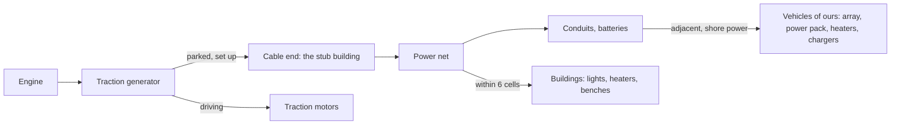

# The mobile generator set: design (9 Nov 2026)

**A design record. Nothing is built, and nothing in it is tested in game. Agent-authored for the owner to confirm.** It replaces the
generator-set sketch in [utility vehicles](utility-vehicles-design.md) and follows the shape of that record's bulk tanker. Facts marked
"from the code" were read on 9 Nov 2026 from our decompiles (`all.cs` is the game's, `VF.cs` is Vehicle Framework 1.6's, the build the
1.7 game loads) and are summarised in our own words; everything the record says will happen in play is a proposal.

## Read this first

- **What it is:** a small self-propelled truck whose one engine turns a generator. Traction motors drive the wheels; parked and set up
  (outriggers down, cable out), the generator feeds the power grid. A driver takes it there; nobody tends it while it runs.
- **It is the family's diesel-electric vehicle** (owner, 9 Nov 2026): the first vehicle of ours on `TransmissionKind.DieselElectric`,
  with a new road drivetrain Def, `PhobosDrivetrain_RoadDieselElectric`. The old sketch's "towed-size" is dropped: it has a cab.
- **Three decisions the owner must make:** (1) the stub-building route to the power net, the honest mechanics below; (2) whether the
  battery buffer node (idea I2) goes in the first tree; (3) whether the sound enclosure node stays, as the weakest node.
- **The risk:** the stub building is new and touches the game's power net, which other mods patch heavily; and a parked set is a
  generator anyone can shoot, standing in the open beside the camp it powers.
- **The camp's power rule lives here**, under its own heading: every vehicle of ours with electric loads draws from the set's net when
  parked beside it. The survey truck, drill rig and tipper records link to that section rather than repeat it.
- **Fuel per watt is never better than the game's chemfuel generator** (the no-value-loop rule); the set buys mobility, not cheap power.

## What it is and what it does in play

A genset truck: a light truck with an engine, a generator and a switchboard on its deck, outriggers at the back and a cable reel. The
real machine grounds the shape only. The diesel-electric drive is the same idea as a shunting locomotive's, scaled down: the engine never
turns the wheels, it turns the generator, and the generator feeds traction motors on the rear axle or, when parked, the camp. There is
no gearbox to change, and the engine runs at the power asked of it.

In play, the set drives to a camp with the drill rig or the survey truck, parks, and sets up: outriggers down, cable out to a cell the
player picks. From then on it is a generator on the power overlay, feeding whatever is wired to it, and it burns fuel in step with what
the camp draws. Run out of fuel and the camp's lights go out the way any starved net's do. Pack it up and drive home when the job is
done. It is also the smallest vehicle of the family and the one every other vehicle plugs into.

## What each behaviour does to the player

| Behaviour | What it lets them do | What it stops them doing | How it changes the way they play |
| --- | --- | --- | --- |
| **Deploy and feed a net** | Power a camp, a far field or a repair site with nothing built but a cable end | Move while set up; power anything beyond 6 cells of the cable end without conduits | A camp is somewhere you park, not somewhere you build |
| **Output follows fuel and health** | Read how many watts the set offers and why, on its Health tab | Get full output from a shot-up generator or a dying engine | Repairs are a power decision: the net browns out before the set stops |
| **Running out of fuel** | Nothing new | Keep a camp running on an empty tank: the net browns out, consumers drop off at random as the game does | Fuel runs become part of a camp's routine; the tanker beside the set refuels it |
| **The cable reel** | Park the set under cover or behind a wall and still reach the camp's conduit | Nothing | The set stands where it is safe, not where the power is wanted |
| **The bigger alternator** | Run a heavier camp (a rig drilling and a survey array charging at once) | Have it for nothing: more fuel a day at full output | A choice between fuel and reach |
| **The sound enclosure** (the weakest node) | Park it in a garage without turning the room into an oven | Run the engine as cool as an open set: it runs hotter under load | Indoor sets are quieter and cooler for the crew, hotter for the engine |
| **The battery buffer** | Creep a short way with the engine off, and keep the net alive through a refuelling stop | Drive far on it: a few hundred cells, then the engine must run | A set out of fuel can limp to the tanker instead of waiting for it |
| **Diesel-electric driving** | Pull hard from a standstill without a gear to miss | Hold a heavy pull for long: the traction motors heat and the Dashboard says so | Towing or climbing is a matter of patience, not gears |
| **Powering the family's vehicles** | Charge and run every vehicle of ours parked beside the set's net | Run them all at once beyond what the set offers: the net browns out | The set is the camp's heart; its output is the camp's budget |
| **A destroyed engine or generator** | Nothing new | Make power with either gone: the set offers nothing and says which part | A raid on the set is a raid on the camp; defend it as a generator, not as a truck |

## The camp's power

**The family rule (owner, 9 Nov 2026), written once here.** Any vehicle of ours with electric loads draws from the generator set's net when
it is parked beside it, through the shore-power path that already exists. Our systems service calls a parked vehicle shore-powered when
any thing within `shorePowerReach` (1 cell) of its footprint sits on a power net with stored energy above 1 or a positive gain
(`ShorePowered()`, `src/PhobosFramework.Vehicles/Systems/CompPhobosVehicleSystems.cs:983-1004`; `Rules_VehicleSystems.xml:22`), and a
shore-powered vehicle's starting battery trickle-charges at `shoreChargeAmps`, 10 A (`Systems_Electrical.xml:36, 230-239`). The set's
stub is a thing on a power net, so any vehicle parked beside the stub, beside a conduit of that net, or beside a powered building of
that net is on the camp's power. Vehicle Framework's own electric vehicles charge the same way, from a transmitter touching their
footprint plus one cell (`VF.cs:19727-19766`), but only while the net holds more stored energy than one charge step
(`VF.cs:19110-19118`): **a camp that charges electric vehicles needs a battery on the net**; the set alone will not do it.

What runs on it: the survey truck's powered array (a high-amp load only shore power or its own big battery sustains), the drill rig's
electric power pack (drilling on shore power), floodlights, the tanker's heaters, and every cab heater and battery charger in the camp.
**The set's output is the limit.** The game's net sums every component's output and draw each tick; when draw outruns output and the
batteries are empty, every 20 ticks about 5% of the powered consumers switch off at random, and they come back one by one as power
allows (`PowerNet.PowerNetTick`, `all.cs:423501-423565`, from the code). Too many loads and the camp browns out exactly as a base does.

What the net can reach, from the code: the stub transmits, so it joins any transmitter (conduit, battery, another generator) on a
cardinally adjacent cell (`PowerNetMaker.ContiguousPowerBuildings`, `all.cs:423893-423906`), and any powered building within 6 cells
wires to it as it would to a conduit (`PowerConnectionMaker.ConnectMaxDist`, `all.cs:423178`; `BestTransmitterForConnector`,
`all.cs:423271-423298`). Conduits extend it as far as the player lays them. A vehicle is never a connector: it is on the camp's power only
by standing next to something that is.

## The honest mechanics

**What the game does (from the code).** A Def transmits power when its power comp has `transmitsPower`; it is a connector when it does
not transmit but has a battery comp or a comp whose class is exactly `CompPowerTrader` (`ThingDef.EverTransmitsPower` and
`ConnectToPower`, `all.cs:45518-45584`). A connector links to the nearest transmitter within 6 cells (`all.cs:423178, 423271-423298`).
`CompPowerPlant` is a `CompPowerTrader` whose output is positive when it has fuel, is not broken down and is switched on
(`all.cs:421908-421976`); the net sums `EnergyOutputPerTick` over components that are on (`all.cs:423474-423486`). **The game's own
chemfuel generator is a transmitter**, `compClass CompPowerPlant` with `transmitsPower true` (`query-defs show ChemfuelPoweredGenerator`,
read 9 Nov 2026), so it joins conduits by adjacency and consumers wire to it. The power code assumes buildings: `TransmitsPowerNow` casts
the comp's parent to `Building` (`all.cs:421678`), the transmitter lookup returns a `Building` (`all.cs:71996`), the connector scan casts
to `Building` (`all.cs:423264`). `PowerNet.ChangeStoredEnergy` is private; a positive amount is shared among batteries and a negative one
drawn from them (`all.cs:423574-423613`). Vehicle Framework charges an electric vehicle by finding a transmitting power comp on a building
in its footprint plus one cell, then calling that private method by reflection every 120 ticks for a negative amount, and it disconnects
when the vehicle moves (`VF.cs:18971, 19223, 19606-19646, 19727-19766`). Nothing anywhere puts power into a net from a pawn, and VEF 1.7
has no power comp on pawns.

**Why a stub building (agent proposal).** A `VehiclePawn` is not a `Building`, so a normal power comp on the set would throw at the casts
above (inference from the code; not tried). The honest route: **deploying spawns a 1x1 building of ours, `Phobos_GeneratorStub`**, the
cable end, on a free cell the player picks within the reel's reach, and packing up or destruction despawns it. Its power comp is a
`CompPowerPlant` of ours with **`transmitsPower true`, as the game's generators are**, not the connector the first sketch assumed: a
`CompPowerPlant` comp class never passes `ConnectToPower`'s exact type test, so a non-transmitting stub would join nothing. Transmitting,
it joins adjacent conduits and takes connections from buildings within 6 cells (`allowWireConnection` left true). Its output is set
each rare tick by the set's comp from `Phobos_GeneratorOutput`, fuel and load, the way VOE's outlet comp reads its outpost (below); it
shows on the power overlay as a generator (proposal, to confirm at build). Saved state: the stub's cell and the unlocked reel reach, on
the vehicle's comp; the stub itself is respawned from them on load if missing (idempotent). **Argued against:** reflection into
`ChangeStoredEnergy` as Vehicle Framework does (a positive amount feeds batteries only, nothing on a net without one: inference,
untested); patching `PowerNet` (heavily patched by other mods: read `python scripts/query-patches.py who "RimWorld.PowerNet.*"` at
build before any patch); a power comp on the pawn (the casts above). The stub is one more building on the map for the duration of a
deployment, and nothing else.

**What VOE Power Grid does (read 9 Nov 2026 from our decompile, `.local/decompiled/VOE-PowerGrid`, and its Defs; in our own words).**
Vanilla Outposts Expanded: Power Grid (MrHydralisk, Workshop 2915686437, a 1.3 to 1.6 build that the 1.7 game loads; depends on VEF and
Outposts) sells exactly the pattern proposed here. The player builds a **power grid outlet** at home, a 1x1 building (100 steel, 2
components, Electricity) whose power comp is `CompPowerGridOutlet : CompPowerPlant` with `transmitsPower true` and `allowWireConnection
false` (`Defs/ThingDefs_Buildings/Buildings_Misc.xml:4-45`); its desired output is whatever the linked outpost says it produces
(`CompPowerGridOutlet.cs:22, 135-138`). The outpost is a world object that holds counts of generator buildings its colonists "build"
there (the game's Defs: wind turbine, watermill, solar, geothermal, chemfuel, wood-fired, nuclear with Rimatomics), limited by their
Construction skill, and its power is the sum of those buildings' rated outputs times terrain and settings multipliers
(`Outpost_PowerGrid.cs:53, 164-171, 274-303`). The outlet's connect gizmo lists outposts within range; range is the count of transmission
towers built there times a setting (1 tile each), and output is cut by a loss of (distance / 2 tiles − 1)% (`CompPowerGridOutlet.cs:95-
105`; `VOEPowerGrid_Settings.cs:11-13`). Fuelled types consume fuel once a day from the outpost's stored items, less a share the terrain
"gathers"; a shortfall scales output down and sends one letter (`Outpost_PowerGrid_Refuelable.cs:54-120`). Nothing decays. **Watch:** its
daily fuel step logs four debug lines every time (`Outpost_PowerGrid_Refuelable.cs:69, 73, 78, 109`), which the owner's 10,000-message
log cap will feel. **What it means for us:** the stub route is proven by a mod on the owner's list, down to the `CompPowerPlant` subclass
reading an external source. **A tie-in is thin:** its outposts count building Defs, not vehicles, and have no map, so a parked set
cannot be an outpost's generator without C# in its world object. The agent recommends no `IfModActive` folder for it in the first build;
the later idea worth a line is the reverse, a set that can *be connected to* an outlet as an outpost can, which is its API, not ours.

**Figures.** From the code: the chemfuel generator gives 1,000 W for 4.5 chemfuel a day, holds 30, costs 100 steel and 3 components, is
2x2 and needs Electricity (its Def, read 9 Nov 2026): 222 W per chemfuel a day. The set (all authored): **1,200 W at full health**; the
engine's load is the net's draw divided by the offered output (read from the net's components, as `CurrentEnergyGainRate` reads them),
so fuel runs from **1.5 chemfuel a day deployed with no load to 9 a day at full output**, 133 W per chemfuel a day, 60% of the fixed
generator's, the price of a truck engine turning a generator and of mobility; **14 a day driving**; **capacity 150 chemfuel**, about 16
days at full output or ten days' driving. `Phobos_GeneratorOutput` (Average over engine, generator, regulator) scales the watts; below
0.2 the set offers nothing and names the part. The game's watts are not real watts: a 1,000 W shed-sized generator would not run a
fridge and a workbench in life, so the set's 1,200 W is priced against that building and not against a real 100 kW genset. The road
diesel-electric Def (`PhobosDrivetrain_RoadDieselElectric`, all authored, grounded on the light-medium genset-truck class, 6 to 7.5 t,
general and unverified): kerb mass 6,000 kg; engine `ratedKilowatts` 100, idle 700 and rated 2,200 rpm (a truck diesel); `efficiency`
0.8 as the rail Def; `drivenShare` 0.6 (the rear axle); `dragArea` 6; `maxTractiveEffortKilonewtons` 30 (about the rear axle's share of
weight times tarmac grip) and `continuousTractiveEffortKilonewtons` 10 (the Class 08's starting-to-continuous ratio of about 3, used for
the Goat); rolling resistance and grip through the normal ground path, no `fixedRollingResistance` or `fixedGrip`, unlike the rail Def
(`Drivetrains.xml:256-276`). The model gives it no gear, usable power = rated x efficiency, pull capped at the motors' maximum, rpm a
straight line from idle to rated with load, and `TractionMotorLoad` above 1 heats the motors (`DrivetrainModel.cs:28-33, 68-71,
272-307, 310-311`).

**Sources and simplifications.** The diesel-electric model and its motor-heating fit are in [power and lift](vehicle-power-and-lift-design.md)
(the Class 08 and the EffiShunter 300; the Baldwin switcher manual's short-time ratings). The genset truck's mass and power are general
knowledge of the class, unverified. "Quiet" is not modelled: the game has no noise, so the enclosure and the buffer move heat and
range, never sound. Fuel burning in step with the net's draw is a simplification of a governor; the game's own generators burn fuel at a
flat rate whatever the load, so this is kinder than vanilla and is labelled as such.

**Argued against or later.** A towed set (the owner's call: self-propelled, with a cab). Helixien gas as a fuel (owner, 9 Nov 2026: no). A
second VehicleDef for a bigger set (an upgrade node moves the figure instead). Making the stub a battery as well (open question below).
Feeding VEF pipe nets or a gravship's grid (nothing asked for it). A trailer version for Vehicle Framework's towing when 1.7 ships
(catalogue).

## The set

| Item | Value |
| --- | --- |
| Footprint, drawSize | (2, 6), (3, 7). Two cells wide and six long: a light truck beside the tanker's 3 x 10, the same cells-per-metre as the picked tanker art (3.27 cells at 10 long); the drawSize overhangs a half cell each side as the tanker's does |
| Empty mass and power | Kerb mass 6,000 kg in the kerb-mass extension; VF `Mass` 260 (authored, Vehicle Framework's own unit, scaled from the tanker's 340); engine 100 kW; **1,200 W to the net** (see Figures for why the watts are the game's, not a genset's) |
| Drivetrain Def | `PhobosDrivetrain_RoadDieselElectric`, new (figures above); `TransmissionKind.DieselElectric`, no gearbox |
| Fuel | Chemfuel, 150; 14 a day driving, 1.5 a day deployed unloaded, 9 a day at full output (authored) |
| Crew | Driver only; nobody tends it while it runs |
| Research | Electricity (the chemfuel generator's own prerequisite; the game has no separate chemfuel-power project, from its Def) and the Vehicles tier (VVE's hauler research where present, as the tanker) |
| Cost (authored, our parts; decision 4) | 1 `PhobosVehicles_EngineAssembly`, 1 `PhobosVehicles_DrivetrainKit` (axles and tank; no transmission: no gearbox), 1 `PhobosVehicles_ElectricalKit`, plus the generator's worth (100 steel, 3 components, the game's generator's own cost), 220 steel, 6 components and 10 plasteel for the traction motors' windings. RimThunder's medium engine (4 to 15 t) and VVE's alternator and battery (under 6 t) accepted as substitutes where present |
| Systems loadout | Electrical (battery, alternator, starter, loads: lights), cooling (radiator; `Effect_PushHeat` into the room while running), lubrication, the diesel-electric drive's `PhobosVehicleSystem_TractionMotors`, the fuel system |
| Tie-ins by `IfModActive` folder | None in the first build (VOE Power Grid: see above). Combat Extended armour follows the tanker's light-vehicle scale |
| Prior art | RV with built-in PD (1.6: power from vehicle fuel); VOE Power Grid's outlet (above); the game's chemfuel generator |

## Upgrade tree

Every node moves a figure; none changes the parts list (principle 8). Node keys are stable once a save can hold them.

| Node key | Figure it moves | Cost | Research | Prerequisite or exclusive with | Look |
| --- | --- | --- | --- | --- | --- |
| `BiggerAlternator` (label "larger generator") | Full output 1,200 to 1,600 W (`StatUpgrade` on `Phobos_GeneratorOutput`'s base); full-output fuel 9 to 12 a day, the same watts per chemfuel | 60 steel, 4 components | Electricity | None | A taller generator housing behind the cab |
| `CableReel` | The stub's cell from adjacent to up to 12 cells away | 40 steel, 1 component | Electricity | None | A drum and a cable on the rear corner |
| `SoundEnclosure` (keep or cut: the owner's call) | Heat pushed into the room halved; the engine runs 10 degrees C hotter under load | 80 steel | None | None | Panelled sides over the engine and generator |
| `BatteryBuffer` (idea I2) | 150 units of charge at 1 Wd each: creep up to 200 cells with the engine off at half speed; the stub keeps its output through a refuelling stop | 20 steel, 10 components (the electric record's module price) | The game's battery research | None | A battery box under the deck |
| `WorkLights` | A light over the set, radius 6, and a 10 A load (`CompUpgrade` adds the glower, `VF.cs:33709-33716`) | 20 steel, 1 component | Electricity | None | A mast with two lamps |

`StatUpgrade` sets a stat's base, offset or factor (`VF.cs:33992-34218`); a node carries ingredients, research, prerequisites and overlays
(`UpgradeNode`, `VF.cs:34815-34866`). The owner's rule of play for the Harrier applies: no node without a figure the player can feel.

## Parts

Cells run x 0 to 1 and z −2 to 3 on the 2 x 6 footprint, cab forward at high z: bonnet and engine at z 3, cab at z 2, generator and
switchgear at z 1 and 0, traction motors on the rear axle at z −1, control panel, outriggers and reel at z −2. Parts are appended only.

| Part | Health | Depth | Cells | Feeds | Job |
| --- | --- | --- | --- | --- | --- |
| Chassis | 110 | External | all, weight 3 | BodyIntegrity | |
| Cab | 40 | External | (0, 2) (1, 2) | | The driver |
| Engine | 55 | Internal, priority | (0, 3) (1, 3) | MoveSpeed, Phobos_GeneratorOutput | One engine turns the generator for both jobs; `Reactor_Explosive` as VVE's engines |
| Radiator | 30 | External | (0, 3) (1, 3) | | The systems service's cooling; a hit starts the coolant leak |
| Front axle and wheels | 35 | External | (0, 3) (1, 3) | MoveSpeed | Steered, not driven |
| Traction generator | 45 | Internal | (0, 1) (1, 1) | Phobos_GeneratorOutput, MoveSpeed | Feeds the motors on the road and the stub when parked; a dead generator stops both |
| Voltage regulator and switchgear | 25 | Internal | (1, 0) | Phobos_GeneratorOutput | |
| Traction motors | 40 | Internal | (0, −1) (1, −1) | MoveSpeed | Heat above their continuous pull (`PhobosVehicleSystem_TractionMotors`) |
| Rear axle and wheels | 40 | External | (0, −1) (1, −1) | MoveSpeed | The driven axle |
| Fuel tank | 35 | Internal | (0, 0) | | `Reactor_FuelLeak` |
| Control panel | 25 | Internal | (0, −2) | Phobos_RigControl | |
| Wiring | 25 | Internal | (1, 0) (1, −2) | Phobos_RigControl | |
| Outriggers | 30 | External | (0, −2) (1, −2) | Phobos_RigStability | Set up before it runs |
| Cable reel | 30 | External | (1, −2) | | Needed to deploy; the reel node lengthens the cable |
| Lights | 15 | External | (0, 3) (1, 3) (0, −2) (1, −2) | | Set up at night |

**Floors (authored, as the rig's):** deploying needs `Phobos_RigStability` and `Phobos_RigControl` at or above 0.5, and the refusal
names the part ("the outriggers will not hold"; "the control panel is damaged"). `Phobos_GeneratorOutput` below 0.2 offers no power.
**Reactors:** the fuel leak on the tank; `Reactor_Explosive` on the engine as VVE does; the stub itself has 50 hit points and no
reactor, and its destruction only ends the deployment. `Phobos_RigControl` already exists (`Tanks.xml:50`); `Phobos_GeneratorOutput` and
`Phobos_RigStability` are design-only and would be added with the set.

## Art request

The pilot is the **bare body, north**: a 2 x 6 light truck, cab forward, an open deck with a low generator housing and a switchboard,
drawn empty (no cable, lights, outriggers or damage), one tone for the body and one for the cab, repaintable through `color` and
`colorTwo` as the tanker is. Overlays, each its own north, east and south on the body's canvas: outriggers down; the cable out (a short
run off the rear corner; the stub's own texture is a 1x1 cable end with a junction box); the sound enclosure's panels; the cable reel's
drum; the work-light mast, lit and unlit; the battery box; damage states for the engine and the generator housing. Icon: the truck
from the north with a lightning bolt over the deck. Paid generation follows [the paid image rules](paid-image-generation-rules.md): a
dry run first, the camera instruction first, one pilot at native size before the facing set.
- **Size it first** (owner's rule, 9 Nov 2026): before the first picture, measure the planned footprint against the biggest comparable light truck on the owner's list (the HUMVEE mod's trucks at 2 wide), and generate at 1.5 times the drawn size ([the rules](paid-image-generation-rules.md)); the tanker had to grow from 2 x 6 to 3 x 10 after its first look.

## Open questions for the owner

| Question | Agent lean |
| --- | --- |
| The stub-building route to the net, or wait for a Vehicle Framework or VEF power hook that may never come? | The stub. It is the pattern VOE Power Grid already ships, and the only route the code allows without patching the net |
| The stub as a transmitter with `allowWireConnection` true (buildings within 6 cells wire to it, no conduit needed), or false as VOE's outlet (conduits only)? | True. A camp should need nothing built but the cable end |
| The battery buffer in the first tree, or later? | In the first tree, as the hybrid of idea I2: it is the one node that changes what a set out of fuel can do |
| Should the buffer also make the stub a battery on the net, so Vehicle Framework's electric vehicles can charge from the set alone? | Not in the first build: it means a battery comp whose stored energy must be saved on the vehicle and restored on the stub; record it and decide after the first test |
| Keep the sound enclosure? | Keep it as the weakest node and cut it if the first test shows the room heat does not matter; it is cheap to leave out of the first tree |
| Fuel in step with the camp's draw (a governor), or a flat burn as the game's generators? | In step with the draw. It is what a diesel-electric does, and the engine model already has the load |
| A VOE Power Grid tie-in now? | No folder in the first build; the precedent matters, the tie-in does not |
| Build order after the tanker? | **The generator set first**: it is the smallest, it proves the diesel-electric drive and the power stub, and every other vehicle plugs into it |
| 1,200 W and 9 chemfuel a day at full output, 60% of the fixed generator's fuel economy? | Keep the 1,200 W; tune the fuel in play, never below the fixed generator's watts per chemfuel |
| The 2 x 6 footprint, after the owner found 2 x 6 small for the tanker? | 2 x 6: a light truck should look light beside the 3 x 10 tanker; the drawSize overhang gives it presence |

## Who chose what

- **Owner (9 Nov 2026):** one record per vehicle, research and record only; self-propelled and diesel-electric, the family's
  diesel-electric vehicle; the camp's power as the family rule, through the existing shore-power path; no Helixien gas; our part items
  always exist and set the costs, RimThunder's medium engine and VVE's alternator and battery accepted as substitutes; every node moves a
  figure and none changes the parts list.
- **Agent choices, owner to revise:** the stub building and its transmitting power comp; the correction that the stub must transmit (the
  first sketch's connector would join nothing); fuel in step with the net's draw; every figure (1,200 W, 1.5 to 9 and 14 chemfuel a day,
  150 capacity, 6,000 kg, 100 kW, 30 and 10 kN, 2,200 rpm, the node figures and costs, the part healths); the 2 x 6 footprint; the five
  nodes and the enclosure's place as the weakest; no VOE tie-in; the build order.
- **Agent corrections to the brief (9 Nov 2026):** the game's chemfuel generator is a transmitter, not a connector; Vehicle Framework's
  charging needs stored energy on the net, so the set alone cannot charge its electric vehicles.

## Sources

- The game's power code, our decompile `.local/decompiled/full/all.cs` (RimWorld 1.7): `ThingDef.EverTransmitsPower` and
  `ConnectToPower` (45518-45584); `CompPower.TransmitsPowerNow` (421678) and `PostSpawnSetup` (421729-421745); `CompPowerPlant`
  (421908-421976); `PowerConnectionMaker` (423178, 423209-423223, 423264, 423271-423298); `PowerNet.CurrentEnergyGainRate` (423474-423486),
  `PowerNetTick` (423501-423565) and `ChangeStoredEnergy` (423574-423613); `PowerNetMaker.ContiguousPowerBuildings` (423875-423917);
  `GetTransmitter` (71996). Ludeon Studios' code, read for research and summarised, never copied.
- Vehicle Framework 1.6 (SmashPhil, MIT), our decompile `.local/decompiled/VehicleFramework-1.6/Vehicles.decompiled.cs`:
  `CompFueledTravel` (18971, 19110-19118, 19223, 19606-19646, 19727-19766); `CompUpgrade` (33709-33785), `StatUpgrade` (33992-34218),
  `UpgradeNode` (34815-34866).
- Vanilla Outposts Expanded: Power Grid (MrHydralisk; Workshop 2915686437; source on GitHub per its About): Defs read from the installed
  mod, assembly decompiled on 9 Nov 2026 into `.local/decompiled/VOE-PowerGrid` for research only.
- Our code and Defs: `CompPhobosVehicleSystems.ShorePowered` (`src/PhobosFramework.Vehicles/Systems/CompPhobosVehicleSystems.cs:983-1004`);
  `DrivetrainModel` (`src/PhobosFramework.Vehicles/Rules/DrivetrainModel.cs:28-33, 68-71, 272-311`); `Effect_PushHeat`
  (`src/PhobosFramework.Vehicles/Schema/Effects.cs:93`); `ElectricalLoadSpec` (`src/PhobosFramework.Vehicles/Defs/SystemDefs.cs:363`);
  `Drivetrains.xml:256-276`, `Rules_VehicleSystems.xml:22`, `Systems_Electrical.xml:36, 230-239`, `Systems_Electric.xml`, `Tanks.xml:50`
  (all under `mods/PhobosFramework/Mods/VehicleFramework/Common/Defs/Phobos/Framework/VehicleSystems/`).
- Design records: [utility vehicles](utility-vehicles-design.md) (principles 8 and 9, the stats table, the tanker as the shape),
  [electric vehicles](vehicle-electric-design.md), [power and lift](vehicle-power-and-lift-design.md) (the diesel-electric model and
  its railway sources), [vehicle health, slice 3](vehicle-health-consequences.md), [outstanding work](outstanding-work.md) (I1, I2).
- Real machines, grounding only, general knowledge and unverified: light-medium genset trucks of 6 to 7.5 t with engines near 100 kW;
  the British Rail Class 08's starting-to-continuous tractive-effort ratio, as cited in power and lift.
