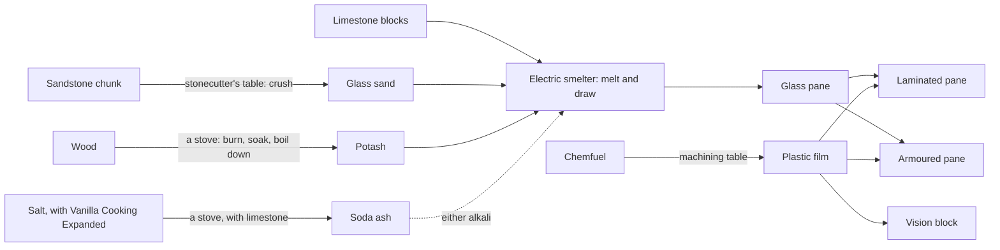

# Glass on our vehicles: a part that breaks, and what follows (22 Nov 2026)

**Status (22 Nov 2026):** a research record. It changes no code, Def or setting, and every numbered idea in it (VG1 to VG14) is
unbuilt and untested.

The owner, 22 Nov 2026, while the [nuclear strike record](nuclear-strike-effects.md) was being researched: "maybe we should make
glass a component of our vehicles, and that could have its own, knock-on, effects!" And: "We could do so much work with glass
windows and the like being a component." The strike record covers what a nuclear burst does; this one covers glass on its own
account, since bullets, weather, fire and the air in a cab all meet it without any warhead.

**How to read the marks.** **[code]** was read in code or Defs on 22 Nov 2026, never run. **[P]** a primary source; **[S]** a
secondary one. **[I]** our inference. **[A]** an agent's choice or authored figure, for the owner to revise. **[not read]** says so
plainly. `V/` is `src/PhobosFramework.Vehicles/`; **VFsrc** and **CEsrc** are Vehicle Framework's and Combat Extended's public
sources, as in the strike record.

## Read this first

- **No vehicle in the owner's game has glass.** A windscreen is drawn on the picture and is nowhere in the machine: of four designs
  looked at (a bus, the Highwayman, a main battle tank and our tanker), none has a part for it **[code]**.
- **The cab is already "closed" or "open", with nothing physical behind the word.** Our cab system keeps a closed cab's own
  temperature and gives an open one the weather **[code]**. Glass is what makes a cab closed, so it is the missing piece, not a new
  system.
- **Three designs are already waiting for exactly this.** Shelter aboard a vehicle (EM22), smoke and heat in a burning vehicle's cab
  (C3) and hotboxing's "Windows" switch all need a cab that can be sealed or not. **None of the three is built.**
- **One tracked part per vehicle, not one per window** [A], as the spall liner is one part. It keeps the cost and the Health tab small.
- **It must not be an outer plate.** Combat Extended makes a round beat every outer part on a cell, so a glass part beside the cab
  plate would stack into armour nobody meant ([the armour design](vehicle-armour.md#one-outer-part-to-a-cell)). The glass would be
  an inner part that our own rule breaks, from hits the cab plate reports **[A, after the liner]**.
- **Unlike spall, it can work without Combat Extended**: Vehicle Framework's own damage step calls a part's reactors too, though
  only for a hit that did the plate some damage **[code]**.
- **Glass+Lights is on the owner's list and has glass and reinforced glass as goods**, but it declares game versions up to 1.6
  only, was last updated in July 2025, and its uploader last replied in May 2026 [`scripts/workshop-research.py`, 22 Nov 2026]. So
  our own pane is the part, and its goods are an accepted ingredient, never a requirement.
- **No cracked-glass pictures on other authors' vehicles**, by the owner's standing rule on other authors' art.

## What the code already does

| What | Where | What it means for glass |
| --- | --- | --- |
| **Parts** of the bus: panels, roof, hood, bumpers, wheels, engine, dashboard, upholstery. Of the Highwayman and the tank: armour plating by side. Of our tanker: cab, chassis, tank shell and fittings | The Defs as patched (`scripts/query-defs.py patched`) | No glass anywhere; ours to add, by loadout, as we add radiators and the liner |
| **A cab is closed or open** | `CabinSpec.closed` on a loadout; `PhobosVehicleCabinExtension` on any mod's vehicle (`V/Defs/SystemDefs.cs:721-733`) | "Closed" would come to mean "closed, and its glass is whole" |
| **A closed cab has its own temperature**; an open one gives the weather | `V/Service/CabClimate.cs` | A cab without glass is an open one |
| **A "Windows" switch**, up or down, on closed cabs | Designed in [hotboxing](vehicle-hotboxing.md#windows); not built | Glass gone is windows that cannot be put up |
| **Seats are enclosed or exposed.** Without Combat Extended an exposed seat can be hit from outside; with it, people are hit only after a shot reaches an inner layer, exposed or not | [Militarised service vehicles](vehicle-militarised-service-vehicles.md) | Glass cannot make a seat "more hittable" under Combat Extended through the seat's own flag |
| **A part's reactors are told of its hits**: under Combat Extended every one, even a hit that did nothing; under Vehicle Framework's own step only a hit that did some damage | CEsrc `VehicleArmorPatch.cs:363-369`; VFsrc `VehicleComponent.cs:114-122` (both re-read) | A reactor on the cab's plate can decide when the glass behind it breaks. No Harmony patch. Without Combat Extended a hit the plate turns aside is not heard |
| **An inner part at zero health is skipped** by Combat Extended's walk; a part can be left out of a vehicle's health sum; a part can be mended only with its own goods | The spall liner ([spall](vehicle-spall.md)), built | The whole pattern glass needs exists and has had one fault-read |
| **An explosion touches a vehicle's edge cells only** | VFsrc `Patch_Combat.cs:207-216` (re-read) | A blast reports once per edge cell; glass is judged once per blast, as shock spall is |
| **What a thing is built from is a bill of roles**, each filled by an installed mod's goods or ours | [Parts bills](parts-bills.md) | "Glass" is a role; Glass+Lights' glass fills it where active |
| **A tired driver hands the wheel to a rested passenger**; a stoned driver drives slower, with no random crashes | `V/Camp/NightDriving.cs`; hotboxing (the owner's rule) | The pattern for a driver who cannot see well: slower, never a rolled crash |
| **An aircraft's fit says whether it carries oxygen and cruises high** | `AvionicsFitValues` (`V/Defs/SystemDefs.cs:554-558`) | A broken canopy has something to act on |

## What the real thing does

Gathered by a research agent on 21 and 22 Nov 2026; each source is listed with its link under [Sources](#sources), with how it was
read. Quotations are the sources' words. Conversions and anything marked [I] are ours.

### Kinds of glass, and how each breaks

- **A windscreen is laminated, by law.** Australian Design Rule 8/01, clause 7.3: "The glass used in the windscreen of all vehicles
  must be laminated safety glass" **[P]**. UN Regulation No. 43 allows a toughened windscreen only on vehicles that cannot exceed
  40 km/h, and "does not apply to armoured vehicles" **[P]**.
- **Laminated glass cracks and holds.** UN R43 defines it as "two or more layers of glass held together by one or more interlayer of
  plastics material", and its test passes a screen that "breaks displaying numerous circular cracks" while "the layers of glass
  shall remain adhering" **[P]**. The rule behind it, in the regulation's words: "In the event of the windscreen's shattering, the
  driver shall still be able to see the road clearly enough to be able to brake and stop his vehicle safely."
- **Toughened glass bursts into small pieces.** UN R43 requires at least 40 fragments in any 5 cm square **[P]**. The US Federal
  Emergency Management Agency's manual FEMA 426 calls it "four to five times stronger than annealed glass", breaking into "small
  cube-shaped fragments", and adds: "Breakage patterns of side and rear windows in American automobiles are a good example" **[P]**.
- **Ordinary (annealed) glass** "fractures into razor sharp, dagger-shaped fragments" (FEMA 426) **[P]**. No road vehicle should
  have it; a building's windows may.
- **The lab accident is real.** In 1903 the French chemist Édouard Bénédictus dropped a flask that had held a cellulose nitrate
  solution; it shattered but "the fragments did not fly apart" (Joe Schwarcz, McGill University Office for Science and Society)
  **[S]**. His French patent FR405881A was filed on 10 Aug 1909 **[P, the patent record]**.

### Blast

- **Glass is the first thing a blast breaks.** Glasstone and Dolan's *The Effects of Nuclear Weapons* (1977), Table 5.145: glass
  windows shatter at a peak overpressure of **0.5 to 1.0 psi** (about 3.4 to 6.9 kPa) **[P]**. FEMA 426 prints "typical window glass
  breakage" at 0.15 to 0.22 psi, and the US National Oceanic and Atmospheric Administration gives 0.15 psi as the "typical pressure
  for glass failure" and 0.5 to 1.0 for "windows usually shattered" **[P]**. **The sources disagree**; the lower figures read like
  first breakage and the higher like general shattering **[I]**.
- **A vehicle loses its glass and drives on.** Glasstone and Dolan on vehicles in the test series **[P]**:
  - at 1.7 psi, "minor exterior damage, such as broken windows and dished-in panels" (para 5.90);
  - at 5 psi, "badly battered, with their tops and sides pushed in, windows broken, and hoods blown open. But the engines were
    still operable and the vehicles could be driven away" (para 5.87);
  - their lightest damage class for motor equipment: "Glass broken, dents in body, possibly turned over, immediately usable"
    (Table 5.147a).
- **Laminated glass does well under blast** "if mounted in properly designed window frames" (FEMA 426) **[P]**. No figure was found
  for the pressure at which a vehicle's own windscreen fails **[not found]**.

### Injuries from glass

- **Hiroshima and Nagasaki:** people were treated for lacerations out to about two miles from ground zero, distances that
  "correspond roughly to those at which moderate damage occurred to wood-frame houses, including the shattering of window glass"
  (Glasstone and Dolan, para 12.19) **[P]**. Their Table 12.47: a 10-gram glass fragment cuts skin from about 50 feet a second and
  wounds seriously from about 100 **[P]**.
- **Halifax, 1917:** "Twelve ophthalmologists treated 592 people with eye injuries and performed 249 enucleations"; sixteen people
  lost both eyes (McAlister and colleagues, *British Journal of Ophthalmology*, 2007) **[P]**. The Canadian National Institute for
  the Blind was founded the next year (The Canadian Encyclopedia) **[S]**.
- **Oklahoma City, 1995:** "40 percent of the survivors in the Murrah Federal Building cited glass as contributing to their
  injuries" (FEMA 426) **[P]**. **Beirut, 2020:** glass debris was "the main source of injury to most patients" in an eye-injury
  series (Kheir and colleagues, *JAMA Ophthalmology*, 2021) **[P]**.

### Armoured glass

- **What it is:** "several layers of glass with polymer interlayers bonded to a polycarbonate liner that prevents glass shards and
  other debris from entering the crew area" (RAND Corporation, RR-2285, 2018) **[P]**. "Current Humvee windows are about 4 in. thick
  and weigh about 90 lb each" (US National Research Council, 2011) **[P]**.
- **It wears out by itself.** Delamination "impaired driver visibility with cloudiness, bubbles, spots, whiteness, discoloration,
  and visual distortion", most commonly "four to five years after a windshield's manufacture date" (RAND) **[P]**; a US Marine
  Corps briefing gives "~6 months to 3 years" **[P]**. **The two disagree.**
- **It is a replaced item, and a costly one:** "from a sample of 266 transparent armor damage incidents 68.2% were a result of
  combat damage", and replacement ran at "$3-$12 million a month" in 2006 to 2008 (SCHOTT and the US Army's tank and automotive
  centre, 2011; a maker co-wrote it) **[P]**. The same paper notes that the weight of the windows, high on the vehicle, "was also
  contributing to the problem of mine resistant vehicles rolling over".

### Vision blocks and periscopes

- **Armoured vehicles see through blocks and periscopes, not windows**, so there is no "direct opening through the armor for
  passage of projectiles, chemicals, liquids or other harmful materials" (US patent 4,065,206, 1976) **[P]**. They are "usually
  designed to be installed from inside the vehicle", and an older periscope sees "between 94° and 104°" across (US patent
  4,934,246, 1988) **[P]**.
- **Even these throw pieces inward.** When a projectile strikes the outer window, "a shock wave is transmitted through the body and
  causes parts and pieces of the observer window and surrounding plastic body to fly out into the interior of the vehicle and
  strike the observer" (US patent 4,065,206) **[P]**.
- **Spares are carried**, on at least one vehicle: the US Army's operator's manual for the M728 has the crew "Get spare head
  assembly ... from turret stowage box" **[P]**. No other vehicle's manual was opened, so "tank crews carry spares" in general is
  **not verified**.
- **Closed up, a crew sees less; opened up, it is exposed.** US Army FM 7-20: "Fighting with closed hatches reduces the crew's
  ability to see, acquire, and engage targets", and with hatches open "the crew is vulnerable to small-arms fire" **[P]**. In a US
  Army Research Laboratory trial, drivers using natural vision "drove the course 26.5% faster" than with camera displays **[P]**
  (cameras, not periscopes: the nearest measured figure found).

### Heat

- **Sudden heat cracks ordinary glass and spares toughened glass for longer.** The Glass and Glazing Federation: toughened glass
  resists temperature differences "up to 200°C compared with annealed glass (up to 40°C)" **[P]**. In fire, ordinary float glass
  "tends to crack when the glass reaches a temperature of about 150 - 200°C", and toughened glass "shatters upon initial cracking"
  at a surface temperature of 290 to 380 °C (Vytenis Babrauskas, "Glass breakage in fires") **[P]**. He adds: "There does not appear
  to have been any glass fallout studies for automotive glazing."
- **Damaged glass goes first.** In a full-scale burn test, a pre-cracked windscreen "failed in locations where there was existing
  mechanical damage", and "The fire propagated into the vehicle via the broken windshield" (Papageorge and Colwell, SAE, 2024) **[P]**.

### Seeing through damaged glass

- **Roadworthiness rules give sizes.** The UK's MOT manual fails "damage in windscreen zone A more than 10mm in diameter" (a strip
  290 mm wide in front of the driver) and more than 40 mm elsewhere in the swept area **[P]**. Australia's National Heavy Vehicle
  Inspection Manual rejects, in front of the driver, a "bulls-eye or star fracture that exceeds 16mm" and a "crack from the edge of
  the windscreen exceeding 75mm long" **[P]**.
- **Wear and dirt do more harm than a crack.** Monash University Accident Research Centre's review (Report 183, 2001): cracks
  "seemed to cause less of a visual problem than the multiple fine scratches and chips resulting from gradual wear"; "dirty
  windscreens seemed to cause drivers to crash twice as often in a driving simulator"; and "drivers seem to adapt their speed to
  their abilities" **[P]**. It found "very few studies" tying windscreen condition to crashes.

### A sealed cab

- **Protection from bad air is a sealed, pressurised, filtered compartment**, and it has limits. US Army FM 3-4, chapter 6: "The air
  pressure precludes leakage of contaminated air into the enclosure", and "The system does not protect against gamma radiation or
  neutrons" **[P]**. "Opening the doors allows contamination inside" **[P]**.

### What this means for the ideas

- **VG3 has the real thing behind it:** glass goes at a fraction of the pressure that harms anything else, and the vehicle is
  "immediately usable" afterwards.
- **VG5's wounds are real and mostly small**, with eyes the lasting risk, and the kind of glass decides how many pieces fly.
- **VG6 should be modest** [A]: the evidence is that drivers slow down and that a crack alone matters less than a worn or dirty
  screen. "Slower in the dark and in rain" fits; a penalty in clear daylight would not.
- **Armoured glass wearing out with age** is real, and is left out [A]: it would be upkeep with no decision in it.
- **A sealed cab stops what is in the air and nothing of the radiation that comes through the walls**, which is how the strike
  record's NK9 and NK11 divide.

## The ideas

Every row is unbuilt. Verdicts are the agent's recommendations **[A]**: **Take**, **Idea**, **Hold**, **Waiting**.

| # | Idea | What the reads found | Lets | Stops | Changes | Size and verdict |
| --- | --- | --- | --- | --- | --- | --- |
| **VG1** | **Glass as one tracked part** on every closed-cab vehicle: sound, cracked, or gone. An inner part on the cab's cells, added by the loadout, born whole, left out of the vehicle's destruction sum | The liner is the same shape, and its faults are already found and fixed | See the glass on the Health tab and lose it | Treating a cab as sealed whatever has hit it | A cab becomes something to keep whole | Medium. **Take**, as the base of everything below |
| **VG2** | **Three kinds, by the vehicle** [A]: ordinary glass (a laminated screen and toughened side glass) on civilian cabs; armoured glass on an armoured cab; vision blocks on tanks and the like, small and tough. Open vehicles have none | The kind can follow the loadout and the cab's armour class, with no list per vehicle | A truck's glass and a tank's fail differently | One glass for all | Armour kits bring better glass with them | Small on top of VG1. **Take** |
| **VG3** | **What breaks it.** A blast, far out past where anything else is harmed; a bullet striking the cab, by chance; fire against the cab; a strike's flash and wind ([NK2, NK3](nuclear-strike-effects.md#a-a-vehicles-own-route-through-a-strike)) | The cab plate's reactor hears every hit. Glass really is the first thing a blast breaks ([physics](#what-the-real-thing-does)) | Break a vehicle's glass without beating its plate | A distant shell leaving no mark at all | Even a near miss costs something | Medium. **Take** |
| **VG4** | **Glass gone, the cab is open.** It takes the weather's temperature, and when cab air exists, gas, fallout and smoke come straight in | The cab system already has both states. EM22, C3 and hotboxing's switch all hang on this | Lose a cab's shelter by losing its glass | Sheltering from fallout behind a broken screen | Glass is checked before a drive through bad air or deep cold | Small for temperature now; the rest **Waiting** on cab air (the owner's answer of 20 Nov 2026) |
| **VG5** | **Splinters.** When ordinary glass breaks, the people behind it take small cuts, and by chance an eye injury; a laminated screen throws few; armoured glass and vision blocks throw none until spent | More Injuries has a "cut (spall)" condition; the game has cuts. Flying glass is a leading injury of real blasts ([physics](#what-the-real-thing-does)) | Wound a crew through the glass | Riding through a blast unmarked | Goggles and helmets earn a place; crews duck | Small. **Take**, behind its own setting (it hurts people) |
| **VG6** | **The driver's view.** Cracked glass: slower at night and in rain or fog. Glass gone: the weather on the driver. Vision blocks gone: the driver opens the hatch and drives head-out, or crawls | The pattern is the stoned driver's: slower, never a rolled crash. This changes speed by what the driver can see, not by air resistance, so it does not touch the "no drag" rule | A cracked screen that matters | Driving a blind tank at full speed | Spare glass is carried; tanks carry spare blocks, as real crews do | Medium. **Idea** |
| **VG7** | **Glass is replaced, not mended.** A new part item, the glass pane, sets what a repair costs; cracked glass takes panes by the share missing, as a re-line takes panels | The liner's "mended only with its own goods" rule, built | Restore a cab's seal | Free repair of glass | Panes are stocked and carried | Small on top of VG1. **Take**. Needs one item picture |
| **VG8** | **What a pane is made from.** Glass+Lights' glass where it is active; otherwise a recipe of ours | Real window glass is silica sand melted with soda ash and limestone, roughly seven parts to one and a half to one **[not sourced here]**. The game has no sand or soda; a stand-in is an authored choice to settle with the owner, who knows the chemistry better than this record does | Make glass honestly | Glass from nothing | A small supply chain, or a trade good | Small. **Idea**: needs the owner's steer on the stand-in |
| **VG9** | **Armoured glass and vision blocks as grades**, coming with the armoured cab, their weight as carried mass | The kit rules already say how a kit's weight counts | Pay weight for glass that holds | — | — | Small. **Idea**, with VG2 |
| **VG10** | **Other authors' vehicles.** Closed-cab ones get the part from our loadout, as they get our radiators; a small extension marks a design's glass kind, in the same family as the liner's unbuilt "lined" mark. No pictures of ours on their art | The liner's extension is still unbuilt because no vehicle needed it; glass would need it at once, for every tank | One rule for every vehicle | Raiders' vehicles being exempt | — | Medium. **Take** with VG1: build the two extensions together |
| **VG11** | **What the player sees.** A row on the Health tab; an alert when a vehicle with no glass is out in dangerous air or cold; a logbook entry when glass goes; a cracked-screen picture on our own vehicles only | Alerts and the logbook exist | — | — | — | Small. **Take** with VG1; one overlay per vehicle of ours is art to plan |
| **VG12** | **Glass from ground zero.** The fireball's scoured ground leaves fused glass, a poor glass that can be remelted into panes | Real, and named after the first test ([physics](#what-the-real-thing-does)); see [NK25](nuclear-strike-effects.md#e-after-the-strike) | A use for a crater | — | A reason to go back, suited | Small. **Idea** |
| **VG13** | **An aircraft's canopy.** Cracked or gone, the aircraft cannot cruise high: no pressure, no warmth | The avionics fit already says whether an aircraft carries oxygen and cruises high | Bring an aircraft down low with a cracked canopy | Flying home at height with no canopy | A damaged aircraft takes the low, slow, fuel-hungry way home, through whatever is down there | Small on top of VG1. **Idea** |
| **VG14** | **One state for glass and the "Windows" switch**: up, down, or gone | Hotboxing designs the switch; neither is built | — | — | — | **Hold**: decide when either is built first |

### What outside the vehicle notices

- **The people aboard:** cold, heat and weather through a missing screen; cuts when it goes; later, whatever is in the air.
- **The colony:** an alert and a logbook line; panes as a stock to keep; doctors, for cuts and eyes.
- **Raiders and other factions:** their vehicles lose glass to the colony's fire and blasts by the same rule, and their crews are
  cut and exposed by it.
- **The weather and the map:** a vehicle without glass is at the mercy of both, which is the point.

## Risk and settings

Grades are the agent's proposals **[A]** until the owner confirms them.

| Behaviour | What the player can lose | Proposed grade | Default by the rule |
| --- | --- | --- | --- |
| Glass that breaks, and an open cab after (VG1 to VG4) | Comfort and shelter, with warning; never a vehicle or a person at once | Low | On |
| Splinters (VG5) | Small wounds; rarely an eye | Moderate: a lasting injury is possible, but never a death by itself | On, with its own setting |
| The driver's view (VG6) | Time | Low | On |
| A canopy at height (VG13) | Range and safety of an aircraft, with warning | Low to moderate | On |

## Other factions' vehicles

| Where | What happens |
| --- | --- |
| **A raid on us** | The colony's fire and blasts break raiders' glass by the same rule; their crews are cut and, once cab air exists, exposed to gas. It costs nothing until a cab is hit |
| **Parked at a base we attack** | Glass broken in the fight is one more thing a captured vehicle needs; a struck town's vehicles have none left |
| **One we capture** | It keeps whatever glass it has, and takes our panes to restore |

**Cost with several on a map:** nothing per tick. A hit on a cab plate costs the reactor's check; a break costs a few damage calls
at most. The open-cab state is read where the cab's temperature is already worked out.

## Saves

- **Nothing is built, so nothing changes in any save.**
- If built: glass is one more appended part, whose health Vehicle Framework saves. An existing vehicle would gain it whole.
  Appended parts move the saved order, which our part-key handling already puts right for the liner; that it holds for one more
  part is read before building. Removing the mod drops the part with the rest of ours.

## To read or prove before building

1. **What a blast reports to a cab plate's reactor without Combat Extended**: Vehicle Framework's own step tells reactors only of
   hits that did damage, so a distant blast its armour roll turns aside would break no glass there. Decide whether that is
   acceptable or needs another way in.
2. **How "closed" is read today**, everywhere: each place must come to ask "closed, and glazed".
3. **The liner's lessons, applied from the start**: a part left out of the health sum and of "destroyed" alerts; born whole on new
   and existing vehicles; never mended for free.
4. **Which designs on the owner's list are closed, open, armoured or tanks**, so the kinds in VG2 can be set by rule and the
   exceptions listed.
5. **Whether More Injuries' "cut (spall)" can be given by name** without its own code objecting, or whether the game's cut is the
   better choice.
6. **Glass+Lights on 1.7**: it runs in the owner's game though it declares 1.6; that its glass goods are sound as an ingredient.

## Questions for the owner

To be asked as cards once this record has been read; the agent's recommendation is the first option of each.

1. **Build the base** (VG1, VG2, VG3, VG7, VG10, VG11): yes, as one piece with real art first; or wait for cab air and build both.
2. **Splinters** (VG5): in the first build, behind a setting; or later.
3. **What a pane is made from** (VG8): Glass+Lights' glass where active and a simple recipe of ours otherwise; or a real glass
   recipe with its own raw goods; or bought only.
4. **The driver's view** (VG6) and **the canopy** (VG13): with the base; or after it has been played.

## The owner's answers (cards, 22 Nov 2026)

| # | Question | The owner's answer | The agent's recommendation |
| --- | --- | --- | --- |
| 1 | The base (VG1, VG2, VG3, VG7, VG10, VG11) | **Yes, with real art first** | The same |
| 2 | Splinters (VG5) | **With the glass base**, behind its own setting | The same |
| 3 | What a pane is made from (VG8) | **A real glass chain**: our own raw goods and a melt step, with the owner steering the stand-ins | Glass+Lights' glass where active, a simple recipe of ours otherwise |
| 4 | The driver's view (VG6) and the canopy (VG13) | **With the glass base** | The same |

**What follows from the answers:**

- **To build, as one piece with its art made first:** VG1, VG2, VG3, VG5, VG6, VG7, VG10, VG11 and VG13, with a real glass chain
  (VG8) behind the pane. VG4's open cab acts on temperature now and on air once the cab-air model exists. VG9, VG12 and VG14 stay
  ideas.
- **The glass chain needs its own short design before it is built**: which raw goods, which stand-ins the game allows, which bench,
  and how Glass+Lights' glass fits beside it. The owner, an applied chemist, steers the stand-ins.
- **Art to plan before the first test** (the owner's rule: the whole built, with real art, before a first test): the pane item, the
  glass chain's goods and any bench, and a cracked-glass overlay for each of our own vehicles.

### The glass chain: the owner's answers (cards, 22 Nov 2026, second round)

| # | Question | The owner's answer | The agent's recommendation |
| --- | --- | --- | --- |
| 5 | Where the silica comes from | **Crushed sandstone** | The same |
| 6 | The flux | **Either is fine**, and the owner asked what works with no other mod: **potash from wood ash as the base, soda ash as an option** where Vanilla Cooking Expanded's salt is active | The same |
| 7 | The lime | **Limestone straight into the batch**, "while we retain the idea for quicklime later" | The same |
| 8 | The plastics (the laminate's film, armoured glass's liner, vision blocks) | **A film of ours from chemfuel**, Rimefeller's plastics accepted where active | The same |
| 9 | Where glass is melted | **The game's electric smelter** | A glass furnace of ours |
| 10 | When the art is made | **An overnight run**, picked the next day one card per picture | The same |

### The glass chain: the design [A, on the owner's answers]

**The real chemistry, as a ballpark** (general glassmaking knowledge, not a cited source): window glass is about 72 % silica, 14 %
soda and 9 % lime by mass. A batch for one tonne is roughly 730 kg of sand, 220 kg of soda ash (Na2CO3) and 190 kg of limestone
(CaCO3); the two carbonates give off their carbon dioxide in the melt (about 91 kg and 84 kg), leaving about 965 kg of glass.
**Potash** (K2CO3) stands in for soda ash mole for mole: about 290 kg for the same batch, giving potash glass, the forest glass of
medieval Europe. **Real potash is scarce in wood ash**: a few per cent of the ash, and ash about a per cent of the wood, so a real
batch would burn hundreds of tonnes of wood. The game's yield is an authored simplification, labelled so.

| Item [A] | Made at | From (authored, for play) | Used for |
| --- | --- | --- | --- |
| **Glass sand** | Stonecutter's table | 1 sandstone chunk gives 20 | The melt |
| **Potash** | A fueled or electric stove (boiling the lye) | Wood, with the soaking water taken as given without Dubs Bad Hygiene | The melt's alkali |
| **Soda ash** (only with Vanilla Cooking Expanded) | The same stove | Its salt and limestone | The melt's alkali, in place of potash |
| **Glass pane** | The game's electric smelter (power only) | Glass sand, potash or soda ash, and limestone blocks, about 7 to 2 to 2, by the real batch above | A side window; the base of every other kind |
| **Plastic film** | Machining table | Chemfuel; Rimefeller's plastics accepted in its place | Laminating, the armoured liner, vision blocks |
| **Laminated pane** | Machining table | Two panes and a film | A windscreen |
| **Armoured pane** | Machining table | Several panes and films, and longer work | An armoured cab's glass |
| **Vision block** | Machining table | Film (acrylic) and a little steel | A tank's or armoured vehicle's view |

- **Where the goods live:** D'thorga Framework, with our other vehicle parts; nothing of the chain needs Vehicle Framework.
- **Glass+Lights:** its glass is not part of the chain (it melts any stone chunk); it may be accepted in place of a glass pane where
  active, as a parts-bill substitute, if the owner wants that later.
- **Quicklime** stays an idea for later (the owner's word): a lime kiln whose quicklime could serve mortar and other chemistry.
- **Repairs** take the kind's own goods: ordinary glass laminated panes and panes, armoured glass armoured panes, a tank's vision
  blocks; by the share missing, as a liner takes panels.
- **The pictures for the overnight run** (about 12): glass sand, potash, soda ash, a glass pane, a laminated pane, an armoured pane,
  a vision block and a plastic film; and a cracked-glass overlay for each of our own closed-cab vehicles. No building: the melt is
  the game's electric smelter. **The eight items were made on the paid route instead and picked on 22 Nov 2026** (the owner's rule
  of that day: what lies in the game world is made paid; [the batch record](../../assets/vehicle-systems/requests/glass-and-radiation-medicines-record.md)).
  The cracked-glass overlays are still to make.

## Who chose what

- **Owner (22 Nov 2026):** glass as a vehicle part with knock-on effects; research and record only; then the answers above.
- **Agent:** a record of its own; one part per vehicle; an inner part broken by rule; the three kinds; every verdict and grade;
  everything marked [A].

## Sources

**Code**, read 22 Nov 2026, never run. Re-read by the agent writing this record: Combat Extended's public source at commit d847807b,
`VehicleArmorPatch.cs` (`DamageComponent`, lines 350-381); Vehicle Framework's public source at commit 026420b5,
`VehicleComponent.cs` (lines 95-151) and `Patch_Combat.cs` (lines 207-268); our `SystemDefs.cs` (`CabinSpec`,
`PhobosVehicleCabinExtension`, `AvionicsFitValues`), `Spall.cs` and `VehicleHulls.cs`. The part names of the four vehicles are from
`scripts/query-defs.py patched`. Glass+Lights' page facts are from `scripts/workshop-research.py report`, 22 Nov 2026.

**The real thing**, gathered by a research agent on 21 and 22 Nov 2026. "Read directly" means the agent read the publisher's or
host's own text; "through a fetch tool" means a tool opened the page and returned short quotations, so the whole page was not seen.
A host is named where it is not the author.

- **UN Regulation No. 43**, safety glazing (United Nations Economic Commission for Europe; Revision 3 with its 01 series of
  amendments). Read directly in the copy the Australian Government reproduces as Appendix A of
  [ADR 8/01 Amendment 3](https://www.legislation.gov.au/F2015L00981/asmade/2015-06-29/text/original/epub/OEBPS/document_1/document_1.html).
- **[Vehicle Standard (Australian Design Rule 8/01 - Safety Glazing Material) 2005](https://www.legislation.gov.au/F2005L03908/latest/text)**
  (Australian Government; compilation of 1 July 2015). Read directly.
- **FEMA 426**, *Reference Manual to Mitigate Potential Terrorist Attacks Against Buildings* (US Federal Emergency Management
  Agency, 2003): [chapter 3](https://www.fema.gov/pdf/plan/prevent/rms/426/fema426_ch3.pdf) and
  [chapter 4](https://www.fema.gov/pdf/plan/prevent/rms/426/fema426_ch4.pdf). Read directly.
- **Samuel Glasstone and Philip J. Dolan (compilers and editors), *The Effects of Nuclear Weapons*, third edition** (US Department
  of Defense and US Department of Energy, 1977): [chapter V](https://www.fourmilab.ch/etexts/www/effects/eonw_5.pdf) and
  [chapter XII](https://www.fourmilab.ch/etexts/www/effects/eonw_12.pdf). Read directly from scans hosted by Fourmilab; figures read
  from tables in scanned text may carry reading errors.
- **[NOAA Office of Response and Restoration, "Overpressure Levels of Concern"](https://response.restoration.noaa.gov/node/371)**.
  Read directly.
- **[Joe Schwarcz, "What is Safety Glass?"](https://www.mcgill.ca/oss/node/8774)** (McGill University Office for Science and
  Society, 2021). Through a fetch tool. Secondary.
- **[French patent FR405881A](https://patents.google.com/patent/FR405881A/fr)**, Édouard Bénédictus, filed 10 Aug 1909. The record
  as Google Patents hosts it; read directly.
- **[McAlister, Murray, Lakosha and Maxner, "The Halifax disaster (1917): eye injuries and their care"](https://bjo.bmj.com/content/91/6/832.abstract)**,
  *British Journal of Ophthalmology* 91(6):832 (2007). The abstract, through a fetch tool.
- **[Jon Tattrie, "Halifax Explosion and the CNIB"](https://www.thecanadianencyclopedia.ca/en/article/the-halifax-explosion-and-the-cnib)**
  (The Canadian Encyclopedia, Historica Canada). Read directly. Secondary.
- **[Kheir and colleagues, "Ophthalmic Injuries After the Port of Beirut Blast"](https://pmc.ncbi.nlm.nih.gov/articles/PMC8343520)**,
  *JAMA Ophthalmology* 139(9):937-943 (2021). Through a fetch tool.
- **[US National Research Council, *Opportunities in Protection Materials Science and Technology for Future Army Applications*](https://nap.nationalacademies.org/read/13157/chapter/7)**
  (National Academies Press, 2011), chapter 5. Through a fetch tool.
- **[Pint, Fleming, Germanovich and Muggy, *Addressing Ballistic Glass Delamination in the Marine Corps Tactical Vehicle Fleet*](https://www.rand.org/pubs/research_reports/RR2285.html)**
  (RAND Corporation, RR-2285, 2018). Read directly.
- **[Leighton, Carberry, Serafin, Avery and Templeton, "Transparent Armor for the New Standard in Transparent Battle Performance"](https://archive.org/details/DTIC_ADA577148)**
  (SCHOTT and the US Army's TARDEC, 2011; DTIC ADA577148). Read directly from the Internet Archive's copy. A maker co-wrote it.
- **[Hardwire LLC and US Marine Corps Logistics Command, "Hardwire Transparent Armor Relamination"](https://jteg.ncms.org/wp-content/uploads/2017/12/04-Hardwire-Relamination-Line_JTEG_30-July-2019v5_Distribution_A.pdf)**
  (briefing, 30 July 2019). Read directly. A maker's briefing.
- **[US patent 4,065,206, "Ballistic protected periscope construction"](https://patents.google.com/patent/US4065206/en)** (1976) and
  **[US patent 4,934,246, "Wide angled trapezoidal periscope"](https://patents.google.com/patent/US4934246/en)** (1988). Read directly.
- **[US Army TM 9-2350-222-10-3, operator's manual for the M728](https://operatormanuals.tpub.com/TM-9-2350-222-10-3/TM-9-2350-222-10-30252.htm)**,
  as hosted by Integrated Publishing. Read directly.
- **[US Army FM 7-20, *The Infantry Battalion*, appendix D](https://www.globalsecurity.org/military/library/policy/army/fm/7-20/Appd.htm)**
  and **[FM 3-4, *NBC Protection*, chapter 6](https://www.globalsecurity.org/wmd/library/policy/army/fm/3-4/Ch6.htm)**, as hosted by
  GlobalSecurity.org. Read directly; their dates were not on the pages.
- **[Smyth, Gombash and Burcham, *Indirect Vision Driving With Fixed Flat Panel Displays*](https://archive.org/details/DTIC_ADA392445)**
  (US Army Research Laboratory, ARL-TR-2511, 2001). Read directly from the Internet Archive's copy.
- **[Glass and Glazing Federation, Data Sheet 4.4](https://cdn.shopify.com/s/files/1/0622/2749/files/GGF_Standard_Data_Sheet_4.4.pdf)**
  (2004), toughened safety glass. Read directly from a copy on a third party's file host, not the Federation's own site.
- **[Vytenis Babrauskas, "Glass breakage in fires"](https://doctorfire.com/wp-content/uploads/2018/11/GlassBreak.pdf)** (Fire Science
  and Technology Inc.). Read directly.
- **[Papageorge and Colwell, "Evaluating Fire Propagation into the Passenger Compartment via Full-Scale Burn Testing"](https://doi.org/10.4271/2024-01-2502)**,
  SAE Technical Paper 2024-01-2502. The abstract, through a fetch tool.
- **[UK Driver and Vehicle Standards Agency, MOT inspection manual, section 3](https://www.gov.uk/guidance/mot-inspection-manual-for-private-passenger-and-light-commercial-vehicles/3-visibility)**.
  Through a fetch tool.
- **[National Heavy Vehicle Regulator, National Heavy Vehicle Inspection Manual, section 10](https://www.nhvr.gov.au/document/639)**
  (Australia). Read directly.
- **[Pronk, Fildes, Regan, Lenné, Truedsson and Olsson, *Windscreens and Safety: A Review*](https://www.monash.edu/muarc/archive/our-publications/reports/muarc183)**
  (Monash University Accident Research Centre, Report 183, 2001). The abstract and summary, read directly.

**Looked for and not verified, so not used:** the glass tables of the US Department of Defense's UFC 3-340-02; a UK Health and Safety
Executive figure for glass breakage; the item numbers of ANSI/SAE Z26.1; the levels of EN 1063, UL 752 and STANAG 4569; a museum's
or chemistry society's account of Bénédictus; the Nova Scotia Archives' and the CNIB's own Halifax figures; that tank crews in
general carry spare periscopes; a failure temperature for vehicle glass in fire; a measured effect of a cracked screen on driving.
The make-up of window glass in VG8 is general knowledge and has no source here.
