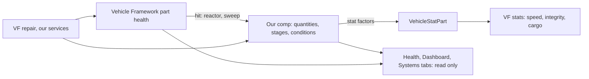

# A pawn-like health model for vehicles: research and direction (8 Nov 2026)

A design record. The owner's primary aim for the vehicle work (8 Nov 2026): a health and injury model for vehicles and aircraft as
detailed as the game's for colonists, where the detail is most extreme, with NPC vehicles allowed to be far more diffuse, and
**performance as the one hard constraint**. The first deliverable the owner named: rectify the vehicle Health tab so it shows all
the complex damage a vehicle can take, no differently from a pawn. Three read-only explorations (the game's pawn model, Vehicle
Framework's part model, our own code) and one critique fed this record. **Nothing here is tested in game, apart from one
measurement:** the owner's dev-mode cost reading of 9 Nov 2026 (Framework 0.42.0) found the whole model within its budget; its
figures are under "Performance". The four-run protocol table there is still empty.

**Merged here on 17 Nov 2026**, each kept as written: [Vehicle health, slice 3: what it does to the player](#vehicle-health-slice-3-what-it-does-to-the-player-8-nov-2026-built-9-nov-2026).

## Read this first

- **Vehicles do carry the whole pawn health stack, and Vehicle Framework switches it off.** A `VehiclePawn` derives from `Pawn`
  and gets `health`, `hediffSet`, `capacities` and `summaryHealth` at creation; Vehicle Framework (VF) then blocks hediffs, never
  ticks health, absorbs every hit into its own part model, and replaces the condition label. "Vehicles are recoded pawns" is true
  of the structure and false of the behaviour.
- **Owner's decisions (8 Nov 2026):** (1) **a condition layer on VF's parts**, VF's part health the one authority, our own Health
  tab replacing VF's; reviving the pawn hediff stack rejected; (2) this round: this record, measurement and an NPC tier, then the
  Health tab; (3) **NPC vehicles run a lite tier by default**, with a setting to run the full model for everyone (**the setting was
  removed in Framework 0.96.1**, owner, 11 Nov 2026: other factions always run the lite tier; [the audit](vehicle-other-factions-audit.md)); (4) the repair
  direction for later: **destroyed parts and serious conditions need supplies**, behind a setting; ordinary damage keeps VF's
  free repair.
- **The budget in one line:** the whole vehicle model, every map, averages **no more than 0.05 ms a tick**; nothing runs every
  tick; the Health tab costs under 0.25 ms a pass while open; a one-off spike under 2 ms is allowed only for something the player
  caused or sees. The owner's colony already runs at 36 to 50 TPS of 60, so there is no headroom to spend.
- **No second engine.** A vehicle condition is a per-part severity in the systems' existing vocabulary (quantities, stages,
  effects, flows), not a new HediffDef-like machine. One schema, one checker, one set of widgets.

## What the game does for a pawn

Read from the 1.7 decompile (`.local/decompiled/full/all.cs`, line numbers as "G:n"). Ludeon's code; our summary.

- **The body** is a tree of `BodyPartRecord`s (G:32225: `def`, children, `height`, `depth` Inside/Outside, `coverage`) from a
  `BodyDef` (G:32388); coverage decides which part a hit lands on (`coverageAbs × hitChanceFactor`, G:115321). `BodyPartDef`
  (G:32608) gives hit points (10 by default), `bleedRate`, `solid`, `destroyableByDamage` and tags such as `MovingLimbCore` or
  `ConsciousnessSource` that the capacity workers look for.
- **Conditions are hediffs.** `HediffDef` (G:38393) has stages (`minSeverity`, `label`, `lifeThreatening`, `painOffset`,
  `capMods`, `statFactors`, `partEfficiencyOffset`, `destroyPart`, `deathMtbDays`; G:38987) and comps (tend duration, severity per
  day, gets permanent, disappears, immunizable). `Hediff_Injury` (G:122710) turns severity into pain and bleeding; `Hediff_MissingPart`
  (G:123994) marks a part gone. `HediffSet` (G:114348) holds them with cached pain, bleed and capacities, all cleared together by
  `DirtyCache` (G:114722).
- **Capacities** (`PawnCapacityDef`, G:40593; workers from G:444846) are computed from tagged parts' efficiencies and every hediff's
  `capMods` (G:126012), with **impactors** (G:125948-126005) that explain each figure in the tooltip: "left leg 40%", "gunshot".
- **Downed** is pain shock, no consciousness, or no moving (G:136636); **dead** is a hediff that kills, a lethal capacity at zero, or
  injuries past 150 × health scale (G:136645-136699).
- **The Health tab** (`HealthCardUtility.DrawPawnHealthCard`, G:644225): the left 37.5% lists capacities with a colour per band (red
  at 0, then under 0.4, 0.7, 1, equal to 1, blue above; G:645208) and the impactor tooltip (G:645010); the right lists hediffs
  grouped by part, sorted by height and coverage (G:644357), each row with the part's condition colour (0.4, 0.7, 0.999;
  G:112939), "label x3" grouping, bleed and tend icons, and a tooltip of stage, effects and cause. Mechanoids use it unchanged: solid
  parts take the Crack injury, no pain, no bleeding, no natural healing, no tending (G:113402, G:115669, G:136069, G:137145).
- **Cost:** `Pawn_HealthTracker.HealthTick` (G:137044) ticks every hediff every tick, plus interval work (healing every 600 ticks,
  givers every 60, severity comps every 200; G:137091). That is the cost VF removed for vehicles.

## What Vehicle Framework does for a vehicle

Read from VF 1.6's assembly (`.local/decompiled/VehicleFramework-1.6/Vehicles.decompiled.cs`, "VF:n"), the one the 1.7 game loads
today, and Combat Extended's vehicle compatibility (`.local/decompiled/CE-VehiclesCompat/VehiclesCompat.decompiled.cs`, "CE:n").
SmashPhil's and the CE team's code; our summary. **VF 1.7 may change any of it.**

**The pawn stack, switched off.** The game creates every pawn component for a vehicle (G:445057; VF calls it at VF:33417). VF then:
blocks `Pawn_HealthTracker.AddHediff` for vehicles (VF:47449); never calls `HealthTick` (`VehiclePawn.Tick`, VF:17202, 17260);
sends all damage to `VehicleStatHandler.TakeDamage` and marks it absorbed (`PreApplyDamage`, VF:15461); gives vehicles a 1-HP
empty body, FleshType `MetalVehicle` (neither flesh nor mechanoid), `doesntMove` and `alwaysAwake`; forces the downed checks off
and natural healing off; and replaces the condition label with Immobile, Beached, Dead, Injured (below 95%) or Healthy (VF:47412).

**Parts.** A `VehicleComponent` (VF:8763; its properties VF:9070) is: `health` (an integer), `depth` External or Internal, a
`hitbox` of cells relative to the vehicle's centre in its north-facing frame (VF:7843-7909), `armor` (a list that replaces the
vehicle's armour stat when given, VF:9006), an `efficiency` curve from health percent (default: nothing below 25%, 40% at 40%, 70% at
70%, full from 85%; VF:9115-9144), `efficiencyWeight`, `hitWeight`, `categories` (which `VehicleStatDef`s it feeds), a
`priorityStatEfficiency` flag (a priority part is a ceiling on the stat, VF:9908), `reactors`, and a `compClass` a mod may subclass
in XML (`TakeDamage`, `HealComponent` and `DrawIcon` are virtual; `Efficiency` is not). `HealthPercent` is rounded to 0.01 (VF:8806):
a part above 99.5% counts as full and is never repaired. **There are no linked parts, no "required for movement", and the `tags`
list is never read** (VF reads `.tags` only on terrain).

**Stats are the capacities.** A `VehicleStatDef` (MoveSpeed, BodyIntegrity, CargoCapacity, flight speed and the rest) combines the
efficiencies of the parts in its `categories` by its `operationType` (lowest, highest, sum, or a weighted average; VF:9918), with
priority parts as a ceiling; the result multiplies the base value plus upgrade offsets (VF:8374-8452). Stats are cached and all
dirtied together on `DamageTaken`, `Repaired`, cargo changes and the 250-tick `ScanRare` (VF:14208-14231). `BodyIntegrity` is total
health over total maximum (VF:8732). At `MoveSpeed` of 0.1 or less the vehicle undrafts and cannot move (VF:8900, 13733).

**Damage.** A hit picks a cell (an explosive's registered cell, else the occupied cell nearest the instigator; VF:10041-10082),
then up to `max(width, length)` passes at that same cell (VF:10209): External parts there weighted by `hitWeight`, then Internal
there, then any Internal, then any part (VF:10225-10267). Before each part, `HitPawn` (VF:10426) may give the whole hit to an
occupant instead: `chanceToHit` 0.3 per role (VF:17546), times 1.25 for an exposed role or the cell, 1 one cell along, 0.75 for a
neighbour; the direction looks unrotated against the vehicle's frame (VF:10503). Armour: a roll under half of (armour minus
penetration) deflects, under all of it halves and blunts (VF:8960-8987). What passes on to the next part is only the overflow
below zero, and only when the part is already below half (VF:8909-8920): **that is the whole of "propagation"**. EMP electrifies
every part (VF:10363); extinguishing damage puts out fire (VF:10410).

**Reactors** (VF:8001) are the per-hit hook: `Reactor_Explosive` fires at a health threshold (never on a hit straight to zero,
VF:8020-8083) at a cell from the raw hitbox list, so a side-defined part explodes at the centre; `Reactor_FuelLeak` is read by
`CompFueledTravel`, which leaks fuel and filth per tick while the tank is below its threshold (VF:19616-19698). **`Reactor.Repaired`
has no caller anywhere** (VF:8009).

**Death.** `BodyIntegrity` under 0.01 calls `Kill` (VF:8904; CE:575). `Kill` drops the inventory and makes a wreck building at 10%
only when `spawnWreckage` is true, **and no caller passes true** (VF:15609-15714): by default nothing is left. Crew walk out
unharmed on destroy (VF:15545); in deep water they roll a drowning check (VF:15686).

**Repair.** `JobDriver_RepairVehicle` (VF:2310) heals the first damaged part in `ComponentsPrioritized` (display priority, then
lowest health; VF:9622) by the vehicle's `RepairRate` each time 60 work is done, **with no materials** (VF:2337); a caravan repairs
one part every 300 ticks while its repairing flag is set (VF:87951). `HealComponent` fires `Repaired` and `HealthChanged` (VF:8955).

**Saves.** Parts are saved as a list of healths and rebound to the design **by index** (VF:10613-10629): append-only, which our
`PartsOnLoad` patch already tolerates (`Service/Patches.cs`). Health upgrades appear to heal their part fully on every load
(`VehicleUpgrade.Unlock` with `unlockingPostLoad`, VF:34509): inferred, not seen.

**VF's Health tab** (`VehicleTabHelper_Health`, VF:71123-71692; static, private, no extension points): 690 × 430; the left 250 px a
stat list drawn by the public virtual `VehicleStatWorker.DrawVehicleStat` (VF:8610) for `VehicleDef.StatCategoryDefs()` (VF:12143);
the right a flat parts list **in Def order** (VF:71470) with health %, efficiency %, armour per category and the reactor's icon;
hover sets the internal `HighlightedComponent` (VF:13729) and the map draws the hitbox (VF:16050, 10534). **It draws no vehicle.**
It is registered in XML (`VehiclePawnBase.xml`, line 78), so it can be replaced without Harmony. The caravan manifest's "more
details" window draws the same panel (VF:81722); a replaced tab does not reach it.

**Under Combat Extended** the whole damage path is replaced (a prefix on `VehicleStatHandler.ApplyDamage`, CE:98): CE traces a line
of cells along the shot, sorts parts by `Rand.Value × hitWeight` ascending (CE:522-529), uses `Efficiency × ArmorRating` as the
armour (CE:621-644), **writes `component.health` directly, calls every reactor with the pre-armour damage and twice per part, fires
`DamageTaken` but never `HealthChanged`, and bypasses a custom `compClass`'s `TakeDamage`** (CE:548-578). VF's damage multipliers,
EMP and extinguishing are lost under CE.

### Vehicle Framework's development branch (read 8 Nov 2026)

Read before freezing slice 2's Def shape, as the roadmap asked: SmashPhil's `develop` branch (github.com/SmashPhil/Vehicle-Framework,
last pushed 31 October 2026, MIT), cloned read-only into `.local/research/VehicleFramework-develop` and diffed against `release/1.6`
(147 commits, 920 files). SmashPhil's code; our summary. **Nothing here is released yet**; the 1.7 game still loads VF 1.6.
(Note, 17 Nov 2026: since 14 Nov 2026 Vehicle Framework ships a 1.7 build; see the [dependency audit](dependency-audit-2026-11-16.md).)

- **The health model is unchanged.** `VehicleComponent`, `VehicleStatHandler`, the reactors and `VehiclePawn_Health` differ from
  1.6 only in comments, logging and formatting. Reactors still run inside `VehicleComponent.TakeDamage` after the health is
  written (`VehicleComponent.cs` 113-123); `Reactor.Repaired` still has no caller; the `Penetration` result is `NonPenetrated`,
  `Deflected`, `Diminished`, `Penetrated` or `Electrified`, and a hit made with `ignoreArmor` reports `NonPenetrated` like any
  other. No part conditions of VF's own: the Def shape below does not collide with anything coming.
- **New: hand brakes.** With VF's setting `useHandBrakes` (on by default), braking damages every part tagged `Wheel` with
  `Scratch`, ignoring armour, `brakeDamagePerNode` (0.15) per path node decelerated (`VehiclePathFollower.EngageBrakes`, 528-552).
  The scratch goes through `TakeDamage`, so it fires reactors and `DamageTaken` like a real hit. VF's own Defs tag no part, but
  ten of the owner's subscribed Workshop mods have `<li>Wheel</li>` in their vehicle Defs (Vanilla Vehicles Expanded among them), and our Wheels role binds by
  that tag. Consequences: condition rules must filter by kind of damage (built: `exceptDamageDefs`), and wheels will wear twice once
  this ships, VF's health loss beside our tread wear. **Open question for the owner when VF 1.7 ships**: leave both, or have tread
  wear stand down while VF's hand brakes are on. **VF 1.7 shipped on 14 Nov 2026 with hand brakes exactly as read here** (on by
  default, `brakeDamagePerNode` 0.15), so the question is now live ([dependency audit](dependency-audit-2026-11-16.md)).
  **Answered by the owner, 16 Nov 2026: leave both**, as they measure different things; nothing to build (outstanding-work V9a).
- **New: acceleration and braking** (`AccelerationController`, an `AccelerationRate` stat, a `Braking` event, tyre screech): may
  meet our drivetrain's speed cap; to read when it ships, not now.
- **New events:** `FactionChanged`, `PositionChanged`, `RotationChanged`.
- **Destroy now drops leavings** through the game's `GenLeaving.DoLeavingsFor` before converting the destroy mode (VehiclePawn.cs,
  Destroy): a vehicle Def's own leavings will drop on death. Relevant to the wreck question in slice 3.
- **The Health tab** loses its unused "job settings" page; nothing else moves. Our replacement is unaffected.
- **Other patches on the damage path** (read with `scripts/query-code.py` after decompiling both mods into `.local/decompiled`):
  the Hind's and the Mongoose's `NearestPart` prefix only moves a hit's cell to the nearest outer part, for their own vehicles;
  their `Critical` postfixes queue the game's `Kill` when a part listed in their extension reaches zero, wound the crew and start
  crash fires. Neither changes what a condition sees.

### Pawn to vehicle: the honest analogues

| Pawn | Vehicle | Verdict |
| --- | --- | --- |
| Capacities with impactors | VF's stats, with the parts in each stat's categories and our stage factors as the impactors | Imitate the presentation; no new capacity list |
| Pain | Nothing | Do not imitate |
| Bleeding, and the bleed-out clock | Leaks: fuel (VF's own), coolant, oil, hydraulic fluid draining toward a stage that stops the vehicle; the hours from the core's `ConditionDangerRule.ExpectedHoursToDeath` | Imitate through the quantities that exist |
| Consciousness | Control: can it be driven and steered (VF undrafts at 10% move speed; our refusals; the Harrier's flight-control rule) | Name it in the tab; no new state |
| Downed | Immobilised, a label derived from VF's stats and our refusals | A label only; never the pawn's Downed state, which drags rescue, hauling and arrest logic in |
| Death | VF's BodyIntegrity kill; nothing is left by default | VF decides death; a recoverable wreck is a later, separate question |
| A life-threatening stage | A condition that will destroy the vehicle (fire, thermal runaway, a seized engine) | Imitate, through the core's danger rule, for triage-style grading |
| Infection, disease | Slow conditions: corrosion, contaminated fuel, cold-running wear | Later; rare tick only |
| A permanent scar | A warped head, a bent chassis: an efficiency loss until a rebuild service | Later (slice 3) |
| Tending | A field fix with a component that slows a leak without repairing the part | Later (slice 3) |
| Natural healing | None; VF turns it off | Do not imitate |
| A missing part | A part at zero health; VF repairs it free | Change the rule (owner, 8 Nov 2026): a destroyed part needs replacement supplies, behind a setting (slice 3) |
| Crew injury | VF's `HitPawn` onto real pawn health | Display a crew row; never duplicate |

## What we already have

- **Parts bound to roles by effect, never by name** (`Service/VehicleSystems.cs` `Apply`, 89-165; `Defs/SystemDefs.cs`
  `PartFinder`, `PartToAdd`, `PartRoleSpec`), appended parts with hitboxes borrowed from a reference part (`cellsOf`), and a reactor
  on every bound part (`Reactor_PhobosVehicleSystems`, `Service/Patches.cs` 144-158) that counts **health lost**, polled again on
  the rare tick (`SweepPartHealth`), so a hit counts once whether VF or CE delivered it (`CompPhobosVehicleSystems` 572-640).
- **Stages and effects shaped like HediffDef** (`QuantitySpec`, `StageSpec`, `Effect_*`, `When_*`, `Input_*`; `Schema/*.cs`), with
  `Effect_DamagePart`, `Effect_Breakdown` and `Effect_Explosion` acting on parts, `WearRole`, `BreakRole`, `PartEfficiency` and
  `RoleShareBelow` reading them, services with supplies and restores, and `VehicleStatPart_PhobosSystems.ExplanationPart`
  (`Patches.cs` 136) already putting our stage factors into VF's stat tooltip through `comp.StatFactorReasons`.
- **Presentation:** the Dashboard, Systems and world tabs sharing one `Draw(comp, rect, onWorld)` each; `PhobosWidgets` (gauges,
  warning lights, `HealthColour`, history graphs), `TabState<T>`, `PhobosTabs`; the Systems tab's parts list by role with hover
  highlight through the one reflection setter for `HighlightedComponent`.
- **Core rules** we can reuse unchanged: `ConditionDangerRule` (how soon a condition kills), `TriageRule` and `ConditionClassRule`
  (grading by effect), `LastingRule`, `SupplyRules`, `HistoryRing`; `MapPatientCache` as the per-map cache pattern;
  `FrameWorkQueue` with its 12 ms budget for one-off long jobs.
- **Gaps:** only role-bound parts carry our reactor, so hits on side panels and other authors' unbound parts are never seen;
  `lastPartHealth` is derived, so the first look after a load sets the baseline; nothing of ours is timed in game (the only timing
  is a 50 ms xunit ceiling, `DrivetrainTests.cs` 158-172); **`CompPhobosVehicleSystems.Usable` (line 162) does not look at the
  faction, so every raider's vehicle runs the full systems update each rare tick**; the medical layer keeps vehicles out by design
  (`Patients.IsFleshPerson`).

## Our parts and a vehicle's destruction (16 Nov 2026)

**The owner's question** (16 Nov 2026, from the save PG8): allies took "an inordinate amount of time" to destroy an enemy town's
vehicles. Read from the save and the code (Vehicle Framework 1.7, Combat Extended's vehicle compatibility, RimPacts' build of
16 Nov 2026):

- **Most of the time was RimPacts', not ours.** The empty Highwayman was a RimPacts assault target: 11 of the ally's 19 soldiers had
  it as their focus and fought it by hand (57 log entries, every one melee or fire: mechs kicking, a soldier clubbing it with an
  anti-tank rifle's stock, over two in-game hours), because the game's order for a non-threat target is to trash it and nobody fires at
  an empty vehicle. Patched in D'thorga Patches 0.19.3 (temporary-patches.md, row 17).
- **Our parts made it tougher too.** Vehicle Framework destroys a vehicle when its body integrity, every part's health over every
  part's full health, falls under 1 % (`VehicleComponent.TakeDamage`; Combat Extended's `DamageComponent` asks the same stat). The
  parts we append joined that sum: on the Highwayman under Combat Extended, 12 parts and 275 health against its author's 1,650
  (about 17 % more; about 27 % without Combat Extended, whose patch raises the armour plates).

**The audit (owner's answer, 16 Nov 2026: "only leave the parts out that belong to us where they wouldn't matter ... parts that are
critical to the wellbeing of a vehicle still remain").** Of the 22 parts our loadouts can append:

| Counts (does a job on the vehicle) | Left out (an empty mounting point for a fitting) |
| --- | --- |
| Alternator, battery, starter motor, oil pump, fuel pump, gearbox, radiator, water pump, drive belt, brakes, clutch, avionics bay, traction battery, DC-DC converter, air compressor, hydraulic lines, main rotor gearbox | Auxiliary tank cradle, lamp bracket, winch mount, ferry tank tie-downs, hook mount |

A part left out can still be hit and broken, with every effect it had; it neither keeps a wreck standing nor brings a vehicle closer to
destruction. `PartToAdd.countsTowardDestruction` marks it; `VehicleStatWorker_PhobosBodyIntegrity` (set on the stat by an XML patch, no
Harmony) sums the rest, through `IntegrityRule` with tests. A vehicle without our systems is summed exactly as Vehicle Framework sums it.
On the Highwayman under Combat Extended our share falls from 275 to 195 health (about 12 % more than its author's). Framework 0.114.5,
Vehicles 0.56.2; not yet tested in game. **Agent's reading:** the rest of our parts are real systems a crew would need, so they stay.

## The direction

**Why not revive the pawn stack.** It is a patch war with a framework whose 1.7 rework is weeks away: counter-prefixing VF's
blocks on hediffs, downing and healing by patch order. It pulls every pawn-health patch in a 340-mod list (More Injuries, MSE2,
Smart Medicine, CE, RimHUD) onto vehicles, which VF switched the stack off precisely to avoid. It mirrors VF's part health in
hediffs, and mirrors drift: VF repairs, CE's silent writes and upgrades changing maximum health would all need re-syncing. It
needs a generated BodyDef per vehicle for every VF vehicle in the list, with coverage and depth that mean nothing for a box of
parts, and retrofit-by-effect cannot build a coherent tree from `categories` and `depth` alone. It breaks saves on any body
change and leaves unknown Defs in every vehicle's health tracker on uninstall. And it is per-tick health work, the one thing the
constraint forbids. The game's tab would also show Consciousness, Talking and Eating for a truck unless a second fake capacity set
were built, when VF's stats already are the capacities.

**The condition layer** (owner's choice). VF's part health stays the one health number; nothing duplicates it. A **condition** is a
per-part severity quantity with stages and effects in the existing systems vocabulary, keyed by the VF part's key and saved by key
in our comp with stable Scribe keys (a condition whose part is gone is dropped with one log line; the uninstall sweep drops them
all). Conditions arise from **hits** (a rule from the damage kind and the part's role or depth to a condition, like
`DamageDef.hediff` for pawns: a bullet to a tank is "punctured, leaking"; flame is "burning"; EMP is "fried electronics"),
from **stages** (an `Effect_AddCondition` on a system's stage), and from **wear**. Hits reach it through the existing reactor,
made idempotent per tick and part because CE calls reactors twice, and the rare-tick sweep; repairs through VF's `Repaired` event
and the sweep, never `Reactor.Repaired`. Effects act at stat level through the existing `VehicleStatPart` (no patch on the
non-virtual `Efficiency` getter unless the owner later wants the efficiency column itself to move). Conditions resolve by
`clearsOnRepair`, by fading flows, or only through a service with supplies, so VF's free repair cannot silently remove a seized
engine. What is generic (the detail tier rule, the timing accumulator, any widget a second tab needs) goes to the Framework core in
the change that first uses it.

## Performance

The owner's colony runs at 36 to 50 TPS of 60 at normal speed (screenshots, 8 Nov 2026): each tick already costs about 20 to
28 ms against a 16.7 ms frame. The budget is therefore "nothing you can see on top of that", measured on the owner's high-end PC
and treated as a best case for players (AGENTS.md).

| Where | Budget | Notes |
| --- | --- | --- |
| The whole vehicle model, simulation side, all maps | **average at most 0.05 ms a tick**; a single tick at most 0.5 ms | The ceiling is one full-tier vehicle's rare-tick evaluation or a burst of hits |
| One full-tier vehicle | at most 0.1 ms per rare tick (every 250 ticks); at most 0.02 ms of our code per hit; nothing per ordinary tick | Ten player vehicles then cost about 0.004 ms a tick amortised |
| One lite-tier vehicle | nothing per rare tick; at most 0.01 ms per hit | Hits are counted; nothing evolves |
| Load time | at most 50 ms once, for injection and schema resolution | Not counted against the tick |
| The Health tab, open | at most 0.25 ms per OnGUI pass | IMGUI draws a tab at least twice a frame (layout and repaint), so about 0.5 ms a frame; per-frame cost runs while paused and scales with frame rate, not tick rate, and is paid only while a vehicle is selected with the tab open |
| Allocations | none in the rare-tick and per-hit paths | Garbage collection spikes are what players feel |

**Measured in the owner's game, 9 Nov 2026** (Framework 0.42.0, 2,518 ticks, 12 vehicles in full detail and 3 in light; a best case, on a high-end PC):

| Where | Measured | Budget | |
| --- | --- | --- | --- |
| The whole model, average per tick | 0.0076 ms | 0.05 ms | Within, about 15% of it |
| Worst single call | 0.358 ms | 0.5 ms | Within |
| One full-tier vehicle, rare tick | 0.131 ms on average, 0.358 ms at worst | 0.1 ms | **Over**, by about a third |
| One hit | 0.0003 ms | 0.02 ms | Within |
| One lite-tier vehicle, rare tick | 0.014 ms | nothing | **Over**: the part-health sweep, kept so Combat Extended's hits are counted |
| The drivetrain sample | 0.029 ms a call | | No budget set |

**When exceeding it is acceptable:** once, bounded under 2 ms, for something the player caused or sees: a burst of hits, opening
a tab, a save conversion, Def load. **Never** on a cadence, never per frame with no tab open, never anything per tick that scales
with parts times conditions. The 12 ms frame work queue is for one-off long jobs, never the steady state.

**NPC vehicles, the diffuse tier** (owner, 8 Nov 2026: lite by default, a setting to run the full model for everyone; the setting
was removed in Framework 0.96.1, so other factions always run lite). A pure rule
in the core decides each vehicle's tier from its faction and whether it is spawned: a player vehicle is **Full**; a non-player
vehicle on a map is **Lite** (no rare-tick integration, no history, no services, no loads; hits are counted and a condition's
effect is applied once and never evolves); a non-player vehicle not on a map is **Off**. The tier is re-read on the rare tick
(one faction comparison), so a captured vehicle wakes to Full from its saved values, consistent with "derived state is never
saved".

**How to measure**, in order of effort: (1) Dubs Performance Analyzer (in the owner's list): the Tick category by ThingComp for our
comp, the GUI category by ITab for the tabs, and its custom-method entries for
`Phobos.VehicleSystems.CompPhobosVehicleSystems:CompTickRare`, `UpdateNow`, `Notify_PartSeen`,
`VehicleStatPart_PhobosSystems:TransformValue` and the Health tab's `FillTab`; its hooks add overhead, so it ranks rather than
measures. (2) The 1.7 Frame Profiler: instrument `PhobosFramework.Vehicles` (and VF's `Vehicles` for comparison) and filter
`PhobosFramework.Vehicles!Phobos.VehicleSystems.CompPhobosVehicleSystems.CompTickRare`; whether the filter is exact or a prefix is
unknown until tried. (3) Our own dev-mode timing readout (slice 0), which alone can split full-tier from lite-tier cost.

**Protocol (owner runs it):** one saved colony; three runs each, one in-game day at speed 3: baseline with the vehicle systems
off; on, tabs closed; the Health tab open on one vehicle; during a vehicle raid (VTOL Raids and RimPacts convoys bring NPC
vehicles). Record TPS and our milliseconds in the table below.

| Run | TPS | Our ms a tick (average, worst) | Tab ms a pass | Vehicles (full, lite) | Date |
| --- | --- | --- | --- | --- | --- |
| Baseline, systems off | | | | | |
| On, tabs closed | | | | | |
| Health tab open | | | | | |
| Vehicle raid | | | | | |

## Roadmap

| Slice | What | Needs | Status |
| --- | --- | --- | --- |
| 0 | **Measurement and the NPC tier:** the core detail-tier rule (tested) and timing accumulator; `CompTickRare` by tier; the setting "Every vehicle runs the full model" (off; removed in Framework 0.96.1); dev actions for the timing report and tiers | nothing | Built in Framework 0.25.0 (this round); not yet tested in game, apart from the owner's cost reading of 9 Nov 2026 (within budget) |
| 1 | **The Health tab as a projection of what exists:** replaces VF's tab in `inspectorTabs` (a setting keeps VF's); VF's stats drawn by us from its figures (its drawing helper takes a Unity type the 1.7 build cannot pass) with an impactor tooltip (the parts in each stat's categories and our factors); parts grouped External then Internal by role, each with health, efficiency and armour; under each part the stages, refusals and VF leaks that already exist; a crew row; hover lights the hitbox; the same tab on the world map | slice 0 for honest numbers | Built in Framework 0.26.0 (this round); not yet tested in game |
| 2 | **Conditions proper:** per-part severity quantities keyed by part; hit-born (damage kind by role or depth, from the reactor, idempotent), stage-born (`Effect_AddCondition`), wear-born; stat effects through the existing stat part; `clearsOnRepair`, fading, or a service; the tab's "under each part" slot fills; the schema check covers them | slice 1's slot; slice 0's tier; SmashPhil's develop branch read (above) | Built in Framework 0.29.0; not yet tested in game |
| 3 | **Consequences and repair depth:** leaks as conditions with the danger clock ("engine seizes in about 2 h"); destroyed parts need replacement supplies (owner, setting on); field fixes; permanent conditions; the part-efficiency postfix only if the owner wants the efficiency column itself to move; wreck-on-death as a separate recorded question | slice 2 | Built in Framework 0.36.0 (and Vehicles 0.14.0): the danger clock, destroyed parts needing supplies, one serious condition needing a service, and field fixes; permanent damage and wrecks left out ([slice 3's record](#vehicle-health-slice-3-what-it-does-to-the-player-8-nov-2026-built-9-nov-2026)); not yet tested in game |

### Slice 2 as built (Framework 0.29.0)

- **The Def** (`PhobosVehicleConditionDef`): `label`, `description`, `stages` (the systems' own `StageSpec`, over a severity of 0
  to 1), `fadePerHour`, `clearsOnRepair` (true by default). Its severity is a `QuantitySpec` built from the Def, so the stage rule,
  the tabs' formatting and the stage colours work on it unchanged: **no second engine**.
- **Sources:** a part-hit rule with `condition` (severity per hit point lost) and the filters `armorCategories`, `damageDefs` and
  `exceptDamageDefs`; the kind of damage is recorded by our reactor and consumed when the health it cost is counted, so Combat
  Extended's double reactor calls add once. `Effect_AddCondition` gives one from any system's stage, so wear-born conditions are
  the same effect in a wear stage.
- **Resolution:** a rise in the part's health to full (99.5%, VF's own repair limit) clears a `clearsOnRepair` condition; a
  condition on a part that was already full is not cleared by standing there (the core's `SeverityRule`, tested). Fading by
  `fadePerHour`. A service lists conditions in `clearsConditions`, falls due while one is held, and clears them.
- **One list of stages in force** now feeds the refusals, the stat factors, their explanations and the charge factor, systems and
  conditions alike. A condition's effects run in the context of the system that gave it, and stand down while that system is
  switched off.
- **Saved** by part key in the systems comp (`PhobosVehicleSystems_Conditions`); a condition whose part is gone is dropped with one
  log line on the next update; one whose Def is gone is dropped on load; the uninstall sweep clears them.
- **Content, agent-authored for the owner's review:** a holed radiator (three leak rates), a shorted battery (two drain rates), a
  warped cylinder head from boiling over (extra heat, then 10% slower). Every figure authored; sources for the behaviour in
  `Conditions.xml`.
- **Not in this slice:** the danger clock for leaks, destroyed parts needing supplies, field fixes and permanent conditions (slice 3).

## Risks and unknowns

- (Note, 17 Nov 2026: Vehicle Framework has shipped a 1.7 build since 14 Nov 2026; the [dependency audit](dependency-audit-2026-11-16.md)
  says what changed for us.) **VF 1.7 is unknown:** the tab hook order, `inspectorTabs` XML, the internal `HighlightedComponent`, event names, the
  `VehicleComponent` surface, and whether VF adds part conditions of its own. Slice 1 is a projection and survives most of that;
  slice 2's Def shape waits for a branch read; every VF-internal access goes through one accessor class so a rename is one fix.
- **CE's bypasses:** no `HealthChanged`, no virtual `TakeDamage`, reactors with pre-armour damage twice. Health-lost accounting
  (exists), invalidation on `DamageTaken`, idempotent condition triggers, and never a `compClass` override for damage.
- **`Reactor.Repaired` has no caller in VF 1.6:** hook the `Repaired` event and the rare-tick sweep.
- **Parts saved by index:** conditions keyed by part key; a condition whose part is gone is dropped with one log line; the
  uninstall sweep drops them all.
- **Two health panels:** VF's caravan manifest window keeps VF's panel; players may see two layouts. Recorded; cover later or accept.
- **Other mods patch the damage path too** (read with `scripts/query-patches.py`, 8 Nov 2026): besides Combat Extended's
  prefix that replaces `VehicleStatHandler.ApplyDamage`, the Hind and Mongoose helicopters add priority-800 prefixes to it
  ("NearestPart") and postfixes on `TakeDamage` and `RecalculateHealthPercent` ("Critical"); the BMP-1 patched `ExposeData`
  and `GetStatValue` too, but it left the Workshop and the owner's list the same day. Slice 2's hit-born conditions must hold with all of them; read their code with
  `scripts/query-code.py` before freezing the Def shape.
- **A postfix on `VehicleComponent.get_Efficiency`** would run on every stat recompute of every vehicle, NPC included; if it is
  ever added it must be a dictionary miss for vehicles without conditions. The stat-level path is preferred.
- **VF's free repair against conditions:** replacement supplies for destroyed parts is a balance change for every VF vehicle; it
  needs its setting, and other authors' vehicles are included.
- **Nothing is measured yet:** every figure above is a budget. The table must be filled before slice 2 ships. (Measured since: the
  owner's reading of 9 Nov 2026, under "Performance".)
- **NPC vehicles ran the full model** until slice 0: the owner's TPS before it cannot be attributed to any one cause.
- **VF's own oddities, recorded and not fixed:** the crew-hit direction looks unrotated (VF:10503); health upgrades appear to heal
  fully on every load (VF:34509); a side-defined explosive part explodes at the vehicle's centre (VF:8066).

## Who chose what

- **Owner (8 Nov 2026):** the aim (pawn-like detail for player vehicles, diffuse for NPCs, performance first); the Health tab as the
  first deliverable; the condition layer on VF's parts rather than the pawn stack; this round's scope; the lite tier by default
  with a setting; supplies for destroyed parts and serious conditions, behind a setting, later.
- **Agent, with the owner's approval of the plan:** the no-second-engine rule; every budget figure; the measurement protocol; the
  analogue table's verdicts; the slice order and what each needs; the condition sources and resolution rules sketched for slice 2.
- **Agent choices in slice 2, owner to revise:** the Def shape above; the filters' names; repairs clearing at full health only
  (not severity falling with partial repair); a condition's effects reading the figures of the system that gave it; the three
  conditions, their stages and every rate.
- **Agent defaults, owner to revise:** the Health tab's layout (VF's stat rows kept, the pawn-style grouping on the right); the
  tier rule's exact gates; the timing labels.

## Sources

- Ludeon Studios, RimWorld 1.7 (decompiled to `.local/decompiled/full/all.cs` for research; never committed).
- SmashPhil, Vehicle Framework 1.6 (`.local/decompiled/VehicleFramework-1.6/`), MIT; its `develop` branch at commit b557926d
  (31 Oct 2026), [github.com/SmashPhil/Vehicle-Framework](https://github.com/SmashPhil/Vehicle-Framework/tree/develop), read in
  `.local/research/`.
- The authors of the Hind Helicopter Gunship and Mongoose Attack Helicopter (Workshop 3822052079 and 3819896964), decompiled for
  research into `.local/decompiled/`.
- The Combat Extended team, Vehicle Framework compatibility (`.local/decompiled/CE-VehiclesCompat/`).
- Our records: [vehicle systems](vehicle-systems-design.md), [Vehicle Framework mechanics](vehicle-framework-mechanics.md),
  [the vehicle tabs](vehicle-tabs-design.md), [analysis tooling](analysis-tooling.md) (why milliseconds per tick have no file we
  can read), [the RimWorld modding reference](rimworld-modding-reference.md) (the 1.7 Frame Profiler).

## Vehicle health, slice 3: what it does to the player (8 Nov 2026, built 9 Nov 2026)

*Merged into this record on 17 Nov 2026 from `vehicle-health-consequences.md`; kept as written.*

**Status: built in Framework 0.36.0 and Vehicles 0.14.0, on the owner's go of 9 Nov 2026. Not yet tested in game, nor is slice 2 it builds
on.** The answers to its questions are in [Decisions](#decisions-9-nov-2026). Findings marked "from the code" are read from our decompile of Vehicle Framework
1.6 (the build the 1.7 game loaded then) and summarised in our own words; what this record says will happen in play is a proposal.
(Note, 17 Nov 2026: since 14 Nov 2026 Vehicle Framework ships a 1.7 build; see the [dependency audit](dependency-audit-2026-11-16.md).)

This record answers the project's rule that every new behaviour says, before it is built, what it lets the player do, what it stops
them doing and how it changes the way they play. The architecture is settled in [the vehicle health design](vehicle-health-design.md).

### Read this first

- **Built:** the danger clock, destroyed parts needing supplies, one serious condition needing a service, and field fixes. **Permanent
  damage is left out for now, and wrecks wait until Vehicle Framework 1.7 ships.** (Vehicle Framework 1.7 shipped on 14 Nov 2026;
  wrecks are still not built.)
- **The player sets the prices** in the mod settings: engines and transmissions at 100% of the whole part by default, everything else
  at 50% of its materials (agent default for the 50%).
- **Every vehicle from every mod is affected** by destroyed parts needing supplies, so it stays behind a setting (on by default, the
  owner's decision of 8 Nov 2026).
- **Other factions' vehicles are left out** of all of this: they run the light model, and a raider must never be stranded by it.

### What each behaviour does to the player

| Behaviour | What it lets them do | What it stops them doing | How it changes the way they play |
| --- | --- | --- | --- |
| **Danger clock** | See how long a damaged vehicle has before something worse happens ("boils over in about 2 hours") | Nothing | Damaged vehicles are triaged like patients: which can wait, which must stop now |
| **Destroyed parts need supplies** | Rebuild a part at 0% with a real replacement, from whichever mod provides it | Rebuild a destroyed part from nothing, anywhere, for free. Ordinary damage stays free | Spare parts become a stock worth making and carrying; losing a part in the field has a cost that outlasts the fight |
| **Serious conditions need a service** | Have a mechanic properly fix the worst faults | Clear them with an ordinary repair | The worst faults mean going back to a place with supplies, so overworking an engine has a lasting price |
| **Field fixes** | Slow a leak with a component or a spare, away from any base, so the vehicle can limp home | Nothing: the fix is optional. It never repairs the part | A convoy carries a small kit; a shot-up radiator becomes "drive gently for a few hours" rather than "abandon the truck" |
| **Permanent damage** (recommended out for now) | Nothing new | Have a badly damaged vehicle made good by ordinary repairs | Old vehicles become visibly worn and carry a history; rebuilding one is a project |
| **Wreck on death** (separate, not now) | Salvage something from a destroyed vehicle | Nothing | A lost vehicle stops being a total loss |

### How each would work

#### Danger clock

A line under the condition on the Health tab: what happens next and roughly when, worked out from the rates already running (a leak
draining coolant toward the level where the engine overheats). Plain mode says "about 2 hours", Operator and Engineer the figures.
It is worked out only when the tab's rows are rebuilt, so it costs nothing while the tab is closed. The core's `ConditionDangerRule`
was written for patients and reads death rolls, so the projection is a new game-free rule beside it, with tests. **It is an estimate**:
the rates change if the vehicle stops or the weather turns, and the line should say "about".

#### Destroyed parts need supplies

From the code: Vehicle Framework's repair job (`JobDriver_RepairVehicle`) heals the first damaged part by a rate, with no materials,
and a caravan repairs one part every 300 ticks. Two other mods already postfix that job's `WorkComplete`; nobody patches its work giver.

Proposed: a part at 0% is skipped by the repair job until its supplies are in the vehicle's cargo, the way a service already waits for
them, and using them brings the part back to a small share of health, from which ordinary free repair continues. The inspect text and
the tab name what it waits for. The caravan path does the same.

Supplies come **from providers by role**, as [the utility vehicles' table](utility-vehicles-design.md) already sets out (RimThunder
for engine, transmission, fuel tank and running gear; Vanilla Vehicles Expanded for electrical and cooling; our fallback parts when
neither is present), named in XML and resolved through `IfModActive` folders, never in C#. A part with no role (most of an imported
vehicle's armour and hull) costs steel and components in proportion to its health.

**The garage** (Framework 0.31.0) repairs from its own stores and does not yet know about this; it must apply the same rule, or
parking a vehicle becomes the way round it.

#### Serious conditions need a service

The mechanism exists: a condition with `clearsOnRepair` off stays until a service listing it in `clearsConditions`. The proposal is to
convert one condition first, **the warped cylinder head at its "badly" stage**, because a head that is badly warped is not put right by
patching the engine. A system has one service today, and the cooling system's is the coolant top-up, so this needs either a second
service per system or a small engine-overhaul system of its own (agent's preference: the small system).

#### Field fixes

A job a colonist does at the vehicle, using a component or a provider's spare from the cargo: the condition's stage drops by one, or
its rate halves, until the part is properly repaired. It never restores health, and a second fix adds nothing. It works in a caravan
at rest. It has its own button with its own icon, and the button says why it is unavailable.

#### Permanent damage (recommended out for now)

A lasting efficiency loss after severe structural hits, until a rebuild service, using the core's `LastingRule`. **Agent's candid
view:** it adds a slow penalty the player mostly notices as a smaller number, on top of supplies, services and field fixes that already
make damage matter. Worth reconsidering after play shows whether damage matters enough.

#### Wreck on death (not now)

From Vehicle Framework's development branch (read 8 Nov 2026): its `Destroy` now drops the game's normal leavings. Today nothing is
left when a vehicle dies. Better to see what 1.7 does before building on it.

### Cost and risk

- **Performance:** all of it runs on hits, repairs, jobs and the tab's rebuild. Nothing runs every tick, inside the budget of the
  [vehicle health design](vehicle-health-design.md) (0.05 ms a tick for the whole vehicle model). This part is still unmeasured: H4 is open (the one measurement above is of a whole vehicle's rare tick).
- **Combat Extended** writes part health directly, so "destroyed" is read from the part's health at the sweep and the repair job, not
  from an event.
- **A vehicle stranded for want of a part** is the main risk. Field fixes, and the fact that only destroyed parts cost anything, are
  the answer; a part that stops the vehicle moving is the case to watch in play.
- **Vehicle Framework 1.7 may change the repair job.** Every touch of it stays in one class.

### Decisions (9 Nov 2026)

The owner: "proceed with your H3 proposal in full", so the agent's recommendations below stand, with these additions.

- **Cost:** the whole part for engines and transmissions by default, a share of the cost for everything else, **both configurable in the
  mod settings** (owner).
- **Our own framework of parts and supplies** (owner): our parts always exist and set the cost; other mods' are accepted as substitutes
  **only where it makes sense**. This reverses "parts come from providers".
- **The framework should grow into tuning and upgrades** (owner: "one of possible tuning and full of upgrades as well"). **Not built
  yet:** it needs its own record of what each lets the player do, stops and changes, before any of it is written.

#### Calibration after the owner's test (9 Nov 2026, Framework 0.53.0)

The owner's screenshots of two wrecked raider vehicles matched the model to the percent, and showed the rules were too gentle: "the damage is not being interpreted by the
coolant and lubricant systems as harshly as it could be". The owner agreed every figure below. All are authored; not yet tested in game.

| Rule | Was | Now |
| --- | --- | --- |
| Engine role | an internal part carrying move speed, so six Vanilla Vehicles Expanded designs whose engine is marked External bound a suspension or a gearbox | a part carrying move speed and named engine comes first |
| Radiator hit, coolant lost | 1.5% per point (at most 45% on 30 points) | 90% of the share of health lost |
| Engine hit, coolant lost | 0.5% per point | 30% of the share lost |
| Oil pump hit, oil lost | 1% per point (at most 20%) | 25% of the share lost |
| Engine hit, oil lost | 0.4% per point | 60% of the share lost |
| Cracked sump | nothing went on leaking | a condition on the engine: 1%, 5% or 20% of the oil an hour; field-fixable |
| No oil pressure, under 15% | 2 points an hour, as low pressure | 20% of the engine's health an hour |
| Boiling over | 6 points an hour | 15% of the engine's health an hour |

**Lets the player:** read a shot-up vehicle's state from its gauges, and race a leak home. **Stops them:** driving a holed engine for a day. **Changes play:** after a fight, a patch kit and oil decide
whether a vehicle gets home. **Left as it was:** other factions' vehicles still do not evolve after a hit, so a raider's "pouring out" never pours (cost); the setting for the full model on every faction changes that.

#### Parts audit (9 Nov 2026, Framework 0.55.0)

The owner: "update all the different components of each vehicle too as we introduce new functionality". Checked against the owner's patched Defs of 8 November (68 vehicle designs) and our Defs. **No design has its own
radiator, oil pump, battery, starter, clutch, fuel pump or water pump, so we append them; gearboxes, alternators and a few brakes and turbos are the authors' own.** Agent's table, for the owner to revise.

| System | What it simulates | The part behind it | Result |
| --- | --- | --- | --- |
| Cooling | Coolant carried to the radiator by a pump | Radiator, engine; no pump | **Water pump added**: its health scales the radiator, and a hit costs a quarter of the coolant at most |
| Fuel | Only fuel gelling in the cold | None | **Fuel pump added**: under half health 75% speed, under a tenth the engine will not start |
| Lubrication | Level, pressure, heat | Engine, oil pump | Sound; cracked sump added in 0.53.0 |
| Electrical | Charge, starting | Battery, alternator, starter | Sound |
| Running gear, brakes, transmission | Wear and heat | Wheels, brakes, gearbox, clutch | Sound |
| Boiler, turbine, rotor, traction, hydraulics, air brakes | Their own models | Their own parts | Sound |
| Cabin | Cab temperature, heaters | None | **Left for now:** a broken heater only matters in a cab, and the cab already follows the air |
| Fan, thermostat | Curves on engine speed and temperature | None | **Left for now:** a part each would add a hit target without a choice for the player that the water pump does not already give |

**Lets the player:** lose and fix a specific, nameable fault. **Stops them:** starting an engine whose pump is gone. **Changes play:** two more small parts to carry spares for, with both priced as small mechanical parts.

#### As built

| Piece | Where | Note |
| --- | --- | --- |
| Our parts | `Parts.xml` in the Framework | Engine assembly, turbine assembly, transmission, and the two kits moved from D'thorga Vehicles |
| What each role costs | `PartSupplies.xml`, `PhobosVehiclePartSupplyDef` | The first Def that fits wins; substitutes filtered by empty mass and by turbine or not (authored) |
| Free repair leaves destroyed parts alone | Two postfixes on `VehicleStatHandler` | It leaves them for the job that fits a new part, on the map and at a garage |
| Fitting a part, a serious service, a field fix | `VehicleRepairs`, one job (Construction) | Supplies are hauled to the cargo as a service's are; another mod's part is hauled when ours cannot be found |
| In a caravan | A button per vehicle, at a halt | Done at once: an authored simplification, as the caravan jump-start is |
| The garage | Skips destroyed parts and charges nothing for them | **Limit:** it cannot fit new parts, so the vehicle has to come home for that |

### Questions for the owner (answered)

| # | Question | Agent's recommendation |
| --- | --- | --- |
| 1 | How dear is a destroyed part: the provider's whole part (a RimThunder heavy engine is 4 heavy castings and 12 components), or a cheaper repair kit? | The whole part for engines and transmissions, because the owner wants provider parts to matter; a share of the part's cost for everything else |
| 2 | Should a destroyed part with no role (hull, armour plates) need supplies at all? | Yes, but only steel and components, in proportion to its health |
| 3 | The danger clock: only on the Health tab, or also an alert when a player's vehicle has under a set time left? | Tab first; add an alert only if play shows it is missed |
| 4 | Which conditions count as serious, beyond the badly warped head? | Only that one until play shows more are needed |
| 5 | Field fixes: one job for every condition, or only leaks? | Only leaks and shorts at first: a radiator and a battery are what a field fix can honestly do |
| 6 | Permanent damage: leave out as recommended? | Leave out for now |

### Who chose what

- **Owner (8 Nov 2026):** destroyed parts and serious conditions need supplies, behind a setting, on by default; parts come from
  providers by role; the architecture of the condition layer.
- **Agent proposals, for the owner to revise:** everything in the behaviour table's wording, the order, the warped head as the first
  serious condition, a small engine-overhaul system, and every recommendation above.

### Sources

- SmashPhil, Vehicle Framework 1.6 (`.local/decompiled/VehicleFramework-1.6/`) and its `develop` branch, MIT; read for research, not copied.
- Our records: [the vehicle health design](vehicle-health-design.md), [utility vehicles](utility-vehicles-design.md),
  [the garage](vehicle-stations.md#the-vehicle-garage-and-fleet-tools-design-8-nov-2026).

## The two tabs, one answer (23 Nov 2026)

**The owner's report:** "The systems page for many aircraft and possibly vehicles too seems to be at odds with the Health page (our
one), so a bit of an audit might be required." **The owner's ask, during the audit:** "Maybe genericize how these talk with each
other, so any future updates/additions can just be picked up, where possible?" Built in D'thorga Framework 0.256.0; not yet tested in game
(rows 426, 427).

**What the code read found (agent's audit; no screenshot was needed to see these):**

- **Two answers to one question.** The Systems tab listed a system's parts by every role it names; the Health tab hung a system's
  warnings on the part of its *first* role only, and knew only the roles in the loadout's own list.
- **A turbine with one engine.** The turbine system (and cooling, lubrication and service) names the role "Engine", which the aircraft
  loadout's generic finder bound to the first part that moves flight speed or has "engine" in its key: one engine of a twin or a
  four-engined aircraft, or a cover. The numbered roles (Engine1 to Engine4) were never part of those systems.
- **Parts bound by code were roleless on the Health tab:** weapon mounts, glass, fire-fighting's bracket and systems, the spall liner.
- **Systems with no part of their own** (cabin, driver, flight controls, auxiliary electrics, water injection) showed their warnings on
  the Systems tab and nowhere on the Health tab.

**What changed, generic so later additions are picked up:**

- **`SystemParts`**, one service both tabs read: `Of` (the parts a system covers, in its roles' order, each once), `Home` (the first of
  them, where its warnings sit), `RoleByKey` (every binding, the loadout's roles first, then those bound by code).
- **Role families** (`RoleFamilyRule`, game-free and tested): any role ending in digits is a member of its base role, so binding
  Engine1 to EngineN binds "Engine" to all of them, in number order, before the reactors are set; a later numbered role needs nothing.
  No loadout bound "Engine" beside numbered engines (checked across all fourteen that bind them), so none loses a deliberate binding.
- **The Health tab** lists every bound part, hangs each enabled system's warnings under its `Home`, and lists the warnings of systems
  with no part under **Whole vehicle**, each line opening the Systems tab at that system, as part lines do.
- **The bindings report** (`SystemParts.WriteReport`, at each start; a fault is logged and never thrown) and
  **`scripts/vehicle-bindings.py`**, which audits it: systems that name roles none of which is bound, roles bound to parts that read like a
  cover, door, hatch, panel or window, and internal parts that move a stat but no role binds; `show <vehicle>` lists one vehicle's
  systems, the parts each covers, and the parts nothing binds. It reads what the game did, never a copy of its rules.

**The first report (written at the owner's start of 23 Nov 2026, Framework 0.256.0; 93 vehicles):** 1 unbound system, 131 cover-like
bindings and 134 unwatched parts. Read and settled (Framework 0.258.0, Vehicles 0.113.0):

- **The tool's own false alarms:** 121 cover-like hits were our own mounting points (the recovery mount matched "cover" in "recovery",
  the outlet and oxygen panels "panel"). The audit now leaves out parts we add, and reads what is expected by design from
  `config/vehicle-bindings.json`: the cab role's fall-back to the roof on ten armoured vehicles with no cab part (the crew sit under it),
  suspensions (no system of ours models them), wiring, intakes, and our own work parts read through their own stats.
- **A regression of 0.256.0:** the roll-up dropped the part the thruster craft call "Engine". A base role now keeps a part it held
  whose key names it (`RoleFamilyRule.KeepsBaseBinding`), never a cover.
- **The aircraft defaults named no fuel tank or landing gear**, so every aircraft without its own loadout naming them had them
  unwatched: now found by name in the aircraft parent.
- **The diesel shunter's fuel system bound nothing**, its own part list having turned the shared one off: a tank by name, and a
  fuel pump of ours added `late` (a new flag: appended after every other part we add, so saved shunters keep their parts in place).
- **Rotor drives:** the Mosquito's and Louie's transmissions and the Mi-38's tail drive joined their rotor drives.

**Left open, for the owner's eye (agent's judgement):** the Cherokee's "Front engine" and "Rear engine" beside its two turboshafts
(engines or gearboxes? the design does not say); the Smuggler's and Warbird's transmissions and fuel intakes (propeller planes with
no drivetrain of ours, so nothing models them); the Lightning's gearbox (it runs as an electric vehicle with no gearbox system). The
next report, after the owner's next start with these versions, shows what is left.

**Other factions' vehicles:** the same answer for any faction's vehicle; it changes only what the tabs show.

