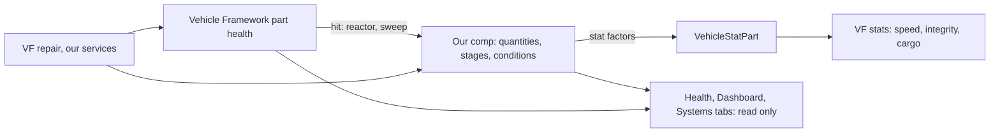

# A pawn-like health model for vehicles: research and direction (9 Nov 2026)

A design record. The owner's primary aim for the vehicle work (9 Nov 2026): a health and injury model for vehicles and aircraft as
detailed as the game's for colonists, where the detail is most extreme, with NPC vehicles allowed to be far more diffuse, and
**performance as the one hard constraint**. The first deliverable the owner named: rectify the vehicle Health tab so it shows all
the complex damage a vehicle can take, no differently from a pawn. Three read-only explorations (the game's pawn model, Vehicle
Framework's part model, our own code) and one critique fed this record. **Nothing here is tested in game**; the measured table in
"Performance" is empty until the owner runs the protocol.

## Read this first

- **Vehicles do carry the whole pawn health stack, and Vehicle Framework switches it off.** A `VehiclePawn` derives from `Pawn`
  and gets `health`, `hediffSet`, `capacities` and `summaryHealth` at creation; Vehicle Framework (VF) then blocks hediffs, never
  ticks health, absorbs every hit into its own part model, and replaces the condition label. "Vehicles are recoded pawns" is true
  of the structure and false of the behaviour.
- **Owner's decisions (9 Nov 2026):** (1) **a condition layer on VF's parts**, VF's part health the one authority, our own Health
  tab replacing VF's; reviving the pawn hediff stack rejected; (2) this round: this record, measurement and an NPC tier, then the
  Health tab; (3) **NPC vehicles run a lite tier by default**, with a setting to run the full model for everyone; (4) the repair
  direction for later: **destroyed parts and serious conditions need supplies**, behind a setting; ordinary damage keeps VF's
  free repair.
- **The budget in one line:** the whole vehicle model, every map, averages **no more than 0.05 ms a tick**; nothing runs every
  tick; the Health tab costs under 0.25 ms a pass while open; a one-off spike under 2 ms is allowed only for something the player
  caused or sees. The owner's colony already runs at 36 to 50 TPS of 60, so there is no headroom to spend.
- **No second engine.** A vehicle condition is a per-part severity in the systems' existing vocabulary (quantities, stages,
  effects, flows), not a new HediffDef-like machine. One schema, one checker, one set of widgets.

## What the game does for a pawn

Read from the 1.7 decompile (`.local/decompiled/full/all.cs`, line numbers as "G:n"). Ludeon's code; our summary.

- **The body** is a tree of `BodyPartRecord`s (G:32225: `def`, children, `height`, `depth` Inside/Outside, `coverage`) from a
  `BodyDef` (G:32388); coverage decides which part a hit lands on (`coverageAbs × hitChanceFactor`, G:115321). `BodyPartDef`
  (G:32608) gives hit points (10 by default), `bleedRate`, `solid`, `destroyableByDamage` and tags such as `MovingLimbCore` or
  `ConsciousnessSource` that the capacity workers look for.
- **Conditions are hediffs.** `HediffDef` (G:38393) has stages (`minSeverity`, `label`, `lifeThreatening`, `painOffset`,
  `capMods`, `statFactors`, `partEfficiencyOffset`, `destroyPart`, `deathMtbDays`; G:38987) and comps (tend duration, severity per
  day, gets permanent, disappears, immunizable). `Hediff_Injury` (G:122710) turns severity into pain and bleeding; `Hediff_MissingPart`
  (G:123994) marks a part gone. `HediffSet` (G:114348) holds them with cached pain, bleed and capacities, all cleared together by
  `DirtyCache` (G:114722).
- **Capacities** (`PawnCapacityDef`, G:40593; workers from G:444846) are computed from tagged parts' efficiencies and every hediff's
  `capMods` (G:126012), with **impactors** (G:125948-126005) that explain each figure in the tooltip: "left leg 40%", "gunshot".
- **Downed** is pain shock, no consciousness, or no moving (G:136636); **dead** is a hediff that kills, a lethal capacity at zero, or
  injuries past 150 × health scale (G:136645-136699).
- **The Health tab** (`HealthCardUtility.DrawPawnHealthCard`, G:644225): the left 37.5% lists capacities with a colour per band (red
  at 0, then under 0.4, 0.7, 1, equal to 1, blue above; G:645208) and the impactor tooltip (G:645010); the right lists hediffs
  grouped by part, sorted by height and coverage (G:644357), each row with the part's condition colour (0.4, 0.7, 0.999;
  G:112939), "label x3" grouping, bleed and tend icons, and a tooltip of stage, effects and cause. Mechanoids use it unchanged: solid
  parts take the Crack injury, no pain, no bleeding, no natural healing, no tending (G:113402, G:115669, G:136069, G:137145).
- **Cost:** `Pawn_HealthTracker.HealthTick` (G:137044) ticks every hediff every tick, plus interval work (healing every 600 ticks,
  givers every 60, severity comps every 200; G:137091). That is the cost VF removed for vehicles.

## What Vehicle Framework does for a vehicle

Read from VF 1.6's assembly (`.local/decompiled/VehicleFramework-1.6/Vehicles.decompiled.cs`, "VF:n"), the one the 1.7 game loads
today, and Combat Extended's vehicle compatibility (`.local/decompiled/CE-VehiclesCompat/VehiclesCompat.decompiled.cs`, "CE:n").
SmashPhil's and the CE team's code; our summary. **VF 1.7 may change any of it.**

**The pawn stack, switched off.** The game creates every pawn component for a vehicle (G:445057; VF calls it at VF:33417). VF then:
blocks `Pawn_HealthTracker.AddHediff` for vehicles (VF:47449); never calls `HealthTick` (`VehiclePawn.Tick`, VF:17202, 17260);
sends all damage to `VehicleStatHandler.TakeDamage` and marks it absorbed (`PreApplyDamage`, VF:15461); gives vehicles a 1-HP
empty body, FleshType `MetalVehicle` (neither flesh nor mechanoid), `doesntMove` and `alwaysAwake`; forces the downed checks off
and natural healing off; and replaces the condition label with Immobile, Beached, Dead, Injured (below 95%) or Healthy (VF:47412).

**Parts.** A `VehicleComponent` (VF:8763; its properties VF:9070) is: `health` (an integer), `depth` External or Internal, a
`hitbox` of cells relative to the vehicle's centre in its north-facing frame (VF:7843-7909), `armor` (a list that replaces the
vehicle's armour stat when given, VF:9006), an `efficiency` curve from health percent (default: nothing below 25%, 40% at 40%, 70% at
70%, full from 85%; VF:9115-9144), `efficiencyWeight`, `hitWeight`, `categories` (which `VehicleStatDef`s it feeds), a
`priorityStatEfficiency` flag (a priority part is a ceiling on the stat, VF:9908), `reactors`, and a `compClass` a mod may subclass
in XML (`TakeDamage`, `HealComponent` and `DrawIcon` are virtual; `Efficiency` is not). `HealthPercent` is rounded to 0.01 (VF:8806):
a part above 99.5% counts as full and is never repaired. **There are no linked parts, no "required for movement", and the `tags`
list is never read** (VF reads `.tags` only on terrain).

**Stats are the capacities.** A `VehicleStatDef` (MoveSpeed, BodyIntegrity, CargoCapacity, flight speed and the rest) combines the
efficiencies of the parts in its `categories` by its `operationType` (lowest, highest, sum, or a weighted average; VF:9918), with
priority parts as a ceiling; the result multiplies the base value plus upgrade offsets (VF:8374-8452). Stats are cached and all
dirtied together on `DamageTaken`, `Repaired`, cargo changes and the 250-tick `ScanRare` (VF:14208-14231). `BodyIntegrity` is total
health over total maximum (VF:8732). At `MoveSpeed` of 0.1 or less the vehicle undrafts and cannot move (VF:8900, 13733).

**Damage.** A hit picks a cell (an explosive's registered cell, else the occupied cell nearest the instigator; VF:10041-10082),
then up to `max(width, length)` passes at that same cell (VF:10209): External parts there weighted by `hitWeight`, then Internal
there, then any Internal, then any part (VF:10225-10267). Before each part, `HitPawn` (VF:10426) may give the whole hit to an
occupant instead: `chanceToHit` 0.3 per role (VF:17546), times 1.25 for an exposed role or the cell, 1 one cell along, 0.75 for a
neighbour; the direction looks unrotated against the vehicle's frame (VF:10503). Armour: a roll under half of (armour minus
penetration) deflects, under all of it halves and blunts (VF:8960-8987). What passes on to the next part is only the overflow
below zero, and only when the part is already below half (VF:8909-8920): **that is the whole of "propagation"**. EMP electrifies
every part (VF:10363); extinguishing damage puts out fire (VF:10410).

**Reactors** (VF:8001) are the per-hit hook: `Reactor_Explosive` fires at a health threshold (never on a hit straight to zero,
VF:8020-8083) at a cell from the raw hitbox list, so a side-defined part explodes at the centre; `Reactor_FuelLeak` is read by
`CompFueledTravel`, which leaks fuel and filth per tick while the tank is below its threshold (VF:19616-19698). **`Reactor.Repaired`
has no caller anywhere** (VF:8009).

**Death.** `BodyIntegrity` under 0.01 calls `Kill` (VF:8904; CE:575). `Kill` drops the inventory and makes a wreck building at 10%
only when `spawnWreckage` is true, **and no caller passes true** (VF:15609-15714): by default nothing is left. Crew walk out
unharmed on destroy (VF:15545); in deep water they roll a drowning check (VF:15686).

**Repair.** `JobDriver_RepairVehicle` (VF:2310) heals the first damaged part in `ComponentsPrioritized` (display priority, then
lowest health; VF:9622) by the vehicle's `RepairRate` each time 60 work is done, **with no materials** (VF:2337); a caravan repairs
one part every 300 ticks while its repairing flag is set (VF:87951). `HealComponent` fires `Repaired` and `HealthChanged` (VF:8955).

**Saves.** Parts are saved as a list of healths and rebound to the design **by index** (VF:10613-10629): append-only, which our
`PartsOnLoad` patch already tolerates (`Service/Patches.cs`). Health upgrades appear to heal their part fully on every load
(`VehicleUpgrade.Unlock` with `unlockingPostLoad`, VF:34509): inferred, not seen.

**VF's Health tab** (`VehicleTabHelper_Health`, VF:71123-71692; static, private, no extension points): 690 × 430; the left 250 px a
stat list drawn by the public virtual `VehicleStatWorker.DrawVehicleStat` (VF:8610) for `VehicleDef.StatCategoryDefs()` (VF:12143);
the right a flat parts list **in Def order** (VF:71470) with health %, efficiency %, armour per category and the reactor's icon;
hover sets the internal `HighlightedComponent` (VF:13729) and the map draws the hitbox (VF:16050, 10534). **It draws no vehicle.**
It is registered in XML (`VehiclePawnBase.xml`, line 78), so it can be replaced without Harmony. The caravan manifest's "more
details" window draws the same panel (VF:81722); a replaced tab does not reach it.

**Under Combat Extended** the whole damage path is replaced (a prefix on `VehicleStatHandler.ApplyDamage`, CE:98): CE traces a line
of cells along the shot, sorts parts by `Rand.Value × hitWeight` ascending (CE:522-529), uses `Efficiency × ArmorRating` as the
armour (CE:621-644), **writes `component.health` directly, calls every reactor with the pre-armour damage and twice per part, fires
`DamageTaken` but never `HealthChanged`, and bypasses a custom `compClass`'s `TakeDamage`** (CE:548-578). VF's damage multipliers,
EMP and extinguishing are lost under CE.

### Pawn to vehicle: the honest analogues

| Pawn | Vehicle | Verdict |
| --- | --- | --- |
| Capacities with impactors | VF's stats, with the parts in each stat's categories and our stage factors as the impactors | Imitate the presentation; no new capacity list |
| Pain | Nothing | Do not imitate |
| Bleeding, and the bleed-out clock | Leaks: fuel (VF's own), coolant, oil, hydraulic fluid draining toward a stage that stops the vehicle; the hours from the core's `ConditionDangerRule.ExpectedHoursToDeath` | Imitate through the quantities that exist |
| Consciousness | Control: can it be driven and steered (VF undrafts at 10% move speed; our refusals; the Harrier's flight-control rule) | Name it in the tab; no new state |
| Downed | Immobilised, a label derived from VF's stats and our refusals | A label only; never the pawn's Downed state, which drags rescue, hauling and arrest logic in |
| Death | VF's BodyIntegrity kill; nothing is left by default | VF decides death; a recoverable wreck is a later, separate question |
| A life-threatening stage | A condition that will destroy the vehicle (fire, thermal runaway, a seized engine) | Imitate, through the core's danger rule, for triage-style grading |
| Infection, disease | Slow conditions: corrosion, contaminated fuel, cold-running wear | Later; rare tick only |
| A permanent scar | A warped head, a bent chassis: an efficiency loss until a rebuild service | Later (slice 3) |
| Tending | A field fix with a component that slows a leak without repairing the part | Later (slice 3) |
| Natural healing | None; VF turns it off | Do not imitate |
| A missing part | A part at zero health; VF repairs it free | Change the rule (owner, 9 Nov 2026): a destroyed part needs replacement supplies, behind a setting (slice 3) |
| Crew injury | VF's `HitPawn` onto real pawn health | Display a crew row; never duplicate |

## What we already have

- **Parts bound to roles by effect, never by name** (`Service/VehicleSystems.cs` `Apply`, 89-165; `Defs/SystemDefs.cs`
  `PartFinder`, `PartToAdd`, `PartRoleSpec`), appended parts with hitboxes borrowed from a reference part (`cellsOf`), and a reactor
  on every bound part (`Reactor_PhobosVehicleSystems`, `Service/Patches.cs` 144-158) that counts **health lost**, polled again on
  the rare tick (`SweepPartHealth`), so a hit counts once whether VF or CE delivered it (`CompPhobosVehicleSystems` 572-640).
- **Stages and effects shaped like HediffDef** (`QuantitySpec`, `StageSpec`, `Effect_*`, `When_*`, `Input_*`; `Schema/*.cs`), with
  `Effect_DamagePart`, `Effect_Breakdown` and `Effect_Explosion` acting on parts, `WearRole`, `BreakRole`, `PartEfficiency` and
  `RoleShareBelow` reading them, services with supplies and restores, and `VehicleStatPart_PhobosSystems.ExplanationPart`
  (`Patches.cs` 136) already putting our stage factors into VF's stat tooltip through `comp.StatFactorReasons`.
- **Presentation:** the Dashboard, Systems and world tabs sharing one `Draw(comp, rect, onWorld)` each; `PhobosWidgets` (gauges,
  warning lights, `HealthColour`, history graphs), `TabState<T>`, `PhobosTabs`; the Systems tab's parts list by role with hover
  highlight through the one reflection setter for `HighlightedComponent`.
- **Core rules** we can reuse unchanged: `ConditionDangerRule` (how soon a condition kills), `TriageRule` and `ConditionClassRule`
  (grading by effect), `LastingRule`, `SupplyRules`, `HistoryRing`; `MapPatientCache` as the per-map cache pattern;
  `FrameWorkQueue` with its 12 ms budget for one-off long jobs.
- **Gaps:** only role-bound parts carry our reactor, so hits on side panels and other authors' unbound parts are never seen;
  `lastPartHealth` is derived, so the first look after a load sets the baseline; nothing of ours is timed in game (the only timing
  is a 50 ms xunit ceiling, `DrivetrainTests.cs` 158-172); **`CompPhobosVehicleSystems.Usable` (line 162) does not look at the
  faction, so every raider's vehicle runs the full systems update each rare tick**; the medical layer keeps vehicles out by design
  (`Patients.IsFleshPerson`).

## The direction

**Why not revive the pawn stack.** It is a patch war with a framework whose 1.7 rework is weeks away: counter-prefixing VF's
blocks on hediffs, downing and healing by patch order. It pulls every pawn-health patch in a 340-mod list (More Injuries, MSE2,
Smart Medicine, CE, RimHUD) onto vehicles, which VF switched the stack off precisely to avoid. It mirrors VF's part health in
hediffs, and mirrors drift: VF repairs, CE's silent writes and upgrades changing maximum health would all need re-syncing. It
needs a generated BodyDef per vehicle for every VF vehicle in the list, with coverage and depth that mean nothing for a box of
parts, and retrofit-by-effect cannot build a coherent tree from `categories` and `depth` alone. It breaks saves on any body
change and leaves unknown Defs in every vehicle's health tracker on uninstall. And it is per-tick health work, the one thing the
constraint forbids. The game's tab would also show Consciousness, Talking and Eating for a truck unless a second fake capacity set
were built, when VF's stats already are the capacities.

**The condition layer** (owner's choice). VF's part health stays the one health number; nothing duplicates it. A **condition** is a
per-part severity quantity with stages and effects in the existing systems vocabulary, keyed by the VF part's key and saved by key
in our comp with stable Scribe keys (a condition whose part is gone is dropped with one log line; the uninstall sweep drops them
all). Conditions arise from **hits** (a rule from the damage kind and the part's role or depth to a condition, like
`DamageDef.hediff` for pawns: a bullet to a tank is "punctured, leaking"; flame is "burning"; EMP is "fried electronics"),
from **stages** (an `Effect_AddCondition` on a system's stage), and from **wear**. Hits reach it through the existing reactor,
made idempotent per tick and part because CE calls reactors twice, and the rare-tick sweep; repairs through VF's `Repaired` event
and the sweep, never `Reactor.Repaired`. Effects act at stat level through the existing `VehicleStatPart` (no patch on the
non-virtual `Efficiency` getter unless the owner later wants the efficiency column itself to move). Conditions resolve by
`clearsOnRepair`, by fading flows, or only through a service with supplies, so VF's free repair cannot silently remove a seized
engine. What is generic (the detail tier rule, the timing accumulator, any widget a second tab needs) goes to the Framework core in
the change that first uses it.

## Performance

The owner's colony runs at 36 to 50 TPS of 60 at normal speed (screenshots, 9 Nov 2026): each tick already costs about 20 to
28 ms against a 16.7 ms frame. The budget is therefore "nothing you can see on top of that", measured on the owner's high-end PC
and treated as a best case for players (AGENTS.md).

| Where | Budget | Notes |
| --- | --- | --- |
| The whole vehicle model, simulation side, all maps | **average at most 0.05 ms a tick**; a single tick at most 0.5 ms | The ceiling is one full-tier vehicle's rare-tick evaluation or a burst of hits |
| One full-tier vehicle | at most 0.1 ms per rare tick (every 250 ticks); at most 0.02 ms of our code per hit; nothing per ordinary tick | Ten player vehicles then cost about 0.004 ms a tick amortised |
| One lite-tier vehicle | nothing per rare tick; at most 0.01 ms per hit | Hits are counted; nothing evolves |
| Load time | at most 50 ms once, for injection and schema resolution | Not counted against the tick |
| The Health tab, open | at most 0.25 ms per OnGUI pass | IMGUI draws a tab at least twice a frame (layout and repaint), so about 0.5 ms a frame; per-frame cost runs while paused and scales with frame rate, not tick rate, and is paid only while a vehicle is selected with the tab open |
| Allocations | none in the rare-tick and per-hit paths | Garbage collection spikes are what players feel |

**When exceeding it is acceptable:** once, bounded under 2 ms, for something the player caused or sees: a burst of hits, opening
a tab, a save conversion, Def load. **Never** on a cadence, never per frame with no tab open, never anything per tick that scales
with parts times conditions. The 12 ms frame work queue is for one-off long jobs, never the steady state.

**NPC vehicles, the diffuse tier** (owner, 9 Nov 2026: lite by default, a setting to run the full model for everyone). A pure rule
in the core decides each vehicle's tier from its faction and whether it is spawned: a player vehicle is **Full**; a non-player
vehicle on a map is **Lite** (no rare-tick integration, no history, no services, no loads; hits are counted and a condition's
effect is applied once and never evolves); a non-player vehicle not on a map is **Off**. The tier is re-read on the rare tick
(one faction comparison), so a captured vehicle wakes to Full from its saved values, consistent with "derived state is never
saved".

**How to measure**, in order of effort: (1) Dubs Performance Analyzer (in the owner's list): the Tick category by ThingComp for our
comp, the GUI category by ITab for the tabs, and its custom-method entries for
`Phobos.VehicleSystems.CompPhobosVehicleSystems:CompTickRare`, `UpdateNow`, `Notify_PartSeen`,
`VehicleStatPart_PhobosSystems:TransformValue` and the Health tab's `FillTab`; its hooks add overhead, so it ranks rather than
measures. (2) The 1.7 Frame Profiler: instrument `PhobosFramework.Vehicles` (and VF's `Vehicles` for comparison) and filter
`PhobosFramework.Vehicles!Phobos.VehicleSystems.CompPhobosVehicleSystems.CompTickRare`; whether the filter is exact or a prefix is
unknown until tried. (3) Our own dev-mode timing readout (slice 0), which alone can split full-tier from lite-tier cost.

**Protocol (owner runs it):** one saved colony; three runs each, one in-game day at speed 3: baseline with the vehicle systems
off; on, tabs closed; the Health tab open on one vehicle; during a vehicle raid (VTOL Raids and RimPacts convoys bring NPC
vehicles). Record TPS and our milliseconds in the table below.

| Run | TPS | Our ms a tick (average, worst) | Tab ms a pass | Vehicles (full, lite) | Date |
| --- | --- | --- | --- | --- | --- |
| Baseline, systems off | | | | | |
| On, tabs closed | | | | | |
| Health tab open | | | | | |
| Vehicle raid | | | | | |

## Roadmap

| Slice | What | Needs | Status |
| --- | --- | --- | --- |
| 0 | **Measurement and the NPC tier:** the core detail-tier rule (tested) and timing accumulator; `CompTickRare` by tier; the setting "Every vehicle runs the full model" (off); dev actions for the timing report and tiers | nothing | Built in Framework 0.25.0 (this round); not yet tested in game |
| 1 | **The Health tab as a projection of what exists:** replaces VF's tab in `inspectorTabs` (a setting keeps VF's); VF's stats drawn by us from its figures (its drawing helper takes a Unity type the 1.7 build cannot pass) with an impactor tooltip (the parts in each stat's categories and our factors); parts grouped External then Internal by role, each with health, efficiency and armour; under each part the stages, refusals and VF leaks that already exist; a crew row; hover lights the hitbox; the same tab on the world map | slice 0 for honest numbers | Built in Framework 0.26.0 (this round); not yet tested in game |
| 2 | **Conditions proper:** per-part severity quantities keyed by part; hit-born (damage kind by role or depth, from the reactor, idempotent), stage-born (`Effect_AddCondition`), wear-born; stat effects through the existing stat part; `clearsOnRepair`, fading, or a service; the tab's "under each part" slot fills; the schema check covers them | slice 1's slot; slice 0's tier; **read SmashPhil's develop branch before freezing the Def shape** | Open |
| 3 | **Consequences and repair depth:** leaks as conditions with the danger clock ("engine seizes in about 2 h"); destroyed parts need replacement supplies (owner, setting on); field fixes; permanent conditions; the part-efficiency postfix only if the owner wants the efficiency column itself to move; wreck-on-death as a separate recorded question | slice 2 | Open |

## Risks and unknowns

- **VF 1.7 is unknown:** the tab hook order, `inspectorTabs` XML, the internal `HighlightedComponent`, event names, the
  `VehicleComponent` surface, and whether VF adds part conditions of its own. Slice 1 is a projection and survives most of that;
  slice 2's Def shape waits for a branch read; every VF-internal access goes through one accessor class so a rename is one fix.
- **CE's bypasses:** no `HealthChanged`, no virtual `TakeDamage`, reactors with pre-armour damage twice. Health-lost accounting
  (exists), invalidation on `DamageTaken`, idempotent condition triggers, and never a `compClass` override for damage.
- **`Reactor.Repaired` has no caller in VF 1.6:** hook the `Repaired` event and the rare-tick sweep.
- **Parts saved by index:** conditions keyed by part key; a condition whose part is gone is dropped with one log line; the
  uninstall sweep drops them all.
- **Two health panels:** VF's caravan manifest window keeps VF's panel; players may see two layouts. Recorded; cover later or accept.
- **Other mods patch the damage path too** (read with `scripts/query-patches.py`, 9 Nov 2026): besides Combat Extended's
  prefix that replaces `VehicleStatHandler.ApplyDamage`, the Hind and Mongoose helicopters add priority-800 prefixes to it
  ("NearestPart") and postfixes on `TakeDamage` and `RecalculateHealthPercent` ("Critical"); the BMP-1 patched `ExposeData`
  and `GetStatValue` too, but it left the Workshop and the owner's list the same day. Slice 2's hit-born conditions must hold with all of them; read their code with
  `scripts/query-code.py` before freezing the Def shape.
- **A postfix on `VehicleComponent.get_Efficiency`** would run on every stat recompute of every vehicle, NPC included; if it is
  ever added it must be a dictionary miss for vehicles without conditions. The stat-level path is preferred.
- **VF's free repair against conditions:** replacement supplies for destroyed parts is a balance change for every VF vehicle; it
  needs its setting, and other authors' vehicles are included.
- **Nothing is measured yet:** every figure above is a budget. The table must be filled before slice 2 ships.
- **NPC vehicles ran the full model** until slice 0: the owner's TPS before it cannot be attributed to any one cause.
- **VF's own oddities, recorded and not fixed:** the crew-hit direction looks unrotated (VF:10503); health upgrades appear to heal
  fully on every load (VF:34509); a side-defined explosive part explodes at the vehicle's centre (VF:8066).

## Who chose what

- **Owner (9 Nov 2026):** the aim (pawn-like detail for player vehicles, diffuse for NPCs, performance first); the Health tab as the
  first deliverable; the condition layer on VF's parts rather than the pawn stack; this round's scope; the lite tier by default
  with a setting; supplies for destroyed parts and serious conditions, behind a setting, later.
- **Agent, with the owner's approval of the plan:** the no-second-engine rule; every budget figure; the measurement protocol; the
  analogue table's verdicts; the slice order and what each needs; the condition sources and resolution rules sketched for slice 2.
- **Agent defaults, owner to revise:** the Health tab's layout (VF's stat rows kept, the pawn-style grouping on the right); the
  tier rule's exact gates; the timing labels.

## Sources

- Ludeon Studios, RimWorld 1.7 (decompiled to `.local/decompiled/full/all.cs` for research; never committed).
- SmashPhil, Vehicle Framework 1.6 (`.local/decompiled/VehicleFramework-1.6/`), MIT.
- The Combat Extended team, Vehicle Framework compatibility (`.local/decompiled/CE-VehiclesCompat/`).
- Our records: [vehicle systems](vehicle-systems-design.md), [Vehicle Framework mechanics](vehicle-framework-mechanics.md),
  [the vehicle tabs](vehicle-tabs-design.md), [analysis tooling](analysis-tooling.md) (why milliseconds per tick have no file we
  can read), [the RimWorld modding reference](rimworld-modding-reference.md) (the 1.7 Frame Profiler).
