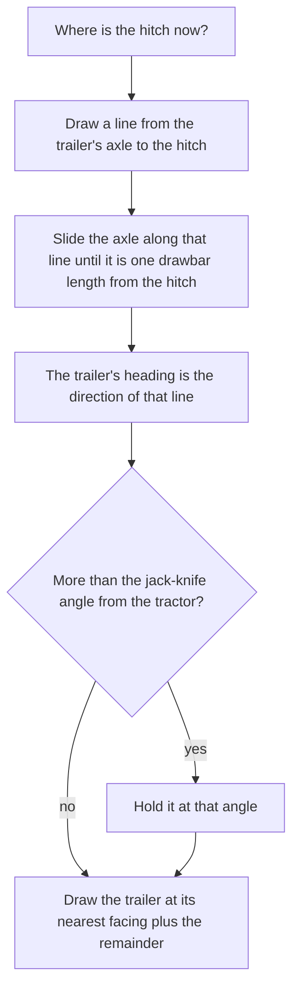

# The hitch and the generic trailer: design (11 Nov 2026)

**A design with one check done. Nothing is built, and nothing is tested in game.** It follows
[the trailer research](vehicle-trailer-research.md), where the owner answered on 11 Nov 2026: a hitch of our own, improved
and smoother; the smoother turn is worth a check; and "a genericized trailer that can be towed by, theoretically, any
vehicle", provided the vehicle has the torque, the engine power and the cooling for it. Facts marked "from the code" were
read on 11 Nov 2026 with `scripts/query-code.py`; everything else is agent-authored for the owner to confirm, and no
figure is set yet.

## Read this first

- **Yes to the generic trailer, and most of it already exists.** Our drivetrain model works out speed, gear, load, heat and
  fuel from the mass it is given. Give it the trailer's mass and every consequence the owner asked for follows without a
  new rule: a small truck with a heavy trailer drops gears, runs hot, burns more and crawls on soft ground.
- **The check passed for what a trailer needs.** Vehicle Framework draws a vehicle's body and its overlays at any angle.
  It does not turn the shadow or seated crew, so the first trailer has neither.
- **Any vehicle that has our systems can tow.** The hitch is added the way the sling is: in code at start-up, from a
  vehicle's loadout, with no change to another author's Def or picture.
- **The turn is a real trailer's**, from one rule: the trailer's axle stays a fixed length behind the hitch and is dragged
  toward it. Two lengths per trailer replace RimThunder's eight hand-written offsets.
- **Four decisions for the owner** are at the end. The first build waits for them.

## The check: does Vehicle Framework honour a free angle?

From the code of Vehicle Framework's 1.6 build, `VF` being `.local/decompiled/VehicleFramework-1.6/Vehicles.decompiled.cs`:

| Drawn thing | Honours the angle? | Where |
| --- | --- | --- |
| The body | **Yes.** The picture is chosen by facing, then turned by the facing's own angle plus the free angle; its offset turns too | `VF:38735-38759` |
| Overlays | **Yes.** They go through the same routine as the body | `VF:6411-6417` |
| The shadow | **No.** It is drawn at the vehicle's own facing with no angle | `VF:75257-75261` |
| Crew drawn in seats | **No.** Their places come from the facing alone | `VF:17961-17966` |
| Turrets | Not read | |

**What it means:** a trailer with no shadow, no seated crew and no turret can swing smoothly. We draw it at the nearest
of the eight facings plus the remainder, at most 22.5 degrees either way. **Still to see in game:** whether the picture
visibly jumps where one facing's drawing hands over to the next.

## What each behaviour does to the player

| Behaviour | Lets them | Stops them | Changes how they play |
| --- | --- | --- | --- |
| **Hitching a trailer to any vehicle** | Take a second load on one trip, behind whatever vehicle is to hand | Hitching to an aircraft, a boat, a rail vehicle or another trailer; two trailers on one vehicle | A trip is planned around what tows what |
| **The tow costs what physics says** | Pull a heavy trailer with a strong vehicle at nearly full speed | Pulling the same trailer briskly with a small one: it is held to a lower speed, in a lower gear, hotter and thirstier | The player picks the tractor for the load, and watches the temperature on a long pull |
| **Grip comes from the tractor alone** | Tow on firm ground with little loss | Getting a heavy trailer through mud or up a grade without weight on the driven wheels: it crawls | Soft ground and hills are a reason to send a heavier or all-wheel-drive tractor |
| **Dropping the trailer** | Leave the load at a camp or a site and drive away | Nothing | A trailer becomes a store that stays behind |
| **The swing** | See where the trailer is and which way it lies | Nothing in the first build: it is a picture | None yet; it is what makes the rest legible |

## How it works

### Hitching and holding

- **A hitch comp, `CompPhobosHitch`, beside the sling's.** The sling already carries one vehicle in a holder of its own,
  takes it off the map, puts it back, and saves it (`src/PhobosFramework.Vehicles/Sling/CompPhobosSling.cs`). The hitch
  is the same shape with a different rule for where the load is drawn and what it weighs on.
- **Added at start-up from the loadout**, as the systems comp and the sling are
  (`src/PhobosFramework.Vehicles/Service/VehicleSystems.cs:92-163`). So every vehicle the loadout selectors reach gets a
  hitch, ours or another author's, and a loadout can say "no hitch".
- **The trailer is held by the hitch, not in the cargo bay.** RimThunder puts it in the tractor's inventory, and Turbo's
  library then needs a long list of patches to keep cargo capacity, the cargo window and caravans straight
  ([the research](vehicle-trailer-research.md)). A holder of our own avoids all of it and needs no Harmony.
- **The order:** select a vehicle, right-click a trailer, "hitch". The vehicle backs up to it, a short wait, the trailer
  leaves the map. A gizmo with its own icon unhitches, and the trailer is set down behind the vehicle. Every refusal says
  why.
- **The hitch point** defaults to the middle of the vehicle's rear edge, from its footprint. A vehicle whose picture
  needs a different point names one in XML.

### The turn

One number is kept and saved: the trailer's heading. It moves by one rule, each tick the tractor moves:

- **What comes out of it without more rules:** a long trailer straightens slowly and a short one quickly; the trailer
  cuts the inside of a corner; it swings when the tractor's rear swings.
- **Two lengths per trailer:** hitch to axle, and axle to the middle of its picture.
- **Game-free:** the rule is a few lines with one square root, in the Framework core's `Rules/` with its own tests.
- **Simplifications, labelled:** the same rule is used in reverse, where it is stable and a real trailer is not; and the
  jack-knife angle is an authored limit, not a force.

### The load on the tractor

From our code: the model's road load is rolling resistance times weight, plus air drag, plus mass times acceleration and
grade (`src/PhobosFramework.Vehicles/Rules/DrivetrainModel.cs:146-147`), and grip is the driven wheels' share of the
weight times the ground's friction (`DrivetrainModel.cs:203`). Both take one mass
(`src/PhobosFramework.Vehicles/Systems/Powertrain.cs:303-322`).

**The change:** a second mass, the towed one.

| Term | Mass used | Why |
| --- | --- | --- |
| Rolling resistance, acceleration, grade | Tractor plus trailer | The whole train must be rolled, speeded up and lifted |
| Air drag | Unchanged | A simplification: the trailer runs in the tractor's wake |
| Grip | Tractor, plus an authored share of the trailer's weight carried on the hitch (none for a trailer on its own axles) | Only weight on the driven wheels pushes |

- **The trailer's mass** is its empty mass plus everything in it, counted as the sling already counts a slung vehicle
  (`CompPhobosSling.LoadKilograms`).
- **Everything downstream is the existing model:** the speed it can hold, the gear, the engine load, the heat into the
  cooling system, the fuel, clutch slip on a launch, and the crawl floor (a vehicle that cannot pull still crawls,
  owner, 8 Nov 2026).
- **A vehicle without a drivetrain of ours** is decision 3 below.

### The generic trailer

- **One Def, a flatbed with a cargo deck:** a vehicle with no engine, no seats, no turret and no shadow, loaded through
  Vehicle Framework's own cargo window while it stands unhitched.
- **Its picture:** our own, drawn empty. Until a picture exists it borrows one of ours so the game shows no error (owner's
  rule of 9 Nov 2026 against stand-in vehicle art).
- **It is the base for the special ones later:** tank, generator, tipping and camp trailers are the same trailer with a
  different deck.

## What it leaves out, said plainly

- **A towed trailer is not on the map.** It blocks nothing, cannot be shot and can swing through a wall (decision 1).
- **No loading while hitched** in the first build.
- **The world map and caravans** are not designed here: whether a hitched trailer's mass reaches our world rules needs a
  read first.
- **No road trains:** one trailer per vehicle.
- **No raid is given a trailer yet** (the section below says what works for other factions from the first build).

## Other factions' vehicles

The owner asked on 11 Nov 2026 that vehicle mechanics be designed with enemy raids in mind, or at the very least for the
vehicles at a base the player attacks. How those vehicles come to exist is in
[the Vehicle Framework record](vehicle-framework-mechanics.md). Agent-authored:

| Where | What the hitch does there | Lets the player | Stops the player | From which slice |
| --- | --- | --- | --- | --- |
| **A base we attack** | A trailer is a vehicle, so whatever puts vehicles at a base can put a parked trailer there, loaded | Hitch it to a vehicle of ours and drive off with the load | Taking it without bringing something that can pull it, and standing still to hitch under fire | 2, once a hostile faction's unattended trailer can be taken (to check: how Vehicle Framework treats claiming a vehicle) |
| **A raid on us** | A raider's vehicle may arrive towing. Other factions' vehicles run the lite tier (owner, 11 Nov 2026: kept, with no setting), so the tow does not slow it | Stop the tractor and keep what it was pulling: a trailer whose tractor is destroyed is set down where it stood, as the sling sets down its load | Nothing | The comp works for any faction from slice 2; a raid that brings a trailer waits for slice 4 and a hook to add one |
| **A vehicle we capture** | It tows as ours do, by its own drivetrain | Use a captured truck as a tractor at once | Nothing | 2 |

- **Cost with several on a map:** the follow rule runs only for a vehicle that is towing and moving, and a trailer set
  down runs nothing.
- **Decision 1 matters more here.** Off the map while towed, a raider's trailer cannot be shot until its tractor falls.
  That is acceptable for a first build and a reason to make towed trailers hittable soon after.

## Slices

1. **Rules, game-free and tested:** the trailer's follow rule; the towed mass in the drivetrain model.
2. **The first working trailer:** the hitch comp, the orders and their icons, the drawing, the saved heading, the generic
   flatbed, the mass reaching the model. One Framework version and one Vehicles version, one install, one short test list.
3. **Reading it:** towed mass and what limits the pull on the Dashboard; "can this vehicle pull that?" before hitching;
   loading while hitched; the world map.
4. **The special trailers** from [the research](vehicle-trailer-research.md), the recovery tow, and road trains.

Slices 1 and 2 are built together: rules nobody uses are not a working slice.

## Decisions for the owner

**Decided by the owner, 11 Nov 2026:**

1. **A towed trailer is on the map and can be hit, from the first build.** This replaces "off the map while towed" throughout this
   record: the trailer is a spawned vehicle that follows the hitch, so it blocks and is blocked, can be shot, and a raider's towed
   trailer is a target from the start. The hitch therefore moves a real vehicle each tick instead of drawing a held one, and needs
   a design pass of its own before slice 2: how it is moved without Vehicle Framework's pathing fighting it, what it does at a wall,
   and what it costs per tick with several on a map.
2. **Borrow one of our pictures for the first build**, then a paid picture on the owner's go.
3. **Only vehicles with our drivetrain tow by default.** A mod setting lets other vehicles tow too, with a warning in the setting's
   description that their pull is a plain rule (speed falls with the trailer's share of the total mass), not the full model.
4. **One medium flatbed first.**

The questions as they were put:

1. **Off the map while towed?** Simple and cheap, as RimThunder does it, with the limits above. Or must a towed trailer
   be hittable from the first build? (Agent default: off the map first, hits later. A raider's towed trailer is the case
   that suffers most; see "Other factions' vehicles".)
2. **The trailer's picture.** Borrow one of ours for the first build, then a paid picture on your go. (Agent default.)
3. **A vehicle with no D'thorga drivetrain:** tow with a plain rule (speed falls with the trailer's share of the total
   mass, a gameplay simplification), or not tow at all? (Agent default: the plain rule, so "any vehicle" stays true.)
4. **How many sizes?** One medium flatbed first, or small, medium and large from the start? (Agent default: one.)

## Who chose what

- **Owner (11 Nov 2026):** our own hitch, improved and smoother; the check; a generic trailer any vehicle can tow, limited
  by torque, power and cooling.
- **Agent defaults:** the holder beside the sling's; the follow rule and its two simplifications; grip from the tractor
  alone; drag unchanged; the hitch point from the footprint; the slices; the four defaults above.

## Sources

- Vehicle Framework, by Smash Phil: the drawing routines, read from our decompile and summarised in our own words.
- RimThunder - Core, by RimThunderTeams, and Turbo's Vehicle Features Library, by Turbo: the approach we chose to differ
  from, described in [the research](vehicle-trailer-research.md). No code, Def or art of theirs is used.
- The drivetrain model's method and its sources are in [the drivetrain design](vehicle-drivetrain-design.md).
- The follow rule is standard geometry (the curve is a tractrix); our form of it has not been checked against a reference.
