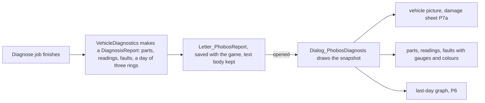

# How our vehicle features look: research and record (11 Nov 2026)

The owner, after their first Diagnose letter in game (a plain list of parts and readings): "a research and record purview where I want to
improve, visually, how this appears and perhaps that of other areas too, at your suggestion"; open to more art through the OpenAI image
API. Two questions followed while the plan was read: whether graphs are practical and what they would cost in performance, and whether
anything "strikingly visual and playful" would be of high benefit. This is the research and record. **Nothing here is built.** Every
proposal answers for itself (what it lets the player do, stops them doing, and changes), figures and costs are the agent's and labelled,
and the owner's call is asked at the end.

**Status, 11 Nov 2026:** the owner agreed with every lean below. **Built in Framework 0.78.0** (not yet tested in game): P1 steps one and
two together (the coloured letter and the report window), G1 (the last-day graphs, temperatures and levels as two graphs rather than one,
so each keeps its own scale) and P7a in the report window only (the Health tab and the fleet board's tooltip are still to come). Batch A
is generated (18 pictures, about US$0.98 spent, under the US$2.50 estimate) and waits for the owner's picks; the letter keeps the game's
letter picture until then. The damage sheet draws Vehicle Framework's picture through reflection: a 1.7 build cannot call its methods
that take Unity types directly.

**Built in Framework 0.79.0** (11 Nov 2026, the owner's go for "two or three slices" overnight; not yet tested in game): P7a in the
Health tab too (its own column; hovering the picture also lights the part on the map), P2 (the fleet board's thumbnails, fuel and
worst-part gauges, and the check-engine lamp for the status) and G2 (a 16-pixel line of the last day under each Dashboard gauge, in
Operator and Engineer). Still to come from P7a: the damage sheet in the fleet board's tooltip, which needs a drawn tooltip rather than
the game's text one. Next in order: P7b, the range on the world map.

**Batch A picked and wired in Framework 0.79.1 and Medical 0.13.1** (11 Nov 2026; not yet tested in game). The owner picked diagnose #2,
jump-start #2, tyre set #1, brake pad set #2, engine service kit #1, drive belt #1 and #1 of the three category icons. Masters are on
`art-masters`, the attempts not picked on `art-references`; each sprite's record sits beside it. Every borrowed picture in the table
below is now replaced except the vehicle bodies (batch B) and the Medical placeholders (batch C). The diagnosis letter keeps the game's
letter picture (agent's choice): the game tints a letter's icon one colour and draws it in a small oblong, so a full-colour clipboard
would read worse than the envelope players know.

**The owner's next four slices, built 11 Nov 2026** (owner: "Slices #1 through #4, step-wise if necessary"; not yet tested in game):
Framework 0.84.0, G3 (event marks on every graph, from a small saved event log) with the rest of P7a (click a part on the picture; the
picture beside the mouse on the fleet board); 0.85.0, P7b (the caravan's reach on the fuel aboard, over Vehicle Framework's own world
costs; caravans only, not a vehicle parked on a map); 0.86.0, G4 (the fifteen-day wear rings and the Health tab's Wear block); 0.87.0,
P3 and P5 (16 icons: the 8 fittings, 6 tunes and 2 grades, the owner's picks, US$1.74; tunes as lit icon buttons; a one-line "what it
changes" from the Def's figures; the Health tab's coloured names and icon stack). The record's guess of 10 fittings was 8, so 16 icons
covered the grades too. Left in the order: P4, P7c, P7d and P7e, each waiting on the owner.

**Framework 0.88.0 (owner's idea, 11 Nov 2026, agreed with the agent's push-back):** the fittings window's part rows borrow the tune row's
picture buttons; the engine and gearbox rows show their fitting and the running tune combined, and a hover on any choice previews it.
Only those two rows carry a tune (agent's push-back, agreed); a part with more choices than fit across keeps the menus. The window and
the vehicle share one rule for the figures (FitFigures). Grouping the four wheel rows as axles is a possible later tidy, not built.

## Read this first

- **Recommendation, in five lines.** Turn the diagnosis into a proper report window with the vehicle's picture, coloured gauges and one
  graph of its last day (P1). Put the vehicle's picture, tinted part by part by health, in the Health tab and the report: the damage
  sheet (P7a), code only. Show a vehicle's fuel range on the world map (P7b). Give the fleet board thumbnails and gauges (P2). Pay for one
  small batch of icons so nothing in the vehicle screens borrows another's picture (batch A, about US$2.50).
- **Graphs are practical and cheap.** We already record a day of every shown reading on every vehicle; a graph costs only while its window
  is open, nothing when closed. Four places for them are proposed (P6).
- **The one decision that costs money** is batch A. Everything else is code. The vehicle bodies (batch B) and the eleven Medical
  placeholders (batch C) are listed with costs but are separate goes.
- **Argued against:** a dial for every gauge, a custom window for every letter, animated needles and flashing lamps, a 3D vehicle view,
  redrawing the Dashboard (the owner's screenshot of 10 Nov reads well), and a per-tick world overlay.
- **The owner's rules this keeps:** UI presents, services decide (a report is a saved snapshot the window only draws); interfaces follow
  the game's own patterns; the Plain display mode shows words and bars, never a figure; every button has its own icon; in-world text
  names no mod.

## What the player sees today

Read from the code on 11 November 2026 (`src/PhobosFramework/UI/PhobosWidgets.cs`, `src/PhobosFramework.Vehicles/Presentation/*.cs`,
`Systems/VehicleDiagnostics.cs`):

| Where | Size | What it is made of |
| --- | --- | --- |
| Dashboard tab | 460 x 350 | a row of flat gauge bars, the 15 painted telltales (24 px, tinted), a check-engine lamp, a tachometer bar in Operator and Engineer, a row of 32 px switches |
| Systems tab | 560 x 450 | text rows with a thin bar each; in Engineer, a 64 px graph per reading and tiny flow lines; part rows with a coloured percentage |
| Health tab | 690 x 430 | two columns: stat rows and crew on the left; External and Internal part rows on the right, each a small bar, two percentages and tiny condition lines |
| Fittings and tunes | 640 x 560 | text rows and buttons, no icons |
| Fleet board | 900 x 640 | a sortable text table; status is a 12 px coloured square |
| Diagnosis | a letter | plain text: intro, rated power, tunes, parts worst first, readings, faults; sections split by blank lines |
| Every other letter | a letter | plain text through the game's stock letter |

**Everything is text and flat bars.** No window of ours shows the vehicle's picture, an item's picture or a part's picture, except the
Dashboard's telltales and switches. The colours are one shared set (Good, Caution, Bad, Off, in `PhobosWidgets`), which is a good base.

**Borrowed and placeholder pictures today** (every one found):

| Picture | Borrowed from | Where |
| --- | --- | --- |
| Diagnose button | the tuning rig building's sprite | `CompPhobosVehicleSystems.cs:1700` |
| Jump-start button | the booster pack and kit item sprites | `Jobs/JumpStart.cs:119` |
| Tyre set, brake pad set, engine service kit, drive belt | the drivetrain kit, transmission, electrical kit, engine assembly | `ServiceKits.xml` |
| Three storage categories (vehicle parts, clinical supplies, medical equipment) | the engine assembly, fluids kit, oxygen concentrator | the two `ThingCategories.xml` |
| Tipper, drill rig, submarine test hull, Seabed Crawler bodies | the bulk tanker's body | each `Vehicle_*.xml` |
| Generator set body and overlays | drawn in code | `draw_generator_set.py` |
| Eleven Medical items and buildings | drawn in code (`draw_placeholders.py`, 7 Nov) | `art-backlog.md` |
| Switch icon | drawn in code; the owner kept it on 10 Nov | `Switch.png` |
| Load switches | headlights serves navigation and work lights; the cab heater serves firebox warmth | the loadouts |

Two Def comments still call the jump-start kit and booster pack "drawn in code"; their records say gpt-image-2, 9 Nov. Correct them when
those files are next touched.

## What the game already gives us, free

Read from the decompiles in our own words; nothing copied (RimWorld 1.7 `full/all.cs`, Vehicle Framework 1.6 `Vehicles.decompiled.cs`):

- **A letter can open any window.** The stock letter builds a dialogue node from its text; `OpenLetter` is overridable, and the game's own
  growth-moment letter opens its own window, as does Nice Research Tab's research letter. Letter text renders Unity rich text, and the
  game's `ColoredText.Colorize` wraps text in colour tags; the Health tab's percentages in Vehicle Framework are coloured that way.
- **The health card's row shape** (`HealthCardUtility.DrawHediffRow`): a coloured part label, entries grouped with a count, a right-aligned
  stack of small icons, a hover highlight and a tooltip. `Widgets.Label(x, ref curY, width, text, tip)` does label, highlight and tip in
  one call. Players know this shape.
- **Graphs:** `SimpleCurveDrawer.DrawCurves` is public, takes several curves with labels and colours, draws background, grid, measures,
  legend, mouse read-out and event marks (`CurveMark`). We already call it (`PhobosWidgets.HistoryGraph`).
- **A vehicle's picture in a rect:** `VehicleGui.DrawVehicleDefOnGUI` (VF:77217) and `DrawVehicleOnGUI` (VF:77187), which Vehicle
  Framework's upgrade tab uses for its before-and-after pictures.
- **Part positions:** every part has its hit cells relative to the body (`ComponentHitbox.Hitbox`); Vehicle Framework outlines them on the
  map when a row is hovered (`VehicleStatHandler.DrawHitbox`, VF:10534), never on a picture.
- **No dial anywhere:** vanilla draws no arcs; `Widgets.DrawTextureRotated` turns a needle texture, which is how a dial would be made.
- **World rings:** the game draws a radius ring on the globe (`GenDraw.DrawWorldRadiusRing`; Vanilla Gravship Expanded patches it for the
  gravship's range), and Vehicle Framework keeps a world path grid per vehicle kind (`WorldVehiclePathGrid`, VF:83140 and on).

## P1. The diagnosis as a report window (the owner's prompt)

**Today:** a plain letter. **Proposed:** a letter of ours whose opening shows a report window built from the same widgets as the Health
tab, in its two-column shape.

- **Left column:** the vehicle's picture (with P7a, its parts tinted by health), its name, rated power (not in Plain), the tunes, who
  looked and when; buttons Jump to and Open Health tab.
- **Right column:** Parts, worst first (a gauge, the percentage or the health word, grade and fitting as small icons once batch A exists);
  Readings, by system, each with its telltale where one exists, a gauge and the stage coloured Good, Caution or Bad; Faults, each a
  coloured label with the part and stage.
- **Plain mode:** words and gauges, no figures, as the display-mode rule says.
- **Services decide, UI presents:** the diagnosis makes a saved snapshot at the moment it is done (the part rows, the reading rows with
  their colours, the fault rows, and the rings the graph needs, about 1 KB each). The window only draws it, so a reload shows the same
  report, and a later look at the letter shows what was true then, which is what a report is.
- **The letter keeps a text body** for the archive and for anything else that reads letters.
- **Its own LetterDef**, so it can carry an icon (batch A) and arrive quietly.
- **Step one, cheap and immediate, a patch:** colour the existing text letter with the game's colour tags (section titles; health words and
  percentages by `PhobosWidgets.HealthColour`; stages amber or red) and group the readings under their system's name. Half an hour's work,
  no new classes. **Step two** is the window, a middle bump.

Lets the player: read a captured or bought vehicle at a glance. Stops them: nothing. Changes: a report becomes something to open again.

## P2. The fleet board

Each row gets the vehicle's thumbnail (the free picture call), fuel and worst-part as small gauges instead of numbers, and the status
square becomes a telltale icon (the Dashboard's, which exist). Hovering a row shows the damage sheet (P7a) as its tooltip.

Lets: scan a fleet without reading. Stops: nothing. Changes: the board is glanced at, not read. Cost: code only.

## P3. The fittings window

An icon per fitting and tune (16 pictures, batch A), a one-line "what it moves" under each name taken from the Def's own figures (the
rule that a shown figure is derived, never typed), and the current tune shown as a lit switch like the Dashboard's.

Lets: choose a fitting by what it does. Stops: nothing. Changes: the window stops reading like a price list. Cost: 16 icons plus code.

## P4. One real dial

A tachometer face and a needle (two pictures) drawn with the game's rotated-texture call, in Operator and Engineer, where the bar is now.
Everything else stays a bar.

Lets: feel the engine. Stops: nothing. Changes: the feel only. Argued half-way: one dial, not an instrument cluster, and last in the order.

## P5. The Health tab's parts in the game's row shape

The health card's row look for parts: a coloured part label, condition entries grouped, a right-aligned stack of small icons (fitting,
grade, leak, danger clock), hover highlight, tooltip. Uses the telltales we have and P3's icons.

Lets: nothing new. Stops: nothing. Changes: our tab looks like the game's. Cost: code, after P3.

## P6. Graphs here and there (the owner's question)

**Practical, and cheap, because the data is already there.** `QuantityHistory` keeps the last 24 hours of every shown reading on every
vehicle, one sample per 250 ticks: 240 points a reading, about ten readings a vehicle, taken on the update the systems already make and
saved with the vehicle (the owner's exception to "derived state is never saved", 8 Nov 2026). `PhobosWidgets.HistoryGraph` already draws
a ring through the game's curve drawer, the one the History tab uses for thousands of points.

**Performance, honestly:** the recording is already paid for and changes nothing here. A graph is drawn only while its window is open,
on the frame, and costs nothing when closed. No proposal below adds per-tick work. The only new cost is the second ring (below), about
1.4 KB per slow reading per vehicle in the save.

| # | Where | What | Lets the player | Cost |
| --- | --- | --- | --- | --- |
| G1 | the report window (P1) | one "last day" graph of coolant, oil and battery together, with a legend | see how the engine was treated, not only where it stands | the snapshot stores three rings |
| G2 | under the Dashboard gauges, Operator and Engineer | a bare 24-hour sparkline strip, 24 px, no axes or figures | see a climbing coolant before it is red | code only |
| G3 | every graph | event marks (boiled over, service done, belt snapped) recorded beside the samples, a few a day | a spike has a caption | a small saved list |
| G4 | the Health tab | a second, coarser ring: one sample an hour for fifteen days (360 points) for the slow readings only (tread, brakes, engine hours, pack wear, hot-section life), and a "due in about N days" line from its slope | plan services from a trend, which no gauge gives | a second ring class beside the first, saved like it |

**Not proposed:** graphs on the fleet board (a table), on the world map's caravan tab per tick, or in Plain mode.

## P7. Strikingly visual, and of high benefit (the owner's question)

Ranked by benefit. Each answers for itself.

### P7a. The damage sheet: HIGH

The vehicle's own picture, drawn in the Health tab, the report window and the fleet board's tooltip, with every part's hit cells tinted
by its health from Good to Bad; hovering a part row lights its cells on the picture; clicking a cell selects the part's row. The car-hire
damage diagram: one look says where the vehicle is hurt. Vehicle Framework outlines the same cells on the map, never on a picture.

- **Lets the player:** see damage at a glance, and tell a holed radiator at the front from a worn gearbox at the back without reading.
- **Stops them:** nothing.
- **Changes how they play:** the Health tab is read as a picture; the list becomes the detail.
- **Cost:** code only, one drawing helper in `PhobosWidgets` (picture, then one tinted rectangle per hit cell, scaled to the rect, turned
  with the facing); no art. Parts with no hit cells of their own (a few appended ones) are listed, not drawn.

### P7b. The range on the world map: HIGH

With a vehicle caravan or a parked vehicle selected, the tiles it can reach on the fuel aboard, shaded on the globe, with the game's ring
drawing for the edge. The reach comes from Vehicle Framework's world path grid for that vehicle kind and our drivetrain's burn per tile.

- **Lets the player:** plan a trip, and know where the bulk tanker must meet the convoy.
- **Stops them:** nothing.
- **Changes how they play:** fuel becomes a map, not a number.
- **Cost:** a shortest-path pass over the world grid from the vehicle's tile, cached until its fuel or tile changes; a crow-flies ring
  first if the grid proves awkward. The ring call's exact signature is read when built (Vanilla Gravship Expanded patches it, so it exists).

### P7c. A ground-cost overlay: MEDIUM-HIGH

A toggle beside the game's overlays colouring the map by what the ground does to tyres and running gear (the path cost link 6 reads),
through a `CellBoolDrawer` like the painted radiation area.

- **Lets the player:** lay roads and park where it saves the most.
- **Stops them:** nothing.
- **Changes how they play:** roads get built for a reason the map shows.
- **Cost:** code only; recomputed when terrain changes, not per tick.

### P7d. Wear that shows on the body: MEDIUM, playful

**On the back burner (owner, 11 Nov 2026).** It cannot be made generic across all vehicles: drawing grime and dents over another mod's
vehicle would change its author's art, and their vision for it is theirs. Not built until the owner raises it again; if it ever is, it
stays on our own vehicles.

Grime, dents and a smoke overlay drawn over the body as parts fail and fires burn, through the overlay system the tanker's damage variants
already use.

- **Lets the player:** read a fleet by looking at it from across the map.
- **Cost:** art per vehicle and facing (the tanker's overlays were US$0.0385 each), so a batch per vehicle; only for picked vehicles.

### P7e. The Dashboard as a painted instrument cluster: MEDIUM, playful

One drawn dashboard face behind the telltales and gauges, the lamps in bezels, the tachometer a dial (P4).

- **Lets the player:** nothing new. **Changes:** the feel.
- **Cost:** two or three pictures and layout code. The owner's screenshot of 10 Nov shows the Dashboard reads well now, so this is last, if
  at all.

### Argued against here

Animated needles and flashing lamps (noise, and the owner is hearing impaired and watches the screen: a flashing lamp is a nag); a 3D or
rotating vehicle view (not the game's look); a per-tick world overlay (cost); redrawing the Dashboard's layout.

## The art plan

Every item through the paid rules (`paid-image-generation-rules.md`): a pilot first, a dry run, a cap, our own pictures as the only
references. Costs are the recorded ones (gpt-image-2, medium): US$0.02 to 0.066 an image; 45 station and part pictures cost US$2.52.

| Batch | What | How | Cost (two attempts each) |
| --- | --- | --- | --- |
| **A, buttons and small icons** | the Diagnose button; the four service kits; the three storage category icons; a jump-start button of its own; ten fitting icons and six tune icons (P3); a report letter icon (may reuse Diagnose) | one API run, the item-icon prompt skeleton from `stations-parts-pilot.json` (`part-engine-assembly`), the owner's picked parts as style references | about US$2.50 |
| **B, vehicle bodies** | tipper, drill rig, generator set, each with facings, masks and overlays through the tanker's pipeline (`export_vehicle.py`) | the tanker's pilot flow, one vehicle at a time | about US$0.60 a vehicle; the Seabed Crawler and test hull are session 4b's, listed not planned |
| **C, the Medical placeholders** | the eleven items and buildings drawn in code | the owner's local model first (free; it made the picked medical art); the API only where a top-down building keeps failing (the electrolyser, the hyperbaric chamber) | free, or about US$0.50 |

Batch A removes every borrowed picture in the vehicle screens. Batches B and C are their own goes.

## Order to build, when the owner says so

1. **P1 step one** (the coloured letter): a patch.
2. **P1 step two** (the report window) with **G1** and **P7a** (the damage sheet, which the window shows), and **batch A**: a middle bump.
3. **P2** (the fleet board) with **G2** (Dashboard sparklines).
4. **P7b** (the range on the world map).
5. **P3** and **P5** (fittings icons and the Health tab's row shape).
6. **G3**, **G4** (event marks, the wear ring and trend line) and **P7c** (the ground overlay).
7. **P4** (the dial) and **P7e** last, if wanted. **P7d** is on the back burner (owner, 11 Nov 2026; see its section).

Each step says "not yet tested in game" until the owner says otherwise.

## Open questions for the owner

| Question | Agent lean |
| --- | --- |
| Go on batch A, about US$2.50? | Yes: it is the one spend that clears every borrowed picture |
| The report window, or the coloured letter only? | Both, the letter first as a patch |
| Which of the graphs G1 to G4? | G1 and G2 first; G4 when the Health tab's row shape is done |
| Which of P7? | P7a and P7b: both high benefit, both code only |
| The dial, P4? | Last, if at all |
| Batch B now, or after the Crawler's art? | After: the Crawler is in another session's hands and its pilot will teach the pipeline |
| Batch C local or API? | Local first |

## Who chose what

- **Owner (11 Nov 2026, after slices 1 to 4):** P7d on the back burner, because it cannot be made generic without touching other authors'
  vehicles and their vision for them.
- **Owner (11 Nov 2026):** the purview (visual improvement of the diagnosis and other areas at the agent's suggestion); art through the
  API is acceptable; the two questions on graphs and on strikingly visual, high-benefit pieces.
- **Owner (11 Nov 2026, later):** "Agreed with all your leans", and the go for P1 steps one and two.
- **Agent:** everything proposed, the ranking, every cost figure and lean, and the arguments against. All for the owner to revise.
  While building 0.78.0 (agent choices): two graphs instead of one; the graphs follow the gauges marked for the Dashboard rather than a
  named list, so any system's Def adds its own; a cell on the damage sheet shows the worst part covering it; line colours authored.

## Sources

Read for this record, in our own words: `src/PhobosFramework/UI/PhobosWidgets.cs`, `src/PhobosFramework.Vehicles/Presentation/*.cs`,
`Systems/VehicleDiagnostics.cs`, `Systems/QuantityHistory.cs`; `docs/development/art-backlog.md`, `paid-image-generation-rules.md`,
`artwork-direction.md`, `assets/phobos-vehicles/README.md` and `requests/*.json` (costs and the prompt skeleton); the decompiled game
(`ChoiceLetter.OpenLetter`, `ChoiceLetter_GrowthMoment`, `ColoredText.Colorize`, `HealthCardUtility.DrawHediffRow`,
`SimpleCurveDrawer.DrawCurves`, `Widgets.DrawTextureRotated`, `GenDraw.DrawWorldRadiusRing`) and Vehicle Framework 1.6
(`VehicleGui.DrawVehicleDefOnGUI` 77217, `DrawVehicleOnGUI` 77187, `VehicleStatHandler.DrawHitbox` 10534, `WorldVehiclePathGrid` 83140),
all through `scripts/query-code.py`; Nice Research Tab's research letter as the mod example of a letter with its own window. No code was
copied from any of them, and no figure in this record is measured in game.
