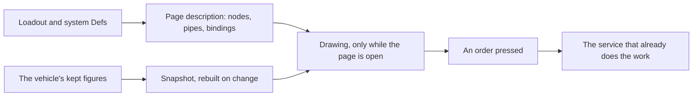

# A live systems schematic for vehicles (28 Nov 2026)

**Status (28 Nov 2026):** partly built. The first slice is built in Framework 0.363.0, not yet tested in game (row 735): the flow
sheet for land vehicles with a piston engine, in its own window, flow marks a setting that starts off ([As built](#as-built-framework-03630)).
Not built: pages for other kinds, cutaways, orders from the page, the standard's line. The missing parts M1 to M3 have records of their
own, not built: [the fuel filter](vehicle-fuel-filter.md), [the intake separator](vehicle-inlet-separator.md) and
[the chip detector](vehicle-chip-detector.md).

## Read this first

- **The answer: most of the function, and a good part of the look.** The sim already keeps most of what such a page shows. The
  drawing is the kind that code does well: flat shapes, lines and state colours. The limit is draughtsmanship, one believable
  section per kind of engine.
- **The mock-up is a drawing in a browser, not the game**: <https://claude.ai/artifact/U1bHEYWoUDudPwcvN9vdQM> (private to the
  owner). Its source is not in this repository. **Nothing here is tested in game or on screen in the game.**
- **It shows steady readings.** The game moves each figure over hours; the page shows where each settles. Its simplifications are
  listed under [The mock-up page](#the-mock-up-page).
- **An earlier record argued against movement**: [how our vehicle features look](vehicle-presentation-design.md) set aside
  "animated needles and flashing lamps", because a flashing lamp nags. The owner chose to see both forms before deciding (below).
- **Two things the mock-up noticed were checked and fixed** (F6 and F7, Framework 0.372.1): turbines ran past every limit on an
  ordinary take-off, and aircraft electrics ran on a car's 12 V ([What it found](#what-it-found)).
- Marks: **[O]** the owner's, **[A]** the agent's, **[code]** read from our source or Defs, **[game]** found in the game's
  decompiled code and not tried. Figures and references not checked against a source say **unverified**.

## What the owner sent

**[O]** A screenshot of a tablet page in a flight simulator cockpit: the right engine's page of Black Square's Turbine Duke (the
owner's identification, by card). In our own words, it shows:

- tabs across the top (options, payload, left engine, right engine, electrics, cabin, failures);
- a bar of engine condition, and buttons to repair the engine or starter, clean the filters, recharge the batteries and refill the
  extinguisher;
- a cutaway of a turboprop engine, its compressor drawn cold blue and its hot section orange, with arrows for the air and gas;
- the fuel's path from the wing and auxiliary tanks through a heater and a filter to the engine, and the oil's through a cooler;
- small boxes that carry state (a governor, a fuel control unit, a generator with its amps and volts), a chip detector, a fire
  bottle, an inertial separator, and a figure for foreign-object damage.

Black Square made the aircraft and Just Flight publishes it. Just Flight's page says the tablet lets a pilot set options, manage
payload, control failures and watch the engines, the electrical schematics and the environmental systems
([Just Flight: Black Square Turbine Duke](https://justflight.com/product/black-square-turbine-duke)). **We take the idea of a live
schematic page, never the drawing**: the screenshot is not in this repository and no shape of ours is traced from it.

**[A]** The idea is older than this aircraft. Airliners show such pages on their engine displays, and process plants draw the same
thing as piping and instrumentation diagrams (both from general knowledge, **unverified** here). The engine in the screenshot reads
as a reverse-flow turboprop, with its exhaust at the front (**[A]**, from the picture, **unverified**): a drawing of this kind only
charms when details like that are right.

## What exists to build on

| Piece | State | Where **[code]** |
| --- | --- | --- |
| Every system's quantities, flows and stages | Kept per vehicle, updated every 250 ticks | `CompPhobosVehicleSystems`, `SystemState`, the `Systems_*.xml` Defs |
| Engine health, each engine | Kept, as Vehicle Framework's part health (up to 8 engines) | `Powertrain.EngineOrders`, `EngineOutputs` |
| Each aircraft engine's fuel feed and oil | Kept per engine since Framework 0.360.0 | `EngineFeeds`, `EngineFeedRule` |
| Turbine temperature, spool speed, rating | Worked out every 60 ticks while moving; **one figure for the whole aircraft** | `TurbineModel.Evaluate` |
| Hot-section life | Kept per engine | `PartFigures`, `Systems_Turbine.xml` |
| Compressor fouling | Kept per vehicle | `CompressorFoulingRule` |
| Electrics: charge, loads, supply, starting power | Charge kept; amps worked out each look; **volts are a fixed figure** (12 or 24, × 1.1667 while charging) | `Systems_Electrical.xml`, `ElectricalVolts()` |
| Fire and bottles | Kept per zone (engine bay, crew compartment, running gear) | `CompPhobosFireFighting` |
| Faults on parts | Kept per part | `VehicleConditions` |
| Which part plays which role | Resolved at start-up, and written to a report | `SystemParts.WriteReport`; `python scripts/vehicle-bindings.py show` |
| What feeds what | **Missing as data**: implicit in each flow's inputs and in C# | [the cross-links record](vehicle-crosslinks.md) draws it by hand |
| One read-only snapshot for a screen | **Missing**: each tab reads the comp directly | `HealthView`, `FleetEntry` and `DiagnosisReport` are the nearest |
| A picture tinted by region, with hover | Built, by hit cells | `DamageSheet.cs` |
| Bars, state colours, cards, sparklines | Built | `PhobosWidgets` |
| Lines drawn in a window | Built | `UpgradeAnyOf.cs`, the radio's `PathProfile.cs` (dashed too) |
| A picture painted by code at run time, moving in real time | Built once | `ITab_RadioWaterfall.cs` |
| White icons tinted by state | Built | the Dashboard's warning pictures, `SystemIcons` |
| Art drawn by a script | Built once | `scripts/art/draw_signal_bars.py` |
| A tab strip inside a window, rotated pictures, pictures drawn with a material | **Not used by us**; all three exist in the game **[game]** | `TabDrawer.DrawTabs`, `Widgets.DrawTextureRotated`, `GenUI.DrawTextureWithMaterial` |

`vehicle-bindings.py` read a report written on 27 Nov 2026, before Framework 0.360.0 was installed, so it does not yet list the
C-27J's engine fuel and oil systems; the loadout Def does.

## The screenshot, part by part

| In the screenshot | Ours today **[code]** | Verdict |
| --- | --- | --- |
| Engine condition, per engine | Part health per engine; output from it (`TurbineModel.EngineOutput`) | Have |
| Compressor cold, hot section hot | Turbine temperature (whole aircraft), hot-section life (per engine), compressor fouling | Have, coarser |
| Wing and auxiliary tanks | One tank figure, twin side tanks with a cross-feed, auxiliary and ferry tanks as fittings | Have |
| Fuel pumps | One per engine on aircraft; one on land | Have |
| Fuel heater | A fitting (a 12 A load); the fuel's own temperature and freezing | Have |
| Fuel filter | Nothing | **Missing** |
| Fuel control unit, governor | Nothing, and no need: the model works from demand | Leave out |
| Generator, amps and volts | Amps worked out; volts a fixed figure | Partly |
| Batteries and their capacity | Charge; the house battery's capacity wears, the starting battery's does not | Have |
| Oil cooler | A fitting (less oil burned); aircraft keep no oil temperature | Partly |
| Chip detector | Nothing | **Missing** |
| Inertial separator | A fitting's power cost only; nothing clogs | **Missing** |
| Bleed air, cabin pressure | A share of demand (`BleedRule`); cabin temperature | Partly |
| Foreign-object damage, a figure and a type | Events that cost engine health (`StripDebris`, rough landings); no running figure | Partly |
| Fire bottle | Bottles by zone, spent or ready | Have |
| Repair engine, repair starter | Replace-part work | Have |
| Clean filters | The engine service clears the air filter | Have, for air |
| Refill extinguisher | Refill and recharge work | Have |
| Recharge batteries | No order: a battery charges from the alternator, shore power, a solar panel or a jump-start | By design |

**Our buttons would suit the game better than the tablet's.** The tablet mends by magic; ours would ask for work the mod already
has, done by a mechanic with supplies.

## What a page would be [A]

Rows SC1 to SC12 are proposals. None is built.

| Row | What | Rests on |
| --- | --- | --- |
| SC1 | **A flow sheet from data**, for every vehicle: symbols for tanks, pumps, coolers and boxes, joined by pipes, each coloured by its reading's stage | Lines and boxes we already draw |
| SC2 | **A cutaway at the centre**, for the kinds of engine that earn one | SC7 |
| SC3 | Point at a part: its reading, and the part lights on the vehicle. Click: the Systems tab opens at its system | `DamageSheet`, `VehicleHighlight`, the Dashboard's `OpenSystem` |
| SC4 | **Orders from the page**, each a one-line call to work that exists; an order that cannot be given says why | "UI presents, services decide" |
| SC5 | **The page as data**: a Def per loadout class listing nodes, pipes and what each is bound to, so other modders add a page in XML | "XML first" |
| SC6 | **One read-only snapshot** of what the page shows, rebuilt when the vehicle's figures change | `HealthView`'s version stamp |
| SC7 | **Cutaways drawn by a script**, which writes the picture and an exactly matching map of its regions | `draw_signal_bars.py` |
| SC8 | A heat gradient along the gas path, painted into one texture when a figure changes | The waterfall's way |
| SC9 | Slow marks drifting along pipes that carry something | The owner's choice, below |
| SC10 | Tabs across the page: each engine, electrics, and more as they earn it | `TabDrawer` **[game]** |
| SC11 | Where the page lives | The owner's choice, below |
| SC12 | Other factions' vehicles | Below |

### Two levels

- **The flow sheet (SC1) needs no art beyond a dozen white symbols**, made locally as icons are. The bindings report counts 95
  vehicle designs with our systems (58 land, 10 fixed-wing, 10 rotor, 13 trailers, 2 boats, 2 submarines), so a page cannot be
  laid out by hand per vehicle. A layout per loadout class can: the framework's own files hold twelve.
- **The cutaway (SC2) needs one drawing per kind of engine**: a turboprop or turboshaft, a jet, a piston diesel, an electric
  drive, a steam boiler (**[A]**, a count to check against the drivetrain Defs). The mock-up's two are plain sections, not
  drawings of the AE 2100 or of a real diesel.

### Three ways to draw a cutaway

| Way | How | For | Against |
| --- | --- | --- | --- |
| **White layers** | One white picture per region, tinted by state and stacked over a line drawing | Exactly what the Dashboard's warning pictures do today | One flat colour per region; a draw per layer |
| **One painted texture** | The script's region map and a small palette are painted into one texture when a colour changes | Any number of regions, and a gradient along the gas path (SC8) | A repaint costs time each change, **unmeasured**; one precedent only |
| **The game's mask shader** | A picture and a mask drawn with a material | No new art technique | Two or three tints at most; drawing with a material in a window is **untried** by us **[game]** |

**[A] lean: white layers first**, because nothing about them is new, and the painted texture only if the gradient is wanted.

### The art route

- **Drawn by a script, not generated** (**[A]**): an image generator draws a cutaway with nonsense inside, and its regions would
  never match a mask. A script draws polygons from a short list of shapes, and writes the region map from the same list.
- **The mock-up is already built that way**: its pictures come from lists of shapes, which an art script could read.
- The art rules that apply (`assets/AGENTS.md`): pictures that are only interface are made locally; every picture has a record
  of how it was made; canvas heights with many factors of two, because the owner's game holds any other height uncompressed.

### Where it would live

| Place | For | Against |
| --- | --- | --- |
| **Its own window**, opened from the Dashboard or the Systems tab | Room for the picture (the diagnosis report is 900 × 620); live | One more window |
| A view inside the Systems tab | No new window | 560 × 450 is tight for a cutaway |
| A page of the diagnosis report | A mechanic's work earns the detail, so something outside the vehicle notices | A saved report is still: the live feel is lost |

**[A] lean: its own window, live, hidden in Plain mode as the Systems tab is**, with the same drawing reused in the diagnosis
report later. When built, the page is a new line in [the vehicle standard](vehicle-standard.md) and
`config/vehicle-standard.json`: what each kind of vehicle shows on it, and what does not belong (a turbine has no radiator).

### Movement

- **Still**: a pipe that carries something takes its medium's colour; one that carries nothing is grey. Colour alone says
  whether fuel reaches the burners.
- **Slow flow marks**: small dots drift along a pipe that carries something. They add direction, and a sense that the machine is
  alive. Nothing flashes, and they stop with the flow.
- The earlier record's objection was to lamps that flash for attention. Marks that drift are information, not an alarm
  (**[A]** reading). Either way it would be a display preference, on the owner's choice.

### Other factions' vehicles

- **In a raid on us**: no page. Their vehicles run the lite tier, where hits are counted and nothing evolves, and the player's
  crew could not know another faction's oil pressure.
- **Parked at a base we attack**: no page, for the same reasons.
- **Captured**: the full page from the moment the vehicle is ours, as its systems become full.
- **Cost with several on a map**: none. The page draws only while open, for one vehicle.

## What is missing, as possible behaviours [A]

Each would be a new behaviour, answering the four questions in a record of its own. One line each here; none is designed.

| Row | What | Lean |
| --- | --- | --- |
| M1 | A fuel filter that clogs, faster on dirty or bowser fuel, cleared by the engine service | Worth a look: it gives fuel quality a place |
| M2 | An inertial separator or inlet barrier that clogs in dust, costing power until cleaned | Fold into compressor fouling: it is the same story |
| M3 | A chip detector: the first visible sign of a worn engine or gearbox, before a breakdown | Worth a look: a warning the player can act on |
| M4 | Oil temperature on aircraft, and an oil cooler that matters to it | Small: the land system already has both |
| M5 | A running figure for foreign-object damage | Leave as events: a figure adds nothing to act on |
| M6 | Generator volts and amps as kept readings | Only if a fault needs them (a failing regulator) |
| M7 | Bleed air as a system of its own | Leave: the demand share is enough |

## The four questions

- **What it lets the player do**: see at a glance what feeds what and where a fault sits, and order the fitting work from the
  picture.
- **What it stops them doing**: nothing.
- **How it changes the way they do things**: a fault is found by looking at one picture, not by reading rows across three tabs.
  The tabs stay, for the figures.
- **What outside the vehicle notices**: **nothing, as a choice [A]**: it is a display. The orders it gives are noticed as they
  always are, by the mechanic who does the work. If the page lived in the diagnosis report, a mechanic's work would earn it.

**Risk: none to the player's things or people**, so the page needs no setting to switch it off. A missing behaviour from the
table above would be graded in its own record.

## Cost [A]

- **Nothing per tick.** The snapshot is rebuilt when the vehicle's figures change (every 250 ticks at most), and only while the
  page is open.
- **Per frame while open**: the mock-up's turboprop page is 93 shapes and 26 labels, the truck's 90 and 18. Text is the costly part in the
  game's windows, so labels are measured once and kept. The Health tab's budget is 0.25 ms a pass; this page should be held to
  the same. **Unmeasured.**
- **Memory**: a 512 × 256 picture or a handful of white layers per kind of engine. Small.

## Every game from the start

- **Game-free already**: a page description (nodes, pipes, what each reads), the rule that turns a reading into a colour, and
  the script that draws a cutaway and its region map.
- **RimWorld's own**: the drawing calls, and the bindings from a node to a vehicle's part.
- **A next game would need**: its own way to read a figure for a node, and its own drawing calls.
- **A possibility [A]**: D'thorga Companion could draw the same page from a save, since `query-save.py` already reads a
  vehicle's saved figures. That would be a web page much like the mock-up.

## The mock-up page

<https://claude.ai/artifact/U1bHEYWoUDudPwcvN9vdQM>: two vehicles, the C-27J Spartan (left engine, right engine, electrics) and
the Datum survey truck (engine, electrics); a cutaway or a flow sheet; still or with slow flow marks; a test bench of faults;
orders; and a table of every reading with where it comes from.

**Real [code]:**

| Rule or figure | From |
| --- | --- |
| Fuel pump: starved under 0.1, weak under 0.5 (three quarters output) | `EngineFeedRule.cs` |
| Oil pressure = pump × the level's curve; gone under 0.15, low under 0.45 | `EngineFeedRule.cs`, `Systems_Lubrication.xml` |
| Fuel freezing from -47 °C, stopping the engines at -52 °C | `Systems_EngineFeed.xml` |
| An engine's output from its working order; out at 0.2 | `TurbineModel.EngineOutput` |
| Turbine temperature and spool speed from demand against what is available | `TurbineModel.Evaluate`; idle 363 °C above the air, limit 800 °C (`PhobosDrivetrain_AE2100`) |
| Hot-section life spent: 1 % an hour at the limit, doubling every 25 °C over | `TurbineModel.LifePerHour` |
| Condition from hot-section life and fouling (5 % at most) | `Powertrain.Condition`, `CompressorFoulingRule` |
| Flight phases' demand: 0.15 turning, 0.6 cruise, 0.8 climb, 1.0 take-off | `PhobosFlightProfile_C27J` |
| Generator and alternator curves, the charging taper, the cold battery and cold oil curves | `Rules_VehicleSystems.xml`, `Systems_Electrical.xml` |
| Aircraft electrics 45 Ah, 65 A, 12 V; the truck's 100 Ah, 100 A, 24 V | The aircraft loadout's defaults; the heavy land loadout |
| Avionics 8 A essential and 28 A more for the C-27J's fit | `AvionicsRule` |
| Coolant: 420 °C an hour of heat at full load, radiator rate 6, soak 0.6, thermostat 88 °C, the stages | `Systems_Cooling.xml` |
| Turbocharger boost, air filter, fuel gelling, starting power | `Systems_Turbocharger.xml`, `Systems_Service.xml`, `Systems_Lubrication.xml` |

**Invented or simplified:**

- **A fuel filter, an inertial separator and a chip detector** are drawn dashed. The mod keeps nothing for them.
- **The colours along a gas path** are the page's own, hung on the one turbine temperature.
- **Steady readings**: each figure is shown where it settles, worked out from its flows. The coolant's is the balance of its
  heat against the radiator and the soak, held at 88 °C by the thermostat.
- **A part's work is taken as its health.** Vehicle Framework has its own curve between the two.
- **The engine's heat is taken as its load**, and the truck's states (idling, driving, flat out) are three authored points.
- **Load shedding, the cross-feed, altitude and the hours themselves are left out.**
- **An order acts at once**, where the game would send a mechanic.

**Checked outside the browser**: a script runs the page's rules against 31 figures worked by hand from the Defs and rule files
(all match), and draws all 1,794 combinations of vehicle, page, level, running state, air temperature and fault with no broken
value. That checks the port, never the game.

## What it found

| Row | Finding | So |
| --- | --- | --- |
| F1 | **The two engine pages differ less than the tabs promise.** Only fuel feed, oil, health and hot-section life are per engine; turbine temperature and fouling are one figure | Draw both engines on one page, side by side, or keep turbine temperature per engine first |
| F2 | **Still works.** Grey for "nothing flows" reads at once; the marks add direction and life, not information | Movement is a matter of taste, as the owner chose to judge |
| F3 | **Medium and state fight for colour.** Fuel tan, oil brown and caution amber sit close | Pipes carry the medium's colour only; state lives on the parts (pumps, boxes, tanks) |
| F4 | **The dashed parts make the gaps plain**: three of the turboprop page's fourteen parts, one of the truck's sixteen | M1 to M3 are where a build would add depth |
| F5 | **The steady page is calmer than the tablet.** Our figures move over hours, so drama comes from faults and from changing the running state | A page for diagnosis, more than one to watch in flight |
| F6 | **The C-27J at take-off.** With hot sections 20 % used and a little fouling, demand 1.0 against 0.98 available settles at 810 °C, over its 800 °C limit; its one rating makes "over the continuous limit" and "over every limit" the same line. At 40 °C it reads 897 °C | **Checked in the code, a real fault, fixed** (Framework 0.372.1): nothing capped a flight phase's demand, so every take-off of a worn C-27J, and of any turbine aircraft on a hot enough day, went over every limit, damaging its engines (4 health an hour while there) with a warning. The engine's control now holds it just inside its top rating outside a hover (`TurbineModel.HeldDemand`); not yet tested in game (row 762) |
| F7 | **To check: aircraft electrics.** The aircraft loadout sets no electrical figures, so the C-27J reads 45 Ah, 65 A and 12 V (14.0 V charging), a light vehicle's. [The flight record](systems/flight.md) says its avionics amps were authored for 24 V. With the air conditioner and defensive aids on, the mock-up shows 101 A against 65 A | Either the loadout wants its own figures, or the record's "24 V" is out of date. **Not checked in game** |
| F8 | One engine starved at cruise reads 892 °C and spends hot-section life at 13 % an hour | **Answered by F6's fix**: the game asked the same 0.6 of the engine left, so it ran past every limit; held, it now gives what its top rating allows |

## Questions for the owner

Asked on the Decisions page on 28 Nov 2026, each with the agent's lean; all five are answered (below).

1. **Go on to a build?** Lean: a first slice, the flow sheet (SC1, SC3, SC6) for one loadout class.
2. **Where does the page live?** Lean: its own window.
3. **Flow sheet for every vehicle first, or cutaways first?** Lean: flow sheet first.
4. **Still, or slow flow marks?** Lean: marks as a preference that starts off.
5. **Which missing parts are worth building?** Lean: the chip detector and the fuel filter.

## The owner's answers (28 Nov 2026)

By card; every option offered, the chosen one first.

| Question | Chosen | Also offered |
| --- | --- | --- |
| A mock-up as well as the record? | **Record and mock-up** | Record only |
| The worked example | **Turbine aircraft and diesel truck** | Turbine aircraft only; diesel truck only |
| Whose tablet is in the screenshot? | **Black Square, Turbine Duke** | Black Square, another aircraft; another maker |
| Movement | **Describe both, decide after seeing** | Still picture only; slow flow marks, no flashing |

The owner on seeing the page: "This is AWESOME". That is appreciation, not a go-ahead to build.

Second round, on the Decisions page (28 Nov 2026):

| Question | Chosen | Also offered |
| --- | --- | --- |
| Go on to a build? | **Build a first slice**: the flow sheet for one kind of vehicle (SC1, SC3, SC6) | Keep it a record; build the whole page |
| Where the page lives | **Its own window** | Inside the Systems tab; in the diagnosis report |
| Flow sheet or cutaways first | **Flow sheet first** | Cutaways first; flow sheet only |
| Movement | **Marks as a preference, off at first** | Still only; marks always |
| Which missing parts | **All three, each with its own record first** | Chip detector and fuel filter (the lean); none; chip detector only |

## As built (Framework 0.363.0)

Not yet tested in game: row 735. What differs from the design above, and the choices the build made:

- **One page, for land vehicles with a piston engine** (agent's choice of the one kind: the light, medium, heavy and tracked loadouts,
  58 of the 95 designs with our systems). `PhobosVehicleSchematicDef` in `Schematics.xml` lays out 13 parts and 16 pipes on a 720 by
  360 page (14 and 17 since Framework 0.365.0 put the fuel filter between the tank and the pump); a vehicle without a part leaves it out with its pipes, and a truck with no turbocharger draws its air straight from the
  filter. This is SC5 as well as SC1: the page is data, so the next kind is XML.
- **The window** (`Window_PhobosVehicleSchematic`): opened and closed by a new Dashboard button, shown in Operator and Engineer modes on
  a player's vehicle followed in full. Resting on a part reads it and lights it on the vehicle; a click selects the vehicle and opens
  the Systems tab at the part's system (SC3).
- **The snapshot** (`SchematicView`, SC6): rebuilt every 60 ticks while the game runs, or when a part's health changes; nothing per
  tick, and nothing at all while the window is closed.
- **Tones**: a part is the worse of its health (red below 40 %, amber below 70 %, the game's bands) and its reading's warning stage
  (amber, or red where the stage stops or harms). A pipe takes its medium's colour while the engine runs and the part driving it does a
  tenth of its work and is not in a red warning; grey otherwise. A quiet stage never counts, so a cold engine still shows its exhaust.
- **Colours** follow F3: pipes carry only their medium's colour, kept off green, amber and red; state lives on the parts.
- **Flow marks** (SC9): the setting **Flow marks on the systems schematic**, Display page, off by default. They drift 22 drawing units a
  second, one every 18, and stand still while the game is paused.
- **The button's icon is drawn by script** (`scripts/art/draw_schematic_icon.py`; agent's choice, for the owner to revise): a tank and an
  engine joined by a pipe through a pump.
- **The vehicle standard has no line for the page yet** (agent's choice): one kind has it; the line comes when every kind does.
- **Not built**: pages for aircraft, boats, electric and steam; cutaways (SC2, SC7, SC8); tabs (SC10); orders from the page (SC4).

## Who chose what

- **Owner (28 Nov 2026)**: research and a record only; the four answers above; then the five on the Decisions page.
- **Agent**: the C-27J and the survey truck as the examples; every row SC1 to SC12, M1 to M7 and F1 to F8; every lean; the
  mock-up's layout, colours and simplifications; the reading that drifting marks are not the flashing lamps the earlier record
  set aside.

## Sources

- [Just Flight: Black Square Turbine Duke](https://justflight.com/product/black-square-turbine-duke), the publisher's page for
  the aircraft, for what its tablet does. Black Square is the developer. No endorsement is implied.
- Our own records: [how our vehicle features look](vehicle-presentation-design.md), [the vehicle tabs](vehicle-tabs-design.md),
  [vehicle systems](vehicle-systems-design.md), [the vehicle standard](vehicle-standard.md),
  [the cross-links](vehicle-crosslinks.md), [the compressor wash](compressor-wash.md), [per-engine realism](per-engine-realism.md),
  and [the radio visuals](radio-visuals.md) for how a mock-up is recorded.
- Synoptic pages in airliners and piping and instrumentation diagrams are named from general knowledge: **unverified**, no source
  was looked up.
