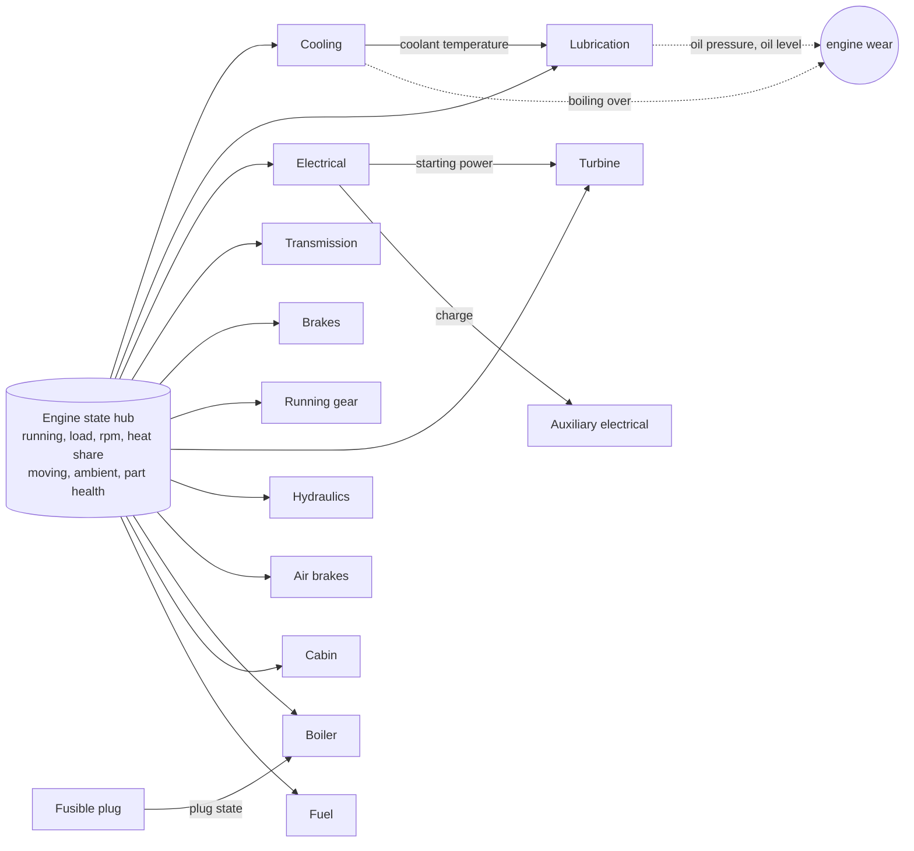

# Vehicle system crosslinks: research and record (9 Nov 2026)

The owner, 9 Nov 2026: "I just want to enrich the simulation layer under everything. Create crosslinks and so forth." This is the research
and record part of that, with nothing built. It reads what the 22 vehicle systems already feed each other, from the Defs and the code, and
proposes the links that would earn their place. Every proposal answers for itself (what it lets the player do, stops them doing, and changes),
as the standing rule asks. Figures here are agent proposals for the owner to revise; sources are labelled, and nothing is tested in game.

## Read this first

- **The systems form a star, not a web.** Almost every system reads the same hub, the comp's shared engine state (running, load, speed,
  heat share, moving, ambient air, part efficiencies, `CompPhobosVehicleSystems.cs:564-587`). Only **five links run from one system's quantity
  to another's**, out of 22 systems and about 60 quantities:

  | Reader | Reads | How | Where |
  | --- | --- | --- | --- |
  | Lubrication | Cooling's `coolantTemperature` | oil temperature follows the coolant | `Systems_Lubrication.xml:130-139` |
  | Turbine | Electrical's `startingPower` | a turbine too weak to light | `Systems_Turbine.xml:138-151` |
  | Auxiliary electrical | Electrical's `charge` | the loads' supply | `Systems_Electrical.xml` |
  | Boiler | Fusible plug's `fusiblePlug` (twice) | a melted plug drops the fire | `Systems_Boiler.xml` |

- **The one real chain we have is the best thing in the model**: a hit radiator leaks coolant, the engine runs hot, the oil follows it and
  cooks, and the engine wears (Cooling, Lubrication, Conditions). The owner's Harrier story and the Wagon screenshots both came from it. Every
  proposal below is another chain of that kind, where one system's state changes what another one does, and the player can read it from the
  gauges.
- **The schema can already express most of them in XML**: `Input_Quantity` reads any quantity of any system, with a `fallback` when a vehicle has
  no such system (`Inputs.cs`), and `Input_PartEfficiency` reads any role. Four of the eight proposals need no C# at all. Two need a small new
  input each, and two need a code change in the hub.
- **My recommended first four**, in order: the engine block warmed by the night heater (**1**), the cab heater running off the coolant (**2**), a
  worn engine burning oil and running hot (**3**), and a burning vehicle cooking its own systems (**4**). Together they turn the cold start, the
  winter camp, the tired engine and the fire into things the gauges show and the player can act on.

## The graph today

Solid arrows are quantities read by another system. Dotted arrows are wear applied to the engine part. Everything else a system knows, it gets
from the hub. Conditions (a holed radiator, a cracked sump, a shorted battery, a warped head) hang off single systems and are not drawn.

## What is missing, and what each link would do

Each row is one proposed crosslink. "Lets / stops / changes" is the standing test. Cost: **XML** means Defs only; **input** means one small new
`Input_` or `When_` class; **hub** means a change in the comp's shared state.

| # | Link | The real basis (labelled) | Reads and changes | Lets the player | Stops them | Changes how they play | Cost |
| --- | --- | --- | --- | --- | --- | --- | --- |
| 1 | **Night heater warms the engine, not only the cab** | A block heater keeps coolant and oil warm overnight so the engine starts easily and wears less (secondary: Wikipedia, "Block heater"). Today the night heater holds the cab (`Systems_Cabin.xml:149`) and the engine starts from the air's temperature, paying the cold-start wear (`Systems_Cooling.xml:251-265`) | Cabin's `nightHeaterRunning` becomes a flow toward about 15 °C [A] on `coolantTemperature` and `oilTemperature` while the vehicle stands | Start a frozen camp's vehicles without the wear and the weak-battery refusals | Nothing | A winter camp runs the heater for the engines' sake as well as the crew's; fuel against repairs | XML |
| 2 | **Cab heater from the coolant** | A car's heater is a small radiator fed by engine coolant: no heat until the engine is warm, and none when the coolant is gone (secondary: Wikipedia, "Heater core") | Cabin's `heater` flow scaled by a curve on `coolantTemperature` (0 below 30 °C, full from 60 °C [A]), `fallback` 1 for vehicles without cooling (electric, steam) | Warm the cab for free once the engine is warm | Instant warmth on a cold start, and any heat with the coolant gone | Idle the engine before a winter trip; a holed radiator now also freezes the crew | XML |
| 3 | **A worn engine burns oil and runs hot** | Worn rings and guides let oil past; a tired engine also sheds more heat to its coolant (secondary, approximate: engine makers' service literature as commonly cited; unverified figures) | Lubrication's `burn` flow and Cooling's `combustion` flow each gain an `Input_PartEfficiency` on `Engine` through an inverted curve (1 at full health, 2 at 40 % [A]) | Read a tired engine from its oil consumption before it fails | Ignoring a 40 % engine for a season | Services come sooner on a worn engine; a repair pays back in oil | XML |
| 4 | **A burning vehicle cooks its systems** | Fire on the body heats everything under the skin. Today a fire only takes hit points from parts; the owner's Harrier flew home on fire with its coolant and oil none the wiser | New `Input_Fire`: the size of the fires attached to the vehicle. A flow into `coolantTemperature`, `oilTemperature`, `packTemperature` and `cabTemperature` while it burns | See the fire on the gauges and know how long the engine has | Shrugging off a fire that the crew puts out in time | Fire-fighting a vehicle becomes urgent for the engine, not only the hull; a jet on fire lands hot | input |
| 5 | **Accessories load the engine** | An alternator takes shaft power for what it supplies: about 1.5 W at the crank per watt delivered (secondary, approximate: alternator efficiency 55 to 70 %, Wikipedia, "Alternator (automotive)") | The hub adds the active electrical load's watts to `EngineLoad` (12 or 24 V times the amperes, over the engine's rated power) | Nothing new to do | Nothing | Lights, heaters and climate control cost fuel and heat; a camp that runs them off the engine all night feels it | hub |
| 6 | **Rough ground wears tyres and suspension** | Off-road running wears tyres and running gear far faster than roads (common knowledge; no figure claimed). Today tread wears by distance only (`Systems_Chassis.xml`, `Input_Moving`) | New `Input_TerrainCost`: Vehicle Framework's path cost under the vehicle, normalised so a road reads 1 and the worst passable ground about 3 [A]; scales `treadWear` and a small `Effect_DamagePart` on `Wheels` and suspensions | Choose roads to save tyres and parts | Nothing | Caravans and convoys prefer roads for a reason the player can see on the Health tab | input |
| 7 | **Cold oil makes a hard start** | Cold oil is thick: cranking takes more battery and the first minutes wear more (the same sources as the cold-start wear we have) | Electrical's `startingPower` gains a curve on `oilTemperature` (0.6 at -20 °C, 1 at 10 °C [A]); the cold-start wear condition moves from coolant to oil temperature | Warm the engine (link 1) to make a start certain | Starting a soaked-cold diesel on a tired battery | The night heater, the battery and the start become one decision | XML |
| 8 | **Water pump drives the heater too** | The heater core is on the same coolant circuit as the radiator | Link 2's curve also multiplied by `Input_PartEfficiency` on `WaterPump` | Nothing new | A hit water pump leaving the cab warm | A small, honest extra from a part we already added in Framework 0.55.0 | XML, with link 2 |

Not proposed, and why:

- **A shared engine-bay temperature as a second hub.** It would be a parallel model of heat beside the coolant, the oil and the pack, each
  of which is already a temperature. Link 4 gives fire a way in without it.
- **Hydraulic pressure following engine speed.** Real, but set-up and tipping are one-shot actions; the player would never see the difference.
- **Oil pressure feeding other systems.** Separate circuits on every vehicle we model; nothing honest to link.
- **Era-specific electrics** (an electric fuel pump that needs the battery): true of modern vehicles only, and the loadouts do not know an era.

## Order to build, when the owner says so

1. Links **1, 2 and 8** together: one Cabin and one Cooling Def change, no code, and a new design line in the world-map record (the night heater
   gains a reason). **Built in Framework 0.67.0 (10 Nov 2026), not yet tested in game.** As built:
   - Link 1 pulls the coolant toward 40 °C at 2 an hour [A], not toward 15: the cold-start wear begins below 20 °C, so 15 would have
     saved nothing. That holds the coolant near 26 °C at -20 outside and near 21 °C at -40 through a night's camp (rule tests). The oil
     follows the coolant already, so no second flow. It runs on every vehicle with liquid cooling, open or closed (owner); the heater's
     fuel is burned by the cab system when there is one and by the cooling system otherwise, once either way.
   - Links 2 and 8 also apply to climate control's heating, which uses the same heater core. Vehicles with no coolant (electric, steam,
     turbine bleed air) read as warm and keep their full heater.
   - Found on the way: a system switched off in the settings went on lending its frozen readings to the others, and went on applying its
     frozen stage (a cab switched off mid-burn kept burning fuel). Both now stand down with it.
2. Link **3**: two flows, no code; the Lubrication and Cooling Def comments carry the label. **Built in Framework 0.68.0 (10 Nov 2026),
   not yet tested in game.** As built:
   - The flows read a new `Input_PartHealth` (the part's share of health), not `Input_PartEfficiency`: a part's efficiency follows its
     author's curve and can stay at 1 while it is badly worn.
   - Oil burn: twice the normal at 40 % engine health and below [A], as proposed.
   - Heat: **a fifth more**, not twice [A]. At full load the radiator holds the coolant about 70 degrees above the air, so double heat
     boils any worn engine over on a warm day and wears it further, a spiral rather than a sign; a quarter more already reached
     "overheating" on a 35 °C day in the rule tests. A fifth more reaches "running hot", which the player sees and can act on.
   - The owner's answer (oil use is a reason to service): the engine service also falls due once the oil is below 60 % [A], through a
     new data rule on services (`alsoDue`), behind the setting **Low oil calls for a service** (on). Off, the burned oil only lowers the
     level until the next service. This also brings a cracked sump's leak to a mechanic's attention.
3. Link **4**: `Input_Fire` (one class, one attachment read on the rare tick), then flows on the four temperatures. The owner's Harrier is the test.
   **Built in Framework 0.69.0 (10 Nov 2026), not yet tested in game.** As built:
   - `Input_Fire` reads the biggest attached fire on the vehicle's own map, as a share of a full-grown fire (the game's 1.75), at most
     once a tick. The biggest, not the sum: a vehicle can carry duplicate fires the game never puts out (temporary-patches.md, J3). A
     hull under water (a submersible's hidden phase) and a vehicle off the map read 0, at session 4b's prompting.
   - **The owner's rule could not be met by heat alone.** A fire grows to full size within minutes, and the radiator settles any steady
     heat within the hour, so a steady flow either boils every burning engine or none. So the fire also **cooks the radiator and its
     hoses**, half its health an hour [A] (they fail first in a real vehicle fire), and heats the coolant at 180 an hour [A]: put out
     after an hour, the coolant peaks near 102 °C and the radiator needs repair; after two, it boils over. `FireFigureTests` hold this.
   - The oil follows the coolant, so it needs no flow of its own, except on an engine with no coolant (a turbine, an air-cooled
     engine): 60 an hour [A], about 20 °C above its running heat, so a jet that flew on fire lands with hot oil. That needed a new
     condition, `When_HasQuantity`.
   - The cab: 80 an hour [A], about 40 °C above the air within the hour, stifling, so the crew want out. The electric pack: 30 an hour
     [A]; heavy and slow, it is warm but unharmed after an hour, and in thermal runaway after about three and a third.
4. Link **7**: a curve on starting power, and moving the cold-start condition to oil temperature.
5. Links **5 and 6** last: each touches the hub or reads the map, so each needs a cost measurement against the 0.05 ms budget before it ships.

**Links 7, 5 and 6 and the block heater built together in Framework 0.70.0 (10 Nov 2026), with D'thorga Vehicles 0.30.2 for the
heavy vehicles' voltage; not yet tested in game.** The owner asked for one batch and one version, to spend fewer tokens. As built:

- **Link 7:** starting power gains a curve on `oilTemperature` (0.6 at -20 °C, 1 from 10 [A]); a start's battery draw follows the oil
  rather than the air (the air's curve kept for a vehicle without oil); the cold-start wear moved from Cooling to Lubrication, reading
  the oil below 20 °C, so air-cooled and turbine engines count it too.
- **Block heater:** a fitting on an engine (15 steel, 2 components, vehicle electrics research, Construction 3; the owner's agreed
  defaults). It keeps the coolant at the night heater's 40 °C on shore power, parked with the engine off, free from the grid as shore
  charging is. Built on a `blockHeaterAbsent` figure the fitting multiplies to 0, the fusible plug's pattern, so no new code. **Both
  heaters gained a thermostat** (full below 35 °C, off at 40): without it the 0.67.0 night heater pulled a hot engine just parked
  *down* toward 40 faster than it would cool by itself, a fault found while adding this.
- **Link 5:** `AccessoryRules.EngineShare`: the switched-on loads' amperes times the system voltage, over an alternator efficiency of
  0.6 [A, inside the cited 55 to 70 %], as a share of the engine's rated power. It adds to the engine load, to the heat share, and to
  the fuel burned when fuel follows the model. It is honestly small (lights and a heater on a light truck: about 1 %); its point is a
  long night camp or an idle with every load on. Electric vehicles and engines with no known rated power are not charged. A new
  `systemVolts` figure (12, heavy vehicles 24, the voltage their loads were authored for) turns amperes into watts. Setting **Accessories
  load the engine** (on; owner).
- **Link 6:** `Input_GroundPathCost` reads the terrain and snow under the vehicle once per cell moved to (the caravan's tile on the
  world map). Tread wears by a curve on it (road 1, soil 1.2, mud or soft sand 2.5, the worst 3 [A]), and over path cost 8 and up the
  Wheels part loses 1 % of its health an hour on the move [A]. No suspension part exists to wear, so the wheels carry it. Rails and
  aircraft in flight read as a road. Setting **Rough ground wears tyres and suspension** (on; owner).
- **Cost:** link 5 is a sum the update already makes plus one multiplication; link 6 is one array read when the vehicle has moved
  cell. Both run in the rare update, never per tick. **Not measured in game**: the 0.05 ms budget check needs the owner's colony.

Each step takes the middle version number (new behaviour), carries its own test-pass row, and says "not yet tested in game" until the owner says
otherwise.

## The owner's answers (10 Nov 2026)

| Question | Agent lean | Owner's answer |
| --- | --- | --- |
| Should the night heater warm the engine on every vehicle, or only ones with a cab heater fitted? | Every vehicle with cooling | **Every vehicle with cooling, and a block heater can be a good upgrade** (below) |
| Does a worn engine's extra oil burn count as a reason to service, or only as a cost? | A cost only | **A reason to service it, with a setting to make it a cost only** (link 3) |
| How hard should fire cook? | Put out within an in-game hour: hot but undamaged; left to burn: boils over | **The agent's lean** (link 4) |
| Link 5 on or off by default? | On, with a setting | **On, with a setting to turn it off** |

## Proposed: a block heater upgrade (agent's proposal from the owner's answer, not built)

The night heater works only at a caravan's night camp. A **block heater** is an electric element in the engine that plugs into mains
power, which is how real vehicles in cold places are kept warm overnight at home (secondary: Wikipedia, "Block heater").

- **Lets the player:** keep vehicles parked in a cold base warm from the colony's power, so a winter morning's start costs no wear and
  the cab heater works at once.
- **Stops them:** nothing.
- **Changes how they play:** winter parking is laid out beside power, and a fitting is worth buying for a cold map.
- **How:** a fitting in the existing fittings set, with a Toward flow on `coolantTemperature` while the vehicle is on shore power
  (`Input_ShorePower`, which the depot bays and electric vehicles already use) and parked, and a small power draw. It would come with
  link 7 (cold oil makes a hard start), when the start itself depends on the warmth. Figures to author then.

## Who chose what

- **Owner (9 Nov 2026):** enrich the simulation layer under everything with crosslinks; research and record first.
- **Owner (10 Nov 2026):** the four answers above, after testing the damage chain in game; go-ahead for the cross-linking.
- **Agent:** the graph reading, the eight proposals and their figures (all authored, marked [A]), the order, and what was left out; in
  0.67.0, the engine heater's 40 °C target and rate, the heater core's 30 to 60 °C curve, and applying links 2 and 8 to climate control;
  in 0.68.0, reading health rather than efficiency, the heat cut to a fifth, the 60 % oil line and the setting's default (on, matching
  the owner's answer); in 0.69.0, the cooked radiator as the way to meet the owner's fire rule, and every fire figure; in 0.70.0, every
  figure in links 7, 5 and 6, the heaters' thermostat, the wheels standing in for suspension, and 24 V for the heavy loadouts.
- **Owner (10 Nov 2026):** batch links 7, 5, 6 and the block heater into one version; a setting for link 6, on; the block heater's
  defaults agreed.

## Sources

Read for this record, in our own words: `src/PhobosFramework.Vehicles/Systems/CompPhobosVehicleSystems.cs:564-587` (the hub) and `:1034-1040`
(heat share); `src/PhobosFramework.Vehicles/Schema/Inputs.cs` (`Input_Quantity`'s fallback, `Input_PartEfficiency`, `Input_ElectricalBalance`);
every `Systems_*.xml` under `mods/PhobosFramework/Mods/VehicleFramework/Common/Defs/Phobos/Framework/VehicleSystems/`, parsed for cross-system
quantity reads (five found); `Systems_Cabin.xml:149` (night heater), `Systems_Cooling.xml:251-265` (cold-start wear), `Systems_Lubrication.xml:130-139`
(oil follows coolant), `Systems_Turbine.xml:138-151` (turbine start). Secondary sources for the real basis are named per row and are not primary
engineering references; the figures in the proposals are authored for play, not measured.
