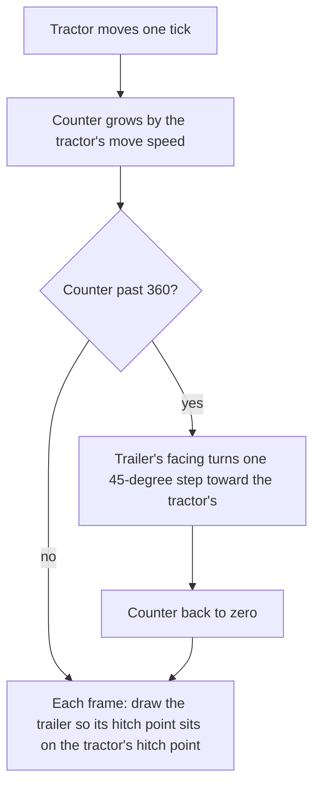

# Trailers that follow their tractor: how RimThunder does it, and what it opens for us (11 Nov 2026)

**Research only. Nothing here is built, no mod was added to the owner's list, and nothing was tested in game.** The owner
linked [RimArrow: Mechanized Vol.1](https://steamcommunity.com/sharedfiles/filedetails/?id=3835687894) on 11 Nov 2026 with a
screenshot of a tracked tractor pulling a long trailer at an angle, and asked how the trailer turns so realistically. The
mechanics below were read from decompiled code (kept on this PC, summarised in our own words) and from the mods' Defs; every
idea for our own vehicles is agent-authored.

## Read this first

- **The turn is drawn, not simulated.** A hitched trailer is taken off the map and carried in its tractor's inventory. The
  tractor draws it every frame with the two hitch points pinned together. The trailer has its own facing, one of eight,
  which **trails the tractor's facing by one 45-degree step at a time** as the tractor covers ground. That lag, pivoting
  about the hitch, is the whole effect.
- **The code is RimThunder - Core's, and it is already active in the owner's game.** RimArrow: Mechanized Vol.1 has no code:
  it supplies the trailer and tractor Defs. Turbo's Vehicle Features Library adds mass limits, release and caravan handling
  on top, and changes nothing about how the trailer turns.
- **The owner's game has tractors but, as far as checked, nothing to hitch.** RimThunder - Roaring Tiger's HEMTT and M113
  Defs carry RimThunder's mounts, and two Defs use its tractor class. No Def in the three active RimThunder mods uses its
  trailer class (those three folders were searched, not all 340 mods).
- **Our earlier records were incomplete.** Vehicle Framework has no tow, as they say, but a mod on the owner's list does.
- **The interesting opening:** RimThunder passes a fixed angle of zero where Vehicle Framework's draw call takes any angle.
  A hitch of our own could fill that in with a true trailer model, smoother than the original (below, "A smoother turn").
- **Three questions for the owner** are at the end.

## Whose code is whose

| Mod | Authors | What it holds | In the owner's game |
| --- | --- | --- | --- |
| [RimThunder - Core](https://steamcommunity.com/sharedfiles/filedetails/?id=3070495204) | RimThunderTeams | `Motorization.dll`: the tractor and trailer classes, the trailer mount, the hitching job, the drawing | Active, load position 156 |
| [Turbo's Vehicle Features Library](https://steamcommunity.com/sharedfiles/filedetails/?id=3835572327) | Turbo | `AirLaunchFramework.RTTowing.dll`, loaded only with RimThunder - Core: tow mass limits, release, caravan and destruction handling, in 29 Harmony patches | Downloaded, not active |
| [RimArrow: Mechanized Vol.1](https://steamcommunity.com/sharedfiles/filedetails/?id=3835687894) | Turbo, GuinPren | Defs and art only: the MAZ-837810 trailer (3 by 10 cells), the MT-T tractor in the screenshot, and tanks | Downloaded, not active |

`RT` below is `.local/decompiled/RimThunder-Core-1.6/Motorization.decompiled.cs`, `TU` is
`.local/decompiled/Turbo-RTTowing-1.7/RTTowing.decompiled.cs` and `VF` is our decompile of Vehicle Framework's 1.6 build,
all read with `scripts/query-code.py`.

## How it works

### Hitching

- **Only a tractor may hitch, and only a trailer may be hitched.** The menu option needs the selected vehicle to be of the
  class `VehiclePawn_Tractor` with a trailer mount (`RT:1096-1099`) and the clicked one a `VehiclePawn_Trailer`
  (`RT:1103-1111`).
- **The two mounts must share a type word.** Each mount lists `supportedType` strings, and one in common is enough
  (`RT:827-847`). RimArrow's trailer and tractor both say `lowTrailerMount`.
- **The job:** the tractor drives to the nearest cell, waits 60 ticks, the trailer's crew get out, a deployed trailer packs
  up, and the trailer is attached (`RT:1409-1442`).
- **Attaching takes the trailer off the map** and puts it in the tractor's inventory (`RT:1019-1029`). From then on it is
  cargo that happens to be drawn.

### Drawing

- Every frame, the tractor's mount draws its payload after the tractor (`RT:935-947`, `RT:959-1003`).
- **Where:** the tractor's hitch point for the tractor's facing, minus the trailer's hitch point for the trailer's facing
  (`RT:802-825`). So the two hitch points always coincide, whatever the two facings are.
- **The hitch points are eight hand-written offsets per vehicle**, one for each facing (`RT:481-495`, `RT:576-609`). In
  RimArrow's Defs the trailer's sit about four to five cells from its centre.
- **The angle is always zero** (`RT:926-929`), so the trailer shows only at the eight facings.
- A trailer with a cargo deck draws what it carries too (`RT:4465-4481`).

### The lag that makes it look right

- The mount remembers the trailer's own facing, `latestRot`, and saves it (`RT:886-891`).
- **Each tick while the tractor is moving and the game is not paused, a counter grows by the tractor's move speed.** When it
  passes 360, the trailer's facing turns one step toward the tractor's, the shorter way round, and the counter starts again
  (`RT:756-771`, `RT:856-875`).
- **If the tractor ends up facing exactly opposite the trailer, the trailer snaps round at once** (`RT:785-788`).
- **Inference:** because the counter adds speed per tick, a step comes after a set amount of travel rather than a set time,
  so a fast tractor's trailer straightens in fewer ticks. The stat's unit was not checked.

In the owner's screenshot the tractor faces east and the trailer lies on the diagonal behind it: one step behind, as this
code would draw it. That reading is ours; we have not run it.

### Unhitching

The trailer leaves the inventory and is dropped near where the hitch points met, facing as the tractor does (`RT:692-736`).

### What follows from "it is cargo" (inference, not read line by line)

- A towed trailer occupies no cells. It blocks nothing, nothing blocks it, and it can swing through a wall.
- It is not on the map to be shot or repaired until it is unhitched.
- It travels on the world map and is saved as part of the tractor's inventory.

### What Turbo's library adds

- **A tow policy per vehicle:** a mass limit, and whether towing has its own capacity apart from the cargo bay (`TU:1689-1694`).
- **Rules for attaching:** mass, a land-vehicle check, and a guard against a loop of vehicles towing each other
  (`TU:790-905`).
- **Mass accounting:** patches on the game's inventory mass, free space, capacity and encumbrance, and on Vehicle
  Framework's weight modifier and cargo dialog (`TU:1958-2211`).
- **Release, caravans and loss:** dropping from the cargo tab or the world map, forming caravans with a trailer's cargo, and
  what happens to a trailer when its carrier is destroyed (`TU:1351-1688`).
- **A way round the tractor class:** it patches the menu and `CanTowVehicle` so its recovery tank can tow without being a
  `VehiclePawn_Tractor` (`TU:2292-2320`).

That these patches exist suggests the base mod leaves those areas thin. We did not test the base mod without them.

## Limits and risks

- **Eight facings, 45-degree steps.** It reads as articulation at a glance; it is not a continuous swing.
- **Eight offsets per vehicle, written by hand.** Every tractor and every trailer needs its own set.
- **The classes.** A vehicle must be RimThunder's tractor class to tow. Our vehicle Defs name no class of their own.
  Changing a Def's class leaves built vehicles in a save with the class they were saved with (we met this with turrets),
  and a save holding RimThunder's class would not load that vehicle without RimThunder.
- **RimThunder - Core declares 1.4 to 1.6** and was last updated on 4 Jul 2026; none of its newest 50 comments is the
  uploader's, and players are asking for 1.7. The owner runs its 1.6 build on 1.7. RimArrow names an unofficial 1.7 port
  (Workshop item 3827788538); Steam returned no details for it.
- **Turbo's two mods are days old and moving fast:** both updated on 10 Nov 2026, with under 900 subscribers each and the
  uploader replying daily. The library's 13 comments include load-order trouble and red errors on a bare list. All 33 and 13
  comments were read with `scripts/workshop-research.py`; RimThunder - Core's newest 50 of 451.
- **29 patches, some on game-wide mass rules,** are a wide surface on a list of 340 mods. Not judged here.
- **No licence file** ships with any of the three. The pages' descriptions were not read for reuse terms. We copy nothing
  either way.
- **Cost (inference):** a few comparisons per tick for each tractor, and one more vehicle drawn per frame.

## What it opens for our vehicles

### Two routes

| Route | What it is | For | Against |
| --- | --- | --- | --- |
| A: use RimThunder's towing | Give our vehicles its mount, behind `IfModActive`; trailers of ours take its trailer class | Their trailers and ours mix at once; little code | The class problem above; nothing without RimThunder; 45-degree steps; the mod's 1.7 state |
| **B: a hitch of our own in D'thorga Framework** | The same idea in our own code: a comp on any vehicle that carries a trailer and draws it at the hitch | Works on any vehicle class, with or without RimThunder; ours to tune, to give to enemy vehicles and to make smoother | New code; our own mass and caravan rules to write; eight offsets per vehicle unless the model below removes them |

**Agent's lean: B**, with RimThunder's trailers accepted where they make sense. It follows the owner's rules that vehicle
systems are ours with other mods' as substitutes, and that shared functions live in the Framework core.

### A smoother turn (agent-authored, untested)

Vehicle Framework's draw call takes a free angle as well as a facing (`VF:16064-16067`), and RimThunder leaves it at zero.
A hitch of ours could keep **one number, the trailer's heading,** and move it the way a real trailer's moves:

- A trailer's axle always rolls toward its hitch. For each small distance `s` the hitch travels, the trailer's heading
  closes on the direction of travel by `sin(difference) x s / L`, where `L` is the length from hitch to axle. This is the
  curve mathematicians call a tractrix.
- **What it gives for free:** a long trailer straightens slowly and a short one quickly; the trailer cuts the inside of a
  corner; and the eight hand-written offsets shrink to two lengths, hitch overhang and drawbar.
- **What it costs:** one sine per tick per moving tractor, and one saved number.
- **To check before any design:** whether every layer of a vehicle's picture, its overlays and its diagonal sprites honour
  the free angle; how the model behaves in reverse, where a real trailer jack-knifes.

### Ideas, each to answer for itself

| Idea | Lets the player | Stops the player | Changes how they play |
| --- | --- | --- | --- |
| **Drawbar trailer for the tipper** | Bring twice the stone per trip | Tip the trailer while hitched; turn round in a tight yard, if length is made to matter | A quarry run is planned around where to drop the trailer |
| **Tank trailer for the bulk tanker** | Carry a second liquid without the compartment upgrades | Draw from both at one hose | Fuel and water go out together to a far camp |
| **The generator set as a trailer** (deferred in [its record](vehicle-generator-set.md)) | Leave the camp's power behind and take the truck away | Move the set without a vehicle to pull it | One truck serves several camps |
| **Recovery tow** (the "Tow" row of [the military research](military-vehicles-research.md)) | Bring home a vehicle with no fuel, a flat battery or a wrecked part | Tow a crewed or hostile vehicle | A breakdown far from home is a job, not a loss |
| **Camp trailer** | Carry a packed camp, tents and stores, and drop it whole | Nothing new | Camping trips start from one hitch, not a loading list |

The Cherokee needs nothing here: a trailer is a vehicle, so the sling's own mass rules decide whether it can lift one
(inference from [the sling record](vehicle-sling-design.md)).

## Questions for the owner

1. **Route A or route B?** RimThunder's towing as an optional tie-in, or a hitch of our own that also accepts its trailers.
2. **Is the smoother turn worth a check?** It decides whether a trailer of ours needs eight offsets or two lengths.
3. **Which trailer first,** if any: the tipper's, the tanker's, the generator set, the recovery tow or the camp trailer?

## Who chose what

- **Owner:** the subject, and that this is research and a record (11 Nov 2026).
- **Agent:** the lean to route B, the smoother turn, and every idea in the table.

## Sources

- RimThunder - Core, by RimThunderTeams: the towing itself, read from `Motorization.dll` as decompiled text.
- Turbo's Vehicle Features Library, by Turbo, and RimArrow: Mechanized Vol.1, by Turbo and GuinPren: the towing rules and
  the Defs, read the same way and from their XML.
- Vehicle Framework, by Smash Phil: the draw call.
- The tractrix is standard geometry; the form given here is our own simplification and has not been checked against a
  reference.
