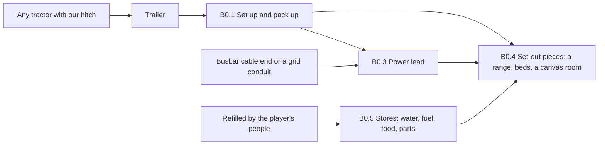

# Working trailers: the shared base and a catalogue (13 Nov 2026)

**A research and design record. Built so far (13 Nov 2026, the owner's first batch; nothing tested in game): set up and pack up by hand
(B0.1), the hitch that respects it (B0.2) and the two bowsers (Q3, Q4), in Framework 0.111.0 and Vehicles 0.55.0; see "What was built"
below.** The rest is design only. The owner, 13 November 2026: "I want to do
a research and record purview on utilitarian trailers", with two ideas of their own, **a military-style field kitchen on wheels
powered by the Busbar as required** ([vehicle-field-kitchen.md](vehicle-field-kitchen.md)) and **something to transport prisoners
with** ([vehicle-prisoner-transport.md](vehicle-prisoner-transport.md)), and asked for the agent's ideas too. This record holds
the **shared base** every working trailer needs and the **catalogue** of the rest.

Facts marked **[code]** were read on 13 Nov 2026 with `scripts/query-code.py`, `scripts/query-defs.py` and our own source and are
summarised in our own words. **[A]** is an authored starting value; **[S]** is a real-world figure with its source below;
**[I]** is our inference. Vehicle Framework references are from its **1.6** decompile, the only one we hold.

## Read this first

- **No active mod on the owner's list has a working trailer of any kind** (kitchen, prisoner, water, fuel, cold store, medical,
  workshop, livestock, boat). The only trailer anyone can build is our own Pintle flatbed. Everything here is new ground.
- **One shared base does most of the work.** A trailer today has none of our vehicle systems and cannot be "set up". Five
  pieces, built once, turn the Pintle's chassis into any working trailer: **set up and pack up**, **a hitch that respects it**,
  **a power lead**, **set-out pieces** (real buildings placed beside it, a canvas room among them) and **stores**.
- **Trailers do their work through the game's own buildings.** A kitchen trailer sets out a real cooking range; an aid post sets
  out real hospital beds. The game's jobs, recipes and other mods' content then work unchanged. This is the main design choice:
  a vehicle cannot sensibly take cooking bills or be a bed [code], but a building beside it can.
- **The owner's chosen families**: Supply (water bowser, fuel bowser, cold store), Care (aid post, shower and latrine, crib
  room), Work (field workshop, field laboratory, light tower, stone saw, bridge layer), and the livestock trailer.
- **The owner's rules apply**: every trailer uses up something real; stores run down and are refilled by the player's people;
  passive gear costs materials and weight only; no drag; every vehicle of ours is upgradeable from its first Def; every
  mechanic works for other factions' vehicles; no stand-in body art.

## What the research found

### Our hitch and trailer today [code]

- **The Pintle flatbed** (`mods/PhobosVehicles/Defs/Phobos/Vehicles/FlatbedTrailer/Vehicle_FlatbedTrailer.xml`): 2 x 5 cells,
  2,000 kg empty, 3,000 kg of cargo, no seats; parts chassis, deck, drawbar, axles, lights; one upgrade (greedy boards).
- **The hitch** (`src/PhobosFramework.Vehicles/Hitch/`, Framework 0.101.0 to 0.104.0, untested): any land vehicle with a
  loadout can tow; the trailer stays on the map and can be shot; a colonist couples it in about a third of an hour; the towed
  weight is felt by the drivetrain; on the world map the trailer rides in the hitch's own holder and is set down behind the
  tractor on arrival. Its record already foresaw this: "tank, generator, tipping and camp trailers are the same trailer with a
  different deck" (`vehicle-hitch-design.md:114-122`).
- **What a trailer lacks:** a trailer gets no loadout, so no `CompPhobosVehicleSystems`: no Dashboard, fittings, electrics,
  conduits beneath it or shore power (`src/PhobosFramework.Vehicles/Service/VehicleSystems.cs:54-55`). It has no fuel comp, so it
  cannot be drafted.
- **Set-up today needs crew and a running engine:** `CompPhobosSetUp` refuses otherwise
  (`src/PhobosFramework.Vehicles/Systems/CompPhobosSetUp.cs:320-325`), which a trailer can never satisfy.

### Pieces we can reuse [code]

| Piece | Where | What a trailer gets from it |
| --- | --- | --- |
| **Power point** | `CompPhobosRigWork`, `RigWork.xml:246-286` | A 1 x 1 consumer set beside the vehicle that wires to any conduit or generator within 6 cells, the Busbar's cable end included; its draw is set each rare tick |
| **Rig work** | `WorkGiver_PhobosRigWork`, `CompPhobosRigWork.cs:330-401` | A colonist works at a parked vehicle from a cell beside it, trains a skill, sees a progress bar |
| **Tank** | `CompPhobosTank` | Any fluid by Def; **already works without vehicle systems**, reading the cell's temperature instead (`CompPhobosTank.cs:175-182`); ports to plumbing, pipes, items, a drill rig, and **refuelling any vehicle within hose reach** (`TankPorts.cs:79-101`) |
| **Holder** | `CompPhobosLitter` | People held in our own holder, loaded by a carry job, tended, set down when unloaded |
| **Set-out building** | The Busbar's cable end, the rig's power point | A building spawned beside a set-up vehicle and removed when packed |
| **Canvas roof** | Field Tents (another author's mod, read only) | Proof that a packable building can roof cells and make a real room |

### The Busbar, for every trailer that takes power

The Busbar gives **2,000 W** (2,650 W uprated) at 15 chemfuel a day at full output, with a 12-cell cable reel; its cable end is a
building on the game's power net (`Vehicle_GeneratorSet.xml`, `CompPhobosGeneratorSet.cs:355-432`). A trailer's power point within
6 cells of that cable end, or of any conduit, draws from it. **Nothing new is needed for "powered by the Busbar".** The owner
turned a towed generator down (`vehicle-generator-set.md:194-197`), so no trailer here makes power except the light tower's own
small engine.

## The shared base (B0)

Five pieces of new code, written once in the Framework, used by every trailer below.

### B0.1 Set up and pack up, with no crew and no engine

- **Order:** a **Set up here** button on a parked, unhitched trailer of the player's. A colonist (Construction) lowers the legs
  and unpacks in a set time per trailer [A: 1,500 to 4,000 work], like hitching. **Pack up** reverses it.
- **Refusals, each with its reason:** still hitched; ground blocked on the side the pieces go; a set-out piece in use (a bed
  occupied, a bill in progress) or holding things.
- **Rule:** a subclass of today's set-up comp that waives its crew-and-engine test for trailers; everything else (the saved flag,
  refusing to move while set up, placement helpers) is reused.

### B0.2 A hitch that respects set-up

- **Today the hitch moves a towed vehicle without asking whether it is set up** (`CompPhobosHitch.cs:272-299`; found on the way,
  listed under Faults). The base adds the check: coupling a set-up trailer is refused ("Pack it up first"), and a tractor that
  tries to drive off with one still coupled is stopped with the same words.

### B0.3 A power lead

- A trailer that takes power sets out the rig's **power point** on its side when set up. Its draw is the sum of what is
  switched on. **Without power, each trailer says plainly what stops** ("No power: the cold store is warming").
- **The Busbar link is free**: a Busbar parked within reach with its cable end near, or a grid conduit, powers it.

### B0.4 Set-out pieces

- Each trailer Def lists the **buildings it sets out** and where, relative to its body (left, right, rear; in cells). Packing
  removes them; each is held by the trailer while packed, so a save holds it once. This is the same service the accessories
  record's camp order needs (`vehicle-accessories.md`, Y3): build it once.
- **A canvas room** is one kind of piece: walls and a canvas roof set out together, making **a real room** in the game's eyes
  (the way Field Tents does it). A real room is what lifts the outdoor penalties: work tables outdoors work at x0.8 and outdoor
  cooking rolls a flat 2% food poisoning [code, `full:all.cs:715046-715084`, `91079-91135`]. **Agent recommendation:** the
  kitchen, aid post, crib room and laboratory each set out a canvas room; the rest set out open pieces.
- **Engineering rules carried over:** pieces are placed on the tick after the order, never during spawn set-up (the sling's
  landing fault); nothing of the player's is ever deleted (an item left inside a packed room is set down beside it).
- **If the trailer is destroyed while set up**, its pieces stay as ordinary buildings, now unowned by any trailer.

### B0.5 Stores

- A store is a tank or a locker on the trailer with a **size**, a **rate it empties at**, **how it is refilled** and a **plain
  warning when low** (the accessories rule). Fluids use the tank system as it is; dry goods use a locker that takes chosen items
  from the cargo.

### B0.6 Trailer sizes

**Owner, 13 Nov 2026: "3 x 7 is the bare minimum, and at least vehicle sized or near for the other trailers."** There is no
small chassis: the 2 x 5 proposed here is dropped.

- **The floor is 3 x 7**, the Pintle flatbed's size since Vehicles 0.54.0 and the survey truck's. No trailer of ours is smaller,
  the livestock and prisoner trailers included.
- **Every other trailer is the size of a truck or near it.** Our trucks are 3 x 7 (the survey truck), 3 x 8 (the Busbar, the Talus
  tipper) and 3 x 10 (the Ullage tanker, the drill rig) [code, their Defs]. **Agent's reading, owner to revise:** the working
  trailers are 3 wide and 7 to 8 long, 3 x 8 (the Busbar's and the tipper's length) for the big ones (the kitchen, the aid post,
  the bowsers, the crib room); each trailer's length is fixed in its own Def before its picture.
- **Figures to revisit at that size:** the bowsers' 1,500 L and 1,200 L, the prisoner trailer's six cells and the livestock
  trailer's stalls were set for the smaller chassis [A]; each is set again from its trailer's size when it is built.
- Before any trailer's picture is made, its size is **measured against the biggest comparable vehicle on the owner's list and
  generated at 1.5 times its drawn size or more** (owner's rule). Each body has its own upgrade tree and parts bill from its first
  Def.

| Lets the player | Stops the player | Changes how they play |
| --- | --- | --- |
| Set up a working site anywhere a truck can tow to | Moving a set-up trailer without packing it | A camp becomes a convoy of purpose: one tractor, then the trailers the job needs |

## The catalogue

Every idea, with its ID for the outstanding-work list. "Beyond the base" says what each needs that B0 does not give. **Bold** IDs
are the owner's two and the families the owner chose to design in depth.

| ID | Trailer | What it does | Uses up | Beyond the base |
| --- | --- | --- | --- | --- |
| **Q1** | **Field kitchen** | Cooks for a camp; burners always, more with power | Fuel, water, food | Its own record |
| **Q2** | **Prisoner transport** | Holds prisoners or captives securely | Rations, water, fuel for a heater | Its own record |
| **Q3** | **Water bowser** | 1,500 L of water to where it is needed | Water | None: the tank as it is |
| **Q4** | **Fuel bowser** | Chemfuel to vehicles and the Busbar in the field | Chemfuel | None: the tank and its refuel port as they are |
| **Q5** | **Cold store** | Keeps cargo cold with power | Watts or its own fuel | A cold answer for its cargo |
| **Q6** | **Aid post** | Hospital beds in a canvas room, lit and powered | Medicine, watts | None beyond B0 |
| **Q7** | **Shower and latrine** | Washing and toilets in the field (Dubs Bad Hygiene) | Water, fuel to heat it; waste to empty | Dubs' water storage, unread |
| **Q8** | **Crib room** | A warm room with a table and a tea urn | Fuel or watts; tea, food | None beyond B0 |
| **Q9** | **Field workshop** | Faster repairs and services nearby; a spares shelf | Parts, watts | A repair factor near it |
| **Q10** | **Field laboratory** | Research away from home | Watts | None beyond B0 |
| **Q11** | **Light tower** | Lights a work site or a defence at night | Its own chemfuel, or watts | None beyond B0 |
| **Q12** | **Stone saw** | Cuts stone chunks into blocks at the quarry | Watts | None beyond B0 |
| **Q13** | **Bridge layer** | Lays a crossing over water and takes it up | Work; the bridge itself | Placing and lifting a bridge |
| **Q14** | **Livestock trailer** | Carries animals at vehicle speed | Feed and water | Animals' food aboard |
| Q15 | Boat trailer | Carries a small boat overland and launches it | — | Loading a vehicle onto a deck; launch at the shore |
| Q16 | Low-loader | Carries a broken or slow vehicle | — | The same deck as Q15 |
| Q17 | Drawbar tipper and tank trailers | A second body behind our own Talus tipper and Ullage tanker | — | Our tipper's and tanker's comps on a trailer |
| Q18 | Battery trailer | Batteries charged at base and drained at camp | Watts | A store of watts |
| Q19 | Ordnance trailer | Ammunition and shells for a gun line (Combat Extended) | — | None: cargo with explosive parts |

**Left out, with reasons:** a towed generator (the owner kept the Busbar self-propelled); a radio or command trailer (radio is on
the back burner); a camp trailer (the accessories record's camp order and swags cover it); anything that only changes speed or
drag (the owner: no drag).

## The families in depth

### Supply

#### Q3. Water bowser

- **What it is:** a tank trailer of water. The US Army's M149 "water buffalo" carries 400 US gallons (about 1,514 L); it weighs
  about 3,000 lb empty and carries another 3,300 lb of water when full, and was designed for 2.5-ton trucks [S]. Ours: **1,500 L**
  [A from the M149], about 1,300 kg empty [A], on the tandem chassis.
- **How:** the tank system as it is, with the water contents Def; filled from plumbing, our tanker, or a pump into open water [A];
  it remembers the worst water it was filled with (built). Feeds the field kitchen, the shower trailer and, where Dubs Bad
  Hygiene is active, plumbing beside it. **It never fills itself.**
- **Set-up:** none needed to pump; parked is enough.
- **Without Dubs Bad Hygiene:** it still feeds the kitchen's water (Q1) and the tanker's existing water uses.

| Lets the player | Stops the player | Changes how they play |
| --- | --- | --- |
| Run a camp, a kitchen and showers far from any well | Nothing | Water is planned and hauled, as it is in real field work |

#### Q4. Fuel bowser

- **What it is:** a tank trailer of chemfuel, the field refuelling trailer armies call a bowser (the word comes from Sylvanus
  Bowser, credited with the fuel pump; in the UK a "bowser" is also an emergency water tank [S]).
- **How:** the tank system and its **existing refuel port**, which fills any vehicle within hose reach (`Port_VehicleFuel`). 1,200 L
  [A]. Refilled at base from items, a pipe net or our tanker.
- **Why it earns a trailer when the Ullage tanker exists:** the tanker is a truck that takes a driver and a vehicle slot; a bowser
  rides behind the Busbar or any truck already going, and stays at a camp while the truck leaves.

| Lets the player | Stops the player | Changes how they play |
| --- | --- | --- |
| Keep a convoy and a Busbar running far from base | Nothing | Fuel becomes a supply line rather than a range limit |

#### Q5. Cold store

- **What it is:** an insulated box trailer with a refrigeration unit. A real shipping reefer runs from shore power or a diesel
  generator set clipped to it, and holds anything from −65 °C to 40 °C [S]. Ours keeps its cargo at **−5 °C** (frozen) or
  **4 °C** (chilled), the player's switch [A].
- **How:** the game asks a held thing's holders for a temperature before the weather [code, `RimWorld-1.7:Verse.Thing.cs:506-534`];
  we already answer for riders (`HeldTemperaturePatch`). The cold store answers for **its own cargo**. With power from its lead it
  holds the set point; **its own small diesel unit** burns chemfuel when no power is near [A: 3 chemfuel a day]; with neither, it
  warms towards the weather, slowly at first [A], and says so.
- **Uses:** fresh meat and vegetables for the field kitchen; a hunting or butchering camp; and, darkly, **a field mortuary**:
  corpses kept fresh for a funeral at home or for an ideology's rites. **Whether Vehicle Framework's cargo takes corpses was not
  read**; to check before building.

| Lets the player | Stops the player | Changes how they play |
| --- | --- | --- |
| Bring a hunt home fresh; feed a kitchen fresh food for weeks | Forgetting the power: a flat cold store spoils the load | Cold is paid for in watts or chemfuel every hour |

### Care

#### Q6. Aid post

- **What it is:** a medical trailer that sets out a **canvas room with two hospital beds** [A], a lamp, and the game's vitals
  monitor beside them, linked to the beds as the game links it (powered through the lead).
- **How:** the beds are the game's own medical beds, so doctoring, tending, operations, rest and infection all run as they do at
  home, with the canvas room giving them real room cleanliness. Power for the lamp and monitor comes through its lead. Medicine
  comes from a locker stocked from the cargo.
- **Real-world sense:** a regimental aid post is a medic team's first stop under canvas behind the line; ours is that, not a
  field hospital.
- **Why not our litter kit:** the litter kit is an aircraft fitting that holds patients aboard; the aid post is where they are
  treated properly.

| Lets the player | Stops the player | Changes how they play |
| --- | --- | --- |
| Treat and operate in the field in a clean room | Nothing | Expeditions can survive a bad fight without carrying the wounded home first |

#### Q7. Shower and latrine trailer (with Dubs Bad Hygiene only)

- **What it is:** a trailer that sets out showers and toilets under canvas, as the military's shower trailers do
  (`military-vehicles-research.md:110-124`, the DDA-66).
- **How:** Dubs Bad Hygiene's own fixtures as set-out pieces, fed from the trailer's own tank or a water bowser beside it, with a
  heater burning chemfuel for hot water [A]. Its waste tank fills and is emptied at a septic point (our tanker already has a
  septic port).
- **The open question:** how Dubs' fixtures would draw from a tank on a vehicle. Its water storage code was **not read**; that is
  the first check before building (also owed to the accessories record, row Y22).

| Lets the player | Stops the player | Changes how they play |
| --- | --- | --- |
| Keep hygiene up on long operations | Nothing | Water and waste become part of the camp's plan |

#### Q8. Crib room

- **What it is:** the Australian crib room or smoko shed on wheels: **a canvas room with a table, chairs, a heater and a tea urn**,
  somewhere warm to sit, eat and talk at a work site.
- **How:** set-out pieces only. The table is a gathering spot and a dining table, so people who eat there avoid the game's "ate
  without a table"; the room is a real room for recreation and warmth. The **urn** is a small work table that makes hot tea or
  coffee from leaves or beans in its locker [A]; with Vanilla Brewing Expanded active it takes their hot drinks' recipes. The
  heater burns chemfuel, or uses watts from its lead.
- **Not a kitchen:** it serves, it does not cook meals.

| Lets the player | Stops the player | Changes how they play |
| --- | --- | --- |
| Keep a work crew's mood up far from home | Nothing | Long jobs (a quarry, a mine, a siege) get a proper break room |

### Work

#### Q9. Field workshop

- **What it is:** a workshop trailer with a bench, tools and a spares shelf, as recovery and maintenance units carry.
- **How:** set up, it sets out a **spares shelf** (as the depot bay has, built) and powers a **tool rack**. Repairs and services
  on vehicles within **8 cells** [A] go **1.5 times faster** [A] while it has power, and draw parts from its shelf. Our own
  service kits can be made at its bench (the parts bench's simpler recipes) [A].

| Lets the player | Stops the player | Changes how they play |
| --- | --- | --- |
| Keep a convoy running far from the motor pool | Nothing | Breakdowns in the field are an afternoon, not a tow home |

#### Q10. Field laboratory

- **What it is:** a canvas-room laboratory: the game's simple research bench and, with power, the multi-analyser link [A].
- **How:** set-out pieces only; the game's research runs as at home. **Value, honestly:** research is a home activity in most
  colonies; this trailer suits outposts, long expeditions and the survey truck's field research
  (`FieldResearchExtension`). The record lists it for completeness; the owner may judge it low.

#### Q11. Light tower

- **What it is:** a mast of lamps on a trailer. Real ones carry metal halide lamps on a mast, powered by their own diesel
  generator set; battery, solar and hydrogen sets also exist [S].
- **How:** set up, the mast rises (a moving part, like the survey truck's boom) and lights a wide circle [A: radius 14 cells,
  brighter than our work lamps]. **Its own small engine** burns chemfuel [A: 4 a day]; with a power lead it uses watts instead
  [A: 600 W].
- **Value:** night work and night defence (Combat Extended's darkness penalties make light matter more; unverified for CE's
  current rules).

#### Q12. Stone saw

- **What it is:** a powered stone saw for the quarry, so blocks are cut where the stone is.
- **How:** set out, it is a work table taking the game's stonecutting recipes (copied from any table that cuts stone, found by what
  the recipes make, never by name), faster than the stonecutter's table while powered [A: x1.5], at the hand rate without.
- **Value:** the Talus tipper then hauls blocks instead of chunks; how much lighter a load of blocks is than its chunks was **not
  read**, so the gain is unmeasured.

#### Q13. Bridge layer

- **What it is:** a trailer carrying a folding bridge, laid over water and lifted again. Real armoured bridge layers carry spans of
  19 m or more; the US Wolverine's 26 m bridge goes down in about four minutes [S].
- **How:** set up at a water's edge, a colonist lays the bridge over up to **8 cells** of shallow or deep water [A]; the cells
  become bridge for as long as it is down; packing lifts it, refusing while anything stands on it.
- **What must be checked before building:** that Vehicle Framework's own path grid treats our bridge as passable for vehicles, and
  what the game does with bridges over deep water. Neither was read.

| Lets the player | Stops the player | Changes how they play |
| --- | --- | --- |
| Take vehicles across a river where there is no ford or bridge | Nothing | Rivers stop being walls for a convoy |

### Q14. Livestock trailer

- **What it is:** a stock crate on the Pintle chassis. Road livestock trailers are the ordinary way animals are moved today [S].
- **How:** Vehicle Framework already lets animals ride in any seat with no driving or gunner duty [code,
  `VehicleFramework-1.6:Vehicles.decompiled.cs:17131`], so the trailer has **stalls**: seats that take animals only (a small patch
  of ours on the seat check, shared with the prisoner trailer's cells). Stalls by body size: one large animal (a horse, a cow), or
  three small ones [A].
- **Feeding:** nobody feeds an animal aboard on a map; our rider check (the accessories record's "life aboard", Y4) feeds them
  hay or kibble from the trailer's feed locker, and water where Dubs Bad Hygiene gives animals thirst.
- **What it lets the player do:** move breeding stock to an outpost, take animals to market at vehicle speed, bring a tamed animal
  home from far away without a walk.
- **To check:** whether a vehicle caravan is slowed by animals walking beside it, which decides how much the trailer gains.

### Briefly: Q15 to Q19

- **Q15 Boat trailer and Q16 low-loader** share one need: carrying a whole vehicle on a deck and setting it down again (the
  HEMTT's deck in RimThunder does this; nothing of ours does). The boat trailer adds launching at the shore. Small boats on the
  owner's list: Vanilla Vehicles Expanded's dinghy (2 x 4) and trawler (2 x 5).
- **Q17 drawbar trailers:** a second tipping or tank body behind our own Talus and Ullage, as road trains do.
- **Q18 battery trailer:** in the utility vehicles catalogue already; overlaps the accessories record's house battery.
- **Q19 ordnance trailer:** a cargo trailer whose explosive parts make it dangerous when hit (Combat Extended's ammunition).

## Other factions' vehicles

| Where | What happens | Lets the player | Stops the player |
| --- | --- | --- | --- |
| **A raid on us** | Raiders bring no working trailer except the prisoner transport ([its record](vehicle-prisoner-transport.md)). Nothing else would change a raid | — | — |
| **A base we attack** | A base may have **parked, set-up trailers** placed when its map is made: a kitchen with its canvas room, a bowser, a light tower lighting the yard at night, a cold store [A: by the faction's tech level] | Loot them, capture them whole, or shoot the bowser | Easy night raids where a light tower stands |
| **A vehicle we capture** | A trailer works for us at once, its stores as found | Use it | Nothing |

The base and every trailer read only what any vehicle has. A trailer parked at a base costs nothing per tick until a player is
on the map, and then only what a set-out building costs.

## Cost to run

- **Set-out pieces** are ordinary buildings; they cost what a stove, a bed or a lamp costs.
- **The power lead** reads its draw on the rare tick, as the rig's does.
- **Stores** use the tank's existing rare update.
- **The cold store** adds one lookup for things in its own cargo when the game asks their temperature.
- **Nothing runs per tick.**

## Optional tie-ins

| Mod | What changes |
| --- | --- |
| Dubs Bad Hygiene | The shower and latrine trailer exists only with it; the water bowser feeds its plumbing; animals' thirst |
| Vanilla Brewing Expanded and its Coffees and Teas | The crib room's urn takes their hot drinks |
| Vanilla Cooking Expanded, Tavern | The field kitchen takes their stove recipes ([its record](vehicle-field-kitchen.md)) |
| Combat Extended | Light towers matter more at night (unverified); the ordnance trailer |
| Field Tents | Nothing; its canvas-room approach is the precedent for ours, nothing of it is used |
| Vanilla Vehicles Expanded | Its dinghy and trawler for the boat trailer |

## Art and sound

- **Truck-sized bodies, 3 x 7 at least.** Each trailer is its own picture, drawn bare, with its set-out pieces as separate things beside it
  (never drawn on the trailer). Until its picture exists a trailer borrows one of ours (the Pintle's, the tanker's), as the rule
  allows; no stand-in body art is drawn.
- **Set-out pieces need their own pictures**: the canvas room's walls and roof, the range, the urn, the stalls, the mast.
- **Moving parts:** the light tower's mast and the bridge layer's span, planned like the survey truck's boom.
- **Sounds, each its own:** legs going down, canvas, the reefer's compressor, the light tower's engine, the bridge's hydraulics.

## A suggested order

1. **The base (B0)** with the **water bowser (Q3)** and **fuel bowser (Q4)**: the bowsers need almost nothing beyond the base and
   prove it.
2. **The owner's two**: the field kitchen (Q1) and the prisoner transport (Q2).
3. **Care**: the aid post (Q6) and crib room (Q8); the shower and latrine (Q7) after Dubs' storage is read.
4. **The cold store (Q5)** and the **livestock trailer (Q14)**, which share the rider check with the accessories record.
5. **Work**: the field workshop (Q9), light tower (Q11), stone saw (Q12); the bridge layer (Q13) after its two checks; the field
   laboratory (Q10) if wanted.

## Faults and stale lines found on the way (listed, not fixed)

| What | Where |
| --- | --- |
| ~~The hitch moves a towed vehicle without checking whether it is set up~~ **Fixed in Framework 0.111.0** (B0.2) | `src/PhobosFramework.Vehicles/Hitch/CompPhobosHitch.cs` |
| "Recovery-tow caravans are not built" is stale: the code takes any towed vehicle along | `vehicle-upgrade-families.md:285-286` |
| The hitch record calls the Pintle's 2 x 5 "the generator set's width"; the Busbar is now 3 x 8 | `assets/phobos-vehicles/requests/round-three-record.md` |
| The Busbar's Def comment is dated 14 Nov 2026; the work was 13 Nov | `Vehicle_GeneratorSet.xml`, near its fuel figures |
| "A vehicle is not an IBillGiver" is not quite right: every pawn is one, with surgery-shaped rules | `vehicle-framework-mechanics.md:159` |
| Whether people riding a towed vehicle count on the colonist bar while travelling is still unchecked | `vehicle-hitch-design.md:271` |

## What was built (13 Nov 2026)

The owner's first batch: "the base with the water and fuel bowsers". Framework 0.111.0 and Vehicles 0.55.0, **not yet tested in game**.

| Piece | Built | Where |
| --- | --- | --- |
| B0.1 Set up and pack up by hand | **Built.** A set-up comp on a trailer waives crew and engine; **Set up** and **Pack up** become orders a colonist with construction work carries out (work set in the trailer's Def: 1,500 and 1,000 on the bowsers [A]); the order is saved, shown in the inspect pane and cancellable with the game's own cancel picture. A towed vehicle cannot be set up | `CompPhobosSetUp` (hand set-up), `Hitch/TrailerSetUp.cs` |
| B0.2 A hitch that respects set-up | **Built**, and it fixes the fault listed below: the hitch refuses a vehicle set up for work or awaiting a colonist to set it up, on the recovery tow too, and a tractor finding what it tows set up stops and says so | `CompPhobosHitch.SetUpRefusal` |
| B0.3 A power lead | **Not built**: nothing in this batch takes power. With the field kitchen | |
| B0.4 Set-out pieces and canvas rooms | **Not built**: the bowsers set out nothing. With the field kitchen | |
| B0.5 Stores | **The fluid half is the tank as it is**, now with a tank built into a vehicle (a fitting with no node) and limited to one fluid (onlyContents). The dry-goods locker and a low-store warning come with the kitchen | `TankDefs.cs` |
| Q3 Water bowser | **Built**, with Dubs Bad Hygiene only (water gear only with Dubs, owner); 3 x 8, 2,500 L, 400 L an hour [A]; fills from plumbing or a tanker, gives to plumbing or a tanker | `mods/PhobosVehicles/Mods/DubsBadHygiene/Defs/WaterBowser` |
| Q4 Fuel bowser | **Built**; 3 x 8, 2,500 L, 400 L an hour [A]; fills from stacks, a chemfuel line or a tanker, gives to vehicles, fuelled buildings or a tanker | `mods/PhobosVehicles/Defs/Phobos/Vehicles/FuelBowser` |
| Tank to tank | **Built** (agent's addition, so "filled from our tanker" in Q3 and Q4 works): a tank on **Load** draws from one beside it on **Unload** holding the same | `CompPhobosTank` |
| Pipes beneath a trailer | **Built** (owner's rule: anything that takes water or piping has its own pipes beneath it): a trailer holds its own pipes, laid while it stands unhitched | `CompPhobosTrailer`, `VehiclePipes.IHost` |

**Changed from the design while building, agent's choices for the owner to revise:**

- **The bowsers are set up** by a colonist, where Q3 said "parked is enough": the tank's pump runs only while set up, and setting up a
  bowser (chocks, legs, hoses) is what B0.1 is for.
- **Sizes and figures re-set from the owner's sizes**: 3 x 8, 2,500 L each (was 1,500 and 1,200 L on the small chassis), 2,000 kg empty,
  400 L an hour.
- **The water bowser exists only with Dubs Bad Hygiene**: without it there is no water for a tank, and the kitchen it would also feed is
  not built.
- **No pump sound** (working machinery is never shared; sound-catalogue.md S128), **a borrowed picture** (the Pintle's, scaled evenly),
  and **names**: Pintle P2 water bowser and Pintle P3 fuel bowser, the agent's choice.
- **Other factions**: raiders bring none, and none stand at enemy bases yet (question 4 was never put).

## Questions for the owner

**Answered by the owner, 13 Nov 2026:** (1) **the first batch is the base with the water and fuel bowsers** (Q0, Q3, Q4), the
field kitchen and the prisoner transport next; (2) **canvas rooms, yes**, for the kitchen, aid post, crib room and laboratory;
(3) **3 x 7 is the bare minimum, and the other trailers are at least vehicle-sized or near** (later the same day; see B0.6).
Questions 4 and 5 were not put yet; their agent defaults stand until the owner says otherwise. Nothing is built: each batch waits
on the owner's go.

The questions as they were written:

1. **Build order:** the suggested order above, or another?
2. **Canvas rooms:** the kitchen, aid post, crib room and laboratory set out a real canvas room (agent default), or open pieces only?
3. **Chassis:** two chassis, the Pintle's 2 x 5 and a 3 x 7 tandem (agent default), or one size for all?
4. **Bases with trailers:** enemy bases may have parked, set-up trailers (agent default: yes), or never?
5. **The field laboratory and bridge layer:** keep both, or drop either?

## Who chose what

- **Owner (13 Nov 2026):** the round; the field kitchen powered by the Busbar as required, cooking on burners with power as a
  bonus; the prisoner transport with capture into it, raiders using it, captives at bases and harsh conditions; the Supply, Care
  and Work families and the livestock trailer in depth.
- **Owner (13 Nov 2026, later):** the base with the two bowsers first; canvas rooms; 3 x 7 the bare minimum, the other trailers
  at least vehicle-sized or near.
- **Agent defaults, owner to revise:** the shared base and its five pieces; 3 x 8 for the big working trailers; every figure marked [A];
  the suggested order; the catalogue entries and what was left out.

## Sources

**Pages read in full on 13 Nov 2026** unless marked otherwise:

- Wikipedia, [Bowser (tanker)](https://en.wikipedia.org/wiki/Bowser_(tanker)): the name, emergency water in the UK, fuel at
  airfields.
- US Army, [Attack of the Water Buffaloes](https://www.army.mil/article/188614/attack_of_the_water_buffaloes) (Maj. Jason
  Spencer, 2017): the M149's 400 gallons, 3,000 lb empty and 3,300 lb of water, designed for 2.5-ton trucks.
- Wikipedia, [Refrigerated container](https://en.wikipedia.org/wiki/Refrigerated_container): shore power or a clip-on diesel
  generator set; −65 °C to 40 °C.
- Wikipedia, [Light tower (equipment)](https://en.wikipedia.org/wiki/Light_tower_(equipment)): metal halide lamps on a mast,
  diesel generator sets; battery, solar and hydrogen sets.
- Wikipedia, [Armoured vehicle-launched bridge](https://en.wikipedia.org/wiki/Armoured_vehicle-launched_bridge): spans of 19 m
  or more; the Wolverine's 26 m bridge in about four minutes.
- Wikipedia, [Livestock transportation](https://en.wikipedia.org/wiki/Livestock_transportation): road trailers as the ordinary
  way; no figures used.
- RimWorld 1.7 (Ludeon Studios), Vehicle Framework 1.6 build (Smash Phil), Field Tents (lordfelix): read from our decompiles,
  summarised in our own words.
- Our own records: `vehicle-hitch-design.md`, `vehicle-trailer-research.md`, `vehicle-generator-set.md`, `vehicle-accessories.md`,
  `utility-vehicles-design.md`, `military-vehicles-research.md`.
