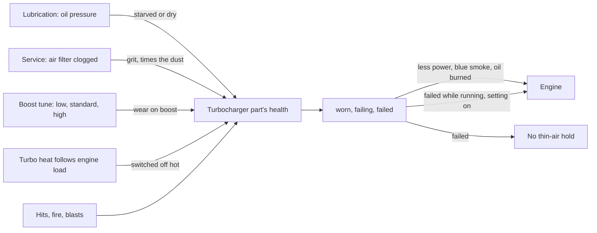

# The turbocharger as a part and a system

**Status (26 Nov 2026):** built in D'thorga Framework 0.320.0: the part, its system, its four causes of wear, its failure and the
setting. Not yet tested in game (rows 576 and 577).

The owner, 26 Nov 2026, after fitting a turbo and finding only a "Fitted: turbocharger" line under the engine: "I think we're doing a
disservice to not be modelling it like the rest of the components, and with the rest of the components at that." Before this, the
turbocharger was only a fitting: numbers multiplied onto the engine (power x1.2, fuel x1.1, heat at full load x1.25, and the thin-air
hold to 1,500 m), with no part, no health and no readings of its own. Engines turbocharged as built (the medium and heavy diesels, the
turbo tractors, the EffiShunter locomotive) had even less: one flag that held their power at height.

## The owner's choices (question cards, 26 Nov 2026)

| Question | The owner's choice |
| --- | --- |
| Which engines get it | **Fitted and built-in**: the turbocharger fitting, and every engine turbocharged as built |
| A vehicle with no turbo | **Hidden until fitted**: no row anywhere, never hit, never repaired |
| What wears it | **All four**: oil starvation, dust past the filter, the high boost tune, and stopping hot |
| Engine damage when it fails | **Yes, with its own setting, on** (the agent's risk grade, moderate, accepted) |

## How it works

- **The part** (`Turbochargers.cs`): one `PhobosTurbocharger` part on every design whose loadout has a piston engine, on the engine's
  cells, inside, not counted toward the vehicle's destruction, appended after every other part we add (Vehicle Framework matches saved
  parts by position). It is there only while the vehicle has a turbocharger: built in, or a fitting granting `Turbocharger`. Without one
  it sits at nothing, which Vehicle Framework never aims a hit at (it picks only parts above nothing), and the Health tab, the damage
  picture, the fleet, the diagnosis and the repairs leave it out (`AbsentParts`, which the spall liner now shares). A turbo fitted is a new
  one, whole; one taken off or lost with its engine goes to nothing; one worn or shot to nothing while fitted stays there until a mechanic
  replaces it (the turbocharger repair supply: 30 steel and 3 industrial components, authored).
- **The system** (`Systems_Turbocharger.xml`): brought by the lubrication system (`comesWith`), so every oiled engine has it, and it
  runs only while a turbocharger is on (`needsGrant`, now met by a built-in turbo too). Its readings: **boost** (shown), **turbocharger**
  (its condition), **turbo heat** (shown), and in Engineer mode **turbo oil feed** and **grit in the intake**.
- **The boost tunes** now open for an engine turbocharged as built as well as a fitted turbo: a wastegate can be set on any turbo.

## Figures

Every figure is authored, a gameplay choice for the owner to tune, unless a source is named.

| What | Figure | Basis |
| --- | --- | --- |
| Part health | 30 | Authored, a radiator's |
| Boost | Part efficiency x running x engine-speed curve (5% at idle, half at 1,300 rpm, full from 1,700) x load (10% to 100%) | Authored, shaped like a typical diesel's lag |
| Wear on boost (boost above 60%) | 0.04% of health an hour on standard boost, 0.02% on low, 0.12% on high | Authored: about 2,500 hours at full boost to wear out a standard turbo |
| Oil starved (feed under 50%) | 5% an hour while running | Authored: about 20 running hours |
| Oil dry (feed under 15%) | 50% an hour while running | Authored: about 2 hours, faster than the engine's own 5 |
| Grit (filter past 70% clogged, times the place's dust) | 1% an hour from 0.3, 5% an hour from 1 | Authored: about 100 hours, or 20 in a desert or sandstorm |
| Turbo heat | Follows engine load at 6 a share of the gap an hour | Authored: settles in about ten game minutes |
| Hot shutdown (heat above 60%) | 1% of health each time | Authored |
| Worn (under 50%) | Power x0.97, oil burned 0.15% of the sump an hour, light blue smoke, a message | Authored; the oil matches the engine's own burn |
| Failing (under 20%) | Power x0.92, oil 0.4% an hour, more smoke, a message | Authored |
| Failed (nothing) | A fitted turbo gives back its x1.2 (x0.83); a built-in one leaves 0.7 of rated power; no thin-air hold; oil 1% an hour; a message | Authored: turbocharging commonly adds a third or more to a diesel's output |
| Failure while running | 15% of the engine's health, once | Authored; behind the setting |

**Sources** (secondary, no figure checked): turbocharger makers' service literature as commonly cited (Garrett's and Holset's failure
guides) for oil starvation as the commonest cause of failure, coking from a hot shutdown, and compressor-blade erosion from dust past
the air filter. Unverified as cited here; every rate above is our own.

**Simplifications**: one turbocharger part for the whole vehicle, even on a design with several engines; the boost tune's power stays
while a turbo is dead (its stage takes back only what the fitting or the build gave); worn and failing are steps, not a smooth curve;
turbo heat follows the engine's load share, not a temperature. The turbocharger fitting is still offered for an engine turbocharged as
built (as before 0.320.0); if that one turbo part then fails, both the fitting's and the build's power losses apply (about 0.58 of rated),
a known gap left for the owner's word on whether the fitting should be refused there.

## The owner's answer: no second turbo (Framework 0.340.0)

The owner answered the question left open on 26 Nov 2026 ("Should the turbocharger fitting be refused on an engine that is already
turbocharged as built?") on 27 Nov 2026: **refuse it there** (the agent's lean: one turbo part stands for one turbo). The Fittings window
now refuses the fitting on an engine turbocharged as built and says why (`VehicleFittings.Refusal`); one fitted before stays until it is
taken off.

## The four questions

- **What it lets the player do**: see the turbo on the Health and Systems tabs, watch its boost and heat, read why an engine is down on
  power, mend a worn turbo or replace a dead one, and choose a gentler boost tune to make it last.
- **What it stops them doing**: running a turbo engine on low oil, a clogged filter in the desert or high boost without paying for it
  in turbos; and switching a hard-worked engine off at once without a little wear.
- **How it changes the way they play**: oil and air filter services matter more on turbo vehicles; a short idle before parking pays;
  high boost becomes a choice with a running cost; a smoking truck is a warning to act on before it costs an engine.
- **What outside the vehicle notices**: the map sees blue smoke from a worn or dead turbo; the player gets a message at each stage; the
  repairs list and the mechanics' work take a turbo replacement; the fleet's worst part and the diagnosis count it. Nothing else in the
  world takes notice, by choice: a turbo is the vehicle's own business.

## Risk

**Moderate** (the agent's grade, accepted by the owner on 26 Nov 2026): a turbo that fails while the engine runs takes 15% of the
engine's health once. The player sees it coming (worn and failing stages, with messages and blue smoke), and nothing is lost all at
once. Its setting, **A failing turbocharger can damage the engine**, is on by default. The rest of the wear costs only the turbo itself,
a slow loss with warnings, and has no setting of its own.

## Other factions' vehicles

- **In a raid on us**: a raider's turbo diesel, or a spacer raider with the turbocharger fitting, has the part; it can be shot, and a dead
  one costs the engine its boost. Another faction's vehicle runs its systems only at the lite tier or not at all, so wear from oil, dust,
  boost and heat does not run on it; hits do. Cheap with several on a map: one part each, and the system stands down.
- **Parked at a base we attack**: the same; its turbo is a part to shoot like any other.
- **One we capture**: it wakes on the player's settings with its turbo as it was left, the part's health saved like any other.

## Saves

- Safe to add: on a save made before 0.320.0, the part is new; a vehicle with a turbo (built in or fitted) has it whole, one without has
  it at nothing. Nothing else in a save changes.
- Removing D'thorga Framework is covered by its uninstall sweep, which cuts saved vehicles back to their design's own parts.
- What a next game would need: nothing generic here. The pattern of a part that exists only while fitted (`AbsentParts`) is this
  repository's, about Vehicle Framework's parts.
