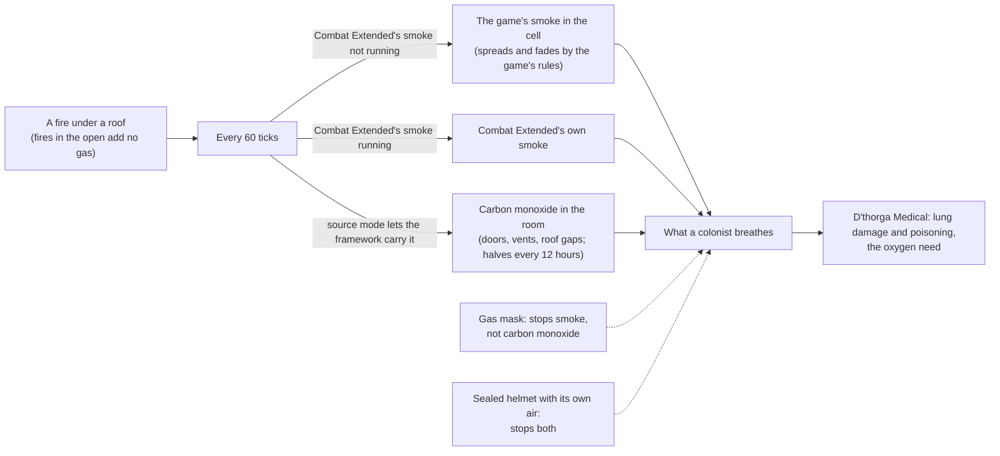

# D'thorga Framework for modders

How to use D'thorga Framework's shared services from your own mod: room gases, supplied oxygen, the health layer and per-person
care choices, protective-gear lines, parts bills, water and pipes beneath things, pictures and progress bars, and the small helpers
every D'thorga mod shares (settings, logging, long jobs, rules Defs). **Vehicles have their own pages**: [vehicle systems for modders](vehicle-systems-modding.md) and
[vehicle features for modders](vehicle-features-modding.md). The reasons behind each
design are in [the framework's design record](development/archive/phobos-framework.md). **Each other D'thorga mod has its own
page** for modders: [mod by mod](modding/README.md).

**Status (28 Nov 2026):** checked against D'thorga Framework 0.365.0: every comp, Def and extension this page names is still in
the code, and since 28 Nov 2026 every one of the core's 37 XML-facing types has a section here, written from the code and the
shipped XML. This page explains how to use each one, with worked examples. **For every field of every class, see the reference
site's [XML types](https://phobos-dthorga.github.io/phobos-rimworld/xml-types.html) page**, rebuilt from the code on every change.
**Partly tested in game:** the owner saw the gas layer and supplied
oxygen working through D'thorga Medical (5 November 2026). The health layer, protective-gear lines and parts bills are **not yet
tested in game**. Names may still change before the first public release; this page will say so when they do.

## Read this first (gotchas)

- **Load after D'thorga Framework** and list it in your `modDependencies`. It needs Harmony (since Framework 0.205.0), which
  nearly every mod list already has, and no other mod.
- **The core patches only its own few places with Harmony** (the Architect's sub-tabs and the loop watch, since 0.205.0). Where a
  service needs a patch of the game (protective-gear lines), the consuming mod applies it and calls the core; see each section.
- **Reuse what exists before adding a gas** (the owner's rule, 4 November 2026). Smoke is the game's or Combat Extended's; the
  framework carries its own gas only where nothing else does. Ask whether yours earns its place.
- **Player text stays in your `Languages/English/Keyed`**, never in C#; the framework draws your buttons from your keys.
- **Never hard-reference an optional mod's assembly.** Use `OptionalMods` to find a mod, a Def or a setting by name.

## Gases

### Reading what a pawn breathes

```csharp
float smoke = PhobosGases.Breathed(pawn, GasKind.Smoke);          // 0..1, Combat Extended's condition or the game's smoke through the mask
float co = PhobosGases.Breathed(pawn, myGasDef);                   // a framework gas, through its own mask rule
float enclosure = PhobosGases.Enclosure(pawn.Position, pawn.Map); // 0 open air .. 1 sealed roofed room
GasSource where = PhobosGases.Source(myGasDef);                    // Own, Existing or None under the rule and the player's setting
```

`GasKind` names the gases the game (or Combat Extended) already carries: smoke, tox gas, rot stink, deadlife dust. The player's
**Where gases come from** setting (Automatic, always the framework's own gases, or never) can switch a framework gas off; read
`Source` and fall back to a simpler estimate when it says `None`.

| Gas | Who carries it | What the framework does with it |
| --- | --- | --- |
| Smoke | Combat Extended's black smoke while its smoke effects run; otherwise the game's own smoke | Reads it for other mods; without CE's smoke, fires add the game's smoke under a roof |
| Tox gas, rot stink, deadlife dust | The game | Reads them; adds tox gas where a mod asks |
| Carbon monoxide | The framework (its first own gas) | Fires add it to their roofed room on both paths |

### Adding a gas of your own

A gas is a Def. The framework's carbon monoxide, from `mods/PhobosFramework/Common/Defs/Phobos/Framework/Gases.xml`:

```xml
<Phobos.Framework.Gases.PhobosGasDef>
  <defName>PhobosGas_CarbonMonoxide</defName>
  <label>carbon monoxide</label>
  <decayHalfLifeTicks>30000</decayHalfLifeTicks>     <!-- halves every 12 hours indoors -->
  <openRoofHalfLifeTicks>600</openRoofHalfLifeTicks> <!-- the share under a roof gap halves every 600 ticks -->
  <maxConcentration>1</maxConcentration>
  <filteredByMask>false</filteredByMask>             <!-- a gas mask does not stop it -->
  <preferExisting>None</preferExisting>              <!-- or a GasKind it should defer to -->
  <overlayColor>(0.9, 0.3, 0.3, 1)</overlayColor>
</Phobos.Framework.Gases.PhobosGasDef>
```

`alwaysOwn` pins a gas on whatever the player's source setting says. Defaults: `decayHalfLifeTicks` 2500, `openRoofHalfLifeTicks`
600, `filteredByMask` true.

### Making gas

- **In XML**, give a thing `Phobos.Framework.Gases.CompProperties_PhobosGasEmitter` with `gas` (a framework gas) or `kind` (an
  existing one), `amountPerRareTick` (default 0.05), and optionally `onlyWhenPowered`, `onlyWhenSwitchedOn` or `onlyWhenFuelled`.
- **From code**, `PhobosGases.AddOwn(cell, map, gas, cells)` for a framework gas, or `PhobosGases.Add(cell, map, GasKind.Smoke,
  fraction)` for an existing one.

### How a room gas moves

A framework gas is kept per room, the way the game keeps room temperature, and moves at the game's own door and vent rates. The
figures live in the rules Def `PhobosGasRulesDef`.

| Opening | Rate the game uses for temperature | The framework's pass (every 60 ticks) |
| --- | --- | --- |
| Open door | 1 every 34 ticks | the same, scaled to one pass |
| Closed door | 1 every 375 ticks | the same |
| Vent, switched on | 14 every 250 ticks | the same |
| Door or vent onto the outdoors | | a sink |
| Gap in the roof | | that share of the room halves at the gas's open-roof half-life |

Rooms without gas cost nothing; a wall built through a gassy room leaves both halves gassy; a merged room dilutes. Gas does not
travel with a gravship. Saves hold the cells, not room numbers.



## Supplied oxygen

Oxygen is a treatment, not a gas. Put `Phobos.Framework.Breathing.PhobosSuppliedOxygenExtension` (with
`carbonMonoxideHalfLifeHours`, default 1.25) on your treatment condition, and `PhobosOxygenResponsiveExtension` (with
`minSeverity`) on a condition oxygen helps. Read them with `PhobosBreathing.SuppliedCarbonMonoxideHalfLifeHours(pawn)` and
`PhobosBreathing.HasOxygenResponsiveCondition(pawn)`; `PhobosBreathing.HealOnSuppliedOxygen` lists conditions that heal faster on
oxygen. D'thorga Medical's oxygen conditions (`mods/PhobosMedical/Common/Defs/Phobos/Medical/Hediffs_Oxygen.xml`) are the worked
example.

## The health layer and care choices

`Phobos.Framework.Health` answers, for mods whose doctors act on their own, who the doctors look after and under what care, how
dangerous a condition is and how soon it kills, and which doctor could operate:

```csharp
PatientGroup? group = Patients.GroupOf(pawn);                       // Colonist, Slave, Prisoner, Guest, or null
bool allowed = Patients.CareAllows(pawn, MedicalCareCategory.HerbalOrWorse, requireMedicine: true);
float danger = ConditionDanger.DangerSeverity(hediff.def);           // from where the condition threatens life; huge when never
float hours = ConditionDanger.Clock(hediff).HoursToDeath(ConditionDanger.HoursUntilBloodLossDeath(pawn));
bool doctor = Doctors.AnyAvailableFor(pawn);                         // the game's own test
float best = Doctors.BestSurgeonSuccess(map, recipe, pawn);          // negative when no doctor meets the skill
var cache = new MapPatientCache<Pawn>((map, list) => { /* fill */ }); // rebuilt at most once per interval, when asked
Hediff? treatment = MedicalTreatment.GiveOrRefresh(pawn, myTreatmentDef); // a condition that lapses unless refreshed
```

The game-free rule behind the danger reader is `Phobos.Framework.Rules.ConditionDangerRule`, tested without the game.

**A per-person choice** is one registration at start-up. Every humanlike pawn carries a small comp that saves only what the player
set and ticks nothing; the framework draws the button and saves the answer:

```csharp
PatientPreferences.Register(new PatientPreference("MyMod_Choice", "MyMod_ChoiceLabel", "MyMod_ChoiceDesc",
    new[] { "MyMod_ChoiceOff", "MyMod_ChoiceOn" }, defaultFor: pawn => 1));
int choice = PatientPreferences.Choice(pawn, preference);
PatientPreferences.RegisterInspectLine(pawn => myLineOrNull);
```

`PatientPreferences.IconFor`, `MenuFor` and `LabelFor` draw a choice the same way everywhere. D'thorga Medical's triage
("how far the doctors may go") is the first user.

**Who counts as a patient** has one shared answer: `Patients.IsFleshPerson` (one of the player's people, of flesh), `IsLyingDown`
(downed or in bed) and `IsLyingPatient` (both). Add your own need and care check on top.

**Something that stops surgery** is said by the mod that owns it, with no reference between mods. The owner registers
`SurgeryBars.Register(Func<Pawn, string?>)`, returning the reason already translated and in the game world, or null; a mod that
queues operations reads `Patients.SurgeryBarred(pawn, out reason)` and holds the operation with that reason. D'thorga Medical's
pressure chamber (the bar) and its triage (the reader) are the pair.

**A treatment that lapses**: `MedicalTreatment.GiveOrRefresh` gives a condition carrying `HediffCompProperties_PhobosTreatment`,
which lapses `lingerTicks` (default 600) after the last refresh.

**A condition that leaves a lasting one when it heals** (a burned eye leaves a scarred cornea): give the condition
`Phobos.Framework.Health.HediffCompProperties_PhobosLeavesLasting` with `lasting` (the condition left on the same body part),
`fromSeverity` (default 0.5; nothing is left below it) and, optionally, `flag` (a `PatchFlags` setting that must be on). The lasting
condition's severity follows the worst the first one reached (`Rules/LastingRule`, tested). Nothing is left on a part that has gone,
on a dead pawn, or while the uninstall sweep runs (`CleanupService.Sweeping`).

## Protective-gear lines

A `Phobos.Framework.Protection.ProtectionZoneDef` names a stat worn gear raises and how much of it a pawn needs to cross. D'thorga
Medical's radiation control area (`mods/PhobosMedical/Mods/Rimatomics/Defs/Phobos/Protection/RadiationControl.xml`):

```xml
<Phobos.Framework.Protection.ProtectionZoneDef>
  <defName>PhobosZone_RadiationControlled</defName>
  <label>radiation controlled area</label>
  <stat>ToxicEnvironmentResistance</stat>
  <required>0.75</required>
  <color>(0.80, 0.20, 0.70)</color>
</Phobos.Framework.Protection.ProtectionZoneDef>
```

- **A doorway line**: give a rotatable building `CompProperties_PhobosControlPoint` (with `PlaceWorker_PhobosControlPoint`) to close
  off the room it faces.
- **A painted area**: subclass `Designator_PhobosProtectionArea`.
- **A dose before going in**: `preventiveHediffs` names conditions (any drug giving one counts); `preventiveStats` names stats (any
  medical drug whose condition raises one counts, found by effect; Framework 0.327.0). `ProtectionLine.DoseAllowed` lets a content mod
  refuse a dose, as D'thorga Medical does for its safety and reserve.
- Colonists stop at the line to fetch and put on gear, judged by its effect, and take it off on the way out. Animals, prisoners,
  guests and drafted colonists cross as they are. An alert, **Unprotected behind the line**, names everyone of the colony's standing
  behind a line without enough protection.
- **The patch is the consumer's.** D'thorga Medical's patches call `ProtectionLine.BeforeStep`, `AfterStep` and `AllowsCell` for every
  kind of line. A mod that adds a line without D'thorga Medical patches the same two methods itself; a step answered twice is acted on
  once. [The design](development/archive/radiation-control-line.md) has the detail.

## Parts bills

Say what a thing you build is made of **by role**, and let other mods' parts fill a role when they are installed. The target's own
`costList` keeps only its shell (steel and the like); at start-up each role is filled from the role supplies and the result becomes
the target's cost. Nothing is saved. From our own Defs:

```xml
<Phobos.Framework.Bills.PhobosRoleSupplyDef>
  <defName>PhobosPartSupply_FuelTank</defName>
  <label>fuel tank</label>
  <roles><li>FuelTank</li></roles>
  <materials>                                    <!-- ours, where we have no item; or <item> and <itemCount> -->
    <Steel>30</Steel>
    <ComponentIndustrial>1</ComponentIndustrial>
  </materials>
  <substitutes>                                  <!-- each: thing, count, optional minSize and maxSize -->
    <li MayRequire="rimthunder.core"><thing>ComponentFuelTank</thing></li>
    <li MayRequire="oskarpotocki.vanillavehiclesexpanded"><thing>VVE_CarFuelTank</thing></li>
  </substitutes>
</Phobos.Framework.Bills.PhobosRoleSupplyDef>

<Phobos.Framework.Bills.PhobosBillDef>
  <defName>PhobosBill_DepotBay</defName>
  <label>depot bay parts</label>
  <target>PhobosVehicles_DepotBay</target>       <!-- any ThingDef the player builds, or a vehicle's blueprint -->
  <parts>
    <FuelTank>1</FuelTank>
    <FuelPump>1</FuelPump>
  </parts>
</Phobos.Framework.Bills.PhobosBillDef>
```

A bill may also give a `size` (kilograms for a vehicle, read against the substitutes' `minSize` and `maxSize`) and `tags`. A role
supply may scale its item by size (`itemCountBySize`) or cover a whole build with one kit (`coversWholeBuild`). XML alone is enough;
[the parts bills record](development/archive/parts-bills.md) has the rules. The player's **Parts for building** setting chooses between other
mods' parts where installed and always ours.

## Building upgrades

Since 0.210.0 a placed building can take upgrades a builder fits, in XML alone. Give the building the comp, then write each upgrade:

```xml
<!-- On the building's ThingDef, in its comps: -->
<li Class="Phobos.Framework.Upgrades.CompProperties_PhobosBuildingUpgrades" />

<Phobos.Framework.Upgrades.PhobosBuildingUpgradeDef>
  <defName>MyMod_FasterPump</defName>
  <label>faster pump</label>
  <description>What the player reads in the Upgrades window.</description>
  <buildings><li>MyMod_Pump</li></buildings>     <!-- each must carry the comp above -->
  <costList><Steel>15</Steel></costList>         <!-- brought by builders before the work -->
  <work>600</work>                               <!-- the game's work units, as WorkToBuild -->
  <constructionSkill>4</constructionSkill>
  <researchPrerequisite>Electricity</researchPrerequisite>  <!-- optional -->
  <prerequisite>MyMod_OtherUpgrade</prerequisite>           <!-- optional: must be fitted first -->
  <grants><li>MyMod_CanDoThing</li></grants>                <!-- abilities your comp asks for -->
  <figures>                                                 <!-- figures your comp reads -->
    <li><name>pumpPerHour</name><value>60</value></li>
  </figures>
  <refundShare>0.5</refundShare>                 <!-- share of materials back when taken off -->
  <overlay>                                      <!-- optional picture drawn over the building -->
    <texPath>MyMod/PumpCable</texPath>
    <graphicClass>Graphic_Single</graphicClass>
  </overlay>
</Phobos.Framework.Upgrades.PhobosBuildingUpgradeDef>
```

Your own comp reads it from `parent.GetComp<CompPhobosBuildingUpgrades>()`: `Grants("MyMod_CanDoThing")` and
`Figure("pumpPerHour", yourDefault)`. Both read a kept table, rebuilt only when an upgrade is fitted or taken off, so they cost one
lookup and allocate nothing (from 0.275.0). Where two fitted upgrades set the same figure the larger is used, never the sum, so name
figures so that larger is better ("noiseFigureReductionDb", not "noiseFigureDb").

**Hearing a change (0.275.0).** When an upgrade is fitted or taken off, every comp on the building receives
`CompPhobosBuildingUpgrades.ChangedSignal` through the game's own `ReceiveCompSignal`. A comp that keeps anything worked out from the
figures marks it stale there, instead of checking every tick:

```csharp
public override void ReceiveCompSignal(string signal)
{
    if (signal == CompPhobosBuildingUpgrades.ChangedSignal) cached = null;
}
```

**Service yard equipment** (with Vehicle Framework): a building with `Phobos.VehicleSystems.PhobosYardEquipmentExtension` in its
`modExtensions` adds its `cells` to the allowance of a service yard it stands beside; `required` marks the kind a yard cannot be without
(our dyno bay).

## Linking like another building (Framework 0.257.0)

Many mods add their bedside facilities to the game's hospital bed by its name, so a new bed built on it misses them all. Give your
building this extension and, once every mod is loaded, it takes every facility the named building can link to, from any mod, and any
stat the named building has that yours lacks (your own figures always stand):

```xml
<modExtensions>
  <li Class="Phobos.Framework.Buildings.PhobosLinksLikeExtension">
    <like>HospitalBed</like>
    <missingStats>true</missingStats>   <!-- optional, the default; false takes facilities only -->
    <onlyStats>                         <!-- optional (0.259.0): only facilities that change one of these -->
      <li>MedicalTendQualityOffset</li>
    </onlyStats>
  </li>
</modExtensions>
```

With `onlyStats`, a facility is taken only when its own Def offsets one of the listed stats, so it is chosen by what it does and
never by its name: our hyperbaric chamber takes a hospital bed's facilities that better tending or immunity and leaves its comfort
furniture. A facility taken brings all its offsets. Ours so far: the burn unit bed and the hyperbaric chamber (like the hospital
bed), the swag (like the bedroll) and the vehicle parts bench (like the machining table).

Both sides are updated: your building's list of facilities, and each facility's own list of buildings it links to, which the game
fills while Defs load. The load line says how many buildings, facilities and stats were taken.

## Water and pipes beneath things (with Dubs Bad Hygiene)

`PhobosFramework.Hygiene` is a separate assembly that loads only with Dubs Bad Hygiene; never reference it from a core assembly.

- **Drawing water**: `Phobos.Framework.Hygiene.PlumbingFeed`, one per building, held by the building's comp and never saved. Its
  `TryPull(building, litres, out quality)` draws from plumbing under or beside the building; `Check(building, litres)` says what a
  draw would find without drawing; the static `TryPullFrom(net, litres, out quality)` draws from a net the caller already knows (a
  fixture's own pipe). Each answers with a `WaterDraw`: `Flowing`, `NoPlumbing` (no net with a water tower) or `TowersEmpty`.
  `PlumbingFeed.LiteMode` is true in Dubs' lite mode, which has no plumbing at all. It only reads the plumbing: it is deliberately not
  one of Dubs' own pipe comps, which delete the plumbing under a building (on load too) and would leave gaps in the player's runs if a
  D'thorga mod were removed. D'thorga Factory Additions' machines and Medical's electrolyser use it.
- **Pipes beneath a building**: give it `Phobos.Framework.Hygiene.CompProperties_PhobosPipeUnderlay` (no fields). Every cell of its
  footprint that has no pipe gets Dubs' **hidden** plumbing, so a pipe touching any side connects and a run passes through. It never
  touches a pipe it did not lay; a piece the player removes is not laid again while the building stands; the pieces it lays give
  nothing back when taken apart; in lite mode it lays nothing; and if the mod is ever removed, what is left is ordinary hidden pipe. A
  save from before it converts at the building's next load. The service underneath is `Phobos.Framework.Persistence.PipeUnderlay`.
- **Vehicles** lay the same while parked: see [pipes beneath a vehicle](vehicle-systems-modding.md#pipes-beneath-a-vehicle).

[Pipes and conduits beneath our things](development/archive/network-underlays.md) has the design, the owner's rules and every thing of ours
that lays them.

## Large blasts (Framework 0.218.0)

A blast that removes buildings, such as a nuclear strike, should not hit a vehicle as if it were a body: one blow at one cell, which
armour shrugs off. `Phobos.Framework.Environment.LargeBlasts` lets any blast ask first. Nothing here needs Vehicle Framework.

- **Asking:** before you hit a thing, call `LargeBlasts.TakerFor(thing)`. Where it returns a taker, describe the blast at that thing
  in a `LargeBlastHit` (its band, fireball, blast or thermal; `Wind` and `Heat` from 0 to 1, 1 at the fireball's edge; a pulse amount,
  the launcher and the weapon) and call `taker.Take(thing, hit)`. Where it returns null, hit the thing as before.
- **What comes back:** a `LargeBlastOutcome` saying whether the thing is gone, wrecked, battered or pulsed, who inside was killed
  (treat their bodies as yours) and who is still inside with the share of the radiation dose the hull lets through (give the dose
  yourself; the Framework has no radiation model of its own yet).
- **Shelter:** `taker.Sheltered(thing, cell => yourRule(cell))` judges a thing over every cell it stands on.
- **Vehicles** register a taker by themselves when D'thorga Framework's vehicle part loads; its figures are in
  `PhobosVehicleBlastRulesDef` (`PhobosVehicleBlastRules`), all authored and patchable in XML. D'thorga Patches' strike is the first
  user. The design and its sources: [nuclear strikes, vehicles and people](development/nuclear-strike-effects.md).
- **A taker of your own** implements `ILargeBlastTaker` and calls `LargeBlasts.Register` once at startup.

## Bulk goods: bins, silos and loose grain (Framework 0.182.0)

A building with a bulk store (`CompProperties_PhobosBulkStore`) holds loose goods by the kilogram, not as stacks: a field bin, a silo. The player pours it into another
hold within reach (a combine's tank, a chaser bin) or onto the ground beside it, and loads it from stacks lying within reach. Its contents
age at the building's temperature on every rare tick, and an aired store slows spoiling while it has power.

- **Give the building `<tickerType>Rare</tickerType>`.** The store ages, pours and loads only on its rare tick; the game calls a comp's
  rare tick only for a Rare ticker.
- **What a store takes in is chosen by effect, not by name**: whatever a crop (never a tree) yields as its harvest, and any item whose
  Def carries `PhobosBulkGoodsExtension`. Only stackable items go in; steel, weapons and bodies never do.
- **No pawn fills it.** Pours and loads are the player's buttons (Pour, Load, Stop), shown only on the player's own stores.
- **Destroyed or deconstructed, it spills** what it held as up to 40 heaps around where it stood, and names the rest as lost. Marked for
  deconstruction while full, it warns the player once for that order.
- The words (buttons, inspect lines, messages) are the Framework's own; you need no Keyed text.

The field bin and the grain silo, from `mods/PhobosFarming/Common/Defs/Phobos/Farming/Buildings_GrainStores.xml` (trimmed):

```xml
<ThingDef ParentName="BuildingBase">
  <defName>PhobosFarming_Silo</defName>
  <tickerType>Rare</tickerType>                  <!-- required: the store works on its rare tick -->
  <comps>
    <li Class="CompProperties_Power">
      <compClass>CompPowerTrader</compClass>     <!-- its fan: airedSpoilFactor applies only while this has power -->
      <basePowerConsumption>300</basePowerConsumption>
    </li>
    <li Class="CompProperties_Flickable" />
    <li Class="Phobos.Framework.Bulk.CompProperties_PhobosBulkStore">
      <capacityKg>60000</capacityKg>
      <mixesProducts>true</mixesProducts>
      <pourKgPerSecond>80</pourKgPerSecond>
      <reachCells>2</reachCells>
      <airedSpoilFactor>0.25</airedSpoilFactor>  <!-- lasts four times as long while powered (authored) -->
    </li>
  </comps>
</ThingDef>
```

| Field | What it does (default) |
| --- | --- |
| `capacityKg` | How much it holds, in kilograms (25000). Authored |
| `mixesProducts` | Whether it holds several products at once; false keeps it to one at a time, as a combine's tank (true) |
| `pourKgPerSecond` | How fast its spout or auger moves goods, in kilograms a second of game time, out or in (60). Authored |
| `reachCells` | How many cells beyond its footprint its auger reaches, to another hold or to stacks on the ground (1) |
| `airedSpoilFactor` | The share of the normal spoiling rate while its own `CompPowerTrader` has power; 1 for a store with no fan (1). Below 1 with no power comp, it is never aired. Authored |

**Loose goods no crop yields** (seed grain, from `mods/PhobosFarming/Common/Defs/Phobos/Farming/Items_Seed.xml`): put the extension, with
no fields, on the item's own ThingDef.

```xml
<modExtensions>
  <li Class="Phobos.Framework.Bulk.PhobosBulkGoodsExtension" />
</modExtensions>
```

Gotchas:

- Loading from the ground never reaches through a wall or into fog: it takes only stacks in the same room as the spout, and never
  forbidden ones. A pour onto the ground lays at most six stacks a step.
- The list of loose goods is worked out once, the first time it is asked for. From C#, `BulkPour.CountAsLoose(def)` adds a product
  that no Def marks (another mod's second harvest product).
- A hold of your own that is not this comp (a vehicle's tank) implements `Phobos.Framework.Bulk.IBulkHold`, registers on its map with
  `BulkPour.Register`, and calls `BulkPour.Step` from its rare tick; the Framework's vehicle grain tank is the worked example.

## Standby power (Framework 0.222.0)

Powered buildings draw their full power only while in use, and a share of it (10% by default, a setting) while idle; an indoor light goes
dark when no one awake is in its room. **You normally write nothing**: at start-up the Framework finds every building it looks after by
what it is and does, and puts `CompProperties_PhobosStandby` on it in code. Write XML only to keep a building out, or to take in one it
would miss.

- **Never add `CompProperties_PhobosStandby` yourself**; use the extension below. The comp is put on in code, with the kind worked out.
- It looks only at buildings powered by the game's own `CompPowerTrader`, exactly (a subclass, a generator or a battery manages its own
  draw), whose listed draw is above zero.
- **It stands down entirely while LightsOut or Turn It On and Off - RePowered is active**, as they do the same job. On one building,
  it stands down by itself if another mod writes that building's draw.
- Only the player's buildings are put on standby. Nothing is saved, and it runs once a second of game time, never every tick.

How it finds each kind by itself:

| Kind | Found by | In use while |
| --- | --- | --- |
| `Door` | a `Building_Door` | it stands open |
| `Turret` | a `Building_Turret` | it has a target (it still fires on standby) |
| `Machine` | a `Building_WorkTable` or `Building_ResearchBench` | someone's job is at it and they are there (at its interaction spot, or beside it) |
| `Grower` | a `Building_PlantGrower` | anything grows in it |
| `Facility` | a building with `CompFacility` | a bed it serves is occupied, or a building it serves is in use |
| `Watch` | a building with a `joyKind` (a television) | someone is watching it |
| `Light` | a plain `Building` with a glower, no overlight (not a sun lamp), no schedule and `tickerType` Never | someone awake is in its room; outdoors, always lit |

To keep a building of yours out, or take one in as a kind it would not find (the field names are from
`src/PhobosFramework/Power/CompPhobosStandby.cs`; no shipped Def uses the extension yet):

```xml
<modExtensions>
  <li Class="Phobos.Framework.Power.PhobosStandbyExtension">
    <never>true</never>        <!-- this building always draws its full power -->
  </li>
</modExtensions>

<modExtensions>
  <li Class="Phobos.Framework.Power.PhobosStandbyExtension">
    <kind>Machine</kind>       <!-- one of the kinds in the table above -->
  </li>
</modExtensions>
```

| Field | What it does (default) |
| --- | --- |
| `never` | Keeps standby power off this building, whatever it is (false) |
| `kind` | Takes the building in as this kind, where it would not be found by itself (none: found by what it is) |

Gotchas:

- `kind` does not get past the power check: the building still needs exactly `CompPowerTrader` and a draw above zero.
- A `Light` idles at no draw at all, whatever the player's standby share. A `Light` that is not a glower simply draws nothing while idle.
- The player's settings, under **Standby power** in D'thorga Framework's settings: **Idle buildings use less power** (the master
  switch, on), **Lights go dark in empty rooms**, **Workbenches, research benches and televisions**, **Turrets, hydroponics and
  monitors**, **Powered doors** (each on), **Power on standby** (10%) and **Animals turn the lights on** (off).

## Lamps that wait for the dark, heaters that wait for the cold

Two small comps for fuelled things that should burn only when wanted. Both need the game's `CompRefuelable` with
`<consumeFuelOnlyWhenUsed>true</consumeFuelOnlyWhenUsed>`: each marks the fuel used only on the ticks it burns. Neither needs another
mod.

- **Give the thing `<tickerType>Normal</tickerType>`.** Both count fuel by the tick.
- A switch (`CompProperties_Flickable`) is optional: switched off, neither burns.

### A light that lights only in the dark (Framework 0.231.0)

`CompProperties_PhobosNightLight` sits beside the game's own `CompProperties_Glower` and keeps it dark while the sky is light. A lantern
burns its fuel only while lit and may warm the air a little. A light fed from elsewhere (`supplied`) asks its feeder whether it has power.
The camp lantern and the 12-volt camp light, from
`mods/PhobosFramework/Mods/VehicleFramework/Common/Defs/Phobos/Framework/VehicleSystems/Accessories_Camp.xml` (trimmed):

```xml
<!-- The camp lantern: chemfuel, lit at dusk, a little warmth. -->
<tickerType>Normal</tickerType>
<comps>
  <li Class="CompProperties_Refuelable">
    <fuelConsumptionRate>2.0</fuelConsumptionRate>   <!-- a day of burning, so about one a night (authored) -->
    <fuelCapacity>5.0</fuelCapacity>
    <consumeFuelOnlyWhenUsed>true</consumeFuelOnlyWhenUsed>
    <fuelFilter><thingDefs><li>Chemfuel</li></thingDefs></fuelFilter>
  </li>
  <li Class="CompProperties_Glower">
    <glowRadius>7</glowRadius>
    <glowColor>(184,136,83,0)</glowColor>
  </li>
  <li Class="CompProperties_Flickable" />
  <li Class="Phobos.Framework.Environment.CompProperties_PhobosNightLight">
    <heatPerSecond>2</heatPerSecond>                 <!-- a flame of about a hundred watts (authored) -->
  </li>
</comps>

<!-- The 12-volt camp light: no fuel; lit only while its vehicle's battery runs the camp lights load. -->
<li Class="Phobos.Framework.Environment.CompProperties_PhobosNightLight">
  <supplied>true</supplied>
  <watts>10</watts>
</li>
```

| Field | What it does (default) |
| --- | --- |
| `darkBelow` | It lights below this much daylight, the game's sky glow from 0 to 1 (0.5, dusk). Authored |
| `heatPerSecond` | Warmth while lit, as the game's heat pushers give it; 0 for none (0). Authored |
| `heatPushMaxTemperature` | The warmth stops at this temperature, °C (20) |
| `supplied` | Fed from elsewhere: lit only while its feeder says it has power (false) |
| `watts` | What it draws while lit, for its feeder to count (0). Authored |

- **`supplied` needs a feeder, or the light stays dark.** The only feeder today is D'thorga Framework's vehicle part (camp lights on a
  vehicle's battery, with Vehicle Framework). A mod of yours can be one from C#: set `CompPhobosNightLight.Supply` (and optionally
  `DarkWhy`, the player's reason it is dark); there is one feeder, and the last set wins.
- Its inspect line says when it is waiting for daylight to end, or has no power.

### A heater that burns only in the cold (Framework 0.122.0)

`CompProperties_PhobosBurnWhenCold` marks a fuelled heater's fuel used only while it is switched on, fuelled and colder than
`belowCelsius` where it stands. The warmth itself is the game's heat pusher. The camp heater, from the same file (trimmed):

```xml
<tickerType>Normal</tickerType>
<comps>
  <li Class="CompProperties_Refuelable">
    <fuelConsumptionRate>2.0</fuelConsumptionRate>
    <fuelCapacity>10.0</fuelCapacity>
    <consumeFuelOnlyWhenUsed>true</consumeFuelOnlyWhenUsed>
    <fuelFilter><thingDefs><li>Chemfuel</li></thingDefs></fuelFilter>
  </li>
  <li Class="CompProperties_HeatPusher">
    <compClass>CompHeatPusherPowered</compClass>
    <heatPerSecond>21</heatPerSecond>
    <heatPushMaxTemperature>15</heatPushMaxTemperature>  <!-- the same as belowCelsius -->
  </li>
  <li Class="CompProperties_Flickable" />
  <li Class="Phobos.Framework.Environment.CompProperties_PhobosBurnWhenCold">
    <belowCelsius>15</belowCelsius>
  </li>
</comps>
```

| Field | What it does (default) |
| --- | --- |
| `belowCelsius` | It burns fuel below this temperature where it stands, °C (15, Billy's tent heater). Authored |

- **Set the heat pusher's `heatPushMaxTemperature` to `belowCelsius`.** The comp governs only the fuel: above `belowCelsius` it burns
  nothing, so a heat pusher with a higher ceiling would warm for free in between.
- Also used by D'thorga Vehicles' field kitchen (`mods/PhobosVehicles/Defs/Phobos/Vehicles/FieldKitchen/Buildings_FieldKitchen.xml`).

## How wet the ground is (Framework 0.204.0)

The Framework keeps one figure per map for how wet its open ground is, from 0 (dry) to 1 (soaked): wetted by the game's rain, dried by
outdoor temperature, daylight and wind. Under a roof it always reads 0. Vehicles' grip and an aircraft's landing ground read it, and so
does **Rain soaks open fields** (a player setting, off by default, since 0.269.0), which makes soaked open ground more fertile.

**`PhobosGroundWetnessRulesDef` is a rules Def: the first one loaded wins** (see `PhobosRulesDef` in
[Shared helpers](#shared-helpers)). **Never add a second one; patch the Framework's figures.** Its Def, from
`mods/PhobosFramework/Common/Defs/Phobos/Framework/GroundWetness.xml`:

```xml
<Phobos.Framework.Environment.PhobosGroundWetnessRulesDef>
  <defName>PhobosFramework_GroundWetnessRules</defName>
  <label>ground wetness rules</label>
  <soakHours>1</soakHours>
  <dryHours>10</dryHours>
  <frozenFactor>0.1</frozenFactor>
  <nightFactor>0.4</nightFactor>
  <passTicks>250</passTicks>
  <soakedFertilityFactor>1.8</soakedFertilityFactor>
</Phobos.Framework.Environment.PhobosGroundWetnessRulesDef>
```

To change a figure, in your `Patches` folder:

```xml
<Operation Class="PatchOperationReplace">
  <xpath>Defs/Phobos.Framework.Environment.PhobosGroundWetnessRulesDef[defName="PhobosFramework_GroundWetnessRules"]/dryHours</xpath>
  <value><dryHours>16</dryHours></value>
</Operation>
```

| Field | What it does (default) |
| --- | --- |
| `soakHours` | Hours of ordinary rain (the game's rain rate 1) that soak dry ground; gentler rain takes longer in proportion (1) |
| `dryHours` | Hours soaked ground takes to dry at 20 °C, in full daylight and the game's ordinary wind (10) |
| `frozenFactor` | The drying pace at or below freezing, against the 20 °C pace (0.1) |
| `nightFactor` | The drying pace in full darkness, against full daylight (0.4) |
| `passTicks` | Game ticks between updates of a map's figure; 2,500 is an in-game hour (250) |
| `soakedFertilityFactor` | With **Rain soaks open fields** on and no mod keeping the soil's water: how many times as fertile soaked open ground is, falling in a straight line to 1 as it dries (1.8, Dubs Bad Hygiene's own default irrigation strength) |

Every figure is authored, a gameplay choice, shaped to agree with Realistic Rain's puddles.

- **Reading it from C#**: `MapComponent_PhobosGroundWetness.At(map, cell)` (0 under a roof or off the map) or `OpenOn(map)` for the
  open ground.
- With Dubs Bad Hygiene active, **Rain soaks open fields** fills Dubs' own irrigation instead, and `soakedFertilityFactor` is not used:
  a field never gets the bonus twice.
- Safe to add mid-game: a map with no saved figure starts dry. If working the figure out ever fails on a map, it stays as it was until
  the game restarts, and the log says so.

## Radiation bursts from blasts (Framework 0.358.0)

A weapon whose Def carries `PhobosRadiationBurst` gives everyone of flesh on the map a prompt radiation dose at the flash: the full
`graysAtEdge` in the open out to the burst's edge, then falling by the inverse square and by the air beyond it. Cover cuts it (roofs,
stone walls and rock; a vehicle by its hull's share). It may also leave days of fallout. The player's people dosed are told in one letter.

- **It needs D'thorga Medical's radiation model, switched on.** Without it, a burst does nothing at all, fallout included.
- **Where it fires by itself**: a ThingDef with the game's explosive comp (traps, charges, a boiler that blows up) or an explosive
  projectile (a shell). D'thorga Patches fires it for Combat Extended's shells, IRBM's warheads and DMS Legion's support types. On any
  other kind of Def, nothing fires it unless your code calls `RadiationBursts.Burst`.
- **Usually you add it to another mod's Def with a patch.** The nuclear boiler, from
  `mods/PhobosPatches/Mods/ChangzhengPower/Patches/RadiationBursts_NuclearBoiler.xml`:

```xml
<Operation Class="PatchOperationAddModExtension">
  <xpath>Defs/ThingDef[defName="RefuseNuclearBoiler"]</xpath>
  <value>
    <li Class="Phobos.Framework.Health.PhobosRadiationBurst">
      <kind>Nuclear</kind>
      <edgeRadius>28</edgeRadius>             <!-- authored: 40 Gy in the open to 28 cells, about 7.9 Gy at 56, 1.7 at 100 -->
      <graysAtEdge>40</graysAtEdge>
      <airLength>120</airLength>
      <falloutDays>3~10</falloutDays>
      <falloutGraysPerHour>1</falloutGraysPerHour>
      <onlyWithFuel>true</onlyWithFuel>        <!-- empty of its charges, it is an ordinary blast -->
    </li>
  </value>
</Operation>
```

A burst from orbit, the same dose everywhere and through built roofs (IRBM's Gamma-Ray Burst, from
`mods/PhobosPatches/Mods/IRBM/Patches/Phobos/RadiationBursts.xml`):

```xml
<li Class="Phobos.Framework.Health.PhobosRadiationBurst">
  <kind>Nuclear</kind>
  <wholeMap>true</wholeMap>
  <graysAtEdge>50</graysAtEdge>
  <buildingsShield>false</buildingsShield>
</li>
```

| Field | What it does (default) |
| --- | --- |
| `kind` | `Nuclear` (a fission or fusion weapon) or `Antimatter` (annihilation's gamma rays, a sci-fi extrapolation); each has its own player setting (`Nuclear`) |
| `edgeRadius` | Cells from the centre within which everyone in the open takes `graysAtEdge`; 0 uses the thing's own explosion radius, at least 1 (0) |
| `graysAtEdge` | The dose in the open at the edge, in grays; with `wholeMap`, the dose everywhere (10) |
| `airLength` | Cells of air that cut the dose to about a third, on top of the inverse square (60) |
| `wholeMap` | The same dose everywhere on the map, with no centre (false) |
| `buildingsShield` | Whether built roofs and walls shield; rock always does (true) |
| `falloutDays` | Days of fallout, a range; 0 for none (0) |
| `falloutGraysPerHour` | The fallout's dose rate in the open at the first hour, in grays an hour, falling by the 7:10 rule (0) (Framework 0.364.0) |
| `onlyWithFuel` | Only while the thing's `CompRefuelable` holds at least one unit (false) |

Every figure is authored; the shape of the fall-off is the real one.

- **Give fallout both fields.** With `falloutDays` but no `falloutGraysPerHour`, no fallout of ours is laid; only Dubs Rimatomics'
  fallout condition (its sky and plants), where that mod is active.
- The player's settings, in D'thorga Framework's: **Radiation from nuclear blasts** and **Radiation from antimatter blasts**, both on.
- A burst that reaches across half the map or more first brings out people a mod keeps off the map (next section).
- To try one without building the weapon, the dev action **Framework: radiation burst at cell (choose a weapon)** gives any carrying
  Def's burst at the clicked cell.

## People kept off the map (Framework 0.364.0)

Some mods keep people off a map, despawned, and bring them back when wanted: Custom Base Framework keeps much of a base's garrison in its
reserve. A blast cannot reach people who are not there, so before a burst that reaches across half the map or more (above), and before
D'thorga Patches' nuclear strike, the Framework calls each such mod's own method to put them back. A `PhobosHeldPawnsDef` names the map
component and its method; **another modder adds a row the same way, with no code**. From
`mods/PhobosFramework/Common/Defs/Phobos/HeldPawns.xml`:

```xml
<Phobos.Framework.Environment.PhobosHeldPawnsDef>
  <defName>PhobosHeldPawns_CustomBaseFrameworkReserve</defName>
  <label>Custom Base Framework's reserve</label>
  <componentClass>CustomBaseFramework.Reserve</componentClass>
  <bringOutMethod>AllesAbsetzen</bringOutMethod>
</Phobos.Framework.Environment.PhobosHeldPawnsDef>
```

| Field | What it does (default) |
| --- | --- |
| `componentClass` | The map component that holds the people, by its full class name; a subclass counts (empty) |
| `bringOutMethod` | That component's own **public instance** method, taking nothing, that puts everyone it holds back on the map (empty) |

- **Every row is used**; it is not a rules Def. A row whose class is not found (its mod is not active) is passed over silently.
- A method that is gone, or not public, instance and without parameters, is not called: the log warns, naming the row.
- As a defence, any other map component found holding living people (any that is a thing holder) is named once in the log, with how
  many it holds, so a row can be written for it.
- Names in another author's code can change with their updates; the warning says when a row stops fitting.

## Topping up machines (Framework 0.134.0)

Some machines hold a store of material and offer only a right-click order to fill it (a drone platform's steel). A `PhobosTopUpDef` names
the comp that holds the store, and where on it to read how much more it wants and of what. Then colonists doing Hauling work keep every
such building topped up by themselves, a mechanitor does the same for mechanoids that carry one (Smithing work, as mech repair), and
haulers do it for Vehicle Framework vehicles. Nothing is patched and no other mod's assembly is referenced. From
`mods/PhobosPatches/Mods/Fortified/Defs/TopUp_Fortified.xml`:

```xml
<Phobos.Framework.TopUp.PhobosTopUpDef>
  <defName>PhobosTopUp_FortifiedMechPlatform</defName>
  <label>drone platform</label>
  <compClass>Fortified.CompMechPlatform</compClass>
  <wantedMember>AmountToAutofill</wantedMember>
  <ingredientMember>Props.fixedIngredient</ingredientMember>
  <leastLoadMember>CostPerPawn</leastLoadMember>
  <capacityMember>Props.maxIngredientCount</capacityMember>  <!-- these two together let the player's fill level ask for more -->
  <heldMember>IngredientCount</heldMember>
</Phobos.Framework.TopUp.PhobosTopUpDef>
```

| Field | What it does (default) |
| --- | --- |
| `compClass` | The comp that holds the store, by its full class name; a subclass counts. **It must keep its own store** (an `IThingHolder`) (empty) |
| `wantedMember` | On the comp: how much more it wants now, a whole number. Dots walk into members (`Props.count`) (empty) |
| `ingredientMember` | On the comp: the material it wants, a ThingDef (empty) |
| `leastLoad` | The least it must want before a hauler walks for it; an order by hand ignores it (1). Authored per machine |
| `leastLoadMember` | On the comp: the least load read from the machine itself (a drone's cost); wins over `leastLoad` (none) (Framework 0.136.0) |
| `capacityMember` | On the comp: how much it can hold, a whole number. Give it with `heldMember`, or neither (none) |
| `heldMember` | On the comp: how much it holds now, a whole number (none) |
| `buildings` | Buildings with the comp are topped up by haulers (true) |
| `mechanoids` | Mechanoids with the comp are topped up by a mechanitor (true) (Framework 0.135.0) |
| `vehicles` | Vehicle Framework's vehicles with the comp are topped up by haulers (true) (Framework 0.180.0) |

- **Each Def is used**; it is not a rules Def. **A Def for another mod's comp goes in that mod's `IfModActive` load folder**, so its
  names are read only while that mod is there.
- Member names may be properties or fields, public or private. They are checked at start-up: a wrong name, or a value of the wrong type,
  makes that Def stand down with one log line naming it. If reading another author's code throws later, the Def stands down for the
  session.
- Your own comp can be named too: D'thorga Framework's aircraft countermeasure magazine
  (`mods/PhobosFramework/Mods/VehicleFramework/Common/Defs/Phobos/Framework/VehicleSystems/TopUp_Dispensers.xml`) sets `buildings` and
  `mechanoids` false.
- The player's settings, in D'thorga Framework's: **Keep machines and mechanoids topped up** (on) and **How full to fill them** (its
  own fill level). A level above the machine's own works only where the Def gives `capacityMember` and `heldMember`.

## Drones called home in time (Framework 0.240.0)

For drones (pawns sent out from a home that holds their material, running on the game's mechanoid power cell), a `PhobosRecallDef`
names the drone's comp. Every 250 ticks the Framework then calls each of the player's drones home once its power barely covers the walk,
priced by the path finder with half as much again to spare; and haulers carry a drone's wreck home, where the home takes back what the
wreck butchers to. From `mods/PhobosPatches/Mods/Fortified/Defs/Recall_Fortified.xml`:

```xml
<Phobos.Framework.Recall.PhobosRecallDef>
  <defName>PhobosRecall_FortifiedDrone</defName>
  <label>drone</label>
  <compClass>Fortified.CompDrone</compClass>
  <homeMember>PlatformOwner</homeMember>
  <recallMethod>ReturnToPlatform</recallMethod>
  <returningJobMember>Props.returnToDraftPlatformJob</returningJobMember>
  <dockTicks>180</dockTicks>
</Phobos.Framework.Recall.PhobosRecallDef>
```

| Field | What it does (default) |
| --- | --- |
| `compClass` | The drone's comp, by its full class name; a subclass counts. Every pawn Def carrying it is a drone of this kind (empty) |
| `homeMember` | On the comp: the drone's home, a Thing. A home that is a building holds the store a wreck is taken to (empty) |
| `recallMethod` | The comp's own method that sends the drone home. Its first true-or-false parameter, if any, takes `interrupt`; every other parameter must have a default (empty) |
| `interrupt` | Whether the call home stops what the drone is doing (true) |
| `returningJobMember` | On the comp: the JobDef a drone does on its way home, so one already going is left alone (none) |
| `dockTicks` | How long a drone waits at its home before it is taken in, in ticks; counted into the power it needs (0). Authored per kind |
| `recall` | Drones of this kind are called home in time (true) |
| `reclaimWrecks` | Wrecks of this kind are carried home and taken back into its store (true) |

- **Wrecks go only to a home that is a top-up store**: a building whose comp a `PhobosTopUpDef` names (above), holding a material the
  wreck's `butcherProducts` include, with room. Without a top-up Def for the home, wrecks are hauled like other bodies.
- The drone needs the game's `CompMechPowerCell`. Drafted, downed or dead drones are left alone.
- Each Def is used. As with top-up Defs, **put one for another mod's comp in that mod's `IfModActive` folder**; a name that no longer
  fits makes the Def stand down with one warning.
- The player's settings, in D'thorga Framework's: **Call drones home while they can still get there** and **Carry drone wrecks home**,
  both on. The drone's own mod's call home still stands.

## Search and Rescue: a patient job's role (Framework 0.328.1)

Search and Rescue makes a carrier drop anyone it has marked (its Rescue all, its rescue and treat orders) unless the carrier's job is on
its list of other mods' patient jobs. Put `PhobosSearchAndRescueRole` on your JobDef, and the Framework adds the job to that list at
start-up, by name, with no reference to Search and Rescue's assembly. From
`mods/PhobosFramework/Mods/VehicleFramework/Common/Defs/Phobos/Framework/VehicleSystems/WaterDropAndLitter.xml`:

```xml
<JobDef>
  <defName>PhobosVehicleSystems_CarryToLitter</defName>
  <driverClass>Phobos.VehicleSystems.JobDriver_PhobosCarryToLitter</driverClass>
  <modExtensions>
    <li Class="Phobos.Framework.Health.PhobosSearchAndRescueRole">
      <role>Transport</role>
    </li>
  </modExtensions>
</JobDef>
```

| Field | What it does (default) |
| --- | --- |
| `role` | `Transport` (carrying a patient somewhere: the carrier keeps hold of them) or `Treatment` (treating a patient where they lie) (`Transport`) |

- **The job's patient must be the first pawn among its targets**, as Search and Rescue reads it. A job whose first target is a vehicle
  cannot use this.
- Read only while Search and Rescue (`ch4acko3.searchandrescue`) is active; otherwise it does nothing.
- If Search and Rescue's list has moved, nothing is changed and the log warns once. Your code can then ask
  `SearchAndRescueRoles.WouldDropCarry(patient)` and leave that patient to Search and Rescue, as our litter carries do.

## The patient comp (added for you)

`CompProperties_PhobosPatient` is the one comp behind the per-person care choices in
[the health layer](#the-health-layer-and-care-choices). **Never add it in XML**: at start-up the Framework puts it on every humanlike
race in code (a race that already has it is skipped), so races from Humanoid Alien Races and races inheriting from them get it too. It
has no fields, ticks nothing, saves only what the player chose, and draws one button per registered choice for the pawns the doctors look
after. Register your choice from C# with `PatientPreferences.Register`, as that section shows.

## Logbook entry kinds (Framework 0.181.0)

A logbook is a lasting record of what happened to a thing: its whole life, up to 200 entries, oldest going first. Vehicles keep one, and
the **Logbook** tab shows it, a heading for each day and the hour beside each entry. Each kind of entry is a `PhobosLogEntryDef`, so its
words live in XML: translators can override them, and other mods can add kinds. **Writing an entry is C#**: a comp implements
`ILogbookHolder` and calls `Logbook.Add(def, tile, who, subject, detail, value)` on an event that already happens. From
`mods/PhobosFramework/Mods/VehicleFramework/Common/Defs/Phobos/Framework/VehicleSystems/Stories.xml`:

```xml
<Phobos.Framework.Persistence.PhobosLogEntryDef>
  <defName>PhobosLog_TripEnd</defName>
  <label>journey's end</label>
  <text>Journey's end {PLACE}, {VALUE} covered. {DETAIL} Driving: {WHO}.</text>
  <value>Kilometres</value>
</Phobos.Framework.Persistence.PhobosLogEntryDef>

<Phobos.Framework.Persistence.PhobosLogEntryDef>
  <defName>PhobosLog_Stranded</defName>
  <label>stranded</label>
  <text>Stranded {PLACE}. {DETAIL}</text>
  <bad>true</bad>
</Phobos.Framework.Persistence.PhobosLogEntryDef>
```

| Field | What it does (default) |
| --- | --- |
| `text` | The entry in words, with the named placeholders `{WHO}`, `{SUBJECT}`, `{PLACE}`, `{VALUE}` and `{DETAIL}`; an entry fills only those it was written with (empty) |
| `value` | How the entry's figure reads in `{VALUE}`: `None`, `Count`, `Kilometres`, `Hours` or `Percent` (`None`) |
| `bad` | Something went wrong: the entry is shown in a warning colour (false) |

- `{PLACE}` is worked out from the world tile the entry was written at; dates and hours are as they were there.
- Names are kept as written at the time: a colonist since renamed or dead is remembered as they were.
- An entry whose kind no longer exists (its mod removed) is dropped quietly at load.
- To show the tab on a thing of your own, add `Phobos.Framework.Interface.ITab_PhobosLogbook` to its `inspectorTabs`; it shows only
  where a comp's `Logbook` is not null.

## Research that replaces older research

When your research project takes over what an older project gave (yours makes medicine, so it replaces the game's Medicine production),
put `ResearchReplacesExtension` on it: an existing colony that had finished everything it replaces is given your project free, once, the first time a save loads with it. A
new colony researches it normally. From `mods/PhobosMedical/Common/Defs/Phobos/Medical/Research.xml`:

```xml
<ResearchProjectDef ParentName="PhobosResearchMedicalBase">
  <!-- defName, label and the rest as usual -->
  <prerequisites>
    <li>MedicineProduction</li>
  </prerequisites>
  <modExtensions>
    <li Class="Phobos.Framework.Research.ResearchReplacesExtension">
      <replaces><li>MedicineProduction</li></replaces>
    </li>
  </modExtensions>
</ResearchProjectDef>
```

| Field | What it does (default) |
| --- | --- |
| `replaces` | The older projects whose content this one took over. Given free only when every one listed is finished (empty: never given) |

- **Each project is considered once per save**, by name, so a project added in a later version of your mod is still granted once and
  never again; a removed mod leaves nothing the game cannot load.
- Where the project's own prerequisites are not all finished, it is given its progress in full rather than finished outright, so no other
  research is given away with it.
- A list entry with `MayRequire` whose mod is not active drops out of the list. The player sees one message naming how many projects
  were given.

## A new work type's starting priorities (Framework 0.354.0)

A work type a mod adds part-way through a game starts switched off for everyone already in the colony. Put
`PhobosWorkTypeSeedExtension` on your WorkTypeDef, and the first time a save runs with it, each of the player's pawns already there
starts it at the priority they have for the first listed work type they are able to do. From
`mods/PhobosPatches/Defs/RearmAndRefuel_Core.xml`:

```xml
<WorkTypeDef>
  <defName>PhobosRearmRefuel</defName>
  <!-- labels, naturalPriority and workTags as usual -->
  <modExtensions>
    <li Class="Phobos.Framework.Work.PhobosWorkTypeSeedExtension">
      <copyPriorityFrom>
        <li>Hauling</li>          <!-- a colonist's Hauling priority -->
        <li>Construction</li>     <!-- or, for a drone that cannot haul, its Construction priority -->
      </copyPriorityFrom>
    </li>
  </modExtensions>
</WorkTypeDef>
```

| Field | What it does (default) |
| --- | --- |
| `copyPriorityFrom` | The work types to copy from, in order: the first one the pawn is able to do decides (empty: nothing is copied) |

- **The first able source decides, even when it is off**: a pawn the player kept off Hauling starts your work type off too, and is not
  passed on to the next source.
- A pawn that already has a priority for your work type, or cannot do it, is left alone. Pawns who join later are set up by the game as
  for any work type.
- Once per save and work type; it keeps only the work types' names, so it is safe to add mid-game. The log says how many pawns started.

## Architect sub-tabs (Framework 0.205.0)

`PhobosNestedCategoryExtension` on a DesignationCategoryDef takes the tab off the Architect's bar and opens it from inside a parent tab:
the parent shows one button per sub-tab, the sub-tab shows a button back, and a search in the parent finds what its sub-tabs hold. Ours
all sit inside the one **D'thorga** tab (`PhobosDthorga`). From `mods/PhobosRadioFramework/Common/Defs/Radio/Architect.xml`:

```xml
<DesignationCategoryDef>
  <defName>PhobosRadio_Architect</defName>
  <label>radio</label>
  <description>radio base stations, antennas and coax feedline.</description>
  <order>27</order>
  <modExtensions>
    <li Class="Phobos.Framework.Interface.PhobosNestedCategoryExtension" MayRequire="PhobosDthorga.Framework">
      <parentCategory>PhobosDthorga</parentCategory>
      <iconTexPath>Phobos/Radio/UI/Signal</iconTexPath>
    </li>
    <!-- Vanilla Gravship Expanded's own marker, so that mod lists it while it is active -->
    <li Class="VanillaGravshipExpanded.NestedCategoryExtension" MayRequire="PhobosDthorga.Framework,vanillaexpanded.gravship">
      <parentCategory>PhobosDthorga</parentCategory>
      <iconTexPath>Phobos/Radio/UI/Signal</iconTexPath>
    </li>
  </modExtensions>
</DesignationCategoryDef>
```

| Field | What it does (default) |
| --- | --- |
| `parentCategory` | The tab this one opens from. Required: without it the Def reports a config error (none) |
| `iconTexPath` | The picture on the button that opens it; a missing picture shows a plain square, never the red X (none) |

- **Who draws the sub-tabs depends on the mod list.** With Vanilla Gravship Expanded active, it lists them from **its own marker**, so
  give your tab both, as above. With Better Architect, or Dubs Mint Menus without Vanilla Gravship Expanded, each sub-tab stays a tab of
  its own on the bar. Otherwise the Framework draws them, with its only two Harmony patches, which stand down in the other cases.
- **One level only**: a tab under a sub-tab, or under itself, stays on the bar.
- Sub-tabs are listed by their `order`, highest first, then by defName.
- If your mod does not depend on the Framework, give the extension `MayRequire="PhobosDthorga.Framework"`, as above: without the
  Framework your tab is then simply a tab of its own on the bar, with no error for an unknown class.

## A sound when a building is finished (Framework 0.338.0)

The game plays no sound of a building's own when it is finished. `CompProperties_PhobosSoundOnBuilt` plays one, once, as the player's
building is finished or placed again; never on a load, and never for a raid's or a quest's buildings. From
`mods/PhobosRadioFramework/Common/Defs/ThingDefs/Feedline.xml` (a coax connector screwed home as each run is built):

```xml
<comps>
  <li Class="Phobos.Framework.Sounds.CompProperties_PhobosSoundOnBuilt">
    <sound>PhobosRadio_CoaxConnector</sound>
  </li>
</comps>
```

| Field | What it does (default) |
| --- | --- |
| `sound` | The SoundDef played at the building. Required: without it the Def reports a config error (none) |

- Give the SoundDef `PhobosSoundVolumeExtension` (see [Shared helpers](#shared-helpers)) if the one **D'thorga sounds volume** setting
  should scale it.

## Setup wizard pages (Framework 0.362.0)

The setup wizard opens on the main menu once per install, and again only for pages that are new or changed; the player can reopen it from
D'thorga Framework's settings. Each page, a `PhobosSetupPageDef`, is one mod's introduction card and the settings worth choosing before a colony, often as presets.
**A page only drives settings that already exist**: each is registered from C# by the mod that owns it, and the page names it by ID. From
`mods/PhobosFarming/Common/Defs/Phobos/Farming/SetupPages.xml` (trimmed to one preset):

```xml
<Phobos.Framework.Setup.PhobosSetupPageDef>
  <defName>PhobosSetup_Farming</defName>
  <label>D'thorga Farming</label>                       <!-- the page's title -->
  <description>Machines that work your fields: ...</description>  <!-- its introduction -->
  <order>40</order>
  <otherMods>With The Dead Man's Switch - Legion, its Agricultural Frame drops hay only for crops that leave straw (...).</otherMods>
  <settings>
    <li>farming.handsMayHelp</li>
    <li>farming.driverCanFail</li>
    <li>farming.handsUseSeed</li>
  </settings>
  <presets>
    <li>
      <label>Standard</label>
      <description>A new paddock is for machines only, and a machine's driver can fail a harvest as a colonist by hand can.</description>
      <recommended>true</recommended>
      <values>
        <li><setting>farming.handsMayHelp</setting><value>false</value></li>
        <li><setting>farming.driverCanFail</setting><value>true</value></li>
        <li><setting>farming.handsUseSeed</setting><value>false</value></li>
      </values>
    </li>
  </presets>
  <guideUrl>https://github.com/phobos-dthorga/phobos-rimworld/blob/main/docs/player-guide/farming.md</guideUrl>
</Phobos.Framework.Setup.PhobosSetupPageDef>
```

Each setting is registered once, in your Mod constructor, with the label your settings window already shows (from
`src/PhobosFarming/FarmingMod.cs`):

```csharp
Phobos.Framework.Setup.SetupSettings.Tick("farming.handsMayHelp", this, () => "PhobosFarming_SettingHandsMayHelp".Translate(),
    () => "PhobosFarming_SettingHandsMayHelpDesc".Translate(), () => Settings.handsMayHelpOnNew, x => Settings.handsMayHelpOnNew = x,
    byDefault: new FarmingSettings().handsMayHelpOnNew);
// A choice among options: SetupSettings.Choice<T>(id, this, label, tip, get, set, byDefault, options, optionLabel)
```

| Field | What it does (default) |
| --- | --- |
| `label`, `description` | The page's title and its introduction; the picture is your mod's own preview image |
| `order` | Where the page sits among the others; equal orders keep the mods' load order (100) |
| `version` | Raise it when the page's choices change, so players who saw an older one see it again (1) |
| `settings` | The settings shown, by the IDs their mods registered, in order (empty) |
| `presets` | Named sets of values shown as buttons; each has a `label`, a `description`, `recommended` (false) and `values`, each a `setting` and its `value` (empty) |
| `otherMods` | What your mod changes in other authors' mods, in plain words, shown in amber; translatable (none) |
| `moreSettings` | Where the rest of your settings are, for the line under the rows; translatable (none) |
| `guideUrl` | Your player guide's chapter, opened in the browser (none) |

- **Every page is used**; it is not a rules Def. Value keys are text: `true` or `false` for a tick, the option's own name for a choice
  (an enum's name, or a number in invariant figures).
- A setting ID nobody registered is left off the page silently, so a tie-in's setting appears only with its mod. A preset that sets an
  ID not in `settings` is a config error; a value the setting does not have is passed over.
- Settings no preset sets are shown at all times; the rest are shown one by one only on request.
- Finishing writes each mod's settings file and asks for a restart where a registered setting says it needs one; skipping puts every
  setting back as it was.

## Pictures, fades and progress bars

| Helper | What it does |
| --- | --- |
| `Phobos.Framework.Interface.FadingOverlay` | One long-lived mote over a building that builds and fades with its state, made more or less see-through through the colour the game multiplies a mote by; `Update(thing, wanted, ticks, buildTicks, fadeTicks, snap)`. Motes are never saved, so call it with `snap` after a load. The mote Def should be a `MoteBase` child with a long solid time and no fades of its own. The arithmetic is `Rules/FadeRule` (tested). First use: the liquid oxygen store's frost in D'thorga Medical |
| `Phobos.Framework.Interface.MapProgressBar` | The game's work bar (0.68 by 0.12 cells, its colours, the closest zoom only, never in screenshot mode) for work no pawn's job carries, drawn from a comp's `PostDraw`. The game's own bar is a mote renewed every tick, which a rare-ticking comp cannot do |
| `Phobos.Framework.Interface.IDrawsOwnWorkBar` | Marks a job driver that draws its own bar, so D'thorga Patches' `VehicleWorkBarPatch` (which adds the bar to Vehicle Framework's own vehicle work) leaves it alone |
| `Phobos.VehicleSystems.WorkBars.WithBar` | Adds the game's progress bar to a driver that extends Vehicle Framework's `JobDriver_WorkVehicle`, which draws one only when the job has no effecter (and its effecter defaults to the vehicle's repair effect). Our service, diagnose, repair-with-supplies, hitch, trailer set-up and sling hook-up drivers use it; rig work passes its `StepProgress`. Loads with Vehicle Framework |
| `Phobos.VehicleSystems.CompProperties_PhobosNodeLooks` | A vehicle picture that changes with its upgrades. `slots`, each with a `key` (stable and unique on the vehicle, never saved) and `looks` in order, each naming a `node` or a `fitting` and its `look`: the first fitted shows, else the one naming neither (the stock look), else nothing. Vehicle Framework's own node overlays can only add a picture on top, never take a stock one away. The picture changes on Vehicle Framework's upgrade-completed and refund-completed events and at every spawn; nothing is saved. The rule is `NodeLookRule` (tested). First users: the generator set's fan, the tipper's plain, rock and bulk bodies, the drill rig's folded and tall masts |
| `Phobos.VehicleSystems.CompProperties_PhobosDamageLooks` | `looks`, each a `part` (the part's key), `belowHealth` (default 0.6) and an `overlay` shown while that part's health is below the share; checked every rare tick. The bulk tanker's tank comp keeps its own, scoped by tank kind |
| A set-up moving part's `extras` | Pictures on the moving part's own canvas, shown while their node is fitted and posed with the part (the survey truck's geophone array and resistivity reel on its boom) |
| `Input_Moving`'s `stoppedBonusStat` | A vehicle stat added to the input's stopped value, never past its moving value. The cooling system's radiator names `Phobos_StoppedAirflow` (default 0), which a parked engine's fan raises: the generator set's heavy-duty fan gives 0.3 |

## Shared helpers

| Helper | What it does |
| --- | --- |
| `OptionalMods` | Active mods and Defs by name, cached; `StaticMember` and `SettingField` read another mod's setting by name |
| `LoadReport` | The one load line, optionally naming the part of a mod it reports |
| `DisplayMode`, `SettingsUi.DrawDisplayMode` | The Plain, Operator and Engineer display mode |
| `SettingsUi.Section`, `SettingsScroll` | Headings and a scrolling settings page |
| `SettingsUi.Warning`, `SettingsUi.Choice` | A setting's cost in amber; a menu of preset choices |
| `SettingsImport` | Carry a player's settings across a change of mod folder or Mod class, once |
| `PhobosRulesDef` | A rules Def whose first instance wins; read it with `Current<T>()` |
| `PatchFlags.Register`, `PatchOperationPhobosFlag` | XML patches applied only while a setting of yours is on: register the flag in your Mod constructor, which runs before patches; the operation takes a `flag` and its `operations` |
| `FrameWorkQueue`, `RoomRebuildHold` | A long job run a slice per frame; rooms rebuilt once per slice while many things are destroyed |
| `ResearchSetAsideExtension` (0.179.0) | Put on your own `ResearchTabDef` to set its research aside: out of view in a colony that has put no research into it, in view as before in one that has. Nothing is unloaded. Needs Vehicle Framework active (its part carries the patches), in the game's research window and Nice Research Tab |
| `DebugCategory.Name` | The shared dev-mode actions category |
| `CleanupService.RemoveHediffsOf(pack)` | A clean uninstall of your conditions |
| `Phobos.Framework.Sounds.PhobosSoundVolumeExtension` | Put it on a SoundDef so the one **D'thorga sounds volume** setting scales it |
| `Environment/HeldTemperature` | A fixed temperature for things held inside something (a closed cab, a pod, a chamber), as a transport pod has: register a reader for your holder type at start-up; the one Harmony postfix that applies the registry lives in the mod that holds the Harmony reference |
| `Items/ItemFinder` | The nearest thing of a Def a pawn can fetch (`FindNearest`, with an optional condition), or one aboard a caravan (`FindInCaravan`, `AllInCaravan`) |
| `Items/Charges` (`CompProperties_PhobosCharges`) | A thing that holds a few uses: `uses` (default 4), `rechargeHoursPerUse` (0 never recharges over time) and an optional `inspectKey` with `{COUNT}` and `{MAX}`. The `PhobosFramework_ChargesFull` special filter lets a recipe take only full ones. The arithmetic is `Rules/ChargeRules` |
| `Rules/ShelterComfort` | How a pawn feels about a shelter's temperature (a cab, a pod, a tent) against their comfort range |
| `WorldMap/BiomeGround` | A world tile's ground, read from its biome's Defs |
| `Rules/History` (`HistoryRing`), `Persistence/ScribeHistory` | A ring of recent samples and its save codec, for graphs |
| `Phobos.Framework.Interface.PhobosWidgets` | Gauge, warning light, section heading, history graphs, sparkline, tachometer, cards and choice buttons, in shared colours |
| `Phobos.Framework.Interface.TabState` | Per-thing state for a shared inspector tab |
| `Phobos.Framework.Interface.PhobosTabs.OpenWorldTab` | Opens a world inspector tab from code (the game's own call serves the map's pane only) |
| `Rules/DetailTierRule` | Full, Lite or Off: the player's things in full wherever they are, another faction's lite while on a map and off elsewhere (tested) |
| `Rules/SupplyRules` | What several jobs' needs still lack against stock |
| `Rules/CombatExtendedRules` | How Combat Extended reads hit weights and blast penetration, without a reference to its assembly (tested) |
| `Debug/DebugSelection` | The selected things, comps and world objects, for dev actions |
| `Debug/PhobosTiming` | A dev-mode timing accumulator (`PhobosTiming.Measure("label")` in a `using`), free outside dev mode |
| `Logging/GameLogKeeper`, `Logging/HostLog`, `Rules/GameLogRules` | The game's log turned back on after its 10,000-message limit, within a bounded number of revivals (a setting, on by default), and lines written under our own engine category |

**Namespaces**: the `UI/` folder's helpers are in `Phobos.Framework.Interface`, and `WorldMap/` is `Phobos.Framework.WorldMap`. A
namespace named `UI` or `World` would hide the game's `Verse.UI` or `Verse.World` class from every `Phobos.Framework.*` namespace.

**Carrying settings across a rename**, in the Mod constructor:

```csharp
bool fresh = !SettingsImport.HasOwnFile(this);
Settings = GetSettings<MySettings>();
if (fresh && SettingsImport.ImportInto(Settings, "OldFolder", "OldModClass")) LongEventHandler.ExecuteWhenFinished(WriteSettings);
```

It reads the old file through the game's own public `LoadedModManager.ReadModSettings` and copies its fields into the object the
game already handed your mod, so the game keeps saving that one (`ModSettings.Mod` has an internal setter, so a read object cannot be
handed to the game). The file name mirrors the game's private naming, `Config/Mod_<folder>_<class>.xml`.

**A long job**: subclass `Phobos.Framework.Work.FrameWork` (`Start` takes the snapshot, `Step` does one unit, `Finished`, and
`BudgetMs` per frame), then `FrameWorkQueue.Enqueue(job)`. The queue runs jobs one at a time, a slice per frame within the job's
budget (`Rules/SliceBudgetRule`, tested), from `GameComponent_PhobosFrameWork`'s per-frame update, which the game calls paused or not,
so it needs no Harmony. Jobs are never saved: a new or loaded game starts with an empty queue, so leave the map sound after every step.
`RoomRebuildHold` holds a map's room and region rebuild for a slice that destroys many things, and rebuilds once at its end: it sets
`RegionAndRoomUpdater`'s private `working` flag by reflection, and a room lookup in a dirtied cell answers null meanwhile, which the
game's callers already handle.

## Logging

Log through the shared logger, in a static field named `Logger` (never `Log`, which would hide the game's class) on your Mod class:

```csharp
public static readonly Phobos.Logging.PhobosLog Logger = Phobos.Framework.Logging.Logs.For("My Mod", "My part");

if (Logger.DebugEnabled) Logger.Debug("what took work to build: " + detail);
```

Every log made this way is listed under **Verbose logging** in D'thorga Framework's settings, where a player ticks the one they are
chasing; `Debug` lines are written only then. Make the logs in the Mod class so they exist by the time the settings window opens.
The game-free pieces (message signatures, the bounded tally, "at most once per so many ticks") came from the Framework's `Rules/` and
now live in phobos-log itself: `Phobos.Logging.LogSignature`, `StormTally` and `Throttle`.
The design is in [the logging record](development/archive/logging-framework-design.md).

## Tools for developers

- **Write every Def with all patches applied at the next start (dev mode)**, in D'thorga Framework's settings, or the dev action
  "Framework: write patched Defs at the next start": one file, `PhobosPatchedDefs/PatchedDefs.xml` in the RimWorld user folder, for
  `python scripts/query-defs.py patched <defName>`. It holds other authors' Defs: keep it on your computer. How it works
  (`Debug/PatchedDefsDump`): a patch operation of ours keeps the game's combined XML document, which later mods go on patching, and a
  start-up class writes it once every patch has run.
- **Show gases at the mouse (dev mode)**: a small label names every gas in the room under the mouse.
