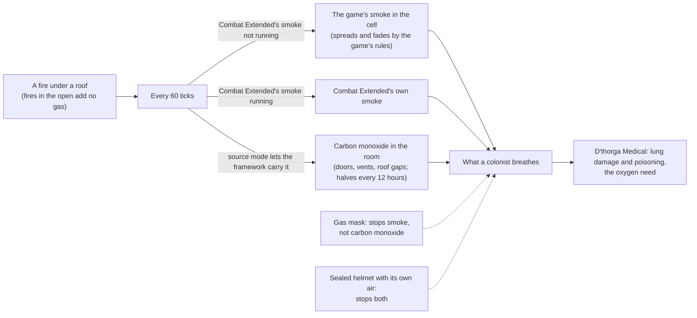

# D'thorga Framework for modders

How to use D'thorga Framework's shared services from your own mod: room gases, supplied oxygen, the health layer and per-person
care choices, protective-gear lines, parts bills, and the small helpers every D'thorga mod shares (settings, logging, long jobs,
rules Defs). **Vehicles have their own page**: [vehicle systems for modders](vehicle-systems-modding.md). The reasons behind each
design are in [the framework's design record](development/phobos-framework.md).

**Status (17 Nov 2026):** describes D'thorga Framework 0.117. **Partly tested in game:** the owner saw the gas layer and supplied
oxygen working through D'thorga Medical (5 November 2026). The health layer, protective-gear lines and parts bills are **not yet
tested in game**. Names may still change before the first public release; this page will say so when they do.

## Read this first (gotchas)

- **Load after D'thorga Framework** and list it in your `modDependencies`. It needs no other mod and no Harmony.
- **The core has no Harmony.** Where a service needs a patch (protective-gear lines), the consuming mod applies it and calls the
  core; see each section.
- **Reuse what exists before adding a gas** (the owner's rule, 4 November 2026). Smoke is the game's or Combat Extended's; the
  framework carries its own gas only where nothing else does. Ask whether yours earns its place.
- **Player text stays in your `Languages/English/Keyed`**, never in C#; the framework draws your buttons from your keys.
- **Never hard-reference an optional mod's assembly.** Use `OptionalMods` to find a mod, a Def or a setting by name.

## Gases

### Reading what a pawn breathes

```csharp
float smoke = PhobosGases.Breathed(pawn, GasKind.Smoke);          // 0..1, Combat Extended's condition or the game's smoke through the mask
float co = PhobosGases.Breathed(pawn, myGasDef);                   // a framework gas, through its own mask rule
float enclosure = PhobosGases.Enclosure(pawn.Position, pawn.Map); // 0 open air .. 1 sealed roofed room
GasSource where = PhobosGases.Source(myGasDef);                    // Own, Existing or None under the rule and the player's setting
```

`GasKind` names the gases the game (or Combat Extended) already carries: smoke, tox gas, rot stink, deadlife dust. The player's
**Where gases come from** setting (Automatic, always the framework's own gases, or never) can switch a framework gas off; read
`Source` and fall back to a simpler estimate when it says `None`.

| Gas | Who carries it | What the framework does with it |
| --- | --- | --- |
| Smoke | Combat Extended's black smoke while its smoke effects run; otherwise the game's own smoke | Reads it for other mods; without CE's smoke, fires add the game's smoke under a roof |
| Tox gas, rot stink, deadlife dust | The game | Reads them; adds tox gas where a mod asks |
| Carbon monoxide | The framework (its first own gas) | Fires add it to their roofed room on both paths |

### Adding a gas of your own

A gas is a Def. The framework's carbon monoxide, from `mods/PhobosFramework/Common/Defs/Phobos/Framework/Gases.xml`:

```xml
<Phobos.Framework.Gases.PhobosGasDef>
  <defName>PhobosGas_CarbonMonoxide</defName>
  <label>carbon monoxide</label>
  <decayHalfLifeTicks>30000</decayHalfLifeTicks>     <!-- halves every 12 hours indoors -->
  <openRoofHalfLifeTicks>600</openRoofHalfLifeTicks> <!-- the share under a roof gap halves every 600 ticks -->
  <maxConcentration>1</maxConcentration>
  <filteredByMask>false</filteredByMask>             <!-- a gas mask does not stop it -->
  <preferExisting>None</preferExisting>              <!-- or a GasKind it should defer to -->
  <overlayColor>(0.9, 0.3, 0.3, 1)</overlayColor>
</Phobos.Framework.Gases.PhobosGasDef>
```

`alwaysOwn` pins a gas on whatever the player's source setting says. Defaults: `decayHalfLifeTicks` 2500, `openRoofHalfLifeTicks`
600, `filteredByMask` true.

### Making gas

- **In XML**, give a thing `Phobos.Framework.Gases.CompProperties_PhobosGasEmitter` with `gas` (a framework gas) or `kind` (an
  existing one), `amountPerRareTick` (default 0.05), and optionally `onlyWhenPowered`, `onlyWhenSwitchedOn` or `onlyWhenFuelled`.
- **From code**, `PhobosGases.AddOwn(cell, map, gas, cells)` for a framework gas, or `PhobosGases.Add(cell, map, GasKind.Smoke,
  fraction)` for an existing one.

### How a room gas moves

A framework gas is kept per room, the way the game keeps room temperature, and moves at the game's own door and vent rates. The
figures live in the rules Def `PhobosGasRulesDef`.

| Opening | Rate the game uses for temperature | The framework's pass (every 60 ticks) |
| --- | --- | --- |
| Open door | 1 every 34 ticks | the same, scaled to one pass |
| Closed door | 1 every 375 ticks | the same |
| Vent, switched on | 14 every 250 ticks | the same |
| Door or vent onto the outdoors | | a sink |
| Gap in the roof | | that share of the room halves at the gas's open-roof half-life |

Rooms without gas cost nothing; a wall built through a gassy room leaves both halves gassy; a merged room dilutes. Gas does not
travel with a gravship. Saves hold the cells, not room numbers.



## Supplied oxygen

Oxygen is a treatment, not a gas. Put `Phobos.Framework.Breathing.PhobosSuppliedOxygenExtension` (with
`carbonMonoxideHalfLifeHours`, default 1.25) on your treatment condition, and `PhobosOxygenResponsiveExtension` (with
`minSeverity`) on a condition oxygen helps. Read them with `PhobosBreathing.SuppliedCarbonMonoxideHalfLifeHours(pawn)` and
`PhobosBreathing.HasOxygenResponsiveCondition(pawn)`; `PhobosBreathing.HealOnSuppliedOxygen` lists conditions that heal faster on
oxygen. D'thorga Medical's oxygen conditions (`mods/PhobosMedical/Common/Defs/Phobos/Medical/Hediffs_Oxygen.xml`) are the worked
example.

## The health layer and care choices

`Phobos.Framework.Health` answers, for mods whose doctors act on their own, who the doctors look after and under what care, how
dangerous a condition is and how soon it kills, and which doctor could operate:

```csharp
PatientGroup? group = Patients.GroupOf(pawn);                       // Colonist, Slave, Prisoner, Guest, or null
bool allowed = Patients.CareAllows(pawn, MedicalCareCategory.HerbalOrWorse, requireMedicine: true);
float danger = ConditionDanger.DangerSeverity(hediff.def);           // from where the condition threatens life; huge when never
float hours = ConditionDanger.Clock(hediff).HoursToDeath(ConditionDanger.HoursUntilBloodLossDeath(pawn));
bool doctor = Doctors.AnyAvailableFor(pawn);                         // the game's own test
float best = Doctors.BestSurgeonSuccess(map, recipe, pawn);          // negative when no doctor meets the skill
var cache = new MapPatientCache<Pawn>((map, list) => { /* fill */ }); // rebuilt at most once per interval, when asked
Hediff? treatment = MedicalTreatment.GiveOrRefresh(pawn, myTreatmentDef); // a condition that lapses unless refreshed
```

The game-free rule behind the danger reader is `Phobos.Framework.Rules.ConditionDangerRule`, tested without the game.

**A per-person choice** is one registration at start-up. Every humanlike pawn carries a small comp that saves only what the player
set and ticks nothing; the framework draws the button and saves the answer:

```csharp
PatientPreferences.Register(new PatientPreference("MyMod_Choice", "MyMod_ChoiceLabel", "MyMod_ChoiceDesc",
    new[] { "MyMod_ChoiceOff", "MyMod_ChoiceOn" }, defaultFor: pawn => 1));
int choice = PatientPreferences.Choice(pawn, preference);
PatientPreferences.RegisterInspectLine(pawn => myLineOrNull);
```

`PatientPreferences.IconFor`, `MenuFor` and `LabelFor` draw a choice the same way everywhere. D'thorga Medical's triage
("how far the doctors may go") is the first user.

## Protective-gear lines

A `Phobos.Framework.Protection.ProtectionZoneDef` names a stat worn gear raises and how much of it a pawn needs to cross. D'thorga
Medical's radiation control area (`mods/PhobosMedical/Mods/Rimatomics/Defs/Phobos/Protection/RadiationControl.xml`):

```xml
<Phobos.Framework.Protection.ProtectionZoneDef>
  <defName>PhobosZone_RadiationControlled</defName>
  <label>radiation controlled area</label>
  <stat>ToxicEnvironmentResistance</stat>
  <required>0.75</required>
  <color>(0.80, 0.20, 0.70)</color>
</Phobos.Framework.Protection.ProtectionZoneDef>
```

- **A doorway line**: give a rotatable building `CompProperties_PhobosControlPoint` (with `PlaceWorker_PhobosControlPoint`) to close
  off the room it faces.
- **A painted area**: subclass `Designator_PhobosProtectionArea`.
- Colonists stop at the line to fetch and put on gear, judged by its effect, and take it off on the way out. Animals, prisoners,
  guests and drafted colonists cross as they are. An alert, **Unprotected behind the line**, names everyone of the colony's standing
  behind a line without enough protection.
- **The patch is the consumer's.** D'thorga Medical's patches call `ProtectionLine.BeforeStep`, `AfterStep` and `AllowsCell` for every
  kind of line. A mod that adds a line without D'thorga Medical patches the same two methods itself; a step answered twice is acted on
  once. [The design](development/radiation-control-line.md) has the detail.

## Parts bills

Say what a thing you build is made of **by role**, and let other mods' parts fill a role when they are installed. The target's own
`costList` keeps only its shell (steel and the like); at start-up each role is filled from the role supplies and the result becomes
the target's cost. Nothing is saved. From our own Defs:

```xml
<Phobos.Framework.Bills.PhobosRoleSupplyDef>
  <defName>PhobosPartSupply_FuelTank</defName>
  <label>fuel tank</label>
  <roles><li>FuelTank</li></roles>
  <materials>                                    <!-- ours, where we have no item; or <item> and <itemCount> -->
    <Steel>30</Steel>
    <ComponentIndustrial>1</ComponentIndustrial>
  </materials>
  <substitutes>                                  <!-- each: thing, count, optional minSize and maxSize -->
    <li MayRequire="rimthunder.core"><thing>ComponentFuelTank</thing></li>
    <li MayRequire="oskarpotocki.vanillavehiclesexpanded"><thing>VVE_CarFuelTank</thing></li>
  </substitutes>
</Phobos.Framework.Bills.PhobosRoleSupplyDef>

<Phobos.Framework.Bills.PhobosBillDef>
  <defName>PhobosBill_DepotBay</defName>
  <label>depot bay parts</label>
  <target>PhobosVehicles_DepotBay</target>       <!-- any ThingDef the player builds, or a vehicle's blueprint -->
  <parts>
    <FuelTank>1</FuelTank>
    <FuelPump>1</FuelPump>
  </parts>
</Phobos.Framework.Bills.PhobosBillDef>
```

A bill may also give a `size` (kilograms for a vehicle, read against the substitutes' `minSize` and `maxSize`) and `tags`. A role
supply may scale its item by size (`itemCountBySize`) or cover a whole build with one kit (`coversWholeBuild`). XML alone is enough;
[the parts bills record](development/parts-bills.md) has the rules. The player's **Parts for building** setting chooses between other
mods' parts where installed and always ours.

## Shared helpers

| Helper | What it does |
| --- | --- |
| `OptionalMods` | Active mods and Defs by name, cached; `StaticMember` and `SettingField` read another mod's setting by name |
| `LoadReport` | The one load line, optionally naming the part of a mod it reports |
| `DisplayMode`, `SettingsUi.DrawDisplayMode` | The Plain, Operator and Engineer display mode |
| `SettingsUi.Section`, `SettingsScroll` | Headings and a scrolling settings page |
| `SettingsUi.Warning`, `SettingsUi.Choice` | A setting's cost in amber; a menu of preset choices |
| `SettingsImport` | Carry a player's settings across a change of mod folder or Mod class, once |
| `PhobosRulesDef` | A rules Def whose first instance wins; read it with `Current<T>()` |
| `PatchFlags.Register`, `PatchOperationPhobosFlag` | XML patches applied only while a setting of yours is on |
| `FrameWorkQueue`, `RoomRebuildHold` | A long job run a slice per frame; rooms rebuilt once per slice while many things are destroyed |
| `DebugCategory.Name` | The shared dev-mode actions category |
| `CleanupService.RemoveHediffsOf(pack)` | A clean uninstall of your conditions |
| `Phobos.Framework.Sounds.PhobosSoundVolumeExtension` | Put it on a SoundDef so the one **D'thorga sounds volume** setting scales it |

**Carrying settings across a rename**, in the Mod constructor:

```csharp
bool fresh = !SettingsImport.HasOwnFile(this);
Settings = GetSettings<MySettings>();
if (fresh && SettingsImport.ImportInto(Settings, "OldFolder", "OldModClass")) LongEventHandler.ExecuteWhenFinished(WriteSettings);
```

**A long job**: subclass `Phobos.Framework.Work.FrameWork` (`Start` takes the snapshot, `Step` does one unit, `Finished`, and
`BudgetMs` per frame), then `FrameWorkQueue.Enqueue(job)`. The queue runs from a game component's per-frame update, paused or not.
Jobs are never saved.

## Logging

Log through the shared logger, in a static field named `Logger` (never `Log`, which would hide the game's class) on your Mod class:

```csharp
public static readonly Phobos.Logging.PhobosLog Logger = Phobos.Framework.Logging.Logs.For("My Mod", "My part");

if (Logger.DebugEnabled) Logger.Debug("what took work to build: " + detail);
```

Every log made this way is listed under **Verbose logging** in D'thorga Framework's settings, where a player ticks the one they are
chasing; `Debug` lines are written only then. Make the logs in the Mod class so they exist by the time the settings window opens.
The design is in [the logging record](development/logging-framework-design.md).

## Tools for developers

- **Write every Def with all patches applied at the next start (dev mode)**, in D'thorga Framework's settings, or the dev action
  "Framework: write patched Defs at the next start": one file, `PhobosPatchedDefs/PatchedDefs.xml` in the RimWorld user folder, for
  `python scripts/query-defs.py patched <defName>`. It holds other authors' Defs: keep it on your computer.
- **Show gases at the mouse (dev mode)**: a small label names every gas in the room under the mouse.
