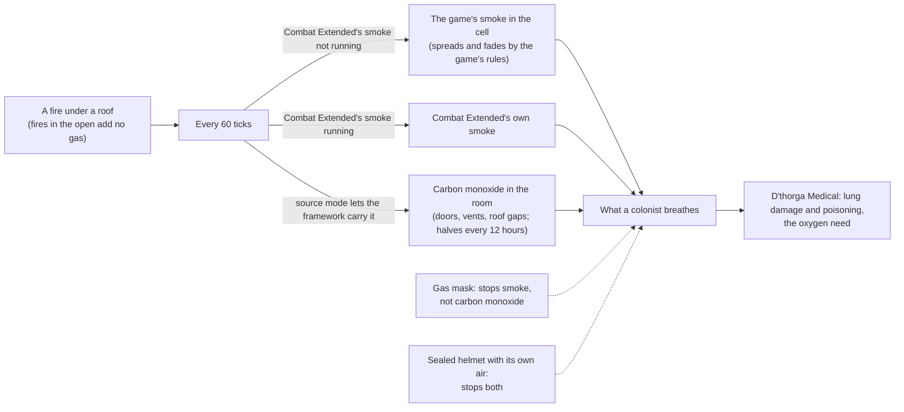

# D'thorga Framework for modders

How to use D'thorga Framework's shared services from your own mod: room gases, supplied oxygen, the health layer and per-person
care choices, protective-gear lines, parts bills, water and pipes beneath things, pictures and progress bars, and the small helpers
every D'thorga mod shares (settings, logging, long jobs, rules Defs). **Vehicles have their own page**: [vehicle systems for modders](vehicle-systems-modding.md). The reasons behind each
design are in [the framework's design record](development/archive/phobos-framework.md).

**Status (23 Nov 2026):** written for D'thorga Framework 0.117. Services added since are not on this page yet; a reference
generated from the code is planned. **Partly tested in game:** the owner saw the gas layer and supplied
oxygen working through D'thorga Medical (5 November 2026). The health layer, protective-gear lines and parts bills are **not yet
tested in game**. Names may still change before the first public release; this page will say so when they do.

## Read this first (gotchas)

- **Load after D'thorga Framework** and list it in your `modDependencies`. It needs Harmony (since Framework 0.205.0), which
  nearly every mod list already has, and no other mod.
- **The core patches only its own few places with Harmony** (the Architect's sub-tabs and the loop watch, since 0.205.0). Where a
  service needs a patch of the game (protective-gear lines), the consuming mod applies it and calls the core; see each section.
- **Reuse what exists before adding a gas** (the owner's rule, 4 November 2026). Smoke is the game's or Combat Extended's; the
  framework carries its own gas only where nothing else does. Ask whether yours earns its place.
- **Player text stays in your `Languages/English/Keyed`**, never in C#; the framework draws your buttons from your keys.
- **Never hard-reference an optional mod's assembly.** Use `OptionalMods` to find a mod, a Def or a setting by name.

## Gases

### Reading what a pawn breathes

```csharp
float smoke = PhobosGases.Breathed(pawn, GasKind.Smoke);          // 0..1, Combat Extended's condition or the game's smoke through the mask
float co = PhobosGases.Breathed(pawn, myGasDef);                   // a framework gas, through its own mask rule
float enclosure = PhobosGases.Enclosure(pawn.Position, pawn.Map); // 0 open air .. 1 sealed roofed room
GasSource where = PhobosGases.Source(myGasDef);                    // Own, Existing or None under the rule and the player's setting
```

`GasKind` names the gases the game (or Combat Extended) already carries: smoke, tox gas, rot stink, deadlife dust. The player's
**Where gases come from** setting (Automatic, always the framework's own gases, or never) can switch a framework gas off; read
`Source` and fall back to a simpler estimate when it says `None`.

| Gas | Who carries it | What the framework does with it |
| --- | --- | --- |
| Smoke | Combat Extended's black smoke while its smoke effects run; otherwise the game's own smoke | Reads it for other mods; without CE's smoke, fires add the game's smoke under a roof |
| Tox gas, rot stink, deadlife dust | The game | Reads them; adds tox gas where a mod asks |
| Carbon monoxide | The framework (its first own gas) | Fires add it to their roofed room on both paths |

### Adding a gas of your own

A gas is a Def. The framework's carbon monoxide, from `mods/PhobosFramework/Common/Defs/Phobos/Framework/Gases.xml`:

```xml
<Phobos.Framework.Gases.PhobosGasDef>
  <defName>PhobosGas_CarbonMonoxide</defName>
  <label>carbon monoxide</label>
  <decayHalfLifeTicks>30000</decayHalfLifeTicks>     <!-- halves every 12 hours indoors -->
  <openRoofHalfLifeTicks>600</openRoofHalfLifeTicks> <!-- the share under a roof gap halves every 600 ticks -->
  <maxConcentration>1</maxConcentration>
  <filteredByMask>false</filteredByMask>             <!-- a gas mask does not stop it -->
  <preferExisting>None</preferExisting>              <!-- or a GasKind it should defer to -->
  <overlayColor>(0.9, 0.3, 0.3, 1)</overlayColor>
</Phobos.Framework.Gases.PhobosGasDef>
```

`alwaysOwn` pins a gas on whatever the player's source setting says. Defaults: `decayHalfLifeTicks` 2500, `openRoofHalfLifeTicks`
600, `filteredByMask` true.

### Making gas

- **In XML**, give a thing `Phobos.Framework.Gases.CompProperties_PhobosGasEmitter` with `gas` (a framework gas) or `kind` (an
  existing one), `amountPerRareTick` (default 0.05), and optionally `onlyWhenPowered`, `onlyWhenSwitchedOn` or `onlyWhenFuelled`.
- **From code**, `PhobosGases.AddOwn(cell, map, gas, cells)` for a framework gas, or `PhobosGases.Add(cell, map, GasKind.Smoke,
  fraction)` for an existing one.

### How a room gas moves

A framework gas is kept per room, the way the game keeps room temperature, and moves at the game's own door and vent rates. The
figures live in the rules Def `PhobosGasRulesDef`.

| Opening | Rate the game uses for temperature | The framework's pass (every 60 ticks) |
| --- | --- | --- |
| Open door | 1 every 34 ticks | the same, scaled to one pass |
| Closed door | 1 every 375 ticks | the same |
| Vent, switched on | 14 every 250 ticks | the same |
| Door or vent onto the outdoors | | a sink |
| Gap in the roof | | that share of the room halves at the gas's open-roof half-life |

Rooms without gas cost nothing; a wall built through a gassy room leaves both halves gassy; a merged room dilutes. Gas does not
travel with a gravship. Saves hold the cells, not room numbers.



## Supplied oxygen

Oxygen is a treatment, not a gas. Put `Phobos.Framework.Breathing.PhobosSuppliedOxygenExtension` (with
`carbonMonoxideHalfLifeHours`, default 1.25) on your treatment condition, and `PhobosOxygenResponsiveExtension` (with
`minSeverity`) on a condition oxygen helps. Read them with `PhobosBreathing.SuppliedCarbonMonoxideHalfLifeHours(pawn)` and
`PhobosBreathing.HasOxygenResponsiveCondition(pawn)`; `PhobosBreathing.HealOnSuppliedOxygen` lists conditions that heal faster on
oxygen. D'thorga Medical's oxygen conditions (`mods/PhobosMedical/Common/Defs/Phobos/Medical/Hediffs_Oxygen.xml`) are the worked
example.

## The health layer and care choices

`Phobos.Framework.Health` answers, for mods whose doctors act on their own, who the doctors look after and under what care, how
dangerous a condition is and how soon it kills, and which doctor could operate:

```csharp
PatientGroup? group = Patients.GroupOf(pawn);                       // Colonist, Slave, Prisoner, Guest, or null
bool allowed = Patients.CareAllows(pawn, MedicalCareCategory.HerbalOrWorse, requireMedicine: true);
float danger = ConditionDanger.DangerSeverity(hediff.def);           // from where the condition threatens life; huge when never
float hours = ConditionDanger.Clock(hediff).HoursToDeath(ConditionDanger.HoursUntilBloodLossDeath(pawn));
bool doctor = Doctors.AnyAvailableFor(pawn);                         // the game's own test
float best = Doctors.BestSurgeonSuccess(map, recipe, pawn);          // negative when no doctor meets the skill
var cache = new MapPatientCache<Pawn>((map, list) => { /* fill */ }); // rebuilt at most once per interval, when asked
Hediff? treatment = MedicalTreatment.GiveOrRefresh(pawn, myTreatmentDef); // a condition that lapses unless refreshed
```

The game-free rule behind the danger reader is `Phobos.Framework.Rules.ConditionDangerRule`, tested without the game.

**A per-person choice** is one registration at start-up. Every humanlike pawn carries a small comp that saves only what the player
set and ticks nothing; the framework draws the button and saves the answer:

```csharp
PatientPreferences.Register(new PatientPreference("MyMod_Choice", "MyMod_ChoiceLabel", "MyMod_ChoiceDesc",
    new[] { "MyMod_ChoiceOff", "MyMod_ChoiceOn" }, defaultFor: pawn => 1));
int choice = PatientPreferences.Choice(pawn, preference);
PatientPreferences.RegisterInspectLine(pawn => myLineOrNull);
```

`PatientPreferences.IconFor`, `MenuFor` and `LabelFor` draw a choice the same way everywhere. D'thorga Medical's triage
("how far the doctors may go") is the first user.

**Who counts as a patient** has one shared answer: `Patients.IsFleshPerson` (one of the player's people, of flesh), `IsLyingDown`
(downed or in bed) and `IsLyingPatient` (both). Add your own need and care check on top.

**Something that stops surgery** is said by the mod that owns it, with no reference between mods. The owner registers
`SurgeryBars.Register(Func<Pawn, string?>)`, returning the reason already translated and in the game world, or null; a mod that
queues operations reads `Patients.SurgeryBarred(pawn, out reason)` and holds the operation with that reason. D'thorga Medical's
pressure chamber (the bar) and its triage (the reader) are the pair.

**A treatment that lapses**: `MedicalTreatment.GiveOrRefresh` gives a condition carrying `HediffCompProperties_PhobosTreatment`,
which lapses `lingerTicks` (default 600) after the last refresh.

**A condition that leaves a lasting one when it heals** (a burned eye leaves a scarred cornea): give the condition
`Phobos.Framework.Health.HediffCompProperties_PhobosLeavesLasting` with `lasting` (the condition left on the same body part),
`fromSeverity` (default 0.5; nothing is left below it) and, optionally, `flag` (a `PatchFlags` setting that must be on). The lasting
condition's severity follows the worst the first one reached (`Rules/LastingRule`, tested). Nothing is left on a part that has gone,
on a dead pawn, or while the uninstall sweep runs (`CleanupService.Sweeping`).

## Protective-gear lines

A `Phobos.Framework.Protection.ProtectionZoneDef` names a stat worn gear raises and how much of it a pawn needs to cross. D'thorga
Medical's radiation control area (`mods/PhobosMedical/Mods/Rimatomics/Defs/Phobos/Protection/RadiationControl.xml`):

```xml
<Phobos.Framework.Protection.ProtectionZoneDef>
  <defName>PhobosZone_RadiationControlled</defName>
  <label>radiation controlled area</label>
  <stat>ToxicEnvironmentResistance</stat>
  <required>0.75</required>
  <color>(0.80, 0.20, 0.70)</color>
</Phobos.Framework.Protection.ProtectionZoneDef>
```

- **A doorway line**: give a rotatable building `CompProperties_PhobosControlPoint` (with `PlaceWorker_PhobosControlPoint`) to close
  off the room it faces.
- **A painted area**: subclass `Designator_PhobosProtectionArea`.
- Colonists stop at the line to fetch and put on gear, judged by its effect, and take it off on the way out. Animals, prisoners,
  guests and drafted colonists cross as they are. An alert, **Unprotected behind the line**, names everyone of the colony's standing
  behind a line without enough protection.
- **The patch is the consumer's.** D'thorga Medical's patches call `ProtectionLine.BeforeStep`, `AfterStep` and `AllowsCell` for every
  kind of line. A mod that adds a line without D'thorga Medical patches the same two methods itself; a step answered twice is acted on
  once. [The design](development/archive/radiation-control-line.md) has the detail.

## Parts bills

Say what a thing you build is made of **by role**, and let other mods' parts fill a role when they are installed. The target's own
`costList` keeps only its shell (steel and the like); at start-up each role is filled from the role supplies and the result becomes
the target's cost. Nothing is saved. From our own Defs:

```xml
<Phobos.Framework.Bills.PhobosRoleSupplyDef>
  <defName>PhobosPartSupply_FuelTank</defName>
  <label>fuel tank</label>
  <roles><li>FuelTank</li></roles>
  <materials>                                    <!-- ours, where we have no item; or <item> and <itemCount> -->
    <Steel>30</Steel>
    <ComponentIndustrial>1</ComponentIndustrial>
  </materials>
  <substitutes>                                  <!-- each: thing, count, optional minSize and maxSize -->
    <li MayRequire="rimthunder.core"><thing>ComponentFuelTank</thing></li>
    <li MayRequire="oskarpotocki.vanillavehiclesexpanded"><thing>VVE_CarFuelTank</thing></li>
  </substitutes>
</Phobos.Framework.Bills.PhobosRoleSupplyDef>

<Phobos.Framework.Bills.PhobosBillDef>
  <defName>PhobosBill_DepotBay</defName>
  <label>depot bay parts</label>
  <target>PhobosVehicles_DepotBay</target>       <!-- any ThingDef the player builds, or a vehicle's blueprint -->
  <parts>
    <FuelTank>1</FuelTank>
    <FuelPump>1</FuelPump>
  </parts>
</Phobos.Framework.Bills.PhobosBillDef>
```

A bill may also give a `size` (kilograms for a vehicle, read against the substitutes' `minSize` and `maxSize`) and `tags`. A role
supply may scale its item by size (`itemCountBySize`) or cover a whole build with one kit (`coversWholeBuild`). XML alone is enough;
[the parts bills record](development/archive/parts-bills.md) has the rules. The player's **Parts for building** setting chooses between other
mods' parts where installed and always ours.

## Building upgrades

Since 0.210.0 a placed building can take upgrades a builder fits, in XML alone. Give the building the comp, then write each upgrade:

```xml
<!-- On the building's ThingDef, in its comps: -->
<li Class="Phobos.Framework.Upgrades.CompProperties_PhobosBuildingUpgrades" />

<Phobos.Framework.Upgrades.PhobosBuildingUpgradeDef>
  <defName>MyMod_FasterPump</defName>
  <label>faster pump</label>
  <description>What the player reads in the Upgrades window.</description>
  <buildings><li>MyMod_Pump</li></buildings>     <!-- each must carry the comp above -->
  <costList><Steel>15</Steel></costList>         <!-- brought by builders before the work -->
  <work>600</work>                               <!-- the game's work units, as WorkToBuild -->
  <constructionSkill>4</constructionSkill>
  <researchPrerequisite>Electricity</researchPrerequisite>  <!-- optional -->
  <prerequisite>MyMod_OtherUpgrade</prerequisite>           <!-- optional: must be fitted first -->
  <grants><li>MyMod_CanDoThing</li></grants>                <!-- abilities your comp asks for -->
  <figures>                                                 <!-- figures your comp reads -->
    <li><name>pumpPerHour</name><value>60</value></li>
  </figures>
  <refundShare>0.5</refundShare>                 <!-- share of materials back when taken off -->
  <overlay>                                      <!-- optional picture drawn over the building -->
    <texPath>MyMod/PumpCable</texPath>
    <graphicClass>Graphic_Single</graphicClass>
  </overlay>
</Phobos.Framework.Upgrades.PhobosBuildingUpgradeDef>
```

Your own comp reads it from `parent.GetComp<CompPhobosBuildingUpgrades>()`: `Grants("MyMod_CanDoThing")` and
`Figure("pumpPerHour", yourDefault)`. Both read a kept list, so they cost nothing to ask each tick. Where two fitted upgrades set the
same figure the larger is used, never the sum.

**Service yard equipment** (with Vehicle Framework): a building with `Phobos.VehicleSystems.PhobosYardEquipmentExtension` in its
`modExtensions` adds its `cells` to the allowance of a service yard it stands beside; `required` marks the kind a yard cannot be without
(our dyno bay).

## Linking like another building (Framework 0.257.0)

Many mods add their bedside facilities to the game's hospital bed by its name, so a new bed built on it misses them all. Give your
building this extension and, once every mod is loaded, it takes every facility the named building can link to, from any mod, and any
stat the named building has that yours lacks (your own figures always stand):

```xml
<modExtensions>
  <li Class="Phobos.Framework.Buildings.PhobosLinksLikeExtension">
    <like>HospitalBed</like>
    <missingStats>true</missingStats>   <!-- optional, the default; false takes facilities only -->
    <onlyStats>                         <!-- optional (0.259.0): only facilities that change one of these -->
      <li>MedicalTendQualityOffset</li>
    </onlyStats>
  </li>
</modExtensions>
```

With `onlyStats`, a facility is taken only when its own Def offsets one of the listed stats, so it is chosen by what it does and
never by its name: our hyperbaric chamber takes a hospital bed's facilities that better tending or immunity and leaves its comfort
furniture. A facility taken brings all its offsets. Ours so far: the burn unit bed and the hyperbaric chamber (like the hospital
bed), the swag (like the bedroll) and the vehicle parts bench (like the machining table).

Both sides are updated: your building's list of facilities, and each facility's own list of buildings it links to, which the game
fills while Defs load. The load line says how many buildings, facilities and stats were taken.

## Water and pipes beneath things (with Dubs Bad Hygiene)

`PhobosFramework.Hygiene` is a separate assembly that loads only with Dubs Bad Hygiene; never reference it from a core assembly.

- **Drawing water**: `Phobos.Framework.Hygiene.PlumbingFeed`, one per building, held by the building's comp and never saved. Its
  `TryPull(building, litres, out quality)` draws from plumbing under or beside the building; `Check(building, litres)` says what a
  draw would find without drawing; the static `TryPullFrom(net, litres, out quality)` draws from a net the caller already knows (a
  fixture's own pipe). Each answers with a `WaterDraw`: `Flowing`, `NoPlumbing` (no net with a water tower) or `TowersEmpty`.
  `PlumbingFeed.LiteMode` is true in Dubs' lite mode, which has no plumbing at all. It only reads the plumbing: it is deliberately not
  one of Dubs' own pipe comps, which delete the plumbing under a building (on load too) and would leave gaps in the player's runs if a
  D'thorga mod were removed. D'thorga Factory Additions' machines and Medical's electrolyser use it.
- **Pipes beneath a building**: give it `Phobos.Framework.Hygiene.CompProperties_PhobosPipeUnderlay` (no fields). Every cell of its
  footprint that has no pipe gets Dubs' **hidden** plumbing, so a pipe touching any side connects and a run passes through. It never
  touches a pipe it did not lay; a piece the player removes is not laid again while the building stands; the pieces it lays give
  nothing back when taken apart; in lite mode it lays nothing; and if the mod is ever removed, what is left is ordinary hidden pipe. A
  save from before it converts at the building's next load. The service underneath is `Phobos.Framework.Persistence.PipeUnderlay`.
- **Vehicles** lay the same while parked: see [pipes beneath a vehicle](vehicle-systems-modding.md#pipes-beneath-a-vehicle).

[Pipes and conduits beneath our things](development/archive/network-underlays.md) has the design, the owner's rules and every thing of ours
that lays them.

## Large blasts (Framework 0.218.0)

A blast that removes buildings, such as a nuclear strike, should not hit a vehicle as if it were a body: one blow at one cell, which
armour shrugs off. `Phobos.Framework.Environment.LargeBlasts` lets any blast ask first. Nothing here needs Vehicle Framework.

- **Asking:** before you hit a thing, call `LargeBlasts.TakerFor(thing)`. Where it returns a taker, describe the blast at that thing
  in a `LargeBlastHit` (its band, fireball, blast or thermal; `Wind` and `Heat` from 0 to 1, 1 at the fireball's edge; a pulse amount,
  the launcher and the weapon) and call `taker.Take(thing, hit)`. Where it returns null, hit the thing as before.
- **What comes back:** a `LargeBlastOutcome` saying whether the thing is gone, wrecked, battered or pulsed, who inside was killed
  (treat their bodies as yours) and who is still inside with the share of the radiation dose the hull lets through (give the dose
  yourself; the Framework has no radiation model of its own yet).
- **Shelter:** `taker.Sheltered(thing, cell => yourRule(cell))` judges a thing over every cell it stands on.
- **Vehicles** register a taker by themselves when D'thorga Framework's vehicle part loads; its figures are in
  `PhobosVehicleBlastRulesDef` (`PhobosVehicleBlastRules`), all authored and patchable in XML. D'thorga Patches' strike is the first
  user. The design and its sources: [nuclear strikes, vehicles and people](development/nuclear-strike-effects.md).
- **A taker of your own** implements `ILargeBlastTaker` and calls `LargeBlasts.Register` once at startup.

## Pictures, fades and progress bars

| Helper | What it does |
| --- | --- |
| `Phobos.Framework.Interface.FadingOverlay` | One long-lived mote over a building that builds and fades with its state, made more or less see-through through the colour the game multiplies a mote by; `Update(thing, wanted, ticks, buildTicks, fadeTicks, snap)`. Motes are never saved, so call it with `snap` after a load. The mote Def should be a `MoteBase` child with a long solid time and no fades of its own. The arithmetic is `Rules/FadeRule` (tested). First use: the liquid oxygen store's frost in D'thorga Medical |
| `Phobos.Framework.Interface.MapProgressBar` | The game's work bar (0.68 by 0.12 cells, its colours, the closest zoom only, never in screenshot mode) for work no pawn's job carries, drawn from a comp's `PostDraw`. The game's own bar is a mote renewed every tick, which a rare-ticking comp cannot do |
| `Phobos.Framework.Interface.IDrawsOwnWorkBar` | Marks a job driver that draws its own bar, so D'thorga Patches' `VehicleWorkBarPatch` (which adds the bar to Vehicle Framework's own vehicle work) leaves it alone |
| `Phobos.VehicleSystems.WorkBars.WithBar` | Adds the game's progress bar to a driver that extends Vehicle Framework's `JobDriver_WorkVehicle`, which draws one only when the job has no effecter (and its effecter defaults to the vehicle's repair effect). Our service, diagnose, repair-with-supplies, hitch, trailer set-up and sling hook-up drivers use it; rig work passes its `StepProgress`. Loads with Vehicle Framework |
| `Phobos.VehicleSystems.CompProperties_PhobosNodeLooks` | A vehicle picture that changes with its upgrades. `slots`, each with a `key` (stable and unique on the vehicle, never saved) and `looks` in order, each naming a `node` or a `fitting` and its `look`: the first fitted shows, else the one naming neither (the stock look), else nothing. Vehicle Framework's own node overlays can only add a picture on top, never take a stock one away. The picture changes on Vehicle Framework's upgrade-completed and refund-completed events and at every spawn; nothing is saved. The rule is `NodeLookRule` (tested). First users: the generator set's fan, the tipper's plain, rock and bulk bodies, the drill rig's folded and tall masts |
| `Phobos.VehicleSystems.CompProperties_PhobosDamageLooks` | `looks`, each a `part` (the part's key), `belowHealth` (default 0.6) and an `overlay` shown while that part's health is below the share; checked every rare tick. The bulk tanker's tank comp keeps its own, scoped by tank kind |
| A set-up moving part's `extras` | Pictures on the moving part's own canvas, shown while their node is fitted and posed with the part (the survey truck's geophone array and resistivity reel on its boom) |
| `Input_Moving`'s `stoppedBonusStat` | A vehicle stat added to the input's stopped value, never past its moving value. The cooling system's radiator names `Phobos_StoppedAirflow` (default 0), which a parked engine's fan raises: the generator set's heavy-duty fan gives 0.3 |

## Shared helpers

| Helper | What it does |
| --- | --- |
| `OptionalMods` | Active mods and Defs by name, cached; `StaticMember` and `SettingField` read another mod's setting by name |
| `LoadReport` | The one load line, optionally naming the part of a mod it reports |
| `DisplayMode`, `SettingsUi.DrawDisplayMode` | The Plain, Operator and Engineer display mode |
| `SettingsUi.Section`, `SettingsScroll` | Headings and a scrolling settings page |
| `SettingsUi.Warning`, `SettingsUi.Choice` | A setting's cost in amber; a menu of preset choices |
| `SettingsImport` | Carry a player's settings across a change of mod folder or Mod class, once |
| `PhobosRulesDef` | A rules Def whose first instance wins; read it with `Current<T>()` |
| `PatchFlags.Register`, `PatchOperationPhobosFlag` | XML patches applied only while a setting of yours is on: register the flag in your Mod constructor, which runs before patches; the operation takes a `flag` and its `operations` |
| `FrameWorkQueue`, `RoomRebuildHold` | A long job run a slice per frame; rooms rebuilt once per slice while many things are destroyed |
| `ResearchSetAsideExtension` (0.179.0) | Put on your own `ResearchTabDef` to set its research aside: out of view in a colony that has put no research into it, in view as before in one that has. Nothing is unloaded. Needs Vehicle Framework active (its part carries the patches), in the game's research window and Nice Research Tab |
| `DebugCategory.Name` | The shared dev-mode actions category |
| `CleanupService.RemoveHediffsOf(pack)` | A clean uninstall of your conditions |
| `Phobos.Framework.Sounds.PhobosSoundVolumeExtension` | Put it on a SoundDef so the one **D'thorga sounds volume** setting scales it |
| `Environment/HeldTemperature` | A fixed temperature for things held inside something (a closed cab, a pod, a chamber), as a transport pod has: register a reader for your holder type at start-up; the one Harmony postfix that applies the registry lives in the mod that holds the Harmony reference |
| `Items/ItemFinder` | The nearest thing of a Def a pawn can fetch (`FindNearest`, with an optional condition), or one aboard a caravan (`FindInCaravan`, `AllInCaravan`) |
| `Items/Charges` (`CompProperties_PhobosCharges`) | A thing that holds a few uses: `uses` (default 4), `rechargeHoursPerUse` (0 never recharges over time) and an optional `inspectKey` with `{COUNT}` and `{MAX}`. The `PhobosFramework_ChargesFull` special filter lets a recipe take only full ones. The arithmetic is `Rules/ChargeRules` |
| `Rules/ShelterComfort` | How a pawn feels about a shelter's temperature (a cab, a pod, a tent) against their comfort range |
| `WorldMap/BiomeGround` | A world tile's ground, read from its biome's Defs |
| `Rules/History` (`HistoryRing`), `Persistence/ScribeHistory` | A ring of recent samples and its save codec, for graphs |
| `Phobos.Framework.Interface.PhobosWidgets` | Gauge, warning light, section heading, history graphs, sparkline, tachometer, cards and choice buttons, in shared colours |
| `Phobos.Framework.Interface.TabState` | Per-thing state for a shared inspector tab |
| `Phobos.Framework.Interface.PhobosTabs.OpenWorldTab` | Opens a world inspector tab from code (the game's own call serves the map's pane only) |
| `Rules/DetailTierRule` | Full, Lite or Off: the player's things in full wherever they are, another faction's lite while on a map and off elsewhere (tested) |
| `Rules/SupplyRules` | What several jobs' needs still lack against stock |
| `Rules/CombatExtendedRules` | How Combat Extended reads hit weights and blast penetration, without a reference to its assembly (tested) |
| `Debug/DebugSelection` | The selected things, comps and world objects, for dev actions |
| `Debug/PhobosTiming` | A dev-mode timing accumulator (`PhobosTiming.Measure("label")` in a `using`), free outside dev mode |
| `Logging/GameLogKeeper`, `Logging/HostLog`, `Rules/GameLogRules` | The game's log turned back on after its 10,000-message limit, within a bounded number of revivals (a setting, on by default), and lines written under our own engine category |

**Namespaces**: the `UI/` folder's helpers are in `Phobos.Framework.Interface`, and `WorldMap/` is `Phobos.Framework.WorldMap`. A
namespace named `UI` or `World` would hide the game's `Verse.UI` or `Verse.World` class from every `Phobos.Framework.*` namespace.

**Carrying settings across a rename**, in the Mod constructor:

```csharp
bool fresh = !SettingsImport.HasOwnFile(this);
Settings = GetSettings<MySettings>();
if (fresh && SettingsImport.ImportInto(Settings, "OldFolder", "OldModClass")) LongEventHandler.ExecuteWhenFinished(WriteSettings);
```

It reads the old file through the game's own public `LoadedModManager.ReadModSettings` and copies its fields into the object the
game already handed your mod, so the game keeps saving that one (`ModSettings.Mod` has an internal setter, so a read object cannot be
handed to the game). The file name mirrors the game's private naming, `Config/Mod_<folder>_<class>.xml`.

**A long job**: subclass `Phobos.Framework.Work.FrameWork` (`Start` takes the snapshot, `Step` does one unit, `Finished`, and
`BudgetMs` per frame), then `FrameWorkQueue.Enqueue(job)`. The queue runs jobs one at a time, a slice per frame within the job's
budget (`Rules/SliceBudgetRule`, tested), from `GameComponent_PhobosFrameWork`'s per-frame update, which the game calls paused or not,
so it needs no Harmony. Jobs are never saved: a new or loaded game starts with an empty queue, so leave the map sound after every step.
`RoomRebuildHold` holds a map's room and region rebuild for a slice that destroys many things, and rebuilds once at its end: it sets
`RegionAndRoomUpdater`'s private `working` flag by reflection, and a room lookup in a dirtied cell answers null meanwhile, which the
game's callers already handle.

## Logging

Log through the shared logger, in a static field named `Logger` (never `Log`, which would hide the game's class) on your Mod class:

```csharp
public static readonly Phobos.Logging.PhobosLog Logger = Phobos.Framework.Logging.Logs.For("My Mod", "My part");

if (Logger.DebugEnabled) Logger.Debug("what took work to build: " + detail);
```

Every log made this way is listed under **Verbose logging** in D'thorga Framework's settings, where a player ticks the one they are
chasing; `Debug` lines are written only then. Make the logs in the Mod class so they exist by the time the settings window opens.
The game-free pieces (message signatures, the bounded tally, "at most once per so many ticks") came from the Framework's `Rules/` and
now live in phobos-log itself: `Phobos.Logging.LogSignature`, `StormTally` and `Throttle`.
The design is in [the logging record](development/logging-framework-design.md).

## Tools for developers

- **Write every Def with all patches applied at the next start (dev mode)**, in D'thorga Framework's settings, or the dev action
  "Framework: write patched Defs at the next start": one file, `PhobosPatchedDefs/PatchedDefs.xml` in the RimWorld user folder, for
  `python scripts/query-defs.py patched <defName>`. It holds other authors' Defs: keep it on your computer. How it works
  (`Debug/PatchedDefsDump`): a patch operation of ours keeps the game's combined XML document, which later mods go on patching, and a
  start-up class writes it once every patch has run.
- **Show gases at the mouse (dev mode)**: a small label names every gas in the room under the mouse.
