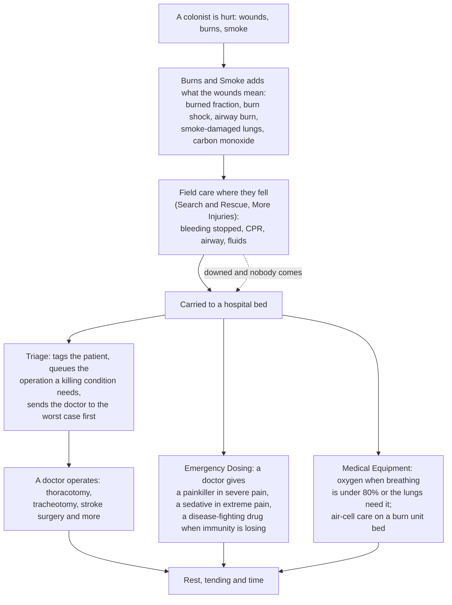

# The medical mods together

What happens when a colonist is hurt, and which mod does what, with House D'thorga's medical mods beside More Injuries and
Search and Rescue. As of 6 November 2026. **Parts of this are not yet tested in game**; each mod's README says which.

**Since 7 November 2026 the five D'thorga medical mods are one, [D'thorga Medical](../mods/PhobosMedical/README.md)**; this guide still names them by their former names (Burns and Smoke, Emergency Dosing, Triage, Medical Equipment, Medical Save Bridge), which are now its parts. Each part can still be switched off in its settings.

## Read this first (gotchas)

- **Field care and surgery are separate jobs, done by separate mods.** Search and Rescue and More Injuries (other authors) handle
  the patient where they fell: tourniquets, bandages, CPR, airways, transfusions, and the carry to a bed. D'thorga Triage handles
  the operations once they are in bed. Neither replaces the other.
- **One mod, D'thorga Medical, holds every part**, and needs D'thorga Framework. The parts still work alone and do more together.
- **A bed is where most of it happens.** Painkillers, oxygen, air-cell burn care and every operation need the patient down or in a
  bed. Build hospital beds with vitals monitors, and put oxygen machines touching them.
- **Stock decides everything.** Medicine, painkillers, oxygen canisters and surgical tools have to be made or bought. A doctor
  carrying them is fastest.
- **Doctors need the Doctor work type on**, and the skill the operation asks for. A message names what is missing when nobody can
  operate.

## From injury to recovery

Up and about in pain, a colonist also fetches a painkiller their drug policy allows (Emergency Dosing, from 40% pain).

## Who does what

| When | Mod | What it does on its own | What you do |
| --- | --- | --- | --- |
| The moment of injury | **D'thorga Burns and Smoke** | Adds up burns into a burned body fraction; burn shock past about a sixth of the body; airway burns that swell over hours; smoke damage to the lungs; carbon monoxide in closed burning rooms; fires in the open heat the cells around them | Tend the burns **and the shock**, with the best medicine you have; keep the patient in bed; get them out of smoke |
| Where they fell | **Search and Rescue** and **More Injuries** (other authors) | Tourniquets, bandages, hemostatic agents, CPR, airway suction, the defibrillator, saline and blood, the carry to a bed | Keep the supplies stocked; research More Injuries' first-aid projects |
| In bed, in pain | **D'thorga Emergency Dosing** | A doctor gives the best painkiller in reach at 60% pain or more; a sedative at 80% when no painkiller can be given; waits while the patient bleeds hard (30% a day or more) | Stock painkillers; set the minimum care level in the settings |
| In bed, a disease winning | **D'thorga Emergency Dosing** | A doctor gives a medical drug that speeds up immunity, only when immunity would arrive too late | Stock penicillin or similar |
| In bed, struggling to breathe | **D'thorga Medical Equipment** | Oxygen from a machine touching the bed when breathing is under 80% or a lung condition needs it; clears carbon monoxide about four times faster | Build a concentrator, or a canister stand with Vanilla Gravship Expanded |
| In bed, badly burned | **D'thorga Medical Equipment** | A powered burn unit bed gives air-cell care: wounds heal 25% faster, pain falls 15% | Build burn unit beds |
| In bed, dying of something only surgery fixes | **D'thorga Triage** | Queues the operation most likely to succeed among those your colony can do; says what is missing when nobody can | Set how far doctors may go, per person; keep a skilled doctor and the ingredients |
| Several patients waiting | **D'thorga Triage** | Tags each patient (immediate, urgent, delayed, minor, expectant); a doctor goes to the worst case first | Nothing; the setting can turn it off |
| Adding More Injuries to an old colony | **D'thorga Medical Save Bridge** | Re-numbers saved body parts on the first load so wounds land on the right parts | Load once with it, then keep it or not |

All of these except the Save Bridge share **D'thorga Framework**: one answer to "who are the doctors' patients", "how dangerous is this condition",
"what is this pawn breathing", and the per-person buttons (Triage's "Doctors may operate" is the first).

## What none of them does yet

- **Hold a collapsed lung in the field.** A tension pneumothorax needs an operation; a field needle decompression to buy time is
  an idea for Medical Equipment, not built.
- **A ventilator.** More Injuries: Organ Failure's ventilator surgery depends on another mod's life-support research, so most
  colonies never see it. One of our own is on the list for Medical Equipment.
- **Animals.** Burns and Smoke's conditions are for humanlike pawns only; Triage and Dosing look after people.

## Where to read more

- The READMEs, gotchas first: [Framework](../mods/PhobosFramework/README.md) and [D'thorga Medical](../mods/PhobosMedical/README.md),
  with a section for each former mod: burns and smoke, emergency dosing, triage, medical equipment and the save bridge.
- The design records, with what was read from the game's and other mods' code: [burns and smoke](development/burns-and-smoke.md),
  [emergency dosing](development/emergency-dosing.md), [medical equipment](development/medical-equipment.md),
  [triage](development/triage.md), [the framework](development/phobos-framework.md).
