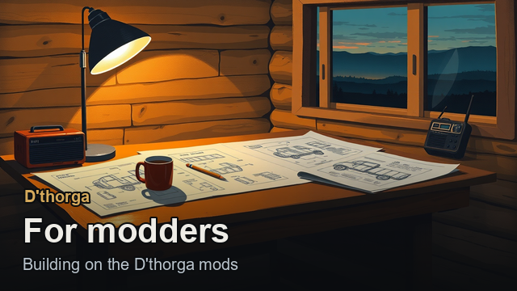

# For modders, mod by mod

How your own mod can extend or work with each D'thorga mod: the Defs and fields to use, with XML examples, and the checks done on
each. Players start at [the player guide](../player-guide/README.md) instead.

- **New here?** [Your first hour](first-hour.md): from nothing to a working vehicle change, with the example mod in
  [`examples/DthorgaExampleMod`](../../examples/DthorgaExampleMod/README.md), dev mode, the log and the offline checks.
- [Stability: what you can rely on](stability.md): which names are kept for saves, what may still change before the first public
  release, and how you are told.

- **The shared library**: [D'thorga Framework for modders](../framework-modding.md) (rooms, gases, health, parts bills, settings,
  logging) and [vehicle systems for modders](../vehicle-systems-modding.md) (batteries, coolant, fittings and tunes on your own vehicles) and
  [vehicle features for modders](../vehicle-features-modding.md) (cabins, camps, hitches, the sling, work rigs, aircraft and more).
- [D'thorga Factory Additions](factory-additions.md): factory bills, automating a bench, storage that feeds belts, piped water.
- [D'thorga Farming](farming.md): putting another mod's crop in a class, so a front takes it.
- [D'thorga Medical](medical.md): burns, dosing, triage, oxygen machines and patient devices, the save bridge, control lines.
- [D'thorga Patches](patches.md): the records behind each patch of another author's mod, and the temporary ones.
- [D'thorga Radio Framework](radio-framework.md): radios, bands, antennas and noisy machines in XML, and the dev actions.
- [D'thorga Vehicles](vehicles.md): loadouts for your own vehicles, and where the designs are.
- [D'thorga Water Tap](water-tap.md): another building that fills bottles, in XML.
