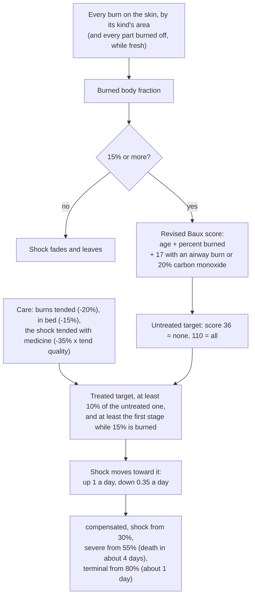

# D'thorga Medical for modders

How your own mod can work with D'thorga Medical: mark your burns, keep a drug out of automatic dosing, name what an operation
treats, add oxygen machines and patient devices, add a kind of control line, **build your own bedside machines, alarms
and showers, and tune the radiation model**. Players start at [the mod's
README](../../mods/PhobosMedical/README.md) and [the player guide](../player-guide/medical.md). Each part's reasons are in its
design record, linked in its section. Every figure below is an authored starting value unless it says otherwise.

The health layer every part shares (who the doctors' patients are, how dangerous a condition is, what a pawn is breathing, the
per-person buttons) is D'thorga Framework's: [D'thorga Framework for modders](../framework-modding.md) and [its
record](../development/archive/phobos-framework.md#health-layer-030-6-nov-2026).

## Burns and smoke

The record: [Burns and smoke](../development/archive/burns-and-smoke.md); tox gas and acid: [caustic
gas](../development/archive/caustic-gas.md).

**Mark an injury Def as a burn** for the burned fraction with the extension this part patches onto the game's burns, and say how
its damage becomes area (the Def's own severity stays its depth): the fraction of a part one point of damage covers, and the most
of a part one such burn can cover. Fire is 0.0833 and 1; an incendiary round is 0.025 and 0.3.

```xml
<modExtensions>
  <li Class="Phobos.BurnsAndSmoke.Defs.PhobosBurnLikeExtension">
    <areaPerDamage>0.0833</areaPerDamage>
    <maxArea>1</maxArea>
  </li>
</modExtensions>
```

Balance lives in `Common/Defs/Phobos/BurnsAndSmoke/Rules.xml` (one `PhobosBurnRulesDef`, first loaded wins) and in the stage
tables of the hediff Defs. Smoke and carbon monoxide are read from D'thorga Framework's `PhobosGases`. The fire heat's peak,
radius, cap and cadence are in the same Def, as is `perCellTemperatureMods`, the list of package ids whose presence makes the fire
heat stand down; add a mod there if it models the air cell by cell.

**How burn shock is decided**, every 300 ticks for a burned pawn (figures from the rules Def, all authored starting values):



**Stages as built:** burned body fraction minor from 5%, serious from 15% (hunger, cold sensitivity, blood pumping), major from
30%, critical from 50%. Burn shock compensated, shock from 30%, severe from 55% (a four-day death clock), terminal from 80% (one
day). Carbon monoxide: headache from 10%, dizzy 20%, confused 30%, collapsed 40%, dying from 55% (a half-day clock); on room air
it halves every 5.3 hours under a roof and 3 in the open. Smoke-damaged lungs heal 4% a day untended, 16% tended well, and 6% a
day more on supplied oxygen. The fire heat's zones are rebuilt every 150 ticks, so a cell can stay hot for up to two and a half
seconds after its fire goes out.

**A worked case:** a 40-year-old with a quarter of the body burned and no inhalation injury scores 65 and heads for stage 1
untreated; the same pawn with an airway burn scores 82 and heads for the severe stage. Burns tended and in bed, the shock tended
with industrial medicine, the second settles at compensated (30% of the untreated target); with no medicine, at the shock stage.
With full care, fluids without medicine leave 55% of the untreated target, herbal 44%, industrial 30%, glitterworld 20%, for a
doctor whose tend quality stat is 1.

### Conditions that clear, swell, cough or explain themselves

Four comps from the burns part work on any HediffDef of yours. A fifth, the ischaemia comp, is in this list too, but it is tied to
our eschar.

- **Each comp works every 250 ticks or every in-game hour, from the condition itself**: nothing is saved but the airway comp's peak.
- **`HediffCompProperties_PhobosHalfLife` and `HediffCompProperties_PhobosRiseThenFall` set the severity themselves.** Another
  severity comp on the same Def (the game's `HediffCompProperties_SeverityPerDay`) adds to theirs, so use one or the other.
- **Coughs need a sound** and stand down by themselves: see the cough comp's gotchas.

**Clearing by half-life.** `Phobos.BurnsAndSmoke.Comps.HediffCompProperties_PhobosHalfLife` makes a condition halve every so many
hours: one half-life under a roof, a shorter one in the open, and, where the Def asks (`oxygenSpeeds`), shorter still while the pawn is
on supplied oxygen. It is how our carbon monoxide clears. From `Common/Defs/Phobos/BurnsAndSmoke/Hediffs_Smoke.xml`:

```xml
<comps>
  <li Class="Phobos.BurnsAndSmoke.Comps.HediffCompProperties_PhobosHalfLife">
    <halfLifeHoursRoofed>5.3</halfLifeHoursRoofed>
    <halfLifeHoursOutdoors>3</halfLifeHoursOutdoors>
    <removeBelow>0.01</removeBelow>
    <oxygenSpeeds>true</oxygenSpeeds>
  </li>
</comps>
```

| Field | What it does (default) |
| --- | --- |
| `halfLifeHoursRoofed` | Hours for the severity to halve while the pawn stands under a roof (5.3) |
| `halfLifeHoursOutdoors` | Hours to halve with no roof over the pawn's cell (3) |
| `removeBelow` | The condition is removed once its severity falls below this (0.01) |
| `oxygenSpeeds` | Whether supplied oxygen speeds the clearing too (false; our carbon monoxide sets it true) |

- **Supplied oxygen speeds only a condition that sets `oxygenSpeeds`** (off by default). With it on, while the pawn is on supplied
  oxygen the shorter of the two applies: this comp's, or the treatment's `carbonMonoxideHalfLifeHours` (D'thorga Framework's
  `PhobosSuppliedOxygenExtension`; see [Supplied oxygen](../framework-modding.md#supplied-oxygen)). That figure is carbon monoxide's,
  so set the switch only on a condition oxygen really clears at that rate.
- The roofed figure is carbon monoxide's half-life on room air, about 320 minutes (Weaver and colleagues, 2000, as cited in emergency
  medicine references; see [the burns record](../development/archive/burns-and-smoke.md)). The open-air figure is authored. Treating
  the condition's severity as a blood fraction that clears at one first-order rate is a simplification.

**Rising, holding, then resolving.** `Phobos.BurnsAndSmoke.Comps.HediffCompProperties_PhobosRiseThenFall` sets the severity from the
condition's age: a straight rise to its peak, flat to the end of the plateau, a straight fall to zero, and then the condition is removed.
It is our airway burn's delayed swelling. From `Common/Defs/Phobos/BurnsAndSmoke/Hediffs_Airway.xml`:

```xml
<li Class="Phobos.BurnsAndSmoke.Comps.HediffCompProperties_PhobosRiseThenFall">
  <peakHours>8</peakHours>
  <plateauEndHours>24</plateauEndHours>
  <resolveHours>48</resolveHours>
</li>
```

| Field | What it does (default) |
| --- | --- |
| `peakHours` | In-game hours from onset to the peak (8) |
| `plateauEndHours` | The hour the peak ends and the fall begins (24) |
| `resolveHours` | The hour severity reaches zero and the condition is removed (48) |

- **The rise starts from the condition's age, not from its starting severity**: the first check (within 250 ticks) sets the severity to
  the rising line, a little above 0, whatever `initialSeverity` says. It is not removed at that check: the game ages a condition before
  its comps run. A `peakHours` of 0 or less would set it to 0 and remove it at once, so that, a `plateauEndHours` before `peakHours`, or
  a `resolveHours` not after `plateauEndHours`, is a config error naming the Def.
- **The peak's height is 1 unless our code sets it.** The burns part sets it for its own airway burn from how bad the exposure was
  (`airwayLightestPeak` in the burns rules Def, 0.5, is the least). A condition of yours added by the game or by your own code reaches
  its full stage table.
- The timings are approximate, after Walker and colleagues (Critical Care, 2015) on inhalation injury; the straight-line shape is ours.

**Coughing.** `Phobos.BurnsAndSmoke.Comps.HediffCompProperties_PhobosCough` plays a cough now and then from a pawn with the condition;
the worse it is, the more often. Presentation only. From `Hediffs_Smoke.xml`:

```xml
<li Class="Phobos.BurnsAndSmoke.Comps.HediffCompProperties_PhobosCough">
  <sound>PhobosMedical_CoughSmoke</sound>
  <mtbHoursAtFull>1</mtbHoursAtFull>
</li>
```

| Field | What it does (default) |
| --- | --- |
| `sound` | The SoundDef played once per cough; none means silence (none) |
| `mtbHoursAtFull` | Mean in-game hours between coughs at severity 1; the time is divided by the severity, never by less than 0.1 (2) |
| `minSeverity` | No coughing below this severity (0.1) |

- **Coughs play only while the player's Coughing setting is on, and only while no other mod already makes pawns cough.** The burns
  rules Def names what to look for: `coughSoundWords` (words in another mod's SoundDef names, "Cough" and "Wheez") and
  `coughSoundMods`. Add your mod's package id there if it coughs by other means.
- Only an awake, spawned, humanlike pawn coughs, and one pawn coughs at most once every 600 ticks (authored) however many such
  conditions it has.
- We add it to Combat Extended's own smoke inhalation with a patch (`Mods/CombatExtended/Patches/SmokeAftermath_CombatExtended.xml`);
  you can do the same to another mod's condition.

**What the tooltip explains.** `Phobos.BurnsAndSmoke.Comps.HediffCompProperties_PhobosBurnTooltip` adds lines to the condition's
health-tab tooltip, by the player's display mode. Its one field, `kind`, says which text:

| `kind` | What it shows, and where it reads from |
| --- | --- |
| `BurnLoad` (the default) | The pawn's burned body fraction and where shock starts, from the burns part's own figures |
| `BurnShock` | The revised Baux score and target; in Engineer mode, every term and figure behind them |
| `CarbonMonoxide` | The level and the half-lives, read from the same Def's `HediffCompProperties_PhobosHalfLife` (0 if it has none) |
| `LungInjury` | The level and the daily recovery untended and tended well, read from the same Def's `HediffCompProperties_SeverityPerDay` and `HediffCompProperties_TendDuration` |
| `SmokeAftermath` | What follows from breathing smoke, promising only what the player's smoke and carbon monoxide settings leave on |

```xml
<li Class="Phobos.BurnsAndSmoke.Comps.HediffCompProperties_PhobosBurnTooltip">
  <kind>SmokeAftermath</kind>
</li>
```

- **`BurnLoad` and `BurnShock` describe our own burn conditions** and the pawn's burns, whatever Def they sit on. On a condition of yours,
  use `CarbonMonoxide`, `LungInjury` or `SmokeAftermath`.
- In Plain mode the first four show one plain line; `SmokeAftermath` reads the same in every mode. We put it on Combat Extended's smoke
  inhalation so its wording stays Combat Extended's own.

**Starving a limb.** `Phobos.BurnsAndSmoke.Comps.HediffCompProperties_PhobosIschaemia` (no fields) does ischaemic damage, once an
in-game hour, to the part its condition sits on, through the game's own damage. It is our constricting eschar's
(`Hediffs_Eschar.xml`).

```xml
<li Class="Phobos.BurnsAndSmoke.Comps.HediffCompProperties_PhobosIschaemia" />
```

- **Its figures are the burns rules Def's, not yours**: damage starts at `escharIschaemiaFromSeverity` (0.7) and rises to
  `ischaemicDamagePerHourAtFull` (0.4, authored) at severity 1. A second Def using it shares them.
- **It stands down while More Injuries is active**: our patch lets More Injuries' gangrene take the limb instead, so the two never
  stack. A condition with no body part does nothing.


### Acid that stays on the skin

**Mark an injury Def whose chemical keeps burning until it is washed off** with
`Phobos.BurnsAndSmoke.Defs.PhobosRinsedByWaterExtension` (no fields). When such an injury lands, the pawn gets "chemical on the skin"
(`PhobosBurns_ChemicalOnSkin`), which deepens every open marked burn until it is spent (about three hours, authored) or rinsed off at a
safety shower ([Safety showers](#safety-showers)). We patch it onto the game's `AcidBurn` and `ChemicalBurn`
(`Common/Patches/Phobos/BurnsAndSmoke/Chemical.xml`):

```xml
<Operation Class="PatchOperationAddModExtension">
  <xpath>Defs/HediffDef[defName="MyMod_AcidBurn"]</xpath>
  <value>
    <li Class="Phobos.BurnsAndSmoke.Defs.PhobosRinsedByWaterExtension" />
  </value>
</Operation>
```

- **A burn deepens only if a DamageDef names it in its `hediff`**: the deepening comes through that damage kind, found by effect, never
  by name. A marked injury no damage kind makes still puts acid on the skin, but is not deepened.
- Only while the player's **Acid keeps burning until it is washed off** setting is on (on by default).
- The deepening is `HediffCompProperties_PhobosChemicalDeepening` on our "chemical on the skin" condition (no fields): once an in-game
  hour it spreads `chemicalDeepenPerHourAtFull` (2, authored, in the burns rules Def) times the condition's severity over the open
  marked burns, ignoring armour. You don't need to add it for marked burns to deepen.
- **On any other condition the comp deepens only that condition**, and only while it is an open, untended injury on a body part:
  `chemicalDeepenPerHourAtFull` times its severity (capped at 1, so in practice the full 2) is added to its severity once an in-game
  hour, never past leaving its part 1 hit point, so it never takes a part off by itself. It stops once the burn is tended or scarred,
  or with the player's acid setting off. On a condition that is not such an injury it does nothing. (Until the owner's card of 28 Nov
  2026, it deepened every marked burn on the pawn from any condition.)
- Every open marked burn on an eye means an eyewash's water is enough; any elsewhere takes a shower's.


### Clothes that carry residue or fallout dust

`Phobos.BurnsAndSmoke.Comps.CompProperties_PhobosContamination` (no fields) holds two things in a garment: caustic residue from tox
gas, and radioactive fallout dust. **You never add it: it is put on every apparel Def at start-up**, and a Def that already has it is
left alone. A contaminated or dusty garment is labelled, says so in its inspect text, and is matched by the "allow contaminated"
filter (`PhobosBurns_AllowContaminatedApparel`), which new apparel policies and stockpiles leave out.

| What it holds | Gets it | Fades | Cleared by | Only while |
| --- | --- | --- | --- | --- |
| Caustic residue | Worn in tox gas | `causticClothesFadePerDay` (0.25 a day, burns rules Def) | A wash in Dubs Bad Hygiene's washing machine | **Tox gas: strip and rinse** is on (off by default); counts from `causticClothesThreshold` (0.05) |
| Fallout dust | Worn outdoors in fallout | The 7:10 rule (Glasstone and Dolan, 9.16) | The same washing machine | **Radiation sickness runs its real course** and **Fallout dust on skin and clothes** are on (both on by default); counts from `dustToWash` (0.1, radiation rules Def) |

- **Saved with the garment** under `PhobosBurns_ContaminationLevel`, `PhobosBurns_ContaminationTick`, `PhobosRadiation_Dust` and
  `PhobosRadiation_DustTick`. It fades by the time since it was last set, so it does no ticking of its own.
- A mod that adds its own washing can't clear it from XML; the washing machine's clean-up is in the Dubs Bad Hygiene tie-in's code.

## Emergency dosing

The record: [Emergency dosing](../development/archive/emergency-dosing.md).

Keep an ingestible out of automatic dosing:

```xml
<modExtensions>
  <li Class="Phobos.Dosing.Defs.PhobosDosingExtension">
    <neverAutoDose>true</neverAutoDose>
  </li>
</modExtensions>
```

An ingestible is indexed when an `IngestionOutcomeDoer_GiveHediff` of its gives a condition whose stage at the dose takes away at
least 30% of the pain (through `painFactor` and a negative `painOffset`) and its score is above zero. Consciousness and breathing
offsets, consciousness `setMax`, `totalBleedFactor` and the drug comp's addictiveness and category are read from the same Defs. An
effect a mod applies from its own code, not its XML, is invisible to the index. Balance lives in
`Common/Defs/Phobos/Dosing/Rules.xml` (one `PhobosDosingRulesDef`, first loaded wins).

Score = pain relief minus half the consciousness cost (not for sedatives) minus half the breathing cost minus the bleed increase
(a quarter of it when the patient is not bleeding) minus half the addictiveness. Every figure is an authored starting value in the
rules Def.

### Care needs (Medical 0.28.0)

The record: [care needs](../development/medical-care-needs.md). Every reason for a dose is a `PhobosCareNeedDef`
(`Common/Defs/Phobos/Dosing/CareNeeds.xml`): `order` (lowest first), `seriousness` (`Minor`, `Serious`, `LifeThreatening`),
`defaultMode` (`Off`, `DoctorsOnly`, `DoctorsAndSelf`), `usesReserve`, `alertWhenUnmet` and a `workerClass` deriving from
`Phobos.Dosing.Needs.CareNeedWorker`. Add a need with a Def and a worker of your own.

Say what one of your items cures or prevents where its Defs cannot show it:

```xml
<modExtensions>
  <li Class="Phobos.Dosing.Defs.PhobosDosingExtension">
    <cures>
      <li>Plague</li>
    </cures>
    <prevents>
      <li>Flu</li>
    </prevents>
  </li>
</modExtensions>
```

- **A preventive needs no extension** when the condition it gives carries the game's `makeImmuneTo` on the stage at its dose.
- **A cure that works through an outcome class of your own** can be read without an extension on each item: patch a reader into the
  rules Def's `removalReaders`, with the class's full name (`doerClass`) and the `field` holding a condition or a list of them.
- **A condition given through an outcome class of your own, or through a use effect** (0.32.0), can be read without an extension:
  patch a `GivenConditionReader` into the rules Def's `givenConditionReaders`, with the class's full name (`className`), the
  `conditionField` (`hediffDef` by default) and `severityField` holding them, `negativeTakesAway` when a negative severity reduces a
  condition already there, and `skipWhenSetField` for a field that makes the effect depend on the taker. A use effect is read only on
  an item swallowed through the game's `IngestionOutcomeDoer_UseThing`; the game's own `CompProperties_UseEffectAddHediff` needs no
  reader. A condition the game marks harmful (`isBad`), given beside one it does not, is a side harm: it counts for the danger check,
  never for the redose check.
- **Disease classes** (0.33.0): give a disease its class with a `Phobos.Dosing.Defs.PhobosDiseaseClassExtension` (`diseaseClass`:
  `PhobosDisease_Bacterial`, `_Viral`, `_Protozoan`, `_Worms` or `_Mechanites`, or a `PhobosDiseaseClassDef` of your own), and say which
  classes a drug for fighting disease acts on with `actsOn` on `PhobosDosingExtension`. A drug naming none acts on every disease, and a
  disease with no class takes any drug.
- **Prevention acts only for an outbreak disease**: one that an `IncidentDef` brings (`diseaseIncident`), one with Vanilla Expanded
  Framework's spreadable comp, or one you patch into the rules Def's `outbreakDiseases`.
- **A help to breathing needs no extension**: a medical drug whose condition, at its dose, adds 0.1 or more to breathing after
  any breathing it costs (`minBreathingGain`) is given to a patient at `breathingRescueLevel` (0.3) or under. Keep an item out
  with `neverAutoDose`, as our More Injuries tie-in does for its epinephrine.
- **The long-term needs** (0.31.0): `treatsAddiction`, `healsOldWounds` and `regrowsParts` on `PhobosDosingExtension` declare what an
  item's code does. Without them, the rules Def names the classes: `addictionTreatments` (a condition's class or a comp's class),
  `regrowthClasses` (a comp's class) and `reservoirs` (a `ReservoirReader`: the condition's `hediffClass` and `levelMember`, its
  `capacity`, the refilling outcome's `refillDoerClass` and `amountField`). The game's own `HediffCompProperties_HealPermanentWounds`
  is read by type, and a stat offset lowering `MentalBreakThreshold` by `minBreakThresholdDrop` or more marks a steadying drug.
- **Protection while exposed needs no extension either** (0.30.0): a medical drug whose condition, at its dose, keeps out a quarter
  or more of toxic buildup (the game multiplies what a pawn takes in by one less each toxic resistance) or adds a quarter or more to
  vacuum resistance is given while exposure is under way (`toxicExposureFrom`, `minToxicCut`, `minVacuumGain`). The vacuum giver is a
  node in the game's constant think tree, ahead of `JobGiver_FindOxygen` (`Patches/Phobos/Dosing/VacuumDose_ThinkTree.xml`).
- **A vaccine of your own** (0.35.0) needs no extension: give a condition carrying `Phobos.Dosing.Comps.HediffCompProperties_PhobosPrimedImmunity`
  (`diseaseClass`, `headStart`, `checkIntervalTicks`) and a stage, and the index lists the item for vaccination; doctors and people
  give and take it as for ours.
- A cure or a preventive scores 1 minus the costs above and a quarter for each vomit a day; a sedative, a recreational drug or an
  item that gives a disease is never either.

| Need | Who | Given | Not given when |
| --- | --- | --- | --- |
| pain relief | resting, pain at or past 40% | the medical painkiller with the best score | a medical painkiller still at a quarter of a dose or more; overdose at 30% or more; a dangerous stage would be reached; consciousness or breathing would fall under 15% |
| sedation | resting, pain at or past 80%, no medical painkiller can be given | the sedative with the best score | its own last dose still working; otherwise the same |
| last resort | setting on, nothing above can be given | the recreational painkiller with the best score | the same |

## Triage

The record: [Triage](../development/archive/triage.md).

A recipe is found by its `removesHediff`, as the game's, More Injuries' and the burns part's already are. A recipe whose worker
removes a condition some other way, or one that must never be queued by the doctors on their own, says so with the extension this
part reads:

```xml
<modExtensions>
  <li Class="Phobos.Triage.Defs.PhobosTriageExtension">
    <treatsHediffs><li>MyMod_Condition</li></treatsHediffs>
    <neverAutoQueue>false</neverAutoQueue>
  </li>
</modExtensions>
```

Thresholds, bands and the bill cap live in `Common/Defs/Phobos/Triage/Rules.xml` (one `PhobosTriageRulesDef`, first loaded wins).
The per-person authority is D'thorga Framework's patient comp; the saved key is `PhobosTriage_Authority`. A mod holds surgery for
a patient (as the hyperbaric chamber does) through the Framework's `Patients.SurgeryBarred`, described in [the triage
record](../development/archive/triage.md).

| Tag | Means | Score band |
| --- | --- | --- |
| immediate | dying, and within 6 hours or with consciousness, breathing or blood pumping at 30% or less | 400 and up |
| urgent | dying, with more time; or life-threatening with no clock the part can read | 300 to 399 |
| delayed | a crippling condition, nothing killing them | 200 to 299 |
| minor | nothing classed | 100 |
| expectant | dying of something only an operation removes, and nobody here can do it | 50 |

## Medical equipment

The record: [Medical equipment](../development/archive/medical-equipment.md) and [the second
set](../development/archive/medical-equipment-2.md).

- **Oxygen machines:** give a building `Phobos.Medical.Comps.CompProperties_PhobosOxygenSupply` and `CompProperties_Facility`; add
  a `CompProperties_Refuelable` and it burns fuel. On a bed it serves its own occupant instead, and its `treatment` can name a
  stronger condition.
- **Patient devices:** give an item `Phobos.Medical.Defs.PhobosPatientDeviceExtension` (its need, the treatment condition, the
  time to use it, and whether it is used up or worked continuously), and doctors use it by themselves.
- **Device work lanes:** a WorkGiverDef using `Phobos.Medical.Jobs.WorkGiver_PhobosUseDevice` can carry
  `Phobos.Medical.Defs.PhobosDeviceWorkExtension`: `needs` limits it to some devices (none named: all), and `requireDoctorWork`
  asks that the worker also has Doctor work on. That is how the two field rescue lanes for Search and Rescue are made
  (`Mods/SearchAndRescue`), and how another mod's work type can take device work.
- **Liquid stores:** pair Vanilla Expanded Framework's resource storage comp with
  `Phobos.Medical.Comps.CompProperties_PhobosBoilOff`.
- Mark your own burn injury Def with `Phobos.Medical.Defs.PhobosBurnCareExtension` so a burn unit bed gives its patient air-cell
  care. Mark your own condition with `Phobos.Framework.Breathing.PhobosOxygenResponsiveExtension` so that it counts as needing
  oxygen. Balance lives in `Common/Defs/Phobos/Medical/Rules.xml` and on each machine's comp.

| Treatment | Breathing | Carbon monoxide half-life | Lasts |
| --- | --- | --- | --- |
| On oxygen (concentrator, stand, trolley) | +20 points, up to normal | About 75 minutes | While in the bed |
| On field oxygen (kit) | +20 points, up to normal | About 75 minutes | About an hour |
| Under hyperbaric oxygen (chamber) | +30 points, up to normal | About 22 minutes | While in the chamber |
| Hand-ventilated (resuscitator) | +30 points, up to normal | No change: it is room air | While a doctor pumps |

A bedside machine's pass runs every 250 ticks: switched on, powered or fuelled and touching a bed, it treats the patients in its
linked beds who need oxygen, worst breathing first, up to two; the treatment lapses about 10 seconds after the last pass. The
chamber is a game tier, not medical advice: the review cited in [the burns record](../development/archive/burns-and-smoke.md)
found the clinical evidence for it of low quality.

### The medical rules Def

**`Phobos.Medical.Defs.PhobosMedicalRulesDef` is a rules Def: the first loaded wins, so patch its figures rather than adding a
second.** It holds the thresholds every machine and device shares; each machine's own figures sit on its comp. From
`Common/Defs/Phobos/Medical/Rules.xml`:

```xml
<Phobos.Medical.Defs.PhobosMedicalRulesDef>
  <defName>PhobosMedical_Rules</defName>
  <breathingNeedThreshold>0.8</breathingNeedThreshold>
  <breathingAssistThreshold>0.5</breathingAssistThreshold>
  <ventilatorBreathingFloor>0.6</ventilatorBreathingFloor>
  <ventilatorStep>0.1</ventilatorStep>
  <alarmCarbonMonoxideLevel>0.05</alarmCarbonMonoxideLevel>
  <alarmSmokeLevel>0.1</alarmSmokeLevel>
  <alarmQuietShare>0.5</alarmQuietShare>
</Phobos.Medical.Defs.PhobosMedicalRulesDef>
```

To change a figure, in your `Patches` folder:

```xml
<Operation Class="PatchOperationReplace">
  <xpath>Defs/Phobos.Medical.Defs.PhobosMedicalRulesDef[defName="PhobosMedical_Rules"]/alarmSmokeLevel</xpath>
  <value><alarmSmokeLevel>0.2</alarmSmokeLevel></value>
</Operation>
```

| Field | What it does (default) |
| --- | --- |
| `breathingNeedThreshold` | Breathing (measured without any breathing treatment) below this needs oxygen, whatever the cause (0.8) |
| `breathingAssistThreshold` | Breathing below this is weak enough for a doctor to push air in by hand; with a condition a tube bypasses, it also means the airway is closing (0.5) |
| `ventilatorBreathingFloor` | A ventilator holds failing breathing up to this; below it, a patient needs one (0.6) |
| `ventilatorStep` | The breathing each stage of the ventilator's treatment adds over the one before (0.1) |
| `alarmCarbonMonoxideLevel` | Carbon monoxide at an alarm's spot, as the burns part measures it, at which it sounds (0.05) |
| `alarmSmokeLevel` | Smoke density in an alarm's cell at which it sounds (0.1) |
| `alarmQuietShare` | A sounding alarm stops only once the gas falls below this share of its level (0.5) |

- Every figure is authored. The alarm levels are the game's gas fractions, not parts per million.
- **Breathing at zero needs neither oxygen nor a ventilator**: no air reaches the lungs, so only a tube (or an operation) helps.
- **Changing `ventilatorStep` or the floor means changing the ventilator treatment's stages to match** ([Ventilators and breathing
  tubes](#ventilators-and-breathing-tubes)).


### Treatment conditions

Every machine and device here keeps a **treatment condition** on its patient, refreshed on each pass. **The condition needs D'thorga
Framework's `Phobos.Framework.Health.HediffCompProperties_PhobosTreatment`** (or a comp built on it), with `lingerTicks` (600): it lapses
that long after its last refresh, so it can't outlive the machine. **Without it the condition never goes.** The nebuliser's mist
(`Hediffs_Nebuliser.xml`) and the burn bed's air cells (`Hediffs_BurnBed.xml`) are plain `HediffWithComps` with that comp.

A breathing treatment (oxygen, hand ventilation) takes `Phobos.Medical.Comps.HediffCompProperties_PhobosOnOxygen` instead, which is the
same clock with a carbon monoxide line in its tooltip. From `Common/Defs/Phobos/Medical/Hediffs_Oxygen.xml`, trimmed:

```xml
<HediffDef>
  <defName>PhobosMedical_OnOxygen</defName>
  <hediffClass>Phobos.Medical.Comps.Hediff_PhobosOnOxygen</hediffClass>
  <isBad>false</isBad>
  <comps>
    <li Class="Phobos.Medical.Comps.HediffCompProperties_PhobosOnOxygen">
      <lingerTicks>600</lingerTicks>
    </li>
  </comps>
  <stages>
    <li/>
    <li>
      <minSeverity>0.5</minSeverity>
      <capMods>
        <li><capacity>Breathing</capacity><offset>0.2</offset><setMax>1</setMax></li>
      </capMods>
    </li>
  </stages>
  <modExtensions>
    <li Class="Phobos.Framework.Breathing.PhobosSuppliedOxygenExtension">
      <carbonMonoxideHalfLifeHours>1.25</carbonMonoxideHalfLifeHours>
    </li>
  </modExtensions>
</HediffDef>
```

| Field | What it does (default) |
| --- | --- |
| `lingerTicks` | Ticks the condition lasts after its last refresh; a machine passes every 250 (600) |
| `roomAirHalfLifeHours` | Carbon monoxide's half-life on room air, **for the tooltip's comparison only** (5.33, about 320 minutes: Weaver and colleagues, 2000, as cited) |

- **Use the hediff class `Phobos.Medical.Comps.Hediff_PhobosOnOxygen` with two stages**: the code picks the stage, the first leaving
  breathing alone and the second raising it (`minSeverity` only keeps the stages in order). It raises breathing only for a patient below
  normal without it, so healthy or bionic lungs keep what they have.
- The tooltip reads `carbonMonoxideHalfLifeHours` from the same Def's `PhobosSuppliedOxygenExtension`. Without one (hand ventilation:
  room air pushed in) it says the treatment helps breathing only. In Plain mode it says "N times faster" than room air.
- Use the condition as an oxygen machine's `treatment` or a patient device's `treatment` (the two lists at the top of [Medical
  equipment](#medical-equipment)). The 75-minute half-life on oxygen is sourced (about 70 to 80 minutes, the same citation); the +0.2
  breathing is authored.


### Bedside machines that treat a tagged condition

**A bedside machine gives its treatment to patients in the beds it links to who have a condition carrying its tag.** It is how the
nebuliser eases airway spasm after smoke. Two parts:

- the machine: `Phobos.Medical.Comps.CompProperties_PhobosBedsideTreatment`, with the game's `CompProperties_Facility`;
- the condition: `Phobos.Medical.Defs.PhobosBedsideTreatableExtension`, naming the tag and the severity it is treated from.

From `Common/Defs/Phobos/Medical/Buildings_Nebuliser.xml`, trimmed:

```xml
<ThingDef ParentName="BuildingBase">
  <defName>PhobosMedical_Nebuliser</defName>
  <tickerType>Rare</tickerType>
  <comps>
    <li Class="CompProperties_Power">
      <compClass>CompPowerTrader</compClass>
      <basePowerConsumption>60</basePowerConsumption>
    </li>
    <li Class="CompProperties_Flickable"/>
    <li Class="CompProperties_Refuelable">
      <fuelCapacity>10</fuelCapacity>
      <consumeFuelOnlyWhenUsed>true</consumeFuelOnlyWhenUsed>
      <fuelFilter><thingDefs><li>PhobosMedical_BronchodilatorVial</li></thingDefs></fuelFilter>
    </li>
    <li Class="CompProperties_Facility">
      <maxSimultaneous>1</maxSimultaneous>
      <mustBePlacedAdjacent>true</mustBePlacedAdjacent>
    </li>
    <li Class="Phobos.Medical.Comps.CompProperties_PhobosBedsideTreatment">
      <tag>Bronchospasm</tag>
      <treatment>PhobosMedical_Nebulised</treatment>
      <maxPatients>1</maxPatients>
      <fuelPerPatientHour>0.25</fuelPerPatientHour>
      <statusKeyPrefix>PhobosMedical_Nebuliser</statusKeyPrefix>
      <workingSound>PhobosMedical_Nebuliser</workingSound>
    </li>
  </comps>
</ThingDef>
```

And on the condition (our smoke inhalation, `Hediffs_Smoke.xml`; patched onto Combat Extended's in
`Mods/CombatExtended/Patches/Phobos/Medical/Bronchospasm_CombatExtended.xml`):

```xml
<li Class="Phobos.Medical.Defs.PhobosBedsideTreatableExtension">
  <tags>
    <li>Bronchospasm</li>
  </tags>
  <minSeverity>0.1</minSeverity>
</li>
```

| Field (`CompProperties_PhobosBedsideTreatment`) | What it does (default) |
| --- | --- |
| `tag` | The tag a patient's condition must carry; **required** ("") |
| `treatment` | The HediffDef given and kept up while it treats; **required** (none) |
| `maxPatients` | How many patients it treats at once, in the order they lie in its beds (1) |
| `fuelPerPatientHour` | Fuel used per patient per in-game hour, if the building has a `CompProperties_Refuelable` (0) |
| `statusKeyPrefix` | The start of its inspect-text keys ("") |
| `workingSound` | A SoundDef that loops while it treats anyone; none for silence (none) |

| Field (`PhobosBedsideTreatableExtension`) | What it does (default) |
| --- | --- |
| `tags` | The tags of the machines that treat this condition (empty) |
| `minSeverity` | Treated from this severity (0) |

- **Give the building `<tickerType>Rare</tickerType>`**: the machine works on the game's rare tick, every 250 ticks.
- **Add your machine to the beds' `linkableFacilities`.** Ours are added to every bed that takes a vitals monitor
  (`Common/Patches/Phobos/Medical/Beds.xml`); copy that patch with your own defName.
- **Write five text keys**: your `statusKeyPrefix` followed by `SwitchedOff`, `NoFuel`, `Waiting`, `Treating` and `NotNeeded`, the last
  two with `{PATIENTS}`. No power and no bed use our shared lines.
- **The treatment needs the treatment comp**, or it never lapses ([Treatment conditions](#treatment-conditions)).
- Power, a switch and fuel are each optional: without a power comp it counts as powered, without a fuel comp it needs none. The config
  check complains of a missing `tag` or `treatment`.


### Ventilators and breathing tubes

**A ventilator breathes for a patient through a breathing tube.** It holds a patient whose own breathing (measured without any
breathing treatment) is above zero and below `ventilatorBreathingFloor` (0.6) up to that floor. A patient without a tube is reported as
needing one, and doctors then fit an intubation kit. Three parts work together:

| Type | On | Does |
| --- | --- | --- |
| `Phobos.Medical.Comps.CompProperties_PhobosVentilator` | A bedside building | Breathes for patients in its linked beds who have a tube |
| `Phobos.Medical.Defs.PhobosOpenAirwayExtension` (no fields) | A condition that is a tube past the upper airway | A ventilator can breathe through it, and an intubation kit is not used again |
| `Phobos.Medical.Defs.PhobosBypassedByTubeExtension` (no fields) | A condition of the upper airway | Fitting an intubation kit removes it; with breathing under `breathingAssistThreshold` (0.5) it means the airway is closing, and a doctor fits a kit |

From `Common/Defs/Phobos/Medical/Buildings_Ventilator.xml`, the comps:

```xml
<li Class="CompProperties_Power">
  <compClass>CompPowerTrader</compClass>
  <basePowerConsumption>200</basePowerConsumption>
</li>
<li Class="CompProperties_Flickable"/>
<li Class="CompProperties_Facility">
  <maxSimultaneous>1</maxSimultaneous>
  <mustBePlacedAdjacent>true</mustBePlacedAdjacent>
</li>
<li Class="Phobos.Medical.Comps.CompProperties_PhobosVentilator">
  <maxPatients>1</maxPatients>
  <workingSound>PhobosMedical_Ventilator</workingSound>
</li>
```

| Field | What it does (default) |
| --- | --- |
| `maxPatients` | How many tubed patients it breathes for at once (1) |
| `treatment` | The condition it gives; none for our `PhobosMedical_Ventilated` (none) |
| `workingSound` | A SoundDef that loops while it breathes for anyone (none) |

On the conditions, from `Common/Defs/Phobos/BurnsAndSmoke/Hediffs_Airway.xml` (our tracheostomy is a tube; our airway burn is bypassed
by one):

```xml
<modExtensions>
  <li Class="Phobos.Medical.Defs.PhobosOpenAirwayExtension" />
</modExtensions>
```

```xml
<modExtensions>
  <li Class="Phobos.Medical.Defs.PhobosBypassedByTubeExtension" />
</modExtensions>
```

- **Give the building `<tickerType>Rare</tickerType>` and add it to the beds' `linkableFacilities`**, as for [bedside
  machines](#bedside-machines-that-treat-a-tagged-condition).
- **A treatment of your own must use the hediff class `Phobos.Medical.Comps.Hediff_PhobosVentilated`, the treatment comp, and stages to
  match the rules Def**: stage *n* adds *n* × `ventilatorStep` breathing with a ceiling at normal, and the code picks the fewest steps
  that reach the floor. Ours (`Hediffs_Ventilator.xml`) has an empty first stage and six more, `minSeverity` 0.01 to 0.06 only to keep
  them in order. Another class would be counted as the patient's own breathing.
- **Breathing at zero is not ventilated**: the machine waits for the tube to open the airway first.
- Our intubation (`PhobosMedical_Intubated`, `Hediffs_Ventilator.xml`) carries `PhobosOpenAirwayExtension` too. Any mod's tube joins by
  the extension, never by name.
- The 0.6 floor is authored: enough to keep a patient out of danger, short of normal.


### Needle decompression

**Mark a condition of pressure building in the chest** with `Phobos.Medical.Defs.PhobosPressureReliefExtension`, and doctors relieve it
with a needle decompression kit: it takes `severityRelieved` off, never below a trace (0.01), so the condition and its operation stay. It
buys time; the operation still has to follow. From `Mods/MoreInjuries/Patches/Phobos/Medical/Decompression_MoreInjuries.xml`:

```xml
<Operation Class="PatchOperationAddModExtension">
  <xpath>Defs/HediffDef[defName="LungCollapse"]</xpath>
  <value>
    <li Class="Phobos.Medical.Defs.PhobosPressureReliefExtension">
      <minSeverity>0.2</minSeverity>
      <severityRelieved>0.5</severityRelieved>
    </li>
  </value>
</Operation>
```

| Field | What it does (default) |
| --- | --- |
| `minSeverity` | Doctors use a kit from this severity (0.2) |
| `severityRelieved` | Severity one kit takes off (0.5) |

- **Our kit, `PhobosMedical_DecompressionKit`, exists only with More Injuries.** Without it, mark your condition and add a patient device
  of your own whose `need` is `Decompression` (the list at the top of [Medical equipment](#medical-equipment)).
- Our kit needs Medicine 5. Both figures are authored; 0.2 is More Injuries' first obstructive shock stage.


### Pressure chambers

**Mark a bed as a pressure chamber** with `Phobos.Medical.Defs.PhobosPressureChamberExtension` (no fields). Doctors then carry a downed
patient who needs oxygen, lying on the ground, to the nearest free chamber that is ready, and no operation is done on anyone lying in
one: the reason shows on the chamber and, through D'thorga Framework's surgery bars, in Triage. From
`Mods/VanillaGravshipExpanded/Defs/Phobos/Medical/Buildings_Hyperbaric.xml`, trimmed:

```xml
<comps>
  <li Class="Phobos.Medical.Comps.CompProperties_PhobosOxygenSupply">
    <treatment>PhobosMedical_Hyperbaric</treatment>
    <startSound>PhobosMedical_HyperbaricSeal</startSound>
  </li>
</comps>
<modExtensions>
  <li Class="Phobos.Medical.Defs.PhobosPressureChamberExtension"/>
</modExtensions>
```

- **It must be a bed with an oxygen machine's comp** (`CompProperties_PhobosOxygenSupply`): a chamber without one, or switched off,
  unpowered or out of fuel, is never chosen. The surgery hold applies to any marked bed.
- Patients already in a bed stay where they are. Prisoners and guests are carried too, so the chamber must be a bed allowed for them.
- Ours exists only with Vanilla Gravship Expanded. It is a game tier, not medical advice ([the burns
  record](../development/archive/burns-and-smoke.md) found the clinical evidence for hyperbaric oxygen of low quality).


### Burn unit beds

**A bed with `Phobos.Medical.Comps.CompProperties_PhobosBurnCare` gives its treatment to an occupant with an open burn** while its power
is on. An open burn is an injury marked `PhobosBurnCareExtension` (see the list at the top of [Medical equipment](#medical-equipment))
that is not yet a scar. From `Common/Defs/Phobos/Medical/Buildings_BurnBed.xml`:

```xml
<ThingDef ParentName="BedWithQualityBase">
  <defName>PhobosMedical_BurnUnitBed</defName>
  <tickerType>Rare</tickerType>
  <comps>
    <li Class="CompProperties_Power">
      <compClass>CompPowerTrader</compClass>
      <basePowerConsumption>200</basePowerConsumption>
    </li>
    <li Class="CompProperties_Flickable"/>
    <li Class="Phobos.Medical.Comps.CompProperties_PhobosBurnCare">
      <treatment>PhobosMedical_OnAirCells</treatment>
    </li>
  </comps>
</ThingDef>
```

| Field | What it does (default) |
| --- | --- |
| `treatment` | The condition an occupant with an open burn gets; its effects are on its own Def (none) |

- **It must be on a bed, with `<tickerType>Rare</tickerType>`.** On anything else it does nothing.
- **The treatment needs the treatment comp** ([Treatment conditions](#treatment-conditions)). Ours, `PhobosMedical_OnAirCells`
  (`Hediffs_BurnBed.xml`), gives pain ×0.85 and injury healing ×1.25, both authored with no clinical source; the healing speeds every
  injury, not only burns (a simplification).
- Unpowered or switched off, it is still a bed. Without a power comp it counts as powered.


### Carbon monoxide and smoke alarms

**A building with `Phobos.Medical.Comps.CompProperties_PhobosGasAlarm` sounds for carbon monoxide or smoke**: it plays its sound once,
posts a warning naming the room, and wakes everyone asleep in that room (not the downed or unconscious). From
`Common/Defs/Phobos/Medical/Buildings_GasAlarm.xml`:

```xml
<comps>
  <li Class="CompProperties_Power">
    <compClass>CompPowerTrader</compClass>
    <basePowerConsumption>5</basePowerConsumption>
  </li>
  <li Class="CompProperties_Flickable"/>
  <li Class="Phobos.Medical.Comps.CompProperties_PhobosGasAlarm">
    <sound>PhobosMedical_GasAlarm</sound>
  </li>
</comps>
```

| Field | What it does (default) |
| --- | --- |
| `sound` | A SoundDef played once when it starts warning, or when a second gas joins; none for silence (none) |

- **Give the building `<tickerType>Rare</tickerType>`.** It senses every 250 ticks.
- **The levels are the rules Def's**, shared by every alarm: `alarmCarbonMonoxideLevel` (0.05), `alarmSmokeLevel` (0.1) and
  `alarmQuietShare` (0.5), all authored ([The medical rules Def](#the-medical-rules-def)). It stays on until the gas falls below that share
  of its level, so it doesn't flicker at the edge.
- Smoke is D'thorga Framework's reading of the alarm's cell; carbon monoxide is the burns part's reading at that spot. What it sounds for
  isn't saved: after a load it warns again if the air is still bad.


### Safety showers

**Any building with `Phobos.Medical.Comps.CompProperties_PhobosRinseStation` is a safety shower.** Someone with acid on the skin (or,
with **Tox gas: strip and rinse** on, contaminated clothes, or with fallout dust to wash off) walks onto it and rinses; a doctor draws water
there for a patient lying down and rinses them. From `Common/Defs/Phobos/Medical/Buildings_SafetyShower.xml`:

```xml
<ThingDef ParentName="BuildingBase">
  <defName>PhobosMedical_SafetyShower</defName>
  <passability>Standable</passability>
  <comps>
    <li Class="Phobos.Medical.Comps.CompProperties_PhobosRinseStation">
      <showerSound>PhobosMedical_SafetyShower</showerSound>
      <pourSound>PhobosMedical_RinsePour</pourSound>
    </li>
  </comps>
</ThingDef>
```

| Field | What it does (default) |
| --- | --- |
| `showerLitres` | Water one full rinse draws (1136) |
| `eyewashLitres` | Water a rinse draws when every chemical burn is on the eyes (22.7) |
| `rinseTicks` | How long a rinse lasts; 625 is 15 in-game minutes (625) |
| `fillTicks` | How long a doctor takes to draw water for a patient (120) |
| `showerSound` | A SoundDef that plays while someone rinses under it (none) |
| `pourSound` | A SoundDef that plays while a doctor rinses a patient with water from it (none) |

- **The person stands on its cell**, so make it standable. A pawn runs to one for itself only within 60 cells (an agent choice); a doctor
  fetching water goes any distance.
- **Water is assumed** unless another comp on the same building supplies it (with Dubs Bad Hygiene, [Water from Dubs Bad
  Hygiene](#water-from-dubs-bad-hygiene)). A failed draw ends the rinse with a message, and the station is skipped while it looks dry.
- The litres are the ANSI/ISEA Z358.1 figures as reported by ISHN (a drench shower 75.7 litres a minute, an eyewash about 1.5, each for
  15 minutes), approximate. `fillTicks` is authored.
- With Dubs Bad Hygiene, we add this comp to Dubs' shower and bath bases, so every shower and bath is a safety shower too
  (`Mods/DubsBadHygiene/Patches/Phobos/Medical/Showers_DubsBadHygiene.xml`).


### Water from Dubs Bad Hygiene

Two comps in **`PhobosMedical.Hygiene`, a separate assembly that loads only with Dubs Bad Hygiene**, draw water from Dubs' plumbing.
**Add them only by a patch in a folder your `LoadFolders.xml` loads with Dubs Bad Hygiene**, never in a Def that loads without it. Both
read plumbing under the building or against its side, through D'thorga Framework's `PlumbingFeed` (see [Water and pipes beneath
things](../framework-modding.md#water-and-pipes-beneath-things-with-dubs-bad-hygiene)), and both assume water in Dubs' lite mode.

| Type | For | Fields |
| --- | --- | --- |
| `Phobos.Medical.Hygiene.CompProperties_PhobosRinseWater` | A [safety shower](#safety-showers): draws each rinse's litres when the rinse starts; a failed draw marks it dry for an in-game hour, so nobody keeps running to it | None |
| `Phobos.Medical.Hygiene.CompProperties_PhobosWaterFeed` | A producer that splits water (the oxygen electrolyser): draws its water every 250 ticks while it is producing, and without water shuts the production gate, so it idles. Idle with its storage full it draws nothing; stopped for water, it looks for water every 250 ticks without drawing any | `litresPerHour`: litres an in-game hour while producing (0.5) |

From `Mods/DubsBadHygiene/Patches/Phobos/Medical/SafetyShower_DubsBadHygiene.xml` and `Electrolyser_DubsBadHygiene.xml`:

```xml
<Operation Class="PatchOperationAdd">
  <xpath>Defs/ThingDef[defName="PhobosMedical_SafetyShower"]/comps</xpath>
  <value>
    <li Class="Phobos.Medical.Hygiene.CompProperties_PhobosRinseWater" />
    <li Class="Phobos.Framework.Hygiene.CompProperties_PhobosPipeUnderlay" />
  </value>
</Operation>
```

```xml
<li Class="Phobos.Medical.Hygiene.CompProperties_PhobosWaterFeed">
  <litresPerHour>0.5</litresPerHour>
</li>
```

- **The water feed stops production only through our gated trader**: the building's Vanilla Expanded Framework resource trader must use
  `<compClass>Phobos.Medical.Comps.CompPhobosGatedResourceTrader</compClass>` (as our electrolyser in
  `Mods/VanillaGravshipExpanded/Defs/Phobos/Medical/Buildings_OxygenChain.xml` does). "Producing" is that trader's: on, and not idling
  (storage full, or a gate shut). On any other building it draws water whenever the building is switched on and powered, and reports it,
  but stops nothing. Give the building `<tickerType>Rare</tickerType>`.
- When water comes back, production starts at once and the first draw comes at the next check, so up to 250 ticks of a restart go
  undrawn (a simplification).
- The framework's pipe underlay comp lays hidden pipe under the building so a pipe touching any side connects.
- 0.5 litres an hour is our arithmetic: about 0.43 kg of oxygen an hour needs about 0.48 kg of water split (2 H₂O → 2 H₂ + O₂). Water
  quality is ignored, though a real electrolyser needs pure water (a simplification).


### A sound while an operation is under way

`Phobos.Medical.Comps.CompProperties_PhobosSurgerySound` loops a sound from a bed's facility while a doctor works a bill on a patient in a
bed it links to, standing beside them. Presentation only: the anaesthesia machine's bellows. From
`Common/Defs/Phobos/Medical/Buildings_Nebuliser.xml`:

```xml
<li Class="Phobos.Medical.Comps.CompProperties_PhobosSurgerySound">
  <sound>PhobosMedical_Anaesthesia</sound>
</li>
```

| Field | What it does (default) |
| --- | --- |
| `sound` | A SoundDef that loops while an operation is under way; none for silence (none) |

- **It needs `CompProperties_Facility` linked to the bed**, and plays only while powered (a building without a power comp counts as
  powered).
- **It checks on the rare tick, so give the building `<tickerType>Rare</tickerType>`**, or it never plays (our own anaesthesia
  machine lacked one until Medical's fix of 28 Nov 2026).

## The save bridge

The record: [The save bridge](../development/archive/medical-save-bridge.md).

The bridge asks first (convert now, not now, or never for this save; [mod consolidation](../development/mod-consolidation.md)),
and its log lines start with [D'thorga Medical: save bridge]. It acts only while the gate is open: a mod that adds body parts is
active, and the save's own mod list does not include it.

| Step | What | Where it hooks |
| --- | --- | --- |
| Re-number | Each saved part number is translated from the old list to the new one, for every body that gained parts | The game's own hook for this, `BackCompatibility.GetBackCompatibleBodyPartIndex`, which every saved part reference passes through |
| Upgrade | An old wound or missing part is created as More Injuries' class straight away, with the bleeding state a live wound would carry; old blood loss and hypothermia get the comp-carrying class More Injuries gives them | The game's own hook for choosing a saved object's class, `BackCompatibility.GetBackCompatibleType` |
| Hold | More Injuries' first-load flag is cleared as it is set, so its clean-up finds nothing to do | More Injuries' pawn comp, reached by name |
| Report | After the load, what was done and a check of every pawn, written to the log | `Game.LoadGame` |

It never touches Medical System Expansion 2: with the wounds upgraded there is nothing for it to re-install. A mod that moves or
deletes an existing part is beyond it.

**Checking it worked.** On the first load after adding More Injuries the log shows ACTIVE, naming th3fr3d.extendedinjuries and
"Human (8 new parts)"; a load-finished line with the parts re-numbered, hediff classes upgraded and wipes prevented (equal to the
pawns with More Injuries' comp); the check of hediffs on parts newer than the save ending "none."; and no lines from More Injuries
saying "Compatibility patch removed some hediff(s)" or from MSE2 saying "Reinstalling Hediffs with wrong type". Two dev actions
help: **Medical Save Bridge: log body part indices** writes the human body's part list with each part's old number, and **Medical
Save Bridge: check every pawn's parts** repeats the after-load check.

## Radiation control

The record: [Radiation control](../development/archive/radiation-control-line.md).

The machinery is D'thorga Framework's (`Phobos.Framework.Protection`): a `ProtectionZoneDef` names a stat and how much of it is
needed, `CompProperties_PhobosControlPoint` makes a building a control point, and `Designator_PhobosProtectionArea` paints an
area. Any mod can add a kind of line in XML; the two Harmony hooks live in D'thorga Medical. Medical's own lines are the radiation
controlled area (with Rimatomics) and, since 0.30.0, the toxic controlled area (`Common/Defs/Phobos/Protection/ToxicControl.xml`), whose
preventive is found by `preventiveStats`. Medical sets `ProtectionLine.DoseAllowed` (`DoseService.LineDoseAllowed`): a dose at any
line is refused to someone who will not take it, during an overdose, while an earlier one still works, or below the preventives'
reserve.

## Radiation sickness

The record: [the radiation model](../development/archive/radiation-model.md).

Behind the player's **Radiation sickness runs its real course** setting (on by default), D'thorga Medical keeps a dose in grays per
person, repaired over days, with the real course of radiation sickness, care that changes who lives, late effects, fallout dust and three
medicines. It takes every Dubs Rimatomics dose for people, and the doses of D'thorga Framework's blasts ([Radiation bursts from
blasts](../framework-modding.md#radiation-bursts-from-blasts-framework-03580)).

- **`Phobos.Radiation.Defs.PhobosRadiationRulesDef` is a rules Def: the first loaded wins, so patch its figures rather than adding a
  second.** Its Def is `PhobosRadiationRules`, in `Common/Defs/Phobos/Radiation/Rules_Radiation.xml`.
- **The dose bands, repair, timings and the harshness presets are not in it**: they are in the game-free rule (`RadiationRule`), from the
  record's sources, and can't be changed in XML.
- **Not yet tested in game.** Other work on this part is under way, so check the shipped file before patching a figure.

To change a figure, in your `Patches` folder:

```xml
<Operation Class="PatchOperationReplace">
  <xpath>Defs/Phobos.Radiation.Defs.PhobosRadiationRulesDef[defName="PhobosRadiationRules"]/careInBed</xpath>
  <value><careInBed>0.25</careInBed></value>
</Operation>
```

Its fields, in groups (defaults in brackets; every figure authored unless it names a source):

| Group | Fields | What they do |
| --- | --- | --- |
| The course | `intervalTicks` (300), `recoveryPerDay` (0.05), `courseEndsBelow` (0.2), `smallestShown` (0.05) | A dosed person's course is worked out every `intervalTicks`; after its height the illness recedes by `recoveryPerDay` of its severity a day, and ends, with the course, once it falls below `courseEndsBelow` (an illness whose height is under it ends at its height; the dose condition stays, still repairing). The "radiation exposure" condition is hidden until the effective dose reaches `smallestShown` grays, then stays shown, as the game keeps any condition it has shown; every dose is recorded either way |
| Care | `careTended` (0.35), `careInBed` (0.2), `careClean` (0.15), `careFluids` (0.15), `careImmunity` (0.15), `cleanRoomFrom` (0.6) | Care, 0 to 1, is the sum, capped at 1: the illness tended (times tend quality), in bed, in bed in a room at cleanliness `cleanRoomFrom` or better, on our fluids drip (`PhobosMedical_OnDrip`), and immunity gain speed above 1.05. Full care moves the dose that kills half by the harshness preset's figure |
| Late effects | `solidCancerParts` (the shipped list: Lung, Stomach, Liver, Torso, Neck, Kidney), `cancerStartSeverity` (0.05) | Where a solid cancer from radiation forms: the first part on the list the person still has, starting from a place fixed by who they are; an empty list leaves no place, so none forms. A leukaemia or carcinoma starts at `cancerStartSeverity` |
| Fallout dust | `dustPerGray` (1), `dustDosePerDay` (0.02), `dustToWash` (0.1), `breathedPerGray` (0.03), `swallowedPerDustDay` (0.01), `thyroidPerGray` (2), `insideHalfLifeDays` (80) | Dust per gray of fallout's dose outdoors, spread over clothes and bare skin; the dose a day from each unit carried; the level that wants washing; the dose from inside per gray breathed unmasked; the dose from inside per unit of skin dust a day (a mask doesn't stop it); the thyroid's dose per gray breathed without potassium iodide; and how long what is inside stays, an effective half-life in days (the Radiogardase label's untreated adults at Goiânia; see below) |
| Medicines | `marrowStimulantMoves` (0.5), `marrowStimulantWithinDays` (1), `marrowStimulantFromGrays` (2), `prussianBlueHalfLifeFactor` (0.325), `prussianBlueFromInside` (0.05) | A marrow stimulant started within `marrowStimulantWithinDays` of the course moves the dose a person survives by `marrowStimulantMoves` grays; doctors give it for a dose known or estimated at `marrowStimulantFromGrays` or more (after the Neupogen label's "greater than 2 gray"). Prussian blue multiplies the half-life inside by its factor (26 days over 80, the same Radiogardase table; see below); doctors give it once `prussianBlueFromInside` grays from inside are still to come |

- **Both caesium figures come from one statement**: the [Radiogardase prescribing
  information](https://dailymed.nlm.nih.gov/dailymed/drugInfo.cfm?setid=baa68c79-5f3d-468a-a510-58b9e978cd50) (Heyl's US FDA-approved
  label, revised 8/2014; hosted on the US National Library of Medicine's DailyMed), section 14.1, Table 2: adults contaminated with
  caesium-137 at Goiânia in 1987 had a whole-body effective half-life of **80 ± 15 days off Prussian blue and 26 ± 6 days on it** (10 g
  a day; 25 days at 6 and at 3 g a day). The label's text gives the mean cut in adults as 69 %. The effective half-life is the one that
  delivers the dose; caesium-137's 30-year physical half-life barely shortens it. Section 12.2's **110 days** is a different measure,
  the slow part (90 %) of caesium's biological half-life, with no treated figure beside it, so it is no longer used (until the owner's
  card of 28 Nov 2026 it was paired with the Goiânia factor). Applying caesium's figure to everything breathed or swallowed from fallout
  is our simplification; adolescents (62 to 30 days) and children (42 to 24) clear it faster in the label, which the model does not
  follow.

- **`solidCancerParts` holds BodyPartDefs.** Add your race's parts if it has none of these, or its people never get a solid cancer
  from radiation (a leukaemia, and a thyroid cancer in the neck, are placed separately).
- The fallout dust figures work only while **Fallout dust on skin and clothes** is on (on by default); the dust in clothes is
  [the contamination comp's](#clothes-that-carry-residue-or-fallout-dust).
- Care is a gameplay sum after the sources' supportive care (fluids, antibiotics, rest, a clean room); the split of its weights is
  authored. The thyroid figure is authored after fallout's iodine (a thyroid's dose runs well above the body's, as on Rongelap); the
  marrow stimulant's 0.5 Gy is the record's, authored after ICRP 103. None of it is clinical guidance.

---

## Checks done

What was checked for each version is in the [changelog](../../mods/PhobosMedical/CHANGELOG.md). In short: every version builds for
RimWorld 1.7 and passes the repository's gate (the game-free rules' unit tests, the Defs, the text keys and the layout checks).
What the owner has passed in game, on the five former mods and on D'thorga Medical, ends [the guide's Medical
chapter](../player-guide/medical.md#tested-in-game). **Not yet tested in game:** everything else, including triage, the ventilator
and the second set of equipment, tox gas and acid, self-medication, and the field responders' use of the kits.
