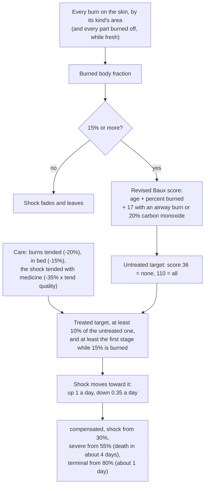

# D'thorga Medical for modders

How your own mod can work with D'thorga Medical: mark your burns, keep a drug out of automatic dosing, name what an operation
treats, add oxygen machines and patient devices, and add a kind of control line. Players start at [the mod's
README](../../mods/PhobosMedical/README.md) and [the player guide](../player-guide/medical.md). Each part's reasons are in its
design record, linked in its section. Every figure below is an authored starting value unless it says otherwise.

The health layer every part shares (who the doctors' patients are, how dangerous a condition is, what a pawn is breathing, the
per-person buttons) is D'thorga Framework's: [D'thorga Framework for modders](../framework-modding.md) and [its
record](../development/archive/phobos-framework.md#health-layer-030-6-nov-2026).

## Burns and smoke

The record: [Burns and smoke](../development/archive/burns-and-smoke.md); tox gas and acid: [caustic
gas](../development/archive/caustic-gas.md).

**Mark an injury Def as a burn** for the burned fraction with the extension this part patches onto the game's burns, and say how
its damage becomes area (the Def's own severity stays its depth): the fraction of a part one point of damage covers, and the most
of a part one such burn can cover. Fire is 0.0833 and 1; an incendiary round is 0.025 and 0.3.

```xml
<modExtensions>
  <li Class="Phobos.BurnsAndSmoke.Defs.PhobosBurnLikeExtension">
    <areaPerDamage>0.0833</areaPerDamage>
    <maxArea>1</maxArea>
  </li>
</modExtensions>
```

Balance lives in `Common/Defs/Phobos/BurnsAndSmoke/Rules.xml` (one `PhobosBurnRulesDef`, first loaded wins) and in the stage
tables of the hediff Defs. Smoke and carbon monoxide are read from D'thorga Framework's `PhobosGases`. The fire heat's peak,
radius, cap and cadence are in the same Def, as is `perCellTemperatureMods`, the list of package ids whose presence makes the fire
heat stand down; add a mod there if it models the air cell by cell.

**How burn shock is decided**, every 300 ticks for a burned pawn (figures from the rules Def, all authored starting values):



**Stages as built:** burned body fraction minor from 5%, serious from 15% (hunger, cold sensitivity, blood pumping), major from
30%, critical from 50%. Burn shock compensated, shock from 30%, severe from 55% (a four-day death clock), terminal from 80% (one
day). Carbon monoxide: headache from 10%, dizzy 20%, confused 30%, collapsed 40%, dying from 55% (a half-day clock); on room air
it halves every 5.3 hours under a roof and 3 in the open. Smoke-damaged lungs heal 4% a day untended, 16% tended well, and 6% a
day more on supplied oxygen. The fire heat's zones are rebuilt every 150 ticks, so a cell can stay hot for up to two and a half
seconds after its fire goes out.

**A worked case:** a 40-year-old with a quarter of the body burned and no inhalation injury scores 65 and heads for stage 1
untreated; the same pawn with an airway burn scores 82 and heads for the severe stage. Burns tended and in bed, the shock tended
with industrial medicine, the second settles at compensated (30% of the untreated target); with no medicine, at the shock stage.
With full care, fluids without medicine leave 55% of the untreated target, herbal 44%, industrial 30%, glitterworld 20%, for a
doctor whose tend quality stat is 1.

## Emergency dosing

The record: [Emergency dosing](../development/archive/emergency-dosing.md).

Keep an ingestible out of automatic dosing:

```xml
<modExtensions>
  <li Class="Phobos.Dosing.Defs.PhobosDosingExtension">
    <neverAutoDose>true</neverAutoDose>
  </li>
</modExtensions>
```

An ingestible is indexed when an `IngestionOutcomeDoer_GiveHediff` of its gives a condition whose stage at the dose takes away at
least 30% of the pain (through `painFactor` and a negative `painOffset`) and its score is above zero. Consciousness and breathing
offsets, consciousness `setMax`, `totalBleedFactor` and the drug comp's addictiveness and category are read from the same Defs. An
effect a mod applies from its own code, not its XML, is invisible to the index. Balance lives in
`Common/Defs/Phobos/Dosing/Rules.xml` (one `PhobosDosingRulesDef`, first loaded wins).

Score = pain relief minus half the consciousness cost (not for sedatives) minus half the breathing cost minus the bleed increase
(a quarter of it when the patient is not bleeding) minus half the addictiveness. Every figure is an authored starting value in the
rules Def.

| Need | Who | Given | Not given when |
| --- | --- | --- | --- |
| pain relief | resting, pain at or past 40% | the medical painkiller with the best score | a medical painkiller still at a quarter of a dose or more; overdose at 30% or more; a dangerous stage would be reached; consciousness or breathing would fall under 15% |
| sedation | resting, pain at or past 80%, no medical painkiller can be given | the sedative with the best score | its own last dose still working; otherwise the same |
| last resort | setting on, nothing above can be given | the recreational painkiller with the best score | the same |

## Triage

The record: [Triage](../development/archive/triage.md).

A recipe is found by its `removesHediff`, as the game's, More Injuries' and the burns part's already are. A recipe whose worker
removes a condition some other way, or one that must never be queued by the doctors on their own, says so with the extension this
part reads:

```xml
<modExtensions>
  <li Class="Phobos.Triage.Defs.PhobosTriageExtension">
    <treatsHediffs><li>MyMod_Condition</li></treatsHediffs>
    <neverAutoQueue>false</neverAutoQueue>
  </li>
</modExtensions>
```

Thresholds, bands and the bill cap live in `Common/Defs/Phobos/Triage/Rules.xml` (one `PhobosTriageRulesDef`, first loaded wins).
The per-person authority is D'thorga Framework's patient comp; the saved key is `PhobosTriage_Authority`. A mod holds surgery for
a patient (as the hyperbaric chamber does) through the Framework's `Patients.SurgeryBarred`, described in [the triage
record](../development/archive/triage.md).

| Tag | Means | Score band |
| --- | --- | --- |
| immediate | dying, and within 6 hours or with consciousness, breathing or blood pumping at 30% or less | 400 and up |
| urgent | dying, with more time; or life-threatening with no clock the part can read | 300 to 399 |
| delayed | a crippling condition, nothing killing them | 200 to 299 |
| minor | nothing classed | 100 |
| expectant | dying of something only an operation removes, and nobody here can do it | 50 |

## Medical equipment

The record: [Medical equipment](../development/archive/medical-equipment.md) and [the second
set](../development/archive/medical-equipment-2.md).

- **Oxygen machines:** give a building `Phobos.Medical.Comps.CompProperties_PhobosOxygenSupply` and `CompProperties_Facility`; add
  a `CompProperties_Refuelable` and it burns fuel. On a bed it serves its own occupant instead, and its `treatment` can name a
  stronger condition.
- **Patient devices:** give an item `Phobos.Medical.Defs.PhobosPatientDeviceExtension` (its need, the treatment condition, the
  time to use it, and whether it is used up or worked continuously), and doctors use it by themselves.
- **Device work lanes:** a WorkGiverDef using `Phobos.Medical.Jobs.WorkGiver_PhobosUseDevice` can carry
  `Phobos.Medical.Defs.PhobosDeviceWorkExtension`: `needs` limits it to some devices (none named: all), and `requireDoctorWork`
  asks that the worker also has Doctor work on. That is how the two field rescue lanes for Search and Rescue are made
  (`Mods/SearchAndRescue`), and how another mod's work type can take device work.
- **Liquid stores:** pair Vanilla Expanded Framework's resource storage comp with
  `Phobos.Medical.Comps.CompProperties_PhobosBoilOff`.
- Mark your own burn injury Def with `Phobos.Medical.Defs.PhobosBurnCareExtension` so a burn unit bed gives its patient air-cell
  care. Mark your own condition with `Phobos.Framework.Breathing.PhobosOxygenResponsiveExtension` so that it counts as needing
  oxygen. Balance lives in `Common/Defs/Phobos/Medical/Rules.xml` and on each machine's comp.

| Treatment | Breathing | Carbon monoxide half-life | Lasts |
| --- | --- | --- | --- |
| On oxygen (concentrator, stand, trolley) | +20 points, up to normal | About 75 minutes | While in the bed |
| On field oxygen (kit) | +20 points, up to normal | About 75 minutes | About an hour |
| Under hyperbaric oxygen (chamber) | +30 points, up to normal | About 22 minutes | While in the chamber |
| Hand-ventilated (resuscitator) | +30 points, up to normal | No change: it is room air | While a doctor pumps |

A bedside machine's pass runs every 250 ticks: switched on, powered or fuelled and touching a bed, it treats the patients in its
linked beds who need oxygen, worst breathing first, up to two; the treatment lapses about 10 seconds after the last pass. The
chamber is a game tier, not medical advice: the review cited in [the burns record](../development/archive/burns-and-smoke.md)
found the clinical evidence for it of low quality.

## The save bridge

The record: [The save bridge](../development/medical-save-bridge.md).

The bridge asks first (convert now, not now, or never for this save; [mod consolidation](../development/mod-consolidation.md)),
and its log lines start with [D'thorga Medical: save bridge]. It acts only while the gate is open: a mod that adds body parts is
active, and the save's own mod list does not include it.

| Step | What | Where it hooks |
| --- | --- | --- |
| Re-number | Each saved part number is translated from the old list to the new one, for every body that gained parts | The game's own hook for this, `BackCompatibility.GetBackCompatibleBodyPartIndex`, which every saved part reference passes through |
| Upgrade | An old wound or missing part is created as More Injuries' class straight away, with the bleeding state a live wound would carry; old blood loss and hypothermia get the comp-carrying class More Injuries gives them | The game's own hook for choosing a saved object's class, `BackCompatibility.GetBackCompatibleType` |
| Hold | More Injuries' first-load flag is cleared as it is set, so its clean-up finds nothing to do | More Injuries' pawn comp, reached by name |
| Report | After the load, what was done and a check of every pawn, written to the log | `Game.LoadGame` |

It never touches Medical System Expansion 2: with the wounds upgraded there is nothing for it to re-install. A mod that moves or
deletes an existing part is beyond it.

**Checking it worked.** On the first load after adding More Injuries the log shows ACTIVE, naming th3fr3d.extendedinjuries and
"Human (8 new parts)"; a load-finished line with the parts re-numbered, hediff classes upgraded and wipes prevented (equal to the
pawns with More Injuries' comp); the check of hediffs on parts newer than the save ending "none."; and no lines from More Injuries
saying "Compatibility patch removed some hediff(s)" or from MSE2 saying "Reinstalling Hediffs with wrong type". Two dev actions
help: **Medical Save Bridge: log body part indices** writes the human body's part list with each part's old number, and **Medical
Save Bridge: check every pawn's parts** repeats the after-load check.

## Radiation control

The record: [Radiation control](../development/archive/radiation-control-line.md).

The machinery is D'thorga Framework's (`Phobos.Framework.Protection`): a `ProtectionZoneDef` names a stat and how much of it is
needed, `CompProperties_PhobosControlPoint` makes a building a control point, and `Designator_PhobosProtectionArea` paints an
area. Any mod can add a kind of line in XML; the two Harmony hooks live in D'thorga Medical.

## Checks done

What was checked for each version is in the [changelog](../../mods/PhobosMedical/CHANGELOG.md). In short: every version builds for
RimWorld 1.7 and passes the repository's gate (the game-free rules' unit tests, the Defs, the text keys and the layout checks).
What the owner has passed in game, on the five former mods and on D'thorga Medical, ends [the guide's Medical
chapter](../player-guide/medical.md#tested-in-game). **Not yet tested in game:** everything else, including triage, the ventilator
and the second set of equipment, tox gas and acid, self-medication, and the field responders' use of the kits.
