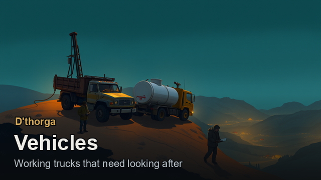
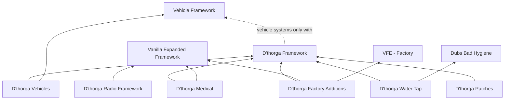

# D'thorga player guide

How to play with House D'thorga's RimWorld mods: what each one adds, what to build first, what to press, and what goes wrong
if you forget something. Also spelt **dthorga**, without the apostrophe.

This guide is for players. It says what the mods do **today**, without their history: each mod's README and changelog keep
that, and they win if this guide ever disagrees with them.

## Read this first (gotchas)

- **Nothing is on the Steam Workshop yet.** Every mod installs from source today: see [getting started](getting-started.md).
- **Most of what this guide describes is not yet tested in game.** Each chapter ends with what the owner has tried in a real
  colony and what has only been checked offline. Treat everything else as "should work".
- **RimWorld 1.7 only.** No mod here supports 1.6.
- **D'thorga Framework goes first.** Every other D'thorga mod with code needs it, loaded above them. Each mod's About file asks
  for the right order, so RimSort and the game's own sorter get it right.
- **Back up your save before adding or removing any mod.** Your saves live under AppData, which most cloud sync tools skip.
- **A few settings are best decided before you start a colony**: which vehicles get the vehicle systems, the radio's map scale,
  and whether colonists fetch their own painkillers. The list is in
  [getting started](getting-started.md#settings-to-decide-before-a-colony).
- **Every mod is safe to add to a running colony. Removing one may need a step first.** The steps are in
  [getting started](getting-started.md#removing-a-mod).

## The mods

| Mod | What it gives you | Needs | Chapter |
| --- | --- | --- | --- |
| **D'thorga Framework** | The shared library. With Vehicle Framework: vehicles with batteries, coolant, oil, tyres, brakes, wear and servicing, a workshop to keep them running, fittings and tunes, helicopter sling loads, and the diving, listening and sonar submarines use. Without it, almost nothing you would notice: smoke and carbon monoxide from fires | Nothing. Vehicle Framework for the vehicle systems | [Looking after vehicles](vehicle-care.md) |
| **D'thorga Vehicles** | Six working vehicles: the Ullage bulk tanker, Kelly drill rig, Talus tipper, Datum survey truck, Busbar generator set and Fathom seabed crawler. Real figures for other mods' vehicles | Vehicle Framework, D'thorga Framework | [Working vehicles](working-vehicles.md), [Submarines](submarines.md) |
| **D'thorga Medical** | Burns and smoke that matter, doctors who dose and operate on their own, triage tags, hospital and field equipment, radiation control with Rimatomics, and a safe way to add More Injuries to an old colony | Harmony, D'thorga Framework, Vanilla Expanded Framework; Vanilla Gravship Expanded strongly recommended | [Medical](medical.md) |
| **D'thorga Factory Additions** | More for Vanilla Furniture Expanded - Factory: belts that take from any storage, an automated fabrication bay, a deep hopper, other mods' drug lab recipes as factory bills, and fixes | Harmony, D'thorga Framework, Vanilla Expanded Framework, VFE - Factory | [Factory](factory.md) |
| **D'thorga Water Tap** | A Dubs Bad Hygiene fixture that keeps bottled water ready and refills itself | Dubs Bad Hygiene (thirst on), D'thorga Framework | [Water tap](water-tap.md) |
| **D'thorga Patches** | Fixes for other authors' mods: the Harrier VTOL, InterRim Ballistic Missile, Visit Settlements, Vehicle Framework's stuck fires and more, each switched on only with that mod | Harmony, D'thorga Framework | [Patches](patches.md) |
| **D'thorga Radio Framework** | Hand-held radios, a base station, coax and antennas on one map; a real link budget decides every contact | Vanilla Expanded Framework | [Radio](radio.md) |

How they depend on each other (an arrow means "needs"):

## Where to start

| You want to... | Read |
| --- | --- |
| Install the mods and set up a colony | [Getting started](getting-started.md) |
| Keep any mod's vehicles running: flat batteries, overheating, services, repairs, tuning | [Looking after vehicles](vehicle-care.md) |
| Find ore, drill it, haul it, move fluids and power a camp with trucks | [Working vehicles](working-vehicles.md) |
| Run a submarine: dive, hide, listen, ping, do research at sea | [Submarines](submarines.md) |
| Keep burned, gassed or badly hurt colonists alive | [Medical](medical.md) |
| Feed factory machines from any storage, make bionics automatically | [Factory](factory.md) |
| Stop colonists queuing at the basin for water bottles | [Water tap](water-tap.md) |
| Know what we fixed in another author's mod | [Patches](patches.md) |
| Talk on the radio across the map | [Radio](radio.md) |

## Words this guide uses

- **Button**: what the game calls a gizmo, the square buttons along the bottom when something is selected. Every button of ours
  says why when it is greyed out: rest the mouse on it.
- **Inspect pane**: the panel at the bottom left when something is selected. Ours always names the one thing a building or
  vehicle is waiting for.
- **Display mode**: most D'thorga mods show their workings at one of three depths, chosen in the mod settings. **Plain** shows
  bars and a reason in plain words, never a figure you must read. **Operator** adds the key figures. **Engineer** shows every figure
  and graph. The outcome is the same in every mode; only what you see changes.
- **The D'thorga research tab**: our research projects have their own tab in the research window, and submarines have
  **D'thorga: Submarines**. An existing colony that had already done the game's research a project replaced gets that project
  free, once, so you lose nothing you could already build.
- **Not yet tested in game**: built and checked offline (builds, unit tests, reading the game's code), but not yet seen working in
  a real colony.

## About the pictures

Every picture in this guide is the mods' own art: the banners from each mod's About folder, and figures drawn from the textures the
mods ship, laid out by `scripts/art/guide_figures.py` ([how](images/README.md)). The art was made with generative AI and picked by
the owner; the record beside each texture says how. A vehicle with its upgrades is a guide's view: in the game a part may sit
or move slightly differently.

## Help

[Help and troubleshooting](../../SUPPORT.md) says where the game's log is and what a useful report needs.

Community-created content. Portions of the materials used to create this content/mod are trademarks and/or copyrighted works of
Ludeon Studios Inc. All rights reserved by Ludeon. This content/mod is not official and is not endorsed by Ludeon.
