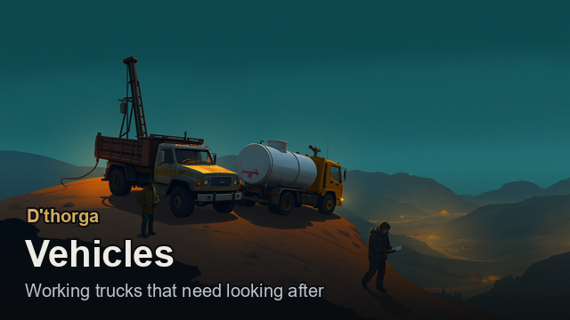
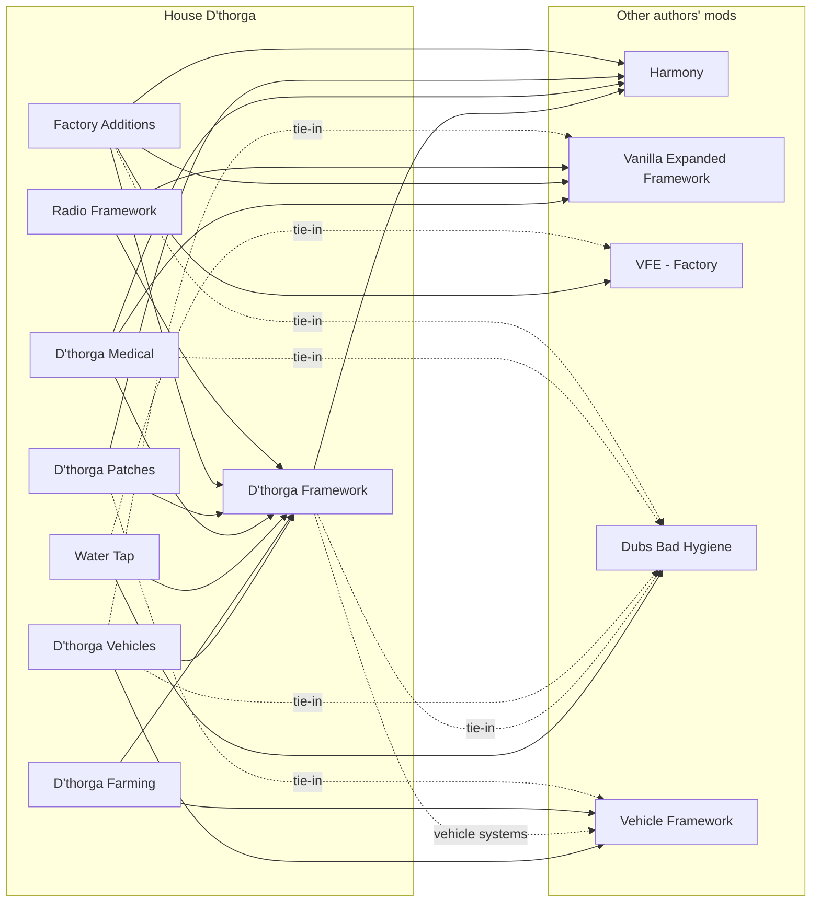

# D'thorga player guide

Start here. House D'thorga's mods for RimWorld 1.7 (also spelt **dthorga**, without the apostrophe) add vehicles that need looking
after, working trucks and trailers, burns and smoke that matter, doctors who act on their own, factory automation,
machines that work your fields, a water tap, fixes for other authors' mods, and radio. This guide says what each mod does, what to
build first, what to press and what goes wrong if you forget something, a chapter per mod. Each mod's README holds its
requirements and every setting and figure; its changelog says what changed and when.

## Read this first (gotchas)

- **Everything in this guide is not yet tested in game, unless the tested-in-game section at the end of its chapter says the
  owner passed it.** Not yet tested means built and checked offline (builds, unit tests, reading the game's code), but not yet
  seen working in a real colony. Treat it as "should work".
- **Nothing is on the Steam Workshop yet.** Every mod installs from source today: see [getting started](getting-started.md).
- **RimWorld 1.7 only.** No mod here supports 1.6.
- **D'thorga Framework goes first.** Every other D'thorga mod needs it, loaded above them. Each mod's About file asks for the
  right order, so RimSort and the game's own sorter get it right.
- **Back up your save before adding or removing any mod.** Your saves live under AppData, which most cloud sync tools skip.
- **A few settings are best decided before you start a colony**: which vehicles get the vehicle systems, the radio's map scale,
  and whether colonists fetch their own painkillers. The list is in
  [getting started](getting-started.md#settings-to-decide-before-a-colony).
- **Every mod is safe to add to a running colony. Removing one may need a step first.** The steps are in
  [getting started](getting-started.md#removing-a-mod).

## The mods

Eight mods. **Needs** is what must be switched on with it, or the mod does not work.

| Mod | What it does | Needs | Chapter |
| --- | --- | --- | --- |
| [D'thorga Framework] | The shared library; with Vehicle Framework, every vehicle needs looking after | Harmony | [Vehicle care], [Camping] |
| [D'thorga Vehicles] | Working trucks, trailers and the V-22 Osprey; real figures for other mods' vehicles | VF, D'thorga Framework | [Working vehicles] |
| [D'thorga Medical] | Burns and smoke, doctors who act on their own, hospital kit, radiation control | Harmony, D'thorga Framework, VEF | [Medical] |
| [D'thorga Factory Additions] | Belts from any storage, an automated fabrication bay, new bills | Harmony, D'thorga Framework, VEF, VFE - Factory | [Factory] |
| [D'thorga Patches] | Fixes and honest costs for other authors' mods, each only while that mod is on | Harmony, D'thorga Framework | [Patches] |
| [D'thorga Farming] | Paddocks that tractors plough and sow, a combine that harvests them, a chaser bin for the grain | VF, D'thorga Framework | [Farming] |
| [D'thorga Water Tap] | Bottled water kept ready, refilled from your water towers | D'thorga Framework, Dubs Bad Hygiene | [Water tap] |
| [D'thorga Radio Framework] | Hand-held radios and a base station; distance, walls and hills decide if calls get through | D'thorga Framework, VEF | [Radio] |

VF is Vehicle Framework, VEF Vanilla Expanded Framework and VFE - Factory Vanilla Furniture Expanded - Factory. **The full
list of what each mod needs, loads after and works with** is [in getting started](getting-started.md#what-each-mod-needs), made
from each mod's own files so it is always current. Version numbers are in [the version list](../README.md#mod-versions).

How the mods depend on other authors' mods, and on one another (read from each mod's About file):

A solid arrow means "needs, loaded before it"; a dotted one is an optional tie-in that switches on only while that mod is active.
Other optional tie-ins (More Injuries, Combat Extended, Vanilla Gravship Expanded, the mods D'thorga Patches fixes, and more) work
the same way; each mod's README lists its own.

[D'thorga Framework]: ../../mods/PhobosFramework/README.md
[D'thorga Vehicles]: ../../mods/PhobosVehicles/README.md
[D'thorga Medical]: ../../mods/PhobosMedical/README.md
[D'thorga Factory Additions]: ../../mods/PhobosFactoryAdditions/README.md
[D'thorga Patches]: ../../mods/PhobosPatches/README.md
[D'thorga Farming]: ../../mods/PhobosFarming/README.md
[D'thorga Water Tap]: ../../mods/PhobosWaterTap/README.md
[D'thorga Radio Framework]: ../../mods/PhobosRadioFramework/README.md
[Vehicle care]: vehicle-care.md
[Camping]: camping.md
[Working vehicles]: working-vehicles.md
[Medical]: medical.md
[Factory]: factory.md
[Patches]: patches.md
[Farming]: farming.md
[Water tap]: water-tap.md
[Radio]: radio.md

## Chapters

| Chapter | Mod or area | What it covers |
| --- | --- | --- |
| [Getting started](getting-started.md) | Every mod | Installing, load order, settings to decide first, research, adding and removing a mod |
| [Looking after vehicles](vehicle-care.md) | D'thorga Framework, with VF | Any mod's vehicles: flat batteries, overheating, service, repairs, tuning |
| [Camping and life on the road](camping.md) | D'thorga Framework and Vehicles | Tents, berths, camp gear, water, lights and the kitchen on a long trip |
| [Working vehicles](working-vehicles.md) | D'thorga Vehicles | Trucks and trailers that find ore, drill and haul it, move fluids and power a camp |
| [Submarines](submarines.md) | D'thorga Vehicles and D'thorga Framework | Running a submarine: dive, hide, listen, ping, do research at sea |
| [Medical](medical.md) | D'thorga Medical | Keeping burned, gassed or badly hurt colonists alive, triage and hospital equipment |
| [Factory](factory.md) | D'thorga Factory Additions | Feeding factory machines from any storage and making bionics automatically |
| [Farming](farming.md) | D'thorga Farming | A combine that harvests a paddock row by row, and a chaser bin for its grain |
| [Water tap](water-tap.md) | D'thorga Water Tap | Bottled water kept ready, so nobody queues at the basin |
| [Patches](patches.md) | D'thorga Patches | What we fixed in other authors' mods, and what it changes for you |
| [Radio](radio.md) | D'thorga Radio Framework | Talking on the radio across the map |

## Words this guide uses

- **Button**: what the game calls a gizmo, the square buttons along the bottom when something is selected. Every button of ours
  says why when it is greyed out: rest the mouse on it.
- **Inspect pane**: the panel at the bottom left when something is selected. Ours always names the one thing a building or
  vehicle is waiting for.
- **Display mode**: most D'thorga mods show their workings at one of three depths, chosen in the mod settings. **Plain** shows
  bars and a reason in plain words, never a figure you must read. **Operator** adds the key figures. **Engineer** shows every
  figure and graph. The outcome is the same in every mode; only what you see changes.
- **The D'thorga research tab**: our research projects have their own tab in the research window, and submarines have
  **D'thorga: Submarines** (set aside for now: it shows only in a colony that has already researched some of it). An existing
  colony that had already done the game's research a project replaced gets that project free, once, so you lose nothing you could
  already build.
- **Not yet tested in game**: built and checked offline (builds, unit tests, reading the game's code), but not yet seen working in
  a real colony.

## About the pictures

Every picture in this guide is the mods' own art: the banners from each mod's About folder, and figures drawn from the textures
the mods ship, laid out by `scripts/art/guide_figures.py` ([how](images/README.md)). The art was made with generative AI and
picked by the owner; the record beside each texture says how. A vehicle with its upgrades is a guide's view: in the game a part
may sit or move slightly differently.

## Help

[Help and troubleshooting](../../SUPPORT.md) says where the game's log is and what a useful report needs.

Community-created content. Portions of the materials used to create this content/mod are trademarks and/or copyrighted works of
Ludeon Studios Inc. All rights reserved by Ludeon. This content/mod is not official and is not endorsed by Ludeon.
