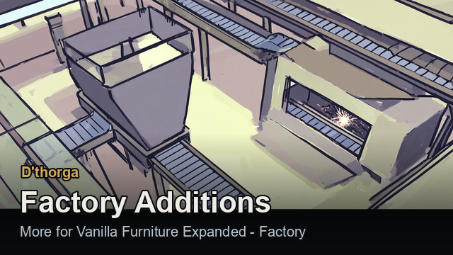
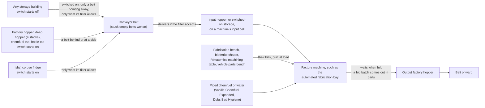

# Factory

**D'thorga Factory Additions** adds to **Vanilla Furniture Expanded - Factory**: belts that take from any storage, a machine that
makes bionics and spacer gear by itself, a deeper hopper, fixes for machines that ate their own output, piped water for the conveyor
oven, and other mods' drug lab recipes as factory bills. [Back to the guide](README.md).

## Read this first (gotchas)

- **Needs Harmony, D'thorga Framework, Vanilla Expanded Framework and VFE - Factory**, loaded before it.
- **A machine draws only from its three input cells, and nobody stocks them for it.** Pawns never carry ingredients to a machine
  that feeds from hoppers, and a hopper at its default **Low** priority is never stocked from better storage. **Feed an ingredient
  by belt, or raise the input hoppers' priority** (Critical works) so colonists fill them. A bill reads "Missing inputs" until fed.
- **Tick the ingredient in the hopper's storage filter.**
- **Machines wait when their output hopper is full**, instead of destroying the batch. They may sit idle where they used to eat
  inputs silently: **run a belt out of every output hopper.**
- **With Dubs Bad Hygiene, the conveyor oven's wet bills need water**: a pipe touching the oven, reaching a water tower. Turn it off
  under Options, Mod settings, D'thorga Factory Additions.
- **Partly tested in game**: see [the last section](#what-has-been-tested-in-game).

How belts, hoppers and machines connect:

## Belts that take from any storage

VFE Factory's belts normally pull only from factory hoppers. With this mod:

1. **Select a shelf, pallet, fridge or any mod's storage building** and click **Belts may take from here** (the belt icon). It
   starts **off** on every storage, including what you have already built. Select several to switch them together; a message says
   what changed, and the inspect text says "Belts may take from here."
2. **Build a belt on a cell next to it, with its arrow pointing away.** Only a belt pointing straight away takes; belts that run past
   leave it alone.
3. The belt takes **one whole stack at a time**, and **only what the storage's own filter allows**, whatever the belt's own filter
   says. If a belt ignores something, tick it in that storage's filter.

| Where switched-on storage is | What happens |
| --- | --- |
| **Directly behind a belt** (the belt points away from it) | The belt takes one whole stack at a time, the first the storage's filter allows, whenever it has room. It goes before a factory hopper at the belt's side |
| **At a belt's side** (the belt runs past it) | Nothing: belts can run along storage |
| **In front of a belt** (the belt points into it) | The belt delivers into it, if its filter accepts the item |
| **On a factory machine's input cell** | The machine takes ingredients from it. Storage holding several stacks on one cell (most Adaptive Storage shelves) works like a deep factory hopper |
| **On a factory machine's output cell** | Nothing changes: machines put finished goods only into factory hoppers |

- **Which buildings get the switch:** every storage building whose items lie on its cells, about 150 types on a large mod list:
  vanilla shelves, VFE furniture, Vanilla Gravship Expanded, The Dead Man's Switch, **Rimefeller's refinery unloading bays**, and
  every Adaptive Storage building ([sbz] mods, Warehouse Storage, Cargo Holds and others). Graves, sarcophagi, growth vats,
  biosculpter pods, outfit stands, bookcases and sealed crates keep their contents inside, where belts can't reach. The startup log
  says how many got it.
- **Don't point a belt back into storage it takes from**, or items go round for ever.
- **Rimefeller under Combat Extended:** an unloading bay can hold FSX but a new bay's filter doesn't tick it. If a belt leaves the
  FSX, tick it in the bay's filter.
- A belt beside switched-on storage looks for a stack every 10 ticks, so it runs a little slower than one fed from a hopper.
  Storage with the switch off costs nothing.

### Factory hoppers: the same switch, starting on

Hoppers, deep hoppers, the chemfuel taps, the corpse fridge and D'thorga Water Tap's bottle tap already feed belts, so their switch
**starts on**; turn it off to stop belts taking from that one. The switch is per hopper, even in a linked group.

| With the switch off on a hopper | What happens |
| --- | --- |
| A belt with it directly behind or at its side | Takes nothing, and carries on with anything else it can reach |
| A belt pointing into it | Delivers as usual, if the hopper's filter accepts the item |
| A factory machine with an input cell on it | Takes ingredients as usual |
| A factory machine with its output cell on it | Puts finished goods there as usual; nothing takes them away by belt, so **the machine waits once the hopper is full** |
| Colonists | Take from it under VFE Factory's own **Allow taking** |

Handy where a belt delivers into a machine's input hopper and another belt runs past it: switched off, the hopper keeps what it was
given. Hoppers and chemfuel taps hand belts whatever is on them, whatever their filter says.

### Stuck belts, and the corpse fridge

- **Stuck belts start again by themselves.** A VFE Factory belt could stick empty and never move again, even after a reload; now it
  wakes, and the log says where ("Woke a stuck conveyor at ...", up to 10 a session). **A belt holding an item the storage ahead
  refuses still waits**: right-click it with a colonist and pick **Haul from conveyor**.
- **With "[sbz] Fridge"**, the corpse fridge (Architect, Temperature) counts as a factory hopper: a belt behind it or at either side
  pulls one corpse at a time whenever it has room, and an automated mincer whose input cell lands on the fridge takes corpses straight
  from it. It hands out only what the fridge's filter allows, so a stray item stays for your haulers. **A belt touching the fridge
  empties it**: keep other belts away from its four cells, or switch **Belts may take from here** off on the fridge.
- **With Vanilla Chemfuel Expanded**, the chemfuel tap works as a factory hopper (a belt touching it pulls chemfuel; a machine whose
  input cell sits on it takes chemfuel directly), and the refinery's astrofuel bill runs on piped chemfuel, even with Combat Extended
  and Vanilla Factions Expanded - Deserters active, whose clash had switched both off.

## Machines and their output

- **A full output hopper makes the machine wait** and say "Output factory hopper too full", instead of destroying the batch or part
  of it. **Run a belt out of each output hopper.** A different item sitting in it blocks it too.
- **Bills with no output limit drop a batch beside the machine** when it doesn't fit (VFE's stock neutroamine bill, Kimoju's drill and
  neutroamine bills): Pipe System's own fallback.
- **A batch bigger than one stack comes out in parts.** A corpse gives its meat once: 140 for a human, 301 for a grizzly, put down as
  the hopper makes room; the mincer takes the next corpse only when the last one's meat is all out. **A line that lived on endless
  meat from one corpse now needs real corpses.**

| Corpse | Meat | Stacks of 75 | Fits one hopper? | Fits a deep factory hopper (300)? |
| --- | --- | --- | --- | --- |
| Hare | 28 | 1 | Yes | Yes |
| Human | 140 | 2 | No, comes out in parts | Yes |
| Grizzly bear | 301 | 5 | No, comes out in parts | No, by 1: comes out in parts |

- **A bill whose recipe changed brings itself up to date** after an update: it is rebuilt the first time it ticks after a load (or
  when it finishes its batch), what it had counted is set down beside the machine, and a message says so.
- **A bill whose recipe no longer exists** (another mod stopped defining it) is set aside with its settings, and comes back with a
  message at the next load where the recipe exists again.
- The "max N units" in the too-full message is the bill's limit in Vanilla Expanded's wording, not what the hopper holds.

## The automated fabrication bay

Makes what a **fabrication bench** makes (bionics and other artificial parts, spacer weapons and armour), and with Anomaly or Dubs
Rimatomics what a **bioferrite shaper** or a **Rimatomics machining table** makes. With Vehicle Framework, it also makes what the
**vehicle parts bench** makes: kits and assemblies for services and fittings.

- **Research Complex factories and Fabrication.** It is under Architect, Factories, and must stand on factory floor. It costs **300
  steel, 150 plasteel, 12 components and 10 advanced components**, 7,000 work (the machining bay: 440 steel, 18 components, 5 advanced
  components). Everything else is the machining bay's: size, three input cells behind and beside it, output in front, power, heat,
  overclocking, piped chemfuel.
- **It looks exactly like the automated machining bay** until it has art of its own. Select it to tell them apart.
- **A bill appears only once its bench recipe is unlocked**: the bench's research plus the item's own, Ideology memes, Rimatomics' own
  research. Until then it is not in the Add process menu.
- **Each bill is the item's own recipe**: its cost as ingredients (an item made of a material takes **steel** for metal, any
  **textile** for fabric, any **leather** for leather), four times the bench's work, no skill, always **normal quality**. Chemfuel
  comes from the pipes with Vanilla Chemfuel Expanded.
- **Not automated:** anything a machine already makes, buildings, and items made of a material plus parts (Pandora's Exopack and
  helmets, Anomaly's ceremonial hood): those could come out made of components. The startup log names every item skipped and how many
  bills each bench gave.
- **Many spacer items need four to six ingredients** and the bay has three input cells. Use **deep factory hoppers** on the input
  cells.
- **Bionics, weapons and armour leave one at a time**: the bay waits while an identical item is still in the output hopper ("Output
  factory hopper too full (max 1 units)"). **Run a belt out of the output hopper.**

| Bench it takes over | Needs | Bills on a large mod list |
| --- | --- | --- |
| Fabrication bench | always | about 135: bionic and other artificial parts (vanilla, Royalty, Biotech, Odyssey, MSE2, Glittertech, Dubs Bad Hygiene), spacer guns, armour and helmets |
| Bioferrite shaper | Anomaly | about 18: ghoul parts, bioferrite guns, shard lances, ritual mask |
| Rimatomics machining table | Dubs Rimatomics | 27: reactor and weapon upgrade parts, warheads, sabot rounds, MOPP and radiation suits |
| Vehicle parts bench | Vehicle Framework | every part, kits and assemblies included |

## The deep factory hopper

A factory hopper that holds **four stacks** on its one cell, so one hopper can feed several ingredients: a belt carrying mixed
ingredients no longer jams it. **35 steel and 1 component**, 800 work, under Architect, Factories, beside the ordinary hopper (Basic
factories). **It looks exactly like the ordinary one**; select it to tell. It starts at **Low** priority like every hopper, and can
share a storage group with ordinary ones.

| Use | What to expect |
| --- | --- |
| **Input**, fed by one belt with mixed ingredients | The belt fills it until all four places hold something; the machine takes what it needs from any of them |
| **Input**, filled by haulers | Tick every ingredient in its filter and raise its priority |
| **Output** of items that don't stack (weapons, bionics, armour) | Holds up to four **different** finished items; an identical one waits until the first is taken away |
| **Output** of items that stack | As an ordinary hopper: the batch waits once that stack reaches the bill's cap |

For the machining or fabrication bay (three input cells, up to four solid ingredients plus chemfuel), put deep hoppers on the input
cells; chemfuel needs no hopper with Vanilla Chemfuel Expanded.

## Hoppers shared with The Dead Man's Switch

With **The Dead Man's Switch** active (0.14.0), each mod's hoppers feed the other's machines:

- **A factory hopper or deep factory hopper within 6 cells of its automatic benches** (auto mill, furnace, reaction chamber, machine
  printer) links to them like its own feed hopper, so **a belt can fill a hopper that such a bench draws from with no colonist**. Its
  plain benches may link too, which does nothing.
- **Its feed hopper is a factory hopper**: a belt pointing away from it takes what its storage settings allow, and a VFE Factory
  machine's input cell on it reads it, so its chunks can feed the **automated masonry saw** and **smelter**. Belts and machines take
  from it whether or not its auger has power; its own benches still need power.

**A whole chunk line** (not yet tested in game): a Talus tips chunks into a **bulk bunker** (D'thorga Vehicles, see
[the tipper](working-vehicles.md#talus-tipper-truck)); a belt pointing away from the bunker carries them one at a time to a masonry
saw's input hopper. A truckload is about **ten days' work for one saw** (6,400 ticks a chunk), so build two or three saws off the same
belt, or let the bunker hold the load while one saw works through it.

## New bills

Each appears in a machine's **Processes** tab (**Add process**) once its research is done, Complex factories (granulator,
synthesizer) or Basic factories (refinery, oven) as well. Values are each mod's lab recipe scaled the way VFE Factory scales its own:
a **batch of four**, four times the lab's work per unit, no skill.

- **Some outputs stack small** (hemogen packs to 10, vaccines and antiserums to 15, medicine to 25): empty the output hopper.
- **Glitterworld medicine needs five input hoppers**: the usual three plus the two behind the granulator's corners. If the corner
  cells don't light up as input slots, feed the fourth ingredient by belt into one of the three.
- **The infusions need both Deep Pills and Medicines+.** A reproduction pill bill makes one pill at a time, one sample per hopper cell.

### Neutroamine

| Bill | Inputs | Output | Time | Who adds it |
| --- | --- | --- | --- | --- |
| Synthesize neutroamine | 20 raw **animal** meat + 3 chemfuel | 5 | 4,800 ticks | VFE Factory; **this mod stops it taking human meat** |
| **Synthesize neutroamine from human meat** | 20 human meat + 3 chemfuel | **6** | 4,800 ticks | **This mod** |
| Synthesize neutroamine from insect meat | 30 insect meat + 5 chemfuel | 10 | 4,800 ticks | Kimoju's "VFE Factories: Buffs and tweaks" |
| Synthesize neutroamine from fish meat | 4 fish + 3 chemfuel | 5 | 4,800 ticks | Kimoju's mod, with Odyssey |
| **Synthesize neutroamine from neutroaleaves** | 25 neutroaleaves | 5 | 5,000 ticks | **This mod**, with Farmable Neutroamine |

Human meat comes from VFE Factory's automated mincer ("Mince human corpses") or a butcher table. **No Ideology thought fires**:
rendering fat for chemistry is not eating. The yield of 6 is an authored nod to how much fattier a human body is than lean game meat.
Human meat already in a hopper for the stock bill stays there until you add the human-meat bill or move it. With Vanilla Chemfuel
Expanded the chemfuel can come from the pipes.

### Medicine from synthread

The granulator's **Make batch of medicine from synthread** takes **12 synthread, 4 neutroamine and 4 herbal medicine** for 4
medicine, 11,200 ticks: the stock bill with synthread in place of cloth, so medicine needs no cotton, which grows only in the warm
months. Same research (**Medicine production**, **Complex factories**). Give the granulator **one input hopper each for synthread,
neutroamine and herbal medicine**.

- **You lose value either way, more with synthread** (inputs worth 112 silver against cotton's 82, for 72 silver of medicine): it's
  for a steady supply, not for selling.
- **Synthread:** Rimefeller's synthread refiner makes 1 from 3 chemfuel, about 167 a day while a colonist mans a resource console with
  a synthread bill. One granulator at base speed uses about 64 a day. Switch the refiner's unloading bay on with **Belts may take from
  here** and run a belt to the synthread hopper.
- **Herbal medicine is seasonal too**, but healroot grows in hydroponics basins (sowing needs Plants 8).

### Soup on the conveyor oven (Vanilla Cooking Expanded)

**Cook simple soup** puts finished soup in the output hopper, with no pot and no colonist. Remove **Prepare simple soup** and add it;
needs **Soup cooking** and **Basic factories**. **Tick "simple soup" in the filter of any storage a belt carries it into**, or the
belt waits for ever, and clear any uncooked soup out of the output hopper first.

| Route | Raw food | Makes | Nutrition out | Time |
| --- | --- | --- | --- | --- |
| Cook simple soup (this bill) | 20 meat, 20 plant food | 5 soups | 4.0 | 6,000 ticks |
| Mass-produced meals, for comparison | 20 meat, 20 plant food | 4 meals | 3.6 | 4,800 ticks |
| Bench and pot, by hand | about 80 units (4 nutrition) | 10 soups | 8.0 | 2 days in the pot |
| Stock oven bill and pot | 40 meat, 40 plant food | 10 soups | 8.0 | 4,800 ticks, then 2 days in the pot |
| Stock oven bill and cannery | 40 meat, 40 plant food, 1 steel | 10 canned soups | 9.0 | 4,800 ticks, then 15,200 ticks |

**The stock Prepare simple soup makes 1 uncooked soup a batch** (VFE Factory's formula gave 8, sixteen times the food in), and a pot
still turns it into 10. **A cannery needs about three ovens to stay busy**, and steel.

### Drug lab recipes on the medicine granulator

**Medicines+** (15 bills):

| Bill | Inputs | Output | Time (ticks) | Research |
| --- | --- | --- | --- | --- |
| aniracetam | 12 neutroamine, 4 medicine | 4 | 16000 | Advanced utility medicine |
| AntiTox | 12 neutroamine, 8 herbal medicine | 4 | 12800 | Basic utility medicine |
| clozapine | 8 neutroamine, 20 smokeleaf leaves | 4 | 12800 | Basic utility medicine |
| cyanide | 4 neutroamine | 4 | 6400 | Medicine basics |
| heroin | 8 crimson bulbs, 8 morphine, 4 neutroamine | 4 | 28800 | Advanced profit drugs |
| hydra | 8 crimson bulbs, 4 neutroamine | 4 | 19200 | Crimson bulb refining |
| Joy | 4 ambrosia, 40 raw fungus, 4 neutroamine | 4 | 9600 | Advanced profit drugs |
| addictol | 12 neutroamine, 20 chemfuel | 4 | 16000 | Advanced profit drugs |
| morphine | 20 opium, 20 psychoid leaves | 4 | 16000 | Basic utility medicine |
| penicillin | 4 neutroamine, 4 herbal medicine | 4 | 8000 | Basic utility medicine |
| **penicillin from fungus** (this mod's own) | 40 raw fungus, 4 neutroamine | 4 | 8000 | Basic utility medicine |
| smelling salts | 4 psychoid leaves, 4 neutroamine | 4 | 12800 | none |
| ThornWeed serum | 20 ThornWeed needles, 20 steel, 4 neutroamine | 4 | 14400 | Advanced utility medicine |
| Tyrox | 8 neutroamine, 4 penicillin, 4 crimson bulbs | 4 | 22400 | Advanced utility medicine |
| Upper | 40 psychoid leaves, 12 neutroamine | 4 | 14400 | Basic profit drugs |

**Deep Pills infusions** (with Medicines+; batch of eight, no research): peyote infusion (32 peyote fruits to 8 peyote), opium
infusion (32 opium poppies to 8 opium), thorn weed infusion (32 thorns of weed to 8 ThornWeed needles), 4,000 ticks each.

**Ushankas Biological Warfare** (16 bills, for flu, wound infection, malaria, necroa, plague, scaria and sleeping sickness):

| Bill | Inputs | Output | Time (ticks) | Research |
| --- | --- | --- | --- | --- |
| each vaccine | 100 pathogen, 32 neutroamine, 4 penoxycyline | 4 | 41600 | that disease's vaccine project |
| each antiserum | 100 pathogen, 24 neutroamine, 4 glitterworld medicine | 4 | 28800 | that disease's vaccine project |
| malaria pills, sleeping sickness pills | 1 sample, 6 neutroamine | 1 | 2400 | Pathogen production |

Pathogen samples, the disease sampler and flesh-breaker stay at the drug lab.

**Singles:**

| Bill | Mod | Inputs | Output | Time (ticks) | Research |
| --- | --- | --- | --- | --- | --- |
| psycho | Combat Extended | 64 psychoid leaves | 4 | 9600 | none |
| potassium iodide | Dubs Rimatomics | 12 neutroamine | 4 | 8000 | Penoxycyline production |
| hemogen from hemofungus | Hemofungus (Biotech) | 60 hemofungus | 4 hemogen packs | 6400 | Deathrest |
| vacsop from steel | Complementary Odyssey | 4 vacdew, 20 steel | 4 | 9600 | Drug production |
| vacsop from vacstone | Complementary Odyssey | 4 vacdew, 20 vacstone blocks | 4 | 9600 | Drug production |
| glitterworld medicine | Glitterworld Medicine Production | 20 synthread, 4 components, 16 plasteel, 4 medicine | 4 | 28800 | Glitterworld medicine production |

With Vanilla Races Expanded - Android, the granulator bills that take neutroamine can draw it from that mod's neutroamine network.

### Chemistry on the automated biofuel refinery

| Bill | Mod | Inputs | Output | Time (ticks) | Research |
| --- | --- | --- | --- | --- | --- |
| polyamide | Passive Exoskeletons | 75 chemfuel, 8 plasteel | 25 | 24000 | Biofuel refining, Drug production |
| laundry detergent | Simple Washing Machine | 100 chemfuel, 4 neutroamine | 12 | 24000 | Sterile materials |
| heavy-duty laundry detergent | Simple Washing Machine | 100 chemfuel, 12 neutroamine | 12 | 32000 | Sterile materials |

With Vanilla Chemfuel Expanded these draw their chemfuel from the pipes, as the refinery's stock bills do.

## Piped water and food poisoning (Dubs Bad Hygiene)

The conveyor oven's wet bills use water from your plumbing as they work. **The oven has its own pipes beneath it: run a pipe that
touches any side, connected to a water tower**, and a run can pass through. With no water the oven pauses, keeps its batch and still
uses power; its inspect text says what is missing. Both options are under **Options, Mod settings, D'thorga Factory Additions**.

| Bill | Water a batch | A day at base speed | A batch made with contaminated water |
| --- | --- | --- | --- |
| Cook simple soup | 20 L | 200 L | 25% chance of food poisoning |
| Make mass-produced meals | 10 L | 125 L | 25% chance of food poisoning |
| Prepare simple soup (uncooked) | 40 L | 500 L | No effect: uncooked soup can't carry it, and a pot starts fresh |
| Make baby food | 2 L | about 67 L | No effect |
| Make pumpkin spice coffee | 10 L | 150 L | No effect |

- Kibble, pemmican and survival meals need no water. For scale, a shower uses 50 L and a bath 190 L. Overclocking uses more water a
  day but the same a batch. The figures are authored.
- **Treated and untreated water are safe**, because these bills cook the food (a simplification). **Contaminated water** gives a batch
  made entirely with it a 25% chance of food poisoning; half its water, 12.5%. It is the game's own food poisoning, blended through
  the stack, times your storyteller's setting, and the game's message names contaminated water.
- **Nothing on the food warns you**: watch Dubs Bad Hygiene's contaminated tower alert and the oven's inspect text.
- Dubs Bad Hygiene's **lite mode** has no plumbing, so bills need no water there. Food already poisoned stays poisoned.

## Where to find things

- Machines are under Architect, Factories (Basic factories, Complex factories). Open a machine's **Processes** tab and click **Add
  process**; bills whose research is not done are not listed yet.
- The **deep factory hopper** sits beside the factory hopper; the **automated fabrication bay** beside the machining bay.
- The **Belts may take from here** switch is among a storage building's buttons when you select it (only on your own storage).
- The **corpse fridge** is under Architect, Temperature, after Air conditioning ("[sbz] Fridge").

## What has been tested in game

- **Tested by the owner:** the human-meat bill (28 October 2026); the drug lab bills appearing on their machines (29 October 2026);
  belts taking from switched-on storage, only when pointing away (29 and 30 October 2026: "The fix works brilliantly"); a bill with
  no recipe taken off the ammunition press (10 November 2026).
- **Not yet tested in game:** the fabrication bay, the output fix, the deep hopper, the hopper switch, piped water, the synthread and
  soup bills, the corpse fridge, and running each new bill to the end.

The settings and the links for modders are in [D'thorga Factory Additions' README](../../mods/PhobosFactoryAdditions/README.md).
