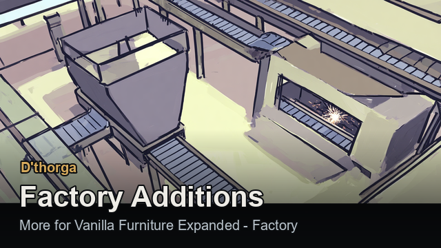

# Factory

**D'thorga Factory Additions** adds to **Vanilla Furniture Expanded - Factory**: belts that take from any storage, a machine that
makes bionics and spacer gear by itself, a deeper hopper, fixes for machines that ate their own output, and other mods' drug lab
recipes as factory bills. [Back to the guide](README.md).

## Read this first (gotchas)

- **Needs Harmony, D'thorga Framework, Vanilla Expanded Framework and VFE - Factory**, loaded before it.
- **A machine draws only from its three input cells, and nobody stocks them for it.** Pawns never carry ingredients to a machine
  that feeds from hoppers, and a hopper at its default **Low** priority is never stocked from better storage. **Feed an ingredient
  by belt, or raise the input hoppers' priority** (Critical works) so colonists fill them. A bill reads "Missing inputs" until fed.
- **Tick the ingredient in the hopper's storage filter.**
- **Machines now wait when their output hopper is full**, instead of destroying the batch. They may sit idle where they used to eat
  inputs silently: **run a belt out of every output hopper.**
- **With Dubs Bad Hygiene, the conveyor oven's wet bills need water**: a pipe under the oven or against its side reaching a water
  tower. Turn it off under Options, Mod settings, D'thorga Factory Additions.
- **Partly tested in game**: see [the last section](#what-has-been-tested-in-game).

## Belts that take from any storage

VFE Factory's belts normally pull only from factory hoppers. With this mod:

1. **Select a shelf, pallet, fridge or any mod's storage building** and click **Belts may take from here** (the belt icon). It
   starts **off** on every storage, including what you have already built.
2. **Build a belt on a cell next to it, with its arrow pointing away.** Only a belt pointing straight away takes; belts that run past
   leave it alone.
3. The belt takes **one whole stack at a time**, and **only what the storage's own filter allows**. If a belt ignores something,
   tick it in that storage's filter.

- **Factory hoppers have the same switch, starting on.** Turn it off and no belt takes from that hopper; belts can still deliver
  into it, and machines and colonists still take from it.
- **Don't point a belt back into storage it takes from**, or items go round for ever.
- **Stuck belts start again by themselves.** A belt holding an item the storage ahead refuses still waits: right-click it with a
  colonist and pick **Haul from conveyor**.
- **With "[sbz] Fridge"**, the corpse fridge feeds belts and the automated mincer directly, by its filter.

## The automated fabrication bay

Makes what a fabrication bench makes (bionics and other artificial parts, spacer weapons and armour), and with Anomaly or Dubs
Rimatomics what a bioferrite shaper or a Rimatomics machining table makes. With Vehicle Framework, it also makes what the **vehicle
parts bench** makes: kits and assemblies for services and fittings.

- **Research Complex factories and Fabrication.** It is under Architect, Factories, and must stand on factory floor.
- **It looks exactly like the automated machining bay** until it has art of its own. Select it to tell them apart.
- **A bill appears only once its bench recipe is unlocked**: the item's research, Ideology memes, Rimatomics' own research.
- **Many spacer items need four to six ingredients** and the bay has three input cells. Use **deep factory hoppers** on the input
  cells, and pipe chemfuel in with Vanilla Chemfuel Expanded.
- **Bionics, weapons and armour leave one at a time**: the bay waits while an identical item is still in the output hopper ("Output
  factory hopper too full"). **Run a belt out of the output hopper.**

## The deep factory hopper

A factory hopper that holds **four stacks** on its one cell: one stack of each of four ingredients, so a belt carrying mixed
ingredients no longer jams it. 35 steel and 1 component, under Architect, Factories, beside the ordinary hopper. **It looks exactly
like the ordinary one**; select it to tell. It starts at **Low** priority like every hopper.

## New bills

Each appears in a machine's **Processes** tab (**Add process**) once its research is done.

| Machine | Bill | Needs |
| --- | --- | --- |
| Neutroamine synthesizer | **Synthesize neutroamine from human meat** | Human meat from the automated mincer or a butcher table. The stock bill stops taking human meat |
| Medicine granulator | **Make batch of medicine from synthread**: 12 synthread, 4 neutroamine, 4 herbal medicine for 4 medicine | Medicine production, Complex factories. For a steady supply, not for selling |
| Conveyor oven | **Cook simple soup**: 20 raw meat and 20 raw plant food for 5 ready-to-eat soups | Vanilla Cooking Expanded; Soup cooking, Basic factories. **Tick "simple soup" in the filter of any storage the belt carries it into** |
| Medicine granulator | Other mods' drug lab recipes, in batches of four: Medicines+, Deep Pills, Ushankas Biological Warfare, Combat Extended, Dubs Rimatomics, Hemofungus, Complementary Odyssey, Glitterworld Medicine Production, Farmable Neutroamine | Each mod's own research plus Complex factories |
| Automated biofuel refinery | Polyamide (Passive Exoskeletons), laundry detergents (Simple Washing Machine) | Their own research |

- **Some outputs stack small** (hemogen packs to 10, vaccines to 15, medicine to 25): empty the output hopper.
- **Glitterworld medicine needs five input hoppers**: the usual three plus the two behind the granulator's corners.
- **A corpse gives its meat once.** A line that lived on endless meat from one corpse now needs real corpses.

## What has been tested in game

- **Tested by the owner:** the human-meat bill (28 October 2026); the drug lab bills appearing on their machines (29 October
  2026); belts taking from switched-on storage, only when pointing away (29 and 30 October 2026: "The fix works brilliantly").
- **Not yet tested in game:** the fabrication bay, the output fix, the deep hopper, the hopper switch, piped water, the synthread and
  soup bills, the corpse fridge, and running each new bill to the end.

Every bill's figures are in [D'thorga Factory Additions' README](../../mods/PhobosFactoryAdditions/README.md).
