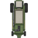

# Farming

**D'thorga Farming** adds machines that work your fields: mark a growing zone as a paddock, and tractors plough and sow it while a
combine harvester cuts it, row by row by themselves, emptying its grain into a chaser bin. [Back to the guide](README.md).

## Read this first (gotchas)

- **Needs Vehicle Framework and D'thorga Framework.**
- **A combine has no front until you fit one**, and refuses to harvest without it. Fit the **standard grain front** from its upgrades.
- **Tractors carry or pull an implement; they do nothing alone**, and an implement or a cart moves only on a hitch. Hitch a plough or
  cultivator to the linkage, or a seed drill to the drawbar, and the tractor's order appears.
- **The Thane T400 is built in two halves: leave room behind its blueprint** for the rear half.
- **A drill needs seed in its hopper**: some of the crop's own grain, or **seed grain** bought from bulk goods traders. Haul the stacks
  next to the drill and press **Load from the ground**, or pour it in from a bin or cart.
- **Hands use seed too** (a setting, off by default): with it on, a colonist sowing grain, peas, oilseeds or corn by hand first takes a
  handful from a stockpile, and will not sow that crop without it. Keep some of each harvest back.
- **With The Dead Man's Switch - Legion, its Agricultural Frame's extra hay comes only from crops that leave straw** (a setting, on by
  default): grains, peas, chickpeas, canola, corn, sunflowers and haygrass. Cabbages, fruit, potatoes and flowers give none. Turn it off
  for hay from every plant, as its author made it.
- **Rain soaks open fields** (a D'thorga Framework setting, **off by default**, under **Fields**): with it on, rain wets the soil outdoors
  within the hour, and wet soil makes crops grow faster, never slower. With Dubs Bad Hygiene it fills Dubs' own irrigation (its **Rain
  irrigation** option must be on too), which dries as Dubs dries it; without it, our own figure dries over the following hours. Any
  growing zone outdoors gains, paddock or not.
- **The grain fronts cut cereals, pulses and oilseeds only**: rice, and buckwheat, chickpeas, peas and canola with Vanilla Cooking
  Expanded or Vanilla Plants Expanded. **The corn header** takes corn and sunflowers. Potatoes, hay and cotton stay for hands for now.
- **Wheat, barley, oats, rye and sorghum stay for hands**: with Vanilla Cooking Expanded they give flour straight from the plant, which
  no combine pours out. A drill still sows them from bought seed grain.
- **A combine's tank takes one kind of grain at a time**: pour out what is left of another crop before a harvest.
- **A full combine needs somewhere to empty**: a chaser bin, a field bin or a grain silo near the paddock. **The silo keeps grain four times
  as long only while its fan has power.** **Empty a bin or silo before taking it down**: it warns you, and saves 40 heaps at most.

## Using it

**Ploughing and sowing**

1. **Research tillage and sowing** (D'thorga tab), and **articulated tractors** for the T400. Build a **Thane** tractor and an
   implement under **Architect > D'thorga > Farming**: every Thane and the cultivator come in two models, under one button.
2. **Hitch the implement**: select the tractor, press **Hitch a trailer** and pick the implement; a colonist couples it. To pull a cart
   too, press **Hitch behind** on the tractor and pick the cart.
3. **Plough or cultivate**: press **Plough a paddock** or **Cultivate a paddock** and pick the paddock. Weeds, stubble and wild plants
   go; a sown crop never does. The turnover plough rolls over at each row's end.
4. **Sow**: get seed into the drill (haul stacks of the crop's own grain or bought seed grain next to it and press **Load from the
   ground**, or pour from a bin), hitch it, and press **Sow a paddock**.
5. **By hand**: press **Lower** on an implement and drive the tractor where you like; **Lift** stops it.

**Harvesting**

1. **Research mechanised harvesting** (D'thorga tab), and **grain storage** for the silo. Build the **Reaper combine harvester** and a
   **Garner chaser bin** under **Architect > D'thorga > Farming**.
2. **Fit a front.** Open the combine's upgrades and fit the **standard grain front** (6 cells wide). After **wide grain fronts**
   research, the **wide grain front** (8 cells) can replace it. For corn, fit the **corn header** instead.
3. **Mark a paddock.** Select a growing zone and press **Machine-worked**. Colonists keep off it. Turn **Hands may help** on to sow it
   by hand.
4. **Harvest.** When the crop is ripe, select the combine and press **Harvest a paddock**, then pick the paddock. With nobody aboard, a
   colonist with Drive work comes to take the wheel.
5. **Watch it work.** It drives the paddock row by row and cuts every ripe plant its front covers. Unripe plants are left standing.
   The driver's harvesting skill sets the yield, as by hand.
6. **When its tank is full** it drives to the nearest chaser bin, field bin or silo with room, pours the grain in, and goes back. Tow the full bin wherever you like with any
   truck, and press **Pour** to empty it onto the ground, where colonists haul it as usual.

| Machine | What it is | Holds |
| --- | --- | --- |
| Reaper combine harvester | Self-propelled, 4 by 9 cells, a 6- or 8-cell front | 9 tonnes of one crop (12 with the tank extension) |
| Garner chaser bin | Towed by any vehicle with a hitch, 3 by 7 cells | 12 tonnes, any crops |
| Field bin | A building, 3 by 3 cells | 25 tonnes, any crops |
| Grain silo | A building, 4 by 4 cells, needs 300 W | 60 tonnes; keeps grain four times as long while powered |
| Thane T60, T130, T400 | Tractors, small to large; the T400 bends in the middle | Implements on the linkage, carts on the drawbar |
| Sillion plough, Tillman cultivators, Coulter drill | Implements, 1 to 4 cells wide, wider with wing extensions | The drill holds 1.5 tonnes of seed |

**Straw**, where a crop leaves any, lies in heaps where each row ends, as a combine leaves it; fit the **straw chopper** to chop it
into the field instead. Only straw is chopped: a second product people can eat is always kept.

## Tested in game

The owner has not yet passed anything in this chapter ([the test list](../development/in-game-test-pass.md)).

Everything in this chapter is not yet tested in game.
