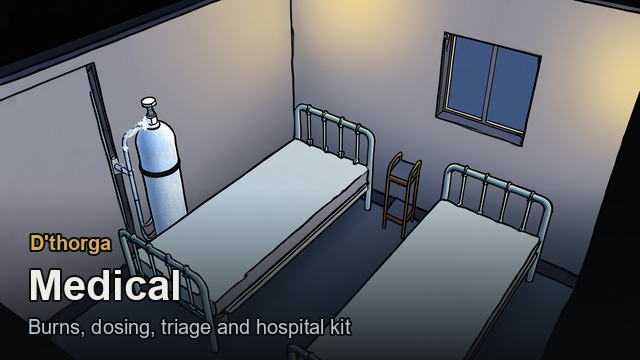
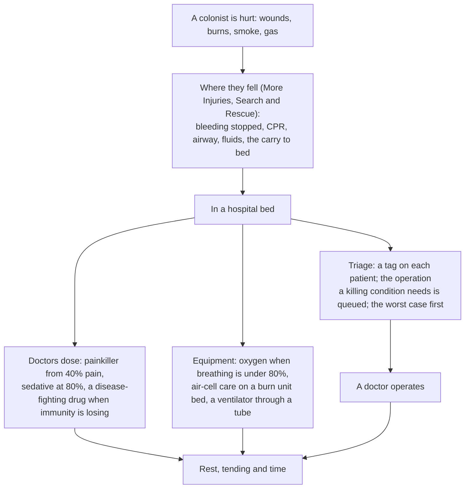
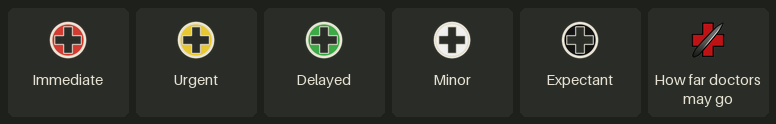
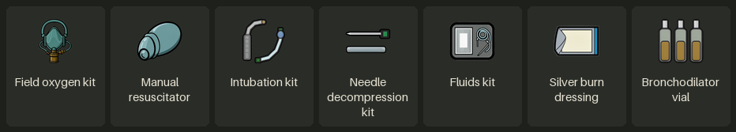
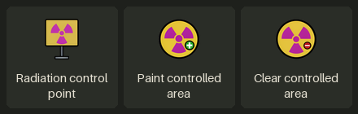

# Medical

**D'thorga Medical** makes burns, smoke and gas matter, lets doctors dose and operate on their own, sorts patients by how
urgently they need help, and adds the hospital and field equipment to treat it all. It sits beside **More Injuries** and **Search
and Rescue**, which handle care where a colonist falls; it handles what happens in bed. [Back to the guide](README.md).

## Read this first (gotchas)

- **Needs Harmony, D'thorga Framework and Vanilla Expanded Framework.** **Vanilla Gravship Expanded is strongly recommended**
  (it needs the Odyssey expansion): most of the oxygen kit uses its canisters and pipes, and a letter says once what is missing
  without it. More Injuries and Combat Extended are optional and used when present.
- **Partly tested in game**: see [the last section](#what-has-been-tested-in-game).
- **People in pain fetch their own painkillers by default. Check your drug policies first**: addiction and overdose are real.
- **Tox gas does lasting harm, and by default the harm comes about 4 hours later**, over two or three days. Keep gassed colonists
  in bed and watch them.
- **Carbon monoxide ignores gas masks** and has no smell. Only sealed headgear with its own air keeps it out. It lingers in a shut
  room for hours after a fire: **open a door or a vent**. Hang a smoke and carbon monoxide alarm in bedrooms and hospitals.
- **Fires in the open are hot**: standing beside a blaze can cause heatstroke and burns from the hot air. People not drafted move
  away from heat that would burn them; firefighters stay at the fire.
- **Switching from the five old mods** (Burns and Smoke, Emergency Dosing, Triage, Medical Equipment, Medical Save Bridge): all five
  off and this one on, in the same change. Your colony and settings carry over.
- **Taking it out**: press **Remove every condition this mod adds, from every pawn** in its settings, deconstruct its machines and
  burn unit beds, take its items out of the colony, save, then switch it off.

## From injury to recovery

**A bed is where most of it happens.** Painkillers, oxygen, burn care and every operation need the patient down or in bed. **Stock
decides everything**: medicine, painkillers, oxygen and kits have to be made or bought, and a doctor carrying them is fastest.

## Burns and smoke

**What to do for a badly burned colonist:** tend the burns **and the burn shock** with the best medicine you have, keep them in bed,
and get them out of the smoke.

- **Burned body fraction**: every burn adds up. Past about a sixth of the body (15%) comes **burn shock**, which kills within days
  untreated. Older patients, and those with an airway burn or carbon monoxide, fare worse.
- **Tend the shock itself.** It is a tendable condition; tending stands in for giving fluids, and the medicine's quality sets how
  much it helps. Fluids wear off after 12 hours, so **keep tending**.

| Burns tended and in bed, the shock tended with | A bad case settles at | The worst cases settle at |
| --- | --- | --- |
| No medicine | Shock | Shock, close to severe |
| Herbal medicine | Shock | Shock |
| Industrial medicine | Compensated | Shock |
| Glitterworld medicine | Compensated | Compensated |

*For a doctor of average tend quality. A poorer doctor gets less from the same medicine.*

- **Airway burns swell shut over hours** (worst at 8 hours, gone by 48). A doctor with Medicine 4 places a breathing tube with an
  **intubation kit** by themselves, or you order a **tracheotomy**. Oxygen does not open a closed airway.
- **Deeply burned limbs tighten.** An arm or leg burned to 60% of its health grows a **constricting eschar** that cuts off its blood
  over about half a day. **An escharotomy** (Medicine 4, any medicine) cuts it open; with triage the doctors queue it themselves.
  **Left alone, the limb is lost.**
- **Smoke scars the lungs**: tending, rest and oxygen help them heal. Severe damage can turn to pneumonia.
- **A fluids kit** (made at a drug lab) is hung by doctors themselves on a patient in burn shock. With More Injuries you can also
  order a **saline bag** as a bill, the very best care.
- **With More Injuries**, its own **fire inhalation** setting decides whether fire burns the lungs directly; this mod never damages
  them twice.

**Hold Alt over a cell** to see its temperature near a fire. A full-size fire in the open adds about 600 degrees at the flame, 150
one cell away and nothing past five. In a large room, a fire also heats the cells around it.

### Carbon monoxide

Fires in closed rooms make carbon monoxide: headache, then dizziness, confusion, collapse and death. **Clean air** clears it: it
halves about every 5 hours indoors, 3 in the open, and **about every 75 minutes on oxygen**. **Move patients out of the burning
room**: a patient on oxygen still breathes the room's air.

### Tox gas and acid

- **Tox gas (needs Biotech) is caustic.** Besides the game's own effects it can injure the eyes, swell the throat, injure the lungs,
  burn the skin, and after a heavy dose weaken immunity for about two weeks. **A gas mask protects the eyes and lungs, not the
  skin**; only a sealed suit protects everything. A badly burned eye can scar for good. Plants in dense gas wilt.
- **Acid keeps burning until it is washed off.** Anyone who can walk runs to the nearest **safety shower** (within 60 cells) and
  rinses for a quarter of an hour; **doctors draw water and rinse patients who can't walk**. Washing also takes tox gas off the skin.
- **With Dubs Bad Hygiene, lay plumbing to the safety shower**: a rinse takes about 1,100 litres (23 for the eyes alone). Its showers
  and baths work as safety showers too.

## Doctors who dose

Doctors give painkillers and sedatives on their own, from whatever mod made them. Each drug is judged by what it does, never by
its name.

| When | Given |
| --- | --- |
| Down or in bed, pain 40% or more | The best painkiller in reach, net of its side effects |
| Pain 80% or more, and no painkiller can be given | A sedative |
| A disease that can kill, and immunity would come too late | A medical drug that speeds immunity. **A patient already winning gets none**, so stock lasts |

- **Never given**: a second painkiller while one still works, anything during an overdose, a dose that would leave consciousness or
  breathing under 15%, recreational drugs (unless the setting allows them, and then last), drugs to someone who refuses them on
  principle.
- **A patient bleeding hard (30% a day or more) waits for a painkiller** until the bleeding is tended.
- **A patient in extreme pain flinches while being tended**, so the tend comes out up to a quarter worse. Pain relief prevents it.
- **Colonists up and about fetch their own painkiller** at 40% pain, by their drug policy. Teetotalers, children and masochists never
  do; anyone with chemical interest or fascination reaches for it sooner.
- **With a doctor selected, right-click a patient** to see why no dose can be given.

## Triage

**Each patient's tag shows by their name on the map**, coloured as in field triage, and **a doctor goes to the worst case first**.

| Tag | Means |
| --- | --- |
| **Immediate** (red) | Dying within 6 hours, or a vital function at the floor |
| **Urgent** (yellow) | Dying, with more time |
| **Delayed** (green) | Crippled, not dying |
| **Minor** (white) | Nothing serious |
| **Expectant** (black) | Dying of something only an operation fixes, and nobody here can do it |

- **Doctors queue the operation a killing condition needs**, choosing the one most likely to succeed among those your colony can do
  now, with a death risk at the table no higher than the setting (5%). The bill goes to the top of the game's own operations list;
  **bills you added are never withdrawn**.
- **The button on each person**, and beside the medicine setting on the health tab, says **how far the doctors may go**: never
  without orders; to save life (the default for colonists, slaves and prisoners); to save life or a limb; any repair. Guests start at
  never.
- **When nobody can do an operation a patient needs, a message says what is missing**: skill, a tool, research or risk.
- **Oxygen, rest and time are not operations**: carbon monoxide or burn shock is tagged, but nothing is queued.
- **No surgery in a hyperbaric chamber**: move the patient to a hospital bed.
- Drug addictions are left alone: their treatment is the drug, your policy and time.

## Equipment

**Bedside machines go touching a hospital bed**, as a vitals monitor does; one can serve two beds it touches. **Nobody has to be
told**: a patient who needs oxygen gets it, and doctors use the kits as Doctor work.

**What to build first:** an **oxygen concentrator** (only power) by your hospital beds, a **smoke and carbon monoxide alarm** in each
bedroom and hospital, a **burn unit bed** if fire is a threat, and a **safety shower** if you fight with acid or gas.

| Piece | Needs | Does | Research |
| --- | --- | --- | --- |
| Oxygen concentrator | 350 W | Oxygen for up to 2 patients in beds it touches | Respiratory care |
| Bedside oxygen stand | 1 oxygen canister per patient-hour, or an oxygen pipe | The same, without power | Piped oxygen |
| Oxygen cylinder trolley | Canisters (holds 40), or a pipe | **No bed needed**: oxygen for 1 patient lying beside it, even on the floor. Quick to move | Piped oxygen |
| Ventilator | 200 W | Breathes for a patient whose breathing failed, **through a breathing tube** only | Respiratory care |
| Nebuliser | 60 W, bronchodilator vials | Eases airways that tightened after smoke | Respiratory care |
| Anaesthesia machine | 150 W | **Operations in that bed 8% likelier to succeed** | Anaesthesia |
| Steriliser | Nothing | The room counts as cleaner: less infection, better surgery | Clinical equipment |
| Safety shower and eyewash | Water (plumbing with Dubs Bad Hygiene) | Washes off acid and gas; cool water eases burn pain | None |
| Smoke and carbon monoxide alarm | 5 W, hangs from the ceiling | **Warns you which room, and wakes anyone asleep there** | Electricity |
| Burn unit bed | 200 W | Better tending; **wounds heal 25% faster and pain falls 15%** for a burned patient | Burn care |
| Hyperbaric chamber | 800 W and oxygen | Stronger oxygen for one patient; carbon monoxide clears in about 22 minutes. No surgery inside | Hospital bed, Oxygen Network |
| Oxygen electrolyser | 3,000 W (and water with Dubs Bad Hygiene) | Makes 1 canister of oxygen an hour into an oxygen pipe. For vacuum and thin air, where Vanilla Gravship Expanded's harvester can't run | Oxygen Network |
| Liquid oxygen store | 300 W for its cooler | Holds 2,000 units; about 2% boils off a day without power. **A badly damaged store bursts into a fireball**. Frost gathers on it while it works | Oxygen Network |

| Kit | Used by | For |
| --- | --- | --- |
| Field oxygen kit | Doctors, by themselves | Oxygen for one patient lying down, for about an hour. Made from a canister |
| Manual resuscitator | Doctors, by themselves | Pumps for breathing under 50%, as long as needed. Kept |
| Intubation kit | A doctor with Medicine 4 | A breathing tube, for a swelling airway or a ventilator. Out after two days |
| Needle decompression kit | A doctor with Medicine 5 (More Injuries only) | Buys about a day for a collapsed lung. **The lung still needs its operation** |
| Fluids kit | Doctors, by themselves | Burn shock |
| Silver burn dressing | Any tend | A medicine, used under normal medicine or better |
| Bronchodilator vial | The nebuliser | 4 from 1 neutroamine at a drug lab |

**Oxygen canisters, and kits made from them, explode when they burn** (Vanilla Gravship Expanded's rule).

## Radiation control (with Rimatomics)

Suits on inside, off at the door, as a real plant runs it. **Only with Rimatomics active. Not yet tested in game.**

1. Place a **radiation control point** (Misc tab, 10 steel) facing into a room or its doorway, or paint a **radiation controlled
   area** (zone tab) over open ground or several rooms.
2. **Keep suits and masks just outside the line**, on a shelf, not forbidden. Gear inside the area is never fetched.
3. A colonist without **75% toxic environment resistance** stops at the line, puts on the fewest, nearest items that get them there
   ("Suiting up"), and takes them off on the way out. Rimatomics' suit and mask give 40% each, so it takes both.

Drafted colonists, prisoners, guests and animals cross as they are. With no gear in reach, a colonist won't go in: a message says
so once.

## Adding More Injuries to an old colony

More Injuries adds body parts, which scrambles every old wound, lost limb and bionic in a save written without it. D'thorga Medical
puts them back on the right parts.

1. **Back up the save** and load the copy.
2. **Switch on More Injuries and D'thorga Medical in the same step.**
3. Load. A dialog asks: **Convert now** (do this), **Not now**, or **Never for this save**. **If you choose Not now, don't save that
   colony**: whatever went wrong on that load is kept.
4. Check a colonist with a lost limb or a bionic, then **save**. From then on it does nothing.

## What has been tested in game

- **Tested by the owner:** burn numbers, how burn conditions progress, and the More Injuries tie-ins (5 November 2026); doctors
  dosing penicillin and ketamine (5 November 2026); a patient's breathing improving on the oxygen concentrator (5 November 2026); the
  burn unit bed and its air-cell care (6 November 2026); the save bridge's first load on a copy of a 330-mod colony (3 November 2026).
- **Not yet tested in game:** everything else, including triage, the ventilator, tox gas, acid, the safety shower, the alarm, the
  oxygen network pieces, self-medication and radiation control.
- **The tests above were on the five separate mods**, before they became one. D'thorga Medical as one mod is not yet tested in game.

The full detail is in [D'thorga Medical's README](../../mods/PhobosMedical/README.md) and
[the medical mods together](../medical-mods.md).
