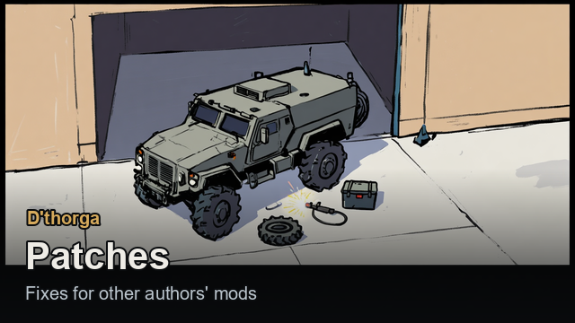
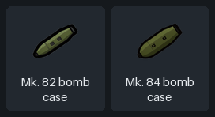

# Patches

**D'thorga Patches** fixes and adjusts other authors' mods. Each part switches on only while that mod is active and copies nothing
from it; without the mods it patches, it does nothing. [Back to the guide](README.md).

## Read this first (gotchas)

- **Needs Harmony and D'thorga Framework. Load it after the mods it patches**; RimSort does this from its About file. **Switch it on
  yourself**: nothing else requires it.
- **Switching from D'thorga Vehicle Patches or D'thorga Missile Patches**: both off, this one on, in the same change.
- **After a missile strike, wait for the message that the blast has spent itself before saving**: a blast still running when you
  save is forgotten on load.
- **Before removing it**: delete bomb, rocket and heavy-casting bills it added; with Combat Extended, use up or sell bomb cases, bomb
  fills and missile seeker heads, and deconstruct turret hulls built under it.

## What it changes, mod by mod

| Mod (author) | What changes | What you do |
| --- | --- | --- |
| **Harrier VTOL Attack Aircraft** (potemkinvillager) | A realistic build cost from real parts (a turbine, nozzles, landing gear, tanks, electrics, hydraulics, avionics; Construction 10). Fourteen parts in place of four. Loads fully beside RimPacts. A sortie's map stays open under the jet. Rearming keeps to one kind of ammunition | Make or buy a turbine (RimThunder's or ours) and the other parts. **Avionics, hydraulics or wiring below about 35% ground the jet**: repair them. To change ammunition, choose it on the weapon |
| Harrier, with **Combat Extended** | Bombs cost what they weigh: each starts as a **bomb case** made from steel, then is filled. With The Dead Man's Switch, bombs and rockets are bills at its ammunition fabricator too | Make bomb cases at the machining table, rotary forger or automated machining bay. **Allow the cases in bay hoppers** that used to take heavy castings |
| Harrier, in the air | Its dodge chance follows its flight controls and warning receiver; a **Chaff and flares** button makes it harder to hit for ten seconds | Keep **countermeasure cartridges** (D'thorga Framework's parts bench) in storage; haulers load them into its dispensers while it is parked. Repair shot-up controls and avionics |
| **UH-60M Black Hawk** (z3nt3) | Built from real parts by role: two turbines, its rotor drive and rotors, servos, hydraulics, landing gear, tanks, electrics and avionics, on a shell of steel, plasteel and a few components | Make or buy the turbines and other parts; finish or cancel a frame before installing |
| **C-17 Globemaster III** (z3nt3) | Built from real parts by role: four turbofans with a generator on each, four hydraulic systems and their actuators, its three landing gear, a tank in each wing, electrics and avionics, on a shell of steel, plasteel, the silver of its wiring and some components. The chemfuel its blueprint asked for goes: fuel is put in its tanks, not built into it | Make or buy the engines and other parts; finish or cancel a frame before installing |
| **Close Air Support: A-10 Warthog & Su-25 Frogfoot** (potemkinvillager) | Fuller parts lists (avionics, hydraulics, wiring, landing gear, pylons, the gun); built from real parts by role (turbines, landing gear, tanks, generators, hydraulics; Construction 10); their bombs also at The Dead Man's Switch's ammunition fabricator. **Realistic handling** (off by default) flies them at speeds set by the real aircraft's | Turn on **Realistic handling** on the **Close Air Support** settings page if you want it, and restart |
| Harrier, Hind, Mongoose, A-10, Su-25 | Rearming tops up the kind already loaded | A part-full magazine waits if that kind runs out |
| A-10, Su-25, Hind, Mongoose, Prowler, with **Combat Extended** | Their bombs, missiles and jamming pods weigh what the real ones do and are made from what they are made of, priced like the Mk. 82 for their size: a FAB-250 or RBK-250 starts as a **Mk. 82 bomb case**, a Hellfire or HARM needs a **missile seeker head**. Worth about 520 (Shturm) to 2,000 silver (CBU-87) | Make bomb cases at the machining table and seeker heads at the machining table or fabrication bench (Microelectronics; one advanced component each). With The Dead Man's Switch, the missiles are bills at its ammunition stamping machine, and seeker heads and pods at the Expedition's precise fabrication center. Ones already made keep their old cost |
| Harrier, being taken apart | A temporary trace writes each step of a vehicle's disassembly to the game's log, to find why the Harrier can't be taken apart | **Try one disassembly, on a copy of your save, and don't retry.** First tick **D'thorga Patches: Harrier disassembly** on D'thorga Framework's **Detailed logs** settings page: the trace is off until you do |
| **RimThunder** with The Dead Man's Switch - Expedition | The rotary forger makes heavy castings 12 at a time from 1,200 steel | Keep the floor around the forger clear: 24 items drop beside it |
| **Spaceship Turret Hull** (MK), with **Combat Extended** | All seven hulls load ammo like CE's own turrets, and no longer explode when destroyed | **Rebuild hulls built before**, while the ship is landed |
| **InterRim Ballistic Missile** (Psionic Zephyr) | A strategic warhead's blast is spread over moments instead of freezing the game; overhead mountain shelters what is under it; the extinction-class warhead strikes with a fireball, blast and heat zone; no flood of "Area revealed" letters | **Wait for the message that a blast has spent itself before saving.** Settings under D'thorga Patches |
| IRBM with **Combat Extended** | Its close-in weapon systems shoot down CE's mortar and artillery shells headed for your things, as they always did vanilla shells | **Unroofed and powered**, as before. The setting **Close-in weapon systems shoot down Combat Extended shells** turns it off |
| **RimPacts** (temporary) | An ally's assault leaves vehicles with nobody aboard alone and goes for the defenders, instead of beating on an empty vehicle for hours | Claim the empty vehicles after the battle. |
| IRBM with **RimPacts** | An ally's assault after your strike faces the garrison the town had before it. A world war attack shows its deadline | **Strike and attack early**: RimPacts gives a war attack 3 days |
| **Visit Settlements** (Nina.Goblin) | A visited settlement's map stays open while any colonist of yours there is conscious, on foot or in a vehicle. Its food drops no longer fail every tick | Pawns already lost this way stay lost: load an earlier save |
| **Vanilla Factions Expanded - Classical** (temporary) | A save made during a scorpion raid loads with the raid still working, instead of raiders who cannot act or leave and thousands of errors a minute | Nothing. **If you saved again after such a save loaded broken, load the save made before that.** |
| **Nice Research Tab** (Andromeda; temporary) | A blank entry in a research project's unlock list can no longer stop the research tab opening, as it now and then did until a restart | Nothing. If the log shows a D'thorga Patches warning naming a research project, tell us which. |
| **Vanilla Expanded Framework** outposts, with **Vehicle Framework** | A caravan with vehicles can't found an outpost through "create outpost", which could lose them | Leave the vehicles first and come on foot. The setting **Refuse to found an outpost from a caravan with vehicles** turns this off |
| **Vehicle Framework** | Fires a vehicle could never put out are put out; a vehicle leaving a map takes no fire with it. Repairs and upgrades show the game's progress bar | Nothing |
| **The Dead Man's Switch** drone platforms (Fortified Features Framework) | Colonists refill the engineering drone bay, the trashpan and hound stations and the FPV nest with steel by themselves; a mechanitor refills the Hermit Crab and the Cluster Weaver | Nothing: keep steel in reach. [Drone platforms](#drone-platforms) |
| **Combat Extended** ammo sets | A temporary guard drops ammo set entries that would stop CE's whole ammo setup (The Dead Man's Switch - Synthriada adds such entries) | Nothing |
| **Biotech** (Ludeon), a setting off by default | Mech rechargers draw power by the size of the mech on them, charging slows over the last fifth, and a charging recharger warms its room | **Turn it on** in the settings' Mechanoids page; check your grid can carry your biggest mech |
| **Combat Extended**, with or without **Simple sidearms** (PeteTimesSix) | Colonists left holding a grenade, a satchel charge or nothing after being downed go back to their own gun. | **Hand a gun once to anyone who has none at all.** [Soldiers keep their guns](#soldiers-keep-their-guns) |

## The Harrier

### Building it

The jet's blueprint is under **Architect, Vehicles**. It needs **Construction 10**, as the Hind and Mongoose do. Since Patches 0.30.0
it is built from **real parts by role**, as Close Air Support's jets are: each part is filled by RimThunder's where installed and suited
to the jet's weight, and by D'thorga Framework's own otherwise. The counts follow the real AV-8B; what each part costs is the shared
table's ([parts bills](../development/archive/parts-bills.md)).

| What | Count | Why |
| --- | --- | --- |
| Steel, plasteel, components | **400, 120, 10** | The airframe, its composites (about a quarter of the real weight) and what no part carries |
| Engine | **1 turbine** | The Pegasus: RimThunder's turbine, or our gas turbine assembly |
| Exhausts | **4** | The four swivelling nozzles |
| Landing gear | **4** | A nose leg, a main leg and two outriggers |
| Fuel tanks | **3** | Fuselage and wings |
| Generator, battery, wiring | **1 each** | Electrics |
| Hydraulic pumps and lines | **2 and 1** | The flight controls |
| Avionics | **1** | The instruments and navigation |

The **Drop Tanks** upgrade costs **2 fuel tanks, 20 steel and 2 components**, in place of 60 steel and 2 components. A jet you
already built keeps working; only new builds pay the new cost. **Finish or cancel a Harrier frame before installing a version that
changes its cost**: a frame keeps what was delivered and then asks for the new list.

### Its parts and flight controls

The Health tab lists fourteen parts, each taking hits and needing repair. Every figure is authored.

| Part | Where | Health | What its damage does |
| --- | --- | --- | --- |
| Airframe, cockpit, engine, wing fuel tanks | The jet's own four | 470, 170, 200, 120 | The engine drives move and flight speed, and overrides the other parts when it fails; the tanks leak and burn |
| Canopy | Outside, over the cockpit | 40 | Takes hits that would have hit the cockpit |
| Avionics, nose radar | Inside the nose | 40, 30 | Avionics are a flight control; the radar only needs repair |
| Intakes and compressor | Inside, either side of the engine | 50 | Flight speed |
| Thrust nozzles and exhaust | Outside, either side of the engine | 50 | Move and flight speed |
| Hydraulics, wiring and electrics | Inside the tail | 40, 30 | Flight controls |
| Alternator | Inside, beside the engine | 30 | Repair only |
| Landing gear | Outside, nose and belly | 60 | Move speed on the ground |
| Wing pylons | Outside, under the wing tips | 50 | Repair only |

- **Avionics, hydraulics and wiring are the flight controls. With any of them below about 35% the jet cannot take off**, and the
  launch and sortie buttons say which to repair. Damaged, it flies slower. This is D'thorga Framework's rule for every aircraft;
  with the Framework's vehicle systems switched off for the Harrier, nothing grounds it.
- **A Harrier you already have gains the new parts at full health** when the save loads.
- The **plasteel armour upgrade** covers the nozzles, landing gear, pylons and intakes too. Under Combat Extended the new parts take
  the jet's own light armour, which rifle fire goes through.

### Rearming

Rearming keeps to **one kind of ammunition**: it tops up with what is already loaded, for the Harrier, the Hind and the Mongoose.
**To change kind, choose it on the weapon**: that still swaps the magazine. If the loaded kind runs out of stock, a part-full magazine
waits rather than being swapped by itself.

### Hovering onto its pad

A Harrier too heavy for its engine to hover in the day's heat will not hover onto its pad. The vertical-landing button and order say
why, an automatic return home uses a runway instead, and a landing that runs out of injection water part-way is called off with the
reason. **This follows D'thorga Framework's setting "When an aircraft is too heavy or too hot to lift off, hover onto its pad or land at a journey's end"**: use the runway
(the default), allow it at a cost to the engine, or warn only. D'thorga Vehicles gives the Harrier its real engine figures; without
it the Framework's general jet engine judges the hover ([aircraft](aircraft-and-sling-loads.md#before-take-off)).

### Sorties

Read from the Harrier's own code, not seen in play. The Harrier mod does all of this; this mod keeps the map open under the jet and
explains refusals.

- **Sortie** (the button on the jet) opens the world map. Pick a site or settlement: an open map gives "fly to" and "land" choices; a
  closed one is entered from the map edge. **Your own maps can be struck too** (from 0.41.0, for the Harrier, A-10, Su-25 and
  Prowler alike), the gravship's included: choose a point to circle, and when done the jet lands on that map's runway if one fits
  it, or else flies back to a home that has one. Launch to World Map still lands at a home. The sortie button's own description
  still says to use Launch for a colony; that text is the jets' mod's own.
- **Fuel decides time on station, not distance.** World flight costs about 0.16 fuel and a minute a tile, so a 30-tile sortie costs
  about 5 fuel each way; over a map the jet burns 250 fuel in about 6 hours. A strike is refused unless the tank holds the trip there
  and back, about an hour and a half over the target (3,600 ticks) and a 10% reserve; the destination picker says how much it needs
  and draws the line red. On RimWorld 1.7 this check is D'thorga Patches' (from 0.42.0): the jets' own stopped running there.
- **It comes home by itself** when its rockets and bombs are spent or fuel runs low, to the map it took off from if that has a
  runway, else the nearest home map with one.
- **Home needs a full beacon runway**, 24 cells by 5 for the Harrier: four beacons on the corners of a rectangle, 23 cells apart
  along it and at least 4 across. With no runway at home, the jet circles and says so.
- **Don't land on a sortie map.** The Harrier lands vertically anywhere but takes off only from a beacon runway, so a jet landed away
  from one stays there. A rough landing also wrecks its engine.
- **No sortie from under a roof**: taxi out first.
- **No sortie onto a RimPacts battle you have not joined**: join it from the town's button on the world map first; the targeter says
  so. The setting **Sorties may fly over a battle you have not joined** lifts this for aircraft only, and RimPacts then counts the
  crew as your forces in that battle.
- **A sortie's map stays open while the jet is over it**, whichever mod made the map (Real Ruins and RimMarket maps could close
  before). Any vehicle of yours with a colonist aboard keeps its map open, the Hind and Mongoose included.

### Taking it apart (temporary)

The Harrier cannot be disassembled yet: the work stops near the end and the jet stays. **Before you try, tick D'thorga Patches:
Harrier disassembly** on D'thorga Framework's **Detailed logs** settings page; each disassembly then writes one log line per step, to
find the cause. It is off until you tick it (since Patches 0.27.0; it used to be a setting of its own, on by default). It changes
nothing in play. **Try one disassembly, on a copy of your save, and stop there:** each attempt runs the first half of the removal again.

## Bombs under Combat Extended

Under Combat Extended bombs are items with their real weight, so their ingredients now weigh close to what the bomb does. **The fuel
and explosive fills stop short of their real weight on purpose**: matching it would take far too long to make. Their selling price
follows from their ingredients. Without Combat Extended nothing here changes.

| Bomb | The Harrier mod's own | Now | Materials weigh |
| --- | --- | --- | --- |
| Mk. 82 (227 kg) | 60 steel, 45 chemfuel, 2 components | 1 Mk. 82 bomb case, 20 FSX, 300 chemfuel, 2 components | 166 kg |
| Mk. 84 incendiary (907 kg) | 120 steel, 120 chemfuel, 2 components | 1 Mk. 84 bomb case, 5 incendiary bomb fills, 2 components | 604 kg |
| Mk. 84 EMP | 120 steel, 6 components | 1 Mk. 84 bomb case, 8 EMP bomb coil packs, 12 components | 905 kg |
| Mk. 84 smoke | 120 steel, 50 chemfuel, 1 component | 1 Mk. 84 bomb case, 8 smoke bomb fills, 1 component | 909 kg |
| Mk. 84 poison gas (Biotech) | 120 steel, 4 wastepacks, 1 component | 1 Mk. 84 bomb case, 8 tox bomb fills, 1 component | 911 kg |

So four Mk. 82s take 4 bomb cases (1,120 steel), 80 FSX, 1,200 chemfuel and 8 components. Bombs already made stay as they are.

### Bomb fills (Mk. 84s)

**A Mk. 84's fill comes in canisters, each made in a short bill**, then the bomb is a case, its canisters and the components: three
trips for a hauler. Making it all in one bill took 14 to 20 trips, and The Dead Man's Switch's ammunition fabricator **drops everything
it has loaded when a haul is interrupted**, so its Mk. 84s were never finished. The materials in all are the same as before.

| Fill | Per bomb | Each made from | Weighs | Research |
| --- | --- | --- | --- | --- |
| Incendiary bomb fill | 5 | 20 prometheum, 300 chemfuel | 25 kg | IEDs |
| EMP bomb coil pack | 8 | 105 steel | 53 kg | Microelectronics basics |
| Smoke bomb fill | 8 | 95 steel, 125 chemfuel | 54 kg | Smokepop belt |
| Tox bomb fill (Biotech) | 8 | 9 wastepacks | 54 kg | Tox gas |

- **Where:** the machining table, and the ammunition fabricator with The Dead Man's Switch. 500 work each, Crafting 5. They stack to 10.
- **Incendiary and smoke fills burn, and a store of them can go up in a fire**, as chemfuel does. Keep them away from heat.

### Bomb cases

Each bomb starts as an empty steel case, made first and then filled.

| Case | Steel | Weighs | Work | Crafting skill | Stack |
| --- | --- | --- | --- | --- | --- |
| Mk. 82 bomb case (also the FAB-250 and RBK-250) | 280 | 140 kg | 1,000 | 6 | 4 |
| Mk. 84 bomb case (all four Mk. 84s) | 956 | 478 kg | 3,000 | 7 | 4 |

- **Where:** the machining table; the rotary forger, with The Dead Man's Switch - Expedition; and the automated machining bay, with
  Vanilla Furniture Expanded - Factory, which gives the bay a bill for each case by itself.
- **They stack to 4**, so a hopper slot holds four. **If your bays' hoppers were set to take heavy castings, allow the two bomb cases
  there instead.**
- **No research of their own**: each bomb keeps its own. They can be smelted back to steel.
- They are this mod's items: **use them up or sell them before removing the mod**.

### The other aircraft's bombs, missiles and pods

The A-10's and Su-25's bombs, the Hind's and Mongoose's missiles and the Prowler's missile and jamming pod follow the same rule
under Combat Extended: **their real weight, made from what they are made of, worth what a Mk. 82 is for their size.** Without Combat
Extended nothing here changes. **Ones already made keep their old cost.**

| Weapon | Weighs | Made from | Worth about |
| --- | --- | --- | --- |
| FAB-250 (Su-25) | 250 kg | 1 Mk. 82 bomb case, 20 steel, 23 FSX, 350 chemfuel, 2 components | 1,630 |
| RBK-250 cluster bomb (Su-25) | 273 kg | 1 Mk. 82 bomb case, 8 FSX, 115 chemfuel, 6 components | 1,060 |
| CBU-87 cluster bomb (A-10) | 430 kg | 600 steel, 12 FSX, 185 chemfuel, 10 components | 2,000 |
| 9M114 Shturm (Hind) | 46.5 kg | 40 steel, 8 FSX, 40 chemfuel, 8 components | 520 |
| AGM-114 Hellfire (Mongoose) | 45 kg | 1 missile seeker head, 40 steel, 10 FSX, 50 chemfuel, 6 components | 790 |
| AGM-88 HARM (Prowler) | 360 kg | 1 missile seeker head, 140 steel, 15 FSX, 150 chemfuel, 10 components, 1 advanced component | 1,580 |
| AN/ALQ-99 jamming pod (Prowler) | 431 kg | 80 steel, 20 gold, 10 components, 2 advanced components | 1,100 |

- **The cluster bombs' explosive is mostly in their bomblets**, so they take less FSX and more steel than a plain bomb of their weight.
- **A colonist carries one at a time.** Stored on a vehicle or carried by a caravan they weigh what they really do. A jamming pod is
  used up into the Prowler's count when mounted, so it adds nothing to the jet's load.
- **The Shturm has no seeker head**: it is steered by radio from the helicopter.
- **With The Dead Man's Switch, the automated benches make them too**: the bombs and missiles at the ammunition stamping machine,
  the jamming pod at the Expedition's precise fabrication center.

**The missile seeker head** is the guidance section of a Hellfire or HARM: 10 steel, 2 components and 1 advanced component, 2,000
work, Crafting 8, at the machining table or the fabrication bench, after **Microelectronics basics**; with The Dead Man's Switch -
Expedition, at its precise fabrication center too. It weighs 5 kg and stacks to 10.
It is this mod's item: **use them up or sell them before removing the mod**.

## Bombs and rockets at the ammunition fabricator

With The Dead Man's Switch and Combat Extended, all five bombs and the jet's three kinds of 57 mm rocket are also bills at its
**ammunition fabricator**. The machining table still makes them, with the same cost and research. The Hind and Mongoose use the same
rocket recipes, so their rockets can be made there too.

| Item | Machine time for one bill | Colonist's Crafting skill |
| --- | --- | --- |
| Mk. 82 | 2,250 ticks (0.9 in-game hours) | 6 |
| Any Mk. 84 | 3,000 ticks (1.2 in-game hours) | 7 |
| 5 HE rockets | 6,500 ticks (2.6 in-game hours) | 4 |
| 5 HEAT rockets | 4,300 ticks (1.7 in-game hours) | 4 |
| 5 AP rockets | 2,750 ticks (1.1 in-game hours) | 4 |

That is half the machining table's work, and no colonist stands at the machine while it runs. It draws 1,000 W running, 50 W idle.

- **A colonist still loads it and collects the result**: the Crafting job "Operate Machine", with the skill above.
- **Finished items drop beside the machine**, whatever the bill's storage setting says; haulers take them from there.
- **Interrupting the colonist while loading drops what they had brought** beside the machine, and the job starts again. Nothing is
  lost, but the chemfuel-heavy bombs take many trips (1,500 chemfuel for an incendiary), so keep your chemfuel close.

## Heavy castings at the rotary forger

With RimThunder and The Dead Man's Switch - Expedition, the **rotary forger** makes heavy castings **12 at a time**: its bill is "make
12 heavy castings" (RimThunder spells the item "heavy compoment"). The electric smelter and assembly platform still make one at a time.

- **Cost:** 1,200 steel makes 12 castings and 12 lumps of steel slag, RimThunder's own recipe times 12. No research, no skill.
- **A colonist with Crafting enabled loads it** ("Operate Machine"): about 16 trips, as steel comes in stacks of 75. **The bill waits
  until 1,200 steel can be fetched**; below that, use the smelter.
- **It saves colonist time**: the fixed load and collect waits are shared by all 12. The machine then runs just over an in-game hour
  on its own, drawing 800 W (50 W idle).
- **Finished items drop beside the machine**: 24 separate things, since castings and slag don't stack. **Keep the floor around the
  forger clear.**
- **Interrupting the colonist while loading drops what they had brought** beside the machine. Nothing is lost.

## Turret hulls under Combat Extended

With Spaceship Turret Hull and Combat Extended both active, all seven armed hulls load like Combat Extended's own turrets: colonists
haul the ammo over, and the turret gets the usual reload and ammo buttons. Colonists reach a hull from any open cell beside it, so
**keep one clear on the inside of the ship**.

| Hull | Fires | Magazine | Range |
| --- | --- | --- | --- |
| Spaceship turret hull | 5.56x45mm NATO | 100 | 48 |
| Autocannon hull and heavy autocannon hull | 20x102mm NATO | 100 | 78 |
| 40mm flak hull (was the uranium slug hull) | 40x311mmR | 20 | 86 |
| Shotgun hull | 12 gauge | 20 | 19 |
| Sniper hull | .50 BMG | 10 | 84 |
| Incendiary hull | 30x64mm fuel cells | 10 | 45 |

- **Hulls built before must be rebuilt** to take ammo: deconstruct and rebuild each, **while the ship is landed** (in space the gap
  lets the air out).
- **They no longer explode when destroyed**, and aim and cooldown follow Combat Extended's nearest turret of each kind. The autocannon
  and heavy autocannon fire the same gun; the heavy one has more hit points.
- **Build cost, work, skill, hit points and power are the hull mod's own**, so these hulls are far cheaper than Combat Extended's
  turrets: a known gap.
- **Before removing this mod with Combat Extended active, deconstruct them.**

## InterRim Ballistic Missile

### A strategic blast

A strategic warhead landing on an open map used to damage everything in one frame, which on a big modded map froze the game for
minutes. Now:

- **The blast is spread over moments**, from the centre outward, and a strike ends in seconds. It takes up to 40 ms a frame while the
  screen is still white, and your setting (12 ms) afterwards.
- **What the warhead would destroy simply vanishes**: no rubble, filth or fragments (each is a setting). People still take the damage
  and die properly.
- **Built roofs are torn off first**, and **overhead mountain shelters what is under it**, thin or thick (the missile mod sheltered
  only under thick).
- **A container's contents go with it**; someone asleep in a casket dies first.
- **With Combat Extended, wall fragments are off during a blast** by default: they were what made blasts crawl.
- **No "Area revealed" letters** while a blast runs. Letters sent by an older version stay: right-click them away, or use the dev
  action below.

### The extinction-class warhead

The missile mod's one true blast warhead strikes with a shape, after Dubs Rimatomics' own nuke. **Ground zero is the centre of the
struck map**:

| Zone | Distance from the centre | What happens |
| --- | --- | --- |
| Fireball | Within 25 cells | Everything is gone, overhead mountain too; the ground is scoured to bare earth, ashen and polluted |
| Blast | 25 to 110 cells | Buildings, items and plants are gone; people take the blast and burns, worse nearer the centre |
| Heat | 110 cells to the edge | Walls may stand; plants wilt; people burn and, with Rimatomics, may be flash-blinded and irradiated; fires start, fewer towards the edge |
| Other settlements in range | | The heat, fires and fallout only, unless you choose a full strike everywhere |

- **Burns are spread over the skin**, so D'thorga Medical sees a burned body.
- **Shelter counts, as it would.** The flash, heat and radiation come before the blast. **Anyone under a roof is spared the burns and
  flash blindness**, even if the blast then takes the roof. The **dose** is cut by what stood over them: almost none of it in a wooden
  or steel building, about a sixth behind **stone walls**, a twentieth under a thin rock roof, almost nothing **deep in a mountain**. A
  gas mask does nothing against it. **Flash blindness** is likelier at night and lasts up to half an hour; by day, a couple of minutes.
  Afterwards **a letter lists the dose each of your people took**. A setting, **Shadow and shelter from the strike**, on by default.
- **The pulse** stops powered buildings and mechanoids standing in the open for a few hours.
- **Vehicles, with D'thorga Framework's vehicles:** in the fireball a vehicle is gone with everyone aboard. Further out the blast
  throws it about: **weight decides**, so a car or a bus is wrecked (leaving its hull where that setting is on) where a tank is only
  battered. Heat burns tyres, belts, hoses and hydraulic lines nearer the centre, and a vehicle with its engine running takes the pulse; a
  parked one shrugs it off. **The people aboard** are bruised as their vehicle is thrown about, and with Rimatomics take the radiation
  that gets through the hull: nearly all of it in a car, about a third in a tank. **A vehicle is no shelter from a strike**: move
  vehicles under overhead mountain, all of them, or out of range. A setting, **Vehicles in the strike**, on by default.
- **Fallout:** with Dubs Rimatomics, its radioactive fallout settles on every struck map for 10 to 30 days, and up to six clouds of
  it drift across the world. Without Rimatomics, the missile mod's nuclear winter. No fallout in space.
- **The screen stays white** until the fireball and blast are done (at most 8 seconds).
- The missile mod's letter, flash, sound, cloud and world effects are its own, unchanged. Other strategic warheads keep its effects,
  with the fast blast.

The zone sizes and damage are gameplay choices; every option is in [the settings](../../mods/PhobosPatches/README.md#settings).

### Messages, limits and dev actions

- A blast that runs longer than two seconds says it is still tearing through the place, and says when it has spent itself.
- **A blast in progress is not saved**: what it had not reached survives a reload. **Wait for the message before saving.**
- The warhead's fires, terrain changes and cloud still happen in the frame the screen turns white, as the missile mod does them.
- Combat Extended's fragment setting is changed only in memory while a blast runs; its settings file is never touched.
- **Dev mode**, D'thorga category: **strike current map** (destroys everything there: use a throwaway save), **strike current map with
  D'thorga's blast model**, **log blast queue**, **drop queued blasts**, **dismiss every "Area revealed" letter** and **count Combat
  Extended fragments on map**. Each finished blast logs one line with its counts and time.
- **Removing IRBM or RimPacts later is clean**: load the save once with this version first.

## RimPacts

- **An ally's assault leaves empty vehicles alone** (temporary). RimPacts counted a vehicle with nobody aboard as a standing defender,
  so allies spent hours beating on it by hand. They now go for the people and turrets, and the empty vehicle is left for you to claim.
  A crewed vehicle is still attacked.
- **After your missile strike, an ally's assault faces the town's garrison from before it**, not the few survivors, so your ally
  arrives with the squad it would have had. A town with nobody left standing still falls to the attack.
- **A world war attack must win before its deadline.** RimPacts gives it 3 days from accepting, checked once a day; if the target town
  has not fallen by then the war is lost, whatever the battlefield shows, and **control of about a dozen border towns passes to the
  enemy**. This is RimPacts' rule. The quest shows its countdown the way the game's own quests do. **Strike and attack early.**
- **The Harrier loads fully beside RimPacts**, and RimPacts' rule against landing on some maps keeps working.

## Visit Settlements

Visit Settlements closed a visited settlement's map the moment anyone there went down if it saw no colonist of yours standing, so
colonists inside a vehicle were lost with the map, and with RimPacts the defence too. **The map now stays open while:**

- a colonist of yours there is conscious, on foot or aboard a vehicle, shuttle or pod;
- a mechanoid of yours there is on its feet;
- or a RimPacts defence or battle is fought there.

Otherwise Visit Settlements' rule stands. **Pawns already lost this way stay lost**: load a save from before. When it keeps a map open
the log says "Kept the map of ... open", once an in-game hour.

Its food drops for friendly settlements also no longer fail on every tick when a settlement holds a pawn that does not eat (a
mechanoid, a robot, an android). That fault filled the game's log in minutes.

## Mech rechargers with real power (Biotech)

**Off by default.** As the game comes, a mech recharger draws the power it lists whichever mech stands on it: a war queen costs no
more to charge than a mid-sized mech. Turn on **Mech rechargers draw power by the size of the mech** (Mod settings, D'thorga Patches,
the **Mechanoids** page) and a recharger draws for the mech on it instead.

| Mech | Body size | Draw while charging (Standard) |
| --- | --- | --- |
| Cleansweeper | 0.3 | about 85 W |
| Most light mechs (lifter, militor, agrihand) | 0.7 | 200 W, as now |
| Tunneler | 3.5 | about 1,000 W |
| War queen, diabolus | 4 | about 1,150 W |

- **Every recharger, whatever it lists**, and other mods' mechs and rechargers too: the figure comes from the mech's body size.
- **Charging slows over the last fifth.** Up to 80% it fills as fast as before; from there the rate and the draw fall to a quarter at
  full, so a full charge takes about 2.3 days in place of 2. Set a control group's recharge range to stop at 80% for quick turnarounds.
- **About a sixth of the power becomes heat** in the recharger's room: a tunneler's recharger warms like one heater. A busy mech bay
  may want a vent or a cooler. It stops warming a room hotter than 80 C.
- **An empty recharger draws a twentieth** of its listed power.
- **The recharger's inspect text** names the mech, the watts and about how long is left, or says it is waiting for power and how much.
- **A mech's information card shows its recharger draw**, beside wastepacks per recharge, so you know the cost before you make one.
  Click the line for its battery size, the heat, the draw when nearly full and how long a full charge takes.
- **Mech battery size**: Standard, Large (three times the draw) or Huge (ten times). Charging takes the same time at each.
- **Watch your grid.** A large mech plugging in at night can ask more than your batteries give; the game then switches things off at
  random, as in any shortage. Compact gravship rechargers lose their low-power advantage while this is on.
- Turning it off puts every recharger back to the game's figure at once. It saves nothing, so it is safe to add or remove.

## Vanilla Factions Expanded - Classical

A save made while a **scorpion raid** was on your map could not be loaded properly: the game could not rebuild the raid's orders, so
the raiders stood with none. They could not act or leave, pathfinding on that map stopped for everyone, and the game reported
thousands of errors a minute. **Such a save now loads with the raid carrying on from where it was** (temporary, until the game can
load that raid by itself).

- **Nothing to do**: load the save as usual. The game's log still shows one error for the raid while loading, its own failed first
  try, followed by a line saying the raid's orders were rebuilt.
- **A game saved again after it loaded broken is not repaired**: the raid's orders were already gone when it was saved. Load the save
  made before that.

## Nice Research Tab

Now and then, opening the research tab failed: its window showed errors every frame and **stayed broken until the game was restarted**.
A research project's list of what it unlocks had a blank in it. The likely cause, not proven, is two things changing those lists at
the same moment: Nice Research Tab reads them from a background task while the game reads them too, and Vanilla Expanded Framework's
patches change the lists as they are read. **Now only one reader at a time gets into those lists, and any blank is taken out**
(temporary, until the cause is fixed where it starts).

- **Nothing to do.** It loads only while Nice Research Tab is active, adds no setting and saves nothing: safe to add or remove at any time.
- **If the log ever shows a D'thorga Patches warning naming a research project**, a blank was taken out of that project's list. The
  tab still opens. Tell us the project: it says which mods put the blank there.

## Outposts and caravans with vehicles

With Vanilla Expanded Framework and Vehicle Framework, the **"create outpost" window refuses a caravan that holds a vehicle**, and
says why: founding one that way looks able to fail part-way and lose the vehicles and their riders (read from the code, not seen in a
game). **Leave the vehicles somewhere first and come on foot.** The setting **Refuse to found an outpost from a caravan with vehicles**
puts the original behaviour back, with no restart.

## Vehicle Framework and Combat Extended

- **Fires a vehicle could never put out are put out**: a second fire on one vehicle, or one left on a map the vehicle has left, goes
  within a few seconds, with a message. A vehicle leaving a map takes no fire with it. A burning vehicle could never be refuelled.
- **Repairs and upgrades show the game's progress bar** beside Vehicle Framework's sparks (temporary).
- **With Combat Extended, one bad entry in an ammo set no longer stops the whole ammo setup** at startup (temporary). The Dead Man's
  Switch - Synthriada adds such entries; they are dropped and the log says how many.

## Soldiers keep their guns

With Combat Extended, a colonist downed in a fight drops their gun. When they get up, a grenade from their pack
can go into their empty hands first, and from then on they fight with grenades and satchel charges and never look for a gun again.
Now:

- **They take their own gun up again**: first a gun in their pack that can fire, then the gun they dropped when they went down,
  wherever it lies, **even if forbidden**.
- **If that gun is gone** (destroyed, or left on another map), they take the nearest gun **of the same kind** lying unforbidden on the
  map with rounds in it. They never swap to a different kind of gun.
- **Drafted colonists are left to your orders**, and a colonist holding a melee weapon is left alone. A grenade you forced in Simple
  Sidearms stays.
- **With Simple Sidearms**, the gun becomes the weapon it keeps handing back, in place of a grenade.
- **With Simple Sidearms, a colonist never fetches a sidearm their loadout would only put down again.** If their sidearms list a
  second copy of the gun in their hands, they used to fetch it and haul it away, over and over. Now you are told once who and which
  weapon: **take the extra copy off their sidearms**, or allow it in their loadout. Setting: **A colonist never fetches a sidearm their
  loadout would only put down again**, on the same page.
- **Someone who already has no gun at all needs one handed to them once**: select them, right-click a gun, **Equip**. They keep it from
  then on.
- **To switch it off**, untick **Colonists go back to their own guns** on the **Combat Extended** page of **Mod settings, D'thorga Patches**.

## Drone platforms

The Dead Man's Switch's drone platforms (the **engineering drone bay**, the **trashpan** and **hound stations**
and the **FPV nest**) hold steel that each drone they send out uses up. On their own they only offer a right-click order, **Fill**.

- **Colonists doing hauling work now refill them by themselves**, once a platform is short by one drone's worth of steel or more.
  They come before most other hauling (just after refuelling), gather up to a full stack from several smaller ones, and come even
  while one of its drones is walking home.
- **Keep steel where haulers can reach it**, and leave the platform unforbidden.
- **How full is your choice**: **How full to fill them** in D'thorga Framework's settings. The default is the platform's own level
  (its starting store, as its own Fill order); you can ask for at least half, at least three-quarters, or full. An engineering
  drone bay holds 360 steel: its own level is 60.
- **The order by hand still works**, for less than a drone's worth too.
- **The Hermit Crab and the Cluster Weaver carry steel for drones too.** A **mechanitor** brings it, walking out to them as they do to
  repair them: it is Smithing work, so give your mechanitor Smithing. Not while the mechanoid is fighting or burning.
- **To switch it off**, untick **Keep machines and mechanoids topped up** in D'thorga Framework's settings.

**Drones come home in time.** A drone that walks home gives its platform back the steel it was made from; one whose power cell runs
flat on the way dies, gives nothing back and leaves a wreck. The drones' own mod calls them home at two hours of power however far
away they are, so far-off drones used to die on the way and platforms set to deploy by themselves ran dry.

- **A drone is now called home as soon as its power would barely cover the walk back**, along its real path, with half as much again
  to spare. Far drones stop work sooner and come home.
- **Drafted drones are left to you.**
- **To switch it off**, untick **Call drones home while they can still get there** in D'thorga Framework's settings.

**Wrecks go home.** Colonists doing hauling work carry a drone's wreck to its own platform, or to the nearest platform with room that
holds steel, before it would go to a stockpile. The platform takes it apart and keeps the steel it is worth (25 for a trashpan, 30 for
a uca); what does not fit is set down beside it.

- **To switch it off**, untick **Carry drone wrecks home** in D'thorga Framework's settings. Wrecks are then hauled like other bodies.
- **With every platform full**, wrecks are hauled like other bodies too.

## Where to find things

- The Harrier's blueprint: Architect, Vehicles. Its turbine: a bill at RimThunder's assembly platform.
- Bombs and rockets: bills at the machining table, and at The Dead Man's Switch's ammunition fabricator.
- Bomb cases (Combat Extended only): bills at the machining table, the rotary forger and the automated machining bay.
- Heavy castings: the electric smelter and assembly platform (one at a time), and the rotary forger (12 at a time).
- Settings: **Mod settings, D'thorga Patches**, one entry with a page per patched mod (Mechanoids, Combat Extended, Harrier jump jet,
  IRBM: strikes, IRBM: after-effects, Outposts); a page shows only while its mod is active. The search box finds a setting on any page.

## Where to read more

The settings and the links for modders are in [D'thorga Patches' README](../../mods/PhobosPatches/README.md).

## Tested in game

What the owner has passed, by row of [the test list](../development/in-game-test-pass.md). A row passed **in part** says which part.
A row marked — is a verdict the owner gave outside the test list, most before it existed, with where it is recorded.

| Row | What the owner passed | Date |
| --- | --- | --- |
| — | **In part:** InterRim Ballistic Missile: a strategic warhead's blast no longer froze the game, on an earlier version (a blast on an enemy town still ran for 14 minutes; the strike's later rework not yet) (the owner, before the test list; source: [Patches changelog](../../mods/PhobosPatches/CHANGELOG.md), Missile Patches 0.1.0) | 7 Nov 2026 |
| 23 | The Prison Labor guard | 10 Nov 2026 |
| 24 | Stuck fires on a Vehicle Framework vehicle go out | 10 Nov 2026 |
| 190 | Drone platforms are kept topped up | 18 Nov 2026 |
| 241 | Soldiers go back to their own guns | 23 Nov 2026 |
| 287 | Mech rechargers draw power by the size of the mech | 21 Nov 2026 |
| 302 | Sidearms that loop are stopped | 21 Nov 2026 |
| 382 | Nice Research Tab: the research tab opens every time | 23 Nov 2026 |
| 383 | Drone platforms are topped up with full loads, even while a drone walks home | 23 Nov 2026 |
| 384 | Drones are called home while they can still get there | 23 Nov 2026 |

Everything else in this chapter is not yet tested in game.
