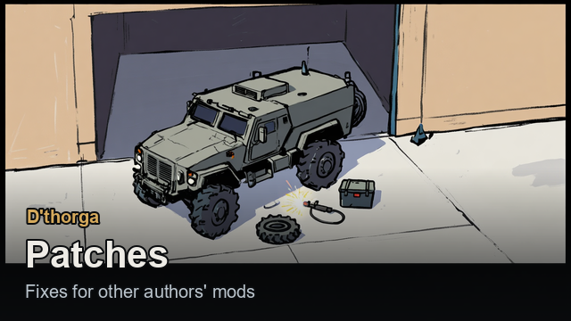
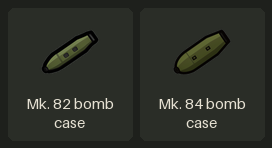

# Patches

**D'thorga Patches** fixes and adjusts other authors' mods. Each part switches on only while that mod is active and copies nothing
from it; without the mods it patches, it does nothing. [Back to the guide](README.md).

## Read this first (gotchas)

- **Needs Harmony and D'thorga Framework. Load it after the mods it patches**; RimSort does this from its About file. **Switch it on
  yourself**: nothing else requires it.
- **Switching from D'thorga Vehicle Patches or D'thorga Missile Patches**: both off, this one on, in the same change.
- **Mostly not yet tested in game**: see [the last section](#what-has-been-tested-in-game).
- **Before removing it**: delete bomb, rocket and heavy-casting bills it added; with Combat Extended, use up or sell bomb cases and
  deconstruct turret hulls built under it.

## What it changes, mod by mod

| Mod (author) | What changes | What you do |
| --- | --- | --- |
| **Harrier VTOL Attack Aircraft** (potemkinvillager) | A realistic build cost (with RimThunder: its turbine, landing gear, tanks, wiring and nozzles; Construction 10). Fourteen parts in place of four. Loads fully beside RimPacts. A sortie's map stays open under the jet. Rearming keeps to one kind of ammunition | Research engine making, Otto Cycle and turbocharged for the turbine. **Avionics, hydraulics or wiring below about 35% ground the jet**: repair them. To change ammunition, choose it on the weapon |
| Harrier, with **Combat Extended** | Bombs cost what they weigh: each starts as a **bomb case** made from steel, then is filled. With The Dead Man's Switch, bombs and rockets are bills at its ammunition fabricator too | Make bomb cases at the machining table, rotary forger or automated machining bay. **Allow the cases in bay hoppers** that used to take heavy castings |
| Harrier, Hind, Mongoose | Rearming tops up the kind already loaded | A part-full magazine waits if that kind runs out |
| **RimThunder** with The Dead Man's Switch - Expedition | The rotary forger makes heavy castings 12 at a time from 1,200 steel | Keep the floor around the forger clear: 24 items drop beside it |
| **Spaceship Turret Hull** (MK), with **Combat Extended** | All seven hulls load ammo like CE's own turrets, and no longer explode when destroyed | **Rebuild hulls built before**, while the ship is landed |
| **InterRim Ballistic Missile** (Psionic Zephyr) | A strategic warhead's blast is spread over moments instead of freezing the game; overhead mountain shelters what is under it; the extinction-class warhead strikes with a fireball, blast and heat zone; no flood of "Area revealed" letters | **Wait for the message that a blast has spent itself before saving.** Settings under D'thorga Patches |
| IRBM with **RimPacts** | An ally's assault after your strike faces the garrison the town had before it. A world war attack shows its deadline | **Strike and attack early**: RimPacts gives a war attack 3 days |
| **Visit Settlements** (Nina.Goblin) | A visited settlement's map stays open while any colonist of yours there is conscious, on foot or in a vehicle. Its food drops no longer fail every tick | Pawns already lost this way stay lost: load an earlier save |
| **Vanilla Expanded Framework** outposts, with **Vehicle Framework** | A caravan with vehicles can't found an outpost through "create outpost", which could lose them | Leave the vehicles first and come on foot. The setting **D'thorga Patches: outposts** turns this off |
| **Vehicle Framework** | Fires a vehicle could never put out are put out; a vehicle leaving a map takes no fire with it | Nothing |
| **Prison Labor** | A temporary guard stops a crash when a warden considers feeding a motivated prisoner | Nothing; it switches itself off once Prison Labor is fixed |
| **Combat Extended** ammo sets | A temporary guard drops ammo set entries that would stop CE's whole ammo setup (The Dead Man's Switch - Synthriada adds such entries) | Nothing |

## The Harrier's sorties

Read from the Harrier's own code, not seen in play. The Harrier mod does all of this; this mod keeps the map open and explains
refusals.

- **Fuel decides time on station, not distance.** A sortie is refused unless the tank holds the trip there and back, an hour over the
  target and a 10% reserve.
- **Home needs a full beacon runway**, 24 by 5 cells for the Harrier. It comes home by itself when its weapons are spent or fuel runs
  low.
- **Don't land on a sortie map**: it takes off only from a beacon runway.
- **No sortie from under a roof**, and **none onto a RimPacts battle you have not joined**: join it from the town's button on the
  world map first.
- **On a hot day a heavy Harrier lands on a runway instead of its pad** ([aircraft](vehicle-care.md#aircraft-and-sling-loads)).

## What has been tested in game

- **Tested by the owner:** Vehicle Framework's stuck fires went out, and the Prison Labor guard let a colony run past its crash (both
  10 November 2026); one missile strike on an earlier version.
- **Not yet tested in game:** everything else.

Every table and setting is in [D'thorga Patches' README](../../mods/PhobosPatches/README.md).
