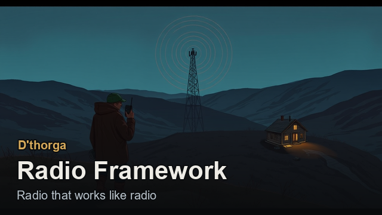

# Radio

**D'thorga Radio Framework** gives colonists hand-held radios and a base station, joined to antennas by coax. Every contact is
decided by a real link budget: distance, walls, rock, roofs and electrical noise all count, and doubling the distance costs 6 dB.
This is the first step, local radio on one map. [Back to the guide](README.md).

## Read this first (gotchas)

- **Needs D'thorga Framework and Vanilla Expanded Framework** (the coax is the latter's pipe network; the upgrades are the former's).
- **The radio terminal is noisy by design**: its computer drowns antennas within a few metres, its own stub included. Site antennas
  away from it, or switch **Radio terminals make radio noise** off in the mod's settings. **Amplifiers only help antennas whose coax
  passes through them.**
- **A station serves only as many radios as its channels hold**: the desk five (ten with its second transceiver), the terminal
  twenty. Past that, a colonist in reach reads **Radio: net busy** and misses the "in touch" mood.
- **The upgrades are experimental**: the desk, whip and mast each have an **Upgrades** button.
- **Decide Metres per map cell before a colony** (default 1). It changes every contact's range.
- **The hand-held is worn on the belt slot**, so a colonist can't wear a shield belt and a radio together.
- **Before removing it**, deconstruct every radio building and drop every hand-held.

## What to build

Research **local radio** (after Microelectronics basics).

| Thing | Where | What it is |
| --- | --- | --- |
| Hand-held radio, VHF or UHF | Machining table: 20 steel, 1 component | 5 W, worn on the belt. **VHF reaches further outdoors; UHF copes better with walls** |
| Radio base station | Architect, D'thorga, Radio: 100 steel, 3 components | 2 x 2, needs power, both bands, a built-in whip |
| Coax feedline | Architect, D'thorga, Radio: 2 steel a cell | Laid like conduit, from the station to an antenna. Loses signal along its length; runs under walls |
| Whip antenna | Architect, D'thorga, Radio: 15 steel | 3 m high. The cheap way to get the antenna outside |
| Mast antenna | Architect, D'thorga, Radio: 60 steel, 1 component | 10 m high, with a little gain. **Sees over walls** |

## How a contact is decided

- **Distance**: doubling it costs 6 dB, a quarter of the power.
- **Walls and closed doors on the straight line**, by material (wood least, plasteel most), but only below 2.5 m: **a tall antenna
  sees over walls**, and the last few cells near the hand-held bite.
- **Natural rock** blocks almost everything. **A mountain base needs coax out to an antenna on the surface.**
- **The roof over each end**: a built roof costs a little, thin mountain roof a lot, overhead mountain nearly everything.
- **Your own generators and batteries** raise the noise near them, fading out towards the edge of their reach.
- **Both directions count, and the worse one decides**: usually the 5 W hand-held, not the 25 W station.

A colonist wearing a hand-held has a **Radio** button with signal bars; click it for the full working. The station's **Net** tab
says who is in touch and which antenna it uses: whichever antenna on its coax gives the best link, or its built-in whip if that is
better or nothing is connected. **Select the station or an antenna and the map shows its coverage**: brighter where a hand-held
would reach it well, dark red where it would not, with every door counted as closed. It fills in roughly at once and finely over a
few seconds, and redraws when you build, so you can see a wall's radio shadow appear. **Select a colonist wearing a hand-held** and a line runs to the antenna they use, in
the colour of their signal, with a mark on everything in the way: a filled orange square on a wall that cost signal, a hollow ring on
one the line passed over, a red diamond on rock. The radio button's window shows the same path from the side. **The desk, whip and mast take upgrades** from their Upgrades button,
fitted by builders: a quieter receiver for the desk, a taller pole for the whip, and an extension or a longer antenna for the mast.
Select the station afterwards and the coverage shows what it bought. **A second station, and amplifiers:** the **radio terminal**
(research software radio) is a computer driving a software-defined radio, only 10 W but able to hear faint hand-helds the desk
misses; its little stub antenna works poorly, and its computer makes noise that spoils antennas close to it, so run coax to a whip
or mast a few metres away. A **linear amplifier** (up to 100 W) or **heavy linear amplifier** (up to 400 W) joined into the coax
raises what either station sends, for the antennas whose cable runs through it, and draws power and warms its room while the
station is sending. The **full-size ground-plane** is a slightly better whip.

**Channels.** Each station has channels, 25 kHz each, as a trunked radio system does: the desk one, the terminal four. Radios
share a channel by taking turns, five to a channel for voice. The station's text and **Net** tab say how many are in use and who is
on which channel; a colonist with no free channel reads **net busy**. A vehicle with a radio fitted is listed too, as standing
by until you ask for it to be driven from a station; then it takes a control channel, and **a colonist assigned to Remote
operation must work the station** (one each, driving two vehicles at once). How driving from a station works is in [vehicles on the road](vehicles-on-the-road.md#driven-from-a-station). Under the count, a line for each kind of use (local voice
for now) says how many channels it holds, for how many radios, and how many more it has room for. The desk's **second transceiver** upgrade adds a channel.

**Signs of life.** The desk's lamp lights and its needle swings while it sends; an amplifier's needle shows its output; the
mast flashes red at night. Select a station and its coax glows, dimming along the cable as it loses the signal. The radio
terminal's **Waterfall** tab (the desk's too, with the setting **Show the waterfall on the radio desk**, off by default) shows each
colonist's radio as a streak, brighter for a stronger signal, over the noise it hears; at
Operator and Engineer the link-budget window adds the budget as steps. A colonist in good contact gets a small **in touch with home** mood, and a fainter one on a weak
link. **While placing** an antenna or the station, the cursor shows its height, the roof and the noise there; red means overhead
mountain.

**How much of the maths to show** (its settings): **Plain** shows bars and one reason in plain words; **Operator** adds the band, the
signal-to-noise ratio, the margin and which direction limits the link; **Engineer** shows every term. The window a radio's button
opens can show one level more than your setting.

## Try it

1. Research local radio. Build the station indoors under a built roof, craft a VHF hand-held and wear it.
2. Walk outside, then behind a stone wall, then into a mountain: watch the bars, the reason, and the line to the antenna.
3. Lay coax from the station out to a mast antenna, and see the station switch to it.
4. Stand near a running generator: the noise appears and the margin falls.
5. Select the station: the map shows its coverage. Build a stone wall near a mast and watch its shadow; select a mast near a running
   generator and see the whole map dim.
6. Open the Engineer sheet: every term should add up to the margin, and the limiting direction should make sense (the 5 W hand-held
   usually limits, not the 25 W station).
7. Check the needs tab for "in touch with home".

The figures and the settings are in [D'thorga Radio Framework's README](../../mods/PhobosRadioFramework/README.md); the notes
for modders are in [Radio Framework for modders](../modding/radio-framework.md).

## Tested in game

The owner has not yet passed anything in this chapter ([the test list](../development/in-game-test-pass.md)).

Everything in this chapter is not yet tested in game.
