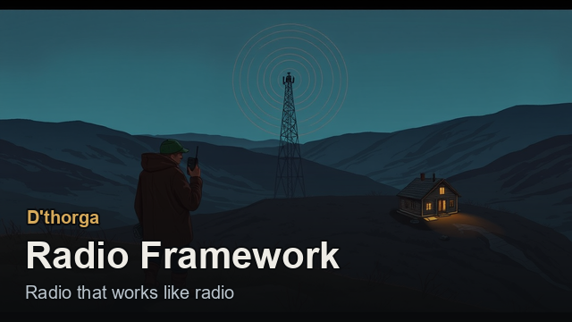
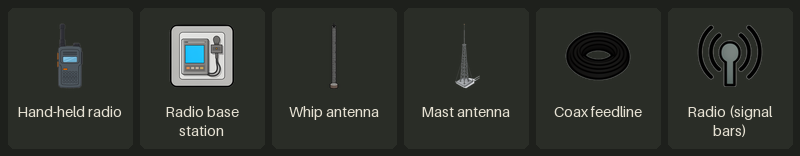

# Radio

**D'thorga Radio Framework** gives colonists hand-held radios and a base station, joined to antennas by coax. Every contact is
decided by a real link budget: distance, walls, rock, roofs and electrical noise all count, and doubling the distance costs 6 dB.
This is the first step, local radio on one map. [Back to the guide](README.md).

## Read this first (gotchas)

- **Not yet tested in game.** It has been built and installed, but not yet seen running.
- **Work on the radio is paused for now**: it stays as described here, and faults reported in play are still fixed.
- **Needs Vanilla Expanded Framework** (the coax is its pipe network). No Harmony, no D'thorga Framework.
- **Decide Metres per map cell before a colony** (default 1). It changes every contact's range.
- **The hand-held is worn on the belt slot**, so a colonist can't wear a shield belt and a radio together.
- **Before removing it**, deconstruct every radio building and drop every hand-held.

## What to build

Research **local radio** (after Microelectronics basics).

| Thing | Where | What it is |
| --- | --- | --- |
| Hand-held radio, VHF or UHF | Machining table: 20 steel, 1 component | 5 W, worn on the belt. **VHF reaches further outdoors; UHF copes better with walls** |
| Radio base station | Architect, Misc: 100 steel, 3 components | 2 x 2, needs power, both bands, a built-in whip |
| Coax feedline | Architect, Misc: 2 steel a cell | Laid like conduit, from the station to an antenna. Loses signal along its length; runs under walls |
| Whip antenna | Architect, Misc: 15 steel | 3 m high. The cheap way to get the antenna outside |
| Mast antenna | Architect, Misc: 60 steel, 1 component | 10 m high, with a little gain. **Sees over walls** |

## How a contact is decided

- **Distance**: doubling it costs 6 dB, a quarter of the power.
- **Walls and closed doors on the straight line**, by material (wood least, plasteel most), but only below 2.5 m: **a tall antenna
  sees over walls**, and the last few cells near the hand-held bite.
- **Natural rock** blocks almost everything. **A mountain base needs coax out to an antenna on the surface.**
- **The roof over each end**: a built roof costs a little, thin mountain roof a lot, overhead mountain nearly everything.
- **Your own generators and batteries** raise the noise near them.
- **Both directions count, and the worse one decides**: usually the 5 W hand-held, not the 25 W station.

A colonist wearing a hand-held has a **Radio** button with signal bars; click it for the full working. The station's **Net** tab
says who is in touch and which antenna it uses. A colonist in good contact gets a small **in touch with home** mood. **While placing**
an antenna or the station, the cursor shows its height, the roof and the noise there; red means overhead mountain.

**How much of the maths to show** (its settings): **Plain** shows bars and one reason in plain words; **Operator** adds the band, the
signal-to-noise ratio and the margin; **Engineer** shows every term.

## Try it

1. Build the station indoors under a built roof, craft a VHF hand-held and wear it.
2. Walk outside, then behind a stone wall, then into a mountain: watch the bars and the reason.
3. Lay coax from the station out to a mast antenna, and see the station switch to it.
4. Stand near a running generator: the noise appears and the margin falls.

The full detail is in [D'thorga Radio Framework's README](../../mods/PhobosRadioFramework/README.md).
