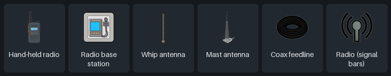

# Radio

**D'thorga Radio Framework** gives colonists hand-held radios and a base station, joined to antennas by coax. Every contact is
decided by a real link budget: distance, walls, rock, roofs and electrical noise all count, and doubling the distance costs 6 dB.
This is the first step, local radio on one map. [Back to the guide](README.md).

## Read this first (gotchas)

- **Needs D'thorga Framework and Vanilla Expanded Framework** (the coax is the latter's pipe network; the upgrades are the former's).
- **The radio terminal is noisy by design**: its computer drowns antennas within a few metres, its own stub included. Site antennas
  away from it, or switch **Radio terminals make radio noise** off in the mod's settings. **Amplifiers only help antennas whose coax
  passes through them.**
- **A station serves only as many radios as its channels hold**: the desk five (ten with its second transceiver), the terminal
  twenty. Past that, a colonist in reach reads **Radio: net busy** and misses the "in touch" mood.
- **The upgrades are experimental**: the desk, whip and mast each have an **Upgrades** button.
- **Decide Metres per map cell before a colony** (default 1). It changes every contact's range.
- **A jammer switched to radios drowns your own radios too**, remote-driven vehicles included: switch the Busbar's jammer mast to radar
  or off while your own trucks are out ([Jamming](#jamming)).
- **The hand-held is worn on the belt slot**, so a colonist can't wear a shield belt and a radio together. **One carried in the
  inventory works just as well** (a Combat Extended loadout puts it there), and leaves the belt slot free.
- **A call is heard only while someone listens** (from 0.73.0): tick **Radio watch** for someone, keep hand-helds in touch, or fit
  the **selective call** ([Radio watch and standing orders](#radio-watch-and-standing-orders-from-0730)).
- **Before removing it**, deconstruct every radio building and drop every hand-held.

## What to build

Research **local radio** (after Microelectronics basics).

| Thing | Where | What it is |
| --- | --- | --- |
| Hand-held radio, VHF or UHF | Machining table: 20 steel, 1 component | 5 W, worn on the belt, ten to a stack (a colonist takes one). **VHF reaches further outdoors; UHF copes better with walls** |
| Radio base station | Architect, D'thorga, Radio: 100 steel, 3 components | 2 x 2, needs power, both bands, a built-in whip |
| Coax feedline | Architect, D'thorga, Radio: 2 steel a cell | Laid like conduit, from the station to an antenna. Loses signal along its length; runs under walls |
| Whip antenna | Architect, D'thorga, Radio: 15 steel | 3 m high. The cheap way to get the antenna outside |
| Mast antenna | Architect, D'thorga, Radio: 60 steel, 1 component | 10 m high, with a little gain. **Sees over walls** |
| Remote gun turret | Architect, D'thorga, Radio: 120 steel, 6 components, 1 advanced component; after **remote turrets** | A .50 that **fires only while a colonist at a station watches it**: connect it to the station **with coax**, or put it **within radio reach** of one (it then needs its picture through the air, so walls and distance count). That colonist can aim it. **While enemies are about, a colonist with Remote operation takes the console.** It takes one of their two hands, after any vehicles they drive. Haulers feed its belt with steel (**with Combat Extended, colonists reload it with .50 BMG**); it needs power |

### Working the radio at the desk (from 0.51.0)

- **The base station has one seat and the radio terminal two**, in front of the edge with the microphone or keyboard. The spot shows as
  you place it, as a workbench's does. **Put a chair there**: whoever works the radio sits and is comfortable; with no chair they stand.
- **One person to a seat.** A colonist who wants the radio while the seats are taken uses their hand-held if they are in touch, or does
  something else.
- **A call made at the desk takes a channel**, as a hand-held does: a radio chat, talking someone through a job, a lesson, a neighbour's
  call. When every channel is in use the desk is passed over, and a call cut off by a vehicle's orders ends with a message.
- **Teaching in person**: at the terminal, a teacher sits beside the child when both seats are free, and the lesson takes no channel.
- **A station built before 0.51.0** may have a wall or a machine where its seat now is: its pane says "Nobody can sit at it". Clear the
  spot or move the station.

### Calling other factions on the radio (from 0.53.0)

- **Select a colonist and right-click a radio station**: you can call every faction whose settlement your radio reaches, each with how
  good the line is. The colonist sits at the desk; the call takes a channel. The game's comms console still reaches every faction.
- **On the call**: ask for a **trader caravan** (it comes from that settlement, so a near one arrives sooner than the console's two
  days), **military aid**, or **check in** for a little goodwill (every 5 days, up to 75).
- **The line matters**: a **clean** line makes requests cheaper; on a **marginal** line one request in four is misheard, and the goodwill
  is spent all the same. Raise a mast or use a relay first.
- **Others listen**: a hostile settlement in reach of your stations may hear you ask for a trader and ambush the caravan. It arrives
  hurt, or not at all. A setting switches this off.
- **Allies warn of raids**: with an ally's settlement in reach, raiders heading your way are reported by radio, and the raid comes
  about three hours later. A setting switches this off.
- **A first call to a settlement earns its QSL card**, and every call goes in the station's logbook.
- **A supply drop by radio** (from 0.54.0): an ally on a radio call can drop supplies by parachute, as the console offers, at 10
  goodwill over a clean line instead of 15.
- **See who you can call** (from 0.54.0): select your colony on the world map, and a line runs to each faction settlement your radio
  reaches, in the colour of how good the line is.

## Talking to aircraft

**Aircraft talk on their own bands**: the civil **air band** (118 to 137 MHz) and **military UHF** (225 to 400 MHz), by AM voice. Your
hand-helds and a station's built-in whip cannot work them. To hear your aircraft:

1. Fit the **aviation transceiver** upgrade to the radio desk or the radio terminal (its Upgrades button: 20 steel, 4 components).
2. Fit **aviation antennas** to a **mast** on that station's coax (25 steel, 1 component).
3. Every aircraft already has its **aviation radio**, fitted at the factory (10 W). Its **Comms** system on the Systems tab then reads
   **in touch** while it is on the map within reach of that mast.

A station with both shows the air band and military UHF on its Waterfall tab. **Jamming reaches these bands too.**

## Talking to boats

**Boats talk on the marine band** (156 to 162 MHz), by FM voice. As with aircraft, your hand-helds and a station's built-in whip
cannot work it. To hear your boats:

1. Fit the **marine transceiver** upgrade to the radio desk or the radio terminal (its Upgrades button: 15 steel, 3 components).
2. Fit a **marine antenna** to a **mast** on that station's coax (15 steel, 1 component).
3. Every new boat comes with its **marine radio**, fitted at the factory (25 W). Its **Comms** system on the Systems tab then reads
   **in touch** while it is on the map within reach of that mast. **A boat you had before keeps its dual-band radio**: a mechanic can
   swap it for the marine radio in the same bay (Fittings).

## How a contact is decided

- **Distance**: doubling it costs 6 dB, a quarter of the power.
- **Walls and closed doors on the straight line**, by material (wood least, plasteel most), but only below 2.5 m: **a tall antenna
  sees over walls**, and the last few cells near the hand-held bite.
- **Natural rock** blocks almost everything. **A mountain base needs coax out to an antenna on the surface.**
- **The roof over each end**: a built roof costs a little, thin mountain roof a lot, overhead mountain nearly everything.
- **Your own generators and batteries** raise the noise near them, fading out towards the edge of their reach. **Narrow modes hear
  less of it**: Morse much less than speech, a remote vehicle's video link more.
- **A jammer switched to radios** drowns every radio for a long way around, yours included ([Jamming](#jamming), below).
- **Both directions count, and the worse one decides**: usually the 5 W hand-held, not the 25 W station.

A colonist wearing or carrying a hand-held has a **Radio** button with signal bars; click it for the full working. The station's **Net** tab
says who is in touch and which antenna it uses: whichever antenna on its coax gives the best link, or its built-in whip if that is
better or nothing is connected. **Select the station or an antenna and the map shows its coverage**: brighter where a hand-held
would reach it well, dark red where it would not, with every door counted as closed. It fills in roughly at once and finely over a
few seconds, and redraws when you build, so you can see a wall's radio shadow appear. **Select a colonist wearing a hand-held** and a line runs to the antenna they use, in
the colour of their signal, with a mark on everything in the way: a filled orange square on a wall that cost signal, a hollow ring on
one the line passed over, a red diamond on rock. The radio button's window shows the same path from the side. **The desk, whip and mast take upgrades** from their Upgrades button,
fitted by builders: a quieter receiver for the desk, a taller pole for the whip, and an extension or a longer antenna for the mast.
Select the station afterwards and the coverage shows what it bought. **A second station, and amplifiers:** the **radio terminal**
(research software radio) is a computer driving a software-defined radio, only 10 W but able to hear faint hand-helds the desk
misses; its little stub antenna works poorly, and its computer makes noise that spoils antennas close to it, so run coax to a whip
or mast a few metres away. A **linear amplifier** (up to 100 W) or **heavy linear amplifier** (up to 400 W) joined into the coax
raises what either station sends, for the antennas whose cable runs through it, and draws power and warms its room while the
station is sending. The **full-size ground-plane** is a slightly better whip.

**Channels.** Each station has channels, 25 kHz each, as a trunked radio system does: the desk one, the terminal four. Radios
share a channel by taking turns, five to a channel for voice. The station's text and **Net** tab say how many are in use and who is
on which channel; a colonist with no free channel reads **net busy**. A vehicle with a radio fitted is listed too, as standing
by until you ask for it to be driven from a station; then it takes a control channel, and **a colonist assigned to Remote
operation must work the station** (one each, driving two vehicles at once). How driving from a station works is in [vehicles on the road](vehicles-on-the-road.md#driven-from-a-station). Under the count, a line for each kind of use (local voice
for now) says how many channels it holds, for how many radios, and how many more it has room for. The desk's **second transceiver** upgrade adds a channel.

**Signs of life.** The desk's lamp lights and its needle swings while it sends; an amplifier's needle shows its output; the
mast flashes red at night. Select a station and its coax glows, dimming along the cable as it loses the signal. The radio
terminal's **Waterfall** tab (the desk's too, with the setting **Show the waterfall on the radio desk**, off by default) shows each
colonist's radio as a streak, brighter for a stronger signal, over the noise it hears; at
Operator and Engineer the link-budget window adds the budget as steps. A colonist in good contact gets a small **in touch with home** mood, and a fainter one on a weak
link. **While placing** an antenna or the station, the cursor shows its height, the roof and the noise there; red means overhead
mountain.

**How much of the maths to show** (its settings): **Plain** shows bars and one reason in plain words; **Operator** adds the band, the
signal-to-noise ratio, the margin and which direction limits the link; **Engineer** shows every term. The window a radio's button
opens can show one level more than your setting.

## Convoys on the world map

**A convoy with a radio fitted** (the remote control kit on any of its vehicles) **can reach home** while it is near: the convoy's line
says whether it is in reach, how far home is, and the horizon of the two aerials. A powered **radio station** at home with a **mast
antenna** reaches furthest. **For radio, a world tile counts as 1 km** (a gameplay choice), so a convoy reaches home from about **20
tiles**, or **26 with a Datum's mast up** (Raise the mast, at a halt). In reach:

- **Home warns of ambushes** ahead: each way out is a little likelier.
- **A caravan on foot can call home too** (from 0.44.0): by a **hand-held**, worn by anyone in it or **packed in its goods**, while
  someone there is awake enough to talk. A hand-held reaches a station's mast about **12 tiles** off on flat ground, further from a
  hill or through relays. In reach, the caravan's pane says so, an aircraft can drop supplies to it, it can call a **medevac**, and it
  can put up a relay mast at a halt. A convoy with no vehicle radio uses a hand-held the same way.
- **In touch on the road** (from 0.44.0): colonists in any caravan of yours in reach, on foot or in vehicles, get the in-touch mood.
- **Calls pass through relays**: a convoy of yours **standing still**, or a vehicle **left at a depot**, with a radio and the **repeater
  kit** fitted (a Datum's mast lifts it), or a **relay mast** (Put up a relay mast, on a stopped convoy: 60 steel and 4 components). Up to
  two relays; the convoy's line names them. A relay mast stands until you take it down from the world map. **Hills reach further**: small
  hills lift an aerial 30 m, large hills 100 m, mountains 300 m.
- **High ground on the way blocks the signal** (from 0.41.0): the hills and mountains of the tiles between a convoy and home stand
  in the line between the two aerials. Grazing it costs a little; in a range's shadow the call is lost, and UHF loses more than VHF.
  The convoy's line says when ground is the reason. **Raise the mast, halt on a hill, put a relay on the high ground, or go round.**
  Impassable mountains block the most.
- **See reach on the world map** (from 0.37.0): select a convoy, a relay mast or a relay post there. A ring shows how far its radio
  reaches a home station's mast on level ground; a convoy also shows its chain home, hop by hop, **the weakest hop in amber**.
- **Radio coverage on the world map** (from 0.42.0): select a colony of yours with a powered station, a relay mast, a relay post or
  a convoy with a radio, press **Radio coverage** and pick the radio at the far end: a **vehicle radio**, the same with its **mast
  up**, a **relay mast**, a **relay post**, or a **vehicle by Morse** (only where a station there has a Morse key). Every tile is
  then coloured by how well that radio would reach the place from there (from 0.44.0 also a **hand-held**, for a caravan on foot): **brighter is stronger, dark red is too weak, and unpainted
  ground is past the horizon**. Hills light up from further off; a range casts a shadow behind it. The picture follows whichever of
  your radio places you select, and stays until you pick **Off**. It shows signal only: a relay with every channel in use still
  refuses a call. A colony with a station also shows a reach ring now, as a mast and a post do.
- **The whole network at once** (from 0.43.0): the same button's menu has **Home, through relays** for a vehicle radio, the same
  with its mast up, and Morse. It paints everywhere a call could get home from, straight to a station or passed on by your relay
  masts, relay posts and halted repeater vehicles, **the weakest hop deciding**. Park a repeater vehicle or put up a mast and the
  picture grows to match. Morse goes straight home only.
- **The path home, seen from the side** (from 0.48.0): a convoy or a caravan on foot with a radio has a **Radio** button on the world
  map, with the same signal bars a hand-held has. Press it for each hop of the way home drawn from the side: the hills of each tile on
  the way, the line between the two aerials, and **the ground that decides in orange**. **Show that ground** looks at its tile.
  **Show more** gives the figures, as on a map.
- **Planning a relay** (from 0.48.0): in the Radio coverage menu, **Planner: where a new relay mast would reach home** (or relay
  post) paints every tile a new one would itself reach home from. Put it where the vehicle picture has a gap and the planner is bright.
- **A full relay is marked** (from 0.48.0): the whole network's picture leaves out a relay with every channel in use, marks its tile
  **pink** and names it in the pane, as a new call would be refused there.
- **Relay masts wear and can be raided** (from 0.37.0; a setting, **off by default**): on, a mast stops passing calls on after about a
  year until a convoy on its tile presses **Service the relay mast** (one component), and raiders near their own lands may knock it
  down. **A worked example of the whole network:** [Setting up a supply network](supply-network.md).
- **A radio relay post** (from 0.24.0): an outpost you found from **Create outpost** with **120 steel and 8 components**, leaving at
  least one colonist to keep it. A 20 m mast and four channels; **put it on a hill**. With nobody left there, it passes nothing on.
- **Your other colonies' stations** pass calls on once their base station has the **repeater** upgrade (25 steel, 3 components, after
  remote-controlled vehicles). This only helps a call meant for one colony, such as **advice by radio** from a doctor there: a call that
  reaches any of your colonies is home already.
- **A relay has only so many channels** (from 0.24.0): a repeater has two, enough for **five convoys talking by turns, or two vehicles
  driven by radio**; a relay post has four. **Orders to a vehicle push talk aside.** A full relay is passed over, and the convoy's line
  says so; the relay's own pane says how busy it is.
- **An aircraft can drop to the convoy** (Airdrop to the convoy, when choosing where to fly): the convoy talks it in, and everything
  dropped joins it.
- **An aircraft is a flying relay** (from 0.50.0): fit it with the **repeater kit** and the **dual-band radio** (for convoys and
  hand-helds; with only its aviation radio it passes on aircraft calls). In flight it passes calls on **from its height**: from 3,000 m its
  horizon is over 200 tiles, where a mast's is about 20. Press **Hold station over...** on it in flight to keep it circling over one place
  ([aircraft](aircraft-and-sling-loads.md#holding-station)); it relays **on the way** too. The whole network's picture draws a holding
  aircraft as a relay, and **names one relaying on the way** in its pane without drawing it, as its place keeps changing; calls pass
  through it all the same.

### Talking home from a camp or a site (from 0.25.0)

**Fit the dual-band radio** to a vehicle (a voice radio bay every land vehicle has; 12 steel, 2 components, after local radio; about
2 A on the battery). **A colonist's hand-held, VHF or UHF, talks home through it** from anywhere on the same map it reaches, through any
relay, as a real cross-band set does. **Your colonies' maps don't need it**: there, the station serves. **From 0.34.0** colonists there
get the **in touch with home** mood through it, and the vehicle's pane says whom it passes calls home for.

## Advice by radio

**A more skilled colonist can talk another through their work by radio**: tending, an operation, a repair of one of our vehicles, or
trade talks. Nothing to press: it happens by itself when both are in radio touch.

- **Who gives advice**: a colonist more skilled in the work, with that work **switched on in the Work tab** (Doctor for tending and
  operations, Construction for repairs; anyone not incapable of social work for trade), awake, and not busy with something more
  urgent. They stop and take the call **on a hand-held where they stand**, **in bed** if they are resting there, or **at a radio
  station's desk** if they carry no radio.
- **Who is helped**: a colonist wearing a hand-held in touch with a station, or anyone in a **convoy whose radio reaches home**, or
  (from 0.25.0) a colonist with a hand-held **on a camp, site or ambush map** within reach of a vehicle of yours with the **dual-band
  radio** fitted, when that vehicle reaches home.
- **How much**: the carer works as if **half the gap** to the adviser's skill were closed, a **quarter** on a marginal link, a little
  slower while every step is spoken. A Medicine 3 colonist talked through by a Medicine 16 doctor works as Medicine 9. The carer's
  stat card shows the help.
- **A numbered medical chest** (drug lab, after local radio and medicine production: 20 steel, 15 cloth, 1 medicine), carried, in the
  convoy or kept nearby, closes **a sixth more** for medical advice. It is never used up.
- **A slow-scan camera kit** (machining table, after local radio: 15 steel, 3 components), at hand the same way, sends the adviser a
  picture of the wound or the engine: **a sixth more** for tending, surgery and vehicle repairs, **on a clean link only**. With the
  chest too, both add.
- **Repairs**: a repair that needs more Construction than your mechanic has can be done while someone better talks them through it,
  at home or with the convoy's repair button.
- **On the road and in trade talks**, which have no job of their own, the adviser stays on the radio for a while afterwards: about
  half an hour after a convoy's tend, an hour after a repair or trade.
- **If the call drops** (out of touch, or the adviser called away), the carer carries on alone, at their own skill.
- **Surgery talked through** has its own setting, **Radio advice during surgery**, on by default.
- **The carer learns while talked through**: the skill rises half again as fast during the call, and the adviser gains a little Social.
- **Other factions' doctors and mechanics**: when none of your colonists can help with tending, an operation or a repair of one of our
  vehicles, a doctor or mechanic at another faction's settlement in radio reach may. **Allies help free, once a day**; a **neutral** faction asks **3 goodwill** a call and never takes its
  goodwill below 0; hostile factions and those without radio (tribes, medieval kingdoms) never help. Masts, hilltops and relays bring
  more settlements into reach. A call stays open for an hour after its last use, so a convoy's tends an hour apart cost once. Setting:
  **Other factions' doctors and mechanics give advice by radio**, on by default.

## A radio friend

**A colonist with a radio can make a friend at another faction's settlement and chat with them as recreation.** Nothing to press: a
colonist picks it like any other recreation.

- **What it needs**: a hand-held in touch with a station (in bed too, awake), or a powered station's desk to walk to; and a faction
  that is not hostile and has radio (not tribes or medieval kingdoms), with a settlement your stations reach. Masts, hilltops and
  relays bring more settlements into reach.
- **The friend** is a named person of that faction, the same each time.
- **After each chat** the colonist's mood lifts: **+2** with a new friend, **+4** with a friend (about 10 hours of chats), **+6** with
  a close friend (about 30 hours).
- **A chat of an hour or more** raises the friend's faction's goodwill by **1**, at most **3 times a quadrum** for each faction.
- **If the friend dies or their faction turns hostile**, the colonist mourns them (**-6** for 6 days), and finds a new friend next time.

## Colonists talk on the radio by themselves (from 0.63.0)

**Give colonists hand-helds and they talk to each other on the radio without being told.** Nothing to press. The setting **Colonists
talk on the radio by themselves** (on by default) switches it all off.

- **Chats across the map**: a colonist in touch now and then calls another who is out of earshot, someone they like. **Working alone**
  (mining at the edge, hunting, a long haul) they call about **every three hours**; with others near, about every twelve. Both get the
  game's usual chit-chat mood, and the chat shows in the social log. **On a faint link a chat can be misheard** and taken as a slight.
- **The evening call**: between **19:00 and 21:00**, someone at home calls their **partner, family or a friend who is away in a caravan**,
  once a day, from a hand-held or a station's desk. Through, both are cheered (**+4** for a partner, **+3** family, **+2** a friend).
  If the caravan has a radio but is out of reach, or the desk has no free channel, the caller **couldn't get through** (**-2**). Masts,
  relays and repeaters keep a caravan in reach.
- **Company through the night**: a colonist in bed who should rest, or one working alone at night, is kept company on the radio by
  whoever likes them best and is awake, or by their radio friend (**+3**; the one keeping company likes them a little more).
- **The station's Log** lists the evening calls and the nights' company. **Its inspect text names who is on the air.**
- **The station's lamp and waterfall now show real talk**: a colonist's hand-held lights them only while they are really talking.
- **The guard net**: when you draft colonists, their hand-helds go on a channel of their own that takes priority over chatter, so a
  full station never cuts off a fight.

## Radio watch and standing orders (from 0.73.0)

**A call from outside is heard only while someone is listening.** That is someone at a station's desk, or an awake colonist, not
drafted, whose hand-held is in touch (through repeaters, relays or a vehicle's radio too). A call nobody hears is **missed**: the
station's Log says so, and a neighbour tries once more about three hours later. A neighbour asking for help is such a call, and from
0.74.0 so is an ally's raid warning: missed, the raid comes unannounced.

- **The station's pane says who is listening**, or that calls will be missed.
- **Radio watch** is a new work, near the end of the work list. A colonist with it ticked sits at a station's desk and listens while
  nobody else is, an hour at a time, and leaves when someone else is listening or a vehicle needs the console. **It is not ticked for
  colonists already in your colony**: choose who keeps watch.
- **The selective call** is a cheap upgrade for the base station or the terminal (5 steel, 1 component). With it, a call nobody hears
  rings and **wakes the colonist asleep with Radio watch highest in their work**, who wakes with the game's "disturbed sleep".
- **Standing orders**: a button on each station opens a list of what whoever is listening may do without asking you. An order ticked
  on any working station of the colony counts, and the Log says who carried it out.
  - **Answer neighbours who ask for help** (on): your best doctor or mechanic goes on the radio at once, as if you had said yes, with
    a message in place of the letter.
  - **Ask an allied trader in when there is silver to spend** (off): once a day in the morning, if the colony has at least the silver
    you set (2,000 to start), the one listening asks an ally in reach to send a trader. Each request costs goodwill, as asking by radio
    does, and a hostile settlement listening may ambush the caravan.

## School of the Air

- **A child who wants to radio-talk** (the game's own learning) and has no comms console to use goes to radio school at one of our stations instead (from 0.54.0).

**Children can learn by radio** (needs Biotech). After the microelectronics research, a child may choose **radio school**: at a radio
station's desk, or anywhere with a hand-held in touch with a station.

- **With nobody to teach**, it fills their learning, as the game's radio talking at a comms console does.
- **With a teacher in radio touch** it is a lesson: an adult **assigned to childcare**, on the map with a hand-held or at a desk, or
  **away in a convoy whose radio reaches home**. The child learns one of the teacher's best skills, at three quarters of a lesson at a
  school desk; the teacher gains Social. A parent is asked first.

## Neighbours ask for yours

**Now and then, about once a fortnight, a friendly neighbour asks by radio for your best doctor or mechanic for an hour.** Only a
faction that is not hostile and has radio, with a settlement your stations reach, asks; and only for a colonist with Medicine or
Construction **6 or more**, free and in radio touch.

- **Yes**: the colonist goes to the radio for an hour (a hand-held, or a station's desk), gains a little of that skill and Social, and
  the faction's goodwill rises by **5** once the hour is done.
- **No** costs nothing. A letter left unanswered goes after 6 hours.
- Setting: **Neighbours ask for help by radio**, on by default.

## HF radio

**Research HF radio, build an HF station, and run coax to a dipole outside.** HF (40 m and 20 m, single-sideband voice) is the
long-distance radio: along the ground a tile or two, and **round the world by the sky when a band is open**:

- **A dipole for each band, in three kinds**: a **flat dipole** between two masts (the best signal, the longest strip: 21 cells for
  40 m, 11 for 20 m), an **inverted V** on one mast (14 and 7 cells, about a decibel less), and a **shortened dipole** with loading
  coils (6 and 4 cells, several decibels less). Turn it as you place it.
- **The manpack radio** is worn like a hand-held: twenty watts and a tall whip.
- **Along the ground HF reaches a tile or two from an upright whip** (a tile is about 30 km for HF), much further over the sea, and
  little from a flat dipole, whose strength is the sky. A caravan with a manpack near home stays in touch with an HF station that
  has an upright antenna, or with another manpack.
- **By the sky**: 40 m reaches the region round you by day and far by night; 20 m reaches far by day and skips over places close
  in. A path opens and shuts as the hours turn. **The HF bands tab** on the HF station shows how often each band is open to each
  distance now, and the world map shows a rose round the colony: how far each band reaches in each direction this hour.
- **Two pictures on the world map**, each switched on in the radio's mod settings: **the grey line** (day meets night; HF often
  opens along it at dawn and dusk) and **skip zones** (a ring for each band where the sky brings it back down this hour).
- **Solar flares**: your radio stations keep working through a flare, but HF by the sky is blacked out on the sunlit side of the
  planet until it passes; a letter says so. HF along the ground, the night side, VHF and hand-helds carry on.
- **Height matters**: a low dipole throws its signal upward, for the region round you; a high one throws it low, for far places.
  **Select a dipole and press Upgrades** to raise it: a **telescopic mast** (15 m, cheap and quick) or a **lattice tower** (25 m,
  dear and slow). It comes on a 10 m guyed pole (8 m for the V and the shortened one).
- **Settlements answer on HF**, so calls, advice and radio friends reach far settlements while a band is open. A setting makes the
  comms console call only the factions your radio reaches (off by default).

## Morse

**A Morse key keeps a convoy in touch with home far beyond the reach of voice.** Fit the **Morse key** upgrade to a base station's desk,
and the **Morse key** fitting to a convoy vehicle that has the remote control kit's radio.

- Morse is narrow and copied by ear on a weak signal, so it reaches **three to four times as far** as speech between tiles. Direct only:
  relays carry voice, not Morse.
- A convoy in touch only by Morse keeps the in-touch mood, and advice by radio still helps, but only **a quarter** of the gap. No radio
  lessons or chats go over it.

## Jamming

**A jammer switched to radios floods the radio bands with noise, and every radio for a long way around hears it, yours as well.** For
now the one jammer that does is the Busbar generator set's **jammer mast**, switched to **radios** or **radar and radios** with its
**Jammer** button ([working vehicles](working-vehicles.md#busbar-generator-set)).

- **What fails, in order**: a remote vehicle's video link first (its remote guns fall silent), then speech, then a vehicle's control
  link; **Morse lasts longest**. A radio-linked turret stops firing; **a turret linked by coax is untouched**.
- **What still gets through**: a radio **close to its station, or nearer the station than the jammer is**, and a strong one: an
  amplifier helps.
- **How to tell**: at Plain, a jammed radio's reason reads **jamming drowns the signal**; a vehicle driven from a station that loses
  its link says it is jammed; the Engineer sheet adds a line with the jamming at each end.
- **Jamming has no edge on the map**: its noise falls off with distance, as a signal does, so it is felt everywhere and strongest near
  the jammer. Walls and rock do not yet shield from it.
- **With The Dead Man's Switch: jam the call.** At one of its bases, a **reinforcement uplink** or **fire support uplink** cannot call
  for help while jamming drowns it: bring a Busbar, set it up, switch its mast to radios, and the alarm brings no drop pods and no
  mortar fire. A message says when a call was drowned. **The call goes out at the next alarm once the jamming stops**, so destroy the
  uplink or keep jamming. Your own radios on that map are drowned too.
- Setting: **Jamming reaches radios**, on by default. Off, jammers blind radar only.

## The logbook and QSL cards

**Select a radio station or terminal and open its Log tab.** It lists your colonists' radio friends, the settlements in reach, and the
log, newest first: advice calls, other factions' help, friends made and lost, radio lessons, neighbours' calls and medevacs.

- **QSL cards**: the first contact with each settlement (a faction's doctor or mechanic, a radio friend's chat, a neighbour's call)
  earns its card, shown on the tab in that faction's colours. A card carries the station's **callsign** (its three-letter prefix comes
  from the named place it lies in or nearest to, a mountain range, sea, lake or bay of your world, named under the callsign; the
  digit says how far north it is), yours, the time in UTC as operators log it, the station's
  **grid square** (the real Maidenhead locator of its place on the planet), your signal report, the distance and a few words for
  what the contact was. Its front is a picture of the station's home, painted from its place on the planet: the sky at the hour you
  made contact, its hills, its trees, desert or ice, the sea if it is on the coast. **Click a card to turn it over**: the back says the
  band and mode the contact was worked on, and the relay stations that carried it. **Your own callsign**: type it in the radio's mod
  settings (*Our station's callsign*) and every card is addressed to it.
- **Cards you can hold**: each card also comes as a real card, **by the QSL bureau**: the next friendly trader or visiting group
  brings every card awaited, all together. Colonists read them for recreation like books, and keep them on a shelf; a card lifts
  the reader's mood a little, more from far away.
- **The QSL wall and the ham shack**: build a **QSL wall** (Architect, radio) and colonists hang the cards on it, six to a board,
  each showing its picture; they read them from there. A room with a radio station and a QSL wall is a **ham shack**: radio work
  there goes 10% faster, and radio operators enjoy a decent one (+2). Each award comes as a **framed certificate** to place;
  colonists admire it as art.
- **The QSL album**: on the Log tab, **Open the album** shows every card, newest first, by faction or farthest first.
- **Rare stations**: now and then, by letter, a rare station is on the air for a few hours (a ship at sea, an expedition on the
  ice, a lone outpost). Select your HF station and press **Call** while a band is open to it, for a rare card.
- **Listener cards**: a settlement your station hears but cannot reach sends a listener's card, heard only.
- **More awards**: every kind of land a station stands on, 10 and 25 grid squares, a contact 10,000 km away or more (HF reaches
  that far), and every landmass with a station on it.
- **Awards**: cards from three factions, from every faction on the air, from 50 km away or more, or from ten settlements each earn an
  award. Colonists who work the radio (wearing a hand-held, or with a radio friend) are proud of it: **+2** an award, up to **+6**.

## Try it

1. Research local radio. Build the station indoors under a built roof, craft a VHF hand-held and wear it.
2. Walk outside, then behind a stone wall, then into a mountain: watch the bars, the reason, and the line to the antenna.
3. Lay coax from the station out to a mast antenna, and see the station switch to it.
4. Stand near a running generator: the noise appears and the margin falls.
5. Select the station: the map shows its coverage. Build a stone wall near a mast and watch its shadow; select a mast near a running
   generator and see the whole map dim.
6. Open the Engineer sheet: every term should add up to the margin, and the limiting direction should make sense (the 5 W hand-held
   usually limits, not the 25 W station).
7. Check the needs tab for "in touch with home".

The figures and the settings are in [D'thorga Radio Framework's README](../../mods/PhobosRadioFramework/README.md); the notes
for modders are in [Radio Framework for modders](../modding/radio-framework.md).

## Tested in game

The owner has not yet passed anything in this chapter ([the test list](../development/in-game-test-pass.md)).

Everything in this chapter is not yet tested in game.
