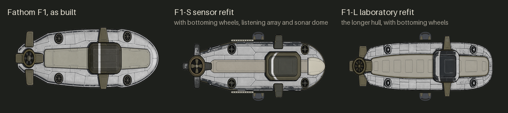
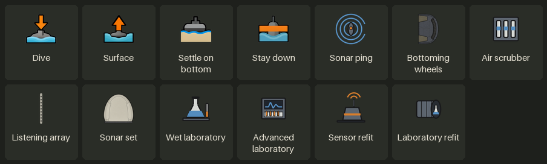

# Submarines

The **Fathom seabed crawler**, from **D'thorga Vehicles**, is a small submarine. Bare, it can dive, hide and come home; its
upgrades let it rest on the bottom, listen, ping, and carry a laboratory. The diving, spotting, listening and sonar come from
**D'thorga Framework** and work for any mod's diving boat. [Back to the guide](README.md).

## Read this first (gotchas)

- **Not yet tested in game.**
- **Research submersible hull** on the **D'thorga: Submarines** tab (after **vehicle parts** and Batteries). Each upgrade has its own
  research and its own part from the vehicle parts bench.
- **Build it in shallow water.** It is 4 by 9 cells. **A Crawler built before it grew** (it was 3 by 8) keeps its old shape: destroy it
  in dev mode and build a fresh one.
- **Stay down kills the crew if you leave it on.** Past the end of the air, the crew breathes stale air. You can call it off while
  anyone aboard can still work the boat; **after that the order stands and the boat is lost.**
- **Every sonar ping gives your boat away** for a minute.
- **Enemy boats dive too**, and ping now and then while they hunt.

## Diving and surfacing

- **Press Dive.** It needs deep water under its whole hull, enough crew, sound ballast tanks and pressure hull, and some air and
  charge in reserve. A refusal says which is missing. **Surface** brings it up.
- **Under the water nobody can aim at it until it is spotted.** Only explosions reach it, most guns hold fire, and nobody can get
  out.
- **The reserve** of air and charge runs down while under, faster on the move, and refills on the surface. **The boat comes up by
  itself** if the reserve runs out, the water gets shallow, a vital part is badly damaged, or nobody aboard can work it (unless it was
  ordered to stay down).
- **Diving puts out a fire**: once a burning boat is fully under, the fire goes out.
- **A caravan of nothing but submersibles can dive together** over water tiles on the world map, and is then safe from ambushes,
  demands and meetings.

### Being spotted

- **Anyone hostile, near and with a clear line can spot it**: more easily when it moves, less easily in fog, rain or dark.
- **Dive out of sight**: a boat seen going down is followed.
- **A spotted boat shows as a dark shape** and can be shelled. Unspotted, your own boat shows only as a faint mark at its middle.
- **A soft ping sounds at the hull** when watchers spot it, with a message.

### Resting on the bottom

With **bottoming wheels** (research **seabed running gear**), press **Settle on bottom**. It uses half the air and charge and is far
harder to find. **It must lift off before it can move.** An **air scrubber** (research **air purification**) gives six more hours
under.

## Listening and sonar

| | Listening array | Sonar set |
| --- | --- | --- |
| Research | Hydrophones | Active sonar, after hydrophones |
| What it finds | Hostile **movement**: in the water across its whole range, on land at half; something standing still not at all | **Everything hostile in the water** within its reach, moving or still, and every boat under the water |
| Range | 40 cells still, 20 on the move | 60 cells; a boat resting on the bottom only from half as far |
| Gives you away? | **Never** | **Yes**: your boat is followed for a minute, and anyone in the water hears the ping from twice its reach |
| Use | Always on; one message when movement is first heard | Press **Sonar ping**: 30 seconds between pings, someone awake aboard |

- **The inspect pane** says how many are moving, how far away and in which direction the nearest is, and **warns when the nearest is
  close enough to spot your boat**.
- **Select the boat** to see its range as a ring, with a line to each contact, fog or not.
- **Another boat under the water that you hear or ping is spotted**, so it can be fired on.
- **Your boats are told the direction of any ping they hear**, with or without a set.
- **It hears only as well as the best ears aboard among those awake.** Damage to the hydrophones at the bow, or the transducer
  under it, shortens the range.
- Neither works on the world map.

## Research at sea

- **The wet laboratory** (research **marine science**) adds two scientist's seats. **Put colonists with Intellectual 7 or more in
  them**, awake and on a work shift, and they carry on the colony's current research project: three quarters of a simple research
  bench's speed while still, half that on the move. It takes any project that needs no particular bench.
- **The advanced laboratory** comes after it and is made from one analyser bench. It takes anything a hi-tech research bench can,
  at a hi-tech bench's speed.
- **The boat's inspect pane says who is at work, or why nobody is.** Research goes on in a caravan on the world map too.
- **Advanced marine science can only be researched at sea.** Choose it in the research tab as usual: the benches at home keep
  working on the colony's own project, and both show as in progress. **With Nice Research Tab, choose it directly** rather than
  queueing it ahead of others, or the queue waits for it.

## The two refits

**Choose one: they exclude each other**, and each gives the hull a different picture. To change your mind, remove one in the
Upgrades tab and fit the other.

| Refit | Research | Gives | Costs |
| --- | --- | --- | --- |
| **F1-S sensor refit** | Faired sensor sail, after active sonar | The listening array hears 20 cells further, the sonar reaches 30 further | It carries 200 less |
| **F1-L laboratory refit** | Laboratory hull section, after advanced marine science; needs the advanced laboratory fitted | A third scientist's seat and faster research | A little slower in the water |

Radar, a manipulator arm and a seabed drill are designed and drawn, and not built yet.

## The X-1 test hull

**Not a finished vehicle, and it cannot be built.** In dev mode, **Vehicle systems: spawn a submersible** places one, crewed, for
trying out diving.

## What has been tested in game

**Nothing in this chapter yet.** It is built and checked offline. The full detail is in
[D'thorga Vehicles' README](../../mods/PhobosVehicles/README.md#the-fathom-seabed-crawler-not-yet-tested-in-game) and
[D'thorga Framework's README](../../mods/PhobosFramework/README.md#submersibles-new-in-0580-spotting-in-0590-not-yet-tested-in-game).
