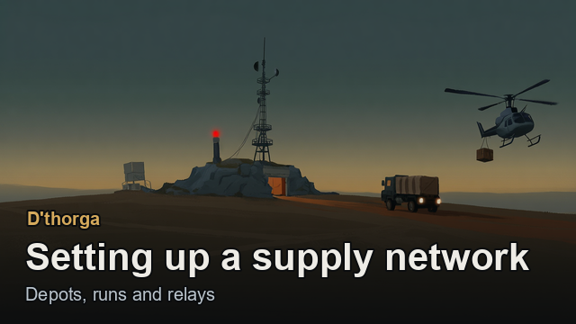

# Setting up a supply network

A worked example from start to finish: keeping a far outpost stocked by truck, by radio and by helicopter, with nobody driving if you
like. Each step names the button to press and says where its chapter explains more. For **D'thorga Framework** with Vehicle Framework;
the radio parts also need **D'thorga Radio Framework**.

## Read this first

1. **A truck runs supplies only with the route kit fitted** (vehicle workshop). **With nobody aboard, it drives only while its route kit
   works and, with the Radio Framework, while home's radio reaches it** (or reached it to set off, if you choose that in the settings).
2. **Radio between places reaches about 20 world tiles** from a vehicle radio to a station's mast on level ground. **Hills reach further;
   relays stretch it.** Select a convoy, a relay mast or a relay post on the world map to see its reach as a ring and the convoy's chain home.
3. **A relay has only two channels**: five convoys talking by turns, or two vehicles driven by radio. **Orders push talk aside.**
4. **A helicopter lifts a cargo net with everything in it**, but only up to what its hook takes today: **on a hot day, or with a heavy
   net, a round waits and says why** rather than strain the hook.
5. **Two settings to decide**: **Crewless supply runs need radio reach** (all the way, or only to set off and at stops) and **A crewless
   supply truck out of reach** (holds, carries on, or turns back): both in D'thorga Vehicle Systems settings, Remote section. With the
   Radio Framework, **Relay masts wear and can be raided** starts **off**.

## The example

Your colony is in the hills; a mining outpost (or a depot) is 35 tiles away, past a ridge. You want steel and meals out and ore back.

### 1. A depot at the far end

- **A depot is any tile where goods are left on the world map.** A convoy leaves one by **Tip the load here** (a tipper), by a supply
  run's **deliver** at a bare tile, or by a helicopter's **leave its load here**. Caravans can collect from it.
- *More:* [Vehicles on the road](vehicles-on-the-road.md), depots.

### 2. A truck that runs the route

1. **Fit the route kit** to a truck at the vehicle workshop.
2. **Plan a supply run**: home is the first stop; click the depot on the world map, then home again; right-click to finish.
3. **Its stops**: set the depot to **deliver its load** (or **fetch the depot's goods** on the way back), and home to wait an hour.
4. **At home, give the stop a loading list** (**Its stops**, the stop, **Loading list**): say 100 steel and 20 meals. **Your people load it
   while it waits; it leaves as soon as all is loaded, or with part of it when its time is up.**
5. **Where it parks**: beside the things on its list, or **Where it parks here** for a spot of your own, so the haulers' walk is short.
6. **Start the run.** It drives to the map's edge, out across the world map, delivers, and comes home again, round and round.
- *More:* [Vehicles on the road](vehicles-on-the-road.md), supply runs.

### 3. Radio reach for a crewless truck

- **35 tiles is past one hop**, so the truck needs a relay half way. Any of these passes calls on:
  - **a relay mast**: a stopped convoy with a radio, 60 steel and 4 components, **Put up a relay mast**;
  - **a truck left standing** at a depot with the **repeater kit** fitted (vehicle workshop);
  - **a radio relay post**: an outpost from **Create outpost** (120 steel, 8 components, one colonist); a 20 m mast and four channels;
  - **another colony's station** with the **repeater** upgrade, for a call meant for one colony.
- **Put the relay on a hill.** Select it on the world map: the ring shows how far it reaches. Select the convoy: its chain home is drawn
  hop by hop, **the weakest hop in amber**.
- **With Relay masts wear and can be raided on**, a mast wears out over a year until a convoy on its tile presses **Service the relay
  mast** (one component), and raiders near their lands may knock it down.
- **A colonist at the outpost with a hand-held** reaches home through a truck there with the **dual-band radio**, and gets the "in touch"
  mood. **A doctor at home can talk them through tending.**
- *More:* [Radio](radio.md).

### 4. A helicopter for the heavy or urgent

1. **Build a cargo net** (Motor pool tab, after turbines) at home and set what it may hold; your haulers fill it.
2. **Plan a round** for a helicopter with the cargo hook and a sling set aboard: home, the outpost's map, home again.
3. **Its stops**: at home **Sling: lift the nearest filled cargo net here** (or **pick what to lift here**). At the outpost it sets the net
   down where it lands and lets its load out on the net's cells, **without pausing the game**.
4. **To a depot with no map**: **Sling: leave its load here** empties the net into the depot and **folds the net aboard**; at a depot,
   **Sling: collect from the depot here** fills that folded net with what the hook lifts and carries it on.
- *More:* [Aircraft and sling loads](aircraft-and-sling-loads.md) and [Vehicles on the road](vehicles-on-the-road.md), rounds.

## When something stops

| What you see | Why, and what to do |
| --- | --- |
| A truck "waits: with nobody aboard, it sets off only in radio reach of home" | Add a relay, or set **Crewless supply runs need radio reach** to stops only |
| A convoy's line says a relay "would pass the call on, but every channel there is in use" | Too many convoys on one relay: add another, or a relay post (four channels) |
| A relay mast's pane says it is worn out | A convoy on its tile: **Service the relay mast** with a component |
| A round waits at a stop with a heavy net | The hook lifts less on a hot day: wait for the cool of the morning, or take some out of the net |
| The truck leaves with part of its loading list | The colony ran short, or the wait was too short: raise its wait at that stop |
