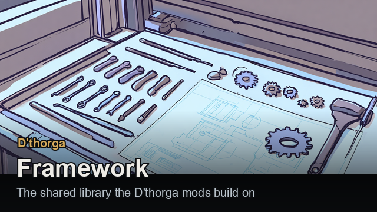
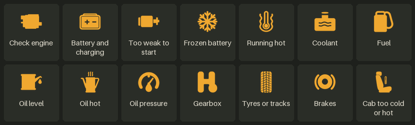
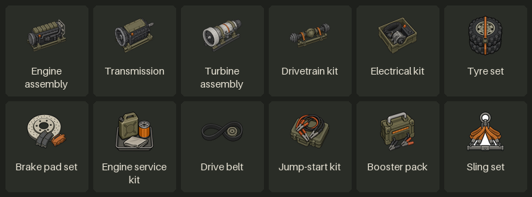
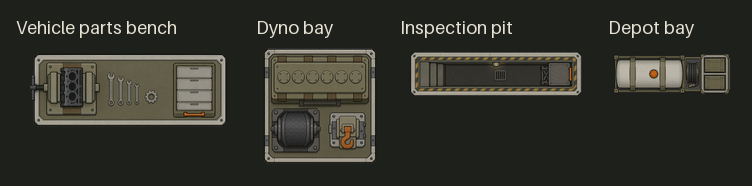

# Looking after vehicles

With **Vehicle Framework** active, **D'thorga Framework** gives vehicles the insides real ones have: a battery that goes flat, an
engine that runs hot, oil, tyres and brakes that wear, and parts that fail when a service is overdue. This chapter is how to keep
them running. It applies to **every Vehicle Framework vehicle from any mod**, not only ours. [Back to the guide](README.md).

## Read this first (gotchas)

- **Not yet tested in game.** Everything in this chapter is built and checked offline; none of it has been seen in a real colony
  except where the [last section](#what-has-been-tested-in-game) says so.
- **It changes every Vehicle Framework vehicle you have**, unless you narrow **Which vehicles** in the settings
  (**D'thorga Framework: vehicle systems**). That needs a restart, so **decide before you load a colony**. Switching vehicles off
  later is safe.
- **Build a vehicle parts bench early** (research **vehicle parts**, then the Architect's **motor pool** tab). Our parts, kits and
  booster packs are made only there.
- **Make a jump-start kit or a booster pack before you need one**, and carry one in every caravan. A flat battery is the commonest
  way to be stranded.
- **Loaded vehicles slow on soft ground.** A heavy truck in sand, mud or snow labours, and **crawls with "Wheels spinning"** where it
  has no grip (never below 15% of its speed). **Drivetrain shown, speeds unchanged** in the settings keeps every vehicle at its
  author's speeds.
- **Removing D'thorga Framework or Vehicle Framework from a colony that used the systems: press the removal button first.** Load
  the colony, press **Remove the added parts from this colony's vehicles** in the settings, save, then remove the mod. Without it,
  saved vehicles may fail to load. **Take every vehicle out of every garage** too.

## The three tabs

Select a vehicle. Beside Vehicle Framework's own tabs you will find three of ours. They work on the world map too, on a caravan
or an aircraft in flight.

| Tab | Answers | Shows |
| --- | --- | --- |
| **Dashboard** | Does anything need me now? | Gauges, warning lamps, what the vehicle is waiting for, and its switches. Click a gauge to open Systems at that system |
| **Health** | How hurt is it? | The vehicle's picture with hurt parts tinted, its speed and strength and what each part does to them, every part with its health, conditions, fitting and grade, and a **Wear** block saying when tread, brakes, battery and service will next need a look ("Tread: worn in about 4 days") |
| **Systems** | What exactly is going on? | Every reading, one row each, opening to its graph when clicked; parts as small bars; an **Only what needs attention** tick box. Hidden in Plain mode |

**Rest the mouse on any reading or part** to learn what it means, what moves it, and what losing it costs.

### Warning lamps

A lamp lights on the Dashboard when a system needs attention, as on a real dashboard; a soft chime sounds when a red one comes
on. Rest the mouse on a lamp for the reason.

## What wears out and what fixes it

The short version: **service when it is due, keep a kit in the cargo, and park somewhere warm in winter.**

| What you see | Why | What to do |
| --- | --- | --- |
| **Won't start**: a flat or very cold battery | Lights and heaters ran it down; the alternator is damaged; deep frost | **Jump-start it** (below), park beside a powered conduit or battery to trickle-charge, warm it up, repair the alternator |
| **Running hot**, then overheating, then boiling over | A holed radiator, low coolant, hard work in the heat, a snapped drive belt | Stop and let it cool; repair the radiator; a **coolant top-up**, due at 60% |
| Oil low, hot or losing pressure | Oil burns as the engine runs, faster when worn; a damaged oil pump | A **service** tops it up |
| Slower, then failing tyres | Tread wears, up to three times as fast off the roads | A service with a **tyre set** |
| Slower, then **won't drive** | Brakes wear with every stop | A service with a **brake pad set** |
| Loses its top gears, slips under load | A damaged gearbox or clutch | Repair the gearbox and clutch |
| **Won't drive** after standing for hours | Air brakes on heavy trucks need air | Draft it and let it idle a few minutes |
| **Won't start** below about -8 °C | Cold fuel gels (only with the **cold fuel** setting on) | Warm the vehicle in a heated room |
| Parts failing now and then | More often once a service is due (120 running hours), far more once overdue (180) | A **service** |

**Services start by themselves when due.** The **Service when possible** button asks for one now. Haulers bring the supplies to the
vehicle's cargo, then a constructor does the work. A service takes kits made at the parts bench: a **tyre set**, a **brake pad
set**, an **engine service kit**, a **drive belt**. A colony from before kits existed keeps paying in raw materials until you switch
off **This colony: services take raw materials instead of kits** in the settings.

**The coolant top-up** takes water from a plumbing pipe beside the parked vehicle with Dubs Bad Hygiene, or 3 chemfuel without it.

### Jump-starting

**Select a colonist and right-click the flat vehicle.** You need one of:

- **another vehicle parked within 8 cells and a jump-start kit**; or
- **a booster pack** (research **booster packs**). It holds 4 starts, gains one back every 2 hours in the cargo of a running vehicle,
  and is recharged fully by a bill at the parts bench. No second vehicle and no kit needed.

In a caravan on the world map, a crew member can jump-start from another vehicle in the caravan with a kit aboard, or with a booster
pack. **Every vehicle carries a booster pack** in the settings (off) does away with packs altogether.

**Cold weather:** cold oil makes a start harder on the battery. A **block heater** fitting keeps a vehicle parked beside power warm,
and the **night heater** keeps a caravan's engine warm at camp (needs the **Night heater at camp** setting and the vehicle's night
heater switch on before it leaves). **Electric vehicles have their own night heater** (not yet tested in game): the same switch and
setting, keeping the cab and the drive battery warm through the night, paid for from the drive battery, about a fifth of its range on a
ten-hour night.

## Damage and repairs

- **Parts can carry conditions** shown under the part on the Health tab: a holed radiator keeps leaking coolant, a shot battery
  drains itself, a boiled-over engine has a warped head and runs hotter. **Repair the part to full health to clear them.**
- **Patch leaks**: away from a base, a mechanic can patch leaks and shorts with a component from the cargo. A patch slows the damage
  so the vehicle can limp home; it is not a repair.
- **A destroyed part needs replacing.** At 0% it waits for supplies in the vehicle's cargo and a mechanic; then ordinary repair
  carries on. **An engine or transmission costs the whole part** (made at the parts bench), anything else half its materials. A
  vehicle whose engine is destroyed cannot move until it has a new one.
- **In a caravan**, select it on the world map and press **Repair** for a vehicle that needs it; it must have stopped and have a
  mechanic.
- **A fire on a vehicle cooks it from the inside**: the cab grows stifling, the coolant heats and the radiator cooks. Put it out
  within an in-game hour or expect a hot engine and a radiator to repair; left two hours, the engine boils over.
- **Damage shows on our vehicles' pictures** once a part is below 60%: scorches, holes and tears.

## The workshop

All four are in the Architect's **motor pool** tab.

| Building | Research | What it is for |
| --- | --- | --- |
| **Vehicle parts bench** | Vehicle parts | Makes our engines, transmissions, kits, sets and booster packs; recharges booster packs |
| **Inspection pit** | Vehicle parts | Speeds the parts bench |
| **Dyno bay** | Vehicle tuning | **Diagnose** a vehicle (a report with its tinted picture and, in Operator and Engineer, a graph of the last day). Needed for **tunes and changes of grade** on a working part, within 5 cells of the vehicle and powered. Replacement parts fitted here go in at 60% health instead of 25%. Select it for **Vehicles in reach** |
| **Depot bay** | Vehicle depots | A home for one vehicle. Press **Assign vehicle** on the bay, then **Go to bay** on the vehicle (needs a driver aboard). On the pad it refuels by itself (chemfuel, while the bay has power) and mechanics need 70% of the usual work. It only moves when you tell it to |

Our vehicles and the depot bay are **built from parts** by role (an engine, a fuel tank, tyres and so on). Where an installed mod makes
a part that suits (RimThunder, Vanilla Vehicles Expanded), a build asks for theirs; otherwise ours. **Parts for building** in the
settings changes that, after a restart.

### Making parts

- **Bills run from the top.** The vehicle parts bench works its bills in order, top to bottom. A bill low in the list may wait a long
  time while the ones above keep the bench busy. Move the part you need most to the top.
- **Give the parts somewhere to go.** Kits and parts go in a storage category of their own, **Vehicle parts**. Stockpiles you made
  before installing don't accept new categories by themselves, so tick Vehicle parts in at least one stockpile or shelf. "Do until
  you have X" only counts parts in storage, so without one the bench keeps making more than you asked for.
- **Keep materials close.** A stockpile of steel and components beside the bench saves a long walk for every part.

## Fittings, tunes and grades

Open **Fittings and tunes** from the vehicle's Dashboard, from a right-click with a colonist selected, or from the button a vehicle
shows while a dyno bay is in reach. It works on any vehicle, from any mod, that has a loadout.

- **Fittings** go on one part each: uprated radiator, oil cooler, turbocharger, heavy-duty alternator, deep-cycle battery,
  heavy-duty springs, road tyres, block heater, and a cargo hook for helicopters. **A fitting is lost if its part is destroyed.**
  Wheels are grouped into axles; a choice on an axle is ordered for each of its wheels.
- **Tunes** set up the whole engine (economy, stock, power) and the final drive (tall, stock, short). Piston engines only. **A tall
  final drive cannot make a vehicle faster than it was built to go.**
- **Grades**: **salvaged** parts are cheap, frail and fault-prone, and cannot hold a fitting; **heavy-duty** parts cost more, take
  more punishment and shrug off faults. Choose one when a part is destroyed, or to refit a working part.
- **It is real work.** Materials are brought, then a mechanic works: a turbocharger on a 5-tonne vehicle is about 12 hours and 100
  steel and 10 components; a power tune about 10 hours. Bigger vehicles cost more. **Demanding work needs a minimum Construction
  skill**; a mechanic below it is told why.
- **Rest the mouse on any choice** to see what it would change ("engine power up, fuel burned up" in Plain mode). Its details stay in the strip at the foot of the window until you rest on another choice, so you can move down and scroll them.
- **Families** (not yet tested in game): above the parts, **Fit all** orders a whole family in one go, on every part it suits; each
  piece can still be fitted on its own below. The **cold-weather pack** puts a block heater in every engine and a deep-cycle battery
  in, and switches the night heater on. **All-terrain tyres** go on every wheel: far more grip in mud, sand and snow, a little slower,
  faster wear. **Work lights** fit work lamps to the vehicle's **lamp bracket** and switch them on: at night, while the vehicle stands
  still, they light the ground round it so work there goes at daylight pace, drawing on the battery. **Long range** fits an
  **auxiliary fuel tank** to a land vehicle or boat (half as much fuel again) or a **ferry tank** to an aircraft (three quarters as
  much again); either costs cargo space, and the range on the world map grows with the fuel aboard. Taking one off drains the extra
  fuel into containers beside the vehicle. **Recovery** fits a **recovery winch** to the vehicle's winch mount: see
  [Recovering a stuck vehicle](#recovering-a-stuck-vehicle). On our own trucks (the tanker, survey truck, drill rig and tipper) the
  winch shows on the front bumper and the auxiliary tank between the wheels; other mods' vehicles keep their own pictures.

## Cabs and comfort

- **A closed cab shelters its passengers**: they feel the cab's temperature, not the weather, while the heater or air conditioner
  has the engine to run on. The heater runs off the engine's heat, so a cab warms only once the engine has.
- **Modern vehicles have climate control** and hold the cab near 21 °C by themselves. Older ones have a **cab heater** (below 5 °C
  outside) and an **air conditioner** (above 26 °C) you switch by hand. Each draws on the battery or alternator.
- **Passengers have moods about it**: glad of a warm cab in the cold, unhappy in one too cold or hot for them.
- **Open vehicles shelter nobody**: bikes and open boats feel the weather.
- **An idling engine warms the room it stands in**, so a truck in a garage heats it.

## Headlights

- **The headlights button is off until you press it.** Switched on, a vehicle lights the ground ahead of it at night, engine running
  or not. People working or fighting there are no longer slowed by the dark. The light follows the vehicle as it drives and turns.
- **With the engine off, the lights run the battery down**, and left on all night they can flatten it. A message warns when the
  battery may soon be too weak to start the engine: start it, or switch off the lights and heaters.
- **The vehicle's inspect panel says what the battery is doing**, in words: which lights or heaters are running it down, or that it is
  charging.
- **Other factions' vehicles light up only while they drive**, so a raid arriving at night shows itself.
- **Turn the light off** with the setting **Headlights light the ground** in the vehicle systems settings, if many vehicles at night
  slow the game.

## On the world map

- **A caravan moves as its slowest vehicle**, and its explanation names it. A vehicle that will not move stops the caravan; its
  inspect text says why.
- **The ground matters**: deserts are sand, swamps mud, jungle undergrowth, and winter adds snow. A road is firm whatever the land.
- **Select a vehicle caravan to see its reach** on the fuel aboard, outlined in amber on the globe, and how many hours of driving
  the fuel allows.
- **The fleet button** on the bottom bar lists every vehicle you own, wherever it is, with its picture, fuel and worst part.
- **A vehicle parked in the wild is lost after a while**; a letter warns you three days ahead.
- **Garages** (needs Vanilla Expanded Framework): a stopped convoy can set one up. Vehicles left there stay with no time limit, and
  whoever is stationed there mends them from steel and components you bring.
- **Services and coolant top-ups need a map.** Repairs and jump-starts do not.

## Aircraft and sling loads

- **Helicopters, jets and pods are checked before they lift off.** Too heavy for the day's heat, or with engines or thrusters out,
  **the launch button refuses and says why**: unload, repair, or wait for cooler air. A heavy Harrier on a hot day lands on a runway
  instead of its pad (with D'thorga Patches). The setting can allow it at a cost to the engine, or only warn.
- **Gas turbines** (aircraft, and the M1A2 tanks) wear their hot section when run past their limits; a **hot-section overhaul**
  (10 plasteel, 3 components) puts it right. With one of two engines out, the other runs hot.
- **Carrying a vehicle on a sling** (take-off tested in game by the owner; the landing not yet):
  1. Fit the helicopter a **cargo hook** (Fittings and tunes). The **Cherokee**, the **Louie** and the **Hind** have a mount for one
     (the Louie and the Hind not yet tested in game). The Hind flies across the map: its load hangs under it there and comes down once
     it has landed.
  2. Put a **sling set** in its cargo.
  3. Press **Lift a vehicle** and pick one of yours parked outdoors nearby. A colonist hooks it up.
  4. It flies with the helicopter, drawn under it. **Where it lands, the game pauses and asks where to put the load** (not yet tested
     in game): click open ground within reach, or right-click to let the crew pick the nearest clear spot. If there was no room, press
     **Set the load down** once there is.

  The load, with its cargo and people, must weigh no more than the hook takes today: less on hot days. **No lift in a gale or a
  thunderstorm**; the button says which. **A slung flight is slower and burns more fuel**, and the range shown is shorter.

- **Emergency release** (world map, not yet tested in game): on a helicopter in flight, it lets the load fall. It lands hard, badly
  damaged, and anyone in it is hurt. It lies there as a **wreck**: right-click it with a caravan to **Recover** it, then repair it,
  drive it, tow it or lift it home. **A helicopter that crashes drops its load too**, beside the wreckage.
- **Each of these is a setting** under **Sling loads** in D'thorga Framework's settings: hot days, ground crew, weather, slower flight,
  and release and drops.
- **Fighting a fire from the air** (not yet tested in game): a helicopter with a cargo hook and a **fire bucket** in its cargo (made at
  the vehicle parts bench) gets **Water drop**. Click a fire within 50 cells: it flies to the nearest open water, fills the bucket, empties
  it over the fire and comes back to where it stood. **It needs open water within reach, open sky over the fire, its crew, fuel and
  flying weather**; the button says what is missing. **The Hind cannot fly water drop runs.** A full bucket puts out the fires on about 3 cells across. Click the helicopter while
  it flies to see what it is doing.
- **An air ambulance** (not yet tested in game): fit the **litter kit** to the helicopter's cabin (Fittings and tunes; on the Cherokee and the Louie
  it goes on the upholstery, on the Hind on the fuselage). Right-click a downed person with a colonist selected and choose **Carry to a litter aboard...**. Up to 4 people
  lie on the litters. **Put a colonist who can doctor in the crew and medicine in the cargo**: while the helicopter stands, they tend the
  patients. In flight nobody gets worse. Press **Unload casualties** at the other end, then take them to bed. **Leaving by caravan sets
  the patients down first.** The kit takes a fifth of the cargo space.

## Towing a trailer

Not yet tested in game. Any land vehicle can tow a trailer such as the [Pintle flatbed](working-vehicles.md#pintle-flatbed-trailer).

- **Press Hitch a trailer** and pick one within 8 cells; a colonist couples it and it is set behind the vehicle. **Unhitch** lets it go.
- **The trailer stays on the map** and follows the hitch. **If it would hit a wall or another vehicle, the vehicle stops and says so.**
- **The engine pulls the trailer and its load too**: lower gears, more heat, more fuel, a crawl on soft ground or uphill. The trailer adds
  no grip.
- **Only vehicles the drivetrain model works out can tow**, unless you turn on **Vehicles without the drivetrain model can tow** (under
  **Towing** in D'thorga Framework's settings), which slows them by a plain rule instead.
- **Before you hitch, read the label beside the mouse**: it says what the tow would be like on the ground where the vehicle stands
  (full speed, slowed by the engine or by grip, a crawl, or too heavy), or why it cannot be hitched. It is a forecast: hills and mud on
  the way can make it worse.
- **A towing vehicle's panels say what holds it back**: the inspect panel, the Dashboard and the Systems tab name what it tows, its
  weight, and whether the engine holds it to a gear, the wheels cannot grip, or it can only crawl.
- **Load a hitched trailer as any vehicle**, through its cargo window; haulers walk to it wherever it stands.
- **A trailer goes on journeys with its vehicle**: form a caravan with the vehicle and the trailer comes along, with its cargo. Its
  weight slows the caravan. On arrival it is set down behind the vehicle, still hitched; at the map's edge, where there is no room behind,
  it is set down beside and swings into line as you drive off.
- **A towing or towed vehicle cannot be lifted on a sling**: unhitch it first.

## Recovering a stuck vehicle

Not yet tested in game. Fit the **recovery winch** (the **Recovery** family in the fittings window) to a land vehicle.

- **Press Winch a vehicle** and pick a stuck, broken or empty vehicle within 12 cells. **Someone must be aboard to work the winch.** It
  drags the vehicle in a cell at a time, slower the heavier the pull, and stops beside you. **Stop winching** ends it at any time.
- **Whether the winch can manage** is worked out from both vehicles' weight and ground: a vehicle in deep mud is far harder to move than
  one on gravel, and one whose wheels are wrecked is dragged, which is harder still. The winch pulls up to 5,443 kg, but never more than
  your vehicle holds on its brakes, so **park the winching vehicle on firm ground**. A refusal says both figures.
- **Then tow it home**: with the winch fitted, **Hitch a trailer or vehicle** also takes an ordinary land vehicle up to 1.5 times your
  vehicle's weight. It follows on a tow bar like a trailer; anyone aboard rides along. **Undraft it first** so it rolls free. It has its
  own **Unhitch** button.
- **Another faction's vehicle** must be claimed first; then it can be winched out and towed home.

## Other factions' vehicles

- **Raiders' and visitors' vehicles run a simpler model**: they take hits, but nothing in them heats, wears or runs down by itself,
  which keeps a raid cheap. Capture one and it wakes to the full model on your settings.
- **Claim a vehicle**: select a colonist and right-click it. Nobody may be aboard, and none of its owners' armed people within 12
  cells. It takes from half an hour to six hours by size. **Taking one from a faction that is not hostile costs 30 goodwill**, and
  the order says so. Machines' vehicles cannot be claimed.
- They may come with fittings suited to their tech level, and keep them when captured.

## Special engines

| Vehicle | What is different |
| --- | --- |
| **Electric vehicles** | A traction battery that gives less in the cold and heat and wears with age; charges parked over a powered conduit. Brakes wear a third as fast. **New battery modules**: 10 components, 20 steel |
| **Steam locomotives** (Trains of the Rim) | Hours to raise steam from cold; a water glass; refill at a **water stop** (with Dubs Bad Hygiene, from water towers). Run it dry and the fusible plug melts. **Boiler explosions** and **Realistic feed water** are settings, off by default |
| **Diesel-electric locomotives** | Traction motors heat when pulling hard from a standstill. Ease the load and let them cool |
| **Boats** | Cool with sea water: no radiator |
| **Helicopters** named by D'thorga Vehicles | A rotor drive that is **over-torqued** if asked for more than its gearbox takes |
| **The Harrier** (with D'thorga Vehicles) | Water injection for a heavy hover: refill 227 litres, from plumbing beside it with Dubs Bad Hygiene, otherwise free |

## What has been tested in game

- **Tested by the owner:** a sling lift with the Cherokee, from hooking up through take-off to the world map, where the load is
  listed (12 November 2026). **The landing and setting the load down are not yet tested in game.**
- **Not yet tested in game:** the vehicle systems, the workshop, fittings and tunes, claiming and the other world-map features.
- **Read from the code and checked offline:** every system above passes its rule tests, and a dev-mode **"Vehicle systems: run the
  self-test"** checks most of it on a throwaway vehicle without touching your colony.

The full detail, with every figure and setting, is in [D'thorga Framework's README](../../mods/PhobosFramework/README.md#vehicle-systems-with-vehicle-framework).
